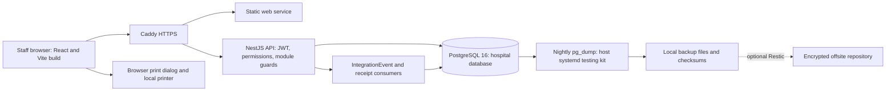
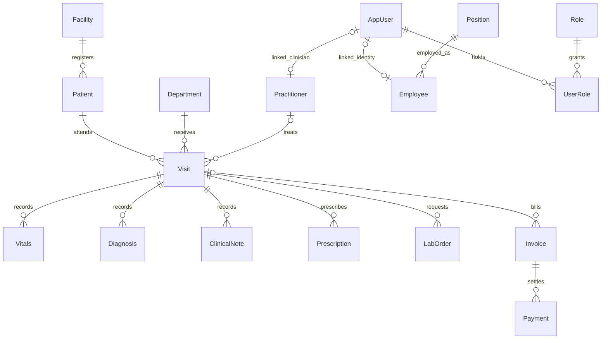

# REDMARS system overview

Snapshot: **2026-10-31**, repository source audit. No application code or live database was changed. “Source-confirmed” describes inspected code, not a passed browser, deployment or hospital test. ⚠️ UNVERIFIED = unresolved or untested; 🚧 NOT IMPLEMENTED = absent from the inspected ownership/routes; 🐞 SUSPECTED BUG = evidence needs a focused reproduction. Testing VPS and legacy LAN deployments are distinct. Actual VPS state and actual hospital configuration are not inferred from this checkout.

## What exists today

**Identity and administration.** Users, system roles, department/room/practitioner masters, services, module flags and settings support one hospital per database. Public login differs from tenant-scoped work. Employee positions are not security roles. `apps/api/src/modules/users/users.service.ts:1`; `apps/api/src/auth/permissions.ts:1`; `apps/api/src/common/guards/jwt-auth.guard.ts:1`.

**Reception and OPD.** Reception combines registration, visit creation, billing and settlement in one transaction. Queue and consultations follow the Visit, with demographics, allergies, vitals, complaints, diagnoses, psychiatric notes, prescriptions, lab orders and follow-up. Administrative authority does not include writing psychiatric notes. `apps/api/src/modules/reception/reception.service.ts:57`; `apps/api/src/modules/visit/visit.service.ts:1`; `apps/api/src/auth/permissions.ts:428`.

**Reception operations and inpatient coordination.** Requests, bed availability/reservation, transfer/discharge coordination, waitlist, patient contacts/documents/coverage, deposits, reminders, handovers and till-close review exist. These do not constitute a full IPD clinical chart, inpatient nursing/MAR or daily inpatient charging system. `apps/api/src/modules/reception/reception-operations.service.ts:1`; `apps/api/prisma/schema.prisma:1313`.

**Laboratory.** Catalog tests, panels/ranges, orders, item-level billing, sample collection, result entry/verification/amendment and browser printing have owners and endpoints. Nurse sample collection has an unresolved policy condition. `apps/api/src/modules/lab-order/lab-order.controller.ts:1`; `apps/api/src/modules/lab-billing/lab-billing.service.ts:1`; `apps/api/src/auth/permissions.ts:483`.

**Pharmacy.** Catalog, interactions, prescription queue, dispensing, returns and pharmacy-origin billing exist. Drug catalog and dispense quantity do not by themselves prove inventory receipts/batches/stock valuation. `apps/api/src/modules/pharmacy/dispense.service.ts:1`; `apps/api/src/modules/pharmacy/pharmacy.controller.ts:1`; `apps/api/src/modules/drug-interaction/drug-interaction.service.ts:1`.

**Finance and accounting.** AFN ledger/chart, fiscal periods, opening GL import, cash/bank, suppliers/AP, operational patient/panel AR, payroll accounting, assets, statements, closing and reports exist. Hospital acceptance and legacy opening-invoice allocation remain pending. `apps/api/src/modules/finance/finance.controller.ts:1`; `docs/production-readiness-phase-6.md:1`.

**Human resources.** Positions, employment identity, documents/credentials, linked accounts, attendance, leave, rosters, coverage checks and HR configuration exist. Finance payroll is a separate owner; automatic HR attendance-to-payroll linkage must not be assumed. `apps/api/src/modules/staff/staff.service.ts:1`; `apps/api/src/modules/staff/staff-operations.service.ts:1`; `docs/production-readiness-phase-6.md:1`.

**CRM.** Contacts and authorized patient links, consent/verification, leads, interactions/calls, tasks and timed appointment integration are present. Broader marketing, external messaging or campaign scope is not established by these controllers. `apps/api/src/modules/crm/crm.controller.ts:1`; `apps/api/src/modules/crm/crm-appointments.controller.ts:1`; `docs/crm-roadmap-assessment.md:1`.

**Reporting and operations.** Role-scoped hospital reports, audit/error views, finance exports, browser printing, health endpoint and deployment/backup scripts exist. Physical devices, VPS reboot recovery and restore acceptance require runtime evidence. `apps/api/src/modules/reports/reports.controller.ts:1`; `apps/api/src/health/health.controller.ts:1`; `output/redmars-testing-vps-kit/backup-testing.sh:1`.

## Architecture

Testing deployment: `output/redmars-testing-vps-kit/compose.testing.yml:1`; backup: `output/redmars-testing-vps-kit/backup-testing.sh:1`; events: `apps/api/src/prisma/transactional-audit.ts:1`; print: `apps/web/src/lib/print.ts:1`. Legacy on-premise configurations are described separately in 05-production-operations.md. Cloud testing requires hospital internet connectivity; there is no verified offline browser synchronization path.

## Visit-centered model

This is a simplified diagram, not the complete relational contract. Actual optionality and composite tenant keys: `apps/api/prisma/schema.prisma:1`; full model inventory: [_inventory.md](_inventory.md).

## Glossary

| Term | Meaning in this system | Source |
| --- | --- | --- |
| Facility | Hospital tenant; deployment architecture uses one hospital database | `apps/api/src/common/guards/jwt-auth.guard.ts:109` |
| Patient / MRN | Person receiving care; MRN is a generated lifelong identifier | `apps/api/prisma/schema.prisma:1116` |
| Visit / encounter | One occasion of care; consultation URL is keyed by visitId | `apps/web/src/router.tsx:76` |
| Queue / token | Working list of open visits; do not assume a separate token-number entity | `apps/api/src/modules/visit/visit.service.ts:129` |
| User | Login identity, active status, password state and grants | `apps/api/prisma/schema.prisma:852` |
| Employee / Staff profile | HR employment identity and related position/department/credentials | `apps/api/prisma/schema.prisma:2884` |
| Position / job | HR title and clinical flag; does not grant login permission | `packages/shared/src/hr.ts:71` |
| System role | Named set of permissions on a User via UserRole | `apps/api/src/auth/permissions.ts:22` |
| Practitioner / doctor profile | Clinical routing identity optionally linked one-to-one to User | `apps/api/src/modules/practitioner/practitioner.service.ts:77` |
| Panel | Finance payer/receivable concept; Lab panel means a group of catalog tests, a different entity | `apps/api/src/modules/finance/finance-revenue.service.ts:1`; `apps/api/src/modules/lab-panel/lab-panel.service.ts:1` |
| Invoice / Payment | Charge document and signed append-only settlement/refund records | `apps/api/src/modules/invoice/payment.service.ts:1` |
| Till | Payments grouped by receiving user and facility day; distinct from Finance cash statements | `apps/api/src/modules/till/till.service.ts:35` |
| Journal / posted / reversal | Balanced accounting entry; posting recognizes it; correction uses controlled reversal | `apps/api/src/modules/finance/finance-ledger.service.ts:1` |
| Care request | Reception coordination record; not a full clinical admission | `apps/api/prisma/schema.prisma:1313` |
| Jalali / Shamsi | Calendar entry/display; storage and endpoint contracts still use normalized dates | `packages/shared/src/shamsi.ts:1` |
| Permission condition | Service-enforced restriction attached to an otherwise granted permission | `apps/api/src/common/guards/permissions.guard.ts:1` |
