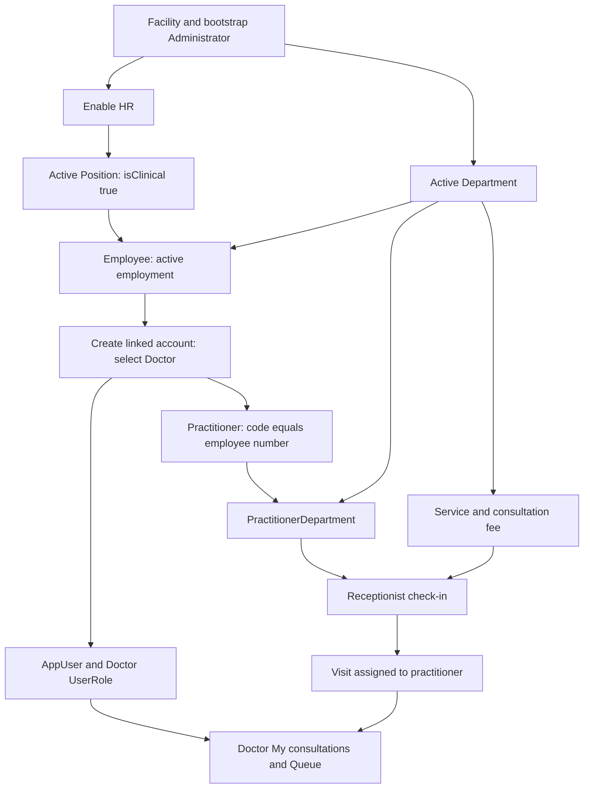

# Day 0: empty database to first patient

Snapshot: **2026-10-31**, repository source audit. No application code or live database was changed. “Source-confirmed” describes inspected code, not a passed browser, deployment or hospital test. ⚠️ UNVERIFIED = unresolved or untested; 🚧 NOT IMPLEMENTED = absent from the inspected ownership/routes; 🐞 SUSPECTED BUG = evidence needs a focused reproduction. Testing VPS and legacy LAN deployments are distinct. Actual VPS state and actual hospital configuration are not inferred from this checkout.

## Stop conditions

Use synthetic data on the testing VPS. Real Axon configuration is still postponed. A clean production schema must not be populated with the development seed. The testing bootstrap refuses a database containing any facility or user; do not weaken this guard or rerun it to reset a password. Its checked-in defaults use a synthetic facility and account; operator-customized names are not evidence of a changed repository. `apps/api/prisma/seed.ts:1`; `output/redmars-testing-vps-kit/bootstrap-testing.cjs:1`.

## Strict setup checklist

| Order | Role / screen | Required setup | What breaks if skipped / source |
| --- | --- | --- | --- |
| 1 | VPS operator / terminal | Separate empty testing database; migrations; one facility; initial admin and role grants using the kit | No valid tenant/login. `output/redmars-testing-vps-kit/README.md:1` |
| 2 | Admin / Change password | Replace temporary password; 12+ character permanent password | Protected routes return password_change_required. `packages/shared/src/auth.ts:163` |
| 3 | Admin / Modules | Enable HR for staff; Lab, CRM and Finance only for the workflows under test | Gated API returns Module not enabled. An enabled IPD flag does not establish an installed clinical IPD workflow. `apps/api/src/modules/facility-module/facility-module.service.ts:44` |
| 4 | Admin / Departments | Active department code, name and type; rooms when required by local operation | Employee/visit references fail. `apps/api/src/modules/department/department.service.ts:70` |
| 5 | Admin / HR → Settings | Positions; clinical flag for doctors; leave types, shift types and approved coverage policies for pilot | Staff/roster/leave forms cannot use missing references. `apps/web/src/pages/HrPage.tsx:1150` |
| 6 | Admin / HR → Employees | Required employment fields, then Employee-linked clinical accounts | Users screen rejects clinical role creation. `apps/api/src/modules/staff/staff.service.ts:566` |
| 7 | Admin / Practitioners | Verify active profile and department memberships after doctor account creation; speciality if needed | Doctor cannot be selected for another department. `apps/api/src/modules/visit/visit.service.ts:170` |
| 8 | Admin / Services | Active billable services and their fees/departments | Reception requires valid priced items. `apps/api/src/modules/reception/reception.service.ts:75` |
| 9 | Admin / Lab tests / Lab panels | Approved test catalog; reference ranges; panel components if using panels | Orders/results depend on valid catalog references. `apps/api/src/modules/lab-test/lab-test.service.ts:1`; `apps/api/src/modules/reference-range/reference-range.service.ts:1` |
| 10 | Admin / Drugs | Approved formulary and price fields used by current dispensing workflow | Prescription/dispense references fail. Physical stock receiving/batches are not established here. `apps/api/src/modules/drug/drug.service.ts:1`; `apps/api/src/modules/pharmacy/dispense.service.ts:1` |
| 11 | Admin / Settings; Reception | Discount ceiling; use built-in payment methods. Do not assume configurable insurance/price lists | Separate panel master/payment-method editor not established by route inventory. `apps/web/src/pages/SettingsPage.tsx:1`; `apps/api/src/modules/reception/reception.service.ts:194` |
| 12 | Finance manager / Finance | Approved test cutover, setup/chart, fiscal year/period, account mappings, cash/bank accounts, supplier/payroll/asset configuration as needed | Posting and subledgers require configuration. Do not invent real opening balances. `apps/api/src/modules/finance/finance-ledger.service.ts:144` |
| 13 | Admin + staff / print dialogs | Review stored facility letterhead and test invoice, prescription, lab and ID-card layouts | Printing requires browser/printer acceptance. Numbering is server-issued, not a proven editable template screen. `apps/web/src/lib/print.ts:1`; `apps/api/src/services/number-sequence.service.ts:1` |
| 14 | Receptionist + Doctor + Lab + Pharmacy + Finance | Walk one synthetic patient through the supported OPD path and reconcile records | Source inspection does not establish UAT. See 04-workflows.md. |

## Doctor onboarding: exact supported path

1. Sign in as an Administrator. Complete the mandatory password change. An empty database needs the operator bootstrap first; there is no anonymous facility-creation screen. `output/redmars-testing-vps-kit/bootstrap-testing.cjs:10`; `apps/web/src/auth/ProtectedRoute.tsx:1`.
2. Open **Modules** and enable **HR**. A missing flag is off. `apps/web/src/pages/ModulesPage.tsx:19`; `apps/api/src/modules/facility-module/facility-module.service.ts:22`.
3. Open **Departments**. Create an active clinical department with a code, name and suitable department type. `apps/web/src/pages/DepartmentsPage.tsx:1`; `apps/api/src/modules/department/department.service.ts:70`.
4. Open **HR → Settings → Positions**. Enter **English title**, optional Dari/Pashto titles and category. Tick **Clinical position**, then **Add position**. `apps/web/src/pages/HrPage.tsx:1324`; `packages/shared/src/hr.ts:71`.
5. Open **HR → Employees**. Enter **First name**, optional **Father name** and **Last name**, **Sex**, optional **Phone**, **Department**, **Position**, **Employment type**, **Joined date (Shamsi)** and salary if authorized. Select the active clinical position, then **Create employee**. The server issues the employee number. `apps/web/src/pages/HrPage.tsx:207`; `apps/api/src/modules/staff/staff.service.ts:273`.
6. Select the employee row to open its details. If supplied by the hospital, add a **professional_license** credential with its reference and dates using **Save credential**. This is not a demonstrated legal licensing gate. `apps/web/src/pages/HrPage.tsx:393`; `apps/api/src/modules/staff/staff.service.ts:437`.
7. In that employee's account form, enter the username, temporary password, optional email, and choose **Doctor**. Click **Create linked account**. It creates the login, Doctor grant and linked practitioner profile together. The employee must not already have an account or be exited/suspended. `apps/web/src/pages/HrPage.tsx:570`; `apps/api/src/modules/staff/staff.service.ts:566`.
8. Open **Practitioners** and confirm the doctor is active and assigned to the intended department. Use the row expansion and **Save departments** if additional memberships are required; verify the current translated label in the UI. The employee's home department is added by onboarding. `apps/web/src/pages/PractitionersPage.tsx:446`; `apps/api/src/modules/practitioner/practitioner.service.ts:232`.
9. Open **Services** and create the consultation service with its department and fee. Fees belong to Services, not to a demonstrated per-doctor fee/schedule master. `apps/web/src/pages/ServicesPage.tsx:1`; `apps/api/src/modules/service/service.service.ts:44`.
10. Create an Employee-linked Receptionist account or a nonclinical Receptionist account under **Users**. Administrator alone does not hold patient.create or visit.create. `apps/api/src/modules/users/users.service.ts:71`; `apps/api/src/auth/permissions.ts:347`.
11. Sign in as that Receptionist. Open **Reception**, choose/register a synthetic patient, choose the department and this doctor, add the consultation service, select payment method and save check-in. This writes Patient when new, Visit/status history, Invoice/items and a positive Payment when payable. `apps/api/src/modules/reception/reception.service.ts:57`.
12. Sign in as the doctor, change the temporary password, open **My consultations** or **Queue**, and open the assigned visit. Start the clinical visit before completing it. Use **F2** to save; **F4** saves and prints; **F9** saves and completes only when the status transition permits it. `apps/web/src/pages/MyConsultationsPage.tsx:1`; `apps/web/src/components/ConsultActions.tsx:105`.

This sequence was walked through against schemas, form handlers and service validations. **It was not executed against an empty database during this documentation task.** Actual hospital setup remains postponed until authorized. Do not use development seed patients or accounting figures as hospital configuration.

The Users API error explains the HR link but gives no click path. Proposed wording: **“To create a Doctor, open HR → Employees, select or create the employee, choose a Clinical position, then choose Doctor under Create linked account. Ask an Administrator if HR is unavailable.”** The proposal is not implemented. `apps/api/src/modules/users/users.service.ts:78`.

## Day-0 gaps that cannot be solved by extra clicks

- No proven general-purpose production facility-onboarding UI/API; the kit is explicitly testing-only. Production provisioning needs an approved process.
- No installed full IPD clinical admission-to-discharge module. Bed coordination is a separate reception feature.
- No proven pharmacy stock receiving/batch/expiry master or configurable queue-counter setup in the route inventory. Do not represent drug catalog entries as on-hand stock.
- Opening patient/panel invoices need a controlled migration workflow; a balanced general opening journal does not allocate receivables.

Evidence: `packages/shared/src/facilityModule.ts:1`; `apps/api/prisma/schema.prisma:1313`; `docs/production-readiness-phase-6.md:1`.
