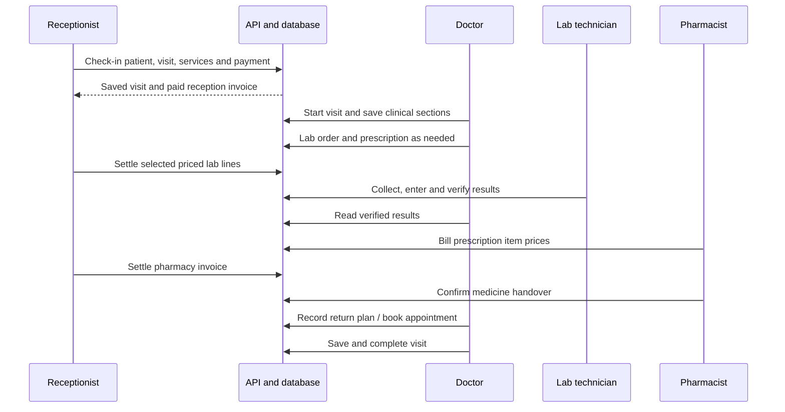
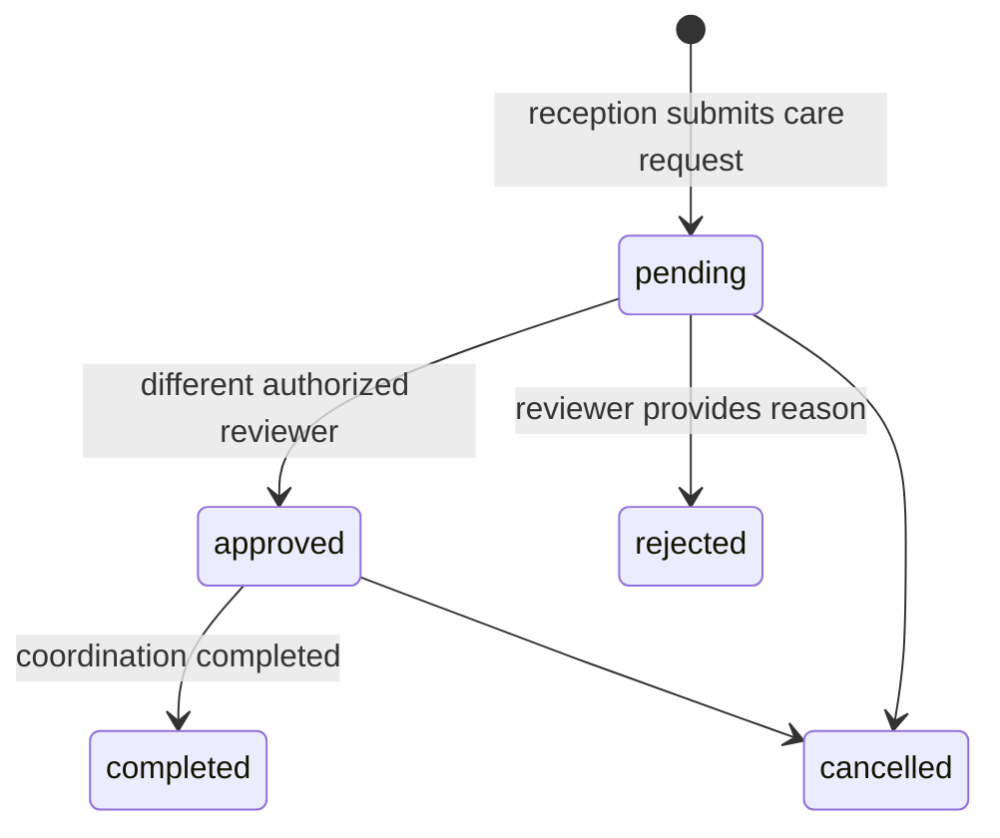
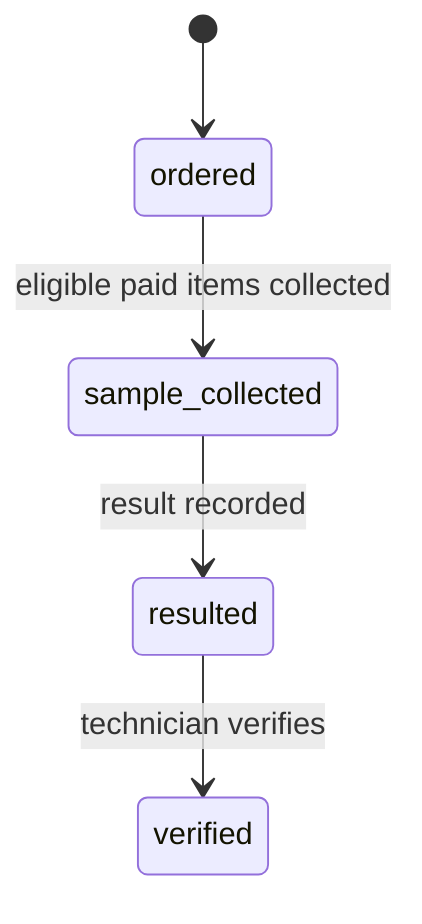
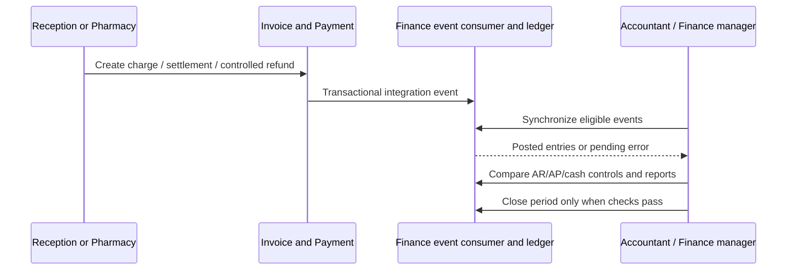

# End-to-end hospital workflows

Snapshot: **2026-10-31**, repository source audit. No application code or live database was changed. “Source-confirmed” describes inspected code, not a passed browser, deployment or hospital test. ⚠️ UNVERIFIED = unresolved or untested; 🚧 NOT IMPLEMENTED = absent from the inspected ownership/routes; 🐞 SUSPECTED BUG = evidence needs a focused reproduction. Testing VPS and legacy LAN deployments are distinct. Actual VPS state and actual hospital configuration are not inferred from this checkout.

The following are source-confirmed paths and proposed UAT scripts. They are **not completed hospital UAT**. Use synthetic identities and amounts in testing; record actual results and departmental approval separately. Exact action IDs, handlers and endpoint candidates are in [_audit/ui-actions.md](_audit/ui-actions.md).

## OPD: arrival to follow-up

1. **Receptionist:** search the patient register and avoid duplicate registration. Reception check-in creates a patient only when the new-patient input is supplied. It always creates the Visit, initial status history and invoice/items in one transaction, plus Payment if total is positive. It can fulfill a matching arrival appointment. Reception's saved invoice is born paid; this is not the later lab/pharmacy credit-collection flow. `apps/api/src/modules/reception/reception.service.ts:57`.
2. **Doctor/nurse:** use the Queue; start the visit and enter only the sections held by the account. The consultation URL is visit-based. Doctor owns diagnoses, psychiatric notes, lab requests and prescriptions; nurse authority is narrower. `apps/web/src/pages/ConsultPage.tsx:1`; `apps/api/src/auth/permissions.ts:422`.
3. **Doctor → Receptionist → Lab technician:** order valid tests; settle eligible priced test lines; collect selected samples only after those lines are paid. Enter results and verify; an unpriced test with no charge does not owe a payment. `apps/api/src/modules/lab-order/lab-order.service.ts:1`; `apps/api/src/modules/lab-order/lab-sample.service.ts:32`; `apps/api/src/modules/lab-billing/lab-billing.service.ts:1`.
4. **Doctor:** review verified results and save the clinical assessment. Draft or unverified numbers must not be described as released results. `apps/api/src/modules/lab-order/lab-result.service.ts:1`; `packages/shared/src/labResult.ts:1`.
5. **Pharmacist → Receptionist → Pharmacist:** create the pharmacy bill with checked item prices, collect payment in Collections, then confirm handover. These are separate operations. No physical stock batch decrement exists in this version. `apps/api/src/modules/pharmacy/dispense.service.ts:49`; `apps/api/src/modules/pharmacy/dispense.service.ts:258`.
6. **Doctor/receptionist:** record the follow-up and/or appointment. A follow-up plan and an actual booking are separate records; do not assume one guarantees the other. Save dirty consultation sections before finish. `apps/api/src/modules/follow-up/follow-up.service.ts:1`; `apps/api/src/modules/appointment/appointment.service.ts:1`; `apps/web/src/components/ConsultActions.tsx:105`.

### OPD acceptance checks

Check one saved patient identity, expected Visit and invoice records, correct doctor queue membership, exact billed/received amounts, payment gates, correct verified result visibility, no premature pharmacy handover and saved follow-up/appointment. Test duplicate and invalid-prerequisite failures. These checks are ⚠️ UNVERIFIED in this task; prior test evidence is historical and linked in 05-production-operations.md.

## IPD: supported coordination and missing clinical workflow

**🚧 NOT IMPLEMENTED as a complete clinical journey.** The source has reception coordination records and an IPD module flag, but no full installed admission chart, daily inpatient charges, nursing medication administration, clinical discharge summary and final settlement chain. A flag can currently be enabled because RESERVED_MODULE_KEYS is empty; it does not install functionality. `packages/shared/src/facilityModule.ts:34`; `apps/api/prisma/schema.prisma:1313`; [_inventory.md](_inventory.md).

1. Admin/nurse creates an active available reception bed associated with an IPD department.
2. Receptionist/admin creates an admission/transfer/discharge coordination request for an existing patient, with matching source/target references where supplied.
3. A different authorized doctor/admin approves or rejects. Approval conditionally reserves the available target bed. Self-approval is rejected.
4. Completion of admission occupies the reserved target. Transfer puts the source into cleaning and the reserved target into occupied; discharge moves the source to cleaning. Cancellation releases a reserved target.
5. **Stop:** these operations do not prove a clinical admission, nursing care record, daily bed charging or discharge bill was created. Do not use this as the hospital's complete IPD record.

All above state/effect claims: `apps/api/src/modules/reception/reception-operations.service.ts:386`. The missing steps require scoped implementation and acceptance, not manual status changes.

## Laboratory

This diagram is a common path, not the complete state machine: the enum also declares in_progress and cancelled. Exact permitted actions are in LabResultService/LabSampleService, not inferred from enum ordering. Sources: `packages/shared/src/labOrder.ts:1`; `apps/api/src/modules/lab-order/lab-result.service.ts:1`.

1. Doctor creates the order from the approved catalog. Receptionist pays selected lab lines through the lab charge workflow.
2. Lab technician selects still-ordered items, checks patient/sample identity and collects. The batch is transactional; an invalid or unpaid selected item refuses the operation.
3. Enter each test's value using its result type, unit and reference range. Review errors before saving.
4. Verify resulted items. The same lab_tech role can enter and verify; separate verifier identity is **not established by the role matrix**. Management must approve this policy.
5. Release/print verified values. To correct a verified result, use amendment; preserve the original and reason.

Sources: `apps/api/src/modules/lab-order/lab-sample.service.ts:32`; `apps/api/src/modules/lab-order/lab-result.service.ts:1`; `apps/api/src/auth/permissions.ts:486`; `apps/web/src/components/LabResultSheet.tsx:1`.

## Follow-up and call center

1. Doctor records the planned return on the prescription/clinical workflow and may book an appointment. Receptionist also books under appointment.create.
2. Follow-ups lists return plans; Appointments is the booking book. Do not interpret a due return plan as a timed appointment.
3. Call center/admin records a call response on Follow-ups; this response does not change clinical notes.
4. CRM contacts, consent/authorization and caller verification govern patient-linked CRM booking. The CRM flow reuses Appointment ownership and overlap protection.
5. On return check-in, the reception flow can fulfill the matching arrival appointment and link its Visit.
6. **⚠️ UNVERIFIED / not established:** automatic outbound SMS/WhatsApp/email delivery. An internal reminder/task record is not proof of sending a message.

Sources: `apps/api/src/modules/follow-up/follow-up.controller.ts:1`; `apps/api/src/modules/crm/crm-appointments.service.ts:1`; `apps/api/src/modules/appointment/appointment.service.ts:1`; `apps/api/src/modules/reception/reception.service.ts:120`.

## Finance: invoice to reconciliation

1. Reception check-in settles at arrival; lab/pharmacy invoices can later be collected. Partial settlement/line settlement depends on the invoice origin and endpoint; do not generalize reception's born-paid behavior.
2. Receptionist/pharmacist discounts need a reason and obey the configured ceiling. Above-threshold authority belongs to admin; the code does not imply a separate asynchronous approval inbox for every discount.
3. Refunds create signed negative Payment records under state, ownership and date checks. They do not erase the original receipt. Reprint through the permitted print action.
4. Till groups payments by user/date/method. Reception operations adds saved close/review and handover records; this is separate from opening a mandatory cash session before payment.
5. Finance synchronization consumes supported Invoice/Payment events. Chart, mapping, cutover and period controls apply. Errors remain pending; investigate them rather than skipping events.
6. Accountant reconciles operational AR/AP/salary/cash/bank to the ledger and sources. Finance manager/admin closes the period when controls pass. A balanced trial balance alone does not prove invoice-level AR allocation.
7. **Blocked for production cutover:** opening patient/panel invoice allocation and receipts on pre-cutover invoices. A general opening GL CSV is not the solution. Named accountant, approved cutover date and acceptance remain pending.

Sources: `apps/api/src/modules/invoice/payment.service.ts:1`; `apps/api/src/modules/invoice/discount.service.ts:1`; `apps/api/src/modules/till/till.service.ts:1`; `apps/api/src/modules/finance/finance-ledger.service.ts:53`; `apps/api/src/modules/finance/finance-close.service.ts:1`; `docs/production-readiness-phase-6.md:1`.

## HR: hire to exit

1. Admin creates active Department/Position and Employee. Clinical position is specifically required for Doctor account creation; there is no generic HR-job-title-to-role synchronization.
2. Admin creates linked account from Employee details. Doctor onboarding also creates/reuses a Practitioner with employee-number code and home-department membership. Other clinical roles receive UserRole grants; do not invent separate nurse/lab profile records.
3. Admin configures shift types/coverage, assigns draft rosters and publishes. Authorized HR/payroll staff mark attendance and manage leave under date/status eligibility checks. Employees use linked self-service leave.
4. **Separate finance owner:** approved HR inputs must be reconciled with FinancePayrollEmployee and manual payroll adjustments. There is no verified automatic feed that turns HR attendance into the salary run.
5. Payroll officer/accountant prepares; an independent authorized reviewer/approver progresses the run; authorized payer settles accrued salary. Follow state/independence checks even if one account has several roles.
6. On Employee exit the service records exited/date/reason, deactivates the linked login and revokes sessions. It does not demonstrate automatic reassignment of every open visit, CRM task, payroll balance or clinical document. Review and hand over those records explicitly. Practitioner active-state synchronization after exit is 🐞 SUSPECTED BUG: exit does not update Practitioner.isActive.

Sources: `apps/api/src/modules/staff/staff.service.ts:566`; `apps/api/src/modules/staff/staff.service.ts:342`; `apps/api/src/modules/staff/staff-operations.service.ts:1`; `apps/api/src/modules/finance/finance-payroll.service.ts:1`.

## Test record and sign-off template

| Workflow / scenario | Synthetic record IDs | Actor roles | Expected state/money effect | Observed result and timestamp | Department sign-off |
| --- | --- | --- | --- | --- | --- |
| OPD / Lab / Pharmacy / Finance / HR / coordination | Record during execution | Record actual account roles | Use the referenced service rules | ⚠️ Not executed in this documentation task | Pending |

For each journey test a normal completion, wrong prerequisite, unauthorized actor, duplicate submit and correction/reversal. Actual printers, staff training, a two-week HR attendance/roster pilot and downtime recovery are acceptance work, not source-code properties.
