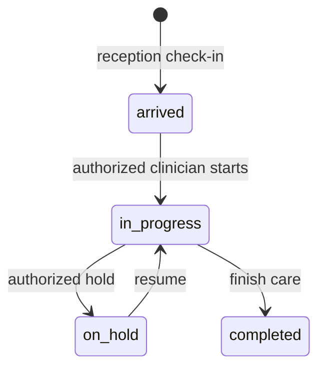

# Accountant

Snapshot: **2026-10-31**, repository source audit. No application code or live database was changed. “Source-confirmed” describes inspected code, not a passed browser, deployment or hospital test. ⚠️ UNVERIFIED = unresolved or untested; 🚧 NOT IMPLEMENTED = absent from the inspected ownership/routes; 🐞 SUSPECTED BUG = evidence needs a focused reproduction. Testing VPS and legacy LAN deployments are distinct. Actual VPS state and actual hospital configuration are not inferred from this checkout.

## 1. Purpose — who this person is in the hospital

Finance records and reconciliation; no clinical access. This is a **system role**, not an HR Position. An Employee's job title grants no access by itself; an AppUser must hold this role through UserRole. `apps/api/src/auth/permissions.ts:34`; `apps/api/prisma/schema.prisma:967`.

## 2. Responsibilities — daily / per-shift / monthly

The procedures below describe the coded work this role supports. Daily: check assigned work and correct patient/source identity before saving. Per shift: hand over unresolved work and sign out of shared devices. Monthly: review unresolved exceptions with the designated supervisor. These frequencies are **recommended SOP assignments, ⚠️ not application-enforced duties**. The hospital must approve ownership and cadence. Capability source: `apps/web/src/pages/FinancePage.tsx:1`.

## 3. Prerequisites — before this person can work

An active User, facility, password change completion and the listed permission grants are required. Optional module screens also require enablement. Clinical accounts created through Users are refused; use Employee-linked onboarding for Doctor, Nurse, Lab technician and Pharmacist. HR self service requires an Employee link even for nonclinical accounts. Doctor accounts additionally require a clinical Position and linked Practitioner/department membership. Required workflow-specific catalogs and balances are in [the dependency matrix](../03-dependency-matrix.md). `apps/api/src/common/guards/jwt-auth.guard.ts:1`; `apps/api/src/modules/users/users.service.ts:73`; `apps/api/src/modules/staff/staff.service.ts:566`.

## 4. Permissions

Each cell lists exact permission codes, rather than implying every action in a module is allowed. Verb grouping is for reading only; some permissions appear in more than one column. Conditional rules and all denied permissions are in [the master matrix](../07-permission-matrix.md). Database grant drift is ⚠️ UNVERIFIED on the VPS.

| Module | View | Create | Edit | Delete/Cancel | Approve | Print/Export | Source (file:line) |
| --- | --- | --- | --- | --- | --- | --- | --- |
| reception | No matching grant | No matching grant | No matching grant | No matching grant | No matching grant | No matching grant | Denied by absence: `apps/api/src/auth/permissions.ts:1` |
| hr | hr.self.view | hr.leave.request | No matching grant | No matching grant | No matching grant | No matching grant | apps/api/src/auth/permissions.ts:136; apps/api/src/auth/permissions.ts:148 |
| crm | No matching grant | No matching grant | No matching grant | No matching grant | No matching grant | No matching grant | Denied by absence: `apps/api/src/auth/permissions.ts:1` |
| payroll | payroll.read | payroll.write | No matching grant | No matching grant | No matching grant | No matching grant | apps/api/src/auth/permissions.ts:166; apps/api/src/auth/permissions.ts:173; apps/api/src/auth/permissions.ts:176 |
| finance | finance.read | finance.write | finance.post; finance.reconcile | No matching grant | No matching grant | finance.export | apps/api/src/auth/permissions.ts:178; apps/api/src/auth/permissions.ts:185; apps/api/src/auth/permissions.ts:193; apps/api/src/auth/permissions.ts:195; apps/api/src/auth/permissions.ts:197 |
| auth | auth.login; auth.me | No matching grant | No matching grant | No matching grant | No matching grant | No matching grant | apps/api/src/auth/permissions.ts:199; apps/api/src/auth/permissions.ts:222 |
| user | No matching grant | No matching grant | No matching grant | No matching grant | No matching grant | No matching grant | Denied by absence: `apps/api/src/auth/permissions.ts:1` |
| role | No matching grant | No matching grant | No matching grant | No matching grant | No matching grant | No matching grant | Denied by absence: `apps/api/src/auth/permissions.ts:1` |
| facility | No matching grant | No matching grant | No matching grant | No matching grant | No matching grant | No matching grant | Denied by absence: `apps/api/src/auth/permissions.ts:1` |
| department | No matching grant | No matching grant | No matching grant | No matching grant | No matching grant | No matching grant | Denied by absence: `apps/api/src/auth/permissions.ts:1` |
| room | No matching grant | No matching grant | No matching grant | No matching grant | No matching grant | No matching grant | Denied by absence: `apps/api/src/auth/permissions.ts:1` |
| practitioner | No matching grant | No matching grant | No matching grant | No matching grant | No matching grant | No matching grant | Denied by absence: `apps/api/src/auth/permissions.ts:1` |
| service | No matching grant | No matching grant | No matching grant | No matching grant | No matching grant | No matching grant | Denied by absence: `apps/api/src/auth/permissions.ts:1` |
| price | No matching grant | No matching grant | No matching grant | No matching grant | No matching grant | No matching grant | Denied by absence: `apps/api/src/auth/permissions.ts:1` |
| drug | No matching grant | No matching grant | No matching grant | No matching grant | No matching grant | No matching grant | Denied by absence: `apps/api/src/auth/permissions.ts:1` |
| labtest | No matching grant | No matching grant | No matching grant | No matching grant | No matching grant | No matching grant | Denied by absence: `apps/api/src/auth/permissions.ts:1` |
| panel | No matching grant | No matching grant | No matching grant | No matching grant | No matching grant | No matching grant | Denied by absence: `apps/api/src/auth/permissions.ts:1` |
| template | No matching grant | No matching grant | No matching grant | No matching grant | No matching grant | No matching grant | Denied by absence: `apps/api/src/auth/permissions.ts:1` |
| setting | No matching grant | No matching grant | No matching grant | No matching grant | No matching grant | No matching grant | Denied by absence: `apps/api/src/auth/permissions.ts:1` |
| patient | No matching grant | No matching grant | No matching grant | No matching grant | No matching grant | No matching grant | Denied by absence: `apps/api/src/auth/permissions.ts:1` |
| allergy | No matching grant | No matching grant | No matching grant | No matching grant | No matching grant | No matching grant | Denied by absence: `apps/api/src/auth/permissions.ts:1` |
| visit | No matching grant | No matching grant | No matching grant | No matching grant | No matching grant | No matching grant | Denied by absence: `apps/api/src/auth/permissions.ts:1` |
| appointment | No matching grant | No matching grant | No matching grant | No matching grant | No matching grant | No matching grant | Denied by absence: `apps/api/src/auth/permissions.ts:1` |
| vitals | No matching grant | No matching grant | No matching grant | No matching grant | No matching grant | No matching grant | Denied by absence: `apps/api/src/auth/permissions.ts:1` |
| diagnosis | No matching grant | No matching grant | No matching grant | No matching grant | No matching grant | No matching grant | Denied by absence: `apps/api/src/auth/permissions.ts:1` |
| clinical_note | No matching grant | No matching grant | No matching grant | No matching grant | No matching grant | No matching grant | Denied by absence: `apps/api/src/auth/permissions.ts:1` |
| attachment | No matching grant | No matching grant | No matching grant | No matching grant | No matching grant | No matching grant | Denied by absence: `apps/api/src/auth/permissions.ts:1` |
| prescription | No matching grant | No matching grant | No matching grant | No matching grant | No matching grant | No matching grant | Denied by absence: `apps/api/src/auth/permissions.ts:1` |
| interaction | No matching grant | No matching grant | No matching grant | No matching grant | No matching grant | No matching grant | Denied by absence: `apps/api/src/auth/permissions.ts:1` |
| follow_up | No matching grant | No matching grant | No matching grant | No matching grant | No matching grant | No matching grant | Denied by absence: `apps/api/src/auth/permissions.ts:1` |
| lab_order | No matching grant | No matching grant | No matching grant | No matching grant | No matching grant | No matching grant | Denied by absence: `apps/api/src/auth/permissions.ts:1` |
| lab | No matching grant | No matching grant | No matching grant | No matching grant | No matching grant | No matching grant | Denied by absence: `apps/api/src/auth/permissions.ts:1` |
| lab_result | No matching grant | No matching grant | No matching grant | No matching grant | No matching grant | No matching grant | Denied by absence: `apps/api/src/auth/permissions.ts:1` |
| pharmacy | No matching grant | No matching grant | No matching grant | No matching grant | No matching grant | No matching grant | Denied by absence: `apps/api/src/auth/permissions.ts:1` |
| invoice | No matching grant | No matching grant | No matching grant | No matching grant | No matching grant | No matching grant | Denied by absence: `apps/api/src/auth/permissions.ts:1` |
| payment | No matching grant | No matching grant | No matching grant | No matching grant | No matching grant | No matching grant | Denied by absence: `apps/api/src/auth/permissions.ts:1` |
| refund | No matching grant | No matching grant | No matching grant | No matching grant | No matching grant | No matching grant | Denied by absence: `apps/api/src/auth/permissions.ts:1` |
| discount | No matching grant | No matching grant | No matching grant | No matching grant | No matching grant | No matching grant | Denied by absence: `apps/api/src/auth/permissions.ts:1` |
| lab_charge | No matching grant | No matching grant | No matching grant | No matching grant | No matching grant | No matching grant | Denied by absence: `apps/api/src/auth/permissions.ts:1` |
| report | No matching grant | No matching grant | No matching grant | No matching grant | No matching grant | No matching grant | Denied by absence: `apps/api/src/auth/permissions.ts:1` |
| audit_log | No matching grant | No matching grant | No matching grant | No matching grant | No matching grant | No matching grant | Denied by absence: `apps/api/src/auth/permissions.ts:1` |
| error_log | No matching grant | No matching grant | No matching grant | No matching grant | No matching grant | No matching grant | Denied by absence: `apps/api/src/auth/permissions.ts:1` |
| data | No matching grant | No matching grant | No matching grant | No matching grant | No matching grant | No matching grant | Denied by absence: `apps/api/src/auth/permissions.ts:1` |

## 5. What they CANNOT do (and who does it instead)

Anything absent from this role's grants is denied, including on a screen reached by manually entering its URL. Multiple roles may expand authority; this document assumes this role alone. Admin manages configuration and users; receptionist registers patients and takes lab collections; doctor writes diagnoses/notes/prescriptions; lab_tech enters/verifies lab results; pharmacist confirms medicine handover; finance roles follow independent approval and posting checks. **Admin alone is not a clinical author.** Exact exceptions and conditions: `apps/api/src/auth/permissions.ts:1`; `apps/api/src/common/guards/permissions.guard.ts:1`.

## 6. Screens they use — navigation path

English menu labels below come from the locale file. The Main group has no translated heading in the current English dictionary. Listed visibility does not prove every button is authorized. `apps/web/src/i18n/locales/en.json:1`.

| Menu group › item | URL | Module prerequisite | Source |
| --- | --- | --- | --- |
| Administration › Human resources | /hr | hr | `apps/web/src/auth/nav.ts:1` |
| Administration › Finance & accounting | /finance | finance | `apps/web/src/auth/nav.ts:1` |
| Main › Dashboard | / | Core | `apps/web/src/auth/nav.ts:1` |

## 7. Button & action reference

These are source locations on menu-linked or permission-linked screens, including reusable controls. **Rows are an inventory, not a grant.** Read the endpoint permission against Section 4; branch-dependent visibility not proven for this role is ⚠️ UNVERIFIED. Administrator includes the complete UI inventory to guarantee no source location is silently omitted, including clinical controls the administrator cannot use. Side effects are direct static service effects; nested helpers may add effects. Runtime behavior and physical printing are not verified by this table.

| ID / source | Screen / component | Button / action (English; Dari where available) | Where | What it does / handler | Preconditions / disabled when | Side effects / trace evidence | Reversible? how | API endpoint | Permission required | Audited? |
| --- | --- | --- | --- | --- | --- | --- | --- | --- | --- | --- |
| A0001 apps/web/src/AppRoot.tsx:23 | AppRoot | FirstRunLanguagePicker | AppRoot / FirstRunLanguagePicker | Local handler / ⚠️ semantic review; onChosen: {() => setHasChosen(true)} | No explicit disabled attribute; surrounding conditions: !hasChosen ? ( <FirstRunLanguagePicker onChosen={() => setHasChosen(true)} /> ) : ( <QueryClientProvider client={queryClient}> {/* AuthProvider above the router: the route components (ProtectedRoute, | ⚠️ UNVERIFIED: inspect handler and linked API call inventory | ⚠️ Use documented cancel/reversal workflow; no generic undo | No statically resolved endpoint | ⚠️ UI local / endpoint-specific; menu is not permission | Local actions have no automatic DB audit; downstream action ⚠️ UNVERIFIED |
| A0272 apps/web/src/components/FinanceAssets.tsx:91 | FinancePage | {register ? "Close registration" : "Register asset"} | FinanceAssets / Button | Local handler / ⚠️ semantic review; onClick: {() => setRegister(!register)} | No explicit disabled attribute; surrounding conditions: canWrite && ( <Button onClick={() => setRegister(!register)}> {register ? "Close registration" : "Register asset"} </Button> ) | ⚠️ UNVERIFIED: inspect handler and linked API call inventory | ⚠️ Use documented cancel/reversal workflow; no generic undo | No statically resolved endpoint | ⚠️ UI local / endpoint-specific; menu is not permission | Local actions have no automatic DB audit; downstream action ⚠️ UNVERIFIED |
| A0273 apps/web/src/components/FinanceAssets.tsx:95 | FinancePage | Export register | FinanceAssets / Button | Local handler / ⚠️ semantic review; onClick: {() => download("asset-register.csv", [ [ "Code", "Name", "Category", "Location", "Acquired (Shamsi)", "Cost AFN", "Residual", "Life months", "Start period", "Status", "Posted depreciation", "Net book value", "Bill", ], ...w.assets.map((a) => [ a.code, a.name, a.category, a.location, gregorianToShamsi(a.acquiredOn), a.cost, a.residual, String(a.lifeMonths), a.startPeriod, a.status, a.depreciation, a.netBookValue, a.billReference ?? "Cash purchase", ]), ]) } | No explicit disabled attribute | ⚠️ UNVERIFIED: inspect handler and linked API call inventory | ⚠️ Use documented cancel/reversal workflow; no generic undo | No statically resolved endpoint | ⚠️ UI local / endpoint-specific; menu is not permission | Local actions have no automatic DB audit; downstream action ⚠️ UNVERIFIED |
| A0274 apps/web/src/components/FinanceAssets.tsx:135 | FinancePage | Prepare due depreciation | FinanceAssets / Button | Server request; onClick: {() => { setRunning(true); void apiPost( "/finance/assets/depreciation", { through: today(), idempotencyKey: crypto.randomUUID() }, z.object({ created: z.number(), errors: z.array(z.string()) }), ) .then((r) => { setResult( `${r.created} depreciation drafts prepared.${r.errors.length ? " " + r.errors.join(" · ") : ""}`, ); return client.invalidateQueries({ queryKey: ["finance"] }); }) .catch(() => setResult("Generation failed. Retry after checking the API."), ) .finally(() => setRunning(false)); }} | {busy &#124;&#124; running}; surrounding conditions: canWrite && ( <Button variant="outline" disabled={busy &#124;&#124; running} onClick={() => { setRunning(true); void apiPost( "/finance/assets/depreciation", | apps/api/src/modules/finance/finance-assets.service.ts:368; Delegated operation: inspect linked service | ⚠️ Use documented cancel/reversal workflow; no generic undo | POST /finance/assets/depreciation (apps/api/src/modules/finance/finance-assets.controller.ts:53) | finance.write | App request context + audited Prisma writes; read audit is endpoint-specific. Root/manual scripts are outside this coverage. |
| A0275 apps/web/src/components/FinanceAssets.tsx:179 | FinancePage | Posted supplier bill Cash / bank purchase | FinanceAssets / select | Form input / selection; onChange: {(e) => setMode(e.target.value)} | No explicit disabled attribute; surrounding conditions: register && canWrite && ( <> <label className="flex gap-3 items-center"> Acquisition source <select className={cls} value={mode} onChange={(e) => setMode(e. | Changes form selection; persistence occurs on submission | Edit again before saving | No statically resolved endpoint | ⚠️ UI local / endpoint-specific; menu is not permission | Local actions have no automatic DB audit; downstream action ⚠️ UNVERIFIED |
| A0276 apps/web/src/components/FinanceAssets.tsx:188 | FinancePage | "Register a new asset" | FinanceAssets / Form | Local handler / ⚠️ semantic review; onSubmit: {(v) => perform("assets", { ...v, lifeMonths: Number(v.lifeMonths), costCentreId: v.costCentreId &#124;&#124; null, }) } | No explicit disabled attribute; surrounding conditions: register && canWrite && ( <> <label className="flex gap-3 items-center"> Acquisition source <select className={cls} value={mode} onChange={(e) => setMode(e. | ⚠️ UNVERIFIED: inspect handler and linked API call inventory | ⚠️ Use documented cancel/reversal workflow; no generic undo | No statically resolved endpoint | ⚠️ UI local / endpoint-specific; menu is not permission | Local actions have no automatic DB audit; downstream action ⚠️ UNVERIFIED |
| A0277 apps/web/src/components/FinanceAssets.tsx:287 | FinancePage | View {a.code} | FinanceAssets / Button | Local handler / ⚠️ semantic review; onClick: {() => setSelected(a.id)} | No explicit disabled attribute | ⚠️ UNVERIFIED: inspect handler and linked API call inventory | ⚠️ Use documented cancel/reversal workflow; no generic undo | No statically resolved endpoint | ⚠️ UI local / endpoint-specific; menu is not permission | Local actions have no automatic DB audit; downstream action ⚠️ UNVERIFIED |
| A0278 apps/web/src/components/FinanceAssets.tsx:301 | FinancePage | Open supplier bill {a.billReference} | FinanceAssets / a | Navigation; {`/finance?journal=${a.billJournalId}`} | No explicit disabled attribute; surrounding conditions: a.billJournalId && <a className="text-primary underline" href={`/finance?journal=${a.billJournalId}`}>Open supplier bill {a.billReference}</a>; a && ( <Card className="p-5 space-y-4"> <h3 className="font-semibold"> {a.code} · {a.name} </h3> {a.billJournalId && <a className="text-primary underline" href={`/finance?journal=${a.billJou | Changes browser destination; target: {`/finance?journal=${a.billJournalId}`} | Browser Back | No statically resolved endpoint | ⚠️ UI local / endpoint-specific; menu is not permission | Local actions have no automatic DB audit; downstream action ⚠️ UNVERIFIED |
| A0279 apps/web/src/components/FinanceAssets.tsx:326 | FinancePage | Review journal | FinanceAssets / a | Navigation; {`/finance?journal=${e.journalId}`} | No explicit disabled attribute; surrounding conditions: a && ( <Card className="p-5 space-y-4"> <h3 className="font-semibold"> {a.code} · {a.name} </h3> {a.billJournalId && <a className="text-primary underline" href={`/finance?journal=${a.billJou | Changes browser destination; target: {`/finance?journal=${e.journalId}`} | Browser Back | No statically resolved endpoint | ⚠️ UI local / endpoint-specific; menu is not permission | Local actions have no automatic DB audit; downstream action ⚠️ UNVERIFIED |
| A0280 apps/web/src/components/FinanceAssets.tsx:343 | FinancePage | Export schedule | FinanceAssets / Button | Local handler / ⚠️ semantic review; onClick: {() => download(`${a.code}-depreciation.csv`, [ ["Shamsi period", "Planned AFN"], ...a.schedule.map((s) => [s.period, s.amount]), ]) } | No explicit disabled attribute; surrounding conditions: a && ( <Card className="p-5 space-y-4"> <h3 className="font-semibold"> {a.code} · {a.name} </h3> {a.billJournalId && <a className="text-primary underline" href={`/finance?journal=${a.billJou | ⚠️ UNVERIFIED: inspect handler and linked API call inventory | ⚠️ Use documented cancel/reversal workflow; no generic undo | No statically resolved endpoint | ⚠️ UI local / endpoint-specific; menu is not permission | Local actions have no automatic DB audit; downstream action ⚠️ UNVERIFIED |
| A0281 apps/web/src/components/FinanceAssets.tsx:360 | FinancePage | "Dispose / write off asset" | FinanceAssets / Form | Local handler / ⚠️ semantic review; onSubmit: {(v) => perform(`assets/${a.id}/disposal`, { ...v, cashAccountId: v.cashAccountId &#124;&#124; undefined, }) } | No explicit disabled attribute; surrounding conditions: canWrite && a.status === "active" && ( <Form title="Dispose / write off asset" busy={busy} submit="Prepare disposal draft" fields={[ { nam; a && ( <Card className="p-5 space-y-4"> <h3 className="font-semibold"> {a.code} · {a.name} </h3> {a.billJournalId && <a className="text-primary underline" href={`/finance?journal=${a.billJou | ⚠️ UNVERIFIED: inspect handler and linked API call inventory | ⚠️ Use documented cancel/reversal workflow; no generic undo | No statically resolved endpoint | ⚠️ UI local / endpoint-specific; menu is not permission | Local actions have no automatic DB audit; downstream action ⚠️ UNVERIFIED |
| A0282 apps/web/src/components/FinanceAssets.tsx:408 | FinancePage | "Transfer between cash / bank accounts" | FinanceTransfers / Form | Local handler / ⚠️ semantic review; onSubmit: {(v) => perform("assets/transfers", v)} | No explicit disabled attribute | ⚠️ UNVERIFIED: inspect handler and linked API call inventory | ⚠️ Use documented cancel/reversal workflow; no generic undo | No statically resolved endpoint | ⚠️ UI local / endpoint-specific; menu is not permission | Local actions have no automatic DB audit; downstream action ⚠️ UNVERIFIED |
| A0283 apps/web/src/components/FinanceAssets.tsx:449 | FinancePage | {[...new Set(data.periods.map((p) => Number(p.label.slice(0, 4))))] .sort() .map((y) => ( {y} ))} | FinanceBudgets / select | Form input / selection; onChange: {(e) => { setYear(Number(e.target.value)); setEditing(null); }} | No explicit disabled attribute | Changes form selection; persistence occurs on submission | Edit again before saving | No statically resolved endpoint | ⚠️ UI local / endpoint-specific; menu is not permission | Local actions have no automatic DB audit; downstream action ⚠️ UNVERIFIED |
| A0284 apps/web/src/components/FinanceAssets.tsx:470 | FinancePage | Export variance report | FinanceBudgets / Button | Local handler / ⚠️ semantic review; onClick: {() => download(`budget-${year}.csv`, [ [ "Period", "Account", "Department", "Budget AFN", "Actual AFN", "Actual minus budget", "Result", ], ...rows.map((r) => [ r.period, r.account, r.department, r.budget ?? "", r.actual, r.variance ?? "", r.favorable === null ? "Unbudgeted" : r.favorable ? "Favorable" : "Unfavorable", ]), ]) } | No explicit disabled attribute | ⚠️ UNVERIFIED: inspect handler and linked API call inventory | ⚠️ Use documented cancel/reversal workflow; no generic undo | No statically resolved endpoint | ⚠️ UI local / endpoint-specific; menu is not permission | Local actions have no automatic DB audit; downstream action ⚠️ UNVERIFIED |
| A0285 apps/web/src/components/FinanceAssets.tsx:534 | FinancePage | Edit budget | FinanceBudgets / Button | Local handler / ⚠️ semantic review; onClick: {() => setEditing(r)} | No explicit disabled attribute; surrounding conditions: configure && !data.periods.find(p => p.id === r.periodId)?.closedAt ? ( <Button key="e" variant="outline" onClick={() => setEditing(r)}> Edit budget </Button> ) : ( "—" ) | ⚠️ UNVERIFIED: inspect handler and linked API call inventory | ⚠️ Use documented cancel/reversal workflow; no generic undo | No statically resolved endpoint | ⚠️ UI local / endpoint-specific; menu is not permission | Local actions have no automatic DB audit; downstream action ⚠️ UNVERIFIED |
| A0286 apps/web/src/components/FinanceAssets.tsx:548 | FinancePage | New budget line | FinanceBudgets / Button | Local handler / ⚠️ semantic review; onClick: {() => setEditing(null)} | No explicit disabled attribute; surrounding conditions: editing && ( <Button variant="outline" onClick={() => setEditing(null)}> New budget line </Button> ); configure && w.data && ( <> {editing && ( <Button variant="outline" onClick={() => setEditing(null)}> New budget line </Button> )} <Form key={`${year}/$ | ⚠️ UNVERIFIED: inspect handler and linked API call inventory | ⚠️ Use documented cancel/reversal workflow; no generic undo | No statically resolved endpoint | ⚠️ UI local / endpoint-specific; menu is not permission | Local actions have no automatic DB audit; downstream action ⚠️ UNVERIFIED |
| A0287 apps/web/src/components/FinanceAssets.tsx:552 | FinancePage | {editing ? "Edit budget line" : "Enter a budget line"} | FinanceBudgets / Form | Local handler / ⚠️ semantic review; onSubmit: {async (v) => { const current = rows.find( (r) => r.periodId === v.periodId && r.accountId === v.accountId && r.costCentreId === (v.costCentreId &#124;&#124; null), ); const ok = await perform("assets/budgets", { ...v, costCentreId: v.costCentreId &#124;&#124; null, expectedVersion: editing && editing.periodId === v.periodId && editing.accountId === v.accountId && editing.costCentreId === (v.costCentreId &#124;&#124; null) ? editing.version : (current?.version ?? 0), }); if (ok) setEditing(null); return ok; }} | No explicit disabled attribute; surrounding conditions: configure && w.data && ( <> {editing && ( <Button variant="outline" onClick={() => setEditing(null)}> New budget line </Button> )} <Form key={`${year}/$ | ⚠️ UNVERIFIED: inspect handler and linked API call inventory | ⚠️ Use documented cancel/reversal workflow; no generic undo | No statically resolved endpoint | ⚠️ UI local / endpoint-specific; menu is not permission | Local actions have no automatic DB audit; downstream action ⚠️ UNVERIFIED |
| A0288 apps/web/src/components/FinanceDateInput.tsx:21 | FinancePage, HrPage | "Shamsi date: YYYY-MM-DD (1350–1499)" | FinanceDateInput / Input | Form input / selection; onChange: {(event) => { const entered = event.target.value setEdit({ source: value, text: entered }) try { const converted = shamsiToGregorian(entered) event.target.setCustomValidity('') setEdit(null) onChange(converted) } catch { event.target.setCustomValidity('Enter a valid Shamsi date, for example 1404-07-05.') } }} | No explicit disabled attribute | Changes form selection; persistence occurs on submission | Edit again before saving | No statically resolved endpoint | ⚠️ UI local / endpoint-specific; menu is not permission | Local actions have no automatic DB audit; downstream action ⚠️ UNVERIFIED |
| A0289 apps/web/src/components/FinancePayables.tsx:68 | FinancePage | Paid from cash / bank Unpaid supplier bill | ChargeForm / select | Form input / selection; onChange: {(e) => setMode(e.target.value as typeof mode)} | No explicit disabled attribute | Changes form selection; persistence occurs on submission | Edit again before saving | No statically resolved endpoint | ⚠️ UI local / endpoint-specific; menu is not permission | Local actions have no automatic DB audit; downstream action ⚠️ UNVERIFIED |
| A0290 apps/web/src/components/FinancePayables.tsx:79 | FinancePage | Mapped expense category Choose expense / asset account | ChargeForm / select | Form input / selection; onChange: {(e) => setSelection(e.target.value)} | No explicit disabled attribute | Changes form selection; persistence occurs on submission | Edit again before saving | No statically resolved endpoint | ⚠️ UI local / endpoint-specific; menu is not permission | Local actions have no automatic DB audit; downstream action ⚠️ UNVERIFIED |
| A0291 apps/web/src/components/FinancePayables.tsx:89 | FinancePage | { mode === 'cash' ? 'Prepare expense or asset purchase' : 'Prepare supplier bill' } | ChargeForm / Form | Local handler / ⚠️ semantic review; onSubmit: {(v) => perform('payables/charges', { ...v, mode, costCentreId: v.costCentreId &#124;&#124; undefined, dueOn: v.dueOn &#124;&#124; undefined, }) } | No explicit disabled attribute | ⚠️ UNVERIFIED: inspect handler and linked API call inventory | ⚠️ Use documented cancel/reversal workflow; no generic undo | No statically resolved endpoint | ⚠️ UI local / endpoint-specific; menu is not permission | Local actions have no automatic DB audit; downstream action ⚠️ UNVERIFIED |
| A0292 apps/web/src/components/FinancePayables.tsx:213 | FinancePage | {label} | open / button | Local handler / ⚠️ semantic review; onClick: {() => setSource(id)} | No explicit disabled attribute | ⚠️ UNVERIFIED: inspect handler and linked API call inventory | ⚠️ Use documented cancel/reversal workflow; no generic undo | No statically resolved endpoint | ⚠️ UI local / endpoint-specific; menu is not permission | Local actions have no automatic DB audit; downstream action ⚠️ UNVERIFIED |
| A0293 apps/web/src/components/FinancePayables.tsx:235 | FinancePage | {label} | FinancePayables / Button | Local handler / ⚠️ semantic review; onClick: {() => setSection(id)} | No explicit disabled attribute | ⚠️ UNVERIFIED: inspect handler and linked API call inventory | ⚠️ Use documented cancel/reversal workflow; no generic undo | No statically resolved endpoint | ⚠️ UI local / endpoint-specific; menu is not permission | Local actions have no automatic DB audit; downstream action ⚠️ UNVERIFIED |
| A0294 apps/web/src/components/FinancePayables.tsx:246 | FinancePage | Close source details | FinancePayables / Button | Local handler / ⚠️ semantic review; onClick: {() => setSource('')} | No explicit disabled attribute; surrounding conditions: source && ( <> <Button variant="outline" onClick={() => setSource('')}> Close source details </Button> <FinanceSource journalId={source} /> </> ) | ⚠️ UNVERIFIED: inspect handler and linked API call inventory | ⚠️ Use documented cancel/reversal workflow; no generic undo | No statically resolved endpoint | ⚠️ UI local / endpoint-specific; menu is not permission | Local actions have no automatic DB audit; downstream action ⚠️ UNVERIFIED |
| A0295 apps/web/src/components/FinancePayables.tsx:255 | FinancePage | All suppliers {data.suppliers.map((s) => ( {s.name} {s.isActive ? '' : ' (inactive)'} ))} | FinancePayables / select | Form input / selection; onChange: {(e) => setSupplier(e.target.value)} | No explicit disabled attribute; surrounding conditions: ['balances', 'suppliers', 'bills'].includes(section) && ( <label className="block max-w-lg"> Supplier <select className={cls} value={supplier} onChange={(e) => setSupplier(e.ta | Changes form selection; persistence occurs on submission | Edit again before saving | No statically resolved endpoint | ⚠️ UI local / endpoint-specific; menu is not permission | Local actions have no automatic DB audit; downstream action ⚠️ UNVERIFIED |
| A0296 apps/web/src/components/FinancePayables.tsx:274 | FinancePage | As of (Shamsi) | FinancePayables / FinanceDateInput | Local handler / ⚠️ semantic review; onChange: {setAsOf} | No explicit disabled attribute; surrounding conditions: section === 'balances' && ( <> <label className="block max-w-xs"> As of (Shamsi) <FinanceDateInput value={asOf} onChange={setAsOf} /> </label> {report.isError && 
 | ⚠️ UNVERIFIED: inspect handler and linked API call inventory | ⚠️ Use documented cancel/reversal workflow; no generic undo | No statically resolved endpoint | ⚠️ UI local / endpoint-specific; menu is not permission | Local actions have no automatic DB audit; downstream action ⚠️ UNVERIFIED |
| A0297 apps/web/src/components/FinancePayables.tsx:296 | FinancePage | Export aging CSV | FinancePayables / Button | Local handler / ⚠️ semantic review; onClick: {() => download('supplier-ap-aging.csv', [ [ 'Supplier', 'Bill', 'Due date (Shamsi)', 'Outstanding AFN', 'Current', '1–30', '31–60', '61–90', 'Over 90', ], ...r.rows.map((b) => [ b.supplierName, b.reference, gregorianToShamsi(b.dueOn), b.outstanding, b.current, b.days1to30, b.days31to60, b.days61to90, b.over90, ]), ]) } | No explicit disabled attribute; surrounding conditions: r && ( <> 
 <Card className="p-4"> Selected suppliers: {formatMoney(r.total)} AFN </Card> <Card className=; section === 'balances' && ( <> <label className="block max-w-xs"> As of (Shamsi) <FinanceDateInput value={asOf} onChange={setAsOf} /> </label> {report.isError && 
 | ⚠️ UNVERIFIED: inspect handler and linked API call inventory | ⚠️ Use documented cancel/reversal workflow; no generic undo | No statically resolved endpoint | ⚠️ UI local / endpoint-specific; menu is not permission | Local actions have no automatic DB audit; downstream action ⚠️ UNVERIFIED |
| A0298 apps/web/src/components/FinancePayables.tsx:359 | FinancePage | Statement from (Shamsi) | FinancePayables / FinanceDateInput | Local handler / ⚠️ semantic review; onChange: {setFrom} | No explicit disabled attribute; surrounding conditions: supplier && ( <> <label className="block max-w-xs"> Statement from (Shamsi) <FinanceDateInput value={from} onChange={setFrom} /> </label> {statement.isErr; section === 'balances' && ( <> <label className="block max-w-xs"> As of (Shamsi) <FinanceDateInput value={asOf} onChange={setAsOf} /> </label> {report.isError && 
 | ⚠️ UNVERIFIED: inspect handler and linked API call inventory | ⚠️ Use documented cancel/reversal workflow; no generic undo | No statically resolved endpoint | ⚠️ UI local / endpoint-specific; menu is not permission | Local actions have no automatic DB audit; downstream action ⚠️ UNVERIFIED |
| A0299 apps/web/src/components/FinancePayables.tsx:371 | FinancePage | Export statement CSV | FinancePayables / Button | Local handler / ⚠️ semantic review; onClick: {() => download('supplier-statement.csv', [ [ 'Date (Shamsi)', 'Journal', 'Bill', 'Type', 'AP movement', 'Balance', ], ['', '', '', 'Opening', '', statement.data!.opening], ...statement.data!.lines.map((l) => [ gregorianToShamsi(l.date), l.number ?? 'Draft', l.reference, l.kind, l.movement, l.balance, ]), ]) } | No explicit disabled attribute; surrounding conditions: statement.data && ( <> 
 {statement.data.supplierName} · Opening{' '} {formatMoney(statement.data.opening)} · Closing{' '} {formatMoney(statemen; supplier && ( <> <label className="block max-w-xs"> Statement from (Shamsi) <FinanceDateInput value={from} onChange={setFrom} /> </label> {statement.isErr; section === 'balances' && ( <> <label className="block max-w-xs"> As of (Shamsi) <FinanceDateInput value={asOf} onChange={setAsOf} /> </label> {report.isError && 
 | ⚠️ UNVERIFIED: inspect handler and linked API call inventory | ⚠️ Use documented cancel/reversal workflow; no generic undo | No statically resolved endpoint | ⚠️ UI local / endpoint-specific; menu is not permission | Local actions have no automatic DB audit; downstream action ⚠️ UNVERIFIED |
| A0300 apps/web/src/components/FinancePayables.tsx:427 | FinancePage | {s.name} | FinancePayables / button | Local handler / ⚠️ semantic review; onClick: {() => setSupplier(s.id)} | No explicit disabled attribute; surrounding conditions: section === 'suppliers' && ( <> <Grid headers={['Supplier', 'Reference / contact', 'Terms', 'Status']} rows={data.suppliers.map((s) => [ <button key={s.id} | ⚠️ UNVERIFIED: inspect handler and linked API call inventory | ⚠️ Use documented cancel/reversal workflow; no generic undo | No statically resolved endpoint | ⚠️ UI local / endpoint-specific; menu is not permission | Local actions have no automatic DB audit; downstream action ⚠️ UNVERIFIED |
| A0301 apps/web/src/components/FinancePayables.tsx:440 | FinancePage | {selected ? 'Edit selected supplier' : 'Add supplier'} | FinancePayables / Form | Local handler / ⚠️ semantic review; onSubmit: {(v) => perform( selected ? `payables/suppliers/${selected.id}` : 'suppliers', { ...v, termsDays: Number(v.termsDays), ...(selected ? { isActive: v.isActive === 'true' } : {}), }, ) } | No explicit disabled attribute; surrounding conditions: canWrite && ( <Form title={selected ? 'Edit selected supplier' : 'Add supplier'} key={selected?.id ?? 'new'} busy={busy} submit={selected ? 'Save supplier' : 'Add supplier'; section === 'suppliers' && ( <> <Grid headers={['Supplier', 'Reference / contact', 'Terms', 'Status']} rows={data.suppliers.map((s) => [ <button key={s.id} | ⚠️ UNVERIFIED: inspect handler and linked API call inventory | ⚠️ Use documented cancel/reversal workflow; no generic undo | No statically resolved endpoint | ⚠️ UI local / endpoint-specific; menu is not permission | Local actions have no automatic DB audit; downstream action ⚠️ UNVERIFIED |
| A0302 apps/web/src/components/FinancePayables.tsx:508 | FinancePage | "Opening supplier invoice" | FinancePayables / Form | Local handler / ⚠️ semantic review; onSubmit: {(v) => perform('payables/opening', v)} | No explicit disabled attribute; surrounding conditions: canWrite && ( <> 
 Opening balances create an opening equity debit and supplier AP credit at{' '} {data.settings ? gregorianTo; section === 'suppliers' && ( <> <Grid headers={['Supplier', 'Reference / contact', 'Terms', 'Status']} rows={data.suppliers.map((s) => [ <button key={s.id} | ⚠️ UNVERIFIED: inspect handler and linked API call inventory | ⚠️ Use documented cancel/reversal workflow; no generic undo | No statically resolved endpoint | ⚠️ UI local / endpoint-specific; menu is not permission | Local actions have no automatic DB audit; downstream action ⚠️ UNVERIFIED |
| A0303 apps/web/src/components/FinancePayables.tsx:642 | FinancePage | Remove receipt | FinancePayables / Button | Local handler / ⚠️ semantic review; onClick: {() => { if ( window.confirm( 'Remove this unbilled goods receipt? Its audit history will remain.', ) ) void perform(`payables/receipts/${r.id}/remove`, {}) }} | {busy}; surrounding conditions: canWrite && ( <Button variant="outline" disabled={busy} onClick={() => { if ( window.confirm( ; r.journalId ? ( open(r.journalId, 'View bill') ) : ( <> Ready for billing {canWrite && ( <Button varian | ⚠️ UNVERIFIED: inspect handler and linked API call inventory | ⚠️ Use documented cancel/reversal workflow; no generic undo | No statically resolved endpoint | ⚠️ UI local / endpoint-specific; menu is not permission | Local actions have no automatic DB audit; downstream action ⚠️ UNVERIFIED |
| A0304 apps/web/src/components/FinancePayables.tsx:662 | FinancePage | "Create bill from goods received" | FinancePayables / Form | Local handler / ⚠️ semantic review; onSubmit: {({ receiptId, ...v }) => perform(`payables/receipts/${receiptId}/bill`, { ...v, dueOn: v.dueOn &#124;&#124; undefined, }) } | No explicit disabled attribute; surrounding conditions: canWrite && ( <Form title="Create bill from goods received" busy={busy} submit="Create bill draft" fields={[ { name: 'receiptId', ; section === 'procurement' && ( <> 
 Record received goods from Excel or paper, keeping the PO and GRN references. Each received-goods record can create one supplier bill. The bill uses | ⚠️ UNVERIFIED: inspect handler and linked API call inventory | ⚠️ Use documented cancel/reversal workflow; no generic undo | No statically resolved endpoint | ⚠️ UI local / endpoint-specific; menu is not permission | Local actions have no automatic DB audit; downstream action ⚠️ UNVERIFIED |
| A0305 apps/web/src/components/FinancePayables.tsx:721 | FinancePage | "Add department / cost centre" | FinancePayables / Form | Local handler / ⚠️ semantic review; onSubmit: {(v) => perform('payables/centres', v)} | No explicit disabled attribute; surrounding conditions: canConfigure && ( <> <Form title="Add department / cost centre" busy={busy} submit="Add cost centre" fields={[ { name: 'code', label; section === 'mapping' && ( <> <Grid headers={['Category', 'COA account', 'Default cost centre']} rows={w.mappings.map((m) => [ m.category, data.accounts.find((a) => a.id | ⚠️ UNVERIFIED: inspect handler and linked API call inventory | ⚠️ Use documented cancel/reversal workflow; no generic undo | No statically resolved endpoint | ⚠️ UI local / endpoint-specific; menu is not permission | Local actions have no automatic DB audit; downstream action ⚠️ UNVERIFIED |
| A0306 apps/web/src/components/FinancePayables.tsx:731 | FinancePage | "Set expense category mapping" | FinancePayables / Form | Local handler / ⚠️ semantic review; onSubmit: {(v) => perform('payables/mappings', { ...v, costCentreId: v.costCentreId &#124;&#124; null, }) } | No explicit disabled attribute; surrounding conditions: canConfigure && ( <> <Form title="Add department / cost centre" busy={busy} submit="Add cost centre" fields={[ { name: 'code', label; section === 'mapping' && ( <> <Grid headers={['Category', 'COA account', 'Default cost centre']} rows={w.mappings.map((m) => [ m.category, data.accounts.find((a) => a.id | ⚠️ UNVERIFIED: inspect handler and linked API call inventory | ⚠️ Use documented cancel/reversal workflow; no generic undo | No statically resolved endpoint | ⚠️ UI local / endpoint-specific; menu is not permission | Local actions have no automatic DB audit; downstream action ⚠️ UNVERIFIED |
| A0307 apps/web/src/components/FinancePayables.tsx:808 | FinancePage | Date (Shamsi) Payment reference setReference(e.target.value)} /> Pay from setCash(e.target.value)} > Select… {data.accounts .filter((a) => a.isCash && a.isActive && a.isPosting) .map((a) => ( {a.name} ))} [ b.reference, formatMoney(b.available), setAllocations({ ...allocations, [b.id]: e.target.value }) } />, ])} /> Total payment:{' '} {valid ? formatMoney( entries.reduce((n, a) => n.add(a.amount), moneyDecimal('0')), ) : 'Check amounts'}{' '} AFN Prepare payment draft | MultiPayment / form | Local handler / ⚠️ semantic review; onSubmit: {(e: FormEvent) => { e.preventDefault() void perform('payables/payments', { supplierId, date: on, reference, cashAccountId: cash, allocations: entries, }).then((ok) => { if (ok) { setAllocations({}) setReference('') } }) }} | No explicit disabled attribute; surrounding conditions: !supplierId ? ( 
Select a supplier above to allocate a payment.
 ) : ( <form className="space-y-3" onSubmit={(e: FormEvent) => { e.preventDefault() void perform('payable | ⚠️ UNVERIFIED: inspect handler and linked API call inventory | ⚠️ Use documented cancel/reversal workflow; no generic undo | No statically resolved endpoint | ⚠️ UI local / endpoint-specific; menu is not permission | Local actions have no automatic DB audit; downstream action ⚠️ UNVERIFIED |
| A0308 apps/web/src/components/FinancePayables.tsx:829 | FinancePage | Date (Shamsi) | MultiPayment / FinanceDateInput | Local handler / ⚠️ semantic review; onChange: {setOn} | No explicit disabled attribute; surrounding conditions: !supplierId ? ( 
Select a supplier above to allocate a payment.
 ) : ( <form className="space-y-3" onSubmit={(e: FormEvent) => { e.preventDefault() void perform('payable | ⚠️ UNVERIFIED: inspect handler and linked API call inventory | ⚠️ Use documented cancel/reversal workflow; no generic undo | No statically resolved endpoint | ⚠️ UI local / endpoint-specific; menu is not permission | Local actions have no automatic DB audit; downstream action ⚠️ UNVERIFIED |
| A0309 apps/web/src/components/FinancePayables.tsx:833 | FinancePage | Payment reference setReference(e.target.value)} /> | MultiPayment / input | Form input / selection; onChange: {(e) => setReference(e.target.value)} | No explicit disabled attribute; surrounding conditions: !supplierId ? ( 
Select a supplier above to allocate a payment.
 ) : ( <form className="space-y-3" onSubmit={(e: FormEvent) => { e.preventDefault() void perform('payable | Changes form selection; persistence occurs on submission | Edit again before saving | No statically resolved endpoint | ⚠️ UI local / endpoint-specific; menu is not permission | Local actions have no automatic DB audit; downstream action ⚠️ UNVERIFIED |
| A0310 apps/web/src/components/FinancePayables.tsx:842 | FinancePage | Select… {data.accounts .filter((a) => a.isCash && a.isActive && a.isPosting) .map((a) => ( {a.name} ))} | MultiPayment / select | Form input / selection; onChange: {(e) => setCash(e.target.value)} | No explicit disabled attribute; surrounding conditions: !supplierId ? ( 
Select a supplier above to allocate a payment.
 ) : ( <form className="space-y-3" onSubmit={(e: FormEvent) => { e.preventDefault() void perform('payable | Changes form selection; persistence occurs on submission | Edit again before saving | No statically resolved endpoint | ⚠️ UI local / endpoint-specific; menu is not permission | Local actions have no automatic DB audit; downstream action ⚠️ UNVERIFIED |
| A0311 apps/web/src/components/FinancePayables.tsx:864 | FinancePage | {`Allocate ${b.reference}`} | MultiPayment / input | Form input / selection; onChange: {(e) => setAllocations({ ...allocations, [b.id]: e.target.value }) } | No explicit disabled attribute; surrounding conditions: !supplierId ? ( 
Select a supplier above to allocate a payment.
 ) : ( <form className="space-y-3" onSubmit={(e: FormEvent) => { e.preventDefault() void perform('payable | Changes form selection; persistence occurs on submission | Edit again before saving | No statically resolved endpoint | ⚠️ UI local / endpoint-specific; menu is not permission | Local actions have no automatic DB audit; downstream action ⚠️ UNVERIFIED |
| A0312 apps/web/src/components/FinancePayables.tsx:888 | FinancePage | Prepare payment draft | MultiPayment / Button | ⚠️ No direct handler (submit/child behavior); {(e: FormEvent) => { e.preventDefault() void perform('payables/payments', { supplierId, date: on, reference, cashAccountId: cash, allocations: entries, }).then((ok) => { if (ok) { setAllocations({}) setReference('') } }) }} | {busy &#124;&#124; !entries.length &#124;&#124; !valid}; surrounding conditions: !supplierId ? ( 
Select a supplier above to allocate a payment.
 ) : ( <form className="space-y-3" onSubmit={(e: FormEvent) => { e.preventDefault() void perform('payable | ⚠️ UNVERIFIED: inspect handler and linked API call inventory | ⚠️ Use documented cancel/reversal workflow; no generic undo | No statically resolved endpoint | ⚠️ UI local / endpoint-specific; menu is not permission | Local actions have no automatic DB audit; downstream action ⚠️ UNVERIFIED |
| A0313 apps/web/src/components/FinancePayables.tsx:953 | FinancePage | Download Excel CSV template | ReceiptForm / Button | Local handler / ⚠️ semantic review; onClick: {() => download('goods-received-template.csv', [ ['sourceLineId', 'description', 'quantity', 'unitCost', 'category'], ]) } | No explicit disabled attribute | ⚠️ UNVERIFIED: inspect handler and linked API call inventory | ⚠️ Use documented cancel/reversal workflow; no generic undo | No statically resolved endpoint | ⚠️ UI local / endpoint-specific; menu is not permission | Local actions have no automatic DB audit; downstream action ⚠️ UNVERIFIED |
| A0314 apps/web/src/components/FinancePayables.tsx:965 | FinancePage | Import receipt lines { const f = e.target.files?.[0] if (!f) return setError('') if (f.size > 80000) { setError('CSV must be below 80 KB.') return } void f .text() .then((csv) => apiPost( '/finance/payables/receipts/preview', { csv }, z.object({ lines: procurementReceiptSchema.shape.lines }), ), ) .then((result) => setLines(result.lines)) .catch((e) => setError( e instanceof ApiError && e.body && typeof e.body === 'object' && 'message' in e.body ? String(e.body.message) : 'Could not read this CSV.', ), ) }} /> | ReceiptForm / input | Server request; onChange: {(e) => { const f = e.target.files?.[0] if (!f) return setError('') if (f.size > 80000) { setError('CSV must be below 80 KB.') return } void f .text() .then((csv) => apiPost( '/finance/payables/receipts/preview', { csv }, z.object({ lines: procurementReceiptSchema.shape.lines }), ), ) .then((result) => setLines(result.lines)) .catch((e) => setError( e instanceof ApiError && e.body && typeof e.body === 'object' && 'message' in e.body ? String(e.body.message) : 'Could not read this CSV.', ), ) }} | No explicit disabled attribute | ; Delegated operation: inspect linked service | ⚠️ Use documented cancel/reversal workflow; no generic undo | POST /finance/payables/receipts/preview (apps/api/src/modules/finance/finance-payables.controller.ts:78) | finance.write | App request context + audited Prisma writes; read audit is endpoint-specific. Root/manual scripts are outside this coverage. |
| A0315 apps/web/src/components/FinancePayables.tsx:1005 | FinancePage | Supplier setSupplier(e.target.value)} > Select… {data.suppliers .filter((s) => s.isActive) .map((s) => ( {s.name} ))} Source / register setSystem(e.target.value)} /> PO reference setPo(e.target.value)} /> GRN reference setGrn(e.target.value)} /> Received (Shamsi) [ ...( ['sourceLineId', 'description', 'quantity', 'unitCost'] as const ).map((key) => ( update(i, key, e.target.value)} /> )), update(i, 'category', e.target.value)} > Select… {workspace.mappings.map((m) => ( {m.category} ))} {l.category && !workspace.mappings.some((m) => m.category === l.category) && ( {l.category} )} , setLines(lines.filter((_, n) => n !== i))} > Remove , ])} /> = 50} onClick={() => setLines([ ...lines, { ...emptyLine(), sourceLineId: String(lines.length + 1) }, ]) } > Add line Save received goods | ReceiptForm / form | Local handler / ⚠️ semantic review; onSubmit: {(e) => void submit(e)} | No explicit disabled attribute | ⚠️ UNVERIFIED: inspect handler and linked API call inventory | ⚠️ Use documented cancel/reversal workflow; no generic undo | No statically resolved endpoint | ⚠️ UI local / endpoint-specific; menu is not permission | Local actions have no automatic DB audit; downstream action ⚠️ UNVERIFIED |
| A0316 apps/web/src/components/FinancePayables.tsx:1009 | FinancePage | Select… {data.suppliers .filter((s) => s.isActive) .map((s) => ( {s.name} ))} | ReceiptForm / select | Form input / selection; onChange: {(e) => setSupplier(e.target.value)} | No explicit disabled attribute | Changes form selection; persistence occurs on submission | Edit again before saving | No statically resolved endpoint | ⚠️ UI local / endpoint-specific; menu is not permission | Local actions have no automatic DB audit; downstream action ⚠️ UNVERIFIED |
| A0317 apps/web/src/components/FinancePayables.tsx:1027 | FinancePage | Source / register setSystem(e.target.value)} /> | ReceiptForm / input | Form input / selection; onChange: {(e) => setSystem(e.target.value)} | No explicit disabled attribute | Changes form selection; persistence occurs on submission | Edit again before saving | No statically resolved endpoint | ⚠️ UI local / endpoint-specific; menu is not permission | Local actions have no automatic DB audit; downstream action ⚠️ UNVERIFIED |
| A0318 apps/web/src/components/FinancePayables.tsx:1036 | FinancePage | PO reference setPo(e.target.value)} /> | ReceiptForm / input | Form input / selection; onChange: {(e) => setPo(e.target.value)} | No explicit disabled attribute | Changes form selection; persistence occurs on submission | Edit again before saving | No statically resolved endpoint | ⚠️ UI local / endpoint-specific; menu is not permission | Local actions have no automatic DB audit; downstream action ⚠️ UNVERIFIED |
| A0319 apps/web/src/components/FinancePayables.tsx:1045 | FinancePage | GRN reference setGrn(e.target.value)} /> | ReceiptForm / input | Form input / selection; onChange: {(e) => setGrn(e.target.value)} | No explicit disabled attribute | Changes form selection; persistence occurs on submission | Edit again before saving | No statically resolved endpoint | ⚠️ UI local / endpoint-specific; menu is not permission | Local actions have no automatic DB audit; downstream action ⚠️ UNVERIFIED |
| A0320 apps/web/src/components/FinancePayables.tsx:1054 | FinancePage | Received (Shamsi) | ReceiptForm / FinanceDateInput | Local handler / ⚠️ semantic review; onChange: {setOn} | No explicit disabled attribute | ⚠️ UNVERIFIED: inspect handler and linked API call inventory | ⚠️ Use documented cancel/reversal workflow; no generic undo | No statically resolved endpoint | ⚠️ UI local / endpoint-specific; menu is not permission | Local actions have no automatic DB audit; downstream action ⚠️ UNVERIFIED |
| A0321 apps/web/src/components/FinancePayables.tsx:1070 | FinancePage | {`${key} row ${i + 1}`} | ReceiptForm / input | Form input / selection; onChange: {(e) => update(i, key, e.target.value)} | No explicit disabled attribute | Changes form selection; persistence occurs on submission | Edit again before saving | No statically resolved endpoint | ⚠️ UI local / endpoint-specific; menu is not permission | Local actions have no automatic DB audit; downstream action ⚠️ UNVERIFIED |
| A0322 apps/web/src/components/FinancePayables.tsx:1079 | FinancePage | {`Category row ${i + 1}`} | ReceiptForm / select | Form input / selection; onChange: {(e) => update(i, 'category', e.target.value)} | No explicit disabled attribute | Changes form selection; persistence occurs on submission | Edit again before saving | No statically resolved endpoint | ⚠️ UI local / endpoint-specific; menu is not permission | Local actions have no automatic DB audit; downstream action ⚠️ UNVERIFIED |
| A0323 apps/web/src/components/FinancePayables.tsx:1096 | FinancePage | Remove | ReceiptForm / Button | Local handler / ⚠️ semantic review; onClick: {() => setLines(lines.filter((_, n) => n !== i))} | {lines.length === 1} | ⚠️ UNVERIFIED: inspect handler and linked API call inventory | ⚠️ Use documented cancel/reversal workflow; no generic undo | No statically resolved endpoint | ⚠️ UI local / endpoint-specific; menu is not permission | Local actions have no automatic DB audit; downstream action ⚠️ UNVERIFIED |
| A0324 apps/web/src/components/FinancePayables.tsx:1108 | FinancePage | Add line | ReceiptForm / Button | Local handler / ⚠️ semantic review; onClick: {() => setLines([ ...lines, { ...emptyLine(), sourceLineId: String(lines.length + 1) }, ]) } | {lines.length >= 50} | ⚠️ UNVERIFIED: inspect handler and linked API call inventory | ⚠️ Use documented cancel/reversal workflow; no generic undo | No statically resolved endpoint | ⚠️ UI local / endpoint-specific; menu is not permission | Local actions have no automatic DB audit; downstream action ⚠️ UNVERIFIED |
| A0325 apps/web/src/components/FinancePayables.tsx:1121 | FinancePage | Save received goods | ReceiptForm / Button | ⚠️ No direct handler (submit/child behavior); {(e) => void submit(e)} | {busy} | ⚠️ UNVERIFIED: inspect handler and linked API call inventory | ⚠️ Use documented cancel/reversal workflow; no generic undo | No statically resolved endpoint | ⚠️ UI local / endpoint-specific; menu is not permission | Local actions have no automatic DB audit; downstream action ⚠️ UNVERIFIED |
| A0326 apps/web/src/components/FinancePayroll.tsx:76 | FinancePage | {s === 'runs' ? 'Payroll runs' : s === 'employees' ? 'Employees' : s === 'loans' ? 'Loans & advances' : 'Tax settings'} | FinancePayroll / Button | Local handler / ⚠️ semantic review; onClick: {() => setSection(s)} | No explicit disabled attribute | ⚠️ UNVERIFIED: inspect handler and linked API call inventory | ⚠️ Use documented cancel/reversal workflow; no generic undo | No statically resolved endpoint | ⚠️ UI local / endpoint-specific; menu is not permission | Local actions have no automatic DB audit; downstream action ⚠️ UNVERIFIED |
| A0327 apps/web/src/components/FinancePayroll.tsx:107 | FinancePage | Calculate | FinancePayroll / Calculate | Local handler / ⚠️ semantic review; onCalculated: {() => setSelected('')} | No explicit disabled attribute; surrounding conditions: canWrite && ( <Calculate {...props} w={w} onCalculated={() => setSelected('')} /> ); section === 'runs' && ( <> {canWrite && ( <Calculate {...props} w={w} onCalculated={() => setSelected('')} /> )} <Card className="p-4 overflow-auto"> <h3 className="font-semibold | ⚠️ UNVERIFIED: inspect handler and linked API call inventory | ⚠️ Use documented cancel/reversal workflow; no generic undo | No statically resolved endpoint | ⚠️ UI local / endpoint-specific; menu is not permission | Local actions have no automatic DB audit; downstream action ⚠️ UNVERIFIED |
| A0328 apps/web/src/components/FinancePayroll.tsx:137 | FinancePage | Open run | FinancePayroll / Button | Local handler / ⚠️ semantic review; onClick: {() => setSelected(r.id)} | No explicit disabled attribute | ⚠️ UNVERIFIED: inspect handler and linked API call inventory | ⚠️ Use documented cancel/reversal workflow; no generic undo | No statically resolved endpoint | ⚠️ UI local / endpoint-specific; menu is not permission | Local actions have no automatic DB audit; downstream action ⚠️ UNVERIFIED |
| A0329 apps/web/src/components/FinancePayroll.tsx:174 | FinancePage | {e ? 'Edit employee' : 'Add payroll employee'} | Employees / Form | Local handler / ⚠️ semantic review; onSubmit: {async (v) => { const ok = await props.perform( 'payroll/employees' + (e ? '/' + e.id : ''), { ...v, endsOn: v.endsOn &#124;&#124; null, isActive: v.active === 'yes', currency: 'AFN', }, ) if (ok) setEdit('') return ok }} | No explicit disabled attribute; surrounding conditions: canWrite && ( <Form key={edit} title={e ? 'Edit employee' : 'Add payroll employee'} busy={props.busy} submit="Save employee" fields={[ { name: 'code', label: 'Employee nu | ⚠️ UNVERIFIED: inspect handler and linked API call inventory | ⚠️ Use documented cancel/reversal workflow; no generic undo | No statically resolved endpoint | ⚠️ UI local / endpoint-specific; menu is not permission | Local actions have no automatic DB audit; downstream action ⚠️ UNVERIFIED |
| A0330 apps/web/src/components/FinancePayroll.tsx:251 | FinancePage | Cancel edit | Employees / Button | Local handler / ⚠️ semantic review; onClick: {() => setEdit('')} | No explicit disabled attribute; surrounding conditions: e && ( <Button variant="outline" onClick={() => setEdit('')}> Cancel edit </Button> ) | ⚠️ UNVERIFIED: inspect handler and linked API call inventory | ⚠️ Use documented cancel/reversal workflow; no generic undo | No statically resolved endpoint | ⚠️ UI local / endpoint-specific; menu is not permission | Local actions have no automatic DB audit; downstream action ⚠️ UNVERIFIED |
| A0331 apps/web/src/components/FinancePayroll.tsx:290 | FinancePage | Edit | Employees / Button | Local handler / ⚠️ semantic review; onClick: {() => setEdit(e.id)} | No explicit disabled attribute; surrounding conditions: canWrite && ( <Button variant="outline" onClick={() => setEdit(e.id)}> Edit </Button> ) | ⚠️ UNVERIFIED: inspect handler and linked API call inventory | ⚠️ Use documented cancel/reversal workflow; no generic undo | No statically resolved endpoint | ⚠️ UI local / endpoint-specific; menu is not permission | Local actions have no automatic DB audit; downstream action ⚠️ UNVERIFIED |
| A0332 apps/web/src/components/FinancePayroll.tsx:319 | FinancePage | Ministry of Finance guide | TaxSettings / a | Navigation; "https://www.acbar.org/upload/145984549848.pdf" | No explicit disabled attribute | Changes browser destination; target: "https://www.acbar.org/upload/145984549848.pdf" | Browser Back | No statically resolved endpoint | ⚠️ UI local / endpoint-specific; menu is not permission | Local actions have no automatic DB audit; downstream action ⚠️ UNVERIFIED |
| A0333 apps/web/src/components/FinancePayroll.tsx:330 | FinancePage | Schedule name setName(e.target.value)} /> | TaxSettings / input | Form input / selection; onChange: {(e) => setName(e.target.value)} | {!canConfigure} | Changes form selection; persistence occurs on submission | Edit again before saving | No statically resolved endpoint | ⚠️ UI local / endpoint-specific; menu is not permission | Local actions have no automatic DB audit; downstream action ⚠️ UNVERIFIED |
| A0334 apps/web/src/components/FinancePayroll.tsx:341 | FinancePage | Income above (AFN) setBands( bands.map((x, j) => i === j ? { ...x, from: e.target.value } : x, ), ) } /> | TaxSettings / input | Form input / selection; onChange: {(e) => setBands( bands.map((x, j) => i === j ? { ...x, from: e.target.value } : x, ), ) } | {!canConfigure} | Changes form selection; persistence occurs on submission | Edit again before saving | No statically resolved endpoint | ⚠️ UI local / endpoint-specific; menu is not permission | Local actions have no automatic DB audit; downstream action ⚠️ UNVERIFIED |
| A0335 apps/web/src/components/FinancePayroll.tsx:356 | FinancePage | Marginal rate (%) setBands( bands.map((x, j) => i === j ? { ...x, rate: e.target.value } : x, ), ) } /> | TaxSettings / input | Form input / selection; onChange: {(e) => setBands( bands.map((x, j) => i === j ? { ...x, rate: e.target.value } : x, ), ) } | {!canConfigure} | Changes form selection; persistence occurs on submission | Edit again before saving | No statically resolved endpoint | ⚠️ UI local / endpoint-specific; menu is not permission | Local actions have no automatic DB audit; downstream action ⚠️ UNVERIFIED |
| A0336 apps/web/src/components/FinancePayroll.tsx:373 | FinancePage | Save tax schedule | TaxSettings / Button | Local handler / ⚠️ semantic review; onClick: {() => void p.perform('payroll/config', { taxName: name, taxBands: bands, }) } | {p.busy}; surrounding conditions: canConfigure && ( 
 <Button disabled={p.busy} onClick={() => void p.perform('payroll/config', { taxName: name, taxBands: band | ⚠️ UNVERIFIED: inspect handler and linked API call inventory | ⚠️ Use documented cancel/reversal workflow; no generic undo | No statically resolved endpoint | ⚠️ UI local / endpoint-specific; menu is not permission | Local actions have no automatic DB audit; downstream action ⚠️ UNVERIFIED |
| A0337 apps/web/src/components/FinancePayroll.tsx:384 | FinancePage | Load Afghan preset | TaxSettings / Button | Local handler / ⚠️ semantic review; onClick: {() => { setBands(AFGHAN_MONTHLY_TAX) setName('Afghan monthly wage withholding · Article 4') }} | No explicit disabled attribute; surrounding conditions: canConfigure && ( 
 <Button disabled={p.busy} onClick={() => void p.perform('payroll/config', { taxName: name, taxBands: band | ⚠️ UNVERIFIED: inspect handler and linked API call inventory | ⚠️ Use documented cancel/reversal workflow; no generic undo | No statically resolved endpoint | ⚠️ UI local / endpoint-specific; menu is not permission | Local actions have no automatic DB audit; downstream action ⚠️ UNVERIFIED |
| A0338 apps/web/src/components/FinancePayroll.tsx:412 | FinancePage | "Issue loan or salary advance" | Loans / Form | Local handler / ⚠️ semantic review; onSubmit: {(v) => p.perform('payroll/loans', v)} | No explicit disabled attribute; surrounding conditions: canWrite && ( <Form title="Issue loan or salary advance" submit="Create issue journal for review" busy={p.busy} fields={[ { name: 'employeeId', label: ' | ⚠️ UNVERIFIED: inspect handler and linked API call inventory | ⚠️ Use documented cancel/reversal workflow; no generic undo | No statically resolved endpoint | ⚠️ UI local / endpoint-specific; menu is not permission | Local actions have no automatic DB audit; downstream action ⚠️ UNVERIFIED |
| A0339 apps/web/src/components/FinancePayroll.tsx:540 | FinancePage | Select… {p.data.periods .filter((x) => !x.closedAt) .map((x) => ( {x.label} ))} | Calculate / select | Form input / selection; onChange: {(e) => { setPeriod(e.target.value) setAdjustments({}) const x = p.data.periods.find((x) => x.id === e.target.value) if (x) setOn(x.endsOn) }} | No explicit disabled attribute | Changes form selection; persistence occurs on submission | Edit again before saving | No statically resolved endpoint | ⚠️ UI local / endpoint-specific; menu is not permission | Local actions have no automatic DB audit; downstream action ⚠️ UNVERIFIED |
| A0340 apps/web/src/components/FinancePayroll.tsx:562 | FinancePage | Accrual date (Shamsi) | Calculate / FinanceDateInput | Local handler / ⚠️ semantic review; onChange: {setOn} | No explicit disabled attribute | ⚠️ UNVERIFIED: inspect handler and linked API call inventory | ⚠️ Use documented cancel/reversal workflow; no generic undo | No statically resolved endpoint | ⚠️ UI local / endpoint-specific; menu is not permission | Local actions have no automatic DB audit; downstream action ⚠️ UNVERIFIED |
| A0341 apps/web/src/components/FinancePayroll.tsx:570 | FinancePage | Load saved attendance and adjustments | Calculate / Button | Local handler / ⚠️ semantic review; onClick: {() => { const r = saved.data! setOn(r.date) setAdjustments( Object.fromEntries( r.items.map((i) => [ i.employeeId, { absenceDays: i.absenceDays, overtimeHours: i.overtimeHours, bonus: i.bonus, otherDeduction: i.otherDeduction, note: i.note, }, ]), ), ) }} | {p.busy}; surrounding conditions: saved.data && ( <Button variant="outline" disabled={p.busy} onClick={() => { const r = saved.data! setOn(r.date) setAdjustments( Object.fromEntries( | ⚠️ UNVERIFIED: inspect handler and linked API call inventory | ⚠️ Use documented cancel/reversal workflow; no generic undo | No statically resolved endpoint | ⚠️ UI local / endpoint-specific; menu is not permission | Local actions have no automatic DB audit; downstream action ⚠️ UNVERIFIED |
| A0342 apps/web/src/components/FinancePayroll.tsx:621 | FinancePage | {e.name + ' ' + f} | Calculate / input | Form input / selection; onChange: {(v) => setAdjustments({ ...adjustments, [e.id]: { ...adjustments[e.id], [f]: v.target.value }, }) } | No explicit disabled attribute | Changes form selection; persistence occurs on submission | Edit again before saving | No statically resolved endpoint | ⚠️ UI local / endpoint-specific; menu is not permission | Local actions have no automatic DB audit; downstream action ⚠️ UNVERIFIED |
| A0343 apps/web/src/components/FinancePayroll.tsx:651 | FinancePage | Calculate payroll | Calculate / Button | Local handler / ⚠️ semantic review; onClick: {() => void p .perform('payroll/calculate', { periodId, date: on, adjustments: eligible.map((e) => ({ ...Object.fromEntries( zeroFields.map((f) => [ f, (adjustments[e.id]?.[f] ?? saved.data?.items.find((i) => i.employeeId === e.id)?.[ f ]) &#124;&#124; '0', ]), ), employeeId: e.id, note: adjustments[e.id]?.note ?? saved.data?.items.find((i) => i.employeeId === e.id)?.note ?? '', })), }) .then((ok) => { if (ok) onCalculated() }) } | {p.busy &#124;&#124; !periodId &#124;&#124; !w.config} | ⚠️ UNVERIFIED: inspect handler and linked API call inventory | ⚠️ Use documented cancel/reversal workflow; no generic undo | No statically resolved endpoint | ⚠️ UI local / endpoint-specific; menu is not permission | Local actions have no automatic DB audit; downstream action ⚠️ UNVERIFIED |
| A0344 apps/web/src/components/FinancePayroll.tsx:789 | FinancePage | Mark reviewed | RunDetail / Button | Local handler / ⚠️ semantic review; onClick: {() => void p.perform(`payroll/runs/${id}/review`, { version: r.version, }) } | {p.busy}; surrounding conditions: canWrite && r.status === 'calculated' && ( <Button disabled={p.busy} onClick={() => void p.perform(`payroll/runs/${id}/review`, { version: r.version, | ⚠️ UNVERIFIED: inspect handler and linked API call inventory | ⚠️ Use documented cancel/reversal workflow; no generic undo | No statically resolved endpoint | ⚠️ UI local / endpoint-specific; menu is not permission | Local actions have no automatic DB audit; downstream action ⚠️ UNVERIFIED |
| A0345 apps/web/src/components/FinancePayroll.tsx:801 | FinancePage | Approve payroll | RunDetail / Button | Local handler / ⚠️ semantic review; onClick: {() => void p.perform(`payroll/runs/${id}/approve`, { version: r.version, }) } | {p.busy &#124;&#124; r.createdBy === user?.id}; surrounding conditions: canApprove && r.status === 'reviewed' && ( <Button disabled={p.busy &#124;&#124; r.createdBy === user?.id} onClick={() => void p.perform(`payroll/runs/${id}/approve`, { version | ⚠️ UNVERIFIED: inspect handler and linked API call inventory | ⚠️ Use documented cancel/reversal workflow; no generic undo | No statically resolved endpoint | ⚠️ UI local / endpoint-specific; menu is not permission | Local actions have no automatic DB audit; downstream action ⚠️ UNVERIFIED |
| A0346 apps/web/src/components/FinancePayroll.tsx:812 | FinancePage | Export payroll CSV | RunDetail / Button | Local handler / ⚠️ semantic review; onClick: {exportRun} | No explicit disabled attribute | ⚠️ UNVERIFIED: inspect handler and linked API call inventory | ⚠️ Use documented cancel/reversal workflow; no generic undo | No statically resolved endpoint | ⚠️ UI local / endpoint-specific; menu is not permission | Local actions have no automatic DB audit; downstream action ⚠️ UNVERIFIED |
| A0347 apps/web/src/components/FinancePayroll.tsx:862 | FinancePage | Payslip | RunDetail / Button | Local handler / ⚠️ semantic review; onClick: {() => setSlip(i.id)} | No explicit disabled attribute | ⚠️ UNVERIFIED: inspect handler and linked API call inventory | ⚠️ Use documented cancel/reversal workflow; no generic undo | No statically resolved endpoint | ⚠️ UI local / endpoint-specific; menu is not permission | Local actions have no automatic DB audit; downstream action ⚠️ UNVERIFIED |
| A0348 apps/web/src/components/FinancePayroll.tsx:893 | FinancePage | "Pay salary" | RunDetail / Form | Local handler / ⚠️ semantic review; onSubmit: {(v) => p.perform('payroll/payments', v)} | No explicit disabled attribute; surrounding conditions: r.status === 'approved' && r.journal?.status === 'posted' && roles.some((x) => ['admin', 'finance_manager', 'accountant'].includes(x), ) && ( <Form title="Pay salary" busy= | ⚠️ UNVERIFIED: inspect handler and linked API call inventory | ⚠️ Use documented cancel/reversal workflow; no generic undo | No statically resolved endpoint | ⚠️ UI local / endpoint-specific; menu is not permission | Local actions have no automatic DB audit; downstream action ⚠️ UNVERIFIED |
| A0349 apps/web/src/components/FinancePayroll.tsx:940 | FinancePage | {language === 'en' ? 'دری' : 'English'} | RunDetail / Button | Local handler / ⚠️ semantic review; onClick: {() => setLanguage(language === 'en' ? 'prs' : 'en')} | No explicit disabled attribute; surrounding conditions: selected && ( <> 
 <Button variant="outline" onClick={() => setLanguage(language === 'en' ? 'prs' : 'en')} > {language === 'en' ? | ⚠️ UNVERIFIED: inspect handler and linked API call inventory | ⚠️ Use documented cancel/reversal workflow; no generic undo | No statically resolved endpoint | ⚠️ UI local / endpoint-specific; menu is not permission | Local actions have no automatic DB audit; downstream action ⚠️ UNVERIFIED |
| A0350 apps/web/src/components/FinancePayroll.tsx:946 | FinancePage | Print / save payslip PDF | RunDetail / Button | Browser print; onClick: {() => window.print()} | No explicit disabled attribute; surrounding conditions: selected && ( <> 
 <Button variant="outline" onClick={() => setLanguage(language === 'en' ? 'prs' : 'en')} > {language === 'en' ? | ⚠️ UNVERIFIED: inspect handler and linked API call inventory | ⚠️ Use documented cancel/reversal workflow; no generic undo | No statically resolved endpoint | ⚠️ UI local / endpoint-specific; menu is not permission | Local actions have no automatic DB audit; downstream action ⚠️ UNVERIFIED |
| A0351 apps/web/src/components/FinanceRevenue.tsx:63 | FinancePage | {title} {fields.map((f) => ( {f.label} {f.type === 'date' ? ' (Shamsi)' : ''} {f.options ? ( setValues({ ...values, [f.name]: e.target.value }) } > Select… {f.options.map((o) => ( {o.label} ))} ) : f.type === 'date' ? ( setValues({ ...values, [f.name]: v })} /> ) : ( setValues({ ...values, [f.name]: e.target.value }) } /> )} ))} {submit} | Form / form | Local handler / ⚠️ semantic review; onSubmit: {(e: FormEvent) => { e.preventDefault() void onSubmit( Object.fromEntries( fields.map((f) => [f.name, values[f.name] ?? f.value ?? '']), ), ).then((ok) => { if (ok) setValues({}) }) }} | No explicit disabled attribute | ⚠️ UNVERIFIED: inspect handler and linked API call inventory | ⚠️ Use documented cancel/reversal workflow; no generic undo | No statically resolved endpoint | ⚠️ UI local / endpoint-specific; menu is not permission | Local actions have no automatic DB audit; downstream action ⚠️ UNVERIFIED |
| A0352 apps/web/src/components/FinanceRevenue.tsx:83 | FinancePage | Select… {f.options.map((o) => ( {o.label} ))} | Form / select | Form input / selection; onChange: {(e) => setValues({ ...values, [f.name]: e.target.value }) } | No explicit disabled attribute; surrounding conditions: f.options ? ( <select className={inputClass} required={!f.optional} value={values[f.name] ?? f.value ?? ''} onChange={(e) => setValu | Changes form selection; persistence occurs on submission | Edit again before saving | No statically resolved endpoint | ⚠️ UI local / endpoint-specific; menu is not permission | Local actions have no automatic DB audit; downstream action ⚠️ UNVERIFIED |
| A0353 apps/web/src/components/FinanceRevenue.tsx:99 | FinancePage | FinanceDateInput | Form / FinanceDateInput | Local handler / ⚠️ semantic review; onChange: {(v) => setValues({ ...values, [f.name]: v })} | No explicit disabled attribute; surrounding conditions: f.type === 'date' ? ( <FinanceDateInput value={values[f.name] ?? f.value ?? ''} required={!f.optional} onChange={(v) => setValues({ ...values, [f.name]: v })} ; f.options ? ( <select className={inputClass} required={!f.optional} value={values[f.name] ?? f.value ?? ''} onChange={(e) => setValu | ⚠️ UNVERIFIED: inspect handler and linked API call inventory | ⚠️ Use documented cancel/reversal workflow; no generic undo | No statically resolved endpoint | ⚠️ UI local / endpoint-specific; menu is not permission | Local actions have no automatic DB audit; downstream action ⚠️ UNVERIFIED |
| A0354 apps/web/src/components/FinanceRevenue.tsx:105 | FinancePage | input | Form / input | Form input / selection; onChange: {(e) => setValues({ ...values, [f.name]: e.target.value }) } | No explicit disabled attribute; surrounding conditions: f.type === 'date' ? ( <FinanceDateInput value={values[f.name] ?? f.value ?? ''} required={!f.optional} onChange={(v) => setValues({ ...values, [f.name]: v })} ; f.options ? ( <select className={inputClass} required={!f.optional} value={values[f.name] ?? f.value ?? ''} onChange={(e) => setValu | Changes form selection; persistence occurs on submission | Edit again before saving | No statically resolved endpoint | ⚠️ UI local / endpoint-specific; menu is not permission | Local actions have no automatic DB audit; downstream action ⚠️ UNVERIFIED |
| A0355 apps/web/src/components/FinanceRevenue.tsx:119 | FinancePage | {submit} | Form / Button | ⚠️ No direct handler (submit/child behavior); {(e: FormEvent) => { e.preventDefault() void onSubmit( Object.fromEntries( fields.map((f) => [f.name, values[f.name] ?? f.value ?? '']), ), ).then((ok) => { if (ok) setValues({}) }) }} | {busy} | ⚠️ UNVERIFIED: inspect handler and linked API call inventory | ⚠️ Use documented cancel/reversal workflow; no generic undo | No statically resolved endpoint | ⚠️ UI local / endpoint-specific; menu is not permission | Local actions have no automatic DB audit; downstream action ⚠️ UNVERIFIED |
| A0356 apps/web/src/components/FinanceRevenue.tsx:195 | FinancePage | Open asset {asset.data.code} · {asset.data.name} · {asset.data.kind} | FinanceSource / a | Navigation; {'/finance?asset='+asset.data.assetId} | No explicit disabled attribute; surrounding conditions: asset.data && <a className="underline" href={'/finance?asset='+asset.data.assetId}>Open asset {asset.data.code} · {asset.data.name} · {asset.data.kind}</a> | Changes browser destination; target: {'/finance?asset='+asset.data.assetId} | Browser Back | No statically resolved endpoint | ⚠️ UI local / endpoint-specific; menu is not permission | Local actions have no automatic DB audit; downstream action ⚠️ UNVERIFIED |
| A0357 apps/web/src/components/FinanceRevenue.tsx:196 | FinancePage | Open payroll {payroll.data.period} | FinanceSource / a | Navigation; {'/finance?payrollRun='+payroll.data.runId} | No explicit disabled attribute; surrounding conditions: payroll.data.runId && <a className="underline" href={'/finance?payrollRun='+payroll.data.runId}>Open payroll {payroll.data.period}</a>; payroll.data && 
{payroll.data.employee} {payroll.data.reference} {payroll.data.runId && <a className="underline" href={'/finance?payrollRun='+payroll.data.runId}>Open payroll {payroll.data.period}</a>}
 | Changes browser destination; target: {'/finance?payrollRun='+payroll.data.runId} | Browser Back | No statically resolved endpoint | ⚠️ UI local / endpoint-specific; menu is not permission | Local actions have no automatic DB audit; downstream action ⚠️ UNVERIFIED |
| A0358 apps/web/src/components/FinanceRevenue.tsx:267 | FinancePage | Open visit | FinanceSource / a | Navigation; {`/consult/${s.invoice.visitId}`} | No explicit disabled attribute; surrounding conditions: s.invoice.visitId && roles.some((r) => ['admin', 'doctor', 'nurse'].includes(r), ) && ( <a className="underline" href={`; s.invoice && ( <> 
 {s.invoice.invoiceNo} · {gregorianToShamsi(s.invoice.date)} ·{' '} {s.invoice.status} 
 
 {s.invoice.patientNam; s && ( <> 
 {s.sourceType.replaceAll('_', ' ')} · {s.sourceId ?? 'Manual entry'} 
 {s.invoice && ( <> 
 {s.invoice.invoic | Changes browser destination; target: {`/consult/${s.invoice.visitId}`} | Browser Back | No statically resolved endpoint | ⚠️ UI local / endpoint-specific; menu is not permission | Local actions have no automatic DB audit; downstream action ⚠️ UNVERIFIED |
| A0359 apps/web/src/components/FinanceRevenue.tsx:400 | FinancePage | {label} | FinanceRevenue / Button | Local handler / ⚠️ semantic review; onClick: {() => setSection(value)} | No explicit disabled attribute | ⚠️ UNVERIFIED: inspect handler and linked API call inventory | ⚠️ Use documented cancel/reversal workflow; no generic undo | No statically resolved endpoint | ⚠️ UI local / endpoint-specific; menu is not permission | Local actions have no automatic DB audit; downstream action ⚠️ UNVERIFIED |
| A0360 apps/web/src/components/FinanceRevenue.tsx:432 | FinancePage | "Set revenue mapping" | FinanceRevenue / Form | Local handler / ⚠️ semantic review; onSubmit: {(v) => perform('revenue/mappings', v)} | No explicit disabled attribute; surrounding conditions: canConfigure && ( <Form title="Set revenue mapping" fields={[ { name: 'category', label: 'Category or service', options: [ ; section === 'mappings' && ( <> 
 Invoices use these accounts when their drafts are generated. A service override takes priority over its category. Discounts and credits use debit-norma | ⚠️ UNVERIFIED: inspect handler and linked API call inventory | ⚠️ Use documented cancel/reversal workflow; no generic undo | No statically resolved endpoint | ⚠️ UI local / endpoint-specific; menu is not permission | Local actions have no automatic DB audit; downstream action ⚠️ UNVERIFIED |
| A0361 apps/web/src/components/FinanceRevenue.tsx:468 | FinancePage | Patients Panels / institutions | FinanceRevenue / select | Form input / selection; onChange: {(e) => setKind(e.target.value as 'patient' &#124; 'panel')} | No explicit disabled attribute; surrounding conditions: section === 'receivables' && ( <> 
 <label> Receivable type <select className={inputClass} value={kind} | Changes form selection; persistence occurs on submission | Edit again before saving | No statically resolved endpoint | ⚠️ UI local / endpoint-specific; menu is not permission | Local actions have no automatic DB audit; downstream action ⚠️ UNVERIFIED |
| A0362 apps/web/src/components/FinanceRevenue.tsx:479 | FinancePage | As of (Shamsi) | FinanceRevenue / FinanceDateInput | Local handler / ⚠️ semantic review; onChange: {setAsOf} | No explicit disabled attribute; surrounding conditions: section === 'receivables' && ( <> 
 <label> Receivable type <select className={inputClass} value={kind} | ⚠️ UNVERIFIED: inspect handler and linked API call inventory | ⚠️ Use documented cancel/reversal workflow; no generic undo | No statically resolved endpoint | ⚠️ UI local / endpoint-specific; menu is not permission | Local actions have no automatic DB audit; downstream action ⚠️ UNVERIFIED |
| A0363 apps/web/src/components/FinanceRevenue.tsx:484 | FinancePage | All panels {panels.map((p) => ( {p.label} ))} | FinanceRevenue / select | Form input / selection; onChange: {(e) => setPanel(e.target.value)} | No explicit disabled attribute; surrounding conditions: kind === 'panel' && ( <label> Panel <select className={inputClass} value={panel} onChange={(e) => setPanel(e.target.value)} ; section === 'receivables' && ( <> 
 <label> Receivable type <select className={inputClass} value={kind} | Changes form selection; persistence occurs on submission | Edit again before saving | No statically resolved endpoint | ⚠️ UI local / endpoint-specific; menu is not permission | Local actions have no automatic DB audit; downstream action ⚠️ UNVERIFIED |
| A0364 apps/web/src/components/FinanceRevenue.tsx:545 | FinancePage | Export aging for Excel | FinanceRevenue / Button | Local handler / ⚠️ semantic review; onClick: {() => download(`${kind}-receivables-${asOf}.csv`, [ [ 'Invoice', 'Patient', 'Panel', 'Shamsi date', 'Days', '0-30', '31-60', '61-90', 'Over 90', 'AFN balance', ], ...activeAr.map((a) => [ a.invoiceNo, a.patientName, a.panelName ?? '', gregorianToShamsi(a.date), String(a.days), a.current, a.days31to60, a.days61to90, a.over90, a.balance, ]), ]) } | No explicit disabled attribute; surrounding conditions: ar.data && ( <> 
 Posted receivables: {formatMoney(ar.data.total)} AFN ·{' '} {ar.data.pending} drafts awaiting review 
 
 
 <label> Receivable type <select className={inputClass} value={kind} | ⚠️ UNVERIFIED: inspect handler and linked API call inventory | ⚠️ Use documented cancel/reversal workflow; no generic undo | No statically resolved endpoint | ⚠️ UI local / endpoint-specific; menu is not permission | Local actions have no automatic DB audit; downstream action ⚠️ UNVERIFIED |
| A0365 apps/web/src/components/FinanceRevenue.tsx:582 | FinancePage | "Add a panel / institution" | FinanceRevenue / Form | Local handler / ⚠️ semantic review; onSubmit: {(v) => perform('panels', v)} | No explicit disabled attribute; surrounding conditions: canWrite && ( 
 <Form title="Add a panel / institution" fields={[ { name: 'code', label: 'Code' }, { nam; section === 'receivables' && ( <> 
 <label> Receivable type <select className={inputClass} value={kind} | ⚠️ UNVERIFIED: inspect handler and linked API call inventory | ⚠️ Use documented cancel/reversal workflow; no generic undo | No statically resolved endpoint | ⚠️ UI local / endpoint-specific; menu is not permission | Local actions have no automatic DB audit; downstream action ⚠️ UNVERIFIED |
| A0366 apps/web/src/components/FinanceRevenue.tsx:598 | FinancePage | "Assign a payer to an unpaid patient invoice" | FinanceRevenue / Form | Local handler / ⚠️ semantic review; onSubmit: {(v) => perform(`invoices/${v.invoiceId}/panel`, { panelId: v.panelId, }) } | No explicit disabled attribute; surrounding conditions: canWrite && ( 
 <Form title="Add a panel / institution" fields={[ { name: 'code', label: 'Code' }, { nam; section === 'receivables' && ( <> 
 <label> Receivable type <select className={inputClass} value={kind} | ⚠️ UNVERIFIED: inspect handler and linked API call inventory | ⚠️ Use documented cancel/reversal workflow; no generic undo | No statically resolved endpoint | ⚠️ UI local / endpoint-specific; menu is not permission | Local actions have no automatic DB audit; downstream action ⚠️ UNVERIFIED |
| A0367 apps/web/src/components/FinanceRevenue.tsx:623 | FinancePage | "Record a panel remittance" | FinanceRevenue / Form | Local handler / ⚠️ semantic review; onSubmit: {(v) => perform('panels/receipts', { ...v, panelId: activeAr.find((a) => a.invoiceId === v.invoiceId) ?.panelId, }) } | No explicit disabled attribute; surrounding conditions: kind === 'panel' && ( <Form title="Record a panel remittance" fields={[ { name: 'invoiceId', label: 'Invoice', ; canWrite && ( 
 <Form title="Add a panel / institution" fields={[ { name: 'code', label: 'Code' }, { nam; section === 'receivables' && ( <> 
 <label> Receivable type <select className={inputClass} value={kind} | ⚠️ UNVERIFIED: inspect handler and linked API call inventory | ⚠️ Use documented cancel/reversal workflow; no generic undo | No statically resolved endpoint | ⚠️ UI local / endpoint-specific; menu is not permission | Local actions have no automatic DB audit; downstream action ⚠️ UNVERIFIED |
| A0368 apps/web/src/components/FinanceRevenue.tsx:668 | FinancePage | From (Shamsi) | FinanceRevenue / FinanceDateInput | Local handler / ⚠️ semantic review; onChange: {setStatementFrom} | No explicit disabled attribute; surrounding conditions: kind === 'panel' && panel && ( <Card className="space-y-3 p-5"> <h3 className="font-semibold">Panel statement</h3> <label> From (Shamsi) <FinanceDateInput ; section === 'receivables' && ( <> 
 <label> Receivable type <select className={inputClass} value={kind} | ⚠️ UNVERIFIED: inspect handler and linked API call inventory | ⚠️ Use documented cancel/reversal workflow; no generic undo | No statically resolved endpoint | ⚠️ UI local / endpoint-specific; menu is not permission | Local actions have no automatic DB audit; downstream action ⚠️ UNVERIFIED |
| A0369 apps/web/src/components/FinanceRevenue.tsx:694 | FinancePage | {l.number} | FinanceRevenue / button | Local handler / ⚠️ semantic review; onClick: {() => setSource(l.journalId)} | No explicit disabled attribute; surrounding conditions: statement.data && ( <> 
 {statement.data.panelName} · Opening{' '} {formatMoney(statement.data.opening)} · Closing{' '} {formatMoney(statement.d | ⚠️ UNVERIFIED: inspect handler and linked API call inventory | ⚠️ Use documented cancel/reversal workflow; no generic undo | No statically resolved endpoint | ⚠️ UI local / endpoint-specific; menu is not permission | Local actions have no automatic DB audit; downstream action ⚠️ UNVERIFIED |
| A0370 apps/web/src/components/FinanceRevenue.tsx:707 | FinancePage | Export statement for Excel | FinanceRevenue / Button | Local handler / ⚠️ semantic review; onClick: {() => download(`panel-statement-${asOf}.csv`, [ ['Panel', statement.data!.panelName], ['Opening', statement.data!.opening], [ 'Date', 'Journal', 'Invoice', 'Debit', 'Credit', 'Balance', ], ...statement.data!.lines.map((l) => [ gregorianToShamsi(l.date), l.number, l.invoiceNo, l.debit, l.credit, l.balance, ]), ['Closing', statement.data!.closing], ]) } | No explicit disabled attribute; surrounding conditions: statement.data && ( <> 
 {statement.data.panelName} · Opening{' '} {formatMoney(statement.data.opening)} · Closing{' '} {formatMoney(statement.d; kind === 'panel' && panel && ( <Card className="space-y-3 p-5"> <h3 className="font-semibold">Panel statement</h3> <label> From (Shamsi) <FinanceDateInput ; section === 'receivables' && ( <> 
 <label> Receivable type <select className={inputClass} value={kind} | ⚠️ UNVERIFIED: inspect handler and linked API call inventory | ⚠️ Use documented cancel/reversal workflow; no generic undo | No statically resolved endpoint | ⚠️ UI local / endpoint-specific; menu is not permission | Local actions have no automatic DB audit; downstream action ⚠️ UNVERIFIED |
| A0371 apps/web/src/components/FinanceRevenue.tsx:749 | FinancePage | "Count a completed till shift" | FinanceRevenue / Form | Server request; onSubmit: {async (v) => { setError('') setTillBusy(true) try { const input = { userId: v.userId, origin: v.origin, label: v.label, startsAt: new Date( `${v.date}T${v.start}:00+04:30`, ).toISOString(), endsAt: new Date( `${v.date}T${v.end}:00+04:30`, ).toISOString(), opening: v.opening, counted: v.counted, note: v.note, } const p = await apiPost( '/finance/tills/preview', { ...input, idempotencyKey: crypto.randomUUID() }, z.object({ expected: z.string(), difference: z.string(), paymentCount: z.number(), }), ) draftTill.current = input setPreview(p) } catch (e) { setError(message(e)) } finally { setTillBusy(false) } return false }} | No explicit disabled attribute; surrounding conditions: canWrite && ( <Form title="Count a completed till shift" fields={[ { name: 'userId', label: 'Cashier', options: r.users.map((u) =>; section === 'tills' && ( <> 
 Count each cashier’s shift, review any difference, then approve it with a second accountant. Deposits are drafts until reviewed and posted. 
 | apps/api/src/modules/finance/finance-revenue.service.ts:239; appUser.findFirst, payment.findMany | ⚠️ Use documented cancel/reversal workflow; no generic undo | POST /finance/tills/preview (apps/api/src/modules/finance/finance.controller.ts:234) | finance.reconcile | App request context + audited Prisma writes; read audit is endpoint-specific. Root/manual scripts are outside this coverage. |
| A0372 apps/web/src/components/FinanceRevenue.tsx:850 | FinancePage | Save immutable count | FinanceRevenue / Button | Local handler / ⚠️ semantic review; onClick: {() => { if (draftTill.current) void perform('tills/close', draftTill.current).then( (ok) => { if (ok) { setPreview(null) draftTill.current = null } }, ) }} | {busy}; surrounding conditions: preview && ( <Card className="p-5 space-y-3"> 
 {preview.paymentCount} receipts · Expected{' '} {formatMoney(preview.expected)} · Over / short{' '} {formatMoney(pre; section === 'tills' && ( <> 
 Count each cashier’s shift, review any difference, then approve it with a second accountant. Deposits are drafts until reviewed and posted. 
 | ⚠️ UNVERIFIED: inspect handler and linked API call inventory | ⚠️ Use documented cancel/reversal workflow; no generic undo | No statically resolved endpoint | ⚠️ UI local / endpoint-specific; menu is not permission | Local actions have no automatic DB audit; downstream action ⚠️ UNVERIFIED |
| A0373 apps/web/src/components/FinanceRevenue.tsx:866 | FinancePage | Cancel preview | FinanceRevenue / Button | Local handler / ⚠️ semantic review; onClick: {() => setPreview(null)} | No explicit disabled attribute; surrounding conditions: preview && ( <Card className="p-5 space-y-3"> 
 {preview.paymentCount} receipts · Expected{' '} {formatMoney(preview.expected)} · Over / short{' '} {formatMoney(pre; section === 'tills' && ( <> 
 Count each cashier’s shift, review any difference, then approve it with a second accountant. Deposits are drafts until reviewed and posted. 
 | ⚠️ UNVERIFIED: inspect handler and linked API call inventory | ⚠️ Use documented cancel/reversal workflow; no generic undo | No statically resolved endpoint | ⚠️ UI local / endpoint-specific; menu is not permission | Local actions have no automatic DB audit; downstream action ⚠️ UNVERIFIED |
| A0374 apps/web/src/components/FinanceRevenue.tsx:891 | FinancePage | Approve | FinanceRevenue / Button | Local handler / ⚠️ semantic review; onClick: {() => void perform(`tills/${c.id}/approve`, {})} | {busy}; surrounding conditions: canWrite && c.createdBy !== user?.id ? ( <Button key="approve" disabled={busy} onClick={() => void perform(`tills/${c.id}/approve`, {})} > ; c.approvedAt ? ( 'Approved' ) : canWrite && c.createdBy !== user?.id ? ( <Button key="approve" disabled={busy} onClick={() => void perform(` | ⚠️ UNVERIFIED: inspect handler and linked API call inventory | ⚠️ Use documented cancel/reversal workflow; no generic undo | No statically resolved endpoint | ⚠️ UI local / endpoint-specific; menu is not permission | Local actions have no automatic DB audit; downstream action ⚠️ UNVERIFIED |
| A0375 apps/web/src/components/FinanceRevenue.tsx:904 | FinancePage | "Record cash deposited into a bank" | FinanceRevenue / Form | Local handler / ⚠️ semantic review; onSubmit: {(v) => perform('deposits', { ...v, tillCloseId: v.tillCloseId &#124;&#124; null, }) } | No explicit disabled attribute; surrounding conditions: canWrite && ( <Form title="Record cash deposited into a bank" fields={[ { name: 'fromAccountId', label: 'From cash account', optio; section === 'tills' && ( <> 
 Count each cashier’s shift, review any difference, then approve it with a second accountant. Deposits are drafts until reviewed and posted. 
 | ⚠️ UNVERIFIED: inspect handler and linked API call inventory | ⚠️ Use documented cancel/reversal workflow; no generic undo | No statically resolved endpoint | ⚠️ UI local / endpoint-specific; menu is not permission | Local actions have no automatic DB audit; downstream action ⚠️ UNVERIFIED |
| A0376 apps/web/src/components/FinanceRevenue.tsx:954 | FinancePage | View source | FinanceRevenue / button | Local handler / ⚠️ semantic review; onClick: {() => setSource(d.journalId)} | No explicit disabled attribute; surrounding conditions: section === 'tills' && ( <> 
 Count each cashier’s shift, review any difference, then approve it with a second accountant. Deposits are drafts until reviewed and posted. 
 | ⚠️ UNVERIFIED: inspect handler and linked API call inventory | ⚠️ Use documented cancel/reversal workflow; no generic undo | No statically resolved endpoint | ⚠️ UI local / endpoint-specific; menu is not permission | Local actions have no automatic DB audit; downstream action ⚠️ UNVERIFIED |
| A0377 apps/web/src/components/FinanceRevenue.tsx:967 | FinancePage | Close source details | FinanceRevenue / Button | Local handler / ⚠️ semantic review; onClick: {() => setSource('')} | No explicit disabled attribute; surrounding conditions: source && ( <> <Button variant="outline" onClick={() => setSource('')}> Close source details </Button> <FinanceSource journalId={source} /> </> ) | ⚠️ UNVERIFIED: inspect handler and linked API call inventory | ⚠️ Use documented cancel/reversal workflow; no generic undo | No statically resolved endpoint | ⚠️ UI local / endpoint-specific; menu is not permission | Local actions have no automatic DB audit; downstream action ⚠️ UNVERIFIED |
| A0378 apps/web/src/components/FinanceStatements.tsx:145 | FinancePage | {label} | FinanceStatements / Button | Local handler / ⚠️ semantic review; onClick: {() => setMode(id)} | No explicit disabled attribute | ⚠️ UNVERIFIED: inspect handler and linked API call inventory | ⚠️ Use documented cancel/reversal workflow; no generic undo | No statically resolved endpoint | ⚠️ UI local / endpoint-specific; menu is not permission | Local actions have no automatic DB audit; downstream action ⚠️ UNVERIFIED |
| A0379 apps/web/src/components/FinanceStatements.tsx:159 | FinancePage | "Reporting period" | FinanceStatements / select | Form input / selection; onChange: {(e) => { const p = data.periods.find((p) => p.id === e.target.value); if (p) { setFrom(p.startsOn); setTo(p.endsOn); } else { const y = data.fiscalYears.find( (y) => y.id === e.target.value, ); if (y) { setFrom( c.shamsiToGregorian( c.utcToShamsi(new Date(y.startsAt)), ), ); setTo( c.shamsiToGregorian( c.utcToShamsi( new Date(new Date(y.endsAt).getTime() - 1), ), ), ); } } }} | No explicit disabled attribute; surrounding conditions: !["close", "access"].includes(mode) && ( <Block title="Reporting period"> 
 <label> Shamsi period <select className={cls} | Changes form selection; persistence occurs on submission | Edit again before saving | No statically resolved endpoint | ⚠️ UI local / endpoint-specific; menu is not permission | Local actions have no automatic DB audit; downstream action ⚠️ UNVERIFIED |
| A0380 apps/web/src/components/FinanceStatements.tsx:206 | FinancePage | "Report from" | FinanceStatements / FinanceDateInput | Local handler / ⚠️ semantic review; onChange: {setFrom} | No explicit disabled attribute; surrounding conditions: !["close", "access"].includes(mode) && ( <Block title="Reporting period"> 
 <label> Shamsi period <select className={cls} | ⚠️ UNVERIFIED: inspect handler and linked API call inventory | ⚠️ Use documented cancel/reversal workflow; no generic undo | No statically resolved endpoint | ⚠️ UI local / endpoint-specific; menu is not permission | Local actions have no automatic DB audit; downstream action ⚠️ UNVERIFIED |
| A0381 apps/web/src/components/FinanceStatements.tsx:214 | FinancePage | "Report through" | FinanceStatements / FinanceDateInput | Local handler / ⚠️ semantic review; onChange: {setTo} | No explicit disabled attribute; surrounding conditions: !["close", "access"].includes(mode) && ( <Block title="Reporting period"> 
 <label> Shamsi period <select className={cls} | ⚠️ UNVERIFIED: inspect handler and linked API call inventory | ⚠️ Use documented cancel/reversal workflow; no generic undo | No statically resolved endpoint | ⚠️ UI local / endpoint-specific; menu is not permission | Local actions have no automatic DB audit; downstream action ⚠️ UNVERIFIED |
| A0382 apps/web/src/components/FinanceStatements.tsx:222 | FinancePage | "Report department" | FinanceStatements / select | Form input / selection; onChange: {(e) => setCentre(e.target.value)} | {ids.length !== 1 &#124;&#124; ids[0] !== own}; surrounding conditions: !["close", "access"].includes(mode) && ( <Block title="Reporting period"> 
 <label> Shamsi period <select className={cls} | Changes form selection; persistence occurs on submission | Edit again before saving | No statically resolved endpoint | ⚠️ UI local / endpoint-specific; menu is not permission | Local actions have no automatic DB audit; downstream action ⚠️ UNVERIFIED |
| A0383 apps/web/src/components/FinanceStatements.tsx:245 | FinancePage | { setIds( e.target.checked ? [...ids, f.id] : ids.filter((id) => id !== f.id), ); setCentre(""); }} /> {f.name} | FinanceStatements / input | Form input / selection; onChange: {(e) => { setIds( e.target.checked ? [...ids, f.id] : ids.filter((id) => id !== f.id), ); setCentre(""); }} | No explicit disabled attribute; surrounding conditions: w && w.facilities.length > 1 && ( <fieldset className="flex flex-wrap gap-4"> <legend className="mb-2 font-medium"> Authorized facilities </legend> {w.facilities.map((f) ; !["close", "access"].includes(mode) && ( <Block title="Reporting period"> 
 <label> Shamsi period <select className={cls} | Changes form selection; persistence occurs on submission | Edit again before saving | No statically resolved endpoint | ⚠️ UI local / endpoint-specific; menu is not permission | Local actions have no automatic DB audit; downstream action ⚠️ UNVERIFIED |
| A0384 apps/web/src/components/FinanceStatements.tsx:273 | FinancePage | Export Excel | FinanceStatements / Button | Server request; onClick: {() => void exportReport("excel")} | {exporting &#124;&#124; !p}; surrounding conditions: canExport && ( 
 <Button disabled={exporting &#124;&#124; !p} variant="outline" onClick={() => void exportReport("excel")} > ; !["close", "access"].includes(mode) && ( <Block title="Reporting period"> 
 <label> Shamsi period <select className={cls} | apps/api/src/modules/finance/finance-statements.service.ts:196; financeCostCentre.count, financeAccount.findMany, financeJournal.findMany, financeAsset.findMany | ⚠️ Use documented cancel/reversal workflow; no generic undo | GET /finance/statements/print (apps/api/src/modules/finance/finance-statements.controller.ts:50) | finance.export | App request context + audited Prisma writes; read audit is endpoint-specific. Root/manual scripts are outside this coverage. |
| A0385 apps/web/src/components/FinanceStatements.tsx:280 | FinancePage | Print / Save PDF | FinanceStatements / Button | Server request; onClick: {() => void exportReport("pdf")} | {exporting &#124;&#124; !p}; surrounding conditions: canExport && ( 
 <Button disabled={exporting &#124;&#124; !p} variant="outline" onClick={() => void exportReport("excel")} > ; !["close", "access"].includes(mode) && ( <Block title="Reporting period"> 
 <label> Shamsi period <select className={cls} | apps/api/src/modules/finance/finance-statements.service.ts:196; financeCostCentre.count, financeAccount.findMany, financeJournal.findMany, financeAsset.findMany | ⚠️ Use documented cancel/reversal workflow; no generic undo | GET /finance/statements/print (apps/api/src/modules/finance/finance-statements.controller.ts:50) | finance.export | App request context + audited Prisma writes; read audit is endpoint-specific. Root/manual scripts are outside this coverage. |
| A0386 apps/web/src/components/FinanceStatements.tsx:392 | FinancePage | "Your report-access ID" | FinanceStatements / input | Form input / selection; ⚠️ UNVERIFIED | No explicit disabled attribute; surrounding conditions: mode === "access" && w && ( <Block title="Consolidated report access"> 
 Each source facility’s administrator grants access to a named manager or auditor. Grants allow reports only. The group roll | Changes form selection; persistence occurs on submission | Edit again before saving | No statically resolved endpoint | ⚠️ UI local / endpoint-specific; menu is not permission | Local actions have no automatic DB audit; downstream action ⚠️ UNVERIFIED |
| A0387 apps/web/src/components/FinanceStatements.tsx:405 | FinancePage | "Grant access to this facility" | FinanceStatements / Form | Local handler / ⚠️ semantic review; onSubmit: {(v) => perform("statements/access", { ...v, active: true, expectedVersion: w.grants.find((g) => g.viewerId === v.viewerId) ?.version ?? 0, }) } | No explicit disabled attribute; surrounding conditions: roles.includes("admin") && ( <> <Form title="Grant access to this facility" fields={[ { name: "viewerId", label: "Viewer’s report-access ID" }, { ; mode === "access" && w && ( <Block title="Consolidated report access"> 
 Each source facility’s administrator grants access to a named manager or auditor. Grants allow reports only. The group roll | ⚠️ UNVERIFIED: inspect handler and linked API call inventory | ⚠️ Use documented cancel/reversal workflow; no generic undo | No statically resolved endpoint | ⚠️ UI local / endpoint-specific; menu is not permission | Local actions have no automatic DB audit; downstream action ⚠️ UNVERIFIED |
| A0388 apps/web/src/components/FinanceStatements.tsx:436 | FinancePage | {g.active ? "Revoke access" : "Restore access"} | FinanceStatements / Form | Local handler / ⚠️ semantic review; onSubmit: {(v) => perform("statements/access", { ...v, viewerId: g.viewerId, active: !g.active, expectedVersion: g.version, }) } | No explicit disabled attribute; surrounding conditions: roles.includes("admin") && ( <> <Form title="Grant access to this facility" fields={[ { name: "viewerId", label: "Viewer’s report-access ID" }, { | ⚠️ UNVERIFIED: inspect handler and linked API call inventory | ⚠️ Use documented cancel/reversal workflow; no generic undo | No statically resolved endpoint | ⚠️ UI local / endpoint-specific; menu is not permission | Local actions have no automatic DB audit; downstream action ⚠️ UNVERIFIED |
| A0389 apps/web/src/components/FinanceStatements.tsx:644 | FinancePage | {r.number} | Cash / a | Navigation; {"/finance?journal=" + r.journalId} | No explicit disabled attribute | Changes browser destination; target: {"/finance?journal=" + r.journalId} | Browser Back | No statically resolved endpoint | ⚠️ UI local / endpoint-specific; menu is not permission | Local actions have no automatic DB audit; downstream action ⚠️ UNVERIFIED |
| A0390 apps/web/src/components/FinanceStatements.tsx:688 | FinancePage | Select journal {journals.map((r) => ( {r.number} · {date(r.date)} · {r.memo} ))} | CashEditor / select | Form input / selection; onChange: {(e) => { setId(e.target.value); setRows( p.cash.rows .filter((r) => r.journalId === e.target.value) .map((r) => ({ category: r.category, accountId: r.accountId, amount: r.amount, label: r.label, })), ); }} | No explicit disabled attribute | Changes form selection; persistence occurs on submission | Edit again before saving | No statically resolved endpoint | ⚠️ UI local / endpoint-specific; menu is not permission | Local actions have no automatic DB audit; downstream action ⚠️ UNVERIFIED |
| A0391 apps/web/src/components/FinanceStatements.tsx:714 | FinancePage | {rows.map((r, i) => ( setRows( rows.map((r, j) => i === j ? { ...r, category: e.target.value as typeof r.category, accountId: null, } : r, ), ) } > {c.cashCategorySchema.options.map((v) => ( {v} ))} setRows( rows.map((r, j) => i === j ? { ...r, accountId: e.target.value &#124;&#124; null } : r, ), ) } > No P&L allocation {data.accounts .filter( (a) => a.isPosting && ["revenue", "expense"].includes(a.type), ) .map((a) => ( {a.code} {a.name} ))} setRows( rows.map((r, j) => i === j ? { ...r, amount: e.target.value } : r, ), ) } /> setRows( rows.map((r, j) => i === j ? { ...r, label: e.target.value } : r, ), ) } /> setRows(rows.filter((_, j) => j !== i))} > Remove row ))} setRows([ ...rows, { category: "operating", accountId: null, amount: "0.00", label: "", }, ]) } > Add allocation Reason setReason(e.target.value)} /> Save classification | CashEditor / form | Local handler / ⚠️ semantic review; onSubmit: {(e) => { e.preventDefault(); void perform("statements/cash/" + id, { rows, reason, expectedVersion: journals.find((r) => r.journalId === id)! .version, }).then((ok) => { if (ok) setId(""); }); }} | No explicit disabled attribute; surrounding conditions: id && ( <form className="space-y-3" onSubmit={(e) => { e.preventDefault(); void perform("statements/cash/" + id, { rows, reason, expectedVersion: | ⚠️ UNVERIFIED: inspect handler and linked API call inventory | ⚠️ Use documented cancel/reversal workflow; no generic undo | No statically resolved endpoint | ⚠️ UI local / endpoint-specific; menu is not permission | Local actions have no automatic DB audit; downstream action ⚠️ UNVERIFIED |
| A0392 apps/web/src/components/FinanceStatements.tsx:730 | FinancePage | {"Category " + (i + 1)} | CashEditor / select | Form input / selection; onChange: {(e) => setRows( rows.map((r, j) => i === j ? { ...r, category: e.target.value as typeof r.category, accountId: null, } : r, ), ) } | No explicit disabled attribute; surrounding conditions: id && ( <form className="space-y-3" onSubmit={(e) => { e.preventDefault(); void perform("statements/cash/" + id, { rows, reason, expectedVersion: | Changes form selection; persistence occurs on submission | Edit again before saving | No statically resolved endpoint | ⚠️ UI local / endpoint-specific; menu is not permission | Local actions have no automatic DB audit; downstream action ⚠️ UNVERIFIED |
| A0393 apps/web/src/components/FinanceStatements.tsx:752 | FinancePage | {"Cash P&L account " + (i + 1)} | CashEditor / select | Form input / selection; onChange: {(e) => setRows( rows.map((r, j) => i === j ? { ...r, accountId: e.target.value &#124;&#124; null } : r, ), ) } | {r.category !== "operating"}; surrounding conditions: id && ( <form className="space-y-3" onSubmit={(e) => { e.preventDefault(); void perform("statements/cash/" + id, { rows, reason, expectedVersion: | Changes form selection; persistence occurs on submission | Edit again before saving | No statically resolved endpoint | ⚠️ UI local / endpoint-specific; menu is not permission | Local actions have no automatic DB audit; downstream action ⚠️ UNVERIFIED |
| A0394 apps/web/src/components/FinanceStatements.tsx:777 | FinancePage | {"Signed amount " + (i + 1)} | CashEditor / input | Form input / selection; onChange: {(e) => setRows( rows.map((r, j) => i === j ? { ...r, amount: e.target.value } : r, ), ) } | No explicit disabled attribute; surrounding conditions: id && ( <form className="space-y-3" onSubmit={(e) => { e.preventDefault(); void perform("statements/cash/" + id, { rows, reason, expectedVersion: | Changes form selection; persistence occurs on submission | Edit again before saving | No statically resolved endpoint | ⚠️ UI local / endpoint-specific; menu is not permission | Local actions have no automatic DB audit; downstream action ⚠️ UNVERIFIED |
| A0395 apps/web/src/components/FinanceStatements.tsx:790 | FinancePage | {"Allocation label " + (i + 1)} | CashEditor / input | Form input / selection; onChange: {(e) => setRows( rows.map((r, j) => i === j ? { ...r, label: e.target.value } : r, ), ) } | No explicit disabled attribute; surrounding conditions: id && ( <form className="space-y-3" onSubmit={(e) => { e.preventDefault(); void perform("statements/cash/" + id, { rows, reason, expectedVersion: | Changes form selection; persistence occurs on submission | Edit again before saving | No statically resolved endpoint | ⚠️ UI local / endpoint-specific; menu is not permission | Local actions have no automatic DB audit; downstream action ⚠️ UNVERIFIED |
| A0396 apps/web/src/components/FinanceStatements.tsx:803 | FinancePage | Remove row | CashEditor / Button | Local handler / ⚠️ semantic review; onClick: {() => setRows(rows.filter((_, j) => j !== i))} | {rows.length === 1}; surrounding conditions: id && ( <form className="space-y-3" onSubmit={(e) => { e.preventDefault(); void perform("statements/cash/" + id, { rows, reason, expectedVersion: | ⚠️ UNVERIFIED: inspect handler and linked API call inventory | ⚠️ Use documented cancel/reversal workflow; no generic undo | No statically resolved endpoint | ⚠️ UI local / endpoint-specific; menu is not permission | Local actions have no automatic DB audit; downstream action ⚠️ UNVERIFIED |
| A0397 apps/web/src/components/FinanceStatements.tsx:813 | FinancePage | Add allocation | CashEditor / Button | Local handler / ⚠️ semantic review; onClick: {() => setRows([ ...rows, { category: "operating", accountId: null, amount: "0.00", label: "", }, ]) } | No explicit disabled attribute; surrounding conditions: id && ( <form className="space-y-3" onSubmit={(e) => { e.preventDefault(); void perform("statements/cash/" + id, { rows, reason, expectedVersion: | ⚠️ UNVERIFIED: inspect handler and linked API call inventory | ⚠️ Use documented cancel/reversal workflow; no generic undo | No statically resolved endpoint | ⚠️ UI local / endpoint-specific; menu is not permission | Local actions have no automatic DB audit; downstream action ⚠️ UNVERIFIED |
| A0398 apps/web/src/components/FinanceStatements.tsx:832 | FinancePage | Reason setReason(e.target.value)} /> | CashEditor / input | Form input / selection; onChange: {(e) => setReason(e.target.value)} | No explicit disabled attribute; surrounding conditions: id && ( <form className="space-y-3" onSubmit={(e) => { e.preventDefault(); void perform("statements/cash/" + id, { rows, reason, expectedVersion: | Changes form selection; persistence occurs on submission | Edit again before saving | No statically resolved endpoint | ⚠️ UI local / endpoint-specific; menu is not permission | Local actions have no automatic DB audit; downstream action ⚠️ UNVERIFIED |
| A0399 apps/web/src/components/FinanceStatements.tsx:839 | FinancePage | Save classification | CashEditor / Button | ⚠️ No direct handler (submit/child behavior); {(e) => { e.preventDefault(); void perform("statements/cash/" + id, { rows, reason, expectedVersion: journals.find((r) => r.journalId === id)! .version, }).then((ok) => { if (ok) setId(""); }); }} | {busy}; surrounding conditions: id && ( <form className="space-y-3" onSubmit={(e) => { e.preventDefault(); void perform("statements/cash/" + id, { rows, reason, expectedVersion: | ⚠️ UNVERIFIED: inspect handler and linked API call inventory | ⚠️ Use documented cancel/reversal workflow; no generic undo | No statically resolved endpoint | ⚠️ UI local / endpoint-specific; menu is not permission | Local actions have no automatic DB audit; downstream action ⚠️ UNVERIFIED |
| A0400 apps/web/src/components/FinanceStatements.tsx:873 | FinancePage | {data.periods.map((p) => ( {p.label} · {p.name} ))} | Closing / select | Form input / selection; onChange: {(e) => setPeriod(e.target.value)} | No explicit disabled attribute | Changes form selection; persistence occurs on submission | Edit again before saving | No statically resolved endpoint | ⚠️ UI local / endpoint-specific; menu is not permission | Local actions have no automatic DB audit; downstream action ⚠️ UNVERIFIED |
| A0401 apps/web/src/components/FinanceStatements.tsx:906 | FinancePage | Reason for closing, locking or reopening setReason(e.target.value)} /> {(["close", "lock", "reopen"] as const).map((action) => ( void perform(`statements/periods/${period}/${action}`, { reason, }) } > {action === "close" ? "Close month" : action === "lock" ? "Lock month" : "Reopen with reason"} ))} | Closing / form | Local handler / ⚠️ semantic review; onSubmit: {(e) => e.preventDefault()} | No explicit disabled attribute; surrounding conditions: canClose && ( <form className="space-y-3" onSubmit={(e) => e.preventDefault()}> <label> Reason for closing, locking or reopening <input className={cls} ; p && ( <> 
 State: <strong>{p.state}</strong> 
 <Grid headers={["Check", "Result", "Details"]} rows={p.checks.map((c) => [ c.label, | ⚠️ UNVERIFIED: inspect handler and linked API call inventory | ⚠️ Use documented cancel/reversal workflow; no generic undo | No statically resolved endpoint | ⚠️ UI local / endpoint-specific; menu is not permission | Local actions have no automatic DB audit; downstream action ⚠️ UNVERIFIED |
| A0402 apps/web/src/components/FinanceStatements.tsx:909 | FinancePage | Reason for closing, locking or reopening setReason(e.target.value)} /> | Closing / input | Form input / selection; onChange: {(e) => setReason(e.target.value)} | No explicit disabled attribute; surrounding conditions: canClose && ( <form className="space-y-3" onSubmit={(e) => e.preventDefault()}> <label> Reason for closing, locking or reopening <input className={cls} ; p && ( <> 
 State: <strong>{p.state}</strong> 
 <Grid headers={["Check", "Result", "Details"]} rows={p.checks.map((c) => [ c.label, | Changes form selection; persistence occurs on submission | Edit again before saving | No statically resolved endpoint | ⚠️ UI local / endpoint-specific; menu is not permission | Local actions have no automatic DB audit; downstream action ⚠️ UNVERIFIED |
| A0403 apps/web/src/components/FinanceStatements.tsx:918 | FinancePage | {action === "close" ? "Close month" : action === "lock" ? "Lock month" : "Reopen with reason"} | Closing / Button | Local handler / ⚠️ semantic review; onClick: {() => void perform(`statements/periods/${period}/${action}`, { reason, }) } | { busy &#124;&#124; !reason.trim() &#124;&#124; (action === "close" ? !p.canClose : action === "lock" ? p.state !== "closed" : p.state === "open") }; surrounding conditions: canClose && ( <form className="space-y-3" onSubmit={(e) => e.preventDefault()}> <label> Reason for closing, locking or reopening <input className={cls} | ⚠️ UNVERIFIED: inspect handler and linked API call inventory | ⚠️ Use documented cancel/reversal workflow; no generic undo | No statically resolved endpoint | ⚠️ UI local / endpoint-specific; menu is not permission | Local actions have no automatic DB audit; downstream action ⚠️ UNVERIFIED |
| A0404 apps/web/src/components/FinanceStatements.tsx:966 | FinancePage | "Closing year" | Closing / select | Form input / selection; onChange: {(e) => setYear(e.target.value)} | No explicit disabled attribute | Changes form selection; persistence occurs on submission | Edit again before saving | No statically resolved endpoint | ⚠️ UI local / endpoint-specific; menu is not permission | Local actions have no automatic DB audit; downstream action ⚠️ UNVERIFIED |
| A0405 apps/web/src/components/FinanceStatements.tsx:984 | FinancePage | Review year-end journal | Closing / a | Navigation; {"/finance?journal=" + y.journalId} | No explicit disabled attribute; surrounding conditions: y?.journalId && ( <a className="underline" href={"/finance?journal=" + y.journalId}> Review year-end journal </a> ) | Changes browser destination; target: {"/finance?journal=" + y.journalId} | Browser Back | No statically resolved endpoint | ⚠️ UI local / endpoint-specific; menu is not permission | Local actions have no automatic DB audit; downstream action ⚠️ UNVERIFIED |
| A0406 apps/web/src/components/FinanceStatements.tsx:989 | FinancePage | { y.prepared ? "Finalize prepared year" : "Prepare year-end journal" } | Closing / Form | Local handler / ⚠️ semantic review; onSubmit: {(v) => perform( `statements/years/${year}/${y.prepared ? "finalize" : "prepare"}`, v, ) } | No explicit disabled attribute; surrounding conditions: canClose && y && !y.finalized && ( <Form key={year + String(y.prepared)} title={ y.prepared ? "Finalize prepared year" : "Prepare year-end journal" } fields={[{ name: " | ⚠️ UNVERIFIED: inspect handler and linked API call inventory | ⚠️ Use documented cancel/reversal workflow; no generic undo | No statically resolved endpoint | ⚠️ UI local / endpoint-specific; menu is not permission | Local actions have no automatic DB audit; downstream action ⚠️ UNVERIFIED |
| A0407 apps/web/src/components/FinanceStatements.tsx:1008 | FinancePage | "Cancel unposted preparation" | Closing / Form | Local handler / ⚠️ semantic review; onSubmit: {(v) => perform(`statements/years/${year}/cancel`, v)} | No explicit disabled attribute; surrounding conditions: canClose && y?.prepared && !y.finalized && ( <Form title="Cancel unposted preparation" fields={[{ name: "reason", label: "Reason" }]} submit="Cancel preparation" busy={busy} | ⚠️ UNVERIFIED: inspect handler and linked API call inventory | ⚠️ Use documented cancel/reversal workflow; no generic undo | No statically resolved endpoint | ⚠️ UI local / endpoint-specific; menu is not permission | Local actions have no automatic DB audit; downstream action ⚠️ UNVERIFIED |
| A0408 apps/web/src/components/FinanceStatements.tsx:1064 | FinancePage | "Custom report" | CustomReports / select | Form input / selection; onChange: {(e) => { setId(e.target.value); const t = w.templates.find((t) => t.id === e.target.value); setName(t?.name ?? ""); setAuthority(t?.authority ?? ""); setRows( t?.definition ?? [ { label: "", accountIds: [], measure: "movement", sign: "debit", costCentreId: null, }, ], ); }} | No explicit disabled attribute | Changes form selection; persistence occurs on submission | Edit again before saving | No statically resolved endpoint | ⚠️ UI local / endpoint-specific; menu is not permission | Local actions have no automatic DB audit; downstream action ⚠️ UNVERIFIED |
| A0409 apps/web/src/components/FinanceStatements.tsx:1104 | FinancePage | Export layout to Excel | CustomReports / Button | Local handler / ⚠️ semantic review; onClick: {() => void excel( `/finance/statements/templates/${id}/excel?${query}`, ).catch(() => setError("Could not export this report.")) } | No explicit disabled attribute; surrounding conditions: canExport && ( <Button variant="outline" onClick={() => void excel( `/finance/statements/templates/${id}/excel?${query}`, ).catch(() => se; result.data && ( <> <h4 className="font-medium"> {result.data.name} · {result.data.authority} · v {result.data.version} </h4> <Grid headers={["Row", "AF | ⚠️ UNVERIFIED: inspect handler and linked API call inventory | ⚠️ Use documented cancel/reversal workflow; no generic undo | No statically resolved endpoint | ⚠️ UI local / endpoint-specific; menu is not permission | Local actions have no automatic DB audit; downstream action ⚠️ UNVERIFIED |
| A0410 apps/web/src/components/FinanceStatements.tsx:1122 | FinancePage | Layout name setName(e.target.value)} /> Organization / form reference setAuthority(e.target.value)} /> {rows.map((r, i) => ( Row {i + 1} Row label setRows( rows.map((r, j) => i === j ? { ...r, label: e.target.value } : r, ), ) } /> Measure setRows( rows.map((r, j) => i === j ? { ...r, measure: e.target.value as typeof r.measure, } : r, ), ) } > Period net movement Closing balance Period debits Period credits Positive side setRows( rows.map((r, j) => i === j ? { ...r, sign: e.target.value as typeof r.sign } : r, ), ) } > Debit Credit Department setRows( rows.map((r, j) => i === j ? { ...r, costCentreId: e.target.value &#124;&#124; null } : r, ), ) } > All departments {w.centres.map((c) => ( {c.name} ))} Accounts (hold Ctrl to select several) setRows( rows.map((r, j) => i === j ? { ...r, accountIds: [...e.target.selectedOptions].map( (o) => o.value, ), } : r, ), ) } > {data.accounts .filter((a) => a.isPosting) .map((a) => ( {a.code} {a.name} ))} setRows(rows.filter((_, j) => j !== i))} > Remove row ))} setRows([ ...rows, { label: "", accountIds: [], measure: "movement", sign: "debit", costCentreId: null, }, ]) } > Add report row Save layout version | CustomReports / form | Local handler / ⚠️ semantic review; onSubmit: {(e) => { e.preventDefault(); void perform("statements/templates", { name, authority, definition: rows, expectedVersion: w.templates.find((t) => t.name === name)?.version ?? 0, }); }} | No explicit disabled attribute; surrounding conditions: configure && ( <Block title="Report layout editor"> <form className="space-y-4" onSubmit={(e) => { e.preventDefault(); void perform("statements/templates", { | ⚠️ UNVERIFIED: inspect handler and linked API call inventory | ⚠️ Use documented cancel/reversal workflow; no generic undo | No statically resolved endpoint | ⚠️ UI local / endpoint-specific; menu is not permission | Local actions have no automatic DB audit; downstream action ⚠️ UNVERIFIED |
| A0411 apps/web/src/components/FinanceStatements.tsx:1138 | FinancePage | Layout name setName(e.target.value)} /> | CustomReports / input | Form input / selection; onChange: {(e) => setName(e.target.value)} | No explicit disabled attribute; surrounding conditions: configure && ( <Block title="Report layout editor"> <form className="space-y-4" onSubmit={(e) => { e.preventDefault(); void perform("statements/templates", { | Changes form selection; persistence occurs on submission | Edit again before saving | No statically resolved endpoint | ⚠️ UI local / endpoint-specific; menu is not permission | Local actions have no automatic DB audit; downstream action ⚠️ UNVERIFIED |
| A0412 apps/web/src/components/FinanceStatements.tsx:1147 | FinancePage | Organization / form reference setAuthority(e.target.value)} /> | CustomReports / input | Form input / selection; onChange: {(e) => setAuthority(e.target.value)} | No explicit disabled attribute; surrounding conditions: configure && ( <Block title="Report layout editor"> <form className="space-y-4" onSubmit={(e) => { e.preventDefault(); void perform("statements/templates", { | Changes form selection; persistence occurs on submission | Edit again before saving | No statically resolved endpoint | ⚠️ UI local / endpoint-specific; menu is not permission | Local actions have no automatic DB audit; downstream action ⚠️ UNVERIFIED |
| A0413 apps/web/src/components/FinanceStatements.tsx:1161 | FinancePage | Row label setRows( rows.map((r, j) => i === j ? { ...r, label: e.target.value } : r, ), ) } /> | CustomReports / input | Form input / selection; onChange: {(e) => setRows( rows.map((r, j) => i === j ? { ...r, label: e.target.value } : r, ), ) } | No explicit disabled attribute; surrounding conditions: configure && ( <Block title="Report layout editor"> <form className="space-y-4" onSubmit={(e) => { e.preventDefault(); void perform("statements/templates", { | Changes form selection; persistence occurs on submission | Edit again before saving | No statically resolved endpoint | ⚠️ UI local / endpoint-specific; menu is not permission | Local actions have no automatic DB audit; downstream action ⚠️ UNVERIFIED |
| A0414 apps/web/src/components/FinanceStatements.tsx:1176 | FinancePage | Period net movement Closing balance Period debits Period credits | CustomReports / select | Form input / selection; onChange: {(e) => setRows( rows.map((r, j) => i === j ? { ...r, measure: e.target.value as typeof r.measure, } : r, ), ) } | No explicit disabled attribute; surrounding conditions: configure && ( <Block title="Report layout editor"> <form className="space-y-4" onSubmit={(e) => { e.preventDefault(); void perform("statements/templates", { | Changes form selection; persistence occurs on submission | Edit again before saving | No statically resolved endpoint | ⚠️ UI local / endpoint-specific; menu is not permission | Local actions have no automatic DB audit; downstream action ⚠️ UNVERIFIED |
| A0415 apps/web/src/components/FinanceStatements.tsx:1200 | FinancePage | Debit Credit | CustomReports / select | Form input / selection; onChange: {(e) => setRows( rows.map((r, j) => i === j ? { ...r, sign: e.target.value as typeof r.sign } : r, ), ) } | No explicit disabled attribute; surrounding conditions: configure && ( <Block title="Report layout editor"> <form className="space-y-4" onSubmit={(e) => { e.preventDefault(); void perform("statements/templates", { | Changes form selection; persistence occurs on submission | Edit again before saving | No statically resolved endpoint | ⚠️ UI local / endpoint-specific; menu is not permission | Local actions have no automatic DB audit; downstream action ⚠️ UNVERIFIED |
| A0416 apps/web/src/components/FinanceStatements.tsx:1219 | FinancePage | All departments {w.centres.map((c) => ( {c.name} ))} | CustomReports / select | Form input / selection; onChange: {(e) => setRows( rows.map((r, j) => i === j ? { ...r, costCentreId: e.target.value &#124;&#124; null } : r, ), ) } | No explicit disabled attribute; surrounding conditions: configure && ( <Block title="Report layout editor"> <form className="space-y-4" onSubmit={(e) => { e.preventDefault(); void perform("statements/templates", { | Changes form selection; persistence occurs on submission | Edit again before saving | No statically resolved endpoint | ⚠️ UI local / endpoint-specific; menu is not permission | Local actions have no automatic DB audit; downstream action ⚠️ UNVERIFIED |
| A0417 apps/web/src/components/FinanceStatements.tsx:1243 | FinancePage | {data.accounts .filter((a) => a.isPosting) .map((a) => ( {a.code} {a.name} ))} | CustomReports / select | Form input / selection; onChange: {(e) => setRows( rows.map((r, j) => i === j ? { ...r, accountIds: [...e.target.selectedOptions].map( (o) => o.value, ), } : r, ), ) } | No explicit disabled attribute; surrounding conditions: configure && ( <Block title="Report layout editor"> <form className="space-y-4" onSubmit={(e) => { e.preventDefault(); void perform("statements/templates", { | Changes form selection; persistence occurs on submission | Edit again before saving | No statically resolved endpoint | ⚠️ UI local / endpoint-specific; menu is not permission | Local actions have no automatic DB audit; downstream action ⚠️ UNVERIFIED |
| A0418 apps/web/src/components/FinanceStatements.tsx:1272 | FinancePage | Remove row | CustomReports / Button | Local handler / ⚠️ semantic review; onClick: {() => setRows(rows.filter((_, j) => j !== i))} | {rows.length === 1}; surrounding conditions: configure && ( <Block title="Report layout editor"> <form className="space-y-4" onSubmit={(e) => { e.preventDefault(); void perform("statements/templates", { | ⚠️ UNVERIFIED: inspect handler and linked API call inventory | ⚠️ Use documented cancel/reversal workflow; no generic undo | No statically resolved endpoint | ⚠️ UI local / endpoint-specific; menu is not permission | Local actions have no automatic DB audit; downstream action ⚠️ UNVERIFIED |
| A0419 apps/web/src/components/FinanceStatements.tsx:1283 | FinancePage | Add report row | CustomReports / Button | Local handler / ⚠️ semantic review; onClick: {() => setRows([ ...rows, { label: "", accountIds: [], measure: "movement", sign: "debit", costCentreId: null, }, ]) } | No explicit disabled attribute; surrounding conditions: configure && ( <Block title="Report layout editor"> <form className="space-y-4" onSubmit={(e) => { e.preventDefault(); void perform("statements/templates", { | ⚠️ UNVERIFIED: inspect handler and linked API call inventory | ⚠️ Use documented cancel/reversal workflow; no generic undo | No statically resolved endpoint | ⚠️ UI local / endpoint-specific; menu is not permission | Local actions have no automatic DB audit; downstream action ⚠️ UNVERIFIED |
| A0420 apps/web/src/components/FinanceStatements.tsx:1301 | FinancePage | Save layout version | CustomReports / Button | ⚠️ No direct handler (submit/child behavior); {(e) => { e.preventDefault(); void perform("statements/templates", { name, authority, definition: rows, expectedVersion: w.templates.find((t) => t.name === name)?.version ?? 0, }); }} | {busy}; surrounding conditions: configure && ( <Block title="Report layout editor"> <form className="space-y-4" onSubmit={(e) => { e.preventDefault(); void perform("statements/templates", { | ⚠️ UNVERIFIED: inspect handler and linked API call inventory | ⚠️ Use documented cancel/reversal workflow; no generic undo | No statically resolved endpoint | ⚠️ UI local / endpoint-specific; menu is not permission | Local actions have no automatic DB audit; downstream action ⚠️ UNVERIFIED |
| A0421 apps/web/src/components/FirstRunLanguagePicker.tsx:39 | FirstRunLanguagePicker | {meta.nativeName} | FirstRunLanguagePicker / button | Local handler / ⚠️ semantic review; onClick: {() => choose(code)} | No explicit disabled attribute | ⚠️ UNVERIFIED: inspect handler and linked API call inventory | ⚠️ Use documented cancel/reversal workflow; no generic undo | No statically resolved endpoint | ⚠️ UI local / endpoint-specific; menu is not permission | Local actions have no automatic DB audit; downstream action ⚠️ UNVERIFIED |
| A0464 apps/web/src/components/LanguageToggle.tsx:30 | LanguageToggle | {meta.nativeName} | LanguageToggle / button | Local handler / ⚠️ semantic review; onClick: {() => select(code)} | No explicit disabled attribute | ⚠️ UNVERIFIED: inspect handler and linked API call inventory | ⚠️ Use documented cancel/reversal workflow; no generic undo | No statically resolved endpoint | ⚠️ UI local / endpoint-specific; menu is not permission | Local actions have no automatic DB audit; downstream action ⚠️ UNVERIFIED |
| A0534 apps/web/src/components/ShamsiCalendar.tsx:72 | FinancePage | {t(`shamsiCalendar.from_${mode}`)} | ShamsiCalendar / Button | Local handler / ⚠️ semantic review; onClick: {() => changeDirection(mode)} | No explicit disabled attribute | ⚠️ UNVERIFIED: inspect handler and linked API call inventory | ⚠️ Use documented cancel/reversal workflow; no generic undo | No statically resolved endpoint | ⚠️ UI local / endpoint-specific; menu is not permission | Local actions have no automatic DB audit; downstream action ⚠️ UNVERIFIED |
| A0535 apps/web/src/components/ShamsiCalendar.tsx:85 | FinancePage | {t(`shamsiCalendar.${direction}`)} setValue(event.target.value)} /> | ShamsiCalendar / Input | Form input / selection; onChange: {(event) => setValue(event.target.value)} | No explicit disabled attribute | Changes form selection; persistence occurs on submission | Edit again before saving | No statically resolved endpoint | ⚠️ UI local / endpoint-specific; menu is not permission | Local actions have no automatic DB audit; downstream action ⚠️ UNVERIFIED |
| A0536 apps/web/src/components/ShamsiCalendar.tsx:102 | FinancePage | Today in Kabul / امروز به وقت کابل | ShamsiCalendar / Button | Local handler / ⚠️ semantic review; onClick: {() => { const now = utcToShamsi(new Date()) setValue(direction === 'shamsi' ? now : shamsiToGregorian(now)) }} | No explicit disabled attribute | ⚠️ UNVERIFIED: inspect handler and linked API call inventory | ⚠️ Use documented cancel/reversal workflow; no generic undo | No statically resolved endpoint | ⚠️ UI local / endpoint-specific; menu is not permission | Local actions have no automatic DB audit; downstream action ⚠️ UNVERIFIED |
| A0537 apps/web/src/components/ShamsiCalendar.tsx:113 | FinancePage | {formatShamsiDate(sample, language)} | ShamsiCalendar / Button | Local handler / ⚠️ semantic review; onClick: {() => { setValue(direction === 'shamsi' ? sample : shamsiToGregorian(sample)) }} | No explicit disabled attribute | ⚠️ UNVERIFIED: inspect handler and linked API call inventory | ⚠️ Use documented cancel/reversal workflow; no generic undo | No statically resolved endpoint | ⚠️ UI local / endpoint-specific; menu is not permission | Local actions have no automatic DB audit; downstream action ⚠️ UNVERIFIED |
| A0538 apps/web/src/components/Sidebar.tsx:35 | Sidebar | div | Sidebar / div | Local handler / ⚠️ semantic review; onClick: {onClose} | No explicit disabled attribute; surrounding conditions: open && ( 
 ) | ⚠️ UNVERIFIED: inspect handler and linked API call inventory | ⚠️ Use documented cancel/reversal workflow; no generic undo | No statically resolved endpoint | ⚠️ UI local / endpoint-specific; menu is not permission | Local actions have no automatic DB audit; downstream action ⚠️ UNVERIFIED |
| A0539 apps/web/src/components/Sidebar.tsx:71 | Sidebar | {Icon && } {t(`nav.${item.key}`)} {item.key === 'collections' && } | Sidebar / NavLink | Navigation; onClick: {onClose} | No explicit disabled attribute | Changes browser destination; target: {item.to} | Browser Back | No statically resolved endpoint | ⚠️ UI local / endpoint-specific; menu is not permission | Local actions have no automatic DB audit; downstream action ⚠️ UNVERIFIED |
| A0540 apps/web/src/components/ThemeToggle.tsx:15 | ThemeToggle | {t(theme === 'dark' ? 'theme.toLight' : 'theme.toDark')} | ThemeToggle / Button | Local handler / ⚠️ semantic review; onClick: {toggle} | No explicit disabled attribute | ⚠️ UNVERIFIED: inspect handler and linked API call inventory | ⚠️ Use documented cancel/reversal workflow; no generic undo | No statically resolved endpoint | ⚠️ UI local / endpoint-specific; menu is not permission | Local actions have no automatic DB audit; downstream action ⚠️ UNVERIFIED |
| A0544 apps/web/src/components/ui/input.tsx:11 | AppointmentsPage, ChangePasswordPage, CollectionsPage, ConsultPage, CrmPage, DepartmentsPage, DrugsPage, FinancePage, FollowUpsPage, HrPage, IcdLookupPage, InteractionCheckerPage, InvoicesPage, LabPanelsPage, LabQueuePage, LabTestsPage, MyConsultationsPage, PatientDetailPage, PatientsPage, PharmacyPage, PractitionersPage, QueuePage, ReceptionOperationsPage, ReceptionPage, ReportsPage, ServicesPage, SettingsPage, StartVisitPage, TillPage, UsersPage | input | Input / input | Form input / selection; ⚠️ UNVERIFIED | No explicit disabled attribute | Changes form selection; persistence occurs on submission | Edit again before saving | No statically resolved endpoint | ⚠️ UI local / endpoint-specific; menu is not permission | Local actions have no automatic DB audit; downstream action ⚠️ UNVERIFIED |
| A0545 apps/web/src/components/ui/select.tsx:14 | AppointmentsPage, CollectionsPage, ConsultPage, DepartmentsPage, HrPage, InvoicesPage, LabQueuePage, LabTestsPage, PatientDetailPage, PharmacyPage, PractitionersPage, QueuePage, ReceptionOperationsPage, ReportsPage, ServicesPage, StartVisitPage, UsersPage | {children} | Select / select | Form input / selection; ⚠️ UNVERIFIED | No explicit disabled attribute | Changes form selection; persistence occurs on submission | Edit again before saving | No statically resolved endpoint | ⚠️ UI local / endpoint-specific; menu is not permission | Local actions have no automatic DB audit; downstream action ⚠️ UNVERIFIED |
| A0551 apps/web/src/layouts/RootLayout.tsx:26 | RootLayout | Open menu / Signed in as {{name}} / ⚠️ auth.password.title / Sign out / باز کردن منو / وارد شده به عنوان {{name}} / ⚠️ / خروج | RootLayout / Sidebar | Local handler / ⚠️ semantic review; onClose: {() => setSidebarOpen(false)} | No explicit disabled attribute | ⚠️ UNVERIFIED: inspect handler and linked API call inventory | ⚠️ Use documented cancel/reversal workflow; no generic undo | No statically resolved endpoint | ⚠️ UI local / endpoint-specific; menu is not permission | Local actions have no automatic DB audit; downstream action ⚠️ UNVERIFIED |
| A0552 apps/web/src/layouts/RootLayout.tsx:35 | RootLayout | Open menu / باز کردن منو | RootLayout / Button | Local handler / ⚠️ semantic review; onClick: {() => setSidebarOpen(true)} | No explicit disabled attribute | ⚠️ UNVERIFIED: inspect handler and linked API call inventory | ⚠️ Use documented cancel/reversal workflow; no generic undo | No statically resolved endpoint | ⚠️ UI local / endpoint-specific; menu is not permission | Local actions have no automatic DB audit; downstream action ⚠️ UNVERIFIED |
| A0553 apps/web/src/layouts/RootLayout.tsx:53 | RootLayout | ⚠️ auth.password.title / ⚠️ | RootLayout / Link | Navigation; "/change-password" | No explicit disabled attribute | Changes browser destination; target: "/change-password" | Browser Back | No statically resolved endpoint | ⚠️ UI local / endpoint-specific; menu is not permission | Local actions have no automatic DB audit; downstream action ⚠️ UNVERIFIED |
| A0554 apps/web/src/layouts/RootLayout.tsx:56 | RootLayout | Sign out / خروج | RootLayout / Button | Local handler / ⚠️ semantic review; onClick: {logout} | No explicit disabled attribute | ⚠️ UNVERIFIED: inspect handler and linked API call inventory | ⚠️ Use documented cancel/reversal workflow; no generic undo | No statically resolved endpoint | ⚠️ UI local / endpoint-specific; menu is not permission | Local actions have no automatic DB audit; downstream action ⚠️ UNVERIFIED |
| A0570 apps/web/src/pages/ChangePasswordPage.tsx:53 | ChangePasswordPage | ⚠️ auth.password.current / ⚠️ auth.password.new / ⚠️ auth.password.confirm / ⚠️ auth.password.save / ⚠️ / ⚠️ / ⚠️ / ⚠️ | ChangePasswordPage / form | Server request; onSubmit: {(event) => { void submit(event) }} | No explicit disabled attribute; surrounding conditions: done ? <> 
{t('auth.password.done', 'Password changed. Sign in again with your new password.')}
 <Button onClick={() => { logout(); navigate('/login', { replace: true }) }}>{t('auth.password.signInAgai | apps/api/src/auth/auth.service.ts:354; appUser.findFirst, appUser.updateMany, session.updateMany | ⚠️ Use documented cancel/reversal workflow; no generic undo | POST /auth/change-password (apps/api/src/auth/auth.controller.ts:93) | auth.me | App request context + audited Prisma writes; read audit is endpoint-specific. Root/manual scripts are outside this coverage. |
| A0574 apps/web/src/pages/ChangePasswordPage.tsx:64 | ChangePasswordPage | ⚠️ auth.password.save / ⚠️ | ChangePasswordPage / Button | Server request; {(event) => { void submit(event) }} | {busy}; surrounding conditions: done ? <> 
{t('auth.password.done', 'Password changed. Sign in again with your new password.')}
 <Button onClick={() => { logout(); navigate('/login', { replace: true }) }}>{t('auth.password.signInAgai | apps/api/src/auth/auth.service.ts:354; appUser.findFirst, appUser.updateMany, session.updateMany | ⚠️ Use documented cancel/reversal workflow; no generic undo | POST /auth/change-password (apps/api/src/auth/auth.controller.ts:93) | auth.me | App request context + audited Prisma writes; read audit is endpoint-specific. Root/manual scripts are outside this coverage. |
| A0652 apps/web/src/pages/FinancePage.tsx:85 | FinancePage | {field.label} | FieldInput / select | Form input / selection; onChange: {(e) => onChange(e.target.value)} | No explicit disabled attribute; surrounding conditions: field.options ? ( <select aria-label={field.label} className={inputClass} value={value} required={!field.optional} onChange={(e) => onChange(e.target.value)} > <opt | Changes form selection; persistence occurs on submission | Edit again before saving | No statically resolved endpoint | ⚠️ UI local / endpoint-specific; menu is not permission | Local actions have no automatic DB audit; downstream action ⚠️ UNVERIFIED |
| A0653 apps/web/src/pages/FinancePage.tsx:100 | FinancePage | {field.label + ' (Shamsi)'} | FieldInput / FinanceDateInput | Local handler / ⚠️ semantic review; onChange: {onChange} | No explicit disabled attribute; surrounding conditions: field.type === 'date' ? ( <FinanceDateInput aria-label={field.label + ' (Shamsi)'} value={value} onChange={onChange} required={!field.optional} /> ) : ( <Input ; field.options ? ( <select aria-label={field.label} className={inputClass} value={value} required={!field.optional} onChange={(e) => onChange(e.target.value)} > <opt | ⚠️ UNVERIFIED: inspect handler and linked API call inventory | ⚠️ Use documented cancel/reversal workflow; no generic undo | No statically resolved endpoint | ⚠️ UI local / endpoint-specific; menu is not permission | Local actions have no automatic DB audit; downstream action ⚠️ UNVERIFIED |
| A0654 apps/web/src/pages/FinancePage.tsx:107 | FinancePage | {field.label} | FieldInput / Input | Form input / selection; onChange: {(e) => onChange(e.target.value)} | No explicit disabled attribute; surrounding conditions: field.type === 'date' ? ( <FinanceDateInput aria-label={field.label + ' (Shamsi)'} value={value} onChange={onChange} required={!field.optional} /> ) : ( <Input ; field.options ? ( <select aria-label={field.label} className={inputClass} value={value} required={!field.optional} onChange={(e) => onChange(e.target.value)} > <opt | Changes form selection; persistence occurs on submission | Edit again before saving | No statically resolved endpoint | ⚠️ UI local / endpoint-specific; menu is not permission | Local actions have no automatic DB audit; downstream action ⚠️ UNVERIFIED |
| A0655 apps/web/src/pages/FinancePage.tsx:145 | FinancePage | {title} {fields.map((f) => ( setValues((old) => ({ ...old, [f.key]: v }))} /> ))} {children} {submit} | SimpleForm / form | Local handler / ⚠️ semantic review; onSubmit: {(e) => { void save(e) }} | No explicit disabled attribute | ⚠️ UNVERIFIED: inspect handler and linked API call inventory | ⚠️ Use documented cancel/reversal workflow; no generic undo | No statically resolved endpoint | ⚠️ UI local / endpoint-specific; menu is not permission | Local actions have no automatic DB audit; downstream action ⚠️ UNVERIFIED |
| A0656 apps/web/src/pages/FinancePage.tsx:154 | FinancePage | FieldInput | SimpleForm / FieldInput | Local handler / ⚠️ semantic review; onChange: {(v) => setValues((old) => ({ ...old, [f.key]: v }))} | No explicit disabled attribute | ⚠️ UNVERIFIED: inspect handler and linked API call inventory | ⚠️ Use documented cancel/reversal workflow; no generic undo | No statically resolved endpoint | ⚠️ UI local / endpoint-specific; menu is not permission | Local actions have no automatic DB audit; downstream action ⚠️ UNVERIFIED |
| A0657 apps/web/src/pages/FinancePage.tsx:163 | FinancePage | {submit} | SimpleForm / Button | ⚠️ No direct handler (submit/child behavior); {(e) => { void save(e) }} | {busy} | ⚠️ UNVERIFIED: inspect handler and linked API call inventory | ⚠️ Use documented cancel/reversal workflow; no generic undo | No statically resolved endpoint | ⚠️ UI local / endpoint-specific; menu is not permission | Local actions have no automatic DB audit; downstream action ⚠️ UNVERIFIED |
| A0658 apps/web/src/pages/FinancePage.tsx:276 | FinancePage | Retry | FinancePage / Button | Local handler / ⚠️ semantic review; onClick: {() => { void workspace.refetch() }} | No explicit disabled attribute | ⚠️ UNVERIFIED: inspect handler and linked API call inventory | ⚠️ Use documented cancel/reversal workflow; no generic undo | No statically resolved endpoint | ⚠️ UI local / endpoint-specific; menu is not permission | Local actions have no automatic DB audit; downstream action ⚠️ UNVERIFIED |
| A0659 apps/web/src/pages/FinancePage.tsx:322 | FinancePage | "Initialize the hospital books" | FinancePage / SimpleForm | ⚠️ Dynamic API trace; onSubmit: {(v) => perform('setup', v)} | No explicit disabled attribute; surrounding conditions: canPost ? ( <SimpleForm title="Initialize the hospital books" fields={[ { key: 'cutoverDate', label: 'Start date for these books', type: 'date',; !data.settings ? ( canPost ? ( <SimpleForm title="Initialize the hospital books" fields={[ { key: 'cutoverDate', label: 'Start date for these books', | ⚠️ UNVERIFIED: inspect handler and linked API call inventory | ⚠️ Use documented cancel/reversal workflow; no generic undo | apiPost '/finance/' + path | ⚠️ UI local / endpoint-specific; menu is not permission | Local actions have no automatic DB audit; downstream action ⚠️ UNVERIFIED |
| A0660 apps/web/src/pages/FinancePage.tsx:353 | FinancePage | {x.label} | FinancePage / Button | Local handler / ⚠️ semantic review; onClick: {() => setTab(x.id)} | No explicit disabled attribute; surrounding conditions: !data.settings ? ( canPost ? ( <SimpleForm title="Initialize the hospital books" fields={[ { key: 'cutoverDate', label: 'Start date for these books', | ⚠️ UNVERIFIED: inspect handler and linked API call inventory | ⚠️ Use documented cancel/reversal workflow; no generic undo | No statically resolved endpoint | ⚠️ UI local / endpoint-specific; menu is not permission | Local actions have no automatic DB audit; downstream action ⚠️ UNVERIFIED |
| A0661 apps/web/src/pages/FinancePage.tsx:394 | FinancePage | Process hospital activity | FinancePage / Button | ⚠️ Dynamic API trace; onClick: {() => { void perform('sync', {}) }} | {busy}; surrounding conditions: canPost && ( <Button disabled={busy} onClick={() => { void perform('sync', {}) }} > Process hospital a; tab === 'overview' && ( <> 
 {[ ['Base currency', 'AFN'], [ 'Open periods', Stri; !data.settings ? ( canPost ? ( <SimpleForm title="Initialize the hospital books" fields={[ { key: 'cutoverDate', label: 'Start date for these books', | ⚠️ UNVERIFIED: inspect handler and linked API call inventory | ⚠️ Use documented cancel/reversal workflow; no generic undo | apiPost '/finance/' + path | ⚠️ UI local / endpoint-specific; menu is not permission | Local actions have no automatic DB audit; downstream action ⚠️ UNVERIFIED |
| A0662 apps/web/src/pages/FinancePage.tsx:493 | FinancePage | "Add an account" | FinancePage / SimpleForm | ⚠️ Dynamic API trace; onSubmit: {(v) => perform('accounts', { ...v, parentId: v.parentId &#124;&#124; null, normalBalance: v.normalBalance &#124;&#124; undefined, isPosting: v.isPosting === 'true', isCash: v.isCash === 'true', }) } | No explicit disabled attribute; surrounding conditions: canConfigure && ( <SimpleForm title="Add an account" fields={[ { key: 'code', label: 'Account code' }, { key: 'name', label: 'Account name' }, ; tab === 'accounts' && ( <> <Panel title="Chart of accounts"> <Table headings={[ 'Code', 'Account', 'Parent', ; !data.settings ? ( canPost ? ( <SimpleForm title="Initialize the hospital books" fields={[ { key: 'cutoverDate', label: 'Start date for these books', | ⚠️ UNVERIFIED: inspect handler and linked API call inventory | ⚠️ Use documented cancel/reversal workflow; no generic undo | apiPost '/finance/' + path | ⚠️ UI local / endpoint-specific; menu is not permission | Local actions have no automatic DB audit; downstream action ⚠️ UNVERIFIED |
| A0663 apps/web/src/pages/FinancePage.tsx:633 | FinancePage | Open | JournalList / Button | Local handler / ⚠️ semantic review; onClick: {() => select(j)} | No explicit disabled attribute; surrounding conditions: select && ( <Button variant="outline" onClick={() => select(j)}> Open </Button> ); rows.length ? ( rows.map((j) => ( <tr key={j.id}> <Cell> {displayDate(j.date)} 
{j.periodLabel}
 </Cell> <Cell> | ⚠️ UNVERIFIED: inspect handler and linked API call inventory | ⚠️ Use documented cancel/reversal workflow; no generic undo | No statically resolved endpoint | ⚠️ UI local / endpoint-specific; menu is not permission | Local actions have no automatic DB audit; downstream action ⚠️ UNVERIFIED |
| A0664 apps/web/src/pages/FinancePage.tsx:689 | FinancePage | New journal | Journals / Button | Local handler / ⚠️ semantic review; onClick: {() => { setNewDraft((v) => !v) setEditing(null) }} | No explicit disabled attribute; surrounding conditions: canWrite && ( <Button onClick={() => { setNewDraft((v) => !v) setEditing(null) }} > New journal </Button> ) | ⚠️ UNVERIFIED: inspect handler and linked API call inventory | ⚠️ Use documented cancel/reversal workflow; no generic undo | No statically resolved endpoint | ⚠️ UI local / endpoint-specific; menu is not permission | Local actions have no automatic DB audit; downstream action ⚠️ UNVERIFIED |
| A0665 apps/web/src/pages/FinancePage.tsx:700 | FinancePage | JournalEditor | Journals / JournalEditor | ⚠️ Dynamic API trace; onSave: {async (input) => { const success = await perform( editing ? `journals/${editing}/edit` : 'journals', input, ) if (success) { setNewDraft(false) setEditing(null) } return success }} | No explicit disabled attribute; surrounding conditions: (newDraft &#124;&#124; editing) && ( <JournalEditor key={editing ?? 'new'} accounts={data.accounts.filter( (a) => !a.isControl && a.isActive && a.isPosting, )} existing={rows.find((j) => j.i | ⚠️ UNVERIFIED: inspect handler and linked API call inventory | ⚠️ Use documented cancel/reversal workflow; no generic undo | apiPost '/finance/' + path | ⚠️ UI local / endpoint-specific; menu is not permission | Local actions have no automatic DB audit; downstream action ⚠️ UNVERIFIED |
| A0666 apps/web/src/pages/FinancePage.tsx:723 | FinancePage | Awaiting review Posted All | Journals / select | Form input / selection; onChange: {(e) => { setStatus(e.target.value) setPage(1) setSelected(null) }} | No explicit disabled attribute | Changes form selection; persistence occurs on submission | Edit again before saving | No statically resolved endpoint | ⚠️ UI local / endpoint-specific; menu is not permission | Local actions have no automatic DB audit; downstream action ⚠️ UNVERIFIED |
| A0667 apps/web/src/pages/FinancePage.tsx:737 | FinancePage | Previous | Journals / Button | Local handler / ⚠️ semantic review; onClick: {() => setPage(page - 1)} | {page === 1} | ⚠️ UNVERIFIED: inspect handler and linked API call inventory | ⚠️ Use documented cancel/reversal workflow; no generic undo | No statically resolved endpoint | ⚠️ UI local / endpoint-specific; menu is not permission | Local actions have no automatic DB audit; downstream action ⚠️ UNVERIFIED |
| A0668 apps/web/src/pages/FinancePage.tsx:745 | FinancePage | Next | Journals / Button | Local handler / ⚠️ semantic review; onClick: {() => setPage(page + 1)} | {page * 50 >= (entries.data?.total ?? 0)} | ⚠️ UNVERIFIED: inspect handler and linked API call inventory | ⚠️ Use documented cancel/reversal workflow; no generic undo | No statically resolved endpoint | ⚠️ UI local / endpoint-specific; menu is not permission | Local actions have no automatic DB audit; downstream action ⚠️ UNVERIFIED |
| A0669 apps/web/src/pages/FinancePage.tsx:804 | FinancePage | Edit draft | Journals / Button | Local handler / ⚠️ semantic review; onClick: {() => { setEditing(journal.id) setNewDraft(false) }} | {busy}; surrounding conditions: journal.sourceType === 'manual' && ( <Button variant="outline" disabled={busy} onClick={() => { setEditing(journal.id) ; canWrite && [ 'manual', 'opening_import', 'expense', 'supplier_bill', 'supplier_payment', 'payroll_payment', ; journal.status === 'draft' && ( 
 {canWrite && [ 'manual', 'opening_import', 'expense', 'supplier_b | ⚠️ UNVERIFIED: inspect handler and linked API call inventory | ⚠️ Use documented cancel/reversal workflow; no generic undo | No statically resolved endpoint | ⚠️ UI local / endpoint-specific; menu is not permission | Local actions have no automatic DB audit; downstream action ⚠️ UNVERIFIED |
| A0670 apps/web/src/pages/FinancePage.tsx:815 | FinancePage | Remove draft | Journals / Button | ⚠️ Dynamic API trace; onClick: {() => { if (window.confirm('Remove this unposted draft?')) void perform(`journals/${journal.id}/remove`, { expectedVersion: journal.version, }) }} | {busy}; surrounding conditions: canWrite && [ 'manual', 'opening_import', 'expense', 'supplier_bill', 'supplier_payment', 'payroll_payment', ; journal.status === 'draft' && ( 
 {canWrite && [ 'manual', 'opening_import', 'expense', 'supplier_b; journal && ( <Card className="space-y-4 p-5"> <h2 className="text-lg font-semibold"> {journal.number ?? 'Draft journal'} · {displayDate(journal.date)} </h2> 
{journal.memo}
 < | ⚠️ UNVERIFIED: inspect handler and linked API call inventory | ⚠️ Use documented cancel/reversal workflow; no generic undo | apiPost '/finance/' + path | ⚠️ UI local / endpoint-specific; menu is not permission | Local actions have no automatic DB audit; downstream action ⚠️ UNVERIFIED |
| A0671 apps/web/src/pages/FinancePage.tsx:830 | FinancePage | Post balanced journal | Journals / Button | ⚠️ Dynamic API trace; onClick: {() => { void perform(`journals/${journal.id}/post`, { expectedVersion: journal.version, }) }} | {busy &#124;&#124; journal.createdBy === user?.id}; surrounding conditions: canPost && ( <Button disabled={busy &#124;&#124; journal.createdBy === user?.id} onClick={() => { void perform(`journals/${journal.id}/post`, { expectedVers; journal.status === 'draft' && ( 
 {canWrite && [ 'manual', 'opening_import', 'expense', 'supplier_b; journal && ( <Card className="space-y-4 p-5"> <h2 className="text-lg font-semibold"> {journal.number ?? 'Draft journal'} · {displayDate(journal.date)} </h2> 
{journal.memo}
 < | ⚠️ UNVERIFIED: inspect handler and linked API call inventory | ⚠️ Use documented cancel/reversal workflow; no generic undo | apiPost '/finance/' + path | ⚠️ UI local / endpoint-specific; menu is not permission | Local actions have no automatic DB audit; downstream action ⚠️ UNVERIFIED |
| A0672 apps/web/src/pages/FinancePage.tsx:848 | FinancePage | "Reverse this posting" | Journals / SimpleForm | ⚠️ Dynamic API trace; onSubmit: {(v) => perform(`journals/${journal.id}/reverse`, v)} | No explicit disabled attribute; surrounding conditions: canPost && journal.status === 'posted' && !journal.reversalId && !journal.reversalOfId && journal.sourceType !== 'hospital' && ( <SimpleForm title="Reverse this p; journal && ( <Card className="space-y-4 p-5"> <h2 className="text-lg font-semibold"> {journal.number ?? 'Draft journal'} · {displayDate(journal.date)} </h2> 
{journal.memo}
 < | ⚠️ UNVERIFIED: inspect handler and linked API call inventory | ⚠️ Use documented cancel/reversal workflow; no generic undo | apiPost '/finance/' + path | ⚠️ UI local / endpoint-specific; menu is not permission | Local actions have no automatic DB audit; downstream action ⚠️ UNVERIFIED |
| A0673 apps/web/src/pages/FinancePage.tsx:902 | FinancePage | Download empty template | OpeningBalances / Button | Local handler / ⚠️ semantic review; onClick: {() => { const url = URL.createObjectURL( new Blob(['accountCode,debit,credit,description\r\n'], { type: 'text/csv', }), ) const a = document.createElement('a') a.href = url a.download = 'opening-balances-template.csv' a.click() URL.revokeObjectURL(url) }} | No explicit disabled attribute | ⚠️ UNVERIFIED: inspect handler and linked API call inventory | ⚠️ Use documented cancel/reversal workflow; no generic undo | No statically resolved endpoint | ⚠️ UI local / endpoint-specific; menu is not permission | Local actions have no automatic DB audit; downstream action ⚠️ UNVERIFIED |
| A0674 apps/web/src/pages/FinancePage.tsx:919 | FinancePage | "Opening balance CSV" | OpeningBalances / input | Form input / selection; onChange: {(e) => { setPreview(null) setError('') setFile(null) const f = e.target.files?.[0] if (f) { if (f.size > 80000) { setError('Use a CSV file no larger than 80 KB.') return } void f .text() .then((csv) => setFile({ filename: f.name, csv })) .catch(() => setError('Could not read this file.')) } }} | No explicit disabled attribute | Changes form selection; persistence occurs on submission | Edit again before saving | No statically resolved endpoint | ⚠️ UI local / endpoint-specific; menu is not permission | Local actions have no automatic DB audit; downstream action ⚠️ UNVERIFIED |
| A0675 apps/web/src/pages/FinancePage.tsx:940 | FinancePage | Validate and preview | OpeningBalances / Button | Server request; onClick: {() => { if (!file) return setLoading(true) setError('') void apiPost( '/finance/opening/preview', { ...file, idempotencyKey: crypto.randomUUID() }, financeOpeningPreviewSchema, ) .then(setPreview) .catch((e: unknown) => setError( e instanceof ApiError && e.body && typeof e.body === 'object' && 'message' in e.body ? String(e.body.message) : 'Could not validate the file.', ), ) .finally(() => setLoading(false)) }} | {!file &#124;&#124; loading &#124;&#124; busy} | apps/api/src/modules/finance/finance-ledger.service.ts:795; financeAccount.findMany | ⚠️ Use documented cancel/reversal workflow; no generic undo | POST /finance/opening/preview (apps/api/src/modules/finance/finance.controller.ts:58) | finance.write | App request context + audited Prisma writes; read audit is endpoint-specific. Root/manual scripts are outside this coverage. |
| A0676 apps/web/src/pages/FinancePage.tsx:992 | FinancePage | Create opening draft for review | OpeningBalances / Button | ⚠️ Dynamic API trace; onClick: {() => { if (file) void perform('opening/import', file).then((ok) => { if (ok) { setPreview(null) setFile(null) } }) }} | {busy}; surrounding conditions: preview && ( <> 
 {preview.rows.length} accounts · {displayDate(preview.date)} · Debit{' '} {money(preview.debit)} = Credit {money(preview.credit)} AFN 
 
 setPage(page - 1)} | {page === 1}; surrounding conditions: audit.data && ( <> <Table headings={['When', 'Who', 'Action', 'Before / after']}> {audit.data.rows.map((r) => ( <tr key={r.id}> <Cell> {utcToShamsi(new Date(r.occ | ⚠️ UNVERIFIED: inspect handler and linked API call inventory | ⚠️ Use documented cancel/reversal workflow; no generic undo | No statically resolved endpoint | ⚠️ UI local / endpoint-specific; menu is not permission | Local actions have no automatic DB audit; downstream action ⚠️ UNVERIFIED |
| A0678 apps/web/src/pages/FinancePage.tsx:1066 | FinancePage | Next | JournalAudit / Button | Local handler / ⚠️ semantic review; onClick: {() => setPage(page + 1)} | {page * 50 >= audit.data.total}; surrounding conditions: audit.data && ( <> <Table headings={['When', 'Who', 'Action', 'Before / after']}> {audit.data.rows.map((r) => ( <tr key={r.id}> <Cell> {utcToShamsi(new Date(r.occ | ⚠️ UNVERIFIED: inspect handler and linked API call inventory | ⚠️ Use documented cancel/reversal workflow; no generic undo | No statically resolved endpoint | ⚠️ UI local / endpoint-specific; menu is not permission | Local actions have no automatic DB audit; downstream action ⚠️ UNVERIFIED |
| A0679 apps/web/src/pages/FinancePage.tsx:1117 | FinancePage | {existing ? 'Edit draft' : 'New manual journal'} {lines.map((l, i) => ( update(i, 'accountId', e.target.value)} > Choose account {accountOptions(accounts).map((a) => ( {a.label} ))} update(i, 'description', e.target.value)} /> update(i, 'debit', e.target.value)} /> update(i, 'credit', e.target.value)} /> setLines((old) => old.filter((_, index) => index !== i)) } > Remove ))} = 100} onClick={() => setLines((old) => [...old, empty()])} > Add line Save draft Saving a draft does not change the books. A finance manager must post it after reviewing the balanced debit and credit lines. | JournalEditor / form | Local handler / ⚠️ semantic review; onSubmit: {(e) => { e.preventDefault() void onSave({ date: on, memo, lines, ...(existing ? { expectedVersion: existing.version } : {}), }) }} | No explicit disabled attribute | ⚠️ UNVERIFIED: inspect handler and linked API call inventory | ⚠️ Use documented cancel/reversal workflow; no generic undo | No statically resolved endpoint | ⚠️ UI local / endpoint-specific; menu is not permission | Local actions have no automatic DB audit; downstream action ⚠️ UNVERIFIED |
| A0680 apps/web/src/pages/FinancePage.tsx:1133 | FinancePage | FieldInput | JournalEditor / FieldInput | Local handler / ⚠️ semantic review; onChange: {setOn} | No explicit disabled attribute | ⚠️ UNVERIFIED: inspect handler and linked API call inventory | ⚠️ Use documented cancel/reversal workflow; no generic undo | No statically resolved endpoint | ⚠️ UI local / endpoint-specific; menu is not permission | Local actions have no automatic DB audit; downstream action ⚠️ UNVERIFIED |
| A0681 apps/web/src/pages/FinancePage.tsx:1138 | FinancePage | FieldInput | JournalEditor / FieldInput | Local handler / ⚠️ semantic review; onChange: {setMemo} | No explicit disabled attribute | ⚠️ UNVERIFIED: inspect handler and linked API call inventory | ⚠️ Use documented cancel/reversal workflow; no generic undo | No statically resolved endpoint | ⚠️ UI local / endpoint-specific; menu is not permission | Local actions have no automatic DB audit; downstream action ⚠️ UNVERIFIED |
| A0682 apps/web/src/pages/FinancePage.tsx:1148 | FinancePage | {`Account line ${i + 1}`} | JournalEditor / select | Form input / selection; onChange: {(e) => update(i, 'accountId', e.target.value)} | No explicit disabled attribute | Changes form selection; persistence occurs on submission | Edit again before saving | No statically resolved endpoint | ⚠️ UI local / endpoint-specific; menu is not permission | Local actions have no automatic DB audit; downstream action ⚠️ UNVERIFIED |
| A0683 apps/web/src/pages/FinancePage.tsx:1164 | FinancePage | {`Description line ${i + 1}`} | JournalEditor / Input | Form input / selection; onChange: {(e) => update(i, 'description', e.target.value)} | No explicit disabled attribute | Changes form selection; persistence occurs on submission | Edit again before saving | No statically resolved endpoint | ⚠️ UI local / endpoint-specific; menu is not permission | Local actions have no automatic DB audit; downstream action ⚠️ UNVERIFIED |
| A0684 apps/web/src/pages/FinancePage.tsx:1171 | FinancePage | {`Debit line ${i + 1}`} | JournalEditor / Input | Form input / selection; onChange: {(e) => update(i, 'debit', e.target.value)} | No explicit disabled attribute | Changes form selection; persistence occurs on submission | Edit again before saving | No statically resolved endpoint | ⚠️ UI local / endpoint-specific; menu is not permission | Local actions have no automatic DB audit; downstream action ⚠️ UNVERIFIED |
| A0685 apps/web/src/pages/FinancePage.tsx:1181 | FinancePage | {`Credit line ${i + 1}`} | JournalEditor / Input | Form input / selection; onChange: {(e) => update(i, 'credit', e.target.value)} | No explicit disabled attribute | Changes form selection; persistence occurs on submission | Edit again before saving | No statically resolved endpoint | ⚠️ UI local / endpoint-specific; menu is not permission | Local actions have no automatic DB audit; downstream action ⚠️ UNVERIFIED |
| A0686 apps/web/src/pages/FinancePage.tsx:1191 | FinancePage | Remove | JournalEditor / Button | Local handler / ⚠️ semantic review; onClick: {() => setLines((old) => old.filter((_, index) => index !== i)) } | {lines.length <= 2} | ⚠️ UNVERIFIED: inspect handler and linked API call inventory | ⚠️ Use documented cancel/reversal workflow; no generic undo | No statically resolved endpoint | ⚠️ UI local / endpoint-specific; menu is not permission | Local actions have no automatic DB audit; downstream action ⚠️ UNVERIFIED |
| A0687 apps/web/src/pages/FinancePage.tsx:1206 | FinancePage | Add line | JournalEditor / Button | Local handler / ⚠️ semantic review; onClick: {() => setLines((old) => [...old, empty()])} | {lines.length >= 100} | ⚠️ UNVERIFIED: inspect handler and linked API call inventory | ⚠️ Use documented cancel/reversal workflow; no generic undo | No statically resolved endpoint | ⚠️ UI local / endpoint-specific; menu is not permission | Local actions have no automatic DB audit; downstream action ⚠️ UNVERIFIED |
| A0688 apps/web/src/pages/FinancePage.tsx:1214 | FinancePage | Save draft | JournalEditor / Button | ⚠️ No direct handler (submit/child behavior); {(e) => { e.preventDefault() void onSave({ date: on, memo, lines, ...(existing ? { expectedVersion: existing.version } : {}), }) }} | {busy} | ⚠️ UNVERIFIED: inspect handler and linked API call inventory | ⚠️ Use documented cancel/reversal workflow; no generic undo | No statically resolved endpoint | ⚠️ UI local / endpoint-specific; menu is not permission | Local actions have no automatic DB audit; downstream action ⚠️ UNVERIFIED |
| A0689 apps/web/src/pages/FinancePage.tsx:1254 | FinancePage | "Report fiscal period" | FinanceReports / select | Form input / selection; onChange: {(e) => { const p = data.periods.find((p) => p.id === e.target.value) if (p) { setFrom(p.startsOn) setTo(p.endsOn) } }} | No explicit disabled attribute | Changes form selection; persistence occurs on submission | Edit again before saving | No statically resolved endpoint | ⚠️ UI local / endpoint-specific; menu is not permission | Local actions have no automatic DB audit; downstream action ⚠️ UNVERIFIED |
| A0690 apps/web/src/pages/FinancePage.tsx:1278 | FinancePage | { setFrom(v) setPage(1) }} /> { setTo(v) setPage(1) }} /> { setAccount(v) setPage(1) }} /> | FinanceReports / FieldInput | Local handler / ⚠️ semantic review; onChange: {(v) => { setFrom(v) setPage(1) }} | No explicit disabled attribute | ⚠️ UNVERIFIED: inspect handler and linked API call inventory | ⚠️ Use documented cancel/reversal workflow; no generic undo | No statically resolved endpoint | ⚠️ UI local / endpoint-specific; menu is not permission | Local actions have no automatic DB audit; downstream action ⚠️ UNVERIFIED |
| A0691 apps/web/src/pages/FinancePage.tsx:1286 | FinancePage | { setFrom(v) setPage(1) }} /> { setTo(v) setPage(1) }} /> { setAccount(v) setPage(1) }} /> | FinanceReports / FieldInput | Local handler / ⚠️ semantic review; onChange: {(v) => { setTo(v) setPage(1) }} | No explicit disabled attribute | ⚠️ UNVERIFIED: inspect handler and linked API call inventory | ⚠️ Use documented cancel/reversal workflow; no generic undo | No statically resolved endpoint | ⚠️ UI local / endpoint-specific; menu is not permission | Local actions have no automatic DB audit; downstream action ⚠️ UNVERIFIED |
| A0692 apps/web/src/pages/FinancePage.tsx:1294 | FinancePage | { setFrom(v) setPage(1) }} /> { setTo(v) setPage(1) }} /> { setAccount(v) setPage(1) }} /> | FinanceReports / FieldInput | Local handler / ⚠️ semantic review; onChange: {(v) => { setAccount(v) setPage(1) }} | No explicit disabled attribute | ⚠️ UNVERIFIED: inspect handler and linked API call inventory | ⚠️ Use documented cancel/reversal workflow; no generic undo | No statically resolved endpoint | ⚠️ UI local / endpoint-specific; menu is not permission | Local actions have no automatic DB audit; downstream action ⚠️ UNVERIFIED |
| A0693 apps/web/src/pages/FinancePage.tsx:1388 | FinancePage | Previous | FinanceReports / Button | Local handler / ⚠️ semantic review; onClick: {() => setPage(page - 1)} | {page === 1}; surrounding conditions: account && ledger.data && ( <Panel title="Account ledger"> 
 Opening {money(ledger.data.opening)} · closing{' '} {money(ledger.data.closing)} AFN 
 
 setPage(page + 1)} | {!ledger.data.truncated}; surrounding conditions: account && ledger.data && ( <Panel title="Account ledger"> 
 Opening {money(ledger.data.opening)} · closing{' '} {money(ledger.data.closing)} AFN 
 
 setSource(l.journalId)} | No explicit disabled attribute; surrounding conditions: account && ledger.data && ( <Panel title="Account ledger"> 
 Opening {money(ledger.data.opening)} · closing{' '} {money(ledger.data.closing)} AFN 
 
 setCreating((v) => !v)} | No explicit disabled attribute; surrounding conditions: canWrite && ( <Button onClick={() => setCreating((v) => !v)}>Add statement</Button> ) | ⚠️ UNVERIFIED: inspect handler and linked API call inventory | ⚠️ Use documented cancel/reversal workflow; no generic undo | No statically resolved endpoint | ⚠️ UI local / endpoint-specific; menu is not permission | Local actions have no automatic DB audit; downstream action ⚠️ UNVERIFIED |
| A0697 apps/web/src/pages/FinancePage.tsx:1500 | FinancePage | Match entries | Reconciliation / Button | Local handler / ⚠️ semantic review; onClick: {() => setSelected(s.id)} | No explicit disabled attribute | ⚠️ UNVERIFIED: inspect handler and linked API call inventory | ⚠️ Use documented cancel/reversal workflow; no generic undo | No statically resolved endpoint | ⚠️ UI local / endpoint-specific; menu is not permission | Local actions have no automatic DB audit; downstream action ⚠️ UNVERIFIED |
| A0698 apps/web/src/pages/FinancePage.tsx:1514 | FinancePage | Load more ledger entries | Reconciliation / Button | Local handler / ⚠️ semantic review; onClick: {() => void entries.fetchNextPage()} | {entries.isFetchingNextPage}; surrounding conditions: entries.hasNextPage && ( <Button variant="outline" disabled={entries.isFetchingNextPage} onClick={() => void entries.fetchNextPage()} > Load more ledger entries; statement && ( <Panel title={statement.reference}> 
 Match each statement movement to the same amount in the ledger. Positive amounts are deposits; negati | ⚠️ UNVERIFIED: inspect handler and linked API call inventory | ⚠️ Use documented cancel/reversal workflow; no generic undo | No statically resolved endpoint | ⚠️ UI local / endpoint-specific; menu is not permission | Local actions have no automatic DB audit; downstream action ⚠️ UNVERIFIED |
| A0699 apps/web/src/pages/FinancePage.tsx:1529 | FinancePage | {`Match ${line.description}`} | Reconciliation / select | ⚠️ Dynamic API trace; onChange: {(e) => { void perform(`statement-lines/${line.id}/match`, { journalLineId: e.target.value &#124;&#124; null, }) }} | {busy &#124;&#124; !canWrite &#124;&#124; !!statement.reconciledAt}; surrounding conditions: statement && ( <Panel title={statement.reference}> 
 Match each statement movement to the same amount in the ledger. Positive amounts are deposits; negati | ⚠️ UNVERIFIED: inspect handler and linked API call inventory | ⚠️ Use documented cancel/reversal workflow; no generic undo | apiPost '/finance/' + path | ⚠️ UI local / endpoint-specific; menu is not permission | Local actions have no automatic DB audit; downstream action ⚠️ UNVERIFIED |
| A0700 apps/web/src/pages/FinancePage.tsx:1562 | FinancePage | Finalize reconciliation | Reconciliation / Button | ⚠️ Dynamic API trace; onClick: {() => { if ( window.confirm( 'Finalize this reconciliation? It cannot be edited afterward.', ) ) void perform(`statements/${statement.id}/finalize`, {}) }} | {busy &#124;&#124; statement.lines.some((l) => !l.journalLineId)}; surrounding conditions: canWrite && !statement.reconciledAt && ( <Button disabled={busy &#124;&#124; statement.lines.some((l) => !l.journalLineId)} onClick={() => { if ( window.confirm( ; statement && ( <Panel title={statement.reference}> 
 Match each statement movement to the same amount in the ledger. Positive amounts are deposits; negati | ⚠️ UNVERIFIED: inspect handler and linked API call inventory | ⚠️ Use documented cancel/reversal workflow; no generic undo | apiPost '/finance/' + path | ⚠️ UI local / endpoint-specific; menu is not permission | Local actions have no automatic DB audit; downstream action ⚠️ UNVERIFIED |
| A0701 apps/web/src/pages/FinancePage.tsx:1624 | FinancePage | Enter a cash / bank statement {fields.map((f) => ( setValues((old) => ({ ...old, [f.key]: v }))} /> ))} {lines.map((line, i) => ( {(['date', 'description', 'amount'] as const).map((key) => ( {key === 'date' ? ( setLines((old) => old.map((l, n) => n === i ? { ...l, date: value } : l, ), ) } /> ) : ( setLines((old) => old.map((l, n) => n === i ? { ...l, [key]: e.target.value } : l, ), ) } /> )} ))} setLines((old) => old.filter((_, n) => n !== i)) } > Remove ))} setLines((old) => [ ...old, { date: today(), description: '', amount: '' }, ]) } > Add movement Save statement | StatementEditor / form | Local handler / ⚠️ semantic review; onSubmit: {(e) => { e.preventDefault() void save({ ...Object.fromEntries( fields.map((f) => [f.key, values[f.key] ?? f.initial ?? '']), ), lines, }) }} | No explicit disabled attribute | ⚠️ UNVERIFIED: inspect handler and linked API call inventory | ⚠️ Use documented cancel/reversal workflow; no generic undo | No statically resolved endpoint | ⚠️ UI local / endpoint-specific; menu is not permission | Local actions have no automatic DB audit; downstream action ⚠️ UNVERIFIED |
| A0702 apps/web/src/pages/FinancePage.tsx:1639 | FinancePage | FieldInput | StatementEditor / FieldInput | Local handler / ⚠️ semantic review; onChange: {(v) => setValues((old) => ({ ...old, [f.key]: v }))} | No explicit disabled attribute | ⚠️ UNVERIFIED: inspect handler and linked API call inventory | ⚠️ Use documented cancel/reversal workflow; no generic undo | No statically resolved endpoint | ⚠️ UI local / endpoint-specific; menu is not permission | Local actions have no automatic DB audit; downstream action ⚠️ UNVERIFIED |
| A0703 apps/web/src/pages/FinancePage.tsx:1653 | FinancePage | {`Statement date ${i + 1} (Shamsi)`} | StatementEditor / FinanceDateInput | Local handler / ⚠️ semantic review; onChange: {(value) => setLines((old) => old.map((l, n) => n === i ? { ...l, date: value } : l, ), ) } | No explicit disabled attribute; surrounding conditions: key === 'date' ? ( <FinanceDateInput aria-label={`Statement date ${i + 1} (Shamsi)`} required value={line.date} onChange={(value) => | ⚠️ UNVERIFIED: inspect handler and linked API call inventory | ⚠️ Use documented cancel/reversal workflow; no generic undo | No statically resolved endpoint | ⚠️ UI local / endpoint-specific; menu is not permission | Local actions have no automatic DB audit; downstream action ⚠️ UNVERIFIED |
| A0704 apps/web/src/pages/FinancePage.tsx:1666 | FinancePage | {`Statement ${key} ${i + 1}`} | StatementEditor / Input | Form input / selection; onChange: {(e) => setLines((old) => old.map((l, n) => n === i ? { ...l, [key]: e.target.value } : l, ), ) } | No explicit disabled attribute; surrounding conditions: key === 'date' ? ( <FinanceDateInput aria-label={`Statement date ${i + 1} (Shamsi)`} required value={line.date} onChange={(value) => | Changes form selection; persistence occurs on submission | Edit again before saving | No statically resolved endpoint | ⚠️ UI local / endpoint-specific; menu is not permission | Local actions have no automatic DB audit; downstream action ⚠️ UNVERIFIED |
| A0705 apps/web/src/pages/FinancePage.tsx:1684 | FinancePage | Remove | StatementEditor / Button | Local handler / ⚠️ semantic review; onClick: {() => setLines((old) => old.filter((_, n) => n !== i)) } | No explicit disabled attribute | ⚠️ UNVERIFIED: inspect handler and linked API call inventory | ⚠️ Use documented cancel/reversal workflow; no generic undo | No statically resolved endpoint | ⚠️ UI local / endpoint-specific; menu is not permission | Local actions have no automatic DB audit; downstream action ⚠️ UNVERIFIED |
| A0706 apps/web/src/pages/FinancePage.tsx:1698 | FinancePage | Add movement | StatementEditor / Button | Local handler / ⚠️ semantic review; onClick: {() => setLines((old) => [ ...old, { date: today(), description: '', amount: '' }, ]) } | No explicit disabled attribute | ⚠️ UNVERIFIED: inspect handler and linked API call inventory | ⚠️ Use documented cancel/reversal workflow; no generic undo | No statically resolved endpoint | ⚠️ UI local / endpoint-specific; menu is not permission | Local actions have no automatic DB audit; downstream action ⚠️ UNVERIFIED |
| A0707 apps/web/src/pages/FinancePage.tsx:1710 | FinancePage | Save statement | StatementEditor / Button | ⚠️ No direct handler (submit/child behavior); {(e) => { e.preventDefault() void save({ ...Object.fromEntries( fields.map((f) => [f.key, values[f.key] ?? f.initial ?? '']), ), lines, }) }} | {busy} | ⚠️ UNVERIFIED: inspect handler and linked API call inventory | ⚠️ Use documented cancel/reversal workflow; no generic undo | No statically resolved endpoint | ⚠️ UI local / endpoint-specific; menu is not permission | Local actions have no automatic DB audit; downstream action ⚠️ UNVERIFIED |
| A0708 apps/web/src/pages/FinancePage.tsx:1741 | FinancePage | "Fiscal year" | FiscalPeriods / select | Form input / selection; onChange: {(e) => setYear(e.target.value)} | No explicit disabled attribute | Changes form selection; persistence occurs on submission | Edit again before saving | No statically resolved endpoint | ⚠️ UI local / endpoint-specific; menu is not permission | Local actions have no automatic DB audit; downstream action ⚠️ UNVERIFIED |
| A0709 apps/web/src/pages/FinancePage.tsx:1771 | FinancePage | Open closing checklist in Financial reports | FiscalPeriods / a | Navigation; "/finance?tab=reports" | No explicit disabled attribute | Changes browser destination; target: "/finance?tab=reports" | Browser Back | No statically resolved endpoint | ⚠️ UI local / endpoint-specific; menu is not permission | Local actions have no automatic DB audit; downstream action ⚠️ UNVERIFIED |
| A0710 apps/web/src/pages/FinancePage.tsx:1788 | FinancePage | "Create a Shamsi fiscal year" | FiscalPeriods / SimpleForm | ⚠️ Dynamic API trace; onSubmit: {async (v) => { const ok = await perform('fiscal-years', { year: Number(v.year) }) if (ok) setYear(v.year) return ok }} | No explicit disabled attribute; surrounding conditions: canPost && ( <SimpleForm title="Create a Shamsi fiscal year" fields={[ { key: 'year', label: 'Shamsi year (1350–1499)', initial: String(Number(year) + 1), | ⚠️ UNVERIFIED: inspect handler and linked API call inventory | ⚠️ Use documented cancel/reversal workflow; no generic undo | apiPost '/finance/' + path | ⚠️ UI local / endpoint-specific; menu is not permission | Local actions have no automatic DB audit; downstream action ⚠️ UNVERIFIED |
| A0728 apps/web/src/pages/HomePage.tsx:106 | HomePage | Open workspace / باز کردن محیط کاری | HomePage / Link | Navigation; {item.to} | No explicit disabled attribute | Changes browser destination; target: {item.to} | Browser Back | No statically resolved endpoint | ⚠️ UI local / endpoint-specific; menu is not permission | Local actions have no automatic DB audit; downstream action ⚠️ UNVERIFIED |
| A0729 apps/web/src/pages/HrPage.tsx:172 | HrPage | {x[0].toUpperCase() + x.slice(1)} | HrPage / Button | Local handler / ⚠️ semantic review; onClick: {() => setParams({ tab: x })} | No explicit disabled attribute | ⚠️ UNVERIFIED: inspect handler and linked API call inventory | ⚠️ Use documented cancel/reversal workflow; no generic undo | No statically resolved endpoint | ⚠️ UI local / endpoint-specific; menu is not permission | Local actions have no automatic DB audit; downstream action ⚠️ UNVERIFIED |
| A0730 apps/web/src/pages/HrPage.tsx:258 | HrPage | Employee register setQ(e.target.value)} /> | Employees / Input | Form input / selection; onChange: {(e) => setQ(e.target.value)} | No explicit disabled attribute | Changes form selection; persistence occurs on submission | Edit again before saving | No statically resolved endpoint | ⚠️ UI local / endpoint-specific; menu is not permission | Local actions have no automatic DB audit; downstream action ⚠️ UNVERIFIED |
| A0731 apps/web/src/pages/HrPage.tsx:272 | HrPage | {e.employeeNo} {e.fullName} {e.departmentName} {e.positionTitle} {e.status} | Employees / tr | Local handler / ⚠️ semantic review; onClick: {() => setSelectedId(e.id)} | No explicit disabled attribute; surrounding conditions: list.isPending ? ( 
Loading employees…
 ) : ( <Table headings={["No.", "Employee", "Department", "Position", "Status"]} > {list.data?.items.map((e) => ( <tr | ⚠️ UNVERIFIED: inspect handler and linked API call inventory | ⚠️ Use documented cancel/reversal workflow; no generic undo | No statically resolved endpoint | ⚠️ UI local / endpoint-specific; menu is not permission | Local actions have no automatic DB audit; downstream action ⚠️ UNVERIFIED |
| A0732 apps/web/src/pages/HrPage.tsx:299 | HrPage | Create a clinical position | Employees / Link | Navigation; "/hr?tab=settings" | No explicit disabled attribute; surrounding conditions: refs.positionsLoaded && refs.positions.length === 0 && ( 
 
 Create an active clinical pos; selectedId && detail.data ? ( <EmployeeDetail employee={detail.data} /> ) : ( <Card className="space-y-4 p-5"> {refs.positionsLoaded && refs.positions.length === 0 && ( 
 ( {d.name} ))} Select… {refs.positions.map((p) => ( {p.titleEn} ))} Permanent Fixed term Part time Temporary Volunteer Create employee {notice && {notice} } | Employees / form | Server request; onSubmit: {submit} | No explicit disabled attribute; surrounding conditions: selectedId && detail.data ? ( <EmployeeDetail employee={detail.data} /> ) : ( <Card className="space-y-4 p-5"> {refs.positionsLoaded && refs.positions.length === 0 && ( 
 ) : ( <Card className="space-y-4 p-5"> {refs.positionsLoaded && refs.positions.length === 0 && ( 
 ) : ( <Card className="space-y-4 p-5"> {refs.positionsLoaded && refs.positions.length === 0 && ( 
 ) : ( <Card className="space-y-4 p-5"> {refs.positionsLoaded && refs.positions.length === 0 && ( 
 ) : ( <Card className="space-y-4 p-5"> {refs.positionsLoaded && refs.positions.length === 0 && ( 
 ) : ( <Card className="space-y-4 p-5"> {refs.positionsLoaded && refs.positions.length === 0 && ( 
 ( {d.name} ))} | Employees / Select | Form input / selection; {submit} | No explicit disabled attribute; surrounding conditions: selectedId && detail.data ? ( <EmployeeDetail employee={detail.data} /> ) : ( <Card className="space-y-4 p-5"> {refs.positionsLoaded && refs.positions.length === 0 && ( 
 ( {p.titleEn} ))} | Employees / Select | Form input / selection; {submit} | No explicit disabled attribute; surrounding conditions: selectedId && detail.data ? ( <EmployeeDetail employee={detail.data} /> ) : ( <Card className="space-y-4 p-5"> {refs.positionsLoaded && refs.positions.length === 0 && ( 
 ) : ( <Card className="space-y-4 p-5"> {refs.positionsLoaded && refs.positions.length === 0 && ( 
 ) : ( <Card className="space-y-4 p-5"> {refs.positionsLoaded && refs.positions.length === 0 && ( 
 ) : ( <Card className="space-y-4 p-5"> {refs.positionsLoaded && refs.positions.length === 0 && ( 
 { e.preventDefault(); const f = new FormData(e.currentTarget); const file = f.get("file"); if (file instanceof File) upload.mutate({ file, title: String(f.get("title")), type: String(f.get("type")), }); }} | No explicit disabled attribute | apps/api/src/modules/staff/staff.service.ts:369; employeeDocument.create | ⚠️ Use documented cancel/reversal workflow; no generic undo | POST /employees/:id/documents (apps/api/src/modules/staff/staff.controller.ts:100) | hr.document.manage; ⚠️ This role lacks: hr.document.manage | App request context + audited Prisma writes; read audit is endpoint-specific. Root/manual scripts are outside this coverage. |
| A0747 apps/web/src/pages/HrPage.tsx:507 | HrPage | Private documents Identity Contract Education License Training Other Upload | EmployeeDetail / Input | Form input / selection; {(e) => { e.preventDefault(); const f = new FormData(e.currentTarget); const file = f.get("file"); if (file instanceof File) upload.mutate({ file, title: String(f.get("title")), type: String(f.get("type")), }); }} | No explicit disabled attribute | Changes form selection; persistence occurs on submission | Edit again before saving | No statically resolved endpoint | ⚠️ UI local / endpoint-specific; menu is not permission | Local actions have no automatic DB audit; downstream action ⚠️ UNVERIFIED |
| A0748 apps/web/src/pages/HrPage.tsx:508 | HrPage | Identity Contract Education License Training Other | EmployeeDetail / Select | Form input / selection; {(e) => { e.preventDefault(); const f = new FormData(e.currentTarget); const file = f.get("file"); if (file instanceof File) upload.mutate({ file, title: String(f.get("title")), type: String(f.get("type")), }); }} | No explicit disabled attribute | Changes form selection; persistence occurs on submission | Edit again before saving | No statically resolved endpoint | ⚠️ UI local / endpoint-specific; menu is not permission | Local actions have no automatic DB audit; downstream action ⚠️ UNVERIFIED |
| A0749 apps/web/src/pages/HrPage.tsx:516 | HrPage | Private documents Identity Contract Education License Training Other Upload | EmployeeDetail / Input | Form input / selection; {(e) => { e.preventDefault(); const f = new FormData(e.currentTarget); const file = f.get("file"); if (file instanceof File) upload.mutate({ file, title: String(f.get("title")), type: String(f.get("type")), }); }} | No explicit disabled attribute | Changes form selection; persistence occurs on submission | Edit again before saving | No statically resolved endpoint | ⚠️ UI local / endpoint-specific; menu is not permission | Local actions have no automatic DB audit; downstream action ⚠️ UNVERIFIED |
| A0750 apps/web/src/pages/HrPage.tsx:522 | HrPage | Upload | EmployeeDetail / Button | Server request; {(e) => { e.preventDefault(); const f = new FormData(e.currentTarget); const file = f.get("file"); if (file instanceof File) upload.mutate({ file, title: String(f.get("title")), type: String(f.get("type")), }); }} | No explicit disabled attribute | apps/api/src/modules/staff/staff.service.ts:369; employeeDocument.create | ⚠️ Use documented cancel/reversal workflow; no generic undo | POST /employees/:id/documents (apps/api/src/modules/staff/staff.controller.ts:100) | hr.document.manage; ⚠️ This role lacks: hr.document.manage | App request context + audited Prisma writes; read audit is endpoint-specific. Root/manual scripts are outside this coverage. |
| A0751 apps/web/src/pages/HrPage.tsx:526 | HrPage | {d.title} ( {Math.ceil(d.sizeBytes / 1024)} KB) | EmployeeDetail / button | Server request; onClick: {() => void apiDownload( `/employees/${employee.id}/documents/${d.id}/download`, ) } | No explicit disabled attribute | apps/api/src/modules/staff/staff.service.ts:401; employeeDocument.findFirst | ⚠️ Use documented cancel/reversal workflow; no generic undo | GET /employees/:id/documents/:documentId/download (apps/api/src/modules/staff/staff.controller.ts:111) | hr.document.manage; ⚠️ This role lacks: hr.document.manage | App request context + audited Prisma writes; read audit is endpoint-specific. Root/manual scripts are outside this coverage. |
| A0752 apps/web/src/pages/HrPage.tsx:545 | HrPage | Create system account Select role… Doctor Nurse Lab technician Pharmacist Receptionist Payroll officer Accountant Create linked account | EmployeeDetail / form | Server request; onSubmit: {(e) => { e.preventDefault(); const f = new FormData(e.currentTarget); account.mutate({ username: f.get("username"), password: f.get("password"), email: f.get("email") &#124;&#124; null, roleCodes: [f.get("role")], }); }} | No explicit disabled attribute; surrounding conditions: employee.userId ? ( 
 <strong>System account:</strong> linked 
 ) : ( <form className="space-y-2" onSubmit={(e) => { e.preventD | apps/api/src/modules/staff/staff.service.ts:566; role.findMany, appUser.findUnique, practitioner.findUnique, employee.findFirst, practitioner.findFirst, appUser.create, userRole.createMany, employee.update, practitioner.update, practitioner.create, practitionerDepartment.upsert | ⚠️ Use documented cancel/reversal workflow; no generic undo | POST /employees/:id/account (apps/api/src/modules/staff/staff.controller.ts:141) | user.create; ⚠️ This role lacks: user.create | App request context + audited Prisma writes; read audit is endpoint-specific. Root/manual scripts are outside this coverage. |
| A0753 apps/web/src/pages/HrPage.tsx:559 | HrPage | Create system account Select role… Doctor Nurse Lab technician Pharmacist Receptionist Payroll officer Accountant Create linked account | EmployeeDetail / Input | Form input / selection; {(e) => { e.preventDefault(); const f = new FormData(e.currentTarget); account.mutate({ username: f.get("username"), password: f.get("password"), email: f.get("email") &#124;&#124; null, roleCodes: [f.get("role")], }); }} | No explicit disabled attribute; surrounding conditions: employee.userId ? ( 
 <strong>System account:</strong> linked 
 ) : ( <form className="space-y-2" onSubmit={(e) => { e.preventD | Changes form selection; persistence occurs on submission | Edit again before saving | No statically resolved endpoint | ⚠️ UI local / endpoint-specific; menu is not permission | Local actions have no automatic DB audit; downstream action ⚠️ UNVERIFIED |
| A0754 apps/web/src/pages/HrPage.tsx:560 | HrPage | Create system account Select role… Doctor Nurse Lab technician Pharmacist Receptionist Payroll officer Accountant Create linked account | EmployeeDetail / Input | Form input / selection; {(e) => { e.preventDefault(); const f = new FormData(e.currentTarget); account.mutate({ username: f.get("username"), password: f.get("password"), email: f.get("email") &#124;&#124; null, roleCodes: [f.get("role")], }); }} | No explicit disabled attribute; surrounding conditions: employee.userId ? ( 
 <strong>System account:</strong> linked 
 ) : ( <form className="space-y-2" onSubmit={(e) => { e.preventD | Changes form selection; persistence occurs on submission | Edit again before saving | No statically resolved endpoint | ⚠️ UI local / endpoint-specific; menu is not permission | Local actions have no automatic DB audit; downstream action ⚠️ UNVERIFIED |
| A0755 apps/web/src/pages/HrPage.tsx:561 | HrPage | Create system account Select role… Doctor Nurse Lab technician Pharmacist Receptionist Payroll officer Accountant Create linked account | EmployeeDetail / Input | Form input / selection; {(e) => { e.preventDefault(); const f = new FormData(e.currentTarget); account.mutate({ username: f.get("username"), password: f.get("password"), email: f.get("email") &#124;&#124; null, roleCodes: [f.get("role")], }); }} | No explicit disabled attribute; surrounding conditions: employee.userId ? ( 
 <strong>System account:</strong> linked 
 ) : ( <form className="space-y-2" onSubmit={(e) => { e.preventD | Changes form selection; persistence occurs on submission | Edit again before saving | No statically resolved endpoint | ⚠️ UI local / endpoint-specific; menu is not permission | Local actions have no automatic DB audit; downstream action ⚠️ UNVERIFIED |
| A0756 apps/web/src/pages/HrPage.tsx:568 | HrPage | Select role… Doctor Nurse Lab technician Pharmacist Receptionist Payroll officer Accountant | EmployeeDetail / Select | Form input / selection; {(e) => { e.preventDefault(); const f = new FormData(e.currentTarget); account.mutate({ username: f.get("username"), password: f.get("password"), email: f.get("email") &#124;&#124; null, roleCodes: [f.get("role")], }); }} | No explicit disabled attribute; surrounding conditions: employee.userId ? ( 
 <strong>System account:</strong> linked 
 ) : ( <form className="space-y-2" onSubmit={(e) => { e.preventD | Changes form selection; persistence occurs on submission | Edit again before saving | No statically resolved endpoint | ⚠️ UI local / endpoint-specific; menu is not permission | Local actions have no automatic DB audit; downstream action ⚠️ UNVERIFIED |
| A0757 apps/web/src/pages/HrPage.tsx:578 | HrPage | Create linked account | EmployeeDetail / Button | Server request; {(e) => { e.preventDefault(); const f = new FormData(e.currentTarget); account.mutate({ username: f.get("username"), password: f.get("password"), email: f.get("email") &#124;&#124; null, roleCodes: [f.get("role")], }); }} | No explicit disabled attribute; surrounding conditions: employee.userId ? ( 
 <strong>System account:</strong> linked 
 ) : ( <form className="space-y-2" onSubmit={(e) => { e.preventD | apps/api/src/modules/staff/staff.service.ts:566; role.findMany, appUser.findUnique, practitioner.findUnique, employee.findFirst, practitioner.findFirst, appUser.create, userRole.createMany, employee.update, practitioner.update, practitioner.create, practitionerDepartment.upsert | ⚠️ Use documented cancel/reversal workflow; no generic undo | POST /employees/:id/account (apps/api/src/modules/staff/staff.controller.ts:141) | user.create; ⚠️ This role lacks: user.create | App request context + audited Prisma writes; read audit is endpoint-specific. Root/manual scripts are outside this coverage. |
| A0758 apps/web/src/pages/HrPage.tsx:582 | HrPage | Add credential Professional license Education Certification Training Other Blocks clinical work after expiry Save credential | EmployeeDetail / form | Server request; onSubmit: {(e) => { e.preventDefault(); const f = new FormData(e.currentTarget); credential.mutate({ type: f.get("type"), name: f.get("name"), issuingAuthority: f.get("authority") &#124;&#124; null, referenceNo: f.get("reference") &#124;&#124; null, expiresOn: f.get("expiresOn") &#124;&#124; null, blocksClinicalWork: f.get("blocks") === "on", }); }} | No explicit disabled attribute | apps/api/src/modules/staff/staff.service.ts:437; credential.create | ⚠️ Use documented cancel/reversal workflow; no generic undo | POST /employees/:id/credentials (apps/api/src/modules/staff/staff.controller.ts:134) | hr.credential.manage; ⚠️ This role lacks: hr.credential.manage | App request context + audited Prisma writes; read audit is endpoint-specific. Root/manual scripts are outside this coverage. |
| A0759 apps/web/src/pages/HrPage.tsx:598 | HrPage | Add credential Professional license Education Certification Training Other Blocks clinical work after expiry Save credential | EmployeeDetail / Input | Form input / selection; {(e) => { e.preventDefault(); const f = new FormData(e.currentTarget); credential.mutate({ type: f.get("type"), name: f.get("name"), issuingAuthority: f.get("authority") &#124;&#124; null, referenceNo: f.get("reference") &#124;&#124; null, expiresOn: f.get("expiresOn") &#124;&#124; null, blocksClinicalWork: f.get("blocks") === "on", }); }} | No explicit disabled attribute | Changes form selection; persistence occurs on submission | Edit again before saving | No statically resolved endpoint | ⚠️ UI local / endpoint-specific; menu is not permission | Local actions have no automatic DB audit; downstream action ⚠️ UNVERIFIED |
| A0760 apps/web/src/pages/HrPage.tsx:599 | HrPage | Professional license Education Certification Training Other | EmployeeDetail / Select | Form input / selection; {(e) => { e.preventDefault(); const f = new FormData(e.currentTarget); credential.mutate({ type: f.get("type"), name: f.get("name"), issuingAuthority: f.get("authority") &#124;&#124; null, referenceNo: f.get("reference") &#124;&#124; null, expiresOn: f.get("expiresOn") &#124;&#124; null, blocksClinicalWork: f.get("blocks") === "on", }); }} | No explicit disabled attribute | Changes form selection; persistence occurs on submission | Edit again before saving | No statically resolved endpoint | ⚠️ UI local / endpoint-specific; menu is not permission | Local actions have no automatic DB audit; downstream action ⚠️ UNVERIFIED |
| A0761 apps/web/src/pages/HrPage.tsx:606 | HrPage | Add credential Professional license Education Certification Training Other Blocks clinical work after expiry Save credential | EmployeeDetail / Input | Form input / selection; {(e) => { e.preventDefault(); const f = new FormData(e.currentTarget); credential.mutate({ type: f.get("type"), name: f.get("name"), issuingAuthority: f.get("authority") &#124;&#124; null, referenceNo: f.get("reference") &#124;&#124; null, expiresOn: f.get("expiresOn") &#124;&#124; null, blocksClinicalWork: f.get("blocks") === "on", }); }} | No explicit disabled attribute | Changes form selection; persistence occurs on submission | Edit again before saving | No statically resolved endpoint | ⚠️ UI local / endpoint-specific; menu is not permission | Local actions have no automatic DB audit; downstream action ⚠️ UNVERIFIED |
| A0762 apps/web/src/pages/HrPage.tsx:607 | HrPage | Add credential Professional license Education Certification Training Other Blocks clinical work after expiry Save credential | EmployeeDetail / Input | Form input / selection; {(e) => { e.preventDefault(); const f = new FormData(e.currentTarget); credential.mutate({ type: f.get("type"), name: f.get("name"), issuingAuthority: f.get("authority") &#124;&#124; null, referenceNo: f.get("reference") &#124;&#124; null, expiresOn: f.get("expiresOn") &#124;&#124; null, blocksClinicalWork: f.get("blocks") === "on", }); }} | No explicit disabled attribute | Changes form selection; persistence occurs on submission | Edit again before saving | No statically resolved endpoint | ⚠️ UI local / endpoint-specific; menu is not permission | Local actions have no automatic DB audit; downstream action ⚠️ UNVERIFIED |
| A0763 apps/web/src/pages/HrPage.tsx:612 | HrPage | Blocks clinical work after expiry | EmployeeDetail / input | Form input / selection; {(e) => { e.preventDefault(); const f = new FormData(e.currentTarget); credential.mutate({ type: f.get("type"), name: f.get("name"), issuingAuthority: f.get("authority") &#124;&#124; null, referenceNo: f.get("reference") &#124;&#124; null, expiresOn: f.get("expiresOn") &#124;&#124; null, blocksClinicalWork: f.get("blocks") === "on", }); }} | No explicit disabled attribute | Changes form selection; persistence occurs on submission | Edit again before saving | No statically resolved endpoint | ⚠️ UI local / endpoint-specific; menu is not permission | Local actions have no automatic DB audit; downstream action ⚠️ UNVERIFIED |
| A0764 apps/web/src/pages/HrPage.tsx:615 | HrPage | Save credential | EmployeeDetail / Button | Server request; {(e) => { e.preventDefault(); const f = new FormData(e.currentTarget); credential.mutate({ type: f.get("type"), name: f.get("name"), issuingAuthority: f.get("authority") &#124;&#124; null, referenceNo: f.get("reference") &#124;&#124; null, expiresOn: f.get("expiresOn") &#124;&#124; null, blocksClinicalWork: f.get("blocks") === "on", }); }} | No explicit disabled attribute | apps/api/src/modules/staff/staff.service.ts:437; credential.create | ⚠️ Use documented cancel/reversal workflow; no generic undo | POST /employees/:id/credentials (apps/api/src/modules/staff/staff.controller.ts:134) | hr.credential.manage; ⚠️ This role lacks: hr.credential.manage | App request context + audited Prisma writes; read audit is endpoint-specific. Root/manual scripts are outside this coverage. |
| A0765 apps/web/src/pages/HrPage.tsx:618 | HrPage | Exit employee | EmployeeDetail / Button | Server request; onClick: {() => { if ( window.confirm( "Exit this employee and disable the linked user account?", ) ) exit.mutate(); }} | No explicit disabled attribute; surrounding conditions: employee.status !== "exited" && ( <Button variant="destructive" size="sm" onClick={() => { if ( window.confirm( "Exit this employee and disable the linked user | apps/api/src/modules/staff/staff.service.ts:342; employee.findFirst, employee.update, appUser.update, session.updateMany | ⚠️ Use documented cancel/reversal workflow; no generic undo | POST /employees/:id/exit (apps/api/src/modules/staff/staff.controller.ts:92) | hr.employee.exit; ⚠️ This role lacks: hr.employee.exit | App request context + audited Prisma writes; read audit is endpoint-specific. Root/manual scripts are outside this coverage. |
| A0766 apps/web/src/pages/HrPage.tsx:666 | HrPage | All credentials {credentialStateSchema.options.map((s) => ( {s.replaceAll("_", " ")} ))} | Credentials / Select | Form input / selection; onChange: {(e) => setState(e.target.value)} | No explicit disabled attribute | Changes form selection; persistence occurs on submission | Edit again before saving | No statically resolved endpoint | ⚠️ UI local / endpoint-specific; menu is not permission | Local actions have no automatic DB audit; downstream action ⚠️ UNVERIFIED |
| A0767 apps/web/src/pages/HrPage.tsx:678 | HrPage | CSV | Credentials / Button | Local handler / ⚠️ semantic review; onClick: {() => downloadTable("hr-credentials", exportRows)} | No explicit disabled attribute | ⚠️ UNVERIFIED: inspect handler and linked API call inventory | ⚠️ Use documented cancel/reversal workflow; no generic undo | No statically resolved endpoint | ⚠️ UI local / endpoint-specific; menu is not permission | Local actions have no automatic DB audit; downstream action ⚠️ UNVERIFIED |
| A0768 apps/web/src/pages/HrPage.tsx:684 | HrPage | Excel | Credentials / Button | Local handler / ⚠️ semantic review; onClick: {() => downloadTable("hr-credentials", exportRows, true)} | No explicit disabled attribute | ⚠️ UNVERIFIED: inspect handler and linked API call inventory | ⚠️ Use documented cancel/reversal workflow; no generic undo | No statically resolved endpoint | ⚠️ UI local / endpoint-specific; menu is not permission | Local actions have no automatic DB audit; downstream action ⚠️ UNVERIFIED |
| A0769 apps/web/src/pages/HrPage.tsx:775 | HrPage | FinanceDateInput | Attendance / FinanceDateInput | Local handler / ⚠️ semantic review; onChange: {setDate} | No explicit disabled attribute | ⚠️ UNVERIFIED: inspect handler and linked API call inventory | ⚠️ Use documented cancel/reversal workflow; no generic undo | No statically resolved endpoint | ⚠️ UI local / endpoint-specific; menu is not permission | Local actions have no automatic DB audit; downstream action ⚠️ UNVERIFIED |
| A0770 apps/web/src/pages/HrPage.tsx:778 | HrPage | CSV | Attendance / Button | Local handler / ⚠️ semantic review; onClick: {() => downloadTable("hr-attendance-month", reportRows)} | No explicit disabled attribute | ⚠️ UNVERIFIED: inspect handler and linked API call inventory | ⚠️ Use documented cancel/reversal workflow; no generic undo | No statically resolved endpoint | ⚠️ UI local / endpoint-specific; menu is not permission | Local actions have no automatic DB audit; downstream action ⚠️ UNVERIFIED |
| A0771 apps/web/src/pages/HrPage.tsx:784 | HrPage | Excel | Attendance / Button | Local handler / ⚠️ semantic review; onClick: {() => downloadTable("hr-attendance-month", reportRows, true) } | No explicit disabled attribute | ⚠️ UNVERIFIED: inspect handler and linked API call inventory | ⚠️ Use documented cancel/reversal workflow; no generic undo | No statically resolved endpoint | ⚠️ UI local / endpoint-specific; menu is not permission | Local actions have no automatic DB audit; downstream action ⚠️ UNVERIFIED |
| A0772 apps/web/src/pages/HrPage.tsx:792 | HrPage | Save attendance | Attendance / Button | Server request; onClick: {() => save.mutate()} | {!query.data?.length &#124;&#124; save.isPending} | apps/api/src/modules/staff/staff-operations.service.ts:453; employee.count, attendanceDay.findFirst, attendanceDay.update, attendanceDay.create | ⚠️ Use documented cancel/reversal workflow; no generic undo | PUT /hr/attendance (apps/api/src/modules/staff/staff-operations.controller.ts:128) | hr.attendance.mark; ⚠️ This role lacks: hr.attendance.mark | App request context + audited Prisma writes; read audit is endpoint-specific. Root/manual scripts are outside this coverage. |
| A0773 apps/web/src/pages/HrPage.tsx:806 | HrPage | Present Absent Late On leave | Attendance / Select | Form input / selection; onChange: {(e) => setMarks((m) => ({ ...m, [r.employeeId]: e.target.value })) } | { r.source === "holiday" &#124;&#124; r.source === "rest_day" &#124;&#124; r.status === "on_leave" } | Changes form selection; persistence occurs on submission | Edit again before saving | No statically resolved endpoint | ⚠️ UI local / endpoint-specific; menu is not permission | Local actions have no automatic DB audit; downstream action ⚠️ UNVERIFIED |
| A0774 apps/web/src/pages/HrPage.tsx:878 | HrPage | Request leave {canApprove && ( My record {employees.data?.items.map((e) => ( {e.fullName} ))} )} Select… {types.data?.map((t) => ( {t.nameEn} ))} Submit request | Leave / form | Server request; onSubmit: {submit} | No explicit disabled attribute | apps/api/src/modules/staff/staff-operations.service.ts:200; employee.findFirst, leaveType.findFirst, leaveRequest.count, leaveRequest.create | ⚠️ Use documented cancel/reversal workflow; no generic undo | POST /hr/leave-requests (apps/api/src/modules/staff/staff-operations.controller.ts:95) | hr.leave.request | App request context + audited Prisma writes; read audit is endpoint-specific. Root/manual scripts are outside this coverage. |
| A0775 apps/web/src/pages/HrPage.tsx:882 | HrPage | My record {employees.data?.items.map((e) => ( {e.fullName} ))} | Leave / Select | Form input / selection; {submit} | No explicit disabled attribute; surrounding conditions: canApprove && ( <Field label="Employee"> <Select name="employeeId" defaultValue=""> <option value="">My record</option> {employees.data?.items.map((e) => ( <option | Changes form selection; persistence occurs on submission | Edit again before saving | No statically resolved endpoint | ⚠️ UI local / endpoint-specific; menu is not permission | Local actions have no automatic DB audit; downstream action ⚠️ UNVERIFIED |
| A0776 apps/web/src/pages/HrPage.tsx:893 | HrPage | Select… {types.data?.map((t) => ( {t.nameEn} ))} | Leave / Select | Form input / selection; {submit} | No explicit disabled attribute | Changes form selection; persistence occurs on submission | Edit again before saving | No statically resolved endpoint | ⚠️ UI local / endpoint-specific; menu is not permission | Local actions have no automatic DB audit; downstream action ⚠️ UNVERIFIED |
| A0777 apps/web/src/pages/HrPage.tsx:909 | HrPage | Input | Leave / Input | Form input / selection; {submit} | No explicit disabled attribute | Changes form selection; persistence occurs on submission | Edit again before saving | No statically resolved endpoint | ⚠️ UI local / endpoint-specific; menu is not permission | Local actions have no automatic DB audit; downstream action ⚠️ UNVERIFIED |
| A0778 apps/web/src/pages/HrPage.tsx:911 | HrPage | Submit request | Leave / Button | Server request; {submit} | No explicit disabled attribute | apps/api/src/modules/staff/staff-operations.service.ts:200; employee.findFirst, leaveType.findFirst, leaveRequest.count, leaveRequest.create | ⚠️ Use documented cancel/reversal workflow; no generic undo | POST /hr/leave-requests (apps/api/src/modules/staff/staff-operations.controller.ts:95) | hr.leave.request | App request context + audited Prisma writes; read audit is endpoint-specific. Root/manual scripts are outside this coverage. |
| A0779 apps/web/src/pages/HrPage.tsx:919 | HrPage | {mine ? "Show all" : "Show mine"} | Leave / Button | Local handler / ⚠️ semantic review; onClick: {() => setMine((x) => !x)} | No explicit disabled attribute; surrounding conditions: canApprove && ( <Button variant="outline" size="sm" onClick={() => setMine((x) => !x)} > {mine ? "Show all" : "Show mine"} </Button> ) | ⚠️ UNVERIFIED: inspect handler and linked API call inventory | ⚠️ Use documented cancel/reversal workflow; no generic undo | No statically resolved endpoint | ⚠️ UI local / endpoint-specific; menu is not permission | Local actions have no automatic DB audit; downstream action ⚠️ UNVERIFIED |
| A0780 apps/web/src/pages/HrPage.tsx:943 | HrPage | Approve | Leave / Button | Server request; onClick: {() => decide.mutate({ id: r.id, decision: "approve" }) } | No explicit disabled attribute; surrounding conditions: canApprove && r.status === "submitted" && (  <Button size="sm" onClick={() => decide.mutate({ id: r.id, d | apps/api/src/modules/staff/staff-operations.service.ts:315; leaveRequest.findFirst, leaveRequest.update, attendanceDay.findFirst, attendanceDay.update, attendanceDay.create | ⚠️ Use documented cancel/reversal workflow; no generic undo | POST /hr/leave-requests/:id/decision (apps/api/src/modules/staff/staff-operations.controller.ts:101) | hr.leave.approve; ⚠️ This role lacks: hr.leave.approve | App request context + audited Prisma writes; read audit is endpoint-specific. Root/manual scripts are outside this coverage. |
| A0781 apps/web/src/pages/HrPage.tsx:951 | HrPage | Reject | Leave / Button | Server request; onClick: {() => decide.mutate({ id: r.id, decision: "reject" }) } | No explicit disabled attribute; surrounding conditions: canApprove && r.status === "submitted" && (  <Button size="sm" onClick={() => decide.mutate({ id: r.id, d | apps/api/src/modules/staff/staff-operations.service.ts:315; leaveRequest.findFirst, leaveRequest.update, attendanceDay.findFirst, attendanceDay.update, attendanceDay.create | ⚠️ Use documented cancel/reversal workflow; no generic undo | POST /hr/leave-requests/:id/decision (apps/api/src/modules/staff/staff-operations.controller.ts:101) | hr.leave.approve; ⚠️ This role lacks: hr.leave.approve | App request context + audited Prisma writes; read audit is endpoint-specific. Root/manual scripts are outside this coverage. |
| A0782 apps/web/src/pages/HrPage.tsx:1080 | HrPage | Select… {employees.data?.items.map((e) => ( {e.fullName} ))} Select… {shifts.data?.map((s) => ( {s.nameEn} ))} Assign | Roster / form | Server request; onSubmit: {submit} | No explicit disabled attribute; surrounding conditions: canEdit && ( <Card className="p-5"> <form className="grid gap-3 md:grid-cols-5" onSubmit={submit}> <Field label="Employee"> <Select name="employeeId" required defaultValue=""> <opt | apps/api/src/modules/staff/staff-operations.service.ts:631; employee.findFirst, shiftType.findFirst, leaveRequest.count, rosterEntry.create | ⚠️ Use documented cancel/reversal workflow; no generic undo | POST /hr/roster (apps/api/src/modules/staff/staff-operations.controller.ts:161) | hr.roster.edit; ⚠️ This role lacks: hr.roster.edit | App request context + audited Prisma writes; read audit is endpoint-specific. Root/manual scripts are outside this coverage. |
| A0783 apps/web/src/pages/HrPage.tsx:1082 | HrPage | Select… {employees.data?.items.map((e) => ( {e.fullName} ))} | Roster / Select | Form input / selection; {submit} | No explicit disabled attribute; surrounding conditions: canEdit && ( <Card className="p-5"> <form className="grid gap-3 md:grid-cols-5" onSubmit={submit}> <Field label="Employee"> <Select name="employeeId" required defaultValue=""> <opt | Changes form selection; persistence occurs on submission | Edit again before saving | No statically resolved endpoint | ⚠️ UI local / endpoint-specific; menu is not permission | Local actions have no automatic DB audit; downstream action ⚠️ UNVERIFIED |
| A0784 apps/web/src/pages/HrPage.tsx:1092 | HrPage | Select… {shifts.data?.map((s) => ( {s.nameEn} ))} | Roster / Select | Form input / selection; {submit} | No explicit disabled attribute; surrounding conditions: canEdit && ( <Card className="p-5"> <form className="grid gap-3 md:grid-cols-5" onSubmit={submit}> <Field label="Employee"> <Select name="employeeId" required defaultValue=""> <opt | Changes form selection; persistence occurs on submission | Edit again before saving | No statically resolved endpoint | ⚠️ UI local / endpoint-specific; menu is not permission | Local actions have no automatic DB audit; downstream action ⚠️ UNVERIFIED |
| A0785 apps/web/src/pages/HrPage.tsx:1105 | HrPage | "on_call" | Roster / Input | Form input / selection; {submit} | No explicit disabled attribute; surrounding conditions: canEdit && ( <Card className="p-5"> <form className="grid gap-3 md:grid-cols-5" onSubmit={submit}> <Field label="Employee"> <Select name="employeeId" required defaultValue=""> <opt | Changes form selection; persistence occurs on submission | Edit again before saving | No statically resolved endpoint | ⚠️ UI local / endpoint-specific; menu is not permission | Local actions have no automatic DB audit; downstream action ⚠️ UNVERIFIED |
| A0786 apps/web/src/pages/HrPage.tsx:1108 | HrPage | Assign | Roster / Button | Server request; {submit} | No explicit disabled attribute; surrounding conditions: canEdit && ( <Card className="p-5"> <form className="grid gap-3 md:grid-cols-5" onSubmit={submit}> <Field label="Employee"> <Select name="employeeId" required defaultValue=""> <opt | apps/api/src/modules/staff/staff-operations.service.ts:631; employee.findFirst, shiftType.findFirst, leaveRequest.count, rosterEntry.create | ⚠️ Use documented cancel/reversal workflow; no generic undo | POST /hr/roster (apps/api/src/modules/staff/staff-operations.controller.ts:161) | hr.roster.edit; ⚠️ This role lacks: hr.roster.edit | App request context + audited Prisma writes; read audit is endpoint-specific. Root/manual scripts are outside this coverage. |
| A0787 apps/web/src/pages/HrPage.tsx:1117 | HrPage | FinanceDateInput | Roster / FinanceDateInput | Local handler / ⚠️ semantic review; onChange: {setFrom} | No explicit disabled attribute | ⚠️ UNVERIFIED: inspect handler and linked API call inventory | ⚠️ Use documented cancel/reversal workflow; no generic undo | No statically resolved endpoint | ⚠️ UI local / endpoint-specific; menu is not permission | Local actions have no automatic DB audit; downstream action ⚠️ UNVERIFIED |
| A0788 apps/web/src/pages/HrPage.tsx:1120 | HrPage | FinanceDateInput | Roster / FinanceDateInput | Local handler / ⚠️ semantic review; onChange: {setTo} | No explicit disabled attribute | ⚠️ UNVERIFIED: inspect handler and linked API call inventory | ⚠️ Use documented cancel/reversal workflow; no generic undo | No statically resolved endpoint | ⚠️ UI local / endpoint-specific; menu is not permission | Local actions have no automatic DB audit; downstream action ⚠️ UNVERIFIED |
| A0789 apps/web/src/pages/HrPage.tsx:1124 | HrPage | Copy previous week | Roster / Button | Server request; onClick: {() => copy.mutate()} | No explicit disabled attribute; surrounding conditions: canEdit && ( <> <Button variant="outline" onClick={() => copy.mutate()}> Copy previous week </Button> <Button onClick={() => publish.mutate()}>Publish roster</Button> | apps/api/src/modules/staff/staff-operations.service.ts:675; rosterEntry.findMany, rosterEntry.upsert | ⚠️ Use documented cancel/reversal workflow; no generic undo | POST /hr/roster/copy (apps/api/src/modules/staff/staff-operations.controller.ts:167) | hr.roster.edit; ⚠️ This role lacks: hr.roster.edit | App request context + audited Prisma writes; read audit is endpoint-specific. Root/manual scripts are outside this coverage. |
| A0790 apps/web/src/pages/HrPage.tsx:1127 | HrPage | Publish roster | Roster / Button | Server request; onClick: {() => publish.mutate()} | No explicit disabled attribute; surrounding conditions: canEdit && ( <> <Button variant="outline" onClick={() => copy.mutate()}> Copy previous week </Button> <Button onClick={() => publish.mutate()}>Publish roster</Button> | apps/api/src/modules/staff/staff-operations.service.ts:728; rosterEntry.findMany, rosterEntry.updateMany, hrNotification.createMany | ⚠️ Use documented cancel/reversal workflow; no generic undo | POST /hr/roster/publish (apps/api/src/modules/staff/staff-operations.controller.ts:179) | hr.roster.edit; ⚠️ This role lacks: hr.roster.edit | App request context + audited Prisma writes; read audit is endpoint-specific. Root/manual scripts are outside this coverage. |
| A0791 apps/web/src/pages/HrPage.tsx:1186 | HrPage | Open salary and payroll | HrSettings / Link | Navigation; "/finance?payrollRun=" | No explicit disabled attribute | Changes browser destination; target: "/finance?payrollRun=" | Browser Back | No statically resolved endpoint | ⚠️ UI local / endpoint-specific; menu is not permission | Local actions have no automatic DB audit; downstream action ⚠️ UNVERIFIED |
| A0792 apps/web/src/pages/HrPage.tsx:1191 | HrPage | HR calendar and controls Weekly rest days {["Sun", "Mon", "Tue", "Wed", "Thu", "Fri", "Sat"].map((d, i) => ( {d} ))} Save controls | HrSettings / form | Server request; onSubmit: {(e) => { e.preventDefault(); const f = new FormData(e.currentTarget); saveConfig.mutate({ weeklyRestDays: f.getAll("rest").map(Number), leavePastEntryDays: Number(f.get("past")), maxConsecutiveNightShifts: Number(f.get("nights")), credentialReminderDays: [90, 60, 30, 0], staffingRequirements: config.data?.staffingRequirements ?? [], }); }} | No explicit disabled attribute | apps/api/src/modules/staff/staff.service.ts:557; setting.upsert | ⚠️ Use documented cancel/reversal workflow; no generic undo | PUT /hr/config (apps/api/src/modules/staff/staff.controller.ts:219) | hr.employee.edit; ⚠️ This role lacks: hr.employee.edit | App request context + audited Prisma writes; read audit is endpoint-specific. Root/manual scripts are outside this coverage. |
| A0793 apps/web/src/pages/HrPage.tsx:1218 | HrPage | {d} | HrSettings / input | Form input / selection; {(e) => { e.preventDefault(); const f = new FormData(e.currentTarget); saveConfig.mutate({ weeklyRestDays: f.getAll("rest").map(Number), leavePastEntryDays: Number(f.get("past")), maxConsecutiveNightShifts: Number(f.get("nights")), credentialReminderDays: [90, 60, 30, 0], staffingRequirements: config.data?.staffingRequirements ?? [], }); }} | No explicit disabled attribute | Changes form selection; persistence occurs on submission | Edit again before saving | No statically resolved endpoint | ⚠️ UI local / endpoint-specific; menu is not permission | Local actions have no automatic DB audit; downstream action ⚠️ UNVERIFIED |
| A0794 apps/web/src/pages/HrPage.tsx:1230 | HrPage | Input | HrSettings / Input | Form input / selection; {(e) => { e.preventDefault(); const f = new FormData(e.currentTarget); saveConfig.mutate({ weeklyRestDays: f.getAll("rest").map(Number), leavePastEntryDays: Number(f.get("past")), maxConsecutiveNightShifts: Number(f.get("nights")), credentialReminderDays: [90, 60, 30, 0], staffingRequirements: config.data?.staffingRequirements ?? [], }); }} | No explicit disabled attribute | Changes form selection; persistence occurs on submission | Edit again before saving | No statically resolved endpoint | ⚠️ UI local / endpoint-specific; menu is not permission | Local actions have no automatic DB audit; downstream action ⚠️ UNVERIFIED |
| A0795 apps/web/src/pages/HrPage.tsx:1238 | HrPage | Input | HrSettings / Input | Form input / selection; {(e) => { e.preventDefault(); const f = new FormData(e.currentTarget); saveConfig.mutate({ weeklyRestDays: f.getAll("rest").map(Number), leavePastEntryDays: Number(f.get("past")), maxConsecutiveNightShifts: Number(f.get("nights")), credentialReminderDays: [90, 60, 30, 0], staffingRequirements: config.data?.staffingRequirements ?? [], }); }} | No explicit disabled attribute | Changes form selection; persistence occurs on submission | Edit again before saving | No statically resolved endpoint | ⚠️ UI local / endpoint-specific; menu is not permission | Local actions have no automatic DB audit; downstream action ⚠️ UNVERIFIED |
| A0796 apps/web/src/pages/HrPage.tsx:1245 | HrPage | Save controls | HrSettings / Button | Server request; {(e) => { e.preventDefault(); const f = new FormData(e.currentTarget); saveConfig.mutate({ weeklyRestDays: f.getAll("rest").map(Number), leavePastEntryDays: Number(f.get("past")), maxConsecutiveNightShifts: Number(f.get("nights")), credentialReminderDays: [90, 60, 30, 0], staffingRequirements: config.data?.staffingRequirements ?? [], }); }} | No explicit disabled attribute | apps/api/src/modules/staff/staff.service.ts:557; setting.upsert | ⚠️ Use documented cancel/reversal workflow; no generic undo | PUT /hr/config (apps/api/src/modules/staff/staff.controller.ts:219) | hr.employee.edit; ⚠️ This role lacks: hr.employee.edit | App request context + audited Prisma writes; read audit is endpoint-specific. Root/manual scripts are outside this coverage. |
| A0797 apps/web/src/pages/HrPage.tsx:1250 | HrPage | Minimum shift coverage {config.data?.staffingRequirements.length ? `${config.data.staffingRequirements.length} coverage rule(s) configured.` : "No coverage rules configured."} Select… {refs.departments.map((d) => ( {d.name} ))} Select… {shifts.data?.map((s) => ( {s.nameEn} ))} Add coverage rule | HrSettings / form | Server request; onSubmit: {(e) => { e.preventDefault(); if (!config.data) return; const f = new FormData(e.currentTarget); saveConfig.mutate({ ...config.data, staffingRequirements: [ ...config.data.staffingRequirements, { departmentId: String(f.get("departmentId")), shiftTypeId: String(f.get("shiftTypeId")), minimumStaff: Number(f.get("minimumStaff")), roleOnShift: String(f.get("roleOnShift") &#124;&#124; "") &#124;&#124; null, }, ], }); }} | No explicit disabled attribute | apps/api/src/modules/staff/staff.service.ts:557; setting.upsert | ⚠️ Use documented cancel/reversal workflow; no generic undo | PUT /hr/config (apps/api/src/modules/staff/staff.controller.ts:219) | hr.employee.edit; ⚠️ This role lacks: hr.employee.edit | App request context + audited Prisma writes; read audit is endpoint-specific. Root/manual scripts are outside this coverage. |
| A0798 apps/web/src/pages/HrPage.tsx:1277 | HrPage | Select… {refs.departments.map((d) => ( {d.name} ))} | HrSettings / Select | Form input / selection; {(e) => { e.preventDefault(); if (!config.data) return; const f = new FormData(e.currentTarget); saveConfig.mutate({ ...config.data, staffingRequirements: [ ...config.data.staffingRequirements, { departmentId: String(f.get("departmentId")), shiftTypeId: String(f.get("shiftTypeId")), minimumStaff: Number(f.get("minimumStaff")), roleOnShift: String(f.get("roleOnShift") &#124;&#124; "") &#124;&#124; null, }, ], }); }} | No explicit disabled attribute | Changes form selection; persistence occurs on submission | Edit again before saving | No statically resolved endpoint | ⚠️ UI local / endpoint-specific; menu is not permission | Local actions have no automatic DB audit; downstream action ⚠️ UNVERIFIED |
| A0799 apps/web/src/pages/HrPage.tsx:1287 | HrPage | Select… {shifts.data?.map((s) => ( {s.nameEn} ))} | HrSettings / Select | Form input / selection; {(e) => { e.preventDefault(); if (!config.data) return; const f = new FormData(e.currentTarget); saveConfig.mutate({ ...config.data, staffingRequirements: [ ...config.data.staffingRequirements, { departmentId: String(f.get("departmentId")), shiftTypeId: String(f.get("shiftTypeId")), minimumStaff: Number(f.get("minimumStaff")), roleOnShift: String(f.get("roleOnShift") &#124;&#124; "") &#124;&#124; null, }, ], }); }} | No explicit disabled attribute | Changes form selection; persistence occurs on submission | Edit again before saving | No statically resolved endpoint | ⚠️ UI local / endpoint-specific; menu is not permission | Local actions have no automatic DB audit; downstream action ⚠️ UNVERIFIED |
| A0800 apps/web/src/pages/HrPage.tsx:1297 | HrPage | Input | HrSettings / Input | Form input / selection; {(e) => { e.preventDefault(); if (!config.data) return; const f = new FormData(e.currentTarget); saveConfig.mutate({ ...config.data, staffingRequirements: [ ...config.data.staffingRequirements, { departmentId: String(f.get("departmentId")), shiftTypeId: String(f.get("shiftTypeId")), minimumStaff: Number(f.get("minimumStaff")), roleOnShift: String(f.get("roleOnShift") &#124;&#124; "") &#124;&#124; null, }, ], }); }} | No explicit disabled attribute | Changes form selection; persistence occurs on submission | Edit again before saving | No statically resolved endpoint | ⚠️ UI local / endpoint-specific; menu is not permission | Local actions have no automatic DB audit; downstream action ⚠️ UNVERIFIED |
| A0801 apps/web/src/pages/HrPage.tsx:1300 | HrPage | "on_call" | HrSettings / Input | Form input / selection; {(e) => { e.preventDefault(); if (!config.data) return; const f = new FormData(e.currentTarget); saveConfig.mutate({ ...config.data, staffingRequirements: [ ...config.data.staffingRequirements, { departmentId: String(f.get("departmentId")), shiftTypeId: String(f.get("shiftTypeId")), minimumStaff: Number(f.get("minimumStaff")), roleOnShift: String(f.get("roleOnShift") &#124;&#124; "") &#124;&#124; null, }, ], }); }} | No explicit disabled attribute | Changes form selection; persistence occurs on submission | Edit again before saving | No statically resolved endpoint | ⚠️ UI local / endpoint-specific; menu is not permission | Local actions have no automatic DB audit; downstream action ⚠️ UNVERIFIED |
| A0802 apps/web/src/pages/HrPage.tsx:1302 | HrPage | Add coverage rule | HrSettings / Button | Server request; {(e) => { e.preventDefault(); if (!config.data) return; const f = new FormData(e.currentTarget); saveConfig.mutate({ ...config.data, staffingRequirements: [ ...config.data.staffingRequirements, { departmentId: String(f.get("departmentId")), shiftTypeId: String(f.get("shiftTypeId")), minimumStaff: Number(f.get("minimumStaff")), roleOnShift: String(f.get("roleOnShift") &#124;&#124; "") &#124;&#124; null, }, ], }); }} | {!config.data} | apps/api/src/modules/staff/staff.service.ts:557; setting.upsert | ⚠️ Use documented cancel/reversal workflow; no generic undo | PUT /hr/config (apps/api/src/modules/staff/staff.controller.ts:219) | hr.employee.edit; ⚠️ This role lacks: hr.employee.edit | App request context + audited Prisma writes; read audit is endpoint-specific. Root/manual scripts are outside this coverage. |
| A0803 apps/web/src/pages/HrPage.tsx:1306 | HrPage | Positions {refs.positions.map((p) => p.titleEn).join(" · ") &#124;&#124; "No positions configured"} Clinical position Add position | HrSettings / form | Server request; onSubmit: {(e) => { e.preventDefault(); const f = new FormData(e.currentTarget); add.mutate({ path: "/hr/positions", body: { titleEn: f.get("titleEn"), titlePrs: f.get("titlePrs") &#124;&#124; null, titlePs: f.get("titlePs") &#124;&#124; null, category: f.get("category") &#124;&#124; null, isClinical: f.get("clinical") === "on", isActive: true, }, }); }} | No explicit disabled attribute | apps/api/src/modules/staff/staff.service.ts:166; position.create | ⚠️ Use documented cancel/reversal workflow; no generic undo | POST /hr/positions (apps/api/src/modules/staff/staff.controller.ts:175) | hr.employee.edit; ⚠️ This role lacks: hr.employee.edit | App request context + audited Prisma writes; read audit is endpoint-specific. Root/manual scripts are outside this coverage. |
| A0804 apps/web/src/pages/HrPage.tsx:1329 | HrPage | Positions {refs.positions.map((p) => p.titleEn).join(" · ") &#124;&#124; "No positions configured"} Clinical position Add position | HrSettings / Input | Form input / selection; {(e) => { e.preventDefault(); const f = new FormData(e.currentTarget); add.mutate({ path: "/hr/positions", body: { titleEn: f.get("titleEn"), titlePrs: f.get("titlePrs") &#124;&#124; null, titlePs: f.get("titlePs") &#124;&#124; null, category: f.get("category") &#124;&#124; null, isClinical: f.get("clinical") === "on", isActive: true, }, }); }} | No explicit disabled attribute | Changes form selection; persistence occurs on submission | Edit again before saving | No statically resolved endpoint | ⚠️ UI local / endpoint-specific; menu is not permission | Local actions have no automatic DB audit; downstream action ⚠️ UNVERIFIED |
| A0805 apps/web/src/pages/HrPage.tsx:1330 | HrPage | Positions {refs.positions.map((p) => p.titleEn).join(" · ") &#124;&#124; "No positions configured"} Clinical position Add position | HrSettings / Input | Form input / selection; {(e) => { e.preventDefault(); const f = new FormData(e.currentTarget); add.mutate({ path: "/hr/positions", body: { titleEn: f.get("titleEn"), titlePrs: f.get("titlePrs") &#124;&#124; null, titlePs: f.get("titlePs") &#124;&#124; null, category: f.get("category") &#124;&#124; null, isClinical: f.get("clinical") === "on", isActive: true, }, }); }} | No explicit disabled attribute | Changes form selection; persistence occurs on submission | Edit again before saving | No statically resolved endpoint | ⚠️ UI local / endpoint-specific; menu is not permission | Local actions have no automatic DB audit; downstream action ⚠️ UNVERIFIED |
| A0806 apps/web/src/pages/HrPage.tsx:1331 | HrPage | Positions {refs.positions.map((p) => p.titleEn).join(" · ") &#124;&#124; "No positions configured"} Clinical position Add position | HrSettings / Input | Form input / selection; {(e) => { e.preventDefault(); const f = new FormData(e.currentTarget); add.mutate({ path: "/hr/positions", body: { titleEn: f.get("titleEn"), titlePrs: f.get("titlePrs") &#124;&#124; null, titlePs: f.get("titlePs") &#124;&#124; null, category: f.get("category") &#124;&#124; null, isClinical: f.get("clinical") === "on", isActive: true, }, }); }} | No explicit disabled attribute | Changes form selection; persistence occurs on submission | Edit again before saving | No statically resolved endpoint | ⚠️ UI local / endpoint-specific; menu is not permission | Local actions have no automatic DB audit; downstream action ⚠️ UNVERIFIED |
| A0807 apps/web/src/pages/HrPage.tsx:1332 | HrPage | Positions {refs.positions.map((p) => p.titleEn).join(" · ") &#124;&#124; "No positions configured"} Clinical position Add position | HrSettings / Input | Form input / selection; {(e) => { e.preventDefault(); const f = new FormData(e.currentTarget); add.mutate({ path: "/hr/positions", body: { titleEn: f.get("titleEn"), titlePrs: f.get("titlePrs") &#124;&#124; null, titlePs: f.get("titlePs") &#124;&#124; null, category: f.get("category") &#124;&#124; null, isClinical: f.get("clinical") === "on", isActive: true, }, }); }} | No explicit disabled attribute | Changes form selection; persistence occurs on submission | Edit again before saving | No statically resolved endpoint | ⚠️ UI local / endpoint-specific; menu is not permission | Local actions have no automatic DB audit; downstream action ⚠️ UNVERIFIED |
| A0808 apps/web/src/pages/HrPage.tsx:1334 | HrPage | Clinical position | HrSettings / input | Form input / selection; {(e) => { e.preventDefault(); const f = new FormData(e.currentTarget); add.mutate({ path: "/hr/positions", body: { titleEn: f.get("titleEn"), titlePrs: f.get("titlePrs") &#124;&#124; null, titlePs: f.get("titlePs") &#124;&#124; null, category: f.get("category") &#124;&#124; null, isClinical: f.get("clinical") === "on", isActive: true, }, }); }} | No explicit disabled attribute | Changes form selection; persistence occurs on submission | Edit again before saving | No statically resolved endpoint | ⚠️ UI local / endpoint-specific; menu is not permission | Local actions have no automatic DB audit; downstream action ⚠️ UNVERIFIED |
| A0809 apps/web/src/pages/HrPage.tsx:1336 | HrPage | Add position | HrSettings / Button | Server request; {(e) => { e.preventDefault(); const f = new FormData(e.currentTarget); add.mutate({ path: "/hr/positions", body: { titleEn: f.get("titleEn"), titlePrs: f.get("titlePrs") &#124;&#124; null, titlePs: f.get("titlePs") &#124;&#124; null, category: f.get("category") &#124;&#124; null, isClinical: f.get("clinical") === "on", isActive: true, }, }); }} | No explicit disabled attribute | apps/api/src/modules/staff/staff.service.ts:166; position.create | ⚠️ Use documented cancel/reversal workflow; no generic undo | POST /hr/positions (apps/api/src/modules/staff/staff.controller.ts:175) | hr.employee.edit; ⚠️ This role lacks: hr.employee.edit | App request context + audited Prisma writes; read audit is endpoint-specific. Root/manual scripts are outside this coverage. |
| A0810 apps/web/src/pages/HrPage.tsx:1340 | HrPage | Leave types {leaveTypes.data ?.map((x) => `${x.code} (${x.annualEntitlement ?? "unlimited"})`) .join(" · ")} Paid Requires attachment Add leave type | HrSettings / form | Server request; onSubmit: {(e) => { e.preventDefault(); const f = new FormData(e.currentTarget); add.mutate({ path: "/hr/leave-types", body: { code: f.get("code"), nameEn: f.get("name"), annualEntitlement: f.get("days") ? Number(f.get("days")) : null, requiresAttachment: f.get("attachment") === "on", isPaid: f.get("paid") === "on", isActive: true, }, }); }} | No explicit disabled attribute | apps/api/src/modules/staff/staff-operations.service.ts:44; leaveType.create | ⚠️ Use documented cancel/reversal workflow; no generic undo | POST /hr/leave-types (apps/api/src/modules/staff/staff-operations.controller.ts:59) | hr.leave.approve; ⚠️ This role lacks: hr.leave.approve | App request context + audited Prisma writes; read audit is endpoint-specific. Root/manual scripts are outside this coverage. |
| A0811 apps/web/src/pages/HrPage.tsx:1364 | HrPage | Leave types {leaveTypes.data ?.map((x) => `${x.code} (${x.annualEntitlement ?? "unlimited"})`) .join(" · ")} Paid Requires attachment Add leave type | HrSettings / Input | Form input / selection; {(e) => { e.preventDefault(); const f = new FormData(e.currentTarget); add.mutate({ path: "/hr/leave-types", body: { code: f.get("code"), nameEn: f.get("name"), annualEntitlement: f.get("days") ? Number(f.get("days")) : null, requiresAttachment: f.get("attachment") === "on", isPaid: f.get("paid") === "on", isActive: true, }, }); }} | No explicit disabled attribute | Changes form selection; persistence occurs on submission | Edit again before saving | No statically resolved endpoint | ⚠️ UI local / endpoint-specific; menu is not permission | Local actions have no automatic DB audit; downstream action ⚠️ UNVERIFIED |
| A0812 apps/web/src/pages/HrPage.tsx:1365 | HrPage | Leave types {leaveTypes.data ?.map((x) => `${x.code} (${x.annualEntitlement ?? "unlimited"})`) .join(" · ")} Paid Requires attachment Add leave type | HrSettings / Input | Form input / selection; {(e) => { e.preventDefault(); const f = new FormData(e.currentTarget); add.mutate({ path: "/hr/leave-types", body: { code: f.get("code"), nameEn: f.get("name"), annualEntitlement: f.get("days") ? Number(f.get("days")) : null, requiresAttachment: f.get("attachment") === "on", isPaid: f.get("paid") === "on", isActive: true, }, }); }} | No explicit disabled attribute | Changes form selection; persistence occurs on submission | Edit again before saving | No statically resolved endpoint | ⚠️ UI local / endpoint-specific; menu is not permission | Local actions have no automatic DB audit; downstream action ⚠️ UNVERIFIED |
| A0813 apps/web/src/pages/HrPage.tsx:1366 | HrPage | Leave types {leaveTypes.data ?.map((x) => `${x.code} (${x.annualEntitlement ?? "unlimited"})`) .join(" · ")} Paid Requires attachment Add leave type | HrSettings / Input | Form input / selection; {(e) => { e.preventDefault(); const f = new FormData(e.currentTarget); add.mutate({ path: "/hr/leave-types", body: { code: f.get("code"), nameEn: f.get("name"), annualEntitlement: f.get("days") ? Number(f.get("days")) : null, requiresAttachment: f.get("attachment") === "on", isPaid: f.get("paid") === "on", isActive: true, }, }); }} | No explicit disabled attribute | Changes form selection; persistence occurs on submission | Edit again before saving | No statically resolved endpoint | ⚠️ UI local / endpoint-specific; menu is not permission | Local actions have no automatic DB audit; downstream action ⚠️ UNVERIFIED |
| A0814 apps/web/src/pages/HrPage.tsx:1368 | HrPage | Paid | HrSettings / input | Form input / selection; {(e) => { e.preventDefault(); const f = new FormData(e.currentTarget); add.mutate({ path: "/hr/leave-types", body: { code: f.get("code"), nameEn: f.get("name"), annualEntitlement: f.get("days") ? Number(f.get("days")) : null, requiresAttachment: f.get("attachment") === "on", isPaid: f.get("paid") === "on", isActive: true, }, }); }} | No explicit disabled attribute | Changes form selection; persistence occurs on submission | Edit again before saving | No statically resolved endpoint | ⚠️ UI local / endpoint-specific; menu is not permission | Local actions have no automatic DB audit; downstream action ⚠️ UNVERIFIED |
| A0815 apps/web/src/pages/HrPage.tsx:1371 | HrPage | Requires attachment | HrSettings / input | Form input / selection; {(e) => { e.preventDefault(); const f = new FormData(e.currentTarget); add.mutate({ path: "/hr/leave-types", body: { code: f.get("code"), nameEn: f.get("name"), annualEntitlement: f.get("days") ? Number(f.get("days")) : null, requiresAttachment: f.get("attachment") === "on", isPaid: f.get("paid") === "on", isActive: true, }, }); }} | No explicit disabled attribute | Changes form selection; persistence occurs on submission | Edit again before saving | No statically resolved endpoint | ⚠️ UI local / endpoint-specific; menu is not permission | Local actions have no automatic DB audit; downstream action ⚠️ UNVERIFIED |
| A0816 apps/web/src/pages/HrPage.tsx:1373 | HrPage | Add leave type | HrSettings / Button | Server request; {(e) => { e.preventDefault(); const f = new FormData(e.currentTarget); add.mutate({ path: "/hr/leave-types", body: { code: f.get("code"), nameEn: f.get("name"), annualEntitlement: f.get("days") ? Number(f.get("days")) : null, requiresAttachment: f.get("attachment") === "on", isPaid: f.get("paid") === "on", isActive: true, }, }); }} | No explicit disabled attribute | apps/api/src/modules/staff/staff-operations.service.ts:44; leaveType.create | ⚠️ Use documented cancel/reversal workflow; no generic undo | POST /hr/leave-types (apps/api/src/modules/staff/staff-operations.controller.ts:59) | hr.leave.approve; ⚠️ This role lacks: hr.leave.approve | App request context + audited Prisma writes; read audit is endpoint-specific. Root/manual scripts are outside this coverage. |
| A0817 apps/web/src/pages/HrPage.tsx:1377 | HrPage | Shift types {shifts.data ?.map((x) => `${x.nameEn} ${x.startsAt}–${x.endsAt}`) .join(" · ")} Add shift | HrSettings / form | Server request; onSubmit: {(e) => { e.preventDefault(); const f = new FormData(e.currentTarget); add.mutate({ path: "/hr/shift-types", body: { code: f.get("code"), nameEn: f.get("name"), startsAt: f.get("startsAt"), endsAt: f.get("endsAt"), color: f.get("color") &#124;&#124; null, isActive: true, }, }); }} | No explicit disabled attribute | apps/api/src/modules/staff/staff-operations.service.ts:522; shiftType.create | ⚠️ Use documented cancel/reversal workflow; no generic undo | POST /hr/shift-types (apps/api/src/modules/staff/staff-operations.controller.ts:137) | hr.roster.edit; ⚠️ This role lacks: hr.roster.edit | App request context + audited Prisma writes; read audit is endpoint-specific. Root/manual scripts are outside this coverage. |
| A0818 apps/web/src/pages/HrPage.tsx:1401 | HrPage | Shift types {shifts.data ?.map((x) => `${x.nameEn} ${x.startsAt}–${x.endsAt}`) .join(" · ")} Add shift | HrSettings / Input | Form input / selection; {(e) => { e.preventDefault(); const f = new FormData(e.currentTarget); add.mutate({ path: "/hr/shift-types", body: { code: f.get("code"), nameEn: f.get("name"), startsAt: f.get("startsAt"), endsAt: f.get("endsAt"), color: f.get("color") &#124;&#124; null, isActive: true, }, }); }} | No explicit disabled attribute | Changes form selection; persistence occurs on submission | Edit again before saving | No statically resolved endpoint | ⚠️ UI local / endpoint-specific; menu is not permission | Local actions have no automatic DB audit; downstream action ⚠️ UNVERIFIED |
| A0819 apps/web/src/pages/HrPage.tsx:1402 | HrPage | Shift types {shifts.data ?.map((x) => `${x.nameEn} ${x.startsAt}–${x.endsAt}`) .join(" · ")} Add shift | HrSettings / Input | Form input / selection; {(e) => { e.preventDefault(); const f = new FormData(e.currentTarget); add.mutate({ path: "/hr/shift-types", body: { code: f.get("code"), nameEn: f.get("name"), startsAt: f.get("startsAt"), endsAt: f.get("endsAt"), color: f.get("color") &#124;&#124; null, isActive: true, }, }); }} | No explicit disabled attribute | Changes form selection; persistence occurs on submission | Edit again before saving | No statically resolved endpoint | ⚠️ UI local / endpoint-specific; menu is not permission | Local actions have no automatic DB audit; downstream action ⚠️ UNVERIFIED |
| A0820 apps/web/src/pages/HrPage.tsx:1404 | HrPage | Input | HrSettings / Input | Form input / selection; {(e) => { e.preventDefault(); const f = new FormData(e.currentTarget); add.mutate({ path: "/hr/shift-types", body: { code: f.get("code"), nameEn: f.get("name"), startsAt: f.get("startsAt"), endsAt: f.get("endsAt"), color: f.get("color") &#124;&#124; null, isActive: true, }, }); }} | No explicit disabled attribute | Changes form selection; persistence occurs on submission | Edit again before saving | No statically resolved endpoint | ⚠️ UI local / endpoint-specific; menu is not permission | Local actions have no automatic DB audit; downstream action ⚠️ UNVERIFIED |
| A0821 apps/web/src/pages/HrPage.tsx:1407 | HrPage | Input | HrSettings / Input | Form input / selection; {(e) => { e.preventDefault(); const f = new FormData(e.currentTarget); add.mutate({ path: "/hr/shift-types", body: { code: f.get("code"), nameEn: f.get("name"), startsAt: f.get("startsAt"), endsAt: f.get("endsAt"), color: f.get("color") &#124;&#124; null, isActive: true, }, }); }} | No explicit disabled attribute | Changes form selection; persistence occurs on submission | Edit again before saving | No statically resolved endpoint | ⚠️ UI local / endpoint-specific; menu is not permission | Local actions have no automatic DB audit; downstream action ⚠️ UNVERIFIED |
| A0822 apps/web/src/pages/HrPage.tsx:1409 | HrPage | Shift types {shifts.data ?.map((x) => `${x.nameEn} ${x.startsAt}–${x.endsAt}`) .join(" · ")} Add shift | HrSettings / Input | Form input / selection; {(e) => { e.preventDefault(); const f = new FormData(e.currentTarget); add.mutate({ path: "/hr/shift-types", body: { code: f.get("code"), nameEn: f.get("name"), startsAt: f.get("startsAt"), endsAt: f.get("endsAt"), color: f.get("color") &#124;&#124; null, isActive: true, }, }); }} | No explicit disabled attribute | Changes form selection; persistence occurs on submission | Edit again before saving | No statically resolved endpoint | ⚠️ UI local / endpoint-specific; menu is not permission | Local actions have no automatic DB audit; downstream action ⚠️ UNVERIFIED |
| A0823 apps/web/src/pages/HrPage.tsx:1410 | HrPage | Add shift | HrSettings / Button | Server request; {(e) => { e.preventDefault(); const f = new FormData(e.currentTarget); add.mutate({ path: "/hr/shift-types", body: { code: f.get("code"), nameEn: f.get("name"), startsAt: f.get("startsAt"), endsAt: f.get("endsAt"), color: f.get("color") &#124;&#124; null, isActive: true, }, }); }} | No explicit disabled attribute | apps/api/src/modules/staff/staff-operations.service.ts:522; shiftType.create | ⚠️ Use documented cancel/reversal workflow; no generic undo | POST /hr/shift-types (apps/api/src/modules/staff/staff-operations.controller.ts:137) | hr.roster.edit; ⚠️ This role lacks: hr.roster.edit | App request context + audited Prisma writes; read audit is endpoint-specific. Root/manual scripts are outside this coverage. |

## 8. Step-by-step procedures

1. **Prepare finance entries.** Open Finance when enabled. Select the configured period and accounts. Prepare balanced journal or expense/supplier records with source evidence. Sources: `apps/web/src/pages/FinancePage.tsx:1`; [action reference](../_audit/ui-actions.md); [workflow service traces](../_audit/endpoint-effects.md).

2. **Post or settle.** Use only the actions granted to your role. Independent posting/approval guards may reject your own prepared record even when finance.post is present. Sources: `apps/web/src/pages/FinancePage.tsx:1`; [action reference](../_audit/ui-actions.md); [workflow service traces](../_audit/endpoint-effects.md).

3. **Reconcile.** Compare supplier/patient control balances and cash/bank statements with source documents. Investigate failed integration events before closing. Sources: `apps/web/src/pages/FinancePage.tsx:1`; [action reference](../_audit/ui-actions.md); [workflow service traces](../_audit/endpoint-effects.md).

4. **Handle payroll payments.** Use the Finance payroll workflow after independent approval; reconcile salary liabilities and payment account movements. Sources: `apps/web/src/pages/FinancePage.tsx:1`; [action reference](../_audit/ui-actions.md); [workflow service traces](../_audit/endpoint-effects.md).

For account onboarding use [Day 0](../02-initial-setup-runbook.md); for status-sensitive money, lab and dispensing operations use [Workflows](../04-workflows.md). These steps describe code paths and have not been executed as hospital UAT in this task.

## 9. Status flows they touch

Only execute transitions allowed by the endpoint and current role. These diagrams show a supported path; they do not imply this role can perform every transition.

Visit contract: `packages/shared/src/visit.ts:47`. Cancel/entered_in_error are separate controlled actions, not an undo button. Other role-specific states are in [04-workflows.md](../04-workflows.md) and the [enum inventory](../_inventory.md#enums-and-declared-states).

## 10. Common errors & what to do

| Exact message | Cause | What to do |
| --- | --- | --- |
| Change your temporary password before using the system. | Password-change flag is set | Open Change password; set a different permanent password. `apps/api/src/common/guards/jwt-auth.guard.ts:132` |
| Missing permission: <permission> | This account does not hold the endpoint grant | Ask the administrator to check intended roles; do not share another user's login. `apps/api/src/common/guards/permissions.guard.ts:93` |
| Module not enabled: <module> | Optional module is off | Ask the administrator to review Modules. `apps/api/src/common/guards/module.guard.ts:71` |
| Your account is not linked to an employee record. | HR self-service account has no Employee link | Ask the administrator to inspect employee/account onboarding. `apps/api/src/modules/staff/staff.service.ts:266` |

All exact business-rule messages, including amount/state/date/reference errors, are in [validation messages](../_audit/validation-messages.md). A generic UI error can hide a more specific API response; report the screen, action and timestamp without passwords or patient notes.

## 11. Handover / end-of-shift duties

Recommended SOP: finish or explicitly hand over pending records; reconcile any physical cash handled against Till and source receipts; identify uncollected samples/unverified results/undispensed paid prescriptions appropriate to the role; lock or sign out of shared devices. A saved shift handover does not itself reconcile GL balances. These duties need hospital approval. Relevant implemented screens: `apps/web/src/pages/ReceptionOperationsPage.tsx:1`; `apps/web/src/pages/TillPage.tsx:1`; `apps/web/src/layouts/RootLayout.tsx:1`.

## 12. Reports they can see

| Permission | Qualification | Source |
| --- | --- | --- |
| payroll.read | Unconditional matrix grant; service may further scope content | apps/api/src/auth/permissions.ts:166 |
| finance.export | Unconditional matrix grant; service may further scope content | apps/api/src/auth/permissions.ts:178 |
| finance.read | Unconditional matrix grant; service may further scope content | apps/api/src/auth/permissions.ts:185 |

If this table is empty, no report permission in those families is granted to this role. Screen visibility and exact filter/export affordances are in Section 7. Do not treat aggregate reporting authority as permission to read psychiatric notes.
