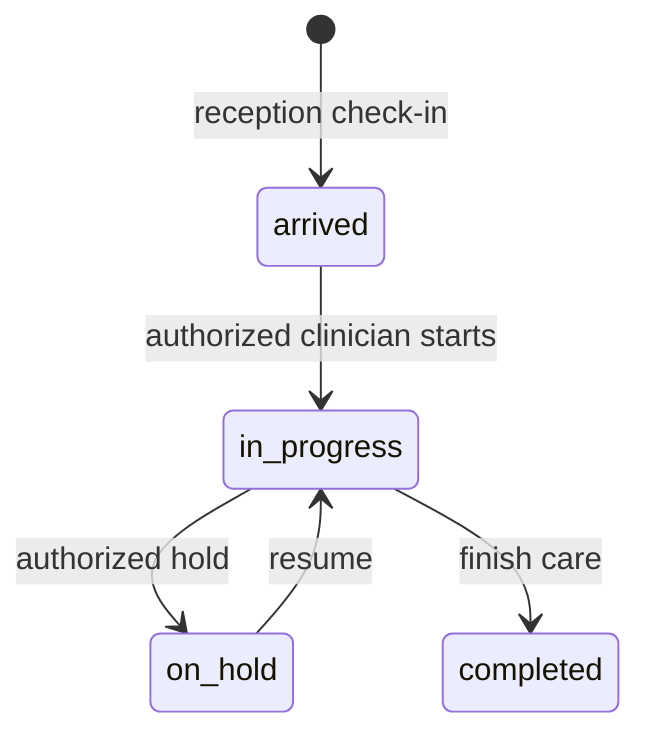

# Administrator

Snapshot: **2026-10-31**, repository source audit. No application code or live database was changed. “Source-confirmed” describes inspected code, not a passed browser, deployment or hospital test. ⚠️ UNVERIFIED = unresolved or untested; 🚧 NOT IMPLEMENTED = absent from the inspected ownership/routes; 🐞 SUSPECTED BUG = evidence needs a focused reproduction. Testing VPS and legacy LAN deployments are distinct. Actual VPS state and actual hospital configuration are not inferred from this checkout.

## 1. Purpose — who this person is in the hospital

Configuration, users, prices, reports, read-all. Cannot write clinical records (R2). This is a **system role**, not an HR Position. An Employee's job title grants no access by itself; an AppUser must hold this role through UserRole. `apps/api/src/auth/permissions.ts:44`; `apps/api/prisma/schema.prisma:967`.

## 2. Responsibilities — daily / per-shift / monthly

The procedures below describe the coded work this role supports. Daily: check assigned work and correct patient/source identity before saving. Per shift: hand over unresolved work and sign out of shared devices. Monthly: review unresolved exceptions with the designated supervisor. These frequencies are **recommended SOP assignments, ⚠️ not application-enforced duties**. The hospital must approve ownership and cadence. Capability source: `apps/web/src/pages/UsersPage.tsx:1`.

## 3. Prerequisites — before this person can work

An active User, facility, password change completion and the listed permission grants are required. Optional module screens also require enablement. Clinical accounts created through Users are refused; use Employee-linked onboarding for Doctor, Nurse, Lab technician and Pharmacist. HR self service requires an Employee link even for nonclinical accounts. Doctor accounts additionally require a clinical Position and linked Practitioner/department membership. Required workflow-specific catalogs and balances are in [the dependency matrix](../03-dependency-matrix.md). `apps/api/src/common/guards/jwt-auth.guard.ts:1`; `apps/api/src/modules/users/users.service.ts:73`; `apps/api/src/modules/staff/staff.service.ts:566`.

## 4. Permissions

Each cell lists exact permission codes, rather than implying every action in a module is allowed. Verb grouping is for reading only; some permissions appear in more than one column. Conditional rules and all denied permissions are in [the master matrix](../07-permission-matrix.md). Database grant drift is ⚠️ UNVERIFIED on the VPS.

| Module | View | Create | Edit | Delete/Cancel | Approve | Print/Export | Source (file:line) |
| --- | --- | --- | --- | --- | --- | --- | --- |
| reception | reception.read; reception.clinical_review | No matching grant | reception.manage_beds | No matching grant | No matching grant | No matching grant | apps/api/src/auth/permissions.ts:121; apps/api/src/auth/permissions.ts:122; apps/api/src/auth/permissions.ts:123; apps/api/src/auth/permissions.ts:124; apps/api/src/auth/permissions.ts:125 |
| hr | hr.employee.view; hr.salary.view; hr.document.manage; hr.attendance.view; hr.roster.view; hr.report.view; hr.self.view | hr.employee.create; hr.leave.request | hr.employee.edit; hr.salary.edit; hr.document.manage; hr.credential.manage; hr.attendance.mark; hr.roster.edit | hr.employee.exit | hr.leave.approve | No matching grant | apps/api/src/auth/permissions.ts:126; apps/api/src/auth/permissions.ts:127; apps/api/src/auth/permissions.ts:128; apps/api/src/auth/permissions.ts:129; apps/api/src/auth/permissions.ts:130; apps/api/src/auth/permissions.ts:131; apps/api/src/auth/permissions.ts:132; apps/api/src/auth/permissions.ts:133; apps/api/src/auth/permissions.ts:134; apps/api/src/auth/permissions.ts:135; apps/api/src/auth/permissions.ts:136; apps/api/src/auth/permissions.ts:141; apps/api/src/auth/permissions.ts:142; apps/api/src/auth/permissions.ts:146; apps/api/src/auth/permissions.ts:147; apps/api/src/auth/permissions.ts:148 |
| crm | crm.read; crm.appointments.write | crm.contacts.write; crm.leads.write; crm.interactions.write; crm.calls.write; crm.tasks.write; crm.appointments.write | crm.configure; crm.leads.assign; crm.tasks.assign | No matching grant | crm.contacts.authorize | No matching grant | apps/api/src/auth/permissions.ts:153; apps/api/src/auth/permissions.ts:154; apps/api/src/auth/permissions.ts:155; apps/api/src/auth/permissions.ts:156; apps/api/src/auth/permissions.ts:157; apps/api/src/auth/permissions.ts:158; apps/api/src/auth/permissions.ts:159; apps/api/src/auth/permissions.ts:160; apps/api/src/auth/permissions.ts:161; apps/api/src/auth/permissions.ts:162; apps/api/src/auth/permissions.ts:163; apps/api/src/auth/permissions.ts:164; apps/api/src/auth/permissions.ts:165 |
| payroll | payroll.read | payroll.write | payroll.configure | No matching grant | payroll.approve | No matching grant | apps/api/src/auth/permissions.ts:166; apps/api/src/auth/permissions.ts:173; apps/api/src/auth/permissions.ts:174; apps/api/src/auth/permissions.ts:175; apps/api/src/auth/permissions.ts:176 |
| finance | finance.read | finance.write | finance.consolidation.manage; finance.configure; finance.post; finance.reconcile | No matching grant | finance.close | finance.export | apps/api/src/auth/permissions.ts:177; apps/api/src/auth/permissions.ts:178; apps/api/src/auth/permissions.ts:185; apps/api/src/auth/permissions.ts:193; apps/api/src/auth/permissions.ts:194; apps/api/src/auth/permissions.ts:195; apps/api/src/auth/permissions.ts:196; apps/api/src/auth/permissions.ts:197 |
| auth | auth.login; auth.me | No matching grant | No matching grant | No matching grant | No matching grant | No matching grant | apps/api/src/auth/permissions.ts:199; apps/api/src/auth/permissions.ts:222 |
| user | user.read | user.create | user.edit | user.deactivate | No matching grant | No matching grant | apps/api/src/auth/permissions.ts:236; apps/api/src/auth/permissions.ts:238; apps/api/src/auth/permissions.ts:239; apps/api/src/auth/permissions.ts:240; apps/api/src/auth/permissions.ts:241 |
| role | No matching grant | No matching grant | role.assign | No matching grant | No matching grant | No matching grant | apps/api/src/auth/permissions.ts:242 |
| facility | No matching grant | No matching grant | facility.manage | No matching grant | No matching grant | No matching grant | apps/api/src/auth/permissions.ts:245 |
| department | No matching grant | No matching grant | department.manage | No matching grant | No matching grant | No matching grant | apps/api/src/auth/permissions.ts:246 |
| room | No matching grant | No matching grant | room.manage | No matching grant | No matching grant | No matching grant | apps/api/src/auth/permissions.ts:247 |
| practitioner | No matching grant | No matching grant | practitioner.manage | No matching grant | No matching grant | No matching grant | apps/api/src/auth/permissions.ts:248 |
| service | No matching grant | No matching grant | service.manage | No matching grant | No matching grant | No matching grant | apps/api/src/auth/permissions.ts:250 |
| price | No matching grant | No matching grant | price.change | No matching grant | No matching grant | No matching grant | apps/api/src/auth/permissions.ts:251 |
| drug | drug.read | No matching grant | drug.manage | No matching grant | No matching grant | No matching grant | apps/api/src/auth/permissions.ts:253; apps/api/src/auth/permissions.ts:267 |
| labtest | No matching grant | No matching grant | labtest.manage | No matching grant | No matching grant | No matching grant | apps/api/src/auth/permissions.ts:269 |
| panel | No matching grant | No matching grant | panel.manage | No matching grant | No matching grant | No matching grant | apps/api/src/auth/permissions.ts:271 |
| template | template.read | No matching grant | template.manage.own; template.manage.shared | No matching grant | No matching grant | No matching grant | apps/api/src/auth/permissions.ts:272; apps/api/src/auth/permissions.ts:273; apps/api/src/auth/permissions.ts:284 |
| setting | No matching grant | No matching grant | setting.manage | No matching grant | No matching grant | No matching grant | apps/api/src/auth/permissions.ts:285 |
| patient | patient.search; patient.read_demographics; patient.read_clinical (R2); patient.read_history (R2); patient.merge_duplicates | No matching grant | patient.edit_demographics | patient.void | No matching grant | No matching grant | apps/api/src/auth/permissions.ts:289; apps/api/src/auth/permissions.ts:301; apps/api/src/auth/permissions.ts:307; apps/api/src/auth/permissions.ts:320; apps/api/src/auth/permissions.ts:328; apps/api/src/auth/permissions.ts:329; apps/api/src/auth/permissions.ts:331 |
| allergy | allergy.read | No matching grant | No matching grant | No matching grant | No matching grant | No matching grant | apps/api/src/auth/permissions.ts:344 |
| visit | visit.read_queue | No matching grant | visit.reassign_practitioner | visit.cancel; visit.void | No matching grant | No matching grant | apps/api/src/auth/permissions.ts:348; apps/api/src/auth/permissions.ts:376; apps/api/src/auth/permissions.ts:382; apps/api/src/auth/permissions.ts:384 |
| appointment | appointment.read | No matching grant | appointment.mark_no_show | appointment.cancel | No matching grant | No matching grant | apps/api/src/auth/permissions.ts:400; apps/api/src/auth/permissions.ts:407; apps/api/src/auth/permissions.ts:413 |
| vitals | vitals.read (R2) | No matching grant | No matching grant | No matching grant | No matching grant | No matching grant | apps/api/src/auth/permissions.ts:419 |
| diagnosis | diagnosis.read (R2) | No matching grant | No matching grant | No matching grant | No matching grant | No matching grant | apps/api/src/auth/permissions.ts:421 |
| clinical_note | No matching grant | No matching grant | No matching grant | No matching grant | No matching grant | No matching grant | Denied by absence: `apps/api/src/auth/permissions.ts:1` |
| attachment | attachment.read (R2) | No matching grant | No matching grant | No matching grant | No matching grant | No matching grant | apps/api/src/auth/permissions.ts:430 |
| prescription | prescription.read (R2) | No matching grant | No matching grant | No matching grant | No matching grant | No matching grant | apps/api/src/auth/permissions.ts:435 |
| interaction | interaction.check | No matching grant | No matching grant | No matching grant | No matching grant | No matching grant | apps/api/src/auth/permissions.ts:447 |
| follow_up | follow_up.read (R2) | follow_up.respond | No matching grant | No matching grant | No matching grant | No matching grant | apps/api/src/auth/permissions.ts:469; apps/api/src/auth/permissions.ts:477 |
| lab_order | lab_order.read_queue | No matching grant | No matching grant | No matching grant | No matching grant | No matching grant | apps/api/src/auth/permissions.ts:481 |
| lab | No matching grant | No matching grant | No matching grant | No matching grant | No matching grant | No matching grant | Denied by absence: `apps/api/src/auth/permissions.ts:1` |
| lab_result | lab_result.read (R2) | No matching grant | No matching grant | No matching grant | No matching grant | No matching grant | apps/api/src/auth/permissions.ts:488 |
| pharmacy | pharmacy.read_queue | No matching grant | No matching grant | No matching grant | No matching grant | No matching grant | apps/api/src/auth/permissions.ts:493 |
| invoice | invoice.read; invoice.list | No matching grant | No matching grant | invoice.void | No matching grant | No matching grant | apps/api/src/auth/permissions.ts:503; apps/api/src/auth/permissions.ts:516; apps/api/src/auth/permissions.ts:524 |
| payment | No matching grant | No matching grant | No matching grant | payment.refund | No matching grant | No matching grant | apps/api/src/auth/permissions.ts:519 |
| refund | No matching grant | No matching grant | No matching grant | No matching grant | No matching grant | No matching grant | Denied by absence: `apps/api/src/auth/permissions.ts:1` |
| discount | No matching grant | No matching grant | No matching grant | No matching grant | discount.approve_over_threshold | No matching grant | apps/api/src/auth/permissions.ts:522; apps/api/src/auth/permissions.ts:523 |
| lab_charge | lab_charge.read | No matching grant | No matching grant | No matching grant | No matching grant | No matching grant | apps/api/src/auth/permissions.ts:533 |
| report | report.operational; report.financial; report.clinical_aggregate | No matching grant | No matching grant | No matching grant | No matching grant | No matching grant | apps/api/src/auth/permissions.ts:538; apps/api/src/auth/permissions.ts:539; apps/api/src/auth/permissions.ts:541 |
| audit_log | audit_log.read | No matching grant | No matching grant | No matching grant | No matching grant | No matching grant | apps/api/src/auth/permissions.ts:542 |
| error_log | error_log.read | No matching grant | No matching grant | No matching grant | No matching grant | No matching grant | apps/api/src/auth/permissions.ts:544 |
| data | No matching grant | No matching grant | No matching grant | No matching grant | No matching grant | data.export (R11) | apps/api/src/auth/permissions.ts:546 |

## 5. What they CANNOT do (and who does it instead)

Anything absent from this role's grants is denied, including on a screen reached by manually entering its URL. Multiple roles may expand authority; this document assumes this role alone. Admin manages configuration and users; receptionist registers patients and takes lab collections; doctor writes diagnoses/notes/prescriptions; lab_tech enters/verifies lab results; pharmacist confirms medicine handover; finance roles follow independent approval and posting checks. **Admin alone is not a clinical author.** Exact exceptions and conditions: `apps/api/src/auth/permissions.ts:1`; `apps/api/src/common/guards/permissions.guard.ts:1`.

## 6. Screens they use — navigation path

English menu labels below come from the locale file. The Main group has no translated heading in the current English dictionary. Listed visibility does not prove every button is authorized. `apps/web/src/i18n/locales/en.json:1`.

| Menu group › item | URL | Module prerequisite | Source |
| --- | --- | --- | --- |
| Administration › Human resources | /hr | hr | `apps/web/src/auth/nav.ts:1` |
| Main › CRM | /crm | crm | `apps/web/src/auth/nav.ts:1` |
| Administration › Finance & accounting | /finance | finance | `apps/web/src/auth/nav.ts:1` |
| Main › Dashboard | / | Core | `apps/web/src/auth/nav.ts:1` |
| Clinical › Reception operations | /reception/operations | Core | `apps/web/src/auth/nav.ts:1` |
| Clinical › Queue | /queue | Core | `apps/web/src/auth/nav.ts:1` |
| Clinical › Appointments | /appointments | Core | `apps/web/src/auth/nav.ts:1` |
| Clinical › Patients | /patients | Core | `apps/web/src/auth/nav.ts:1` |
| Clinical › Follow-ups | /follow-ups | Core | `apps/web/src/auth/nav.ts:1` |
| Clinical › Diagnosis codes | /icd | Core | `apps/web/src/auth/nav.ts:1` |
| Clinical › Interactions | /interactions | Core | `apps/web/src/auth/nav.ts:1` |
| Clinical › Lab | /lab | lab | `apps/web/src/auth/nav.ts:1` |
| Administration › Invoices | /invoices | Core | `apps/web/src/auth/nav.ts:1` |
| Administration › Collections | /collections | Core | `apps/web/src/auth/nav.ts:1` |
| Administration › Till | /till | Core | `apps/web/src/auth/nav.ts:1` |
| Administration › Users | /users | Core | `apps/web/src/auth/nav.ts:1` |
| Administration › Settings | /settings | Core | `apps/web/src/auth/nav.ts:1` |
| Administration › Modules | /modules | Core | `apps/web/src/auth/nav.ts:1` |
| Administration › Departments | /departments | Core | `apps/web/src/auth/nav.ts:1` |
| Administration › Practitioners | /practitioners | Core | `apps/web/src/auth/nav.ts:1` |
| Administration › Services | /services | Core | `apps/web/src/auth/nav.ts:1` |
| Administration › Lab tests | /lab-tests | lab | `apps/web/src/auth/nav.ts:1` |
| Administration › Lab panels | /lab-panels | lab | `apps/web/src/auth/nav.ts:1` |
| Administration › Drugs | /drugs | Core | `apps/web/src/auth/nav.ts:1` |
| Administration › Reports | /reports | Core | `apps/web/src/auth/nav.ts:1` |

## 7. Button & action reference

These are source locations on menu-linked or permission-linked screens, including reusable controls. **Rows are an inventory, not a grant.** Read the endpoint permission against Section 4; branch-dependent visibility not proven for this role is ⚠️ UNVERIFIED. Administrator includes the complete UI inventory to guarantee no source location is silently omitted, including clinical controls the administrator cannot use. Side effects are direct static service effects; nested helpers may add effects. Runtime behavior and physical printing are not verified by this table.

| ID / source | Screen / component | Button / action (English; Dari where available) | Where | What it does / handler | Preconditions / disabled when | Side effects / trace evidence | Reversible? how | API endpoint | Permission required | Audited? |
| --- | --- | --- | --- | --- | --- | --- | --- | --- | --- | --- |
| A0001 apps/web/src/AppRoot.tsx:23 | AppRoot | FirstRunLanguagePicker | AppRoot / FirstRunLanguagePicker | Local handler / ⚠️ semantic review; onChosen: {() => setHasChosen(true)} | No explicit disabled attribute; surrounding conditions: !hasChosen ? ( <FirstRunLanguagePicker onChosen={() => setHasChosen(true)} /> ) : ( <QueryClientProvider client={queryClient}> {/* AuthProvider above the router: the route components (ProtectedRoute, | ⚠️ UNVERIFIED: inspect handler and linked API call inventory | ⚠️ Use documented cancel/reversal workflow; no generic undo | No statically resolved endpoint | ⚠️ UI local / endpoint-specific; menu is not permission | Local actions have no automatic DB audit; downstream action ⚠️ UNVERIFIED |
| A0002 apps/web/src/components/AllergyEditor.tsx:72 | ConsultPage | Record an allergy / ثبت حساسیت | AllergyEditor / Button | Local handler / ⚠️ semantic review; onClick: {() => setOpen((o) => !o)} | No explicit disabled attribute | ⚠️ UNVERIFIED: inspect handler and linked API call inventory | ⚠️ Use documented cancel/reversal workflow; no generic undo | No statically resolved endpoint | ⚠️ UI local / endpoint-specific; menu is not permission | Local actions have no automatic DB audit; downstream action ⚠️ UNVERIFIED |
| A0003 apps/web/src/components/AllergyEditor.tsx:89 | ConsultPage | Substance / Severity / Choose… / Reaction / Saving… / Save allergy / Could not save that allergy. Nothing was recorded. / ماده / شدت / انتخاب کنید… / واکنش / در حال ذخیره… / ذخیرهٔ حساسیت / ذخیرهٔ آن حساسیت ناکام شد. چیزی ثبت نشد. | AllergyEditor / form | Local handler / ⚠️ semantic review; onSubmit: {onSubmit} | No explicit disabled attribute; surrounding conditions: open && ( <Card className="p-4"> <form onSubmit={onSubmit} className="flex flex-wrap items-end gap-3"> 
 <Label htmlFor="allergySubstance">{t('allergies | ⚠️ UNVERIFIED: inspect handler and linked API call inventory | ⚠️ Use documented cancel/reversal workflow; no generic undo | No statically resolved endpoint | ⚠️ UI local / endpoint-specific; menu is not permission | Local actions have no automatic DB audit; downstream action ⚠️ UNVERIFIED |
| A0004 apps/web/src/components/AllergyEditor.tsx:92 | ConsultPage | Substance / ماده | AllergyEditor / Input | Form input / selection; onChange: {(e) => setSubstance(e.target.value)} | No explicit disabled attribute; surrounding conditions: open && ( <Card className="p-4"> <form onSubmit={onSubmit} className="flex flex-wrap items-end gap-3"> 
 <Label htmlFor="allergySubstance">{t('allergies | Changes form selection; persistence occurs on submission | Edit again before saving | No statically resolved endpoint | ⚠️ UI local / endpoint-specific; menu is not permission | Local actions have no automatic DB audit; downstream action ⚠️ UNVERIFIED |
| A0005 apps/web/src/components/AllergyEditor.tsx:106 | ConsultPage | Choose… / انتخاب کنید… | AllergyEditor / Select | Form input / selection; onChange: {(e) => setSeverity(e.target.value as AllergySeverity &#124; '')} | No explicit disabled attribute; surrounding conditions: open && ( <Card className="p-4"> <form onSubmit={onSubmit} className="flex flex-wrap items-end gap-3"> 
 <Label htmlFor="allergySubstance">{t('allergies | Changes form selection; persistence occurs on submission | Edit again before saving | No statically resolved endpoint | ⚠️ UI local / endpoint-specific; menu is not permission | Local actions have no automatic DB audit; downstream action ⚠️ UNVERIFIED |
| A0006 apps/web/src/components/AllergyEditor.tsx:122 | ConsultPage | Reaction / واکنش | AllergyEditor / Input | Form input / selection; onChange: {(e) => setReaction(e.target.value)} | No explicit disabled attribute; surrounding conditions: open && ( <Card className="p-4"> <form onSubmit={onSubmit} className="flex flex-wrap items-end gap-3"> 
 <Label htmlFor="allergySubstance">{t('allergies | Changes form selection; persistence occurs on submission | Edit again before saving | No statically resolved endpoint | ⚠️ UI local / endpoint-specific; menu is not permission | Local actions have no automatic DB audit; downstream action ⚠️ UNVERIFIED |
| A0007 apps/web/src/components/AllergyEditor.tsx:130 | ConsultPage | Saving… / Save allergy / در حال ذخیره… / ذخیرهٔ حساسیت | AllergyEditor / Button | ⚠️ No direct handler (submit/child behavior); {onSubmit} | {add.isPending}; surrounding conditions: open && ( <Card className="p-4"> <form onSubmit={onSubmit} className="flex flex-wrap items-end gap-3"> 
 <Label htmlFor="allergySubstance">{t('allergies | ⚠️ UNVERIFIED: inspect handler and linked API call inventory | ⚠️ Use documented cancel/reversal workflow; no generic undo | No statically resolved endpoint | ⚠️ UI local / endpoint-specific; menu is not permission | Local actions have no automatic DB audit; downstream action ⚠️ UNVERIFIED |
| A0008 apps/web/src/components/AllergyEditor.tsx:145 | ConsultPage | AllergyRow | AllergyEditor / AllergyRow | Local handler / ⚠️ semantic review; onToggle: {() => update.mutate({ id: allergy.id, input: { substance: allergy.substance, drugId: allergy.drugId, reaction: allergy.reaction, severity: allergy.severity, isActive: !allergy.isActive, }, }) } | No explicit disabled attribute; surrounding conditions: allergies.length > 0 && ( <ul className="mt-4 space-y-1 border-t border-border pt-3"> {allergies.map((allergy) => ( <AllergyRow key={allergy.id} allergy={allergy}; open && ( <Card className="p-4"> <form onSubmit={onSubmit} className="flex flex-wrap items-end gap-3"> 
 <Label htmlFor="allergySubstance">{t('allergies | ⚠️ UNVERIFIED: inspect handler and linked API call inventory | ⚠️ Use documented cancel/reversal workflow; no generic undo | No statically resolved endpoint | ⚠️ UI local / endpoint-specific; menu is not permission | Local actions have no automatic DB audit; downstream action ⚠️ UNVERIFIED |
| A0009 apps/web/src/components/AllergyEditor.tsx:195 | ConsultPage | Retract / Restore / پس‌گرفتن / بازگرداندن | AllergyRow / Button | Local handler / ⚠️ semantic review; onClick: {onToggle} | {busy} | ⚠️ UNVERIFIED: inspect handler and linked API call inventory | ⚠️ Use documented cancel/reversal workflow; no generic undo | No statically resolved endpoint | ⚠️ UI local / endpoint-specific; menu is not permission | Local actions have no automatic DB audit; downstream action ⚠️ UNVERIFIED |
| A0010 apps/web/src/components/BookFollowUp.tsx:98 | ConsultPage, PatientDetailPage | Date / Department / Choose a department / With you, when the patient returns. / Doctor / Any doctor / Reason / Could not book that. Nothing was saved. / Booked for {{date}}. / Booking… / Book / تاریخ / بخش / بخش را انتخاب کنید / با شما، وقتی مریض بیرته راشي. / داکتر / هر داکتر / دلیل / ثبت ناکام شد. چیزی ذخیره نشد. / برای {{date}} ثبت شد. / در حال ثبت… / ثبت | BookFollowUp / form | Server request; onSubmit: {onSubmit} | No explicit disabled attribute | apps/api/src/modules/appointment/appointment.service.ts:76; Delegated operation: inspect linked service | ⚠️ Use documented cancel/reversal workflow; no generic undo | POST /appointments (apps/api/src/modules/appointment/appointment.controller.ts:46) | appointment.create; ⚠️ This role lacks: appointment.create | App request context + audited Prisma writes; read audit is endpoint-specific. Root/manual scripts are outside this coverage. |
| A0011 apps/web/src/components/BookFollowUp.tsx:104 | ConsultPage, PatientDetailPage | Date / تاریخ | BookFollowUp / Input | Form input / selection; onChange: {(e) => setScheduledOn(e.target.value)} | No explicit disabled attribute | Changes form selection; persistence occurs on submission | Edit again before saving | No statically resolved endpoint | ⚠️ UI local / endpoint-specific; menu is not permission | Local actions have no automatic DB audit; downstream action ⚠️ UNVERIFIED |
| A0012 apps/web/src/components/BookFollowUp.tsx:118 | ConsultPage, PatientDetailPage | Choose a department / بخش را انتخاب کنید | BookFollowUp / Select | Form input / selection; onChange: {(e) => { setDepartmentId(e.target.value) setPractitionerId('') }} | No explicit disabled attribute | Changes form selection; persistence occurs on submission | Edit again before saving | No statically resolved endpoint | ⚠️ UI local / endpoint-specific; menu is not permission | Local actions have no automatic DB audit; downstream action ⚠️ UNVERIFIED |
| A0013 apps/web/src/components/BookFollowUp.tsx:140 | ConsultPage, PatientDetailPage | Any doctor / هر داکتر | BookFollowUp / Select | Form input / selection; onChange: {(e) => setPractitionerId(e.target.value)} | {!departmentId}; surrounding conditions: lockToSelf ? ( 
{t('appointments.book.withYou')}
 ) : ( 
 <Label htmlFor="apptPractitioner">{t('visits.fields.practitioner')} | Changes form selection; persistence occurs on submission | Edit again before saving | No statically resolved endpoint | ⚠️ UI local / endpoint-specific; menu is not permission | Local actions have no automatic DB audit; downstream action ⚠️ UNVERIFIED |
| A0014 apps/web/src/components/BookFollowUp.tsx:159 | ConsultPage, PatientDetailPage | Reason / دلیل | BookFollowUp / Input | Form input / selection; onChange: {(e) => setReason(e.target.value)} | No explicit disabled attribute | Changes form selection; persistence occurs on submission | Edit again before saving | No statically resolved endpoint | ⚠️ UI local / endpoint-specific; menu is not permission | Local actions have no automatic DB audit; downstream action ⚠️ UNVERIFIED |
| A0015 apps/web/src/components/BookFollowUp.tsx:178 | ConsultPage, PatientDetailPage | Booking… / Book / در حال ثبت… / ثبت | BookFollowUp / Button | Server request; {onSubmit} | {create.isPending &#124;&#124; !scheduledOn &#124;&#124; !departmentId} | apps/api/src/modules/appointment/appointment.service.ts:76; Delegated operation: inspect linked service | ⚠️ Use documented cancel/reversal workflow; no generic undo | POST /appointments (apps/api/src/modules/appointment/appointment.controller.ts:46) | appointment.create; ⚠️ This role lacks: appointment.create | App request context + audited Prisma writes; read audit is endpoint-specific. Root/manual scripts are outside this coverage. |
| A0016 apps/web/src/components/ComplaintTab.tsx:84 | ConsultPage | Chief complaint / What the patient came in with, in plain words. The desk’s version is here already — replace it with yours. / Saving… / Save complaint / Could not save the complaint. Nothing was changed. / شکایت اصلی / آنچه مریض با آن آمده، به زبان ساده. نسخهٔ پذیرش اینجاست — آن را با نوشتهٔ خود جاگزین کنید. / در حال ذخیره… / ذخیرهٔ شکایت / ذخیرهٔ شکایت ناکام شد. چیزی تغییر نکرد. | ComplaintTab / form | Server request; onSubmit: {onSubmit} | No explicit disabled attribute | apps/api/src/modules/visit/visit.service.ts:338; visit.findFirst, visit.update | ⚠️ Use documented cancel/reversal workflow; no generic undo | PATCH /visits/:id/complaint (apps/api/src/modules/visit/visit.controller.ts:144) | visit.record_complaint; ⚠️ This role lacks: visit.record_complaint | App request context + audited Prisma writes; read audit is endpoint-specific. Root/manual scripts are outside this coverage. |
| A0017 apps/web/src/components/ComplaintTab.tsx:87 | ConsultPage | Chief complaint / What the patient came in with, in plain words. The desk’s version is here already — replace it with yours. / شکایت اصلی / آنچه مریض با آن آمده، به زبان ساده. نسخهٔ پذیرش اینجاست — آن را با نوشتهٔ خود جاگزین کنید. | ComplaintTab / Textarea | Form input / selection; onChange: {(e) => setText(e.target.value)} | {!open} | Changes form selection; persistence occurs on submission | Edit again before saving | No statically resolved endpoint | ⚠️ UI local / endpoint-specific; menu is not permission | Local actions have no automatic DB audit; downstream action ⚠️ UNVERIFIED |
| A0018 apps/web/src/components/ComplaintTab.tsx:100 | ConsultPage | Saving… / Save complaint / در حال ذخیره… / ذخیرهٔ شکایت | ComplaintTab / Button | Server request; {onSubmit} | {!isDirty &#124;&#124; update.isPending}; surrounding conditions: open && ( 
 <Button type="submit" disabled={!isDirty &#124;&#124; update.isPending}> {update.isPending ? t('complaint.saving') : t('complaint.save')} | apps/api/src/modules/visit/visit.service.ts:338; visit.findFirst, visit.update | ⚠️ Use documented cancel/reversal workflow; no generic undo | PATCH /visits/:id/complaint (apps/api/src/modules/visit/visit.controller.ts:144) | visit.record_complaint; ⚠️ This role lacks: visit.record_complaint | App request context + audited Prisma writes; read audit is endpoint-specific. Root/manual scripts are outside this coverage. |
| A0019 apps/web/src/components/ComplaintTab.tsx:116 | ConsultPage | TemplatePicker | ComplaintTab / TemplatePicker | Local handler / ⚠️ semantic review; onPick: {append} | No explicit disabled attribute; surrounding conditions: open && ( <TemplatePicker // Narrowed rather than trusted: /templates?type=complaint already returns one // kind, and the guard is what stops a future caller with a wrong query string // handing a five- | ⚠️ UNVERIFIED: inspect handler and linked API call inventory | ⚠️ Use documented cancel/reversal workflow; no generic undo | No statically resolved endpoint | ⚠️ UI local / endpoint-specific; menu is not permission | Local actions have no automatic DB audit; downstream action ⚠️ UNVERIFIED |
| A0020 apps/web/src/components/ComplaintTab.tsx:154 | ConsultPage | {template.content.text} | TemplatePicker / Button | Local handler / ⚠️ semantic review; onClick: {() => onPick(template.content.text)} | No explicit disabled attribute | ⚠️ UNVERIFIED: inspect handler and linked API call inventory | ⚠️ Use documented cancel/reversal workflow; no generic undo | No statically resolved endpoint | ⚠️ UI local / endpoint-specific; menu is not permission | Local actions have no automatic DB audit; downstream action ⚠️ UNVERIFIED |
| A0021 apps/web/src/components/ComplaintTab.tsx:189 | ConsultPage | Save as phrase / ذخیره به‌حیث عبارت | SaveAsTemplate / Button | Local handler / ⚠️ semantic review; onClick: {() => setOpen(true)} | No explicit disabled attribute | ⚠️ UNVERIFIED: inspect handler and linked API call inventory | ⚠️ Use documented cancel/reversal workflow; no generic undo | No statically resolved endpoint | ⚠️ UI local / endpoint-specific; menu is not permission | Local actions have no automatic DB audit; downstream action ⚠️ UNVERIFIED |
| A0022 apps/web/src/components/ComplaintTab.tsx:200 | ConsultPage | Name it / نام آن | SaveAsTemplate / Input | Form input / selection; onChange: {(e) => setName(e.target.value)} | No explicit disabled attribute | Changes form selection; persistence occurs on submission | Edit again before saving | No statically resolved endpoint | ⚠️ UI local / endpoint-specific; menu is not permission | Local actions have no automatic DB audit; downstream action ⚠️ UNVERIFIED |
| A0023 apps/web/src/components/ComplaintTab.tsx:208 | ConsultPage | Saving… / Save phrase / در حال ذخیره… / ذخیرهٔ عبارت | SaveAsTemplate / Button | Server request; onClick: {() => create.mutate( { type: 'complaint', name: name.trim(), content: { text: phrase }, shared: false }, { onSuccess: () => { setOpen(false) setName('') }, }, ) } | {create.isPending &#124;&#124; name.trim().length < 2} | apps/api/src/modules/template/template.service.ts:85; template.create | ⚠️ Use documented cancel/reversal workflow; no generic undo | POST /templates (apps/api/src/modules/template/template.controller.ts:53) | template.manage.own | App request context + audited Prisma writes; read audit is endpoint-specific. Root/manual scripts are outside this coverage. |
| A0024 apps/web/src/components/ComplaintTab.tsx:226 | ConsultPage | Cancel / لغو | SaveAsTemplate / Button | Local handler / ⚠️ semantic review; onClick: {() => setOpen(false)} | No explicit disabled attribute | ⚠️ UNVERIFIED: inspect handler and linked API call inventory | ⚠️ Use documented cancel/reversal workflow; no generic undo | No statically resolved endpoint | ⚠️ UI local / endpoint-specific; menu is not permission | Local actions have no automatic DB audit; downstream action ⚠️ UNVERIFIED |
| A0025 apps/web/src/components/ConsultActions.tsx:196 | ConsultPage | Save and leave / ذخیره و خروج | ConsultActions / Button | Local handler / ⚠️ semantic review; onClick: {() => { void save().then((ok) => { if (ok) void navigate('/queue') }) }} | {busy}; surrounding conditions: confirmLeave && ( 
 void navigate('/queue')} | No explicit disabled attribute; surrounding conditions: confirmLeave && ( 
 setConfirmLeave(false)} | No explicit disabled attribute; surrounding conditions: confirmLeave && ( 
 onPaperSizeChange(event.target.value as PaperSize)} | No explicit disabled attribute | Changes form selection; persistence occurs on submission | Edit again before saving | No statically resolved endpoint | ⚠️ UI local / endpoint-specific; menu is not permission | Local actions have no automatic DB audit; downstream action ⚠️ UNVERIFIED |
| A0030 apps/web/src/components/ConsultActions.tsx:267 | ConsultPage | Paper / کاغذ | ConsultActions / KeyAction | Local handler / ⚠️ semantic review; onRun: {saveAndPrint} | {busy} | ⚠️ UNVERIFIED: inspect handler and linked API call inventory | ⚠️ Use documented cancel/reversal workflow; no generic undo | No statically resolved endpoint | ⚠️ UI local / endpoint-specific; menu is not permission | Local actions have no automatic DB audit; downstream action ⚠️ UNVERIFIED |
| A0031 apps/web/src/components/ConsultActions.tsx:274 | ConsultPage | Paper / کاغذ | ConsultActions / KeyAction | Server request; onRun: {saveAndFinish} | {busy} | apps/api/src/modules/visit/visit.service.ts:390; visit.findFirst, visit.update | ⚠️ Use documented cancel/reversal workflow; no generic undo | PATCH /visits/:id/status (apps/api/src/modules/visit/visit.controller.ts:117) | visit.change_status; ⚠️ This role lacks: visit.change_status | App request context + audited Prisma writes; read audit is endpoint-specific. Root/manual scripts are outside this coverage. |
| A0032 apps/web/src/components/ConsultActions.tsx:281 | ConsultPage | Paper / کاغذ | ConsultActions / KeyAction | Local handler / ⚠️ semantic review; onRun: {leave} | No explicit disabled attribute | ⚠️ UNVERIFIED: inspect handler and linked API call inventory | ⚠️ Use documented cancel/reversal workflow; no generic undo | No statically resolved endpoint | ⚠️ UI local / endpoint-specific; menu is not permission | Local actions have no automatic DB audit; downstream action ⚠️ UNVERIFIED |
| A0033 apps/web/src/components/ConsultActions.tsx:301 | ConsultPage | {label} {hint} | KeyAction / Button | Local handler / ⚠️ semantic review; onClick: {() => void onRun()} | {disabled} | ⚠️ UNVERIFIED: inspect handler and linked API call inventory | ⚠️ Use documented cancel/reversal workflow; no generic undo | No statically resolved endpoint | ⚠️ UI local / endpoint-specific; menu is not permission | Local actions have no automatic DB audit; downstream action ⚠️ UNVERIFIED |
| A0034 apps/web/src/components/CrmAppointments.tsx:150 | CrmPage | Try again / تلاش دوباره | CrmAppointments / Button | Local handler / ⚠️ semantic review; onClick: {() => void options.refetch()} | No explicit disabled attribute; surrounding conditions: options.isError && ( 
 {t('crm.loadError')}{' '} <Button onClick={() => void options.refetch()}> {t('crm.retry')} </Button> 
 ) | ⚠️ UNVERIFIED: inspect handler and linked API call inventory | ⚠️ Use documented cancel/reversal workflow; no generic undo | No statically resolved endpoint | ⚠️ UI local / endpoint-specific; menu is not permission | Local actions have no automatic DB audit; downstream action ⚠️ UNVERIFIED |
| A0035 apps/web/src/components/CrmAppointments.tsx:158 | CrmPage | Contacts and family / مخاطبین و خانواده | CrmAppointments / Link | Navigation; "/crm?tab=contacts" | No explicit disabled attribute; surrounding conditions: !options.isPending && !links.length && ( 
 {t('crmAppointments.verify')}{' '} <Link to="/crm?tab=contacts" className="text-primary underline"> {t('crmLeads.tabs.contacts')} </Lin | Changes browser destination; target: "/crm?tab=contacts" | Browser Back | No statically resolved endpoint | ⚠️ UI local / endpoint-specific; menu is not permission | Local actions have no automatic DB audit; downstream action ⚠️ UNVERIFIED |
| A0036 apps/web/src/components/CrmAppointments.tsx:166 | CrmPage | Choose / انتخاب کنید | CrmAppointments / select | Form input / selection; onChange: {(e) => { setLink(e.target.value) edit() }} | No explicit disabled attribute | Changes form selection; persistence occurs on submission | Edit again before saving | No statically resolved endpoint | ⚠️ UI local / endpoint-specific; menu is not permission | Local actions have no automatic DB audit; downstream action ⚠️ UNVERIFIED |
| A0037 apps/web/src/components/CrmAppointments.tsx:184 | CrmPage | Appointment date / تاریخ ملاقات | CrmAppointments / Input | Form input / selection; onChange: {(e) => { setDate(e.target.value) edit() }}; onInput: {(e) => { setDate(e.currentTarget.value) edit() }} | No explicit disabled attribute | Changes form selection; persistence occurs on submission | Edit again before saving | No statically resolved endpoint | ⚠️ UI local / endpoint-specific; menu is not permission | Local actions have no automatic DB audit; downstream action ⚠️ UNVERIFIED |
| A0038 apps/web/src/components/CrmAppointments.tsx:202 | CrmPage | Book appointment / Department / Choose / Provider / Choose / Start time / Duration (minutes) / Confirm working hours with the provider before booking. This view shows existing reservations; it does not define clinic opening hours. / CRM could not be loaded. / Existing provider reservations / This provider has date-only bookings on this day. Ask reception to review them before booking a time. / No existing reservations for this provider on this day. / Book appointment / Could not save the contact. Try again. / Appointment booked. Reception sees the same booking. / ثبت ملاقات / بخش / انتخاب کنید / داکتر / انتخاب کنید / زمان شروع / مدت (دقیقه) / پیش از ثبت، ساعت کاری را با داکتر تأیید کنید. این صفحه ملاقات‌های موجود را نشان می‌دهد، نه ساعت کاری کلینیک. / بارگذاری انجام نشد. / ملاقات‌های موجود داکتر / این داکتر در این روز ملاقات بدون ساعت دارد. پیش از تعیین ساعت از پذیرش بخواهید آن‌ها را بررسی کند. / برای این داکتر در این روز ملاقات موجود نیست. / ثبت ملاقات / ذخیره تماس ممکن نشد. دوباره تلاش کنید. / ملاقات ثبت شد. پذیرش همین ملاقات را می‌بیند. | CrmAppointments / form | Server request; onSubmit: {submit} | No explicit disabled attribute; surrounding conditions: selected && options.data?.canWrite && ( <Card className="p-5"> <form className="space-y-4" onSubmit={submit}> <h3 className="font-semibold">{t('crmAppointments.book')}</h3> 
 { setDepartment(e.target.value) setProvider('') edit() }} | No explicit disabled attribute; surrounding conditions: selected && options.data?.canWrite && ( <Card className="p-5"> <form className="space-y-4" onSubmit={submit}> <h3 className="font-semibold">{t('crmAppointments.book')}</h3> 
 { setProvider(e.target.value) edit() }} | No explicit disabled attribute; surrounding conditions: selected && options.data?.canWrite && ( <Card className="p-5"> <form className="space-y-4" onSubmit={submit}> <h3 className="font-semibold">{t('crmAppointments.book')}</h3> 
 { setTime(e.target.value) edit() }}; onInput: {(e) => { setTime(e.currentTarget.value) edit() }} | No explicit disabled attribute; surrounding conditions: selected && options.data?.canWrite && ( <Card className="p-5"> <form className="space-y-4" onSubmit={submit}> <h3 className="font-semibold">{t('crmAppointments.book')}</h3> 
 { setDuration(Number(e.target.value)) edit() }} | No explicit disabled attribute; surrounding conditions: selected && options.data?.canWrite && ( <Card className="p-5"> <form className="space-y-4" onSubmit={submit}> <h3 className="font-semibold">{t('crmAppointments.book')}</h3> 
 <form className="space-y-4" onSubmit={submit}> <h3 className="font-semibold">{t('crmAppointments.book')}</h3> 
 cancel.mutate(a.id)} | {cancel.isPending}; surrounding conditions: cancelId === a.id ? ( 
 
{t('crmAppointments.confirmCancel')}
 <Button disabled={cancel.isPending; options.data?.canWrite && ['booked', 'arrived'].includes(a.status) && (cancelId === a.id ? ( 
 
{t('crmAppoint; visible && book.data?.items.map((a) => ( 
 
 {a.endsAt ? `${format(a.scheduledAt)} — ${format(a.endsAt | apps/api/src/modules/crm/crm-appointments.service.ts:236; appointment.findFirst | ⚠️ Use documented cancel/reversal workflow; no generic undo | POST /crm/appointments/:id/cancel (apps/api/src/modules/crm/crm-appointments.controller.ts:65) | crm.appointments.write | App request context + audited Prisma writes; read audit is endpoint-specific. Root/manual scripts are outside this coverage. |
| A0045 apps/web/src/components/CrmAppointments.tsx:360 | CrmPage | Keep appointment / حفظ ملاقات | CrmAppointments / Button | Local handler / ⚠️ semantic review; onClick: {() => setCancel(null)} | No explicit disabled attribute; surrounding conditions: cancelId === a.id ? ( 
 
{t('crmAppointments.confirmCancel')}
 <Button disabled={cancel.isPending; options.data?.canWrite && ['booked', 'arrived'].includes(a.status) && (cancelId === a.id ? ( 
 
{t('crmAppoint; visible && book.data?.items.map((a) => ( 
 
 {a.endsAt ? `${format(a.scheduledAt)} — ${format(a.endsAt | ⚠️ UNVERIFIED: inspect handler and linked API call inventory | ⚠️ Use documented cancel/reversal workflow; no generic undo | No statically resolved endpoint | ⚠️ UI local / endpoint-specific; menu is not permission | Local actions have no automatic DB audit; downstream action ⚠️ UNVERIFIED |
| A0046 apps/web/src/components/CrmAppointments.tsx:365 | CrmPage | Cancel appointment / لغو ملاقات | CrmAppointments / Button | Local handler / ⚠️ semantic review; onClick: {() => { edit() setCancel(a.id) }} | No explicit disabled attribute; surrounding conditions: cancelId === a.id ? ( 
 
{t('crmAppointments.confirmCancel')}
 <Button disabled={cancel.isPending; options.data?.canWrite && ['booked', 'arrived'].includes(a.status) && (cancelId === a.id ? ( 
 
{t('crmAppoint; visible && book.data?.items.map((a) => ( 
 
 {a.endsAt ? `${format(a.scheduledAt)} — ${format(a.endsAt | ⚠️ UNVERIFIED: inspect handler and linked API call inventory | ⚠️ Use documented cancel/reversal workflow; no generic undo | No statically resolved endpoint | ⚠️ UI local / endpoint-specific; menu is not permission | Local actions have no automatic DB audit; downstream action ⚠️ UNVERIFIED |
| A0047 apps/web/src/components/CrmCalls.tsx:48 | CrmPage | {values.map((v) => ( {t(`crmCalls.values.${v}`, { defaultValue: t(`crmTimeline.values.${v}`), })} ))} | Choice / select | Form input / selection; onChange: {(e) => onChange(e.target.value)} | No explicit disabled attribute | Changes form selection; persistence occurs on submission | Edit again before saving | No statically resolved endpoint | ⚠️ UI local / endpoint-specific; menu is not permission | Local actions have no automatic DB audit; downstream action ⚠️ UNVERIFIED |
| A0048 apps/web/src/components/CrmCalls.tsx:129 | CrmPage | Log a call / ثبت تماس | CrmCalls / Button | Local handler / ⚠️ semantic review; onClick: {() => { setCallback(null) setAdding(true) setSelected(null) }} | No explicit disabled attribute; surrounding conditions: query.data?.canWrite && ( <Button onClick={() => { setCallback(null) setAdding(true) setSelected(null) }} > {t('crmCalls.add')} </Bu | ⚠️ UNVERIFIED: inspect handler and linked API call inventory | ⚠️ Use documented cancel/reversal workflow; no generic undo | No statically resolved endpoint | ⚠️ UI local / endpoint-specific; menu is not permission | Local actions have no automatic DB audit; downstream action ⚠️ UNVERIFIED |
| A0049 apps/web/src/components/CrmCalls.tsx:139 | CrmPage | Pending actions / اقدامات در انتظار | CrmCalls / Button | Local handler / ⚠️ semantic review; onClick: {() => { setPending('pending') setPage(1) }} | No explicit disabled attribute | ⚠️ UNVERIFIED: inspect handler and linked API call inventory | ⚠️ Use documented cancel/reversal workflow; no generic undo | No statically resolved endpoint | ⚠️ UI local / endpoint-specific; menu is not permission | Local actions have no automatic DB audit; downstream action ⚠️ UNVERIFIED |
| A0050 apps/web/src/components/CrmCalls.tsx:149 | CrmPage | Reload / بارگذاری دوباره | CrmCalls / Button | Local handler / ⚠️ semantic review; onClick: {() => void query.refetch()} | No explicit disabled attribute | ⚠️ UNVERIFIED: inspect handler and linked API call inventory | ⚠️ Use documented cancel/reversal workflow; no generic undo | No statically resolved endpoint | ⚠️ UI local / endpoint-specific; menu is not permission | Local actions have no automatic DB audit; downstream action ⚠️ UNVERIFIED |
| A0051 apps/web/src/components/CrmCalls.tsx:153 | CrmPage | Open existing patient follow-ups / باز کردن پیگیری‌های فعلی مریضان | CrmCalls / Link | Navigation; "/follow-ups" | No explicit disabled attribute; surrounding conditions: query.data?.canViewFollowUps && ( <Link className="self-center text-sm text-primary underline" to="/follow-ups" > {t('crm.existingFollowUps')} </Link> ) | Changes browser destination; target: "/follow-ups" | Browser Back | No statically resolved endpoint | ⚠️ UI local / endpoint-specific; menu is not permission | Local actions have no automatic DB audit; downstream action ⚠️ UNVERIFIED |
| A0052 apps/web/src/components/CrmCalls.tsx:163 | CrmPage | CallForm | CrmCalls / CallForm | Local handler / ⚠️ semantic review; onCancel: {() => { setAdding(false) setCallback(null) }}; onSaved: {saved} | No explicit disabled attribute; surrounding conditions: adding && (!callback &#124;&#124; Date.parse(callback.interaction.visibleUntil) > now) && ( <CallForm key={callback?.id ?? 'new'} callback={callback} onCancel={() => { setAdding(fals | ⚠️ UNVERIFIED: inspect handler and linked API call inventory | ⚠️ Use documented cancel/reversal workflow; no generic undo | No statically resolved endpoint | ⚠️ UI local / endpoint-specific; menu is not permission | Local actions have no automatic DB audit; downstream action ⚠️ UNVERIFIED |
| A0053 apps/web/src/components/CrmCalls.tsx:173 | CrmPage | Search / جستجو | CrmCalls / form | Local handler / ⚠️ semantic review; onSubmit: {(e) => { e.preventDefault() setSearch(q) setPage(1) }} | No explicit disabled attribute | ⚠️ UNVERIFIED: inspect handler and linked API call inventory | ⚠️ Use documented cancel/reversal workflow; no generic undo | No statically resolved endpoint | ⚠️ UI local / endpoint-specific; menu is not permission | Local actions have no automatic DB audit; downstream action ⚠️ UNVERIFIED |
| A0054 apps/web/src/components/CrmCalls.tsx:181 | CrmPage | Search phone, contact or lead / جستجوی شماره، مخاطب یا سرنخ | CrmCalls / Input | Form input / selection; onChange: {(e) => setQ(e.target.value)} | No explicit disabled attribute | Changes form selection; persistence occurs on submission | Edit again before saving | No statically resolved endpoint | ⚠️ UI local / endpoint-specific; menu is not permission | Local actions have no automatic DB audit; downstream action ⚠️ UNVERIFIED |
| A0055 apps/web/src/components/CrmCalls.tsx:188 | CrmPage | Search / جستجو | CrmCalls / Button | ⚠️ No direct handler (submit/child behavior); {(e) => { e.preventDefault() setSearch(q) setPage(1) }} | No explicit disabled attribute | ⚠️ UNVERIFIED: inspect handler and linked API call inventory | ⚠️ Use documented cancel/reversal workflow; no generic undo | No statically resolved endpoint | ⚠️ UI local / endpoint-specific; menu is not permission | Local actions have no automatic DB audit; downstream action ⚠️ UNVERIFIED |
| A0056 apps/web/src/components/CrmCalls.tsx:193 | CrmPage | { setState(v) setPage(1) }} /> { setDirection(v) setPage(1) }} /> { setPending(v) setPage(1) }} /> | CrmCalls / Choice | Local handler / ⚠️ semantic review; onChange: {(v) => { setState(v) setPage(1) }} | No explicit disabled attribute | ⚠️ UNVERIFIED: inspect handler and linked API call inventory | ⚠️ Use documented cancel/reversal workflow; no generic undo | No statically resolved endpoint | ⚠️ UI local / endpoint-specific; menu is not permission | Local actions have no automatic DB audit; downstream action ⚠️ UNVERIFIED |
| A0057 apps/web/src/components/CrmCalls.tsx:202 | CrmPage | { setState(v) setPage(1) }} /> { setDirection(v) setPage(1) }} /> { setPending(v) setPage(1) }} /> | CrmCalls / Choice | Local handler / ⚠️ semantic review; onChange: {(v) => { setDirection(v) setPage(1) }} | No explicit disabled attribute | ⚠️ UNVERIFIED: inspect handler and linked API call inventory | ⚠️ Use documented cancel/reversal workflow; no generic undo | No statically resolved endpoint | ⚠️ UI local / endpoint-specific; menu is not permission | Local actions have no automatic DB audit; downstream action ⚠️ UNVERIFIED |
| A0058 apps/web/src/components/CrmCalls.tsx:211 | CrmPage | { setState(v) setPage(1) }} /> { setDirection(v) setPage(1) }} /> { setPending(v) setPage(1) }} /> | CrmCalls / Choice | Local handler / ⚠️ semantic review; onChange: {(v) => { setPending(v) setPage(1) }} | No explicit disabled attribute | ⚠️ UNVERIFIED: inspect handler and linked API call inventory | ⚠️ Use documented cancel/reversal workflow; no generic undo | No statically resolved endpoint | ⚠️ UI local / endpoint-specific; menu is not permission | Local actions have no automatic DB audit; downstream action ⚠️ UNVERIFIED |
| A0059 apps/web/src/components/CrmCalls.tsx:254 | CrmPage | Call details / جزئیات تماس | CrmCalls / Button | Local handler / ⚠️ semantic review; onClick: {() => { setSelected(c.id) setAdding(false) }} | No explicit disabled attribute; surrounding conditions: query.data && !query.isError && query.data.items.every( (c) => Date.parse(c.interaction.visibleUntil) > now, ) && ( <> {!query.data.items.length && 
{t('crmCalls.empty')}
} | ⚠️ UNVERIFIED: inspect handler and linked API call inventory | ⚠️ Use documented cancel/reversal workflow; no generic undo | No statically resolved endpoint | ⚠️ UI local / endpoint-specific; menu is not permission | Local actions have no automatic DB audit; downstream action ⚠️ UNVERIFIED |
| A0060 apps/web/src/components/CrmCalls.tsx:267 | CrmPage | Previous / قبلی | CrmCalls / Button | Local handler / ⚠️ semantic review; onClick: {() => setPage(page - 1)} | {page === 1}; surrounding conditions: query.data && !query.isError && query.data.items.every( (c) => Date.parse(c.interaction.visibleUntil) > now, ) && ( <> {!query.data.items.length && 
{t('crmCalls.empty')}
} | ⚠️ UNVERIFIED: inspect handler and linked API call inventory | ⚠️ Use documented cancel/reversal workflow; no generic undo | No statically resolved endpoint | ⚠️ UI local / endpoint-specific; menu is not permission | Local actions have no automatic DB audit; downstream action ⚠️ UNVERIFIED |
| A0061 apps/web/src/components/CrmCalls.tsx:277 | CrmPage | Next / بعدی | CrmCalls / Button | Local handler / ⚠️ semantic review; onClick: {() => setPage(page + 1)} | {page * 25 >= query.data.total}; surrounding conditions: query.data && !query.isError && query.data.items.every( (c) => Date.parse(c.interaction.visibleUntil) > now, ) && ( <> {!query.data.items.length && 
{t('crmCalls.empty')}
} | ⚠️ UNVERIFIED: inspect handler and linked API call inventory | ⚠️ Use documented cancel/reversal workflow; no generic undo | No statically resolved endpoint | ⚠️ UI local / endpoint-specific; menu is not permission | Local actions have no automatic DB audit; downstream action ⚠️ UNVERIFIED |
| A0062 apps/web/src/components/CrmCalls.tsx:288 | CrmPage | {selected} | CrmCalls / CallDetail | Local handler / ⚠️ semantic review; onClose: {() => setSelected(null)}; onCallback: {(c) => { setCallback(c) setSelected(null) setAdding(true) }} | No explicit disabled attribute; surrounding conditions: selected && ( <CallDetail key={selected} id={selected} canWrite={query.data?.canWrite ?? false} onClose={() => setSelected(null)} onCallback={(c) => { setCallback(c) | ⚠️ UNVERIFIED: inspect handler and linked API call inventory | ⚠️ Use documented cancel/reversal workflow; no generic undo | No statically resolved endpoint | ⚠️ UI local / endpoint-specific; menu is not permission | Local actions have no automatic DB audit; downstream action ⚠️ UNVERIFIED |
| A0063 apps/web/src/components/CrmCalls.tsx:417 | CrmPage | A phone match does not verify identity. Use the contact workspace to check the caller and their authority before discussing a patient. / Search / Select a record / CRM could not be loaded. / This outbound attempt retains the original caller and subject. Complete the original action separately when it is resolved. / Open contacts for identity, authority and consent checks / CRM could not be loaded. / Preferred channel: / Permission to contact: / General inquiry / Times use your browser time zone: / Check the caller, times and required fields. Missed and unanswered calls require a next action. Patient discussion requires a current authorized caller check. / The interaction could not be saved. / Save call / Cancel / تطابق شماره هویت را تأیید نمی‌کند. پیش از صحبت دربارهٔ مریض، هویت و صلاحیت تماس‌گیرنده را در بخش مخاطبین بررسی کنید. / جستجو / انتخاب سابقه / بارگذاری انجام نشد. / این تماس خروجی به تماس‌گیرنده و موضوع اصلی مرتبط می‌ماند. پس از حل موضوع، اقدام اصلی را جداگانه تکمیل کنید. / باز کردن مخاطبین برای بررسی هویت، صلاحیت و رضایت / بارگذاری انجام نشد. / راه ارتباط ترجیحی: / اجازهٔ تماس: / درخواست عمومی / زمان‌ها مطابق منطقهٔ زمانی مرورگر است: / تماس‌گیرنده، زمان‌ها و معلومات ضروری را بررسی کنید. تماس بی‌پاسخ نیاز به اقدام بعدی دارد. بحث دربارهٔ مریض نیاز به تأیید معتبر تماس‌گیرنده دارد. / تعامل ذخیره نشد. / ذخیرهٔ تماس / لغو | CallForm / form | Local handler / ⚠️ semantic review; onSubmit: {submit}; onChange: {() => { setKey(crypto.randomUUID()) mutation.reset() }} | No explicit disabled attribute | ⚠️ UNVERIFIED: inspect handler and linked API call inventory | ⚠️ Use documented cancel/reversal workflow; no generic undo | No statically resolved endpoint | ⚠️ UI local / endpoint-specific; menu is not permission | Local actions have no automatic DB audit; downstream action ⚠️ UNVERIFIED |
| A0064 apps/web/src/components/CrmCalls.tsx:432 | CrmPage | Choice | CallForm / Choice | Local handler / ⚠️ semantic review; onChange: {(v) => { setSubject(v) setContactId(null) setLeadId(null) setLinkId(null) setPurpose('enquiry') setSearch('') setSearchTerm('') }} | No explicit disabled attribute; surrounding conditions: !callback && ( <> <Choice label={t('crmCalls.subject')} value={subject} values={['unknown', 'contact', 'lead']} onChange={(v) => { setSubject(v) | ⚠️ UNVERIFIED: inspect handler and linked API call inventory | ⚠️ Use documented cancel/reversal workflow; no generic undo | No statically resolved endpoint | ⚠️ UI local / endpoint-specific; menu is not permission | Local actions have no automatic DB audit; downstream action ⚠️ UNVERIFIED |
| A0065 apps/web/src/components/CrmCalls.tsx:449 | CrmPage | Search caller records / جستجوی سوابق تماس‌گیرنده | CallForm / Input | Form input / selection; onChange: {(e) => setSearch(e.target.value)} | No explicit disabled attribute; surrounding conditions: subject !== 'unknown' && ( <> 
 <Input aria-label={t('crmCalls.searchSubject')} value={search} maxLength=; !callback && ( <> <Choice label={t('crmCalls.subject')} value={subject} values={['unknown', 'contact', 'lead']} onChange={(v) => { setSubject(v) | Changes form selection; persistence occurs on submission | Edit again before saving | No statically resolved endpoint | ⚠️ UI local / endpoint-specific; menu is not permission | Local actions have no automatic DB audit; downstream action ⚠️ UNVERIFIED |
| A0066 apps/web/src/components/CrmCalls.tsx:455 | CrmPage | Search / جستجو | CallForm / Button | Server request; onClick: {() => setSearchTerm(search)} | No explicit disabled attribute; surrounding conditions: subject !== 'unknown' && ( <> 
 <Input aria-label={t('crmCalls.searchSubject')} value={search} maxLength=; !callback && ( <> <Choice label={t('crmCalls.subject')} value={subject} values={['unknown', 'contact', 'lead']} onChange={(v) => { setSubject(v) | apps/api/src/modules/crm/crm-calls.service.ts:124; crmCall.create | ⚠️ Use documented cancel/reversal workflow; no generic undo | POST /crm/calls (apps/api/src/modules/crm/crm-calls.controller.ts:52) | crm.calls.write | App request context + audited Prisma writes; read audit is endpoint-specific. Root/manual scripts are outside this coverage. |
| A0067 apps/web/src/components/CrmCalls.tsx:463 | CrmPage | Select a record / انتخاب سابقه | CallForm / select | Form input / selection; onChange: {(e) => { setLinkId(null) setPurpose('enquiry') if (subject === 'lead') { const l = leads.data?.items.find( (x) => x.id === e.target.value, ) setLeadId(l?.id ?? null) setContactId(l?.contactId ?? null) } else { const c = contacts.data?.items.find( (x) => x.id === e.target.value, ) setContactId(c?.id ?? null) setPhone(c?.phone ?? '') } }} | No explicit disabled attribute; surrounding conditions: subject !== 'unknown' && ( <> 
 <Input aria-label={t('crmCalls.searchSubject')} value={search} maxLength=; !callback && ( <> <Choice label={t('crmCalls.subject')} value={subject} values={['unknown', 'contact', 'lead']} onChange={(v) => { setSubject(v) | Changes form selection; persistence occurs on submission | Edit again before saving | No statically resolved endpoint | ⚠️ UI local / endpoint-specific; menu is not permission | Local actions have no automatic DB audit; downstream action ⚠️ UNVERIFIED |
| A0068 apps/web/src/components/CrmCalls.tsx:509 | CrmPage | setPhone(e.target.value)} /> | CallForm / Input | Form input / selection; onChange: {(e) => setPhone(e.target.value)} | {!!callback} | Changes form selection; persistence occurs on submission | Edit again before saving | No statically resolved endpoint | ⚠️ UI local / endpoint-specific; menu is not permission | Local actions have no automatic DB audit; downstream action ⚠️ UNVERIFIED |
| A0069 apps/web/src/components/CrmCalls.tsx:518 | CrmPage | Open contacts for identity, authority and consent checks / باز کردن مخاطبین برای بررسی هویت، صلاحیت و رضایت | CallForm / Link | Navigation; {submit} | No explicit disabled attribute; surrounding conditions: contactId && ( <> <Link className="text-sm text-primary underline" to="/crm?tab=contacts" > {t('crmCalls.checkContact')} </Link> {detail.isE | Changes browser destination; target: "/crm?tab=contacts" | Browser Back | No statically resolved endpoint | ⚠️ UI local / endpoint-specific; menu is not permission | Local actions have no automatic DB audit; downstream action ⚠️ UNVERIFIED |
| A0070 apps/web/src/components/CrmCalls.tsx:546 | CrmPage | General inquiry / درخواست عمومی | CallForm / select | Form input / selection; onChange: {(e) => { setLinkId(e.target.value &#124;&#124; null) setPurpose( e.target.value ? visibleLinks.find((l) => l.id === e.target.value) ?.authority === 'follow_up' ? 'follow_up' : 'scheduling' : 'enquiry', ) }} | No explicit disabled attribute; surrounding conditions: !callback && ( <> <Field label={t('crmCalls.relationship')}> <select className={control} value={linkId ?? ''} onChange={(e) => { ; contactId && ( <> <Link className="text-sm text-primary underline" to="/crm?tab=contacts" > {t('crmCalls.checkContact')} </Link> {detail.isE | Changes form selection; persistence occurs on submission | Edit again before saving | No statically resolved endpoint | ⚠️ UI local / endpoint-specific; menu is not permission | Local actions have no automatic DB audit; downstream action ⚠️ UNVERIFIED |
| A0071 apps/web/src/components/CrmCalls.tsx:570 | CrmPage | Choice | CallForm / Choice | Local handler / ⚠️ semantic review; onChange: {(v) => setPurpose(v as typeof purpose)} | No explicit disabled attribute; surrounding conditions: linkId && ( <Choice label={t('crmTimeline.purpose')} value={purpose} values={ visibleLinks.find((l) => l.id === linkId)?.authority === ; !callback && ( <> <Field label={t('crmCalls.relationship')}> <select className={control} value={linkId ?? ''} onChange={(e) => { ; contactId && ( <> <Link className="text-sm text-primary underline" to="/crm?tab=contacts" > {t('crmCalls.checkContact')} </Link> {detail.isE | ⚠️ UNVERIFIED: inspect handler and linked API call inventory | ⚠️ Use documented cancel/reversal workflow; no generic undo | No statically resolved endpoint | ⚠️ UI local / endpoint-specific; menu is not permission | Local actions have no automatic DB audit; downstream action ⚠️ UNVERIFIED |
| A0072 apps/web/src/components/CrmCalls.tsx:591 | CrmPage | Choice | CallForm / Choice | Local handler / ⚠️ semantic review; onChange: {(v) => { setDirection(v) if (state !== 'answered') setState(v === 'inbound' ? 'missed' : 'no_answer') }} | No explicit disabled attribute; surrounding conditions: !callback && ( <Choice label={t('crmTimeline.direction')} value={direction} values={['inbound', 'outbound']} onChange={(v) => { setDirection(v) | ⚠️ UNVERIFIED: inspect handler and linked API call inventory | ⚠️ Use documented cancel/reversal workflow; no generic undo | No statically resolved endpoint | ⚠️ UI local / endpoint-specific; menu is not permission | Local actions have no automatic DB audit; downstream action ⚠️ UNVERIFIED |
| A0073 apps/web/src/components/CrmCalls.tsx:602 | CrmPage | {!callback && ( { setDirection(v) if (state !== 'answered') setState(v === 'inbound' ? 'missed' : 'no_answer') }} /> )} { setState(v) if (v !== 'answered') setAction('callback') }} /> setStarted(e.target.value)} /> {state === 'answered' && ( setEnded(e.target.value)} /> )} | CallForm / Choice | Local handler / ⚠️ semantic review; onChange: {(v) => { setState(v) if (v !== 'answered') setAction('callback') }} | No explicit disabled attribute | ⚠️ UNVERIFIED: inspect handler and linked API call inventory | ⚠️ Use documented cancel/reversal workflow; no generic undo | No statically resolved endpoint | ⚠️ UI local / endpoint-specific; menu is not permission | Local actions have no automatic DB audit; downstream action ⚠️ UNVERIFIED |
| A0074 apps/web/src/components/CrmCalls.tsx:615 | CrmPage | setStarted(e.target.value)} /> | CallForm / Input | Form input / selection; onChange: {(e) => setStarted(e.target.value)} | No explicit disabled attribute | Changes form selection; persistence occurs on submission | Edit again before saving | No statically resolved endpoint | ⚠️ UI local / endpoint-specific; menu is not permission | Local actions have no automatic DB audit; downstream action ⚠️ UNVERIFIED |
| A0075 apps/web/src/components/CrmCalls.tsx:624 | CrmPage | setEnded(e.target.value)} /> | CallForm / Input | Form input / selection; onChange: {(e) => setEnded(e.target.value)} | No explicit disabled attribute; surrounding conditions: state === 'answered' && ( <Field label={t('crmCalls.ended')}> <Input type="datetime-local" required value={ended} onChange={(e) => setEnded(e.target.v | Changes form selection; persistence occurs on submission | Edit again before saving | No statically resolved endpoint | ⚠️ UI local / endpoint-specific; menu is not permission | Local actions have no automatic DB audit; downstream action ⚠️ UNVERIFIED |
| A0076 apps/web/src/components/CrmCalls.tsx:638 | CrmPage | setSummary(e.target.value)} /> | CallForm / textarea | Form input / selection; onChange: {(e) => setSummary(e.target.value)} | No explicit disabled attribute | Changes form selection; persistence occurs on submission | Edit again before saving | No statically resolved endpoint | ⚠️ UI local / endpoint-specific; menu is not permission | Local actions have no automatic DB audit; downstream action ⚠️ UNVERIFIED |
| A0077 apps/web/src/components/CrmCalls.tsx:649 | CrmPage | Choice | CallForm / Choice | Local handler / ⚠️ semantic review; onChange: {setOutcome} | No explicit disabled attribute; surrounding conditions: state === 'answered' && ( <Choice label={t('crmTimeline.outcome')} value={outcome} values={CRM_INTERACTION_OUTCOMES.filter((v) => v !== 'no_response')} onChange={setOutcome} | ⚠️ UNVERIFIED: inspect handler and linked API call inventory | ⚠️ Use documented cancel/reversal workflow; no generic undo | No statically resolved endpoint | ⚠️ UI local / endpoint-specific; menu is not permission | Local actions have no automatic DB audit; downstream action ⚠️ UNVERIFIED |
| A0078 apps/web/src/components/CrmCalls.tsx:656 | CrmPage | Search / Select a record / CRM could not be loaded. / This outbound attempt retains the original caller and subject. Complete the original action separately when it is resolved. / Open contacts for identity, authority and consent checks / CRM could not be loaded. / Preferred channel: / Permission to contact: / General inquiry / Times use your browser time zone: / جستجو / انتخاب سابقه / بارگذاری انجام نشد. / این تماس خروجی به تماس‌گیرنده و موضوع اصلی مرتبط می‌ماند. پس از حل موضوع، اقدام اصلی را جداگانه تکمیل کنید. / باز کردن مخاطبین برای بررسی هویت، صلاحیت و رضایت / بارگذاری انجام نشد. / راه ارتباط ترجیحی: / اجازهٔ تماس: / درخواست عمومی / زمان‌ها مطابق منطقهٔ زمانی مرورگر است: | CallForm / Choice | Local handler / ⚠️ semantic review; onChange: {setAction} | No explicit disabled attribute | ⚠️ UNVERIFIED: inspect handler and linked API call inventory | ⚠️ Use documented cancel/reversal workflow; no generic undo | No statically resolved endpoint | ⚠️ UI local / endpoint-specific; menu is not permission | Local actions have no automatic DB audit; downstream action ⚠️ UNVERIFIED |
| A0079 apps/web/src/components/CrmCalls.tsx:668 | CrmPage | setActionNote(e.target.value)} /> | CallForm / textarea | Form input / selection; onChange: {(e) => setActionNote(e.target.value)} | No explicit disabled attribute; surrounding conditions: action !== 'none' && ( <Field label={t('crmCalls.actionNote')}> <textarea className={control} required minLength={3} maxLength={500} value={actionNo | Changes form selection; persistence occurs on submission | Edit again before saving | No statically resolved endpoint | ⚠️ UI local / endpoint-specific; menu is not permission | Local actions have no automatic DB audit; downstream action ⚠️ UNVERIFIED |
| A0080 apps/web/src/components/CrmCalls.tsx:686 | CrmPage | Save call / ذخیرهٔ تماس | CallForm / Button | Server request; {submit} | {mutation.isPending} | apps/api/src/modules/crm/crm-calls.service.ts:124; crmCall.create | ⚠️ Use documented cancel/reversal workflow; no generic undo | POST /crm/calls (apps/api/src/modules/crm/crm-calls.controller.ts:52) | crm.calls.write | App request context + audited Prisma writes; read audit is endpoint-specific. Root/manual scripts are outside this coverage. |
| A0081 apps/web/src/components/CrmCalls.tsx:689 | CrmPage | Cancel / لغو | CallForm / Button | Server request; onClick: {onCancel} | {mutation.isPending} | apps/api/src/modules/crm/crm-calls.service.ts:124; crmCall.create | ⚠️ Use documented cancel/reversal workflow; no generic undo | POST /crm/calls (apps/api/src/modules/crm/crm-calls.controller.ts:52) | crm.calls.write | App request context + audited Prisma writes; read audit is endpoint-specific. Root/manual scripts are outside this coverage. |
| A0082 apps/web/src/components/CrmCalls.tsx:768 | CrmPage | Close / بستن | CallDetail / Button | Local handler / ⚠️ semantic review; onClick: {onClose} | No explicit disabled attribute | ⚠️ UNVERIFIED: inspect handler and linked API call inventory | ⚠️ Use documented cancel/reversal workflow; no generic undo | No statically resolved endpoint | ⚠️ UI local / endpoint-specific; menu is not permission | Local actions have no automatic DB audit; downstream action ⚠️ UNVERIFIED |
| A0083 apps/web/src/components/CrmCalls.tsx:813 | CrmPage | Create task / ایجاد وظیفه | CallDetail / Link | Navigation; {`/crm?tab=tasks&interactionId=${c.interaction.id}`} | No explicit disabled attribute; surrounding conditions: canWrite && !c.interaction.voided && ( <Link className="self-center text-sm text-primary underline" to={`/crm?tab=tasks&interactionId=${c.interaction.id}`} > {t('cr; c && !query.isError && Date.parse(c.interaction.visibleUntil) > now && ( <> 
 <bdi dir="ltr">{c.callerPhone &#124;&#124; t('crmCalls.unknownPhone')}</bdi> ·{' '} {t(`crmCalls.values.${c.state}`)} ·{' '} | Changes browser destination; target: {`/crm?tab=tasks&interactionId=${c.interaction.id}`} | Browser Back | No statically resolved endpoint | ⚠️ UI local / endpoint-specific; menu is not permission | Local actions have no automatic DB audit; downstream action ⚠️ UNVERIFIED |
| A0084 apps/web/src/components/CrmCalls.tsx:821 | CrmPage | Record callback / ثبت تماس مجدد | CallDetail / Button | Local handler / ⚠️ semantic review; onClick: {() => onCallback(c)} | No explicit disabled attribute; surrounding conditions: canWrite && !c.interaction.voided && ( <Button variant="outline" onClick={() => onCallback(c)}> {t('crmCalls.callback')} </Button> ); c && !query.isError && Date.parse(c.interaction.visibleUntil) > now && ( <> 
 <bdi dir="ltr">{c.callerPhone &#124;&#124; t('crmCalls.unknownPhone')}</bdi> ·{' '} {t(`crmCalls.values.${c.state}`)} ·{' '} | ⚠️ UNVERIFIED: inspect handler and linked API call inventory | ⚠️ Use documented cancel/reversal workflow; no generic undo | No statically resolved endpoint | ⚠️ UI local / endpoint-specific; menu is not permission | Local actions have no automatic DB audit; downstream action ⚠️ UNVERIFIED |
| A0085 apps/web/src/components/CrmCalls.tsx:826 | CrmPage | Correct entry / اصلاح ثبت | CallDetail / Button | Local handler / ⚠️ semantic review; onClick: {() => { setEditing(true) setSummary(c.interaction.summary) setReason('') setWithdraw(false) }} | No explicit disabled attribute; surrounding conditions: c.interaction.canCorrect && ( <Button variant="outline" onClick={() => { setEditing(true) setSummary(c.interaction.summary) setReason('') ; c && !query.isError && Date.parse(c.interaction.visibleUntil) > now && ( <> 
 <bdi dir="ltr">{c.callerPhone &#124;&#124; t('crmCalls.unknownPhone')}</bdi> ·{' '} {t(`crmCalls.values.${c.state}`)} ·{' '} | ⚠️ UNVERIFIED: inspect handler and linked API call inventory | ⚠️ Use documented cancel/reversal workflow; no generic undo | No statically resolved endpoint | ⚠️ UI local / endpoint-specific; menu is not permission | Local actions have no automatic DB audit; downstream action ⚠️ UNVERIFIED |
| A0086 apps/web/src/components/CrmCalls.tsx:840 | CrmPage | Complete action / تکمیل اقدام | CallDetail / form | Server request; onSubmit: {(e) => { e.preventDefault() complete.mutate(c.version) }} | No explicit disabled attribute; surrounding conditions: c.canComplete && ( <form className="space-y-2 border-t pt-3" onSubmit={(e) => { e.preventDefault() complete.mutate(c.version) }} > ; c && !query.isError && Date.parse(c.interaction.visibleUntil) > now && ( <> 
 <bdi dir="ltr">{c.callerPhone &#124;&#124; t('crmCalls.unknownPhone')}</bdi> ·{' '} {t(`crmCalls.values.${c.state}`)} ·{' '} | apps/api/src/modules/crm/crm-calls.service.ts:185; crmCall.update | ⚠️ Use documented cancel/reversal workflow; no generic undo | POST /crm/calls/:id/complete (apps/api/src/modules/crm/crm-calls.controller.ts:55) | crm.calls.write | App request context + audited Prisma writes; read audit is endpoint-specific. Root/manual scripts are outside this coverage. |
| A0087 apps/web/src/components/CrmCalls.tsx:848 | CrmPage | setNote(e.target.value)} /> | CallDetail / textarea | Form input / selection; onChange: {(e) => setNote(e.target.value)} | No explicit disabled attribute; surrounding conditions: c.canComplete && ( <form className="space-y-2 border-t pt-3" onSubmit={(e) => { e.preventDefault() complete.mutate(c.version) }} > ; c && !query.isError && Date.parse(c.interaction.visibleUntil) > now && ( <> 
 <bdi dir="ltr">{c.callerPhone &#124;&#124; t('crmCalls.unknownPhone')}</bdi> ·{' '} {t(`crmCalls.values.${c.state}`)} ·{' '} | Changes form selection; persistence occurs on submission | Edit again before saving | No statically resolved endpoint | ⚠️ UI local / endpoint-specific; menu is not permission | Local actions have no automatic DB audit; downstream action ⚠️ UNVERIFIED |
| A0088 apps/web/src/components/CrmCalls.tsx:857 | CrmPage | Complete action / تکمیل اقدام | CallDetail / Button | Server request; {(e) => { e.preventDefault() complete.mutate(c.version) }} | {complete.isPending}; surrounding conditions: c.canComplete && ( <form className="space-y-2 border-t pt-3" onSubmit={(e) => { e.preventDefault() complete.mutate(c.version) }} > ; c && !query.isError && Date.parse(c.interaction.visibleUntil) > now && ( <> 
 <bdi dir="ltr">{c.callerPhone &#124;&#124; t('crmCalls.unknownPhone')}</bdi> ·{' '} {t(`crmCalls.values.${c.state}`)} ·{' '} | apps/api/src/modules/crm/crm-calls.service.ts:185; crmCall.update | ⚠️ Use documented cancel/reversal workflow; no generic undo | POST /crm/calls/:id/complete (apps/api/src/modules/crm/crm-calls.controller.ts:55) | crm.calls.write | App request context + audited Prisma writes; read audit is endpoint-specific. Root/manual scripts are outside this coverage. |
| A0089 apps/web/src/components/CrmCalls.tsx:863 | CrmPage | Withdraw this entry / Save call / لغو این ثبت / ذخیرهٔ تماس | CallDetail / form | Server request; onSubmit: {(e) => { e.preventDefault() const valid = correctCrmInteractionSchema.safeParse({ expectedVersion: c.interaction.version, summary, outcome: c.interaction.outcome, reason, voided: withdraw, }).success setInvalid(!valid) if (valid) correct.mutate() }} | No explicit disabled attribute; surrounding conditions: editing && ( <form className="space-y-2 border-t pt-3" onSubmit={(e) => { e.preventDefault() const valid = correctCrmInteractionSchema.safeParse({ exp; c && !query.isError && Date.parse(c.interaction.visibleUntil) > now && ( <> 
 <bdi dir="ltr">{c.callerPhone &#124;&#124; t('crmCalls.unknownPhone')}</bdi> ·{' '} {t(`crmCalls.values.${c.state}`)} ·{' '} | apps/api/src/modules/crm/crm-timeline.service.ts:304; crmInteraction.update, crmInteractionRevision.create | ⚠️ Use documented cancel/reversal workflow; no generic undo | PUT /crm/timeline/:id (apps/api/src/modules/crm/crm-timeline.controller.ts:62) | crm.interactions.write | App request context + audited Prisma writes; read audit is endpoint-specific. Root/manual scripts are outside this coverage. |
| A0090 apps/web/src/components/CrmCalls.tsx:879 | CrmPage | setSummary(e.target.value)} /> | CallDetail / textarea | Form input / selection; onChange: {(e) => setSummary(e.target.value)} | No explicit disabled attribute; surrounding conditions: editing && ( <form className="space-y-2 border-t pt-3" onSubmit={(e) => { e.preventDefault() const valid = correctCrmInteractionSchema.safeParse({ exp; c && !query.isError && Date.parse(c.interaction.visibleUntil) > now && ( <> 
 <bdi dir="ltr">{c.callerPhone &#124;&#124; t('crmCalls.unknownPhone')}</bdi> ·{' '} {t(`crmCalls.values.${c.state}`)} ·{' '} | Changes form selection; persistence occurs on submission | Edit again before saving | No statically resolved endpoint | ⚠️ UI local / endpoint-specific; menu is not permission | Local actions have no automatic DB audit; downstream action ⚠️ UNVERIFIED |
| A0091 apps/web/src/components/CrmCalls.tsx:889 | CrmPage | setReason(e.target.value)} /> | CallDetail / Input | Form input / selection; onChange: {(e) => setReason(e.target.value)} | No explicit disabled attribute; surrounding conditions: editing && ( <form className="space-y-2 border-t pt-3" onSubmit={(e) => { e.preventDefault() const valid = correctCrmInteractionSchema.safeParse({ exp; c && !query.isError && Date.parse(c.interaction.visibleUntil) > now && ( <> 
 <bdi dir="ltr">{c.callerPhone &#124;&#124; t('crmCalls.unknownPhone')}</bdi> ·{' '} {t(`crmCalls.values.${c.state}`)} ·{' '} | Changes form selection; persistence occurs on submission | Edit again before saving | No statically resolved endpoint | ⚠️ UI local / endpoint-specific; menu is not permission | Local actions have no automatic DB audit; downstream action ⚠️ UNVERIFIED |
| A0092 apps/web/src/components/CrmCalls.tsx:898 | CrmPage | Withdraw this entry / لغو این ثبت | CallDetail / input | Form input / selection; onChange: {(e) => setWithdraw(e.target.checked)} | No explicit disabled attribute; surrounding conditions: editing && ( <form className="space-y-2 border-t pt-3" onSubmit={(e) => { e.preventDefault() const valid = correctCrmInteractionSchema.safeParse({ exp; c && !query.isError && Date.parse(c.interaction.visibleUntil) > now && ( <> 
 <bdi dir="ltr">{c.callerPhone &#124;&#124; t('crmCalls.unknownPhone')}</bdi> ·{' '} {t(`crmCalls.values.${c.state}`)} ·{' '} | Changes form selection; persistence occurs on submission | Edit again before saving | No statically resolved endpoint | ⚠️ UI local / endpoint-specific; menu is not permission | Local actions have no automatic DB audit; downstream action ⚠️ UNVERIFIED |
| A0093 apps/web/src/components/CrmCalls.tsx:905 | CrmPage | Save call / ذخیرهٔ تماس | CallDetail / Button | Server request; {(e) => { e.preventDefault() const valid = correctCrmInteractionSchema.safeParse({ expectedVersion: c.interaction.version, summary, outcome: c.interaction.outcome, reason, voided: withdraw, }).success setInvalid(!valid) if (valid) correct.mutate() }} | {correct.isPending}; surrounding conditions: editing && ( <form className="space-y-2 border-t pt-3" onSubmit={(e) => { e.preventDefault() const valid = correctCrmInteractionSchema.safeParse({ exp; c && !query.isError && Date.parse(c.interaction.visibleUntil) > now && ( <> 
 <bdi dir="ltr">{c.callerPhone &#124;&#124; t('crmCalls.unknownPhone')}</bdi> ·{' '} {t(`crmCalls.values.${c.state}`)} ·{' '} | apps/api/src/modules/crm/crm-timeline.service.ts:304; crmInteraction.update, crmInteractionRevision.create | ⚠️ Use documented cancel/reversal workflow; no generic undo | PUT /crm/timeline/:id (apps/api/src/modules/crm/crm-timeline.controller.ts:62) | crm.interactions.write | App request context + audited Prisma writes; read audit is endpoint-specific. Root/manual scripts are outside this coverage. |
| A0094 apps/web/src/components/CrmContacts.tsx:53 | CrmPage | {options.map((v) => ( {t(`crmContacts.values.${v}`)} ))} | Select / select | Form input / selection; onChange: {(e) => onChange(e.target.value)} | No explicit disabled attribute | Changes form selection; persistence occurs on submission | Edit again before saving | No statically resolved endpoint | ⚠️ UI local / endpoint-specific; menu is not permission | Local actions have no automatic DB audit; downstream action ⚠️ UNVERIFIED |
| A0095 apps/web/src/components/CrmContacts.tsx:89 | CrmPage | New contact / تماس جدید | CrmContacts / Button | Local handler / ⚠️ semantic review; onClick: {() => { setSelected(null) setCreating(true) }} | No explicit disabled attribute | ⚠️ UNVERIFIED: inspect handler and linked API call inventory | ⚠️ Use documented cancel/reversal workflow; no generic undo | No statically resolved endpoint | ⚠️ UI local / endpoint-specific; menu is not permission | Local actions have no automatic DB audit; downstream action ⚠️ UNVERIFIED |
| A0096 apps/web/src/components/CrmContacts.tsx:99 | CrmPage | Name, phone or email / Search / Search / Show archived / نام، شماره یا ایمیل / جستجو / جستجو / نمایش بایگانی | CrmContacts / form | Local handler / ⚠️ semantic review; onSubmit: {(e) => { e.preventDefault() setSearch(q) setPage(1) }} | No explicit disabled attribute | ⚠️ UNVERIFIED: inspect handler and linked API call inventory | ⚠️ Use documented cancel/reversal workflow; no generic undo | No statically resolved endpoint | ⚠️ UI local / endpoint-specific; menu is not permission | Local actions have no automatic DB audit; downstream action ⚠️ UNVERIFIED |
| A0097 apps/web/src/components/CrmContacts.tsx:107 | CrmPage | Search / جستجو | CrmContacts / Input | Form input / selection; onChange: {(e) => setQ(e.target.value)} | No explicit disabled attribute | Changes form selection; persistence occurs on submission | Edit again before saving | No statically resolved endpoint | ⚠️ UI local / endpoint-specific; menu is not permission | Local actions have no automatic DB audit; downstream action ⚠️ UNVERIFIED |
| A0098 apps/web/src/components/CrmContacts.tsx:115 | CrmPage | Search / جستجو | CrmContacts / Button | ⚠️ No direct handler (submit/child behavior); {(e) => { e.preventDefault() setSearch(q) setPage(1) }} | No explicit disabled attribute | ⚠️ UNVERIFIED: inspect handler and linked API call inventory | ⚠️ Use documented cancel/reversal workflow; no generic undo | No statically resolved endpoint | ⚠️ UI local / endpoint-specific; menu is not permission | Local actions have no automatic DB audit; downstream action ⚠️ UNVERIFIED |
| A0099 apps/web/src/components/CrmContacts.tsx:119 | CrmPage | Show archived / نمایش بایگانی | CrmContacts / input | Form input / selection; onChange: {(e) => { setArchived(e.target.checked) setPage(1) }} | No explicit disabled attribute | Changes form selection; persistence occurs on submission | Edit again before saving | No statically resolved endpoint | ⚠️ UI local / endpoint-specific; menu is not permission | Local actions have no automatic DB audit; downstream action ⚠️ UNVERIFIED |
| A0100 apps/web/src/components/CrmContacts.tsx:134 | CrmPage | Try again / تلاش دوباره | CrmContacts / Button | Local handler / ⚠️ semantic review; onClick: {() => void query.refetch()} | No explicit disabled attribute; surrounding conditions: query.isError && ( 
 {t('crm.loadError')}{' '} <Button variant="outline" onClick={() => void query.refetch()}> {t('crm.retry')} </Button> 
 ) | ⚠️ UNVERIFIED: inspect handler and linked API call inventory | ⚠️ Use documented cancel/reversal workflow; no generic undo | No statically resolved endpoint | ⚠️ UI local / endpoint-specific; menu is not permission | Local actions have no automatic DB audit; downstream action ⚠️ UNVERIFIED |
| A0101 apps/web/src/components/CrmContacts.tsx:143 | CrmPage | Do not contact / تماس نگیرید | CrmContacts / button | Local handler / ⚠️ semantic review; onClick: {() => { setSelected(c.id) setCreating(false) }} | No explicit disabled attribute; surrounding conditions: query.data && !query.isError && ( <> 
 {query.data.items.map((c) => ( <button key={c.id} onClick={() => { | ⚠️ UNVERIFIED: inspect handler and linked API call inventory | ⚠️ Use documented cancel/reversal workflow; no generic undo | No statically resolved endpoint | ⚠️ UI local / endpoint-specific; menu is not permission | Local actions have no automatic DB audit; downstream action ⚠️ UNVERIFIED |
| A0102 apps/web/src/components/CrmContacts.tsx:167 | CrmPage | Previous / قبلی | CrmContacts / Button | Local handler / ⚠️ semantic review; onClick: {() => setPage((p) => p - 1)} | {page === 1}; surrounding conditions: query.data && !query.isError && ( <> 
 {query.data.items.map((c) => ( <button key={c.id} onClick={() => { | ⚠️ UNVERIFIED: inspect handler and linked API call inventory | ⚠️ Use documented cancel/reversal workflow; no generic undo | No statically resolved endpoint | ⚠️ UI local / endpoint-specific; menu is not permission | Local actions have no automatic DB audit; downstream action ⚠️ UNVERIFIED |
| A0103 apps/web/src/components/CrmContacts.tsx:178 | CrmPage | Next / بعدی | CrmContacts / Button | Local handler / ⚠️ semantic review; onClick: {() => setPage((p) => p + 1)} | {page * 25 >= query.data.total}; surrounding conditions: query.data && !query.isError && ( <> 
 {query.data.items.map((c) => ( <button key={c.id} onClick={() => { | ⚠️ UNVERIFIED: inspect handler and linked API call inventory | ⚠️ Use documented cancel/reversal workflow; no generic undo | No statically resolved endpoint | ⚠️ UI local / endpoint-specific; menu is not permission | Local actions have no automatic DB audit; downstream action ⚠️ UNVERIFIED |
| A0104 apps/web/src/components/CrmContacts.tsx:189 | CrmPage | ContactForm | CrmContacts / ContactForm | Local handler / ⚠️ semantic review; onSaved: {(id) => { setCreating(false) setSelected(id) }}; onClose: {() => setCreating(false)} | No explicit disabled attribute; surrounding conditions: creating && ( <ContactForm onSaved={(id) => { setCreating(false) setSelected(id) }} onClose={() => setCreating(false)} /> ) | ⚠️ UNVERIFIED: inspect handler and linked API call inventory | ⚠️ Use documented cancel/reversal workflow; no generic undo | No statically resolved endpoint | ⚠️ UI local / endpoint-specific; menu is not permission | Local actions have no automatic DB audit; downstream action ⚠️ UNVERIFIED |
| A0105 apps/web/src/components/CrmContacts.tsx:198 | CrmPage | {selected} | CrmContacts / ContactDetail | Local handler / ⚠️ semantic review; onClose: {() => setSelected(null)} | No explicit disabled attribute; surrounding conditions: selected && ( <ContactDetail key={selected} id={selected} onClose={() => setSelected(null)} /> ) | ⚠️ UNVERIFIED: inspect handler and linked API call inventory | ⚠️ Use documented cancel/reversal workflow; no generic undo | No statically resolved endpoint | ⚠️ UI local / endpoint-specific; menu is not permission | Local actions have no automatic DB audit; downstream action ⚠️ UNVERIFIED |
| A0106 apps/web/src/components/CrmContacts.tsx:287 | CrmPage | Use practical contact instructions only. Do not enter diagnoses, clinical notes, ID numbers or verification answers. / Possible duplicates found. A shared phone does not identify a person. Open an existing contact or confirm a separate person. / I reviewed these contacts; this is a separate person. / Check the name, email and phone numbers (7–15 digits). / Could not save the contact. Try again. / Save contact / Close / فقط رهنمود عملی تماس را بنویسید؛ تشخیص، یادداشت طبی، شماره هویت یا پاسخ تأیید را ثبت نکنید. / تماس‌های مشابه پیدا شد. شماره مشترک هویت شخص را ثابت نمی‌کند. تماس موجود را باز کنید یا شخص جداگانه را تأیید کنید. / بررسی کردم؛ این شخص جداگانه است. / نام، ایمیل و شماره‌ها (۷ تا ۱۵ رقم) را بررسی کنید. / ذخیره تماس ممکن نشد. دوباره تلاش کنید. / ذخیره تماس / بستن | ContactForm / form | Server request; onSubmit: {submit} | No explicit disabled attribute | apps/api/src/modules/crm/crm-contacts.service.ts:144; crmContact.update; apps/api/src/modules/crm/crm-contacts.service.ts:127; crmContact.create | ⚠️ Use documented cancel/reversal workflow; no generic undo | PUT /crm/contacts/:id (apps/api/src/modules/crm/crm-contacts.controller.ts:69); POST /crm/contacts (apps/api/src/modules/crm/crm-contacts.controller.ts:64) | crm.contacts.write; crm.contacts.write | App request context + audited Prisma writes; read audit is endpoint-specific. Root/manual scripts are outside this coverage. |
| A0107 apps/web/src/components/CrmContacts.tsx:297 | CrmPage | set(key, e.target.value)} required={key === 'name'} maxLength={key === 'name' ? 120 : key === 'email' ? 160 : 40} type={key === 'email' ? 'email' : 'text'} /> | ContactForm / Input | Form input / selection; onChange: {(e) => set(key, e.target.value)} | No explicit disabled attribute | Changes form selection; persistence occurs on submission | Edit again before saving | No statically resolved endpoint | ⚠️ UI local / endpoint-specific; menu is not permission | Local actions have no automatic DB audit; downstream action ⚠️ UNVERIFIED |
| A0108 apps/web/src/components/CrmContacts.tsx:306 | CrmPage | Use practical contact instructions only. Do not enter diagnoses, clinical notes, ID numbers or verification answers. / فقط رهنمود عملی تماس را بنویسید؛ تشخیص، یادداشت طبی، شماره هویت یا پاسخ تأیید را ثبت نکنید. | ContactForm / Select | Form input / selection; onChange: {(v) => set('language', v)} | No explicit disabled attribute | Changes form selection; persistence occurs on submission | Edit again before saving | No statically resolved endpoint | ⚠️ UI local / endpoint-specific; menu is not permission | Local actions have no automatic DB audit; downstream action ⚠️ UNVERIFIED |
| A0109 apps/web/src/components/CrmContacts.tsx:312 | CrmPage | Use practical contact instructions only. Do not enter diagnoses, clinical notes, ID numbers or verification answers. / فقط رهنمود عملی تماس را بنویسید؛ تشخیص، یادداشت طبی، شماره هویت یا پاسخ تأیید را ثبت نکنید. | ContactForm / Select | Form input / selection; onChange: {(v) => set('preferredChannel', v)} | No explicit disabled attribute | Changes form selection; persistence occurs on submission | Edit again before saving | No statically resolved endpoint | ⚠️ UI local / endpoint-specific; menu is not permission | Local actions have no automatic DB audit; downstream action ⚠️ UNVERIFIED |
| A0110 apps/web/src/components/CrmContacts.tsx:320 | CrmPage | set('safeInstructions', e.target.value)} /> | ContactForm / textarea | Form input / selection; onChange: {(e) => set('safeInstructions', e.target.value)} | No explicit disabled attribute | Changes form selection; persistence occurs on submission | Edit again before saving | No statically resolved endpoint | ⚠️ UI local / endpoint-specific; menu is not permission | Local actions have no automatic DB audit; downstream action ⚠️ UNVERIFIED |
| A0111 apps/web/src/components/CrmContacts.tsx:333 | CrmPage | set(key, e.target.checked)} /> {t(`crmContacts.${key}`)} | ContactForm / input | Form input / selection; onChange: {(e) => set(key, e.target.checked)} | No explicit disabled attribute | Changes form selection; persistence occurs on submission | Edit again before saving | No statically resolved endpoint | ⚠️ UI local / endpoint-specific; menu is not permission | Local actions have no automatic DB audit; downstream action ⚠️ UNVERIFIED |
| A0112 apps/web/src/components/CrmContacts.tsx:351 | CrmPage | {c.name} | ContactForm / Button | Local handler / ⚠️ semantic review; onClick: {() => onSaved(c.id)} | No explicit disabled attribute; surrounding conditions: !!candidates.length && ( 
 
{t('crmContacts.duplicates')}
 <ul> {candidates.m | ⚠️ UNVERIFIED: inspect handler and linked API call inventory | ⚠️ Use documented cancel/reversal workflow; no generic undo | No statically resolved endpoint | ⚠️ UI local / endpoint-specific; menu is not permission | Local actions have no automatic DB audit; downstream action ⚠️ UNVERIFIED |
| A0113 apps/web/src/components/CrmContacts.tsx:362 | CrmPage | I reviewed these contacts; this is a separate person. / بررسی کردم؛ این شخص جداگانه است. | ContactForm / input | Form input / selection; onChange: {(e) => setReviewed(e.target.checked)} | No explicit disabled attribute; surrounding conditions: !!candidates.length && ( 
 
{t('crmContacts.duplicates')}
 <ul> {candidates.m | Changes form selection; persistence occurs on submission | Edit again before saving | No statically resolved endpoint | ⚠️ UI local / endpoint-specific; menu is not permission | Local actions have no automatic DB audit; downstream action ⚠️ UNVERIFIED |
| A0114 apps/web/src/components/CrmContacts.tsx:378 | CrmPage | Save contact / ذخیره تماس | ContactForm / Button | ⚠️ No direct handler (submit/child behavior); {submit} | {mutation.isPending &#124;&#124; (!!candidates.length && !reviewed)} | ⚠️ UNVERIFIED: inspect handler and linked API call inventory | ⚠️ Use documented cancel/reversal workflow; no generic undo | No statically resolved endpoint | ⚠️ UI local / endpoint-specific; menu is not permission | Local actions have no automatic DB audit; downstream action ⚠️ UNVERIFIED |
| A0115 apps/web/src/components/CrmContacts.tsx:384 | CrmPage | Close / بستن | ContactForm / Button | Local handler / ⚠️ semantic review; onClick: {onClose} | No explicit disabled attribute | ⚠️ UNVERIFIED: inspect handler and linked API call inventory | ⚠️ Use documented cancel/reversal workflow; no generic undo | No statically resolved endpoint | ⚠️ UI local / endpoint-specific; menu is not permission | Local actions have no automatic DB audit; downstream action ⚠️ UNVERIFIED |
| A0116 apps/web/src/components/CrmContacts.tsx:428 | CrmPage | Try again / تلاش دوباره | ContactDetail / Button | Local handler / ⚠️ semantic review; onClick: {() => void query.refetch()} | No explicit disabled attribute | ⚠️ UNVERIFIED: inspect handler and linked API call inventory | ⚠️ Use documented cancel/reversal workflow; no generic undo | No statically resolved endpoint | ⚠️ UI local / endpoint-specific; menu is not permission | Local actions have no automatic DB audit; downstream action ⚠️ UNVERIFIED |
| A0117 apps/web/src/components/CrmContacts.tsx:433 | CrmPage | ContactForm | ContactDetail / ContactForm | Local handler / ⚠️ semantic review; onClose: {() => setEditing(false)}; onSaved: {() => { setEditing(false) void query.refetch() }} | No explicit disabled attribute | ⚠️ UNVERIFIED: inspect handler and linked API call inventory | ⚠️ Use documented cancel/reversal workflow; no generic undo | No statically resolved endpoint | ⚠️ UI local / endpoint-specific; menu is not permission | Local actions have no automatic DB audit; downstream action ⚠️ UNVERIFIED |
| A0118 apps/web/src/components/CrmContacts.tsx:453 | CrmPage | Edit contact / ویرایش تماس | ContactDetail / Button | Local handler / ⚠️ semantic review; onClick: {() => setEditing(true)} | No explicit disabled attribute | ⚠️ UNVERIFIED: inspect handler and linked API call inventory | ⚠️ Use documented cancel/reversal workflow; no generic undo | No statically resolved endpoint | ⚠️ UI local / endpoint-specific; menu is not permission | Local actions have no automatic DB audit; downstream action ⚠️ UNVERIFIED |
| A0119 apps/web/src/components/CrmContacts.tsx:456 | CrmPage | Reload contact / بارگذاری دوباره تماس | ContactDetail / Button | Local handler / ⚠️ semantic review; onClick: {() => void query.refetch()} | No explicit disabled attribute | ⚠️ UNVERIFIED: inspect handler and linked API call inventory | ⚠️ Use documented cancel/reversal workflow; no generic undo | No statically resolved endpoint | ⚠️ UI local / endpoint-specific; menu is not permission | Local actions have no automatic DB audit; downstream action ⚠️ UNVERIFIED |
| A0120 apps/web/src/components/CrmContacts.tsx:459 | CrmPage | Close / بستن | ContactDetail / Button | Local handler / ⚠️ semantic review; onClick: {onClose} | No explicit disabled attribute | ⚠️ UNVERIFIED: inspect handler and linked API call inventory | ⚠️ Use documented cancel/reversal workflow; no generic undo | No statically resolved endpoint | ⚠️ UI local / endpoint-specific; menu is not permission | Local actions have no automatic DB audit; downstream action ⚠️ UNVERIFIED |
| A0121 apps/web/src/components/CrmContacts.tsx:488 | CrmPage | Appointments / ملاقات‌ها | ContactDetail / Link | Navigation; {`/crm?tab=appointments&contactId=${id}`} | No explicit disabled attribute | Changes browser destination; target: {`/crm?tab=appointments&contactId=${id}`} | Browser Back | No statically resolved endpoint | ⚠️ UI local / endpoint-specific; menu is not permission | Local actions have no automatic DB audit; downstream action ⚠️ UNVERIFIED |
| A0122 apps/web/src/components/CrmContacts.tsx:593 | CrmPage | Link existing patient / Link existing patient / ارتباط با مریض موجود / ارتباط با مریض موجود | LinkForm / form | Local handler / ⚠️ semantic review; onSubmit: {(e) => { e.preventDefault() submit('relationships', { mrn, patientName, relationship }) }} | No explicit disabled attribute | ⚠️ UNVERIFIED: inspect handler and linked API call inventory | ⚠️ Use documented cancel/reversal workflow; no generic undo | No statically resolved endpoint | ⚠️ UI local / endpoint-specific; menu is not permission | Local actions have no automatic DB audit; downstream action ⚠️ UNVERIFIED |
| A0123 apps/web/src/components/CrmContacts.tsx:603 | CrmPage | setMrn(e.target.value)} /> | LinkForm / Input | Form input / selection; onChange: {(e) => setMrn(e.target.value)} | No explicit disabled attribute | Changes form selection; persistence occurs on submission | Edit again before saving | No statically resolved endpoint | ⚠️ UI local / endpoint-specific; menu is not permission | Local actions have no automatic DB audit; downstream action ⚠️ UNVERIFIED |
| A0124 apps/web/src/components/CrmContacts.tsx:611 | CrmPage | setPatientName(e.target.value)} /> | LinkForm / Input | Form input / selection; onChange: {(e) => setPatientName(e.target.value)} | No explicit disabled attribute | Changes form selection; persistence occurs on submission | Edit again before saving | No statically resolved endpoint | ⚠️ UI local / endpoint-specific; menu is not permission | Local actions have no automatic DB audit; downstream action ⚠️ UNVERIFIED |
| A0125 apps/web/src/components/CrmContacts.tsx:618 | CrmPage | setMrn(e.target.value)} /> setPatientName(e.target.value)} /> | LinkForm / Select | Form input / selection; onChange: {setRelationship} | No explicit disabled attribute | Changes form selection; persistence occurs on submission | Edit again before saving | No statically resolved endpoint | ⚠️ UI local / endpoint-specific; menu is not permission | Local actions have no automatic DB audit; downstream action ⚠️ UNVERIFIED |
| A0126 apps/web/src/components/CrmContacts.tsx:633 | CrmPage | Link existing patient / ارتباط با مریض موجود | LinkForm / Button | ⚠️ No direct handler (submit/child behavior); {(e) => { e.preventDefault() submit('relationships', { mrn, patientName, relationship }) }} | No explicit disabled attribute | ⚠️ UNVERIFIED: inspect handler and linked API call inventory | ⚠️ Use documented cancel/reversal workflow; no generic undo | No statically resolved endpoint | ⚠️ UI local / endpoint-specific; menu is not permission | Local actions have no automatic DB audit; downstream action ⚠️ UNVERIFIED |
| A0127 apps/web/src/components/CrmContacts.tsx:679 | CrmPage | I confirmed the patient or legal representative authorized this contact and scope. / Save authorization / تأیید کردم که مریض یا نماینده قانونی، این شخص و محدوده را اجازه داده است. / ذخیره اجازه | Relationship / form | Local handler / ⚠️ semantic review; onSubmit: {(e) => { e.preventDefault() submit( `relationships/${link.id}`, { relationship: link.relationship, authority, source, authorityConfirmed: confirmed, }, true, ) }} | No explicit disabled attribute; surrounding conditions: canAuthorize && ( <form className="space-y-3" onSubmit={(e) => { e.preventDefault() submit( `relationships/${link.id}`, { relationship: link.rel | ⚠️ UNVERIFIED: inspect handler and linked API call inventory | ⚠️ Use documented cancel/reversal workflow; no generic undo | No statically resolved endpoint | ⚠️ UI local / endpoint-specific; menu is not permission | Local actions have no automatic DB audit; downstream action ⚠️ UNVERIFIED |
| A0128 apps/web/src/components/CrmContacts.tsx:696 | CrmPage | Select | Relationship / Select | Form input / selection; onChange: {setAuthority} | No explicit disabled attribute; surrounding conditions: canAuthorize && ( <form className="space-y-3" onSubmit={(e) => { e.preventDefault() submit( `relationships/${link.id}`, { relationship: link.rel | Changes form selection; persistence occurs on submission | Edit again before saving | No statically resolved endpoint | ⚠️ UI local / endpoint-specific; menu is not permission | Local actions have no automatic DB audit; downstream action ⚠️ UNVERIFIED |
| A0129 apps/web/src/components/CrmContacts.tsx:708 | CrmPage | Select | Relationship / Select | Form input / selection; onChange: {setSource} | No explicit disabled attribute; surrounding conditions: canAuthorize && ( <form className="space-y-3" onSubmit={(e) => { e.preventDefault() submit( `relationships/${link.id}`, { relationship: link.rel | Changes form selection; persistence occurs on submission | Edit again before saving | No statically resolved endpoint | ⚠️ UI local / endpoint-specific; menu is not permission | Local actions have no automatic DB audit; downstream action ⚠️ UNVERIFIED |
| A0130 apps/web/src/components/CrmContacts.tsx:716 | CrmPage | I confirmed the patient or legal representative authorized this contact and scope. / تأیید کردم که مریض یا نماینده قانونی، این شخص و محدوده را اجازه داده است. | Relationship / input | Form input / selection; onChange: {(e) => setConfirmed(e.target.checked)} | No explicit disabled attribute; surrounding conditions: canAuthorize && ( <form className="space-y-3" onSubmit={(e) => { e.preventDefault() submit( `relationships/${link.id}`, { relationship: link.rel | Changes form selection; persistence occurs on submission | Edit again before saving | No statically resolved endpoint | ⚠️ UI local / endpoint-specific; menu is not permission | Local actions have no automatic DB audit; downstream action ⚠️ UNVERIFIED |
| A0131 apps/web/src/components/CrmContacts.tsx:723 | CrmPage | Save authorization / ذخیره اجازه | Relationship / Button | ⚠️ No direct handler (submit/child behavior); {(e) => { e.preventDefault() submit( `relationships/${link.id}`, { relationship: link.relationship, authority, source, authorityConfirmed: confirmed, }, true, ) }} | {!['pending', 'revoked'].includes(authority) && !confirmed}; surrounding conditions: canAuthorize && ( <form className="space-y-3" onSubmit={(e) => { e.preventDefault() submit( `relationships/${link.id}`, { relationship: link.rel | ⚠️ UNVERIFIED: inspect handler and linked API call inventory | ⚠️ Use documented cancel/reversal workflow; no generic undo | No statically resolved endpoint | ⚠️ UI local / endpoint-specific; menu is not permission | Local actions have no automatic DB audit; downstream action ⚠️ UNVERIFIED |
| A0132 apps/web/src/components/CrmContacts.tsx:734 | CrmPage | Identity matched using the selected method (not a phone match). / Current authority to discuss this patient was confirmed. / هویت با روش انتخاب‌شده تطبیق شد (نه فقط شماره تلفن). / اجازه فعلی برای گفتگو درباره این مریض تأیید شد. | Relationship / form | Local handler / ⚠️ semantic review; onSubmit: {(e) => { e.preventDefault() submit(`relationships/${link.id}/verify`, { method, identityMatched: identity, authorityMatched: permission, }) }} | No explicit disabled attribute; surrounding conditions: link.patientAvailable && !['pending', 'revoked'].includes(link.authority) && ( <form className="space-y-3 border-t pt-3" onSubmit={(e) => { e.preventDefault() submit(`rel | ⚠️ UNVERIFIED: inspect handler and linked API call inventory | ⚠️ Use documented cancel/reversal workflow; no generic undo | No statically resolved endpoint | ⚠️ UI local / endpoint-specific; menu is not permission | Local actions have no automatic DB audit; downstream action ⚠️ UNVERIFIED |
| A0133 apps/web/src/components/CrmContacts.tsx:745 | CrmPage | Identity matched using the selected method (not a phone match). / Current authority to discuss this patient was confirmed. / هویت با روش انتخاب‌شده تطبیق شد (نه فقط شماره تلفن). / اجازه فعلی برای گفتگو درباره این مریض تأیید شد. | Relationship / Select | Form input / selection; onChange: {setMethod} | No explicit disabled attribute; surrounding conditions: link.patientAvailable && !['pending', 'revoked'].includes(link.authority) && ( <form className="space-y-3 border-t pt-3" onSubmit={(e) => { e.preventDefault() submit(`rel | Changes form selection; persistence occurs on submission | Edit again before saving | No statically resolved endpoint | ⚠️ UI local / endpoint-specific; menu is not permission | Local actions have no automatic DB audit; downstream action ⚠️ UNVERIFIED |
| A0134 apps/web/src/components/CrmContacts.tsx:752 | CrmPage | Identity matched using the selected method (not a phone match). / هویت با روش انتخاب‌شده تطبیق شد (نه فقط شماره تلفن). | Relationship / input | Form input / selection; onChange: {(e) => setIdentity(e.target.checked)} | No explicit disabled attribute; surrounding conditions: link.patientAvailable && !['pending', 'revoked'].includes(link.authority) && ( <form className="space-y-3 border-t pt-3" onSubmit={(e) => { e.preventDefault() submit(`rel | Changes form selection; persistence occurs on submission | Edit again before saving | No statically resolved endpoint | ⚠️ UI local / endpoint-specific; menu is not permission | Local actions have no automatic DB audit; downstream action ⚠️ UNVERIFIED |
| A0135 apps/web/src/components/CrmContacts.tsx:760 | CrmPage | Current authority to discuss this patient was confirmed. / اجازه فعلی برای گفتگو درباره این مریض تأیید شد. | Relationship / input | Form input / selection; onChange: {(e) => setPermission(e.target.checked)} | No explicit disabled attribute; surrounding conditions: link.patientAvailable && !['pending', 'revoked'].includes(link.authority) && ( <form className="space-y-3 border-t pt-3" onSubmit={(e) => { e.preventDefault() submit(`rel | Changes form selection; persistence occurs on submission | Edit again before saving | No statically resolved endpoint | ⚠️ UI local / endpoint-specific; menu is not permission | Local actions have no automatic DB audit; downstream action ⚠️ UNVERIFIED |
| A0136 apps/web/src/components/CrmContacts.tsx:767 | CrmPage | {t( identity && permission ? 'crmContacts.verify' : 'crmContacts.recordFailed', )} | Relationship / Button | ⚠️ No direct handler (submit/child behavior); {(e) => { e.preventDefault() submit(`relationships/${link.id}/verify`, { method, identityMatched: identity, authorityMatched: permission, }) }} | No explicit disabled attribute; surrounding conditions: link.patientAvailable && !['pending', 'revoked'].includes(link.authority) && ( <form className="space-y-3 border-t pt-3" onSubmit={(e) => { e.preventDefault() submit(`rel | ⚠️ UNVERIFIED: inspect handler and linked API call inventory | ⚠️ Use documented cancel/reversal workflow; no generic undo | No statically resolved endpoint | ⚠️ UI local / endpoint-specific; menu is not permission | Local actions have no automatic DB audit; downstream action ⚠️ UNVERIFIED |
| A0137 apps/web/src/components/CrmContacts.tsx:793 | CrmPage | Record communication consent / Record an explicit decision from the contact or authorized representative. A preference alone is not consent. Withdrawal preserves history. / Contact enquiries only / Relationship / Record decision / ثبت رضایت ارتباط / تصمیم صریح شخص یا نماینده مجاز را ثبت کنید. ترجیح ارتباط به‌تنهایی رضایت نیست. لغو رضایت تاریخچه را حفظ می‌کند. / فقط پرسش عمومی تماس / رابطه / ثبت تصمیم | ConsentForm / form | Local handler / ⚠️ semantic review; onSubmit: {(e) => { e.preventDefault() submit('consents', { linkId: linkId &#124;&#124; null, channel, purpose, status, source, }) }} | No explicit disabled attribute | ⚠️ UNVERIFIED: inspect handler and linked API call inventory | ⚠️ Use documented cancel/reversal workflow; no generic undo | No statically resolved endpoint | ⚠️ UI local / endpoint-specific; menu is not permission | Local actions have no automatic DB audit; downstream action ⚠️ UNVERIFIED |
| A0138 apps/web/src/components/CrmContacts.tsx:812 | CrmPage | Contact enquiries only / Relationship / فقط پرسش عمومی تماس / رابطه | ConsentForm / select | Form input / selection; onChange: {(e) => { setLinkId(e.target.value) setPurpose(e.target.value ? 'scheduling' : 'enquiry') }} | No explicit disabled attribute | Changes form selection; persistence occurs on submission | Edit again before saving | No statically resolved endpoint | ⚠️ UI local / endpoint-specific; menu is not permission | Local actions have no automatic DB audit; downstream action ⚠️ UNVERIFIED |
| A0139 apps/web/src/components/CrmContacts.tsx:829 | CrmPage | Contact enquiries only / Relationship / فقط پرسش عمومی تماس / رابطه | ConsentForm / Select | Form input / selection; onChange: {setChannel} | No explicit disabled attribute | Changes form selection; persistence occurs on submission | Edit again before saving | No statically resolved endpoint | ⚠️ UI local / endpoint-specific; menu is not permission | Local actions have no automatic DB audit; downstream action ⚠️ UNVERIFIED |
| A0140 apps/web/src/components/CrmContacts.tsx:835 | CrmPage | Contact enquiries only / Relationship / فقط پرسش عمومی تماس / رابطه | ConsentForm / Select | Form input / selection; onChange: {setPurpose} | No explicit disabled attribute | Changes form selection; persistence occurs on submission | Edit again before saving | No statically resolved endpoint | ⚠️ UI local / endpoint-specific; menu is not permission | Local actions have no automatic DB audit; downstream action ⚠️ UNVERIFIED |
| A0141 apps/web/src/components/CrmContacts.tsx:841 | CrmPage | Contact enquiries only / Relationship / فقط پرسش عمومی تماس / رابطه | ConsentForm / Select | Form input / selection; onChange: {setStatus} | No explicit disabled attribute | Changes form selection; persistence occurs on submission | Edit again before saving | No statically resolved endpoint | ⚠️ UI local / endpoint-specific; menu is not permission | Local actions have no automatic DB audit; downstream action ⚠️ UNVERIFIED |
| A0142 apps/web/src/components/CrmContacts.tsx:847 | CrmPage | Contact enquiries only / Relationship / فقط پرسش عمومی تماس / رابطه | ConsentForm / Select | Form input / selection; onChange: {setSource} | No explicit disabled attribute | Changes form selection; persistence occurs on submission | Edit again before saving | No statically resolved endpoint | ⚠️ UI local / endpoint-specific; menu is not permission | Local actions have no automatic DB audit; downstream action ⚠️ UNVERIFIED |
| A0143 apps/web/src/components/CrmContacts.tsx:854 | CrmPage | Record decision / ثبت تصمیم | ConsentForm / Button | ⚠️ No direct handler (submit/child behavior); {(e) => { e.preventDefault() submit('consents', { linkId: linkId &#124;&#124; null, channel, purpose, status, source, }) }} | No explicit disabled attribute | ⚠️ UNVERIFIED: inspect handler and linked API call inventory | ⚠️ Use documented cancel/reversal workflow; no generic undo | No statically resolved endpoint | ⚠️ UI local / endpoint-specific; menu is not permission | Local actions have no automatic DB audit; downstream action ⚠️ UNVERIFIED |
| A0144 apps/web/src/components/CrmLeads.tsx:52 | CrmPage | {options.map((v) => ( {t(`crmLeads.values.${v}`)} ))} | Select / select | Form input / selection; onChange: {(e) => onChange(e.target.value)} | No explicit disabled attribute | Changes form selection; persistence occurs on submission | Edit again before saving | No statically resolved endpoint | ⚠️ UI local / endpoint-specific; menu is not permission | Local actions have no automatic DB audit; downstream action ⚠️ UNVERIFIED |
| A0145 apps/web/src/components/CrmLeads.tsx:103 | CrmPage | New inquiry / درخواست جدید | CrmLeads / Button | Local handler / ⚠️ semantic review; onClick: {() => { setSelected(null) setCreating(true) }} | {!options.data} | ⚠️ UNVERIFIED: inspect handler and linked API call inventory | ⚠️ Use documented cancel/reversal workflow; no generic undo | No statically resolved endpoint | ⚠️ UI local / endpoint-specific; menu is not permission | Local actions have no automatic DB audit; downstream action ⚠️ UNVERIFIED |
| A0146 apps/web/src/components/CrmLeads.tsx:113 | CrmPage | Search leads / جستجوی درخواست‌ها | CrmLeads / form | Local handler / ⚠️ semantic review; onSubmit: {(e) => { e.preventDefault() setSearch(q) setPage(1) }} | No explicit disabled attribute | ⚠️ UNVERIFIED: inspect handler and linked API call inventory | ⚠️ Use documented cancel/reversal workflow; no generic undo | No statically resolved endpoint | ⚠️ UI local / endpoint-specific; menu is not permission | Local actions have no automatic DB audit; downstream action ⚠️ UNVERIFIED |
| A0147 apps/web/src/components/CrmLeads.tsx:121 | CrmPage | Search leads / جستجوی درخواست‌ها | CrmLeads / Input | Form input / selection; onChange: {(e) => setQ(e.target.value)} | No explicit disabled attribute | Changes form selection; persistence occurs on submission | Edit again before saving | No statically resolved endpoint | ⚠️ UI local / endpoint-specific; menu is not permission | Local actions have no automatic DB audit; downstream action ⚠️ UNVERIFIED |
| A0148 apps/web/src/components/CrmLeads.tsx:128 | CrmPage | Search leads / جستجوی درخواست‌ها | CrmLeads / Button | ⚠️ No direct handler (submit/child behavior); {(e) => { e.preventDefault() setSearch(q) setPage(1) }} | No explicit disabled attribute | ⚠️ UNVERIFIED: inspect handler and linked API call inventory | ⚠️ Use documented cancel/reversal workflow; no generic undo | No statically resolved endpoint | ⚠️ UI local / endpoint-specific; menu is not permission | Local actions have no automatic DB audit; downstream action ⚠️ UNVERIFIED |
| A0149 apps/web/src/components/CrmLeads.tsx:133 | CrmPage | { setStatus(v) setPage(1) }} options={['all', ...CRM_LEAD_STATUSES]} /> { setSource(v) setPage(1) }} options={['all', ...CRM_LEAD_SOURCES]} /> { setOwner(e.target.value) setPage(1) }} > {['all', 'mine', 'unassigned'].map((v) => ( {t(`crmLeads.values.${v}`)} ))} {options.data?.canAssign && options.data.owners.map((o) => ( {o.name} ))} | CrmLeads / Select | Form input / selection; onChange: {(v) => { setStatus(v) setPage(1) }} | No explicit disabled attribute | Changes form selection; persistence occurs on submission | Edit again before saving | No statically resolved endpoint | ⚠️ UI local / endpoint-specific; menu is not permission | Local actions have no automatic DB audit; downstream action ⚠️ UNVERIFIED |
| A0150 apps/web/src/components/CrmLeads.tsx:142 | CrmPage | { setStatus(v) setPage(1) }} options={['all', ...CRM_LEAD_STATUSES]} /> { setSource(v) setPage(1) }} options={['all', ...CRM_LEAD_SOURCES]} /> { setOwner(e.target.value) setPage(1) }} > {['all', 'mine', 'unassigned'].map((v) => ( {t(`crmLeads.values.${v}`)} ))} {options.data?.canAssign && options.data.owners.map((o) => ( {o.name} ))} | CrmLeads / Select | Form input / selection; onChange: {(v) => { setSource(v) setPage(1) }} | No explicit disabled attribute | Changes form selection; persistence occurs on submission | Edit again before saving | No statically resolved endpoint | ⚠️ UI local / endpoint-specific; menu is not permission | Local actions have no automatic DB audit; downstream action ⚠️ UNVERIFIED |
| A0151 apps/web/src/components/CrmLeads.tsx:152 | CrmPage | {['all', 'mine', 'unassigned'].map((v) => ( {t(`crmLeads.values.${v}`)} ))} {options.data?.canAssign && options.data.owners.map((o) => ( {o.name} ))} | CrmLeads / select | Form input / selection; onChange: {(e) => { setOwner(e.target.value) setPage(1) }} | No explicit disabled attribute | Changes form selection; persistence occurs on submission | Edit again before saving | No statically resolved endpoint | ⚠️ UI local / endpoint-specific; menu is not permission | Local actions have no automatic DB audit; downstream action ⚠️ UNVERIFIED |
| A0152 apps/web/src/components/CrmLeads.tsx:180 | CrmPage | Try again / تلاش دوباره | CrmLeads / Button | Local handler / ⚠️ semantic review; onClick: {() => { void query.refetch() void options.refetch() }} | No explicit disabled attribute; surrounding conditions: (query.isError &#124;&#124; options.isError) && ( 
 {t('crmLeads.loadError')}{' '} <Button variant="outline" onClick={() => { void query.refetch() void opt | ⚠️ UNVERIFIED: inspect handler and linked API call inventory | ⚠️ Use documented cancel/reversal workflow; no generic undo | No statically resolved endpoint | ⚠️ UI local / endpoint-specific; menu is not permission | Local actions have no automatic DB audit; downstream action ⚠️ UNVERIFIED |
| A0153 apps/web/src/components/CrmLeads.tsx:213 | CrmPage | {l.title} | CrmLeads / button | Local handler / ⚠️ semantic review; onClick: {() => open(l.id)} | No explicit disabled attribute | ⚠️ UNVERIFIED: inspect handler and linked API call inventory | ⚠️ Use documented cancel/reversal workflow; no generic undo | No statically resolved endpoint | ⚠️ UI local / endpoint-specific; menu is not permission | Local actions have no automatic DB audit; downstream action ⚠️ UNVERIFIED |
| A0154 apps/web/src/components/CrmLeads.tsx:243 | CrmPage | Previous / قبلی | CrmLeads / Button | Local handler / ⚠️ semantic review; onClick: {() => setPage((p) => p - 1)} | {page === 1}; surrounding conditions: query.data && !query.isError && ( <> 
 <table className="w-full text-sm"> <thead className="bg-muted"> <tr> {['i | ⚠️ UNVERIFIED: inspect handler and linked API call inventory | ⚠️ Use documented cancel/reversal workflow; no generic undo | No statically resolved endpoint | ⚠️ UI local / endpoint-specific; menu is not permission | Local actions have no automatic DB audit; downstream action ⚠️ UNVERIFIED |
| A0155 apps/web/src/components/CrmLeads.tsx:254 | CrmPage | Next / بعدی | CrmLeads / Button | Local handler / ⚠️ semantic review; onClick: {() => setPage((p) => p + 1)} | {page * 25 >= query.data.total}; surrounding conditions: query.data && !query.isError && ( <> 
 <table className="w-full text-sm"> <thead className="bg-muted"> <tr> {['i | ⚠️ UNVERIFIED: inspect handler and linked API call inventory | ⚠️ Use documented cancel/reversal workflow; no generic undo | No statically resolved endpoint | ⚠️ UI local / endpoint-specific; menu is not permission | Local actions have no automatic DB audit; downstream action ⚠️ UNVERIFIED |
| A0156 apps/web/src/components/CrmLeads.tsx:265 | CrmPage | LeadForm | CrmLeads / LeadForm | Local handler / ⚠️ semantic review; onSaved: {open}; onCancel: {() => setCreating(false)} | No explicit disabled attribute; surrounding conditions: creating && options.data && ( <LeadForm options={options.data} onSaved={open} onCancel={() => setCreating(false)} /> ) | ⚠️ UNVERIFIED: inspect handler and linked API call inventory | ⚠️ Use documented cancel/reversal workflow; no generic undo | No statically resolved endpoint | ⚠️ UI local / endpoint-specific; menu is not permission | Local actions have no automatic DB audit; downstream action ⚠️ UNVERIFIED |
| A0157 apps/web/src/components/CrmLeads.tsx:272 | CrmPage | {selected} | CrmLeads / LeadDetail | Local handler / ⚠️ semantic review; onClose: {() => setSelected(null)}; onOpen: {open} | No explicit disabled attribute; surrounding conditions: selected && options.data && ( <LeadDetail key={selected} id={selected} options={options.data} onClose={() => setSelected(null)} onOpen={open} /> ) | ⚠️ UNVERIFIED: inspect handler and linked API call inventory | ⚠️ Use documented cancel/reversal workflow; no generic undo | No statically resolved endpoint | ⚠️ UI local / endpoint-specific; menu is not permission | Local actions have no automatic DB audit; downstream action ⚠️ UNVERIFIED |
| A0158 apps/web/src/components/CrmLeads.tsx:318 | CrmPage | Try again / تلاش دوباره | LeadDetail / Button | Local handler / ⚠️ semantic review; onClick: {() => void query.refetch()} | No explicit disabled attribute | ⚠️ UNVERIFIED: inspect handler and linked API call inventory | ⚠️ Use documented cancel/reversal workflow; no generic undo | No statically resolved endpoint | ⚠️ UI local / endpoint-specific; menu is not permission | Local actions have no automatic DB audit; downstream action ⚠️ UNVERIFIED |
| A0159 apps/web/src/components/CrmLeads.tsx:323 | CrmPage | LeadForm | LeadDetail / LeadForm | Local handler / ⚠️ semantic review; onCancel: {() => setEditing(false)}; onSaved: {(leadId) => { setEditing(false) onOpen(leadId) }} | No explicit disabled attribute | ⚠️ UNVERIFIED: inspect handler and linked API call inventory | ⚠️ Use documented cancel/reversal workflow; no generic undo | No statically resolved endpoint | ⚠️ UI local / endpoint-specific; menu is not permission | Local actions have no automatic DB audit; downstream action ⚠️ UNVERIFIED |
| A0160 apps/web/src/components/CrmLeads.tsx:338 | CrmPage | Assign to me / به من واگذار شود | LeadDetail / Button | Server request; onClick: {() => claim.mutate(d.lead.version)} | {claim.isPending}; surrounding conditions: d.lead.canClaim && ( <Button disabled={claim.isPending} onClick={() => claim.mutate(d.lead.version)} > {t('crmLeads.claim')} </Button> ) | apps/api/src/modules/crm/crm-leads.service.ts:360; crmLead.update | ⚠️ Use documented cancel/reversal workflow; no generic undo | POST /crm/leads/:id/claim (apps/api/src/modules/crm/crm-leads.controller.ts:75) | crm.leads.write | App request context + audited Prisma writes; read audit is endpoint-specific. Root/manual scripts are outside this coverage. |
| A0161 apps/web/src/components/CrmLeads.tsx:346 | CrmPage | {t( d.lead.status === 'closed' ? 'crmLeads.reopen' : 'crmLeads.edit', )} | LeadDetail / Button | Local handler / ⚠️ semantic review; onClick: {() => setEditing(true)} | No explicit disabled attribute; surrounding conditions: d.lead.canEdit && ( <Button variant="outline" onClick={() => setEditing(true)}> {t( d.lead.status === 'closed' ? 'crmLeads.reopen' : 'crmLeads.edit', )} </Button> ) | ⚠️ UNVERIFIED: inspect handler and linked API call inventory | ⚠️ Use documented cancel/reversal workflow; no generic undo | No statically resolved endpoint | ⚠️ UI local / endpoint-specific; menu is not permission | Local actions have no automatic DB audit; downstream action ⚠️ UNVERIFIED |
| A0162 apps/web/src/components/CrmLeads.tsx:352 | CrmPage | Reload / بارگذاری دوباره | LeadDetail / Button | Local handler / ⚠️ semantic review; onClick: {() => void query.refetch()} | No explicit disabled attribute | ⚠️ UNVERIFIED: inspect handler and linked API call inventory | ⚠️ Use documented cancel/reversal workflow; no generic undo | No statically resolved endpoint | ⚠️ UI local / endpoint-specific; menu is not permission | Local actions have no automatic DB audit; downstream action ⚠️ UNVERIFIED |
| A0163 apps/web/src/components/CrmLeads.tsx:355 | CrmPage | Close / بستن | LeadDetail / Button | Local handler / ⚠️ semantic review; onClick: {onClose} | No explicit disabled attribute | ⚠️ UNVERIFIED: inspect handler and linked API call inventory | ⚠️ Use documented cancel/reversal workflow; no generic undo | No statically resolved endpoint | ⚠️ UI local / endpoint-specific; menu is not permission | Local actions have no automatic DB audit; downstream action ⚠️ UNVERIFIED |
| A0164 apps/web/src/components/CrmLeads.tsx:415 | CrmPage | Appointments / ملاقات‌ها | LeadDetail / Link | Navigation; {`/crm?tab=appointments&contactId=${d.lead.contactId}&leadId=${d.lead.id}`} | No explicit disabled attribute; surrounding conditions: d.lead.contactId && ( <Link className="text-primary underline" to={`/crm?tab=appointments&contactId=${d.lead.contactId}&leadId=${d.lead.id}`} > {t('crmAppointments.title')} </Link> | Changes browser destination; target: {`/crm?tab=appointments&contactId=${d.lead.contactId}&leadId=${d.lead.id}`} | Browser Back | No statically resolved endpoint | ⚠️ UI local / endpoint-specific; menu is not permission | Local actions have no automatic DB audit; downstream action ⚠️ UNVERIFIED |
| A0165 apps/web/src/components/CrmLeads.tsx:554 | CrmPage | Record service needs only. Keep diagnoses, clinical notes and identity document details out of this form. / Unassigned / Unavailable owner / Source / Original source retained / Contact / No contact linked / Remove contact link / Find contact / Choose an existing CRM contact. To add one, use the Contacts and family tab. / Loading CRM… / CRM could not be loaded. / No contacts found. / Qualification / This confirms an inquiry is ready for follow-up. It does not confirm clinical eligibility or permission to contact. / Similar open inquiries exist. Open and review them before adding a separate lead. / I reviewed these inquiries; this is a separate request. / Check the required fields. Qualification needs a contact, owner, service interest and both confirmations. Reopening needs a reason. / Could not save the lead. / Save lead / Cancel / فقط نیاز به خدمات را ثبت کنید. تشخیص، یادداشت طبی و جزئیات اسناد هویت را در این فورم وارد نکنید. / بدون مسئول / مسئول در دسترس نیست / منبع / منبع اصلی حفظ می‌شود / مخاطب / مخاطب مرتبط نیست / حذف ارتباط با مخاطب / یافتن مخاطب / مخاطب موجود CRM را انتخاب کنید. برای افزودن مخاطب به بخش مخاطبین و خانواده بروید. / در حال بارگذاری… / بارگذاری انجام نشد. / تماسی یافت نشد. / تأیید آمادگی / این تأیید فقط آمادگی درخواست برای پیگیری است و تأیید صلاحیت طبی یا اجازه تماس نیست. / درخواست‌های باز مشابه وجود دارد. پیش از افزودن درخواست جداگانه آن‌ها را بررسی کنید. / این درخواست‌ها را بررسی کردم؛ این یک درخواست جداگانه است. / خانه‌های ضروری را بررسی کنید. تأیید آمادگی به مخاطب، مسئول، خدمت و هر دو تأیید نیاز دارد. برای بازگشایی دلیل لازم است. / درخواست ذخیره نشد. / ذخیره درخواست / لغو | LeadForm / form | Server request; onSubmit: {submit} | No explicit disabled attribute | apps/api/src/modules/crm/crm-leads.service.ts:283; crmLeadPatient.findFirst, crmLead.update, crmLeadStatusChange.create; apps/api/src/modules/crm/crm-leads.service.ts:243; crmLead.create, crmLeadStatusChange.create | ⚠️ Use documented cancel/reversal workflow; no generic undo | PUT /crm/leads/:id (apps/api/src/modules/crm/crm-leads.controller.ts:70); POST /crm/leads (apps/api/src/modules/crm/crm-leads.controller.ts:65) | crm.leads.write; crm.leads.write | App request context + audited Prisma writes; read audit is endpoint-specific. Root/manual scripts are outside this coverage. |
| A0166 apps/web/src/components/CrmLeads.tsx:567 | CrmPage | set('title', e.target.value)} /> | LeadForm / Input | Form input / selection; onChange: {(e) => set('title', e.target.value)} | No explicit disabled attribute | Changes form selection; persistence occurs on submission | Edit again before saving | No statically resolved endpoint | ⚠️ UI local / endpoint-specific; menu is not permission | Local actions have no automatic DB audit; downstream action ⚠️ UNVERIFIED |
| A0167 apps/web/src/components/CrmLeads.tsx:577 | CrmPage | set('serviceInterest', e.target.value)} /> {options.serviceAreas.map((s) => ( ))} | LeadForm / Input | Form input / selection; onChange: {(e) => set('serviceInterest', e.target.value)} | No explicit disabled attribute | Changes form selection; persistence occurs on submission | Edit again before saving | No statically resolved endpoint | ⚠️ UI local / endpoint-specific; menu is not permission | Local actions have no automatic DB audit; downstream action ⚠️ UNVERIFIED |
| A0168 apps/web/src/components/CrmLeads.tsx:590 | CrmPage | Unassigned / Unavailable owner / بدون مسئول / مسئول در دسترس نیست | LeadForm / select | Form input / selection; onChange: {(e) => set('ownerId', e.target.value &#124;&#124; null)} | {!options.canAssign} | Changes form selection; persistence occurs on submission | Edit again before saving | No statically resolved endpoint | ⚠️ UI local / endpoint-specific; menu is not permission | Local actions have no automatic DB audit; downstream action ⚠️ UNVERIFIED |
| A0169 apps/web/src/components/CrmLeads.tsx:621 | CrmPage | { setSource(v as typeof source) changed() }} options={CRM_LEAD_SOURCES} /> { setSourceDetail(e.target.value) changed() }} /> | LeadForm / Select | Form input / selection; onChange: {(v) => { setSource(v as typeof source) changed() }} | No explicit disabled attribute; surrounding conditions: lead ? ( 
 {t('crmLeads.source')}: {t(`crmLeads.values.${source}`)} ·{' '} {sourceDetail &#124;&#124; '—'}{' '}  ({t(' | Changes form selection; persistence occurs on submission | Edit again before saving | No statically resolved endpoint | ⚠️ UI local / endpoint-specific; menu is not permission | Local actions have no automatic DB audit; downstream action ⚠️ UNVERIFIED |
| A0170 apps/web/src/components/CrmLeads.tsx:631 | CrmPage | { setSourceDetail(e.target.value) changed() }} /> | LeadForm / Input | Form input / selection; onChange: {(e) => { setSourceDetail(e.target.value) changed() }} | No explicit disabled attribute; surrounding conditions: lead ? ( 
 {t('crmLeads.source')}: {t(`crmLeads.values.${source}`)} ·{' '} {sourceDetail &#124;&#124; '—'}{' '}  ({t(' | Changes form selection; persistence occurs on submission | Edit again before saving | No statically resolved endpoint | ⚠️ UI local / endpoint-specific; menu is not permission | Local actions have no automatic DB audit; downstream action ⚠️ UNVERIFIED |
| A0171 apps/web/src/components/CrmLeads.tsx:648 | CrmPage | Remove contact link / حذف ارتباط با مخاطب | LeadForm / Button | Local handler / ⚠️ semantic review; onClick: {() => { set('contactId', null) setContactName('') }} | No explicit disabled attribute; surrounding conditions: data.contactId && ( <Button type="button" variant="outline" onClick={() => { set('contactId', null) setContactName('') }} | ⚠️ UNVERIFIED: inspect handler and linked API call inventory | ⚠️ Use documented cancel/reversal workflow; no generic undo | No statically resolved endpoint | ⚠️ UI local / endpoint-specific; menu is not permission | Local actions have no automatic DB audit; downstream action ⚠️ UNVERIFIED |
| A0172 apps/web/src/components/CrmLeads.tsx:660 | CrmPage | Find contact / یافتن مخاطب | LeadForm / Input | Form input / selection; onChange: {(e) => setQ(e.target.value)} | No explicit disabled attribute | Changes form selection; persistence occurs on submission | Edit again before saving | No statically resolved endpoint | ⚠️ UI local / endpoint-specific; menu is not permission | Local actions have no automatic DB audit; downstream action ⚠️ UNVERIFIED |
| A0173 apps/web/src/components/CrmLeads.tsx:667 | CrmPage | Find contact / یافتن مخاطب | LeadForm / Button | Local handler / ⚠️ semantic review; onClick: {() => setSearch(q.trim())} | {q.trim().length < 2} | ⚠️ UNVERIFIED: inspect handler and linked API call inventory | ⚠️ Use documented cancel/reversal workflow; no generic undo | No statically resolved endpoint | ⚠️ UI local / endpoint-specific; menu is not permission | Local actions have no automatic DB audit; downstream action ⚠️ UNVERIFIED |
| A0174 apps/web/src/components/CrmLeads.tsx:684 | CrmPage | {c.name} · {c.phone &#124;&#124; c.email &#124;&#124; '—'} | LeadForm / Button | Local handler / ⚠️ semantic review; onClick: {() => choose(c)} | No explicit disabled attribute; surrounding conditions: search && contacts.data && ( 
 {contacts.data.items.map((c) => ( <Button type="button" variant="outline" | ⚠️ UNVERIFIED: inspect handler and linked API call inventory | ⚠️ Use documented cancel/reversal workflow; no generic undo | No statically resolved endpoint | ⚠️ UI local / endpoint-specific; menu is not permission | Local actions have no automatic DB audit; downstream action ⚠️ UNVERIFIED |
| A0175 apps/web/src/components/CrmLeads.tsx:698 | CrmPage | Select | LeadForm / Select | Form input / selection; onChange: {(v) => { setStatus(v as CrmLeadStatus) changed() }} | No explicit disabled attribute; surrounding conditions: lead && ( <Select label={t('crmLeads.status')} value={status} onChange={(v) => { setStatus(v as CrmLeadStatus) changed() }} op | Changes form selection; persistence occurs on submission | Edit again before saving | No statically resolved endpoint | ⚠️ UI local / endpoint-specific; menu is not permission | Local actions have no automatic DB audit; downstream action ⚠️ UNVERIFIED |
| A0176 apps/web/src/components/CrmLeads.tsx:719 | CrmPage | set(k, e.target.checked)} /> {t(`crmLeads.${k}`)} | LeadForm / input | Form input / selection; onChange: {(e) => set(k, e.target.checked)} | No explicit disabled attribute | Changes form selection; persistence occurs on submission | Edit again before saving | No statically resolved endpoint | ⚠️ UI local / endpoint-specific; menu is not permission | Local actions have no automatic DB audit; downstream action ⚠️ UNVERIFIED |
| A0177 apps/web/src/components/CrmLeads.tsx:728 | CrmPage | set('qualificationNotes', e.target.value)} /> | LeadForm / textarea | Form input / selection; onChange: {(e) => set('qualificationNotes', e.target.value)} | No explicit disabled attribute | Changes form selection; persistence occurs on submission | Edit again before saving | No statically resolved endpoint | ⚠️ UI local / endpoint-specific; menu is not permission | Local actions have no automatic DB audit; downstream action ⚠️ UNVERIFIED |
| A0178 apps/web/src/components/CrmLeads.tsx:737 | CrmPage | Select | LeadForm / Select | Form input / selection; onChange: {(v) => { setOutcome(v) changed() }} | No explicit disabled attribute; surrounding conditions: status === 'closed' && ( <Select label={t('crmLeads.outcome')} value={outcome} onChange={(v) => { setOutcome(v) changed() }} o | Changes form selection; persistence occurs on submission | Edit again before saving | No statically resolved endpoint | ⚠️ UI local / endpoint-specific; menu is not permission | Local actions have no automatic DB audit; downstream action ⚠️ UNVERIFIED |
| A0179 apps/web/src/components/CrmLeads.tsx:755 | CrmPage | { setReason(e.target.value) changed() }} /> | LeadForm / textarea | Form input / selection; onChange: {(e) => { setReason(e.target.value) changed() }} | No explicit disabled attribute; surrounding conditions: lead && status !== lead.status && ( <Field label={t( lead.status === 'closed' ? 'crmLeads.reopenReason' : 'crmLeads.changeReason', )} > | Changes form selection; persistence occurs on submission | Edit again before saving | No statically resolved endpoint | ⚠️ UI local / endpoint-specific; menu is not permission | Local actions have no automatic DB audit; downstream action ⚠️ UNVERIFIED |
| A0180 apps/web/src/components/CrmLeads.tsx:774 | CrmPage | {c.title} | LeadForm / Button | Local handler / ⚠️ semantic review; onClick: {() => onSaved(c.id)} | No explicit disabled attribute; surrounding conditions: !!candidates.length && ( 
 
{t('crmLeads.duplicateHint')}
 {candidates.map((c) | ⚠️ UNVERIFIED: inspect handler and linked API call inventory | ⚠️ Use documented cancel/reversal workflow; no generic undo | No statically resolved endpoint | ⚠️ UI local / endpoint-specific; menu is not permission | Local actions have no automatic DB audit; downstream action ⚠️ UNVERIFIED |
| A0181 apps/web/src/components/CrmLeads.tsx:784 | CrmPage | I reviewed these inquiries; this is a separate request. / این درخواست‌ها را بررسی کردم؛ این یک درخواست جداگانه است. | LeadForm / input | Form input / selection; onChange: {(e) => { setReviewed(e.target.checked) setKey(crypto.randomUUID()) }} | No explicit disabled attribute; surrounding conditions: !!candidates.length && ( 
 
{t('crmLeads.duplicateHint')}
 {candidates.map((c) | Changes form selection; persistence occurs on submission | Edit again before saving | No statically resolved endpoint | ⚠️ UI local / endpoint-specific; menu is not permission | Local actions have no automatic DB audit; downstream action ⚠️ UNVERIFIED |
| A0182 apps/web/src/components/CrmLeads.tsx:807 | CrmPage | Save lead / ذخیره درخواست | LeadForm / Button | Server request; {submit} | {!!candidates.length && !reviewed} | apps/api/src/modules/crm/crm-leads.service.ts:283; crmLeadPatient.findFirst, crmLead.update, crmLeadStatusChange.create; apps/api/src/modules/crm/crm-leads.service.ts:243; crmLead.create, crmLeadStatusChange.create | ⚠️ Use documented cancel/reversal workflow; no generic undo | PUT /crm/leads/:id (apps/api/src/modules/crm/crm-leads.controller.ts:70); POST /crm/leads (apps/api/src/modules/crm/crm-leads.controller.ts:65) | crm.leads.write; crm.leads.write | App request context + audited Prisma writes; read audit is endpoint-specific. Root/manual scripts are outside this coverage. |
| A0183 apps/web/src/components/CrmLeads.tsx:810 | CrmPage | Cancel / لغو | LeadForm / Button | Local handler / ⚠️ semantic review; onClick: {onCancel} | No explicit disabled attribute | ⚠️ UNVERIFIED: inspect handler and linked API call inventory | ⚠️ Use documented cancel/reversal workflow; no generic undo | No statically resolved endpoint | ⚠️ UI local / endpoint-specific; menu is not permission | Local actions have no automatic DB audit; downstream action ⚠️ UNVERIFIED |
| A0184 apps/web/src/components/CrmPatientLink.tsx:68 | CrmPage | Try again / تلاش دوباره | CrmPatientLink / Button | Local handler / ⚠️ semantic review; onClick: {() => void query.refetch()} | No explicit disabled attribute | ⚠️ UNVERIFIED: inspect handler and linked API call inventory | ⚠️ Use documented cancel/reversal workflow; no generic undo | No statically resolved endpoint | ⚠️ UI local / endpoint-specific; menu is not permission | Local actions have no automatic DB audit; downstream action ⚠️ UNVERIFIED |
| A0185 apps/web/src/components/CrmPatientLink.tsx:118 | CrmPage | Choose a verified patient / بیمار تأییدشده را انتخاب کنید | CrmPatientLink / select | Form input / selection; onChange: {(e) => { setLinkId(e.target.value); setRegister(false); change(); }} | No explicit disabled attribute; surrounding conditions: data.canLink && ( <> <label className="grid gap-1"> {t("crmPatients.choose")} <select className="rounded border bg-background p-2" value={linkId} onChange={ | Changes form selection; persistence occurs on submission | Edit again before saving | No statically resolved endpoint | ⚠️ UI local / endpoint-specific; menu is not permission | Local actions have no automatic DB audit; downstream action ⚠️ UNVERIFIED |
| A0186 apps/web/src/components/CrmPatientLink.tsx:138 | CrmPage | ⚠️ crm.tabs.contacts / ⚠️ | CrmPatientLink / Link | Navigation; "/crm?tab=contacts" | No explicit disabled attribute; surrounding conditions: !candidates.length && ( 
 {t("crmPatients.noCandidates")}{" "} <Link className="underline" to="/crm?tab=contacts"> {t("crm.tabs.contacts")} </Link> ; data.canLink && ( <> <label className="grid gap-1"> {t("crmPatients.choose")} <select className="rounded border bg-background p-2" value={linkId} onChange={ | Changes browser destination; target: "/crm?tab=contacts" | Browser Back | No statically resolved endpoint | ⚠️ UI local / endpoint-specific; menu is not permission | Local actions have no automatic DB audit; downstream action ⚠️ UNVERIFIED |
| A0187 apps/web/src/components/CrmPatientLink.tsx:144 | CrmPage | {t(register ? "crmPatients.useExisting" : "crmPatients.register")} | CrmPatientLink / Button | Local handler / ⚠️ semantic review; onClick: {() => { setRegister(!register); setAck(false); change(); }} | No explicit disabled attribute; surrounding conditions: data.canRegister && ( <Button variant="outline" onClick={() => { setRegister(!register); setAck(false); change(); }} > ; data.canLink && ( <> <label className="grid gap-1"> {t("crmPatients.choose")} <select className="rounded border bg-background p-2" value={linkId} onChange={ | ⚠️ UNVERIFIED: inspect handler and linked API call inventory | ⚠️ Use documented cancel/reversal workflow; no generic undo | No statically resolved endpoint | ⚠️ UI local / endpoint-specific; menu is not permission | Local actions have no automatic DB audit; downstream action ⚠️ UNVERIFIED |
| A0188 apps/web/src/components/CrmPatientLink.tsx:156 | CrmPage | Registration uses the existing patient master and MRN issuer. Contact authority remains pending until separately approved in Contacts. / Relationship / ثبت از دفتر اصلی بیماران و شماره پرونده موجود استفاده می‌کند. اجازه مخاطب باید جداگانه تأیید شود. / نسبت | CrmPatientLink / div | Local handler / ⚠️ semantic review; onChange: {() => { setAck(false); change(); }} | No explicit disabled attribute; surrounding conditions: register && ( 
 { setAck(false); change(); }} > 
{t("crmPatients.registrationNotice"); data.canLink && ( <> <label className="grid gap-1"> {t("crmPatients.choose")} <select className="rounded border bg-background p-2" value={linkId} onChange={ | ⚠️ UNVERIFIED: inspect handler and linked API call inventory | ⚠️ Use documented cancel/reversal workflow; no generic undo | No statically resolved endpoint | ⚠️ UI local / endpoint-specific; menu is not permission | Local actions have no automatic DB audit; downstream action ⚠️ UNVERIFIED |
| A0189 apps/web/src/components/CrmPatientLink.tsx:171 | CrmPage | {[ "self", "parent", "spouse", "sibling", "child", "guardian", "other", ].map((r) => ( {t(`crmContacts.values.${r}`, { defaultValue: r })} ))} | CrmPatientLink / select | Form input / selection; onChange: {(e) => setRelationship(e.target.value)} | No explicit disabled attribute; surrounding conditions: register && ( 
 { setAck(false); change(); }} > 
{t("crmPatients.registrationNotice"); data.canLink && ( <> <label className="grid gap-1"> {t("crmPatients.choose")} <select className="rounded border bg-background p-2" value={linkId} onChange={ | Changes form selection; persistence occurs on submission | Edit again before saving | No statically resolved endpoint | ⚠️ UI local / endpoint-specific; menu is not permission | Local actions have no automatic DB audit; downstream action ⚠️ UNVERIFIED |
| A0190 apps/web/src/components/CrmPatientLink.tsx:198 | CrmPage | I reviewed these candidates and confirm this is a separate person. / موارد مشابه را بررسی کردم و تأیید می‌کنم این فرد جداگانه است. | CrmPatientLink / input | Form input / selection; onChange: {(e) => { setAck(e.target.checked); setKey(crypto.randomUUID()); }} | No explicit disabled attribute; surrounding conditions: matches && ( <> <DuplicateNotice matches={matches} tone="blocking" /> 
{t("crmPatients.existingHint")}
 <label className="flex gap-2"> <input type=; data.canLink && ( <> <label className="grid gap-1"> {t("crmPatients.choose")} <select className="rounded border bg-background p-2" value={linkId} onChange={ | Changes form selection; persistence occurs on submission | Edit again before saving | No statically resolved endpoint | ⚠️ UI local / endpoint-specific; menu is not permission | Local actions have no automatic DB audit; downstream action ⚠️ UNVERIFIED |
| A0191 apps/web/src/components/CrmPatientLink.tsx:211 | CrmPage | I checked the patient identity independently of the phone number. / هویت بیمار را مستقل از شماره تلفن بررسی کردم. | CrmPatientLink / input | Form input / selection; onChange: {(e) => { setIdentity(e.target.checked); change(); }} | No explicit disabled attribute; surrounding conditions: data.canLink && ( <> <label className="grid gap-1"> {t("crmPatients.choose")} <select className="rounded border bg-background p-2" value={linkId} onChange={ | Changes form selection; persistence occurs on submission | Edit again before saving | No statically resolved endpoint | ⚠️ UI local / endpoint-specific; menu is not permission | Local actions have no automatic DB audit; downstream action ⚠️ UNVERIFIED |
| A0192 apps/web/src/components/CrmPatientLink.tsx:222 | CrmPage | I reviewed existing patient records and possible duplicates. / پرونده‌های موجود و موارد تکراری احتمالی را بررسی کردم. | CrmPatientLink / input | Form input / selection; onChange: {(e) => { setReviewed(e.target.checked); change(); }} | No explicit disabled attribute; surrounding conditions: data.canLink && ( <> <label className="grid gap-1"> {t("crmPatients.choose")} <select className="rounded border bg-background p-2" value={linkId} onChange={ | Changes form selection; persistence occurs on submission | Edit again before saving | No statically resolved endpoint | ⚠️ UI local / endpoint-specific; menu is not permission | Local actions have no automatic DB audit; downstream action ⚠️ UNVERIFIED |
| A0193 apps/web/src/components/CrmPatientLink.tsx:232 | CrmPage | {t(register ? "crmPatients.registerLink" : "crmPatients.link")} | CrmPatientLink / Button | ⚠️ Dynamic API trace; onClick: {save} | { mutation.isPending &#124;&#124; !identity &#124;&#124; !reviewed &#124;&#124; (!register && !candidates.some((c) => c.linkId === linkId)) }; surrounding conditions: data.canLink && ( <> <label className="grid gap-1"> {t("crmPatients.choose")} <select className="rounded border bg-background p-2" value={linkId} onChange={ | ⚠️ UNVERIFIED: inspect handler and linked API call inventory | ⚠️ Use documented cancel/reversal workflow; no generic undo | apiPost `/crm/leads/${leadId}/patient/${operation}` | ⚠️ UI local / endpoint-specific; menu is not permission | Local actions have no automatic DB audit; downstream action ⚠️ UNVERIFIED |
| A0194 apps/web/src/components/CrmPatientLink.tsx:250 | CrmPage | {[ "wrong_patient", "wrong_lead", "duplicate_inquiry", "authorization_withdrawn", ].map((r) => ( {t(`crmPatients.reasons.${r}`)} ))} | CrmPatientLink / select | Form input / selection; onChange: {(e) => { setReason(e.target.value); change(); }} | No explicit disabled attribute; surrounding conditions: data.canUnlink && ( 
 
{t("crmPatients.correctionNotice")}
 <label> {t("crmPatients.reason")}{" "} <select className="round | Changes form selection; persistence occurs on submission | Edit again before saving | No statically resolved endpoint | ⚠️ UI local / endpoint-specific; menu is not permission | Local actions have no automatic DB audit; downstream action ⚠️ UNVERIFIED |
| A0195 apps/web/src/components/CrmPatientLink.tsx:270 | CrmPage | {t( confirmUnlink ? "crmPatients.confirmUnlink" : "crmPatients.unlink", )} | CrmPatientLink / Button | ⚠️ Dynamic API trace; onClick: {() => { if (!confirmUnlink) { setConfirmUnlink(true); return; } mutation.mutate({ operation: "unlink", body: { expectedVersion: data.expectedVersion, idempotencyKey: key, reason, }, }); }} | {mutation.isPending}; surrounding conditions: data.canUnlink && ( 
 
{t("crmPatients.correctionNotice")}
 <label> {t("crmPatients.reason")}{" "} <select className="round | ⚠️ UNVERIFIED: inspect handler and linked API call inventory | ⚠️ Use documented cancel/reversal workflow; no generic undo | apiPost `/crm/leads/${leadId}/patient/${operation}` | ⚠️ UI local / endpoint-specific; menu is not permission | Local actions have no automatic DB audit; downstream action ⚠️ UNVERIFIED |
| A0196 apps/web/src/components/CrmTasks.tsx:45 | CrmPage | {values.map((v) => ( {t(`crmTasks.values.${v}`)} ))} | Choice / select | Form input / selection; onChange: {(e) => onChange(e.target.value)} | No explicit disabled attribute | Changes form selection; persistence occurs on submission | Edit again before saving | No statically resolved endpoint | ⚠️ UI local / endpoint-specific; menu is not permission | Local actions have no automatic DB audit; downstream action ⚠️ UNVERIFIED |
| A0197 apps/web/src/components/CrmTasks.tsx:117 | CrmPage | My tasks / وظایف من | CrmTasks / Button | Local handler / ⚠️ semantic review; onClick: {() => { setOwner('mine') setQueue('all') setStatus('active') setPage(1) }} | No explicit disabled attribute | ⚠️ UNVERIFIED: inspect handler and linked API call inventory | ⚠️ Use documented cancel/reversal workflow; no generic undo | No statically resolved endpoint | ⚠️ UI local / endpoint-specific; menu is not permission | Local actions have no automatic DB audit; downstream action ⚠️ UNVERIFIED |
| A0198 apps/web/src/components/CrmTasks.tsx:128 | CrmPage | Overdue / گذشته از مهلت | CrmTasks / Button | Local handler / ⚠️ semantic review; onClick: {() => { setQueue('overdue') setStatus('active') setPage(1) }} | No explicit disabled attribute | ⚠️ UNVERIFIED: inspect handler and linked API call inventory | ⚠️ Use documented cancel/reversal workflow; no generic undo | No statically resolved endpoint | ⚠️ UI local / endpoint-specific; menu is not permission | Local actions have no automatic DB audit; downstream action ⚠️ UNVERIFIED |
| A0199 apps/web/src/components/CrmTasks.tsx:138 | CrmPage | My reminders / یادآوری‌های من | CrmTasks / Button | Local handler / ⚠️ semantic review; onClick: {() => { setQueue('reminders') setOwner('mine') setStatus('active') setPage(1) }} | No explicit disabled attribute | ⚠️ UNVERIFIED: inspect handler and linked API call inventory | ⚠️ Use documented cancel/reversal workflow; no generic undo | No statically resolved endpoint | ⚠️ UI local / endpoint-specific; menu is not permission | Local actions have no automatic DB audit; downstream action ⚠️ UNVERIFIED |
| A0200 apps/web/src/components/CrmTasks.tsx:156 | CrmPage | Reload / بارگذاری دوباره | CrmTasks / Button | Local handler / ⚠️ semantic review; onClick: {() => void refreshed()} | No explicit disabled attribute | ⚠️ UNVERIFIED: inspect handler and linked API call inventory | ⚠️ Use documented cancel/reversal workflow; no generic undo | No statically resolved endpoint | ⚠️ UI local / endpoint-specific; menu is not permission | Local actions have no automatic DB audit; downstream action ⚠️ UNVERIFIED |
| A0201 apps/web/src/components/CrmTasks.tsx:162 | CrmPage | Calls / تماس‌ها | CrmTasks / Link | Navigation; "/crm?tab=calls" | No explicit disabled attribute | Changes browser destination; target: "/crm?tab=calls" | Browser Back | No statically resolved endpoint | ⚠️ UI local / endpoint-specific; menu is not permission | Local actions have no automatic DB audit; downstream action ⚠️ UNVERIFIED |
| A0202 apps/web/src/components/CrmTasks.tsx:166 | CrmPage | Leads / درخواست‌ها | CrmTasks / Link | Navigation; "/crm?tab=leads" | No explicit disabled attribute | Changes browser destination; target: "/crm?tab=leads" | Browser Back | No statically resolved endpoint | ⚠️ UI local / endpoint-specific; menu is not permission | Local actions have no automatic DB audit; downstream action ⚠️ UNVERIFIED |
| A0203 apps/web/src/components/CrmTasks.tsx:170 | CrmPage | Contacts and family / مخاطبین و خانواده | CrmTasks / Link | Navigation; "/crm?tab=contacts" | No explicit disabled attribute | Changes browser destination; target: "/crm?tab=contacts" | Browser Back | No statically resolved endpoint | ⚠️ UI local / endpoint-specific; menu is not permission | Local actions have no automatic DB audit; downstream action ⚠️ UNVERIFIED |
| A0204 apps/web/src/components/CrmTasks.tsx:175 | CrmPage | TaskForm | CrmTasks / TaskForm | Local handler / ⚠️ semantic review; onCancel: {() => setParams({ tab: 'tasks' })}; onSaved: {async (id) => { setParams({ tab: 'tasks' }) setSelected(id) setOwner('all') setStatus('all') setQueue('all') await refreshed() }} | No explicit disabled attribute; surrounding conditions: source && ( <TaskForm key={source} sourceId={source} onCancel={() => setParams({ tab: 'tasks' })} onSaved={async (id) => { setParams({ tab: 'tasks' }) setSelected(id) | ⚠️ UNVERIFIED: inspect handler and linked API call inventory | ⚠️ Use documented cancel/reversal workflow; no generic undo | No statically resolved endpoint | ⚠️ UI local / endpoint-specific; menu is not permission | Local actions have no automatic DB audit; downstream action ⚠️ UNVERIFIED |
| A0205 apps/web/src/components/CrmTasks.tsx:189 | CrmPage | Search / جستجو | CrmTasks / form | Local handler / ⚠️ semantic review; onSubmit: {(e) => { e.preventDefault() setSearch(q) setPage(1) }} | No explicit disabled attribute | ⚠️ UNVERIFIED: inspect handler and linked API call inventory | ⚠️ Use documented cancel/reversal workflow; no generic undo | No statically resolved endpoint | ⚠️ UI local / endpoint-specific; menu is not permission | Local actions have no automatic DB audit; downstream action ⚠️ UNVERIFIED |
| A0206 apps/web/src/components/CrmTasks.tsx:197 | CrmPage | Search task title or contact / جستجوی عنوان وظیفه یا مخاطب | CrmTasks / Input | Form input / selection; onChange: {(e) => setQ(e.target.value)} | No explicit disabled attribute | Changes form selection; persistence occurs on submission | Edit again before saving | No statically resolved endpoint | ⚠️ UI local / endpoint-specific; menu is not permission | Local actions have no automatic DB audit; downstream action ⚠️ UNVERIFIED |
| A0207 apps/web/src/components/CrmTasks.tsx:204 | CrmPage | Search / جستجو | CrmTasks / Button | ⚠️ No direct handler (submit/child behavior); {(e) => { e.preventDefault() setSearch(q) setPage(1) }} | No explicit disabled attribute | ⚠️ UNVERIFIED: inspect handler and linked API call inventory | ⚠️ Use documented cancel/reversal workflow; no generic undo | No statically resolved endpoint | ⚠️ UI local / endpoint-specific; menu is not permission | Local actions have no automatic DB audit; downstream action ⚠️ UNVERIFIED |
| A0208 apps/web/src/components/CrmTasks.tsx:209 | CrmPage | { setOwner(v) setPage(1) }} /> { setStatus(v) setPage(1) }} /> { setPriority(v) setPage(1) }} /> { setQueue(v) setPage(1) }} /> | CrmTasks / Choice | Local handler / ⚠️ semantic review; onChange: {(v) => { setOwner(v) setPage(1) }} | No explicit disabled attribute | ⚠️ UNVERIFIED: inspect handler and linked API call inventory | ⚠️ Use documented cancel/reversal workflow; no generic undo | No statically resolved endpoint | ⚠️ UI local / endpoint-specific; menu is not permission | Local actions have no automatic DB audit; downstream action ⚠️ UNVERIFIED |
| A0209 apps/web/src/components/CrmTasks.tsx:218 | CrmPage | { setOwner(v) setPage(1) }} /> { setStatus(v) setPage(1) }} /> { setPriority(v) setPage(1) }} /> { setQueue(v) setPage(1) }} /> | CrmTasks / Choice | Local handler / ⚠️ semantic review; onChange: {(v) => { setStatus(v) setPage(1) }} | No explicit disabled attribute | ⚠️ UNVERIFIED: inspect handler and linked API call inventory | ⚠️ Use documented cancel/reversal workflow; no generic undo | No statically resolved endpoint | ⚠️ UI local / endpoint-specific; menu is not permission | Local actions have no automatic DB audit; downstream action ⚠️ UNVERIFIED |
| A0210 apps/web/src/components/CrmTasks.tsx:227 | CrmPage | { setOwner(v) setPage(1) }} /> { setStatus(v) setPage(1) }} /> { setPriority(v) setPage(1) }} /> { setQueue(v) setPage(1) }} /> | CrmTasks / Choice | Local handler / ⚠️ semantic review; onChange: {(v) => { setPriority(v) setPage(1) }} | No explicit disabled attribute | ⚠️ UNVERIFIED: inspect handler and linked API call inventory | ⚠️ Use documented cancel/reversal workflow; no generic undo | No statically resolved endpoint | ⚠️ UI local / endpoint-specific; menu is not permission | Local actions have no automatic DB audit; downstream action ⚠️ UNVERIFIED |
| A0211 apps/web/src/components/CrmTasks.tsx:236 | CrmPage | { setOwner(v) setPage(1) }} /> { setStatus(v) setPage(1) }} /> { setPriority(v) setPage(1) }} /> { setQueue(v) setPage(1) }} /> | CrmTasks / Choice | Local handler / ⚠️ semantic review; onChange: {(v) => { setQueue(v) setPage(1) }} | No explicit disabled attribute | ⚠️ UNVERIFIED: inspect handler and linked API call inventory | ⚠️ Use documented cancel/reversal workflow; no generic undo | No statically resolved endpoint | ⚠️ UI local / endpoint-specific; menu is not permission | Local actions have no automatic DB audit; downstream action ⚠️ UNVERIFIED |
| A0212 apps/web/src/components/CrmTasks.tsx:274 | CrmPage | Task details / جزئیات وظیفه | CrmTasks / Button | Local handler / ⚠️ semantic review; onClick: {() => setSelected(r.id)} | No explicit disabled attribute; surrounding conditions: query.data && !query.isError && query.data.items.every( (r) => Date.parse(r.interaction.visibleUntil) > now, ) && ( <> <ol className="space-y-2"> {query.data.items.map((r | ⚠️ UNVERIFIED: inspect handler and linked API call inventory | ⚠️ Use documented cancel/reversal workflow; no generic undo | No statically resolved endpoint | ⚠️ UI local / endpoint-specific; menu is not permission | Local actions have no automatic DB audit; downstream action ⚠️ UNVERIFIED |
| A0213 apps/web/src/components/CrmTasks.tsx:282 | CrmPage | Previous / قبلی | CrmTasks / Button | Local handler / ⚠️ semantic review; onClick: {() => setPage(page - 1)} | {page === 1}; surrounding conditions: query.data && !query.isError && query.data.items.every( (r) => Date.parse(r.interaction.visibleUntil) > now, ) && ( <> <ol className="space-y-2"> {query.data.items.map((r | ⚠️ UNVERIFIED: inspect handler and linked API call inventory | ⚠️ Use documented cancel/reversal workflow; no generic undo | No statically resolved endpoint | ⚠️ UI local / endpoint-specific; menu is not permission | Local actions have no automatic DB audit; downstream action ⚠️ UNVERIFIED |
| A0214 apps/web/src/components/CrmTasks.tsx:292 | CrmPage | Next / بعدی | CrmTasks / Button | Local handler / ⚠️ semantic review; onClick: {() => setPage(page + 1)} | {page * 25 >= query.data.total}; surrounding conditions: query.data && !query.isError && query.data.items.every( (r) => Date.parse(r.interaction.visibleUntil) > now, ) && ( <> <ol className="space-y-2"> {query.data.items.map((r | ⚠️ UNVERIFIED: inspect handler and linked API call inventory | ⚠️ Use documented cancel/reversal workflow; no generic undo | No statically resolved endpoint | ⚠️ UI local / endpoint-specific; menu is not permission | Local actions have no automatic DB audit; downstream action ⚠️ UNVERIFIED |
| A0215 apps/web/src/components/CrmTasks.tsx:303 | CrmPage | {selected} | CrmTasks / TaskDetail | Local handler / ⚠️ semantic review; onClose: {() => setSelected(null)} | No explicit disabled attribute; surrounding conditions: selected && ( <TaskDetail key={selected} id={selected} onClose={() => setSelected(null)} /> ) | ⚠️ UNVERIFIED: inspect handler and linked API call inventory | ⚠️ Use documented cancel/reversal workflow; no generic undo | No statically resolved endpoint | ⚠️ UI local / endpoint-specific; menu is not permission | Local actions have no automatic DB audit; downstream action ⚠️ UNVERIFIED |
| A0216 apps/web/src/components/CrmTasks.tsx:431 | CrmPage | Cancel / لغو | TaskForm / Button | Local handler / ⚠️ semantic review; onClick: {onCancel} | No explicit disabled attribute | ⚠️ UNVERIFIED: inspect handler and linked API call inventory | ⚠️ Use documented cancel/reversal workflow; no generic undo | No statically resolved endpoint | ⚠️ UI local / endpoint-specific; menu is not permission | Local actions have no automatic DB audit; downstream action ⚠️ UNVERIFIED |
| A0217 apps/web/src/components/CrmTasks.tsx:445 | CrmPage | Unassigned / Times use your browser time zone: / No clinical follow-up link / Check required fields and dates. Reminder must be at or before due time, and due time must precede source expiry. Closed tasks need an outcome. / Check required fields and dates. Reminder must be at or before due time, and due time must precede source expiry. Closed tasks need an outcome. / Save task / بدون مسئول / زمان‌ها مطابق منطقهٔ زمانی مرورگر است: / بدون ارتباط با پیگیری طبی / معلومات و زمان‌ها را بررسی کنید. یادآوری باید پیش از مهلت یا همزمان آن باشد، مهلت پیش از ختم دسترسی منبع باشد و وظیفهٔ بسته نتیجه داشته باشد. / معلومات و زمان‌ها را بررسی کنید. یادآوری باید پیش از مهلت یا همزمان آن باشد، مهلت پیش از ختم دسترسی منبع باشد و وظیفهٔ بسته نتیجه داشته باشد. / ذخیرهٔ وظیفه | TaskForm / form | Local handler / ⚠️ semantic review; onSubmit: {submit}; onChange: {() => { setKey(crypto.randomUUID()) mutation.reset() }} | No explicit disabled attribute; surrounding conditions: !validSource ? ( 
{t('crmTasks.sourceUnavailable')}
 ) : ( <> 
{source.data!.interaction.summary}
 
 ; source.isError &#124;&#124; options.isError ? ( 
{t('crm.loadError')}
 ) : !validSource ? ( 
{t('crmTasks.sourceUnavailable')}
 ) : ( <> 
{source | ⚠️ UNVERIFIED: inspect handler and linked API call inventory | ⚠️ Use documented cancel/reversal workflow; no generic undo | No statically resolved endpoint | ⚠️ UI local / endpoint-specific; menu is not permission | Local actions have no automatic DB audit; downstream action ⚠️ UNVERIFIED |
| A0218 apps/web/src/components/CrmTasks.tsx:458 | CrmPage | setTitle(e.target.value)} /> | TaskForm / Input | Form input / selection; onChange: {(e) => setTitle(e.target.value)} | No explicit disabled attribute; surrounding conditions: !validSource ? ( 
{t('crmTasks.sourceUnavailable')}
 ) : ( <> 
{source.data!.interaction.summary}
 
 ; source.isError &#124;&#124; options.isError ? ( 
{t('crm.loadError')}
 ) : !validSource ? ( 
{t('crmTasks.sourceUnavailable')}
 ) : ( <> 
{source | Changes form selection; persistence occurs on submission | Edit again before saving | No statically resolved endpoint | ⚠️ UI local / endpoint-specific; menu is not permission | Local actions have no automatic DB audit; downstream action ⚠️ UNVERIFIED |
| A0219 apps/web/src/components/CrmTasks.tsx:467 | CrmPage | setNotes(e.target.value)} /> | TaskForm / textarea | Form input / selection; onChange: {(e) => setNotes(e.target.value)} | No explicit disabled attribute; surrounding conditions: !validSource ? ( 
{t('crmTasks.sourceUnavailable')}
 ) : ( <> 
{source.data!.interaction.summary}
 
 ; source.isError &#124;&#124; options.isError ? ( 
{t('crm.loadError')}
 ) : !validSource ? ( 
{t('crmTasks.sourceUnavailable')}
 ) : ( <> 
{source | Changes form selection; persistence occurs on submission | Edit again before saving | No statically resolved endpoint | ⚠️ UI local / endpoint-specific; menu is not permission | Local actions have no automatic DB audit; downstream action ⚠️ UNVERIFIED |
| A0220 apps/web/src/components/CrmTasks.tsx:477 | CrmPage | Unassigned / بدون مسئول | TaskForm / select | Form input / selection; onChange: {(e) => { setOwner(e.target.value) setOwnerChanged(true) }} | {!options.data?.canAssign}; surrounding conditions: !validSource ? ( 
{t('crmTasks.sourceUnavailable')}
 ) : ( <> 
{source.data!.interaction.summary}
 
 ; source.isError &#124;&#124; options.isError ? ( 
{t('crm.loadError')}
 ) : !validSource ? ( 
{t('crmTasks.sourceUnavailable')}
 ) : ( <> 
{source | Changes form selection; persistence occurs on submission | Edit again before saving | No statically resolved endpoint | ⚠️ UI local / endpoint-specific; menu is not permission | Local actions have no automatic DB audit; downstream action ⚠️ UNVERIFIED |
| A0221 apps/web/src/components/CrmTasks.tsx:502 | CrmPage | Unassigned / بدون مسئول | TaskForm / Choice | Local handler / ⚠️ semantic review; onChange: {(v) => setPriority(v as typeof priority)} | No explicit disabled attribute; surrounding conditions: !validSource ? ( 
{t('crmTasks.sourceUnavailable')}
 ) : ( <> 
{source.data!.interaction.summary}
 
 ; source.isError &#124;&#124; options.isError ? ( 
{t('crm.loadError')}
 ) : !validSource ? ( 
{t('crmTasks.sourceUnavailable')}
 ) : ( <> 
{source | ⚠️ UNVERIFIED: inspect handler and linked API call inventory | ⚠️ Use documented cancel/reversal workflow; no generic undo | No statically resolved endpoint | ⚠️ UI local / endpoint-specific; menu is not permission | Local actions have no automatic DB audit; downstream action ⚠️ UNVERIFIED |
| A0222 apps/web/src/components/CrmTasks.tsx:509 | CrmPage | { setDue(e.currentTarget.value) setKey(crypto.randomUUID()) mutation.reset() }} onChange={(e) => setDue(e.target.value)} /> | TaskForm / Input | Form input / selection; onInput: {(e) => { setDue(e.currentTarget.value) setKey(crypto.randomUUID()) mutation.reset() }}; onChange: {(e) => setDue(e.target.value)} | No explicit disabled attribute; surrounding conditions: !validSource ? ( 
{t('crmTasks.sourceUnavailable')}
 ) : ( <> 
{source.data!.interaction.summary}
 
 ; source.isError &#124;&#124; options.isError ? ( 
{t('crm.loadError')}
 ) : !validSource ? ( 
{t('crmTasks.sourceUnavailable')}
 ) : ( <> 
{source | Changes form selection; persistence occurs on submission | Edit again before saving | No statically resolved endpoint | ⚠️ UI local / endpoint-specific; menu is not permission | Local actions have no automatic DB audit; downstream action ⚠️ UNVERIFIED |
| A0223 apps/web/src/components/CrmTasks.tsx:522 | CrmPage | { setReminder(e.currentTarget.value) setKey(crypto.randomUUID()) mutation.reset() }} onChange={(e) => setReminder(e.target.value)} /> | TaskForm / Input | Form input / selection; onInput: {(e) => { setReminder(e.currentTarget.value) setKey(crypto.randomUUID()) mutation.reset() }}; onChange: {(e) => setReminder(e.target.value)} | No explicit disabled attribute; surrounding conditions: !validSource ? ( 
{t('crmTasks.sourceUnavailable')}
 ) : ( <> 
{source.data!.interaction.summary}
 
 ; source.isError &#124;&#124; options.isError ? ( 
{t('crm.loadError')}
 ) : !validSource ? ( 
{t('crmTasks.sourceUnavailable')}
 ) : ( <> 
{source | Changes form selection; persistence occurs on submission | Edit again before saving | No statically resolved endpoint | ⚠️ UI local / endpoint-specific; menu is not permission | Local actions have no automatic DB audit; downstream action ⚠️ UNVERIFIED |
| A0224 apps/web/src/components/CrmTasks.tsx:540 | CrmPage | No clinical follow-up link / بدون ارتباط با پیگیری طبی | TaskForm / select | Form input / selection; onChange: {(e) => setPrescription(e.target.value)} | No explicit disabled attribute; surrounding conditions: !existing && !!followUps.data?.items.length && ( <Field label={t('crmTasks.clinical')}> <select className={control} value={prescription} onChange=; !validSource ? ( 
{t('crmTasks.sourceUnavailable')}
 ) : ( <> 
{source.data!.interaction.summary}
 
 ; source.isError &#124;&#124; options.isError ? ( 
{t('crm.loadError')}
 ) : !validSource ? ( 
{t('crmTasks.sourceUnavailable')}
 ) : ( <> 
{source | Changes form selection; persistence occurs on submission | Edit again before saving | No statically resolved endpoint | ⚠️ UI local / endpoint-specific; menu is not permission | Local actions have no automatic DB audit; downstream action ⚠️ UNVERIFIED |
| A0225 apps/web/src/components/CrmTasks.tsx:556 | CrmPage | Choice | TaskForm / Choice | Local handler / ⚠️ semantic review; onChange: {(v) => setStatus(v as typeof status)} | No explicit disabled attribute; surrounding conditions: existing && ( <> <Choice label={t('crmTasks.status')} value={status} values={ ['completed', 'cancelled'].includes(existing.s; !validSource ? ( 
{t('crmTasks.sourceUnavailable')}
 ) : ( <> 
{source.data!.interaction.summary}
 
 ; source.isError &#124;&#124; options.isError ? ( 
{t('crm.loadError')}
 ) : !validSource ? ( 
{t('crmTasks.sourceUnavailable')}
 ) : ( <> 
{source | ⚠️ UNVERIFIED: inspect handler and linked API call inventory | ⚠️ Use documented cancel/reversal workflow; no generic undo | No statically resolved endpoint | ⚠️ UI local / endpoint-specific; menu is not permission | Local actions have no automatic DB audit; downstream action ⚠️ UNVERIFIED |
| A0226 apps/web/src/components/CrmTasks.tsx:568 | CrmPage | setOutcome(e.target.value)} /> | TaskForm / textarea | Form input / selection; onChange: {(e) => setOutcome(e.target.value)} | No explicit disabled attribute; surrounding conditions: ['completed', 'cancelled'].includes(status) && ( <Field label={t('crmTasks.outcome')}> <textarea className={control} required ; existing && ( <> <Choice label={t('crmTasks.status')} value={status} values={ ['completed', 'cancelled'].includes(existing.s | Changes form selection; persistence occurs on submission | Edit again before saving | No statically resolved endpoint | ⚠️ UI local / endpoint-specific; menu is not permission | Local actions have no automatic DB audit; downstream action ⚠️ UNVERIFIED |
| A0227 apps/web/src/components/CrmTasks.tsx:579 | CrmPage | setReason(e.target.value)} /> | TaskForm / Input | Form input / selection; onChange: {(e) => setReason(e.target.value)} | No explicit disabled attribute; surrounding conditions: existing && ( <> <Choice label={t('crmTasks.status')} value={status} values={ ['completed', 'cancelled'].includes(existing.s; !validSource ? ( 
{t('crmTasks.sourceUnavailable')}
 ) : ( <> 
{source.data!.interaction.summary}
 
 ; source.isError &#124;&#124; options.isError ? ( 
{t('crm.loadError')}
 ) : !validSource ? ( 
{t('crmTasks.sourceUnavailable')}
 ) : ( <> 
{source | Changes form selection; persistence occurs on submission | Edit again before saving | No statically resolved endpoint | ⚠️ UI local / endpoint-specific; menu is not permission | Local actions have no automatic DB audit; downstream action ⚠️ UNVERIFIED |
| A0228 apps/web/src/components/CrmTasks.tsx:596 | CrmPage | Save task / ذخیرهٔ وظیفه | TaskForm / Button | Server request; {submit} | {mutation.isPending &#124;&#124; !options.data}; surrounding conditions: !validSource ? ( 
{t('crmTasks.sourceUnavailable')}
 ) : ( <> 
{source.data!.interaction.summary}
 
 ; source.isError &#124;&#124; options.isError ? ( 
{t('crm.loadError')}
 ) : !validSource ? ( 
{t('crmTasks.sourceUnavailable')}
 ) : ( <> 
{source | apps/api/src/modules/crm/crm-tasks.service.ts:332; crmTask.update; apps/api/src/modules/crm/crm-tasks.service.ts:276; prescription.findFirst, crmTask.create | ⚠️ Use documented cancel/reversal workflow; no generic undo | PUT /crm/tasks/:id (apps/api/src/modules/crm/crm-tasks.controller.ts:71); POST /crm/tasks (apps/api/src/modules/crm/crm-tasks.controller.ts:68) | crm.tasks.write; crm.tasks.write | App request context + audited Prisma writes; read audit is endpoint-specific. Root/manual scripts are outside this coverage. |
| A0229 apps/web/src/components/CrmTasks.tsx:646 | CrmPage | Close / بستن | TaskDetail / Button | Local handler / ⚠️ semantic review; onClick: {onClose} | No explicit disabled attribute | ⚠️ UNVERIFIED: inspect handler and linked API call inventory | ⚠️ Use documented cancel/reversal workflow; no generic undo | No statically resolved endpoint | ⚠️ UI local / endpoint-specific; menu is not permission | Local actions have no automatic DB audit; downstream action ⚠️ UNVERIFIED |
| A0230 apps/web/src/components/CrmTasks.tsx:681 | CrmPage | Call details / جزئیات تماس | TaskDetail / Link | Navigation; {`/crm?tab=calls&callId=${r.interaction.callId}`} | No explicit disabled attribute; surrounding conditions: r.interaction.callId && ( <Link className="text-primary underline" to={`/crm?tab=calls&callId=${r.interaction.callId}`} > {t('crmCalls.details')} </Link> ; r && !query.isError && Date.parse(r.interaction.visibleUntil) > now && ( <> <h4 className="font-semibold">{r.title}</h4> 
{r.notes}
 
 {r.ownerName &#124;&#124; | Changes browser destination; target: {`/crm?tab=calls&callId=${r.interaction.callId}`} | Browser Back | No statically resolved endpoint | ⚠️ UI local / endpoint-specific; menu is not permission | Local actions have no automatic DB audit; downstream action ⚠️ UNVERIFIED |
| A0231 apps/web/src/components/CrmTasks.tsx:692 | CrmPage | Open existing patient follow-ups / باز کردن پیگیری‌های فعلی مریضان | TaskDetail / Link | Navigation; "/follow-ups" | No explicit disabled attribute; surrounding conditions: r.prescriptionId && ( 
 {t('crmTasks.clinical')}:{' '} {r.followUpDate &#124;&#124; t('crmTasks.noCurrentDate')} ·{' '} <Link className="text-primary underline" to="/follow-ups"> ; r && !query.isError && Date.parse(r.interaction.visibleUntil) > now && ( <> <h4 className="font-semibold">{r.title}</h4> 
{r.notes}
 
 {r.ownerName &#124;&#124; | Changes browser destination; target: "/follow-ups" | Browser Back | No statically resolved endpoint | ⚠️ UI local / endpoint-specific; menu is not permission | Local actions have no automatic DB audit; downstream action ⚠️ UNVERIFIED |
| A0232 apps/web/src/components/CrmTasks.tsx:699 | CrmPage | {t( ['completed', 'cancelled'].includes(r.status) ? 'crmTasks.reopen' : 'crmTasks.edit', )} | TaskDetail / Button | Local handler / ⚠️ semantic review; onClick: {() => setEditing(true)} | No explicit disabled attribute; surrounding conditions: r.canEdit && ( <Button variant="outline" onClick={() => setEditing(true)}> {t( ['completed', 'cancelled'].includes(r.status) ? 'crmTasks.reopen' : 'crmT; r && !query.isError && Date.parse(r.interaction.visibleUntil) > now && ( <> <h4 className="font-semibold">{r.title}</h4> 
{r.notes}
 
 {r.ownerName &#124;&#124; | ⚠️ UNVERIFIED: inspect handler and linked API call inventory | ⚠️ Use documented cancel/reversal workflow; no generic undo | No statically resolved endpoint | ⚠️ UI local / endpoint-specific; menu is not permission | Local actions have no automatic DB audit; downstream action ⚠️ UNVERIFIED |
| A0233 apps/web/src/components/CrmTasks.tsx:708 | CrmPage | Claim task / قبول مسئولیت وظیفه | TaskDetail / Button | ⚠️ Dynamic API trace; onClick: {() => mutation.mutate('claim')} | {mutation.isPending}; surrounding conditions: r.canClaim && ( <Button disabled={mutation.isPending} onClick={() => mutation.mutate('claim')} > {t('crmTasks.claim')} </Button> ); r && !query.isError && Date.parse(r.interaction.visibleUntil) > now && ( <> <h4 className="font-semibold">{r.title}</h4> 
{r.notes}
 
 {r.ownerName &#124;&#124; | ⚠️ UNVERIFIED: inspect handler and linked API call inventory | ⚠️ Use documented cancel/reversal workflow; no generic undo | apiPost `/crm/tasks/${id}/${action}` | ⚠️ UI local / endpoint-specific; menu is not permission | Local actions have no automatic DB audit; downstream action ⚠️ UNVERIFIED |
| A0234 apps/web/src/components/CrmTasks.tsx:716 | CrmPage | Acknowledge reminder / تأیید دیدن یادآوری | TaskDetail / Button | ⚠️ Dynamic API trace; onClick: {() => mutation.mutate('acknowledge')} | {mutation.isPending}; surrounding conditions: r.canAcknowledge && r.reminderDue && ( <Button disabled={mutation.isPending} onClick={() => mutation.mutate('acknowledge')} > {t('crmTasks.acknowledge')} ; r && !query.isError && Date.parse(r.interaction.visibleUntil) > now && ( <> <h4 className="font-semibold">{r.title}</h4> 
{r.notes}
 
 {r.ownerName &#124;&#124; | ⚠️ UNVERIFIED: inspect handler and linked API call inventory | ⚠️ Use documented cancel/reversal workflow; no generic undo | apiPost `/crm/tasks/${id}/${action}` | ⚠️ UI local / endpoint-specific; menu is not permission | Local actions have no automatic DB audit; downstream action ⚠️ UNVERIFIED |
| A0235 apps/web/src/components/CrmTasks.tsx:725 | CrmPage | TaskForm | TaskDetail / TaskForm | Local handler / ⚠️ semantic review; onCancel: {() => setEditing(false)}; onSaved: {refresh} | No explicit disabled attribute; surrounding conditions: editing && ( <TaskForm key={`${id}-${r.version}`} sourceId={r.interaction.id} existing={r} onCancel={() => setEditing(false)} onSaved={refresh} />; r && !query.isError && Date.parse(r.interaction.visibleUntil) > now && ( <> <h4 className="font-semibold">{r.title}</h4> 
{r.notes}
 
 {r.ownerName &#124;&#124; | ⚠️ UNVERIFIED: inspect handler and linked API call inventory | ⚠️ Use documented cancel/reversal workflow; no generic undo | No statically resolved endpoint | ⚠️ UI local / endpoint-specific; menu is not permission | Local actions have no automatic DB audit; downstream action ⚠️ UNVERIFIED |
| A0236 apps/web/src/components/CrmTasks.tsx:734 | CrmPage | Escalate to urgent / ارجاع با اولویت عاجل | TaskDetail / form | ⚠️ Dynamic API trace; onSubmit: {(e) => { e.preventDefault() mutation.mutate('escalate') }} | No explicit disabled attribute; surrounding conditions: r.canEdit && ['open', 'in_progress'].includes(r.status) && ( <form className="flex flex-wrap gap-2" onSubmit={(e) => { e.preventDefault() mutation.mutate('escalate') ; r && !query.isError && Date.parse(r.interaction.visibleUntil) > now && ( <> <h4 className="font-semibold">{r.title}</h4> 
{r.notes}
 
 {r.ownerName &#124;&#124; | ⚠️ UNVERIFIED: inspect handler and linked API call inventory | ⚠️ Use documented cancel/reversal workflow; no generic undo | apiPost `/crm/tasks/${id}/${action}` | ⚠️ UI local / endpoint-specific; menu is not permission | Local actions have no automatic DB audit; downstream action ⚠️ UNVERIFIED |
| A0237 apps/web/src/components/CrmTasks.tsx:741 | CrmPage | Reason for escalation / دلیل ارجاع عاجل | TaskDetail / Input | Form input / selection; onChange: {(e) => setReason(e.target.value)} | No explicit disabled attribute; surrounding conditions: r.canEdit && ['open', 'in_progress'].includes(r.status) && ( <form className="flex flex-wrap gap-2" onSubmit={(e) => { e.preventDefault() mutation.mutate('escalate') ; r && !query.isError && Date.parse(r.interaction.visibleUntil) > now && ( <> <h4 className="font-semibold">{r.title}</h4> 
{r.notes}
 
 {r.ownerName &#124;&#124; | Changes form selection; persistence occurs on submission | Edit again before saving | No statically resolved endpoint | ⚠️ UI local / endpoint-specific; menu is not permission | Local actions have no automatic DB audit; downstream action ⚠️ UNVERIFIED |
| A0238 apps/web/src/components/CrmTasks.tsx:750 | CrmPage | Escalate to urgent / ارجاع با اولویت عاجل | TaskDetail / Button | ⚠️ Dynamic API trace; {(e) => { e.preventDefault() mutation.mutate('escalate') }} | {mutation.isPending}; surrounding conditions: r.canEdit && ['open', 'in_progress'].includes(r.status) && ( <form className="flex flex-wrap gap-2" onSubmit={(e) => { e.preventDefault() mutation.mutate('escalate') ; r && !query.isError && Date.parse(r.interaction.visibleUntil) > now && ( <> <h4 className="font-semibold">{r.title}</h4> 
{r.notes}
 
 {r.ownerName &#124;&#124; | ⚠️ UNVERIFIED: inspect handler and linked API call inventory | ⚠️ Use documented cancel/reversal workflow; no generic undo | apiPost `/crm/tasks/${id}/${action}` | ⚠️ UI local / endpoint-specific; menu is not permission | Local actions have no automatic DB audit; downstream action ⚠️ UNVERIFIED |
| A0239 apps/web/src/components/CrmTimeline.tsx:51 | CrmPage | {values.map((v) => ( {t(`crmTimeline.values.${v}`)} ))} | Select / select | Form input / selection; onChange: {(e) => onChange(e.target.value)} | No explicit disabled attribute | Changes form selection; persistence occurs on submission | Edit again before saving | No statically resolved endpoint | ⚠️ UI local / endpoint-specific; menu is not permission | Local actions have no automatic DB audit; downstream action ⚠️ UNVERIFIED |
| A0240 apps/web/src/components/CrmTimeline.tsx:103 | CrmPage | Record interaction / ثبت تعامل | CrmTimeline / Button | Local handler / ⚠️ semantic review; onClick: {() => { setEditing(null) setAdding(true) }} | No explicit disabled attribute; surrounding conditions: query.data?.canWrite && ( <Button variant="outline" onClick={() => { setEditing(null) setAdding(true) }} > {t('crmTimeline.add')} </Bu | ⚠️ UNVERIFIED: inspect handler and linked API call inventory | ⚠️ Use documented cancel/reversal workflow; no generic undo | No statically resolved endpoint | ⚠️ UI local / endpoint-specific; menu is not permission | Local actions have no automatic DB audit; downstream action ⚠️ UNVERIFIED |
| A0241 apps/web/src/components/CrmTimeline.tsx:113 | CrmPage | Reload / بارگذاری دوباره | CrmTimeline / Button | Local handler / ⚠️ semantic review; onClick: {() => void query.refetch()} | No explicit disabled attribute | ⚠️ UNVERIFIED: inspect handler and linked API call inventory | ⚠️ Use documented cancel/reversal workflow; no generic undo | No statically resolved endpoint | ⚠️ UI local / endpoint-specific; menu is not permission | Local actions have no automatic DB audit; downstream action ⚠️ UNVERIFIED |
| A0242 apps/web/src/components/CrmTimeline.tsx:119 | CrmPage | { setChannel(s) setPage(1) }} /> { setDirection(s) setPage(1) }} /> | CrmTimeline / Select | Form input / selection; onChange: {(s) => { setChannel(s) setPage(1) }} | No explicit disabled attribute | Changes form selection; persistence occurs on submission | Edit again before saving | No statically resolved endpoint | ⚠️ UI local / endpoint-specific; menu is not permission | Local actions have no automatic DB audit; downstream action ⚠️ UNVERIFIED |
| A0243 apps/web/src/components/CrmTimeline.tsx:128 | CrmPage | { setChannel(s) setPage(1) }} /> { setDirection(s) setPage(1) }} /> | CrmTimeline / Select | Form input / selection; onChange: {(s) => { setDirection(s) setPage(1) }} | No explicit disabled attribute | Changes form selection; persistence occurs on submission | Edit again before saving | No statically resolved endpoint | ⚠️ UI local / endpoint-specific; menu is not permission | Local actions have no automatic DB audit; downstream action ⚠️ UNVERIFIED |
| A0244 apps/web/src/components/CrmTimeline.tsx:175 | CrmPage | Create task / ایجاد وظیفه | CrmTimeline / Link | Navigation; {`/crm?tab=tasks&interactionId=${item.id}`} | No explicit disabled attribute; surrounding conditions: query.data.canWrite && !item.voided && ( <Link className="self-center text-sm text-primary underline" to={`/crm?tab=tasks&interactionId=${item.id}`} | Changes browser destination; target: {`/crm?tab=tasks&interactionId=${item.id}`} | Browser Back | No statically resolved endpoint | ⚠️ UI local / endpoint-specific; menu is not permission | Local actions have no automatic DB audit; downstream action ⚠️ UNVERIFIED |
| A0245 apps/web/src/components/CrmTimeline.tsx:183 | CrmPage | Call details / جزئیات تماس | CrmTimeline / Link | Navigation; {`/crm?tab=calls&callId=${item.callId}`} | No explicit disabled attribute; surrounding conditions: item.callId && ( <Link className="self-center text-sm text-primary underline" to={`/crm?tab=calls&callId=${item.callId}`} > | Changes browser destination; target: {`/crm?tab=calls&callId=${item.callId}`} | Browser Back | No statically resolved endpoint | ⚠️ UI local / endpoint-specific; menu is not permission | Local actions have no automatic DB audit; downstream action ⚠️ UNVERIFIED |
| A0246 apps/web/src/components/CrmTimeline.tsx:191 | CrmPage | Correct entry / اصلاح ثبت | CrmTimeline / Button | Local handler / ⚠️ semantic review; onClick: {() => { setAdding(false) setEditing(item) }} | No explicit disabled attribute; surrounding conditions: item.canCorrect && ( <Button variant="outline" onClick={() => { setAdding(false) setEditing(item) | ⚠️ UNVERIFIED: inspect handler and linked API call inventory | ⚠️ Use documented cancel/reversal workflow; no generic undo | No statically resolved endpoint | ⚠️ UI local / endpoint-specific; menu is not permission | Local actions have no automatic DB audit; downstream action ⚠️ UNVERIFIED |
| A0247 apps/web/src/components/CrmTimeline.tsx:201 | CrmPage | Revision history / تاریخچه اصلاحات | CrmTimeline / Button | Local handler / ⚠️ semantic review; onClick: {() => setHistory(history === item.id ? null : item.id) } | No explicit disabled attribute; surrounding conditions: query.data && !query.isError && query.data.items.every( (item) => new Date(item.visibleUntil).getTime() > now, ) && ( <> <ol className="space-y-3"> {query.data.items.map( | ⚠️ UNVERIFIED: inspect handler and linked API call inventory | ⚠️ Use documented cancel/reversal workflow; no generic undo | No statically resolved endpoint | ⚠️ UI local / endpoint-specific; menu is not permission | Local actions have no automatic DB audit; downstream action ⚠️ UNVERIFIED |
| A0248 apps/web/src/components/CrmTimeline.tsx:220 | CrmPage | Previous / قبلی | CrmTimeline / Button | Local handler / ⚠️ semantic review; onClick: {() => setPage((p) => p - 1)} | {page === 1}; surrounding conditions: query.data && !query.isError && query.data.items.every( (item) => new Date(item.visibleUntil).getTime() > now, ) && ( <> <ol className="space-y-3"> {query.data.items.map( | ⚠️ UNVERIFIED: inspect handler and linked API call inventory | ⚠️ Use documented cancel/reversal workflow; no generic undo | No statically resolved endpoint | ⚠️ UI local / endpoint-specific; menu is not permission | Local actions have no automatic DB audit; downstream action ⚠️ UNVERIFIED |
| A0249 apps/web/src/components/CrmTimeline.tsx:231 | CrmPage | Next / بعدی | CrmTimeline / Button | Local handler / ⚠️ semantic review; onClick: {() => setPage((p) => p + 1)} | {page * 25 >= query.data.total}; surrounding conditions: query.data && !query.isError && query.data.items.every( (item) => new Date(item.visibleUntil).getTime() > now, ) && ( <> <ol className="space-y-3"> {query.data.items.map( | ⚠️ UNVERIFIED: inspect handler and linked API call inventory | ⚠️ Use documented cancel/reversal workflow; no generic undo | No statically resolved endpoint | ⚠️ UI local / endpoint-specific; menu is not permission | Local actions have no automatic DB audit; downstream action ⚠️ UNVERIFIED |
| A0250 apps/web/src/components/CrmTimeline.tsx:389 | CrmPage | Record service coordination only. Do not enter diagnoses, therapy notes, medications or identity document details. / General inquiry — no patient reference / For a patient entry, complete the caller check in Contacts and family first. Only authorized relationships are available. / Patient references could not be loaded. / Withdraw this entry / The original remains in revision history. Subject, time and channel cannot be changed; withdraw a mistaken entry and record a new one. / Check the required fields and event time. / The interaction could not be saved. / Save interaction / Cancel / فقط هماهنگی خدمات را ثبت کنید. تشخیص، یادداشت درمان، دوا یا جزئیات سند هویت را وارد نکنید. / درخواست عمومی — بدون مرجع بیمار / برای ثبت مربوط به بیمار، ابتدا هویت تماس‌گیرنده را در مخاطبین و خانواده بررسی کنید. فقط روابط مجاز نمایش داده می‌شود. / مراجع بیمار بارگذاری نشد. / لغو این ثبت / نسخه اصلی در تاریخچه باقی می‌ماند. موضوع، زمان و کانال قابل تغییر نیست؛ ثبت اشتباه را لغو و ثبت جدید ایجاد کنید. / خانه‌های ضروری و زمان تعامل را بررسی کنید. / تعامل ذخیره نشد. / ذخیره تعامل / لغو | InteractionForm / form | Server request; onSubmit: {submit} | No explicit disabled attribute | apps/api/src/modules/crm/crm-timeline.service.ts:304; crmInteraction.update, crmInteractionRevision.create; apps/api/src/modules/crm/crm-timeline.service.ts:288; Delegated operation: inspect linked service | ⚠️ Use documented cancel/reversal workflow; no generic undo | PUT /crm/timeline/:id (apps/api/src/modules/crm/crm-timeline.controller.ts:62); POST /crm/timeline (apps/api/src/modules/crm/crm-timeline.controller.ts:57) | crm.interactions.write; crm.interactions.write | App request context + audited Prisma writes; read audit is endpoint-specific. Root/manual scripts are outside this coverage. |
| A0251 apps/web/src/components/CrmTimeline.tsx:400 | CrmPage | { setChannel(s) change() }} /> { setDirection(s) change() }} /> | InteractionForm / Select | Form input / selection; onChange: {(s) => { setChannel(s) change() }} | No explicit disabled attribute; surrounding conditions: !original && ( <> 
 <Select label={t('crmTimeline.channel')} value={channel} values={CRM_INTERACTION_CHANNELS} | Changes form selection; persistence occurs on submission | Edit again before saving | No statically resolved endpoint | ⚠️ UI local / endpoint-specific; menu is not permission | Local actions have no automatic DB audit; downstream action ⚠️ UNVERIFIED |
| A0252 apps/web/src/components/CrmTimeline.tsx:409 | CrmPage | { setChannel(s) change() }} /> { setDirection(s) change() }} /> | InteractionForm / Select | Form input / selection; onChange: {(s) => { setDirection(s) change() }} | No explicit disabled attribute; surrounding conditions: !original && ( <> 
 <Select label={t('crmTimeline.channel')} value={channel} values={CRM_INTERACTION_CHANNELS} | Changes form selection; persistence occurs on submission | Edit again before saving | No statically resolved endpoint | ⚠️ UI local / endpoint-specific; menu is not permission | Local actions have no automatic DB audit; downstream action ⚠️ UNVERIFIED |
| A0253 apps/web/src/components/CrmTimeline.tsx:422 | CrmPage | { setWhen(e.target.value) change() }} /> | InteractionForm / Input | Form input / selection; onChange: {(e) => { setWhen(e.target.value) change() }} | No explicit disabled attribute; surrounding conditions: !original && ( <> 
 <Select label={t('crmTimeline.channel')} value={channel} values={CRM_INTERACTION_CHANNELS} | Changes form selection; persistence occurs on submission | Edit again before saving | No statically resolved endpoint | ⚠️ UI local / endpoint-specific; menu is not permission | Local actions have no automatic DB audit; downstream action ⚠️ UNVERIFIED |
| A0254 apps/web/src/components/CrmTimeline.tsx:433 | CrmPage | General inquiry — no patient reference / درخواست عمومی — بدون مرجع بیمار | InteractionForm / select | Form input / selection; onChange: {(e) => { const id = e.target.value setLinkId(id) setPurpose( id ? links.find((l) => l.id === id)?.authority === 'follow_up' ? 'follow_up' : 'scheduling' : 'enquiry', ) change() }} | No explicit disabled attribute; surrounding conditions: !original && ( <> 
 <Select label={t('crmTimeline.channel')} value={channel} values={CRM_INTERACTION_CHANNELS} | Changes form selection; persistence occurs on submission | Edit again before saving | No statically resolved endpoint | ⚠️ UI local / endpoint-specific; menu is not permission | Local actions have no automatic DB audit; downstream action ⚠️ UNVERIFIED |
| A0255 apps/web/src/components/CrmTimeline.tsx:467 | CrmPage | Select | InteractionForm / Select | Form input / selection; onChange: {(s) => { setPurpose(s) change() }} | No explicit disabled attribute; surrounding conditions: linkId && ( <Select label={t('crmTimeline.purpose')} value={purpose} values={ authority === 'both' ? ['scheduling', 'follow_up'] ; !original && ( <> 
 <Select label={t('crmTimeline.channel')} value={channel} values={CRM_INTERACTION_CHANNELS} | Changes form selection; persistence occurs on submission | Edit again before saving | No statically resolved endpoint | ⚠️ UI local / endpoint-specific; menu is not permission | Local actions have no automatic DB audit; downstream action ⚠️ UNVERIFIED |
| A0256 apps/web/src/components/CrmTimeline.tsx:484 | CrmPage | { setSummary(e.target.value) change() }} /> | InteractionForm / textarea | Form input / selection; onChange: {(e) => { setSummary(e.target.value) change() }} | No explicit disabled attribute | Changes form selection; persistence occurs on submission | Edit again before saving | No statically resolved endpoint | ⚠️ UI local / endpoint-specific; menu is not permission | Local actions have no automatic DB audit; downstream action ⚠️ UNVERIFIED |
| A0257 apps/web/src/components/CrmTimeline.tsx:496 | CrmPage | General inquiry — no patient reference / For a patient entry, complete the caller check in Contacts and family first. Only authorized relationships are available. / Patient references could not be loaded. / Withdraw this entry / The original remains in revision history. Subject, time and channel cannot be changed; withdraw a mistaken entry and record a new one. / Check the required fields and event time. / The interaction could not be saved. / Save interaction / Cancel / درخواست عمومی — بدون مرجع بیمار / برای ثبت مربوط به بیمار، ابتدا هویت تماس‌گیرنده را در مخاطبین و خانواده بررسی کنید. فقط روابط مجاز نمایش داده می‌شود. / مراجع بیمار بارگذاری نشد. / لغو این ثبت / نسخه اصلی در تاریخچه باقی می‌ماند. موضوع، زمان و کانال قابل تغییر نیست؛ ثبت اشتباه را لغو و ثبت جدید ایجاد کنید. / خانه‌های ضروری و زمان تعامل را بررسی کنید. / تعامل ذخیره نشد. / ذخیره تعامل / لغو | InteractionForm / Select | Form input / selection; onChange: {(s) => { setOutcome(s as typeof outcome) change() }} | No explicit disabled attribute | Changes form selection; persistence occurs on submission | Edit again before saving | No statically resolved endpoint | ⚠️ UI local / endpoint-specific; menu is not permission | Local actions have no automatic DB audit; downstream action ⚠️ UNVERIFIED |
| A0258 apps/web/src/components/CrmTimeline.tsx:510 | CrmPage | setReason(e.target.value)} /> | InteractionForm / textarea | Form input / selection; onChange: {(e) => setReason(e.target.value)} | No explicit disabled attribute; surrounding conditions: original && ( <> <Field label={t('crmTimeline.reason')}> <textarea required minLength={3} maxLength={300} className={control} | Changes form selection; persistence occurs on submission | Edit again before saving | No statically resolved endpoint | ⚠️ UI local / endpoint-specific; menu is not permission | Local actions have no automatic DB audit; downstream action ⚠️ UNVERIFIED |
| A0259 apps/web/src/components/CrmTimeline.tsx:520 | CrmPage | Withdraw this entry / لغو این ثبت | InteractionForm / input | Form input / selection; onChange: {(e) => setVoided(e.target.checked)} | No explicit disabled attribute; surrounding conditions: original && ( <> <Field label={t('crmTimeline.reason')}> <textarea required minLength={3} maxLength={300} className={control} | Changes form selection; persistence occurs on submission | Edit again before saving | No statically resolved endpoint | ⚠️ UI local / endpoint-specific; menu is not permission | Local actions have no automatic DB audit; downstream action ⚠️ UNVERIFIED |
| A0260 apps/web/src/components/CrmTimeline.tsx:539 | CrmPage | Save interaction / ذخیره تعامل | InteractionForm / Button | Server request; {submit} | No explicit disabled attribute | apps/api/src/modules/crm/crm-timeline.service.ts:304; crmInteraction.update, crmInteractionRevision.create; apps/api/src/modules/crm/crm-timeline.service.ts:288; Delegated operation: inspect linked service | ⚠️ Use documented cancel/reversal workflow; no generic undo | PUT /crm/timeline/:id (apps/api/src/modules/crm/crm-timeline.controller.ts:62); POST /crm/timeline (apps/api/src/modules/crm/crm-timeline.controller.ts:57) | crm.interactions.write; crm.interactions.write | App request context + audited Prisma writes; read audit is endpoint-specific. Root/manual scripts are outside this coverage. |
| A0261 apps/web/src/components/CrmTimeline.tsx:540 | CrmPage | Cancel / لغو | InteractionForm / Button | Server request; onClick: {close} | No explicit disabled attribute | apps/api/src/modules/crm/crm-timeline.service.ts:304; crmInteraction.update, crmInteractionRevision.create; apps/api/src/modules/crm/crm-timeline.service.ts:288; Delegated operation: inspect linked service | ⚠️ Use documented cancel/reversal workflow; no generic undo | PUT /crm/timeline/:id (apps/api/src/modules/crm/crm-timeline.controller.ts:62); POST /crm/timeline (apps/api/src/modules/crm/crm-timeline.controller.ts:57) | crm.interactions.write; crm.interactions.write | App request context + audited Prisma writes; read audit is endpoint-specific. Root/manual scripts are outside this coverage. |
| A0262 apps/web/src/components/DiagnosisTab.tsx:94 | ConsultPage | Diagnosis / Coded as / Clear code / Certainty / Primary / Saving… / Add diagnosis / Could not save that diagnosis. Nothing was recorded. / تشخیص / کود / پاک کردن کود / درجهٔ یقین / اصلی / در حال ذخیره… / افزودن تشخیص / ذخیرهٔ آن تشخیص ناکام شد. چیزی ثبت نشد. | DiagnosisTab / form | Local handler / ⚠️ semantic review; onSubmit: {onSubmit} | No explicit disabled attribute; surrounding conditions: open && ( <Card className="p-4"> <form onSubmit={onSubmit} className="space-y-4"> 
 <Label htmlFor="diagnosisText">{t('diagnosis.label')}</Label> <Input | ⚠️ UNVERIFIED: inspect handler and linked API call inventory | ⚠️ Use documented cancel/reversal workflow; no generic undo | No statically resolved endpoint | ⚠️ UI local / endpoint-specific; menu is not permission | Local actions have no automatic DB audit; downstream action ⚠️ UNVERIFIED |
| A0263 apps/web/src/components/DiagnosisTab.tsx:97 | ConsultPage | Diagnosis / Coded as / Clear code / تشخیص / کود / پاک کردن کود | DiagnosisTab / Input | Form input / selection; onChange: {(e) => { setText(e.target.value) // Typing over a picked diagnosis unpicks the code. Leaving it attached // would file the doctor's words under somebody else's number. setIcdCode(null) }} | No explicit disabled attribute; surrounding conditions: open && ( <Card className="p-4"> <form onSubmit={onSubmit} className="space-y-4"> 
 <Label htmlFor="diagnosisText">{t('diagnosis.label')}</Label> <Input | Changes form selection; persistence occurs on submission | Edit again before saving | No statically resolved endpoint | ⚠️ UI local / endpoint-specific; menu is not permission | Local actions have no automatic DB audit; downstream action ⚠️ UNVERIFIED |
| A0264 apps/web/src/components/DiagnosisTab.tsx:114 | ConsultPage | Clear code / پاک کردن کود | DiagnosisTab / button | Local handler / ⚠️ semantic review; onClick: {() => setIcdCode(null)} | No explicit disabled attribute; surrounding conditions: icdCode && ( 
 {t('diagnosis.coded')}{' '}  {icdCode} ; open && ( <Card className="p-4"> <form onSubmit={onSubmit} className="space-y-4"> 
 <Label htmlFor="diagnosisText">{t('diagnosis.label')}</Label> <Input | ⚠️ UNVERIFIED: inspect handler and linked API call inventory | ⚠️ Use documented cancel/reversal workflow; no generic undo | No statically resolved endpoint | ⚠️ UI local / endpoint-specific; menu is not permission | Local actions have no automatic DB audit; downstream action ⚠️ UNVERIFIED |
| A0265 apps/web/src/components/DiagnosisTab.tsx:130 | ConsultPage | {code.code} {code.title} | DiagnosisTab / button | Local handler / ⚠️ semantic review; onClick: {() => pick(code)} | No explicit disabled attribute; surrounding conditions: !icdCode && icdQuery.data && icdQuery.data.results.length > 0 && ( <ul className="max-h-48 space-y-1 overflow-y-auto rounded-lg border border-border p-1"> {icdQuery.data.results.map((code) => ( | ⚠️ UNVERIFIED: inspect handler and linked API call inventory | ⚠️ Use documented cancel/reversal workflow; no generic undo | No statically resolved endpoint | ⚠️ UI local / endpoint-specific; menu is not permission | Local actions have no automatic DB audit; downstream action ⚠️ UNVERIFIED |
| A0266 apps/web/src/components/DiagnosisTab.tsx:148 | ConsultPage | {DIAGNOSIS_CERTAINTIES.map((value) => ( {t(`diagnosis.certainties.${value}`)} ))} | DiagnosisTab / Select | Form input / selection; onChange: {(e) => setCertainty(e.target.value as DiagnosisCertainty)} | No explicit disabled attribute; surrounding conditions: open && ( <Card className="p-4"> <form onSubmit={onSubmit} className="space-y-4"> 
 <Label htmlFor="diagnosisText">{t('diagnosis.label')}</Label> <Input | Changes form selection; persistence occurs on submission | Edit again before saving | No statically resolved endpoint | ⚠️ UI local / endpoint-specific; menu is not permission | Local actions have no automatic DB audit; downstream action ⚠️ UNVERIFIED |
| A0267 apps/web/src/components/DiagnosisTab.tsx:162 | ConsultPage | Primary / اصلی | DiagnosisTab / input | Form input / selection; onChange: {(e) => setIsPrimary(e.target.checked)} | No explicit disabled attribute; surrounding conditions: open && ( <Card className="p-4"> <form onSubmit={onSubmit} className="space-y-4"> 
 <Label htmlFor="diagnosisText">{t('diagnosis.label')}</Label> <Input | Changes form selection; persistence occurs on submission | Edit again before saving | No statically resolved endpoint | ⚠️ UI local / endpoint-specific; menu is not permission | Local actions have no automatic DB audit; downstream action ⚠️ UNVERIFIED |
| A0268 apps/web/src/components/DiagnosisTab.tsx:171 | ConsultPage | Saving… / Add diagnosis / در حال ذخیره… / افزودن تشخیص | DiagnosisTab / Button | ⚠️ No direct handler (submit/child behavior); {onSubmit} | {!isDirty &#124;&#124; add.isPending}; surrounding conditions: open && ( <Card className="p-4"> <form onSubmit={onSubmit} className="space-y-4"> 
 <Label htmlFor="diagnosisText">{t('diagnosis.label')}</Label> <Input | ⚠️ UNVERIFIED: inspect handler and linked API call inventory | ⚠️ Use documented cancel/reversal workflow; no generic undo | No statically resolved endpoint | ⚠️ UI local / endpoint-specific; menu is not permission | Local actions have no automatic DB audit; downstream action ⚠️ UNVERIFIED |
| A0269 apps/web/src/components/DiagnosisTab.tsx:192 | ConsultPage | DiagnosisRow | DiagnosisTab / DiagnosisRow | Local handler / ⚠️ semantic review; onMakePrimary: {() => update.mutate({ id: diagnosis.id, input: { text: diagnosis.text, icdCode: diagnosis.icdCode, certainty: diagnosis.certainty, notes: diagnosis.notes, isPrimary: true, }, }) }; onRemove: {() => remove.mutate(diagnosis.id)} | No explicit disabled attribute; surrounding conditions: diagnoses.length === 0 ? ( 
{t('diagnosis.none')}
 ) : ( <ul className="space-y-2"> {diagnoses.map((diagnosis) => ( <DiagnosisRow key={; listQuery.isPending ? ( 
{t('diagnosis.loading')}
 ) : diagnoses.length === 0 ? ( 
{t('diagnosis.none')}
 ) : ( | ⚠️ UNVERIFIED: inspect handler and linked API call inventory | ⚠️ Use documented cancel/reversal workflow; no generic undo | No statically resolved endpoint | ⚠️ UI local / endpoint-specific; menu is not permission | Local actions have no automatic DB audit; downstream action ⚠️ UNVERIFIED |
| A0270 apps/web/src/components/DiagnosisTab.tsx:255 | ConsultPage | Make primary / اصلی ساختن | DiagnosisRow / Button | Local handler / ⚠️ semantic review; onClick: {onMakePrimary} | No explicit disabled attribute; surrounding conditions: editable && ( <Button type="button" size="sm" variant="ghost" onClick={onMakePrimary}> <Star className="size-4" aria-hidden /> {t('diagnosis.makePrimary')} </Button> ); diagnosis.isPrimary ? ( <Badge variant="active">{t('diagnosis.primary')}</Badge> ) : ( editable && ( <Button type="button" size="sm" variant="ghost" onClick={onMakePrimary}> <Star classN | ⚠️ UNVERIFIED: inspect handler and linked API call inventory | ⚠️ Use documented cancel/reversal workflow; no generic undo | No statically resolved endpoint | ⚠️ UI local / endpoint-specific; menu is not permission | Local actions have no automatic DB audit; downstream action ⚠️ UNVERIFIED |
| A0271 apps/web/src/components/DiagnosisTab.tsx:267 | ConsultPage | Remove diagnosis / حذف تشخیص | DiagnosisRow / Button | Local handler / ⚠️ semantic review; onClick: {onRemove} | No explicit disabled attribute; surrounding conditions: editable && ( <Button type="button" size="icon-sm" variant="ghost" aria-label={t('diagnosis.remove')} onClick={onRemove} > <Trash2 className="size-4 | ⚠️ UNVERIFIED: inspect handler and linked API call inventory | ⚠️ Use documented cancel/reversal workflow; no generic undo | No statically resolved endpoint | ⚠️ UI local / endpoint-specific; menu is not permission | Local actions have no automatic DB audit; downstream action ⚠️ UNVERIFIED |
| A0272 apps/web/src/components/FinanceAssets.tsx:91 | FinancePage | {register ? "Close registration" : "Register asset"} | FinanceAssets / Button | Local handler / ⚠️ semantic review; onClick: {() => setRegister(!register)} | No explicit disabled attribute; surrounding conditions: canWrite && ( <Button onClick={() => setRegister(!register)}> {register ? "Close registration" : "Register asset"} </Button> ) | ⚠️ UNVERIFIED: inspect handler and linked API call inventory | ⚠️ Use documented cancel/reversal workflow; no generic undo | No statically resolved endpoint | ⚠️ UI local / endpoint-specific; menu is not permission | Local actions have no automatic DB audit; downstream action ⚠️ UNVERIFIED |
| A0273 apps/web/src/components/FinanceAssets.tsx:95 | FinancePage | Export register | FinanceAssets / Button | Local handler / ⚠️ semantic review; onClick: {() => download("asset-register.csv", [ [ "Code", "Name", "Category", "Location", "Acquired (Shamsi)", "Cost AFN", "Residual", "Life months", "Start period", "Status", "Posted depreciation", "Net book value", "Bill", ], ...w.assets.map((a) => [ a.code, a.name, a.category, a.location, gregorianToShamsi(a.acquiredOn), a.cost, a.residual, String(a.lifeMonths), a.startPeriod, a.status, a.depreciation, a.netBookValue, a.billReference ?? "Cash purchase", ]), ]) } | No explicit disabled attribute | ⚠️ UNVERIFIED: inspect handler and linked API call inventory | ⚠️ Use documented cancel/reversal workflow; no generic undo | No statically resolved endpoint | ⚠️ UI local / endpoint-specific; menu is not permission | Local actions have no automatic DB audit; downstream action ⚠️ UNVERIFIED |
| A0274 apps/web/src/components/FinanceAssets.tsx:135 | FinancePage | Prepare due depreciation | FinanceAssets / Button | Server request; onClick: {() => { setRunning(true); void apiPost( "/finance/assets/depreciation", { through: today(), idempotencyKey: crypto.randomUUID() }, z.object({ created: z.number(), errors: z.array(z.string()) }), ) .then((r) => { setResult( `${r.created} depreciation drafts prepared.${r.errors.length ? " " + r.errors.join(" · ") : ""}`, ); return client.invalidateQueries({ queryKey: ["finance"] }); }) .catch(() => setResult("Generation failed. Retry after checking the API."), ) .finally(() => setRunning(false)); }} | {busy &#124;&#124; running}; surrounding conditions: canWrite && ( <Button variant="outline" disabled={busy &#124;&#124; running} onClick={() => { setRunning(true); void apiPost( "/finance/assets/depreciation", | apps/api/src/modules/finance/finance-assets.service.ts:368; Delegated operation: inspect linked service | ⚠️ Use documented cancel/reversal workflow; no generic undo | POST /finance/assets/depreciation (apps/api/src/modules/finance/finance-assets.controller.ts:53) | finance.write | App request context + audited Prisma writes; read audit is endpoint-specific. Root/manual scripts are outside this coverage. |
| A0275 apps/web/src/components/FinanceAssets.tsx:179 | FinancePage | Posted supplier bill Cash / bank purchase | FinanceAssets / select | Form input / selection; onChange: {(e) => setMode(e.target.value)} | No explicit disabled attribute; surrounding conditions: register && canWrite && ( <> <label className="flex gap-3 items-center"> Acquisition source <select className={cls} value={mode} onChange={(e) => setMode(e. | Changes form selection; persistence occurs on submission | Edit again before saving | No statically resolved endpoint | ⚠️ UI local / endpoint-specific; menu is not permission | Local actions have no automatic DB audit; downstream action ⚠️ UNVERIFIED |
| A0276 apps/web/src/components/FinanceAssets.tsx:188 | FinancePage | "Register a new asset" | FinanceAssets / Form | Local handler / ⚠️ semantic review; onSubmit: {(v) => perform("assets", { ...v, lifeMonths: Number(v.lifeMonths), costCentreId: v.costCentreId &#124;&#124; null, }) } | No explicit disabled attribute; surrounding conditions: register && canWrite && ( <> <label className="flex gap-3 items-center"> Acquisition source <select className={cls} value={mode} onChange={(e) => setMode(e. | ⚠️ UNVERIFIED: inspect handler and linked API call inventory | ⚠️ Use documented cancel/reversal workflow; no generic undo | No statically resolved endpoint | ⚠️ UI local / endpoint-specific; menu is not permission | Local actions have no automatic DB audit; downstream action ⚠️ UNVERIFIED |
| A0277 apps/web/src/components/FinanceAssets.tsx:287 | FinancePage | View {a.code} | FinanceAssets / Button | Local handler / ⚠️ semantic review; onClick: {() => setSelected(a.id)} | No explicit disabled attribute | ⚠️ UNVERIFIED: inspect handler and linked API call inventory | ⚠️ Use documented cancel/reversal workflow; no generic undo | No statically resolved endpoint | ⚠️ UI local / endpoint-specific; menu is not permission | Local actions have no automatic DB audit; downstream action ⚠️ UNVERIFIED |
| A0278 apps/web/src/components/FinanceAssets.tsx:301 | FinancePage | Open supplier bill {a.billReference} | FinanceAssets / a | Navigation; {`/finance?journal=${a.billJournalId}`} | No explicit disabled attribute; surrounding conditions: a.billJournalId && <a className="text-primary underline" href={`/finance?journal=${a.billJournalId}`}>Open supplier bill {a.billReference}</a>; a && ( <Card className="p-5 space-y-4"> <h3 className="font-semibold"> {a.code} · {a.name} </h3> {a.billJournalId && <a className="text-primary underline" href={`/finance?journal=${a.billJou | Changes browser destination; target: {`/finance?journal=${a.billJournalId}`} | Browser Back | No statically resolved endpoint | ⚠️ UI local / endpoint-specific; menu is not permission | Local actions have no automatic DB audit; downstream action ⚠️ UNVERIFIED |
| A0279 apps/web/src/components/FinanceAssets.tsx:326 | FinancePage | Review journal | FinanceAssets / a | Navigation; {`/finance?journal=${e.journalId}`} | No explicit disabled attribute; surrounding conditions: a && ( <Card className="p-5 space-y-4"> <h3 className="font-semibold"> {a.code} · {a.name} </h3> {a.billJournalId && <a className="text-primary underline" href={`/finance?journal=${a.billJou | Changes browser destination; target: {`/finance?journal=${e.journalId}`} | Browser Back | No statically resolved endpoint | ⚠️ UI local / endpoint-specific; menu is not permission | Local actions have no automatic DB audit; downstream action ⚠️ UNVERIFIED |
| A0280 apps/web/src/components/FinanceAssets.tsx:343 | FinancePage | Export schedule | FinanceAssets / Button | Local handler / ⚠️ semantic review; onClick: {() => download(`${a.code}-depreciation.csv`, [ ["Shamsi period", "Planned AFN"], ...a.schedule.map((s) => [s.period, s.amount]), ]) } | No explicit disabled attribute; surrounding conditions: a && ( <Card className="p-5 space-y-4"> <h3 className="font-semibold"> {a.code} · {a.name} </h3> {a.billJournalId && <a className="text-primary underline" href={`/finance?journal=${a.billJou | ⚠️ UNVERIFIED: inspect handler and linked API call inventory | ⚠️ Use documented cancel/reversal workflow; no generic undo | No statically resolved endpoint | ⚠️ UI local / endpoint-specific; menu is not permission | Local actions have no automatic DB audit; downstream action ⚠️ UNVERIFIED |
| A0281 apps/web/src/components/FinanceAssets.tsx:360 | FinancePage | "Dispose / write off asset" | FinanceAssets / Form | Local handler / ⚠️ semantic review; onSubmit: {(v) => perform(`assets/${a.id}/disposal`, { ...v, cashAccountId: v.cashAccountId &#124;&#124; undefined, }) } | No explicit disabled attribute; surrounding conditions: canWrite && a.status === "active" && ( <Form title="Dispose / write off asset" busy={busy} submit="Prepare disposal draft" fields={[ { nam; a && ( <Card className="p-5 space-y-4"> <h3 className="font-semibold"> {a.code} · {a.name} </h3> {a.billJournalId && <a className="text-primary underline" href={`/finance?journal=${a.billJou | ⚠️ UNVERIFIED: inspect handler and linked API call inventory | ⚠️ Use documented cancel/reversal workflow; no generic undo | No statically resolved endpoint | ⚠️ UI local / endpoint-specific; menu is not permission | Local actions have no automatic DB audit; downstream action ⚠️ UNVERIFIED |
| A0282 apps/web/src/components/FinanceAssets.tsx:408 | FinancePage | "Transfer between cash / bank accounts" | FinanceTransfers / Form | Local handler / ⚠️ semantic review; onSubmit: {(v) => perform("assets/transfers", v)} | No explicit disabled attribute | ⚠️ UNVERIFIED: inspect handler and linked API call inventory | ⚠️ Use documented cancel/reversal workflow; no generic undo | No statically resolved endpoint | ⚠️ UI local / endpoint-specific; menu is not permission | Local actions have no automatic DB audit; downstream action ⚠️ UNVERIFIED |
| A0283 apps/web/src/components/FinanceAssets.tsx:449 | FinancePage | {[...new Set(data.periods.map((p) => Number(p.label.slice(0, 4))))] .sort() .map((y) => ( {y} ))} | FinanceBudgets / select | Form input / selection; onChange: {(e) => { setYear(Number(e.target.value)); setEditing(null); }} | No explicit disabled attribute | Changes form selection; persistence occurs on submission | Edit again before saving | No statically resolved endpoint | ⚠️ UI local / endpoint-specific; menu is not permission | Local actions have no automatic DB audit; downstream action ⚠️ UNVERIFIED |
| A0284 apps/web/src/components/FinanceAssets.tsx:470 | FinancePage | Export variance report | FinanceBudgets / Button | Local handler / ⚠️ semantic review; onClick: {() => download(`budget-${year}.csv`, [ [ "Period", "Account", "Department", "Budget AFN", "Actual AFN", "Actual minus budget", "Result", ], ...rows.map((r) => [ r.period, r.account, r.department, r.budget ?? "", r.actual, r.variance ?? "", r.favorable === null ? "Unbudgeted" : r.favorable ? "Favorable" : "Unfavorable", ]), ]) } | No explicit disabled attribute | ⚠️ UNVERIFIED: inspect handler and linked API call inventory | ⚠️ Use documented cancel/reversal workflow; no generic undo | No statically resolved endpoint | ⚠️ UI local / endpoint-specific; menu is not permission | Local actions have no automatic DB audit; downstream action ⚠️ UNVERIFIED |
| A0285 apps/web/src/components/FinanceAssets.tsx:534 | FinancePage | Edit budget | FinanceBudgets / Button | Local handler / ⚠️ semantic review; onClick: {() => setEditing(r)} | No explicit disabled attribute; surrounding conditions: configure && !data.periods.find(p => p.id === r.periodId)?.closedAt ? ( <Button key="e" variant="outline" onClick={() => setEditing(r)}> Edit budget </Button> ) : ( "—" ) | ⚠️ UNVERIFIED: inspect handler and linked API call inventory | ⚠️ Use documented cancel/reversal workflow; no generic undo | No statically resolved endpoint | ⚠️ UI local / endpoint-specific; menu is not permission | Local actions have no automatic DB audit; downstream action ⚠️ UNVERIFIED |
| A0286 apps/web/src/components/FinanceAssets.tsx:548 | FinancePage | New budget line | FinanceBudgets / Button | Local handler / ⚠️ semantic review; onClick: {() => setEditing(null)} | No explicit disabled attribute; surrounding conditions: editing && ( <Button variant="outline" onClick={() => setEditing(null)}> New budget line </Button> ); configure && w.data && ( <> {editing && ( <Button variant="outline" onClick={() => setEditing(null)}> New budget line </Button> )} <Form key={`${year}/$ | ⚠️ UNVERIFIED: inspect handler and linked API call inventory | ⚠️ Use documented cancel/reversal workflow; no generic undo | No statically resolved endpoint | ⚠️ UI local / endpoint-specific; menu is not permission | Local actions have no automatic DB audit; downstream action ⚠️ UNVERIFIED |
| A0287 apps/web/src/components/FinanceAssets.tsx:552 | FinancePage | {editing ? "Edit budget line" : "Enter a budget line"} | FinanceBudgets / Form | Local handler / ⚠️ semantic review; onSubmit: {async (v) => { const current = rows.find( (r) => r.periodId === v.periodId && r.accountId === v.accountId && r.costCentreId === (v.costCentreId &#124;&#124; null), ); const ok = await perform("assets/budgets", { ...v, costCentreId: v.costCentreId &#124;&#124; null, expectedVersion: editing && editing.periodId === v.periodId && editing.accountId === v.accountId && editing.costCentreId === (v.costCentreId &#124;&#124; null) ? editing.version : (current?.version ?? 0), }); if (ok) setEditing(null); return ok; }} | No explicit disabled attribute; surrounding conditions: configure && w.data && ( <> {editing && ( <Button variant="outline" onClick={() => setEditing(null)}> New budget line </Button> )} <Form key={`${year}/$ | ⚠️ UNVERIFIED: inspect handler and linked API call inventory | ⚠️ Use documented cancel/reversal workflow; no generic undo | No statically resolved endpoint | ⚠️ UI local / endpoint-specific; menu is not permission | Local actions have no automatic DB audit; downstream action ⚠️ UNVERIFIED |
| A0288 apps/web/src/components/FinanceDateInput.tsx:21 | FinancePage, HrPage | "Shamsi date: YYYY-MM-DD (1350–1499)" | FinanceDateInput / Input | Form input / selection; onChange: {(event) => { const entered = event.target.value setEdit({ source: value, text: entered }) try { const converted = shamsiToGregorian(entered) event.target.setCustomValidity('') setEdit(null) onChange(converted) } catch { event.target.setCustomValidity('Enter a valid Shamsi date, for example 1404-07-05.') } }} | No explicit disabled attribute | Changes form selection; persistence occurs on submission | Edit again before saving | No statically resolved endpoint | ⚠️ UI local / endpoint-specific; menu is not permission | Local actions have no automatic DB audit; downstream action ⚠️ UNVERIFIED |
| A0289 apps/web/src/components/FinancePayables.tsx:68 | FinancePage | Paid from cash / bank Unpaid supplier bill | ChargeForm / select | Form input / selection; onChange: {(e) => setMode(e.target.value as typeof mode)} | No explicit disabled attribute | Changes form selection; persistence occurs on submission | Edit again before saving | No statically resolved endpoint | ⚠️ UI local / endpoint-specific; menu is not permission | Local actions have no automatic DB audit; downstream action ⚠️ UNVERIFIED |
| A0290 apps/web/src/components/FinancePayables.tsx:79 | FinancePage | Mapped expense category Choose expense / asset account | ChargeForm / select | Form input / selection; onChange: {(e) => setSelection(e.target.value)} | No explicit disabled attribute | Changes form selection; persistence occurs on submission | Edit again before saving | No statically resolved endpoint | ⚠️ UI local / endpoint-specific; menu is not permission | Local actions have no automatic DB audit; downstream action ⚠️ UNVERIFIED |
| A0291 apps/web/src/components/FinancePayables.tsx:89 | FinancePage | { mode === 'cash' ? 'Prepare expense or asset purchase' : 'Prepare supplier bill' } | ChargeForm / Form | Local handler / ⚠️ semantic review; onSubmit: {(v) => perform('payables/charges', { ...v, mode, costCentreId: v.costCentreId &#124;&#124; undefined, dueOn: v.dueOn &#124;&#124; undefined, }) } | No explicit disabled attribute | ⚠️ UNVERIFIED: inspect handler and linked API call inventory | ⚠️ Use documented cancel/reversal workflow; no generic undo | No statically resolved endpoint | ⚠️ UI local / endpoint-specific; menu is not permission | Local actions have no automatic DB audit; downstream action ⚠️ UNVERIFIED |
| A0292 apps/web/src/components/FinancePayables.tsx:213 | FinancePage | {label} | open / button | Local handler / ⚠️ semantic review; onClick: {() => setSource(id)} | No explicit disabled attribute | ⚠️ UNVERIFIED: inspect handler and linked API call inventory | ⚠️ Use documented cancel/reversal workflow; no generic undo | No statically resolved endpoint | ⚠️ UI local / endpoint-specific; menu is not permission | Local actions have no automatic DB audit; downstream action ⚠️ UNVERIFIED |
| A0293 apps/web/src/components/FinancePayables.tsx:235 | FinancePage | {label} | FinancePayables / Button | Local handler / ⚠️ semantic review; onClick: {() => setSection(id)} | No explicit disabled attribute | ⚠️ UNVERIFIED: inspect handler and linked API call inventory | ⚠️ Use documented cancel/reversal workflow; no generic undo | No statically resolved endpoint | ⚠️ UI local / endpoint-specific; menu is not permission | Local actions have no automatic DB audit; downstream action ⚠️ UNVERIFIED |
| A0294 apps/web/src/components/FinancePayables.tsx:246 | FinancePage | Close source details | FinancePayables / Button | Local handler / ⚠️ semantic review; onClick: {() => setSource('')} | No explicit disabled attribute; surrounding conditions: source && ( <> <Button variant="outline" onClick={() => setSource('')}> Close source details </Button> <FinanceSource journalId={source} /> </> ) | ⚠️ UNVERIFIED: inspect handler and linked API call inventory | ⚠️ Use documented cancel/reversal workflow; no generic undo | No statically resolved endpoint | ⚠️ UI local / endpoint-specific; menu is not permission | Local actions have no automatic DB audit; downstream action ⚠️ UNVERIFIED |
| A0295 apps/web/src/components/FinancePayables.tsx:255 | FinancePage | All suppliers {data.suppliers.map((s) => ( {s.name} {s.isActive ? '' : ' (inactive)'} ))} | FinancePayables / select | Form input / selection; onChange: {(e) => setSupplier(e.target.value)} | No explicit disabled attribute; surrounding conditions: ['balances', 'suppliers', 'bills'].includes(section) && ( <label className="block max-w-lg"> Supplier <select className={cls} value={supplier} onChange={(e) => setSupplier(e.ta | Changes form selection; persistence occurs on submission | Edit again before saving | No statically resolved endpoint | ⚠️ UI local / endpoint-specific; menu is not permission | Local actions have no automatic DB audit; downstream action ⚠️ UNVERIFIED |
| A0296 apps/web/src/components/FinancePayables.tsx:274 | FinancePage | As of (Shamsi) | FinancePayables / FinanceDateInput | Local handler / ⚠️ semantic review; onChange: {setAsOf} | No explicit disabled attribute; surrounding conditions: section === 'balances' && ( <> <label className="block max-w-xs"> As of (Shamsi) <FinanceDateInput value={asOf} onChange={setAsOf} /> </label> {report.isError && 
 | ⚠️ UNVERIFIED: inspect handler and linked API call inventory | ⚠️ Use documented cancel/reversal workflow; no generic undo | No statically resolved endpoint | ⚠️ UI local / endpoint-specific; menu is not permission | Local actions have no automatic DB audit; downstream action ⚠️ UNVERIFIED |
| A0297 apps/web/src/components/FinancePayables.tsx:296 | FinancePage | Export aging CSV | FinancePayables / Button | Local handler / ⚠️ semantic review; onClick: {() => download('supplier-ap-aging.csv', [ [ 'Supplier', 'Bill', 'Due date (Shamsi)', 'Outstanding AFN', 'Current', '1–30', '31–60', '61–90', 'Over 90', ], ...r.rows.map((b) => [ b.supplierName, b.reference, gregorianToShamsi(b.dueOn), b.outstanding, b.current, b.days1to30, b.days31to60, b.days61to90, b.over90, ]), ]) } | No explicit disabled attribute; surrounding conditions: r && ( <> 
 <Card className="p-4"> Selected suppliers: {formatMoney(r.total)} AFN </Card> <Card className=; section === 'balances' && ( <> <label className="block max-w-xs"> As of (Shamsi) <FinanceDateInput value={asOf} onChange={setAsOf} /> </label> {report.isError && 
 | ⚠️ UNVERIFIED: inspect handler and linked API call inventory | ⚠️ Use documented cancel/reversal workflow; no generic undo | No statically resolved endpoint | ⚠️ UI local / endpoint-specific; menu is not permission | Local actions have no automatic DB audit; downstream action ⚠️ UNVERIFIED |
| A0298 apps/web/src/components/FinancePayables.tsx:359 | FinancePage | Statement from (Shamsi) | FinancePayables / FinanceDateInput | Local handler / ⚠️ semantic review; onChange: {setFrom} | No explicit disabled attribute; surrounding conditions: supplier && ( <> <label className="block max-w-xs"> Statement from (Shamsi) <FinanceDateInput value={from} onChange={setFrom} /> </label> {statement.isErr; section === 'balances' && ( <> <label className="block max-w-xs"> As of (Shamsi) <FinanceDateInput value={asOf} onChange={setAsOf} /> </label> {report.isError && 
 | ⚠️ UNVERIFIED: inspect handler and linked API call inventory | ⚠️ Use documented cancel/reversal workflow; no generic undo | No statically resolved endpoint | ⚠️ UI local / endpoint-specific; menu is not permission | Local actions have no automatic DB audit; downstream action ⚠️ UNVERIFIED |
| A0299 apps/web/src/components/FinancePayables.tsx:371 | FinancePage | Export statement CSV | FinancePayables / Button | Local handler / ⚠️ semantic review; onClick: {() => download('supplier-statement.csv', [ [ 'Date (Shamsi)', 'Journal', 'Bill', 'Type', 'AP movement', 'Balance', ], ['', '', '', 'Opening', '', statement.data!.opening], ...statement.data!.lines.map((l) => [ gregorianToShamsi(l.date), l.number ?? 'Draft', l.reference, l.kind, l.movement, l.balance, ]), ]) } | No explicit disabled attribute; surrounding conditions: statement.data && ( <> 
 {statement.data.supplierName} · Opening{' '} {formatMoney(statement.data.opening)} · Closing{' '} {formatMoney(statemen; supplier && ( <> <label className="block max-w-xs"> Statement from (Shamsi) <FinanceDateInput value={from} onChange={setFrom} /> </label> {statement.isErr; section === 'balances' && ( <> <label className="block max-w-xs"> As of (Shamsi) <FinanceDateInput value={asOf} onChange={setAsOf} /> </label> {report.isError && 
 | ⚠️ UNVERIFIED: inspect handler and linked API call inventory | ⚠️ Use documented cancel/reversal workflow; no generic undo | No statically resolved endpoint | ⚠️ UI local / endpoint-specific; menu is not permission | Local actions have no automatic DB audit; downstream action ⚠️ UNVERIFIED |
| A0300 apps/web/src/components/FinancePayables.tsx:427 | FinancePage | {s.name} | FinancePayables / button | Local handler / ⚠️ semantic review; onClick: {() => setSupplier(s.id)} | No explicit disabled attribute; surrounding conditions: section === 'suppliers' && ( <> <Grid headers={['Supplier', 'Reference / contact', 'Terms', 'Status']} rows={data.suppliers.map((s) => [ <button key={s.id} | ⚠️ UNVERIFIED: inspect handler and linked API call inventory | ⚠️ Use documented cancel/reversal workflow; no generic undo | No statically resolved endpoint | ⚠️ UI local / endpoint-specific; menu is not permission | Local actions have no automatic DB audit; downstream action ⚠️ UNVERIFIED |
| A0301 apps/web/src/components/FinancePayables.tsx:440 | FinancePage | {selected ? 'Edit selected supplier' : 'Add supplier'} | FinancePayables / Form | Local handler / ⚠️ semantic review; onSubmit: {(v) => perform( selected ? `payables/suppliers/${selected.id}` : 'suppliers', { ...v, termsDays: Number(v.termsDays), ...(selected ? { isActive: v.isActive === 'true' } : {}), }, ) } | No explicit disabled attribute; surrounding conditions: canWrite && ( <Form title={selected ? 'Edit selected supplier' : 'Add supplier'} key={selected?.id ?? 'new'} busy={busy} submit={selected ? 'Save supplier' : 'Add supplier'; section === 'suppliers' && ( <> <Grid headers={['Supplier', 'Reference / contact', 'Terms', 'Status']} rows={data.suppliers.map((s) => [ <button key={s.id} | ⚠️ UNVERIFIED: inspect handler and linked API call inventory | ⚠️ Use documented cancel/reversal workflow; no generic undo | No statically resolved endpoint | ⚠️ UI local / endpoint-specific; menu is not permission | Local actions have no automatic DB audit; downstream action ⚠️ UNVERIFIED |
| A0302 apps/web/src/components/FinancePayables.tsx:508 | FinancePage | "Opening supplier invoice" | FinancePayables / Form | Local handler / ⚠️ semantic review; onSubmit: {(v) => perform('payables/opening', v)} | No explicit disabled attribute; surrounding conditions: canWrite && ( <> 
 Opening balances create an opening equity debit and supplier AP credit at{' '} {data.settings ? gregorianTo; section === 'suppliers' && ( <> <Grid headers={['Supplier', 'Reference / contact', 'Terms', 'Status']} rows={data.suppliers.map((s) => [ <button key={s.id} | ⚠️ UNVERIFIED: inspect handler and linked API call inventory | ⚠️ Use documented cancel/reversal workflow; no generic undo | No statically resolved endpoint | ⚠️ UI local / endpoint-specific; menu is not permission | Local actions have no automatic DB audit; downstream action ⚠️ UNVERIFIED |
| A0303 apps/web/src/components/FinancePayables.tsx:642 | FinancePage | Remove receipt | FinancePayables / Button | Local handler / ⚠️ semantic review; onClick: {() => { if ( window.confirm( 'Remove this unbilled goods receipt? Its audit history will remain.', ) ) void perform(`payables/receipts/${r.id}/remove`, {}) }} | {busy}; surrounding conditions: canWrite && ( <Button variant="outline" disabled={busy} onClick={() => { if ( window.confirm( ; r.journalId ? ( open(r.journalId, 'View bill') ) : ( <> Ready for billing {canWrite && ( <Button varian | ⚠️ UNVERIFIED: inspect handler and linked API call inventory | ⚠️ Use documented cancel/reversal workflow; no generic undo | No statically resolved endpoint | ⚠️ UI local / endpoint-specific; menu is not permission | Local actions have no automatic DB audit; downstream action ⚠️ UNVERIFIED |
| A0304 apps/web/src/components/FinancePayables.tsx:662 | FinancePage | "Create bill from goods received" | FinancePayables / Form | Local handler / ⚠️ semantic review; onSubmit: {({ receiptId, ...v }) => perform(`payables/receipts/${receiptId}/bill`, { ...v, dueOn: v.dueOn &#124;&#124; undefined, }) } | No explicit disabled attribute; surrounding conditions: canWrite && ( <Form title="Create bill from goods received" busy={busy} submit="Create bill draft" fields={[ { name: 'receiptId', ; section === 'procurement' && ( <> 
 Record received goods from Excel or paper, keeping the PO and GRN references. Each received-goods record can create one supplier bill. The bill uses | ⚠️ UNVERIFIED: inspect handler and linked API call inventory | ⚠️ Use documented cancel/reversal workflow; no generic undo | No statically resolved endpoint | ⚠️ UI local / endpoint-specific; menu is not permission | Local actions have no automatic DB audit; downstream action ⚠️ UNVERIFIED |
| A0305 apps/web/src/components/FinancePayables.tsx:721 | FinancePage | "Add department / cost centre" | FinancePayables / Form | Local handler / ⚠️ semantic review; onSubmit: {(v) => perform('payables/centres', v)} | No explicit disabled attribute; surrounding conditions: canConfigure && ( <> <Form title="Add department / cost centre" busy={busy} submit="Add cost centre" fields={[ { name: 'code', label; section === 'mapping' && ( <> <Grid headers={['Category', 'COA account', 'Default cost centre']} rows={w.mappings.map((m) => [ m.category, data.accounts.find((a) => a.id | ⚠️ UNVERIFIED: inspect handler and linked API call inventory | ⚠️ Use documented cancel/reversal workflow; no generic undo | No statically resolved endpoint | ⚠️ UI local / endpoint-specific; menu is not permission | Local actions have no automatic DB audit; downstream action ⚠️ UNVERIFIED |
| A0306 apps/web/src/components/FinancePayables.tsx:731 | FinancePage | "Set expense category mapping" | FinancePayables / Form | Local handler / ⚠️ semantic review; onSubmit: {(v) => perform('payables/mappings', { ...v, costCentreId: v.costCentreId &#124;&#124; null, }) } | No explicit disabled attribute; surrounding conditions: canConfigure && ( <> <Form title="Add department / cost centre" busy={busy} submit="Add cost centre" fields={[ { name: 'code', label; section === 'mapping' && ( <> <Grid headers={['Category', 'COA account', 'Default cost centre']} rows={w.mappings.map((m) => [ m.category, data.accounts.find((a) => a.id | ⚠️ UNVERIFIED: inspect handler and linked API call inventory | ⚠️ Use documented cancel/reversal workflow; no generic undo | No statically resolved endpoint | ⚠️ UI local / endpoint-specific; menu is not permission | Local actions have no automatic DB audit; downstream action ⚠️ UNVERIFIED |
| A0307 apps/web/src/components/FinancePayables.tsx:808 | FinancePage | Date (Shamsi) Payment reference setReference(e.target.value)} /> Pay from setCash(e.target.value)} > Select… {data.accounts .filter((a) => a.isCash && a.isActive && a.isPosting) .map((a) => ( {a.name} ))} [ b.reference, formatMoney(b.available), setAllocations({ ...allocations, [b.id]: e.target.value }) } />, ])} /> Total payment:{' '} {valid ? formatMoney( entries.reduce((n, a) => n.add(a.amount), moneyDecimal('0')), ) : 'Check amounts'}{' '} AFN Prepare payment draft | MultiPayment / form | Local handler / ⚠️ semantic review; onSubmit: {(e: FormEvent) => { e.preventDefault() void perform('payables/payments', { supplierId, date: on, reference, cashAccountId: cash, allocations: entries, }).then((ok) => { if (ok) { setAllocations({}) setReference('') } }) }} | No explicit disabled attribute; surrounding conditions: !supplierId ? ( 
Select a supplier above to allocate a payment.
 ) : ( <form className="space-y-3" onSubmit={(e: FormEvent) => { e.preventDefault() void perform('payable | ⚠️ UNVERIFIED: inspect handler and linked API call inventory | ⚠️ Use documented cancel/reversal workflow; no generic undo | No statically resolved endpoint | ⚠️ UI local / endpoint-specific; menu is not permission | Local actions have no automatic DB audit; downstream action ⚠️ UNVERIFIED |
| A0308 apps/web/src/components/FinancePayables.tsx:829 | FinancePage | Date (Shamsi) | MultiPayment / FinanceDateInput | Local handler / ⚠️ semantic review; onChange: {setOn} | No explicit disabled attribute; surrounding conditions: !supplierId ? ( 
Select a supplier above to allocate a payment.
 ) : ( <form className="space-y-3" onSubmit={(e: FormEvent) => { e.preventDefault() void perform('payable | ⚠️ UNVERIFIED: inspect handler and linked API call inventory | ⚠️ Use documented cancel/reversal workflow; no generic undo | No statically resolved endpoint | ⚠️ UI local / endpoint-specific; menu is not permission | Local actions have no automatic DB audit; downstream action ⚠️ UNVERIFIED |
| A0309 apps/web/src/components/FinancePayables.tsx:833 | FinancePage | Payment reference setReference(e.target.value)} /> | MultiPayment / input | Form input / selection; onChange: {(e) => setReference(e.target.value)} | No explicit disabled attribute; surrounding conditions: !supplierId ? ( 
Select a supplier above to allocate a payment.
 ) : ( <form className="space-y-3" onSubmit={(e: FormEvent) => { e.preventDefault() void perform('payable | Changes form selection; persistence occurs on submission | Edit again before saving | No statically resolved endpoint | ⚠️ UI local / endpoint-specific; menu is not permission | Local actions have no automatic DB audit; downstream action ⚠️ UNVERIFIED |
| A0310 apps/web/src/components/FinancePayables.tsx:842 | FinancePage | Select… {data.accounts .filter((a) => a.isCash && a.isActive && a.isPosting) .map((a) => ( {a.name} ))} | MultiPayment / select | Form input / selection; onChange: {(e) => setCash(e.target.value)} | No explicit disabled attribute; surrounding conditions: !supplierId ? ( 
Select a supplier above to allocate a payment.
 ) : ( <form className="space-y-3" onSubmit={(e: FormEvent) => { e.preventDefault() void perform('payable | Changes form selection; persistence occurs on submission | Edit again before saving | No statically resolved endpoint | ⚠️ UI local / endpoint-specific; menu is not permission | Local actions have no automatic DB audit; downstream action ⚠️ UNVERIFIED |
| A0311 apps/web/src/components/FinancePayables.tsx:864 | FinancePage | {`Allocate ${b.reference}`} | MultiPayment / input | Form input / selection; onChange: {(e) => setAllocations({ ...allocations, [b.id]: e.target.value }) } | No explicit disabled attribute; surrounding conditions: !supplierId ? ( 
Select a supplier above to allocate a payment.
 ) : ( <form className="space-y-3" onSubmit={(e: FormEvent) => { e.preventDefault() void perform('payable | Changes form selection; persistence occurs on submission | Edit again before saving | No statically resolved endpoint | ⚠️ UI local / endpoint-specific; menu is not permission | Local actions have no automatic DB audit; downstream action ⚠️ UNVERIFIED |
| A0312 apps/web/src/components/FinancePayables.tsx:888 | FinancePage | Prepare payment draft | MultiPayment / Button | ⚠️ No direct handler (submit/child behavior); {(e: FormEvent) => { e.preventDefault() void perform('payables/payments', { supplierId, date: on, reference, cashAccountId: cash, allocations: entries, }).then((ok) => { if (ok) { setAllocations({}) setReference('') } }) }} | {busy &#124;&#124; !entries.length &#124;&#124; !valid}; surrounding conditions: !supplierId ? ( 
Select a supplier above to allocate a payment.
 ) : ( <form className="space-y-3" onSubmit={(e: FormEvent) => { e.preventDefault() void perform('payable | ⚠️ UNVERIFIED: inspect handler and linked API call inventory | ⚠️ Use documented cancel/reversal workflow; no generic undo | No statically resolved endpoint | ⚠️ UI local / endpoint-specific; menu is not permission | Local actions have no automatic DB audit; downstream action ⚠️ UNVERIFIED |
| A0313 apps/web/src/components/FinancePayables.tsx:953 | FinancePage | Download Excel CSV template | ReceiptForm / Button | Local handler / ⚠️ semantic review; onClick: {() => download('goods-received-template.csv', [ ['sourceLineId', 'description', 'quantity', 'unitCost', 'category'], ]) } | No explicit disabled attribute | ⚠️ UNVERIFIED: inspect handler and linked API call inventory | ⚠️ Use documented cancel/reversal workflow; no generic undo | No statically resolved endpoint | ⚠️ UI local / endpoint-specific; menu is not permission | Local actions have no automatic DB audit; downstream action ⚠️ UNVERIFIED |
| A0314 apps/web/src/components/FinancePayables.tsx:965 | FinancePage | Import receipt lines { const f = e.target.files?.[0] if (!f) return setError('') if (f.size > 80000) { setError('CSV must be below 80 KB.') return } void f .text() .then((csv) => apiPost( '/finance/payables/receipts/preview', { csv }, z.object({ lines: procurementReceiptSchema.shape.lines }), ), ) .then((result) => setLines(result.lines)) .catch((e) => setError( e instanceof ApiError && e.body && typeof e.body === 'object' && 'message' in e.body ? String(e.body.message) : 'Could not read this CSV.', ), ) }} /> | ReceiptForm / input | Server request; onChange: {(e) => { const f = e.target.files?.[0] if (!f) return setError('') if (f.size > 80000) { setError('CSV must be below 80 KB.') return } void f .text() .then((csv) => apiPost( '/finance/payables/receipts/preview', { csv }, z.object({ lines: procurementReceiptSchema.shape.lines }), ), ) .then((result) => setLines(result.lines)) .catch((e) => setError( e instanceof ApiError && e.body && typeof e.body === 'object' && 'message' in e.body ? String(e.body.message) : 'Could not read this CSV.', ), ) }} | No explicit disabled attribute | ; Delegated operation: inspect linked service | ⚠️ Use documented cancel/reversal workflow; no generic undo | POST /finance/payables/receipts/preview (apps/api/src/modules/finance/finance-payables.controller.ts:78) | finance.write | App request context + audited Prisma writes; read audit is endpoint-specific. Root/manual scripts are outside this coverage. |
| A0315 apps/web/src/components/FinancePayables.tsx:1005 | FinancePage | Supplier setSupplier(e.target.value)} > Select… {data.suppliers .filter((s) => s.isActive) .map((s) => ( {s.name} ))} Source / register setSystem(e.target.value)} /> PO reference setPo(e.target.value)} /> GRN reference setGrn(e.target.value)} /> Received (Shamsi) [ ...( ['sourceLineId', 'description', 'quantity', 'unitCost'] as const ).map((key) => ( update(i, key, e.target.value)} /> )), update(i, 'category', e.target.value)} > Select… {workspace.mappings.map((m) => ( {m.category} ))} {l.category && !workspace.mappings.some((m) => m.category === l.category) && ( {l.category} )} , setLines(lines.filter((_, n) => n !== i))} > Remove , ])} /> = 50} onClick={() => setLines([ ...lines, { ...emptyLine(), sourceLineId: String(lines.length + 1) }, ]) } > Add line Save received goods | ReceiptForm / form | Local handler / ⚠️ semantic review; onSubmit: {(e) => void submit(e)} | No explicit disabled attribute | ⚠️ UNVERIFIED: inspect handler and linked API call inventory | ⚠️ Use documented cancel/reversal workflow; no generic undo | No statically resolved endpoint | ⚠️ UI local / endpoint-specific; menu is not permission | Local actions have no automatic DB audit; downstream action ⚠️ UNVERIFIED |
| A0316 apps/web/src/components/FinancePayables.tsx:1009 | FinancePage | Select… {data.suppliers .filter((s) => s.isActive) .map((s) => ( {s.name} ))} | ReceiptForm / select | Form input / selection; onChange: {(e) => setSupplier(e.target.value)} | No explicit disabled attribute | Changes form selection; persistence occurs on submission | Edit again before saving | No statically resolved endpoint | ⚠️ UI local / endpoint-specific; menu is not permission | Local actions have no automatic DB audit; downstream action ⚠️ UNVERIFIED |
| A0317 apps/web/src/components/FinancePayables.tsx:1027 | FinancePage | Source / register setSystem(e.target.value)} /> | ReceiptForm / input | Form input / selection; onChange: {(e) => setSystem(e.target.value)} | No explicit disabled attribute | Changes form selection; persistence occurs on submission | Edit again before saving | No statically resolved endpoint | ⚠️ UI local / endpoint-specific; menu is not permission | Local actions have no automatic DB audit; downstream action ⚠️ UNVERIFIED |
| A0318 apps/web/src/components/FinancePayables.tsx:1036 | FinancePage | PO reference setPo(e.target.value)} /> | ReceiptForm / input | Form input / selection; onChange: {(e) => setPo(e.target.value)} | No explicit disabled attribute | Changes form selection; persistence occurs on submission | Edit again before saving | No statically resolved endpoint | ⚠️ UI local / endpoint-specific; menu is not permission | Local actions have no automatic DB audit; downstream action ⚠️ UNVERIFIED |
| A0319 apps/web/src/components/FinancePayables.tsx:1045 | FinancePage | GRN reference setGrn(e.target.value)} /> | ReceiptForm / input | Form input / selection; onChange: {(e) => setGrn(e.target.value)} | No explicit disabled attribute | Changes form selection; persistence occurs on submission | Edit again before saving | No statically resolved endpoint | ⚠️ UI local / endpoint-specific; menu is not permission | Local actions have no automatic DB audit; downstream action ⚠️ UNVERIFIED |
| A0320 apps/web/src/components/FinancePayables.tsx:1054 | FinancePage | Received (Shamsi) | ReceiptForm / FinanceDateInput | Local handler / ⚠️ semantic review; onChange: {setOn} | No explicit disabled attribute | ⚠️ UNVERIFIED: inspect handler and linked API call inventory | ⚠️ Use documented cancel/reversal workflow; no generic undo | No statically resolved endpoint | ⚠️ UI local / endpoint-specific; menu is not permission | Local actions have no automatic DB audit; downstream action ⚠️ UNVERIFIED |
| A0321 apps/web/src/components/FinancePayables.tsx:1070 | FinancePage | {`${key} row ${i + 1}`} | ReceiptForm / input | Form input / selection; onChange: {(e) => update(i, key, e.target.value)} | No explicit disabled attribute | Changes form selection; persistence occurs on submission | Edit again before saving | No statically resolved endpoint | ⚠️ UI local / endpoint-specific; menu is not permission | Local actions have no automatic DB audit; downstream action ⚠️ UNVERIFIED |
| A0322 apps/web/src/components/FinancePayables.tsx:1079 | FinancePage | {`Category row ${i + 1}`} | ReceiptForm / select | Form input / selection; onChange: {(e) => update(i, 'category', e.target.value)} | No explicit disabled attribute | Changes form selection; persistence occurs on submission | Edit again before saving | No statically resolved endpoint | ⚠️ UI local / endpoint-specific; menu is not permission | Local actions have no automatic DB audit; downstream action ⚠️ UNVERIFIED |
| A0323 apps/web/src/components/FinancePayables.tsx:1096 | FinancePage | Remove | ReceiptForm / Button | Local handler / ⚠️ semantic review; onClick: {() => setLines(lines.filter((_, n) => n !== i))} | {lines.length === 1} | ⚠️ UNVERIFIED: inspect handler and linked API call inventory | ⚠️ Use documented cancel/reversal workflow; no generic undo | No statically resolved endpoint | ⚠️ UI local / endpoint-specific; menu is not permission | Local actions have no automatic DB audit; downstream action ⚠️ UNVERIFIED |
| A0324 apps/web/src/components/FinancePayables.tsx:1108 | FinancePage | Add line | ReceiptForm / Button | Local handler / ⚠️ semantic review; onClick: {() => setLines([ ...lines, { ...emptyLine(), sourceLineId: String(lines.length + 1) }, ]) } | {lines.length >= 50} | ⚠️ UNVERIFIED: inspect handler and linked API call inventory | ⚠️ Use documented cancel/reversal workflow; no generic undo | No statically resolved endpoint | ⚠️ UI local / endpoint-specific; menu is not permission | Local actions have no automatic DB audit; downstream action ⚠️ UNVERIFIED |
| A0325 apps/web/src/components/FinancePayables.tsx:1121 | FinancePage | Save received goods | ReceiptForm / Button | ⚠️ No direct handler (submit/child behavior); {(e) => void submit(e)} | {busy} | ⚠️ UNVERIFIED: inspect handler and linked API call inventory | ⚠️ Use documented cancel/reversal workflow; no generic undo | No statically resolved endpoint | ⚠️ UI local / endpoint-specific; menu is not permission | Local actions have no automatic DB audit; downstream action ⚠️ UNVERIFIED |
| A0326 apps/web/src/components/FinancePayroll.tsx:76 | FinancePage | {s === 'runs' ? 'Payroll runs' : s === 'employees' ? 'Employees' : s === 'loans' ? 'Loans & advances' : 'Tax settings'} | FinancePayroll / Button | Local handler / ⚠️ semantic review; onClick: {() => setSection(s)} | No explicit disabled attribute | ⚠️ UNVERIFIED: inspect handler and linked API call inventory | ⚠️ Use documented cancel/reversal workflow; no generic undo | No statically resolved endpoint | ⚠️ UI local / endpoint-specific; menu is not permission | Local actions have no automatic DB audit; downstream action ⚠️ UNVERIFIED |
| A0327 apps/web/src/components/FinancePayroll.tsx:107 | FinancePage | Calculate | FinancePayroll / Calculate | Local handler / ⚠️ semantic review; onCalculated: {() => setSelected('')} | No explicit disabled attribute; surrounding conditions: canWrite && ( <Calculate {...props} w={w} onCalculated={() => setSelected('')} /> ); section === 'runs' && ( <> {canWrite && ( <Calculate {...props} w={w} onCalculated={() => setSelected('')} /> )} <Card className="p-4 overflow-auto"> <h3 className="font-semibold | ⚠️ UNVERIFIED: inspect handler and linked API call inventory | ⚠️ Use documented cancel/reversal workflow; no generic undo | No statically resolved endpoint | ⚠️ UI local / endpoint-specific; menu is not permission | Local actions have no automatic DB audit; downstream action ⚠️ UNVERIFIED |
| A0328 apps/web/src/components/FinancePayroll.tsx:137 | FinancePage | Open run | FinancePayroll / Button | Local handler / ⚠️ semantic review; onClick: {() => setSelected(r.id)} | No explicit disabled attribute | ⚠️ UNVERIFIED: inspect handler and linked API call inventory | ⚠️ Use documented cancel/reversal workflow; no generic undo | No statically resolved endpoint | ⚠️ UI local / endpoint-specific; menu is not permission | Local actions have no automatic DB audit; downstream action ⚠️ UNVERIFIED |
| A0329 apps/web/src/components/FinancePayroll.tsx:174 | FinancePage | {e ? 'Edit employee' : 'Add payroll employee'} | Employees / Form | Local handler / ⚠️ semantic review; onSubmit: {async (v) => { const ok = await props.perform( 'payroll/employees' + (e ? '/' + e.id : ''), { ...v, endsOn: v.endsOn &#124;&#124; null, isActive: v.active === 'yes', currency: 'AFN', }, ) if (ok) setEdit('') return ok }} | No explicit disabled attribute; surrounding conditions: canWrite && ( <Form key={edit} title={e ? 'Edit employee' : 'Add payroll employee'} busy={props.busy} submit="Save employee" fields={[ { name: 'code', label: 'Employee nu | ⚠️ UNVERIFIED: inspect handler and linked API call inventory | ⚠️ Use documented cancel/reversal workflow; no generic undo | No statically resolved endpoint | ⚠️ UI local / endpoint-specific; menu is not permission | Local actions have no automatic DB audit; downstream action ⚠️ UNVERIFIED |
| A0330 apps/web/src/components/FinancePayroll.tsx:251 | FinancePage | Cancel edit | Employees / Button | Local handler / ⚠️ semantic review; onClick: {() => setEdit('')} | No explicit disabled attribute; surrounding conditions: e && ( <Button variant="outline" onClick={() => setEdit('')}> Cancel edit </Button> ) | ⚠️ UNVERIFIED: inspect handler and linked API call inventory | ⚠️ Use documented cancel/reversal workflow; no generic undo | No statically resolved endpoint | ⚠️ UI local / endpoint-specific; menu is not permission | Local actions have no automatic DB audit; downstream action ⚠️ UNVERIFIED |
| A0331 apps/web/src/components/FinancePayroll.tsx:290 | FinancePage | Edit | Employees / Button | Local handler / ⚠️ semantic review; onClick: {() => setEdit(e.id)} | No explicit disabled attribute; surrounding conditions: canWrite && ( <Button variant="outline" onClick={() => setEdit(e.id)}> Edit </Button> ) | ⚠️ UNVERIFIED: inspect handler and linked API call inventory | ⚠️ Use documented cancel/reversal workflow; no generic undo | No statically resolved endpoint | ⚠️ UI local / endpoint-specific; menu is not permission | Local actions have no automatic DB audit; downstream action ⚠️ UNVERIFIED |
| A0332 apps/web/src/components/FinancePayroll.tsx:319 | FinancePage | Ministry of Finance guide | TaxSettings / a | Navigation; "https://www.acbar.org/upload/145984549848.pdf" | No explicit disabled attribute | Changes browser destination; target: "https://www.acbar.org/upload/145984549848.pdf" | Browser Back | No statically resolved endpoint | ⚠️ UI local / endpoint-specific; menu is not permission | Local actions have no automatic DB audit; downstream action ⚠️ UNVERIFIED |
| A0333 apps/web/src/components/FinancePayroll.tsx:330 | FinancePage | Schedule name setName(e.target.value)} /> | TaxSettings / input | Form input / selection; onChange: {(e) => setName(e.target.value)} | {!canConfigure} | Changes form selection; persistence occurs on submission | Edit again before saving | No statically resolved endpoint | ⚠️ UI local / endpoint-specific; menu is not permission | Local actions have no automatic DB audit; downstream action ⚠️ UNVERIFIED |
| A0334 apps/web/src/components/FinancePayroll.tsx:341 | FinancePage | Income above (AFN) setBands( bands.map((x, j) => i === j ? { ...x, from: e.target.value } : x, ), ) } /> | TaxSettings / input | Form input / selection; onChange: {(e) => setBands( bands.map((x, j) => i === j ? { ...x, from: e.target.value } : x, ), ) } | {!canConfigure} | Changes form selection; persistence occurs on submission | Edit again before saving | No statically resolved endpoint | ⚠️ UI local / endpoint-specific; menu is not permission | Local actions have no automatic DB audit; downstream action ⚠️ UNVERIFIED |
| A0335 apps/web/src/components/FinancePayroll.tsx:356 | FinancePage | Marginal rate (%) setBands( bands.map((x, j) => i === j ? { ...x, rate: e.target.value } : x, ), ) } /> | TaxSettings / input | Form input / selection; onChange: {(e) => setBands( bands.map((x, j) => i === j ? { ...x, rate: e.target.value } : x, ), ) } | {!canConfigure} | Changes form selection; persistence occurs on submission | Edit again before saving | No statically resolved endpoint | ⚠️ UI local / endpoint-specific; menu is not permission | Local actions have no automatic DB audit; downstream action ⚠️ UNVERIFIED |
| A0336 apps/web/src/components/FinancePayroll.tsx:373 | FinancePage | Save tax schedule | TaxSettings / Button | Local handler / ⚠️ semantic review; onClick: {() => void p.perform('payroll/config', { taxName: name, taxBands: bands, }) } | {p.busy}; surrounding conditions: canConfigure && ( 
 <Button disabled={p.busy} onClick={() => void p.perform('payroll/config', { taxName: name, taxBands: band | ⚠️ UNVERIFIED: inspect handler and linked API call inventory | ⚠️ Use documented cancel/reversal workflow; no generic undo | No statically resolved endpoint | ⚠️ UI local / endpoint-specific; menu is not permission | Local actions have no automatic DB audit; downstream action ⚠️ UNVERIFIED |
| A0337 apps/web/src/components/FinancePayroll.tsx:384 | FinancePage | Load Afghan preset | TaxSettings / Button | Local handler / ⚠️ semantic review; onClick: {() => { setBands(AFGHAN_MONTHLY_TAX) setName('Afghan monthly wage withholding · Article 4') }} | No explicit disabled attribute; surrounding conditions: canConfigure && ( 
 <Button disabled={p.busy} onClick={() => void p.perform('payroll/config', { taxName: name, taxBands: band | ⚠️ UNVERIFIED: inspect handler and linked API call inventory | ⚠️ Use documented cancel/reversal workflow; no generic undo | No statically resolved endpoint | ⚠️ UI local / endpoint-specific; menu is not permission | Local actions have no automatic DB audit; downstream action ⚠️ UNVERIFIED |
| A0338 apps/web/src/components/FinancePayroll.tsx:412 | FinancePage | "Issue loan or salary advance" | Loans / Form | Local handler / ⚠️ semantic review; onSubmit: {(v) => p.perform('payroll/loans', v)} | No explicit disabled attribute; surrounding conditions: canWrite && ( <Form title="Issue loan or salary advance" submit="Create issue journal for review" busy={p.busy} fields={[ { name: 'employeeId', label: ' | ⚠️ UNVERIFIED: inspect handler and linked API call inventory | ⚠️ Use documented cancel/reversal workflow; no generic undo | No statically resolved endpoint | ⚠️ UI local / endpoint-specific; menu is not permission | Local actions have no automatic DB audit; downstream action ⚠️ UNVERIFIED |
| A0339 apps/web/src/components/FinancePayroll.tsx:540 | FinancePage | Select… {p.data.periods .filter((x) => !x.closedAt) .map((x) => ( {x.label} ))} | Calculate / select | Form input / selection; onChange: {(e) => { setPeriod(e.target.value) setAdjustments({}) const x = p.data.periods.find((x) => x.id === e.target.value) if (x) setOn(x.endsOn) }} | No explicit disabled attribute | Changes form selection; persistence occurs on submission | Edit again before saving | No statically resolved endpoint | ⚠️ UI local / endpoint-specific; menu is not permission | Local actions have no automatic DB audit; downstream action ⚠️ UNVERIFIED |
| A0340 apps/web/src/components/FinancePayroll.tsx:562 | FinancePage | Accrual date (Shamsi) | Calculate / FinanceDateInput | Local handler / ⚠️ semantic review; onChange: {setOn} | No explicit disabled attribute | ⚠️ UNVERIFIED: inspect handler and linked API call inventory | ⚠️ Use documented cancel/reversal workflow; no generic undo | No statically resolved endpoint | ⚠️ UI local / endpoint-specific; menu is not permission | Local actions have no automatic DB audit; downstream action ⚠️ UNVERIFIED |
| A0341 apps/web/src/components/FinancePayroll.tsx:570 | FinancePage | Load saved attendance and adjustments | Calculate / Button | Local handler / ⚠️ semantic review; onClick: {() => { const r = saved.data! setOn(r.date) setAdjustments( Object.fromEntries( r.items.map((i) => [ i.employeeId, { absenceDays: i.absenceDays, overtimeHours: i.overtimeHours, bonus: i.bonus, otherDeduction: i.otherDeduction, note: i.note, }, ]), ), ) }} | {p.busy}; surrounding conditions: saved.data && ( <Button variant="outline" disabled={p.busy} onClick={() => { const r = saved.data! setOn(r.date) setAdjustments( Object.fromEntries( | ⚠️ UNVERIFIED: inspect handler and linked API call inventory | ⚠️ Use documented cancel/reversal workflow; no generic undo | No statically resolved endpoint | ⚠️ UI local / endpoint-specific; menu is not permission | Local actions have no automatic DB audit; downstream action ⚠️ UNVERIFIED |
| A0342 apps/web/src/components/FinancePayroll.tsx:621 | FinancePage | {e.name + ' ' + f} | Calculate / input | Form input / selection; onChange: {(v) => setAdjustments({ ...adjustments, [e.id]: { ...adjustments[e.id], [f]: v.target.value }, }) } | No explicit disabled attribute | Changes form selection; persistence occurs on submission | Edit again before saving | No statically resolved endpoint | ⚠️ UI local / endpoint-specific; menu is not permission | Local actions have no automatic DB audit; downstream action ⚠️ UNVERIFIED |
| A0343 apps/web/src/components/FinancePayroll.tsx:651 | FinancePage | Calculate payroll | Calculate / Button | Local handler / ⚠️ semantic review; onClick: {() => void p .perform('payroll/calculate', { periodId, date: on, adjustments: eligible.map((e) => ({ ...Object.fromEntries( zeroFields.map((f) => [ f, (adjustments[e.id]?.[f] ?? saved.data?.items.find((i) => i.employeeId === e.id)?.[ f ]) &#124;&#124; '0', ]), ), employeeId: e.id, note: adjustments[e.id]?.note ?? saved.data?.items.find((i) => i.employeeId === e.id)?.note ?? '', })), }) .then((ok) => { if (ok) onCalculated() }) } | {p.busy &#124;&#124; !periodId &#124;&#124; !w.config} | ⚠️ UNVERIFIED: inspect handler and linked API call inventory | ⚠️ Use documented cancel/reversal workflow; no generic undo | No statically resolved endpoint | ⚠️ UI local / endpoint-specific; menu is not permission | Local actions have no automatic DB audit; downstream action ⚠️ UNVERIFIED |
| A0344 apps/web/src/components/FinancePayroll.tsx:789 | FinancePage | Mark reviewed | RunDetail / Button | Local handler / ⚠️ semantic review; onClick: {() => void p.perform(`payroll/runs/${id}/review`, { version: r.version, }) } | {p.busy}; surrounding conditions: canWrite && r.status === 'calculated' && ( <Button disabled={p.busy} onClick={() => void p.perform(`payroll/runs/${id}/review`, { version: r.version, | ⚠️ UNVERIFIED: inspect handler and linked API call inventory | ⚠️ Use documented cancel/reversal workflow; no generic undo | No statically resolved endpoint | ⚠️ UI local / endpoint-specific; menu is not permission | Local actions have no automatic DB audit; downstream action ⚠️ UNVERIFIED |
| A0345 apps/web/src/components/FinancePayroll.tsx:801 | FinancePage | Approve payroll | RunDetail / Button | Local handler / ⚠️ semantic review; onClick: {() => void p.perform(`payroll/runs/${id}/approve`, { version: r.version, }) } | {p.busy &#124;&#124; r.createdBy === user?.id}; surrounding conditions: canApprove && r.status === 'reviewed' && ( <Button disabled={p.busy &#124;&#124; r.createdBy === user?.id} onClick={() => void p.perform(`payroll/runs/${id}/approve`, { version | ⚠️ UNVERIFIED: inspect handler and linked API call inventory | ⚠️ Use documented cancel/reversal workflow; no generic undo | No statically resolved endpoint | ⚠️ UI local / endpoint-specific; menu is not permission | Local actions have no automatic DB audit; downstream action ⚠️ UNVERIFIED |
| A0346 apps/web/src/components/FinancePayroll.tsx:812 | FinancePage | Export payroll CSV | RunDetail / Button | Local handler / ⚠️ semantic review; onClick: {exportRun} | No explicit disabled attribute | ⚠️ UNVERIFIED: inspect handler and linked API call inventory | ⚠️ Use documented cancel/reversal workflow; no generic undo | No statically resolved endpoint | ⚠️ UI local / endpoint-specific; menu is not permission | Local actions have no automatic DB audit; downstream action ⚠️ UNVERIFIED |
| A0347 apps/web/src/components/FinancePayroll.tsx:862 | FinancePage | Payslip | RunDetail / Button | Local handler / ⚠️ semantic review; onClick: {() => setSlip(i.id)} | No explicit disabled attribute | ⚠️ UNVERIFIED: inspect handler and linked API call inventory | ⚠️ Use documented cancel/reversal workflow; no generic undo | No statically resolved endpoint | ⚠️ UI local / endpoint-specific; menu is not permission | Local actions have no automatic DB audit; downstream action ⚠️ UNVERIFIED |
| A0348 apps/web/src/components/FinancePayroll.tsx:893 | FinancePage | "Pay salary" | RunDetail / Form | Local handler / ⚠️ semantic review; onSubmit: {(v) => p.perform('payroll/payments', v)} | No explicit disabled attribute; surrounding conditions: r.status === 'approved' && r.journal?.status === 'posted' && roles.some((x) => ['admin', 'finance_manager', 'accountant'].includes(x), ) && ( <Form title="Pay salary" busy= | ⚠️ UNVERIFIED: inspect handler and linked API call inventory | ⚠️ Use documented cancel/reversal workflow; no generic undo | No statically resolved endpoint | ⚠️ UI local / endpoint-specific; menu is not permission | Local actions have no automatic DB audit; downstream action ⚠️ UNVERIFIED |
| A0349 apps/web/src/components/FinancePayroll.tsx:940 | FinancePage | {language === 'en' ? 'دری' : 'English'} | RunDetail / Button | Local handler / ⚠️ semantic review; onClick: {() => setLanguage(language === 'en' ? 'prs' : 'en')} | No explicit disabled attribute; surrounding conditions: selected && ( <> 
 <Button variant="outline" onClick={() => setLanguage(language === 'en' ? 'prs' : 'en')} > {language === 'en' ? | ⚠️ UNVERIFIED: inspect handler and linked API call inventory | ⚠️ Use documented cancel/reversal workflow; no generic undo | No statically resolved endpoint | ⚠️ UI local / endpoint-specific; menu is not permission | Local actions have no automatic DB audit; downstream action ⚠️ UNVERIFIED |
| A0350 apps/web/src/components/FinancePayroll.tsx:946 | FinancePage | Print / save payslip PDF | RunDetail / Button | Browser print; onClick: {() => window.print()} | No explicit disabled attribute; surrounding conditions: selected && ( <> 
 <Button variant="outline" onClick={() => setLanguage(language === 'en' ? 'prs' : 'en')} > {language === 'en' ? | ⚠️ UNVERIFIED: inspect handler and linked API call inventory | ⚠️ Use documented cancel/reversal workflow; no generic undo | No statically resolved endpoint | ⚠️ UI local / endpoint-specific; menu is not permission | Local actions have no automatic DB audit; downstream action ⚠️ UNVERIFIED |
| A0351 apps/web/src/components/FinanceRevenue.tsx:63 | FinancePage | {title} {fields.map((f) => ( {f.label} {f.type === 'date' ? ' (Shamsi)' : ''} {f.options ? ( setValues({ ...values, [f.name]: e.target.value }) } > Select… {f.options.map((o) => ( {o.label} ))} ) : f.type === 'date' ? ( setValues({ ...values, [f.name]: v })} /> ) : ( setValues({ ...values, [f.name]: e.target.value }) } /> )} ))} {submit} | Form / form | Local handler / ⚠️ semantic review; onSubmit: {(e: FormEvent) => { e.preventDefault() void onSubmit( Object.fromEntries( fields.map((f) => [f.name, values[f.name] ?? f.value ?? '']), ), ).then((ok) => { if (ok) setValues({}) }) }} | No explicit disabled attribute | ⚠️ UNVERIFIED: inspect handler and linked API call inventory | ⚠️ Use documented cancel/reversal workflow; no generic undo | No statically resolved endpoint | ⚠️ UI local / endpoint-specific; menu is not permission | Local actions have no automatic DB audit; downstream action ⚠️ UNVERIFIED |
| A0352 apps/web/src/components/FinanceRevenue.tsx:83 | FinancePage | Select… {f.options.map((o) => ( {o.label} ))} | Form / select | Form input / selection; onChange: {(e) => setValues({ ...values, [f.name]: e.target.value }) } | No explicit disabled attribute; surrounding conditions: f.options ? ( <select className={inputClass} required={!f.optional} value={values[f.name] ?? f.value ?? ''} onChange={(e) => setValu | Changes form selection; persistence occurs on submission | Edit again before saving | No statically resolved endpoint | ⚠️ UI local / endpoint-specific; menu is not permission | Local actions have no automatic DB audit; downstream action ⚠️ UNVERIFIED |
| A0353 apps/web/src/components/FinanceRevenue.tsx:99 | FinancePage | FinanceDateInput | Form / FinanceDateInput | Local handler / ⚠️ semantic review; onChange: {(v) => setValues({ ...values, [f.name]: v })} | No explicit disabled attribute; surrounding conditions: f.type === 'date' ? ( <FinanceDateInput value={values[f.name] ?? f.value ?? ''} required={!f.optional} onChange={(v) => setValues({ ...values, [f.name]: v })} ; f.options ? ( <select className={inputClass} required={!f.optional} value={values[f.name] ?? f.value ?? ''} onChange={(e) => setValu | ⚠️ UNVERIFIED: inspect handler and linked API call inventory | ⚠️ Use documented cancel/reversal workflow; no generic undo | No statically resolved endpoint | ⚠️ UI local / endpoint-specific; menu is not permission | Local actions have no automatic DB audit; downstream action ⚠️ UNVERIFIED |
| A0354 apps/web/src/components/FinanceRevenue.tsx:105 | FinancePage | input | Form / input | Form input / selection; onChange: {(e) => setValues({ ...values, [f.name]: e.target.value }) } | No explicit disabled attribute; surrounding conditions: f.type === 'date' ? ( <FinanceDateInput value={values[f.name] ?? f.value ?? ''} required={!f.optional} onChange={(v) => setValues({ ...values, [f.name]: v })} ; f.options ? ( <select className={inputClass} required={!f.optional} value={values[f.name] ?? f.value ?? ''} onChange={(e) => setValu | Changes form selection; persistence occurs on submission | Edit again before saving | No statically resolved endpoint | ⚠️ UI local / endpoint-specific; menu is not permission | Local actions have no automatic DB audit; downstream action ⚠️ UNVERIFIED |
| A0355 apps/web/src/components/FinanceRevenue.tsx:119 | FinancePage | {submit} | Form / Button | ⚠️ No direct handler (submit/child behavior); {(e: FormEvent) => { e.preventDefault() void onSubmit( Object.fromEntries( fields.map((f) => [f.name, values[f.name] ?? f.value ?? '']), ), ).then((ok) => { if (ok) setValues({}) }) }} | {busy} | ⚠️ UNVERIFIED: inspect handler and linked API call inventory | ⚠️ Use documented cancel/reversal workflow; no generic undo | No statically resolved endpoint | ⚠️ UI local / endpoint-specific; menu is not permission | Local actions have no automatic DB audit; downstream action ⚠️ UNVERIFIED |
| A0356 apps/web/src/components/FinanceRevenue.tsx:195 | FinancePage | Open asset {asset.data.code} · {asset.data.name} · {asset.data.kind} | FinanceSource / a | Navigation; {'/finance?asset='+asset.data.assetId} | No explicit disabled attribute; surrounding conditions: asset.data && <a className="underline" href={'/finance?asset='+asset.data.assetId}>Open asset {asset.data.code} · {asset.data.name} · {asset.data.kind}</a> | Changes browser destination; target: {'/finance?asset='+asset.data.assetId} | Browser Back | No statically resolved endpoint | ⚠️ UI local / endpoint-specific; menu is not permission | Local actions have no automatic DB audit; downstream action ⚠️ UNVERIFIED |
| A0357 apps/web/src/components/FinanceRevenue.tsx:196 | FinancePage | Open payroll {payroll.data.period} | FinanceSource / a | Navigation; {'/finance?payrollRun='+payroll.data.runId} | No explicit disabled attribute; surrounding conditions: payroll.data.runId && <a className="underline" href={'/finance?payrollRun='+payroll.data.runId}>Open payroll {payroll.data.period}</a>; payroll.data && 
{payroll.data.employee} {payroll.data.reference} {payroll.data.runId && <a className="underline" href={'/finance?payrollRun='+payroll.data.runId}>Open payroll {payroll.data.period}</a>}
 | Changes browser destination; target: {'/finance?payrollRun='+payroll.data.runId} | Browser Back | No statically resolved endpoint | ⚠️ UI local / endpoint-specific; menu is not permission | Local actions have no automatic DB audit; downstream action ⚠️ UNVERIFIED |
| A0358 apps/web/src/components/FinanceRevenue.tsx:267 | FinancePage | Open visit | FinanceSource / a | Navigation; {`/consult/${s.invoice.visitId}`} | No explicit disabled attribute; surrounding conditions: s.invoice.visitId && roles.some((r) => ['admin', 'doctor', 'nurse'].includes(r), ) && ( <a className="underline" href={`; s.invoice && ( <> 
 {s.invoice.invoiceNo} · {gregorianToShamsi(s.invoice.date)} ·{' '} {s.invoice.status} 
 
 {s.invoice.patientNam; s && ( <> 
 {s.sourceType.replaceAll('_', ' ')} · {s.sourceId ?? 'Manual entry'} 
 {s.invoice && ( <> 
 {s.invoice.invoic | Changes browser destination; target: {`/consult/${s.invoice.visitId}`} | Browser Back | No statically resolved endpoint | ⚠️ UI local / endpoint-specific; menu is not permission | Local actions have no automatic DB audit; downstream action ⚠️ UNVERIFIED |
| A0359 apps/web/src/components/FinanceRevenue.tsx:400 | FinancePage | {label} | FinanceRevenue / Button | Local handler / ⚠️ semantic review; onClick: {() => setSection(value)} | No explicit disabled attribute | ⚠️ UNVERIFIED: inspect handler and linked API call inventory | ⚠️ Use documented cancel/reversal workflow; no generic undo | No statically resolved endpoint | ⚠️ UI local / endpoint-specific; menu is not permission | Local actions have no automatic DB audit; downstream action ⚠️ UNVERIFIED |
| A0360 apps/web/src/components/FinanceRevenue.tsx:432 | FinancePage | "Set revenue mapping" | FinanceRevenue / Form | Local handler / ⚠️ semantic review; onSubmit: {(v) => perform('revenue/mappings', v)} | No explicit disabled attribute; surrounding conditions: canConfigure && ( <Form title="Set revenue mapping" fields={[ { name: 'category', label: 'Category or service', options: [ ; section === 'mappings' && ( <> 
 Invoices use these accounts when their drafts are generated. A service override takes priority over its category. Discounts and credits use debit-norma | ⚠️ UNVERIFIED: inspect handler and linked API call inventory | ⚠️ Use documented cancel/reversal workflow; no generic undo | No statically resolved endpoint | ⚠️ UI local / endpoint-specific; menu is not permission | Local actions have no automatic DB audit; downstream action ⚠️ UNVERIFIED |
| A0361 apps/web/src/components/FinanceRevenue.tsx:468 | FinancePage | Patients Panels / institutions | FinanceRevenue / select | Form input / selection; onChange: {(e) => setKind(e.target.value as 'patient' &#124; 'panel')} | No explicit disabled attribute; surrounding conditions: section === 'receivables' && ( <> 
 <label> Receivable type <select className={inputClass} value={kind} | Changes form selection; persistence occurs on submission | Edit again before saving | No statically resolved endpoint | ⚠️ UI local / endpoint-specific; menu is not permission | Local actions have no automatic DB audit; downstream action ⚠️ UNVERIFIED |
| A0362 apps/web/src/components/FinanceRevenue.tsx:479 | FinancePage | As of (Shamsi) | FinanceRevenue / FinanceDateInput | Local handler / ⚠️ semantic review; onChange: {setAsOf} | No explicit disabled attribute; surrounding conditions: section === 'receivables' && ( <> 
 <label> Receivable type <select className={inputClass} value={kind} | ⚠️ UNVERIFIED: inspect handler and linked API call inventory | ⚠️ Use documented cancel/reversal workflow; no generic undo | No statically resolved endpoint | ⚠️ UI local / endpoint-specific; menu is not permission | Local actions have no automatic DB audit; downstream action ⚠️ UNVERIFIED |
| A0363 apps/web/src/components/FinanceRevenue.tsx:484 | FinancePage | All panels {panels.map((p) => ( {p.label} ))} | FinanceRevenue / select | Form input / selection; onChange: {(e) => setPanel(e.target.value)} | No explicit disabled attribute; surrounding conditions: kind === 'panel' && ( <label> Panel <select className={inputClass} value={panel} onChange={(e) => setPanel(e.target.value)} ; section === 'receivables' && ( <> 
 <label> Receivable type <select className={inputClass} value={kind} | Changes form selection; persistence occurs on submission | Edit again before saving | No statically resolved endpoint | ⚠️ UI local / endpoint-specific; menu is not permission | Local actions have no automatic DB audit; downstream action ⚠️ UNVERIFIED |
| A0364 apps/web/src/components/FinanceRevenue.tsx:545 | FinancePage | Export aging for Excel | FinanceRevenue / Button | Local handler / ⚠️ semantic review; onClick: {() => download(`${kind}-receivables-${asOf}.csv`, [ [ 'Invoice', 'Patient', 'Panel', 'Shamsi date', 'Days', '0-30', '31-60', '61-90', 'Over 90', 'AFN balance', ], ...activeAr.map((a) => [ a.invoiceNo, a.patientName, a.panelName ?? '', gregorianToShamsi(a.date), String(a.days), a.current, a.days31to60, a.days61to90, a.over90, a.balance, ]), ]) } | No explicit disabled attribute; surrounding conditions: ar.data && ( <> 
 Posted receivables: {formatMoney(ar.data.total)} AFN ·{' '} {ar.data.pending} drafts awaiting review 
 
 
 <label> Receivable type <select className={inputClass} value={kind} | ⚠️ UNVERIFIED: inspect handler and linked API call inventory | ⚠️ Use documented cancel/reversal workflow; no generic undo | No statically resolved endpoint | ⚠️ UI local / endpoint-specific; menu is not permission | Local actions have no automatic DB audit; downstream action ⚠️ UNVERIFIED |
| A0365 apps/web/src/components/FinanceRevenue.tsx:582 | FinancePage | "Add a panel / institution" | FinanceRevenue / Form | Local handler / ⚠️ semantic review; onSubmit: {(v) => perform('panels', v)} | No explicit disabled attribute; surrounding conditions: canWrite && ( 
 <Form title="Add a panel / institution" fields={[ { name: 'code', label: 'Code' }, { nam; section === 'receivables' && ( <> 
 <label> Receivable type <select className={inputClass} value={kind} | ⚠️ UNVERIFIED: inspect handler and linked API call inventory | ⚠️ Use documented cancel/reversal workflow; no generic undo | No statically resolved endpoint | ⚠️ UI local / endpoint-specific; menu is not permission | Local actions have no automatic DB audit; downstream action ⚠️ UNVERIFIED |
| A0366 apps/web/src/components/FinanceRevenue.tsx:598 | FinancePage | "Assign a payer to an unpaid patient invoice" | FinanceRevenue / Form | Local handler / ⚠️ semantic review; onSubmit: {(v) => perform(`invoices/${v.invoiceId}/panel`, { panelId: v.panelId, }) } | No explicit disabled attribute; surrounding conditions: canWrite && ( 
 <Form title="Add a panel / institution" fields={[ { name: 'code', label: 'Code' }, { nam; section === 'receivables' && ( <> 
 <label> Receivable type <select className={inputClass} value={kind} | ⚠️ UNVERIFIED: inspect handler and linked API call inventory | ⚠️ Use documented cancel/reversal workflow; no generic undo | No statically resolved endpoint | ⚠️ UI local / endpoint-specific; menu is not permission | Local actions have no automatic DB audit; downstream action ⚠️ UNVERIFIED |
| A0367 apps/web/src/components/FinanceRevenue.tsx:623 | FinancePage | "Record a panel remittance" | FinanceRevenue / Form | Local handler / ⚠️ semantic review; onSubmit: {(v) => perform('panels/receipts', { ...v, panelId: activeAr.find((a) => a.invoiceId === v.invoiceId) ?.panelId, }) } | No explicit disabled attribute; surrounding conditions: kind === 'panel' && ( <Form title="Record a panel remittance" fields={[ { name: 'invoiceId', label: 'Invoice', ; canWrite && ( 
 <Form title="Add a panel / institution" fields={[ { name: 'code', label: 'Code' }, { nam; section === 'receivables' && ( <> 
 <label> Receivable type <select className={inputClass} value={kind} | ⚠️ UNVERIFIED: inspect handler and linked API call inventory | ⚠️ Use documented cancel/reversal workflow; no generic undo | No statically resolved endpoint | ⚠️ UI local / endpoint-specific; menu is not permission | Local actions have no automatic DB audit; downstream action ⚠️ UNVERIFIED |
| A0368 apps/web/src/components/FinanceRevenue.tsx:668 | FinancePage | From (Shamsi) | FinanceRevenue / FinanceDateInput | Local handler / ⚠️ semantic review; onChange: {setStatementFrom} | No explicit disabled attribute; surrounding conditions: kind === 'panel' && panel && ( <Card className="space-y-3 p-5"> <h3 className="font-semibold">Panel statement</h3> <label> From (Shamsi) <FinanceDateInput ; section === 'receivables' && ( <> 
 <label> Receivable type <select className={inputClass} value={kind} | ⚠️ UNVERIFIED: inspect handler and linked API call inventory | ⚠️ Use documented cancel/reversal workflow; no generic undo | No statically resolved endpoint | ⚠️ UI local / endpoint-specific; menu is not permission | Local actions have no automatic DB audit; downstream action ⚠️ UNVERIFIED |
| A0369 apps/web/src/components/FinanceRevenue.tsx:694 | FinancePage | {l.number} | FinanceRevenue / button | Local handler / ⚠️ semantic review; onClick: {() => setSource(l.journalId)} | No explicit disabled attribute; surrounding conditions: statement.data && ( <> 
 {statement.data.panelName} · Opening{' '} {formatMoney(statement.data.opening)} · Closing{' '} {formatMoney(statement.d | ⚠️ UNVERIFIED: inspect handler and linked API call inventory | ⚠️ Use documented cancel/reversal workflow; no generic undo | No statically resolved endpoint | ⚠️ UI local / endpoint-specific; menu is not permission | Local actions have no automatic DB audit; downstream action ⚠️ UNVERIFIED |
| A0370 apps/web/src/components/FinanceRevenue.tsx:707 | FinancePage | Export statement for Excel | FinanceRevenue / Button | Local handler / ⚠️ semantic review; onClick: {() => download(`panel-statement-${asOf}.csv`, [ ['Panel', statement.data!.panelName], ['Opening', statement.data!.opening], [ 'Date', 'Journal', 'Invoice', 'Debit', 'Credit', 'Balance', ], ...statement.data!.lines.map((l) => [ gregorianToShamsi(l.date), l.number, l.invoiceNo, l.debit, l.credit, l.balance, ]), ['Closing', statement.data!.closing], ]) } | No explicit disabled attribute; surrounding conditions: statement.data && ( <> 
 {statement.data.panelName} · Opening{' '} {formatMoney(statement.data.opening)} · Closing{' '} {formatMoney(statement.d; kind === 'panel' && panel && ( <Card className="space-y-3 p-5"> <h3 className="font-semibold">Panel statement</h3> <label> From (Shamsi) <FinanceDateInput ; section === 'receivables' && ( <> 
 <label> Receivable type <select className={inputClass} value={kind} | ⚠️ UNVERIFIED: inspect handler and linked API call inventory | ⚠️ Use documented cancel/reversal workflow; no generic undo | No statically resolved endpoint | ⚠️ UI local / endpoint-specific; menu is not permission | Local actions have no automatic DB audit; downstream action ⚠️ UNVERIFIED |
| A0371 apps/web/src/components/FinanceRevenue.tsx:749 | FinancePage | "Count a completed till shift" | FinanceRevenue / Form | Server request; onSubmit: {async (v) => { setError('') setTillBusy(true) try { const input = { userId: v.userId, origin: v.origin, label: v.label, startsAt: new Date( `${v.date}T${v.start}:00+04:30`, ).toISOString(), endsAt: new Date( `${v.date}T${v.end}:00+04:30`, ).toISOString(), opening: v.opening, counted: v.counted, note: v.note, } const p = await apiPost( '/finance/tills/preview', { ...input, idempotencyKey: crypto.randomUUID() }, z.object({ expected: z.string(), difference: z.string(), paymentCount: z.number(), }), ) draftTill.current = input setPreview(p) } catch (e) { setError(message(e)) } finally { setTillBusy(false) } return false }} | No explicit disabled attribute; surrounding conditions: canWrite && ( <Form title="Count a completed till shift" fields={[ { name: 'userId', label: 'Cashier', options: r.users.map((u) =>; section === 'tills' && ( <> 
 Count each cashier’s shift, review any difference, then approve it with a second accountant. Deposits are drafts until reviewed and posted. 
 | apps/api/src/modules/finance/finance-revenue.service.ts:239; appUser.findFirst, payment.findMany | ⚠️ Use documented cancel/reversal workflow; no generic undo | POST /finance/tills/preview (apps/api/src/modules/finance/finance.controller.ts:234) | finance.reconcile | App request context + audited Prisma writes; read audit is endpoint-specific. Root/manual scripts are outside this coverage. |
| A0372 apps/web/src/components/FinanceRevenue.tsx:850 | FinancePage | Save immutable count | FinanceRevenue / Button | Local handler / ⚠️ semantic review; onClick: {() => { if (draftTill.current) void perform('tills/close', draftTill.current).then( (ok) => { if (ok) { setPreview(null) draftTill.current = null } }, ) }} | {busy}; surrounding conditions: preview && ( <Card className="p-5 space-y-3"> 
 {preview.paymentCount} receipts · Expected{' '} {formatMoney(preview.expected)} · Over / short{' '} {formatMoney(pre; section === 'tills' && ( <> 
 Count each cashier’s shift, review any difference, then approve it with a second accountant. Deposits are drafts until reviewed and posted. 
 | ⚠️ UNVERIFIED: inspect handler and linked API call inventory | ⚠️ Use documented cancel/reversal workflow; no generic undo | No statically resolved endpoint | ⚠️ UI local / endpoint-specific; menu is not permission | Local actions have no automatic DB audit; downstream action ⚠️ UNVERIFIED |
| A0373 apps/web/src/components/FinanceRevenue.tsx:866 | FinancePage | Cancel preview | FinanceRevenue / Button | Local handler / ⚠️ semantic review; onClick: {() => setPreview(null)} | No explicit disabled attribute; surrounding conditions: preview && ( <Card className="p-5 space-y-3"> 
 {preview.paymentCount} receipts · Expected{' '} {formatMoney(preview.expected)} · Over / short{' '} {formatMoney(pre; section === 'tills' && ( <> 
 Count each cashier’s shift, review any difference, then approve it with a second accountant. Deposits are drafts until reviewed and posted. 
 | ⚠️ UNVERIFIED: inspect handler and linked API call inventory | ⚠️ Use documented cancel/reversal workflow; no generic undo | No statically resolved endpoint | ⚠️ UI local / endpoint-specific; menu is not permission | Local actions have no automatic DB audit; downstream action ⚠️ UNVERIFIED |
| A0374 apps/web/src/components/FinanceRevenue.tsx:891 | FinancePage | Approve | FinanceRevenue / Button | Local handler / ⚠️ semantic review; onClick: {() => void perform(`tills/${c.id}/approve`, {})} | {busy}; surrounding conditions: canWrite && c.createdBy !== user?.id ? ( <Button key="approve" disabled={busy} onClick={() => void perform(`tills/${c.id}/approve`, {})} > ; c.approvedAt ? ( 'Approved' ) : canWrite && c.createdBy !== user?.id ? ( <Button key="approve" disabled={busy} onClick={() => void perform(` | ⚠️ UNVERIFIED: inspect handler and linked API call inventory | ⚠️ Use documented cancel/reversal workflow; no generic undo | No statically resolved endpoint | ⚠️ UI local / endpoint-specific; menu is not permission | Local actions have no automatic DB audit; downstream action ⚠️ UNVERIFIED |
| A0375 apps/web/src/components/FinanceRevenue.tsx:904 | FinancePage | "Record cash deposited into a bank" | FinanceRevenue / Form | Local handler / ⚠️ semantic review; onSubmit: {(v) => perform('deposits', { ...v, tillCloseId: v.tillCloseId &#124;&#124; null, }) } | No explicit disabled attribute; surrounding conditions: canWrite && ( <Form title="Record cash deposited into a bank" fields={[ { name: 'fromAccountId', label: 'From cash account', optio; section === 'tills' && ( <> 
 Count each cashier’s shift, review any difference, then approve it with a second accountant. Deposits are drafts until reviewed and posted. 
 | ⚠️ UNVERIFIED: inspect handler and linked API call inventory | ⚠️ Use documented cancel/reversal workflow; no generic undo | No statically resolved endpoint | ⚠️ UI local / endpoint-specific; menu is not permission | Local actions have no automatic DB audit; downstream action ⚠️ UNVERIFIED |
| A0376 apps/web/src/components/FinanceRevenue.tsx:954 | FinancePage | View source | FinanceRevenue / button | Local handler / ⚠️ semantic review; onClick: {() => setSource(d.journalId)} | No explicit disabled attribute; surrounding conditions: section === 'tills' && ( <> 
 Count each cashier’s shift, review any difference, then approve it with a second accountant. Deposits are drafts until reviewed and posted. 
 | ⚠️ UNVERIFIED: inspect handler and linked API call inventory | ⚠️ Use documented cancel/reversal workflow; no generic undo | No statically resolved endpoint | ⚠️ UI local / endpoint-specific; menu is not permission | Local actions have no automatic DB audit; downstream action ⚠️ UNVERIFIED |
| A0377 apps/web/src/components/FinanceRevenue.tsx:967 | FinancePage | Close source details | FinanceRevenue / Button | Local handler / ⚠️ semantic review; onClick: {() => setSource('')} | No explicit disabled attribute; surrounding conditions: source && ( <> <Button variant="outline" onClick={() => setSource('')}> Close source details </Button> <FinanceSource journalId={source} /> </> ) | ⚠️ UNVERIFIED: inspect handler and linked API call inventory | ⚠️ Use documented cancel/reversal workflow; no generic undo | No statically resolved endpoint | ⚠️ UI local / endpoint-specific; menu is not permission | Local actions have no automatic DB audit; downstream action ⚠️ UNVERIFIED |
| A0378 apps/web/src/components/FinanceStatements.tsx:145 | FinancePage | {label} | FinanceStatements / Button | Local handler / ⚠️ semantic review; onClick: {() => setMode(id)} | No explicit disabled attribute | ⚠️ UNVERIFIED: inspect handler and linked API call inventory | ⚠️ Use documented cancel/reversal workflow; no generic undo | No statically resolved endpoint | ⚠️ UI local / endpoint-specific; menu is not permission | Local actions have no automatic DB audit; downstream action ⚠️ UNVERIFIED |
| A0379 apps/web/src/components/FinanceStatements.tsx:159 | FinancePage | "Reporting period" | FinanceStatements / select | Form input / selection; onChange: {(e) => { const p = data.periods.find((p) => p.id === e.target.value); if (p) { setFrom(p.startsOn); setTo(p.endsOn); } else { const y = data.fiscalYears.find( (y) => y.id === e.target.value, ); if (y) { setFrom( c.shamsiToGregorian( c.utcToShamsi(new Date(y.startsAt)), ), ); setTo( c.shamsiToGregorian( c.utcToShamsi( new Date(new Date(y.endsAt).getTime() - 1), ), ), ); } } }} | No explicit disabled attribute; surrounding conditions: !["close", "access"].includes(mode) && ( <Block title="Reporting period"> 
 <label> Shamsi period <select className={cls} | Changes form selection; persistence occurs on submission | Edit again before saving | No statically resolved endpoint | ⚠️ UI local / endpoint-specific; menu is not permission | Local actions have no automatic DB audit; downstream action ⚠️ UNVERIFIED |
| A0380 apps/web/src/components/FinanceStatements.tsx:206 | FinancePage | "Report from" | FinanceStatements / FinanceDateInput | Local handler / ⚠️ semantic review; onChange: {setFrom} | No explicit disabled attribute; surrounding conditions: !["close", "access"].includes(mode) && ( <Block title="Reporting period"> 
 <label> Shamsi period <select className={cls} | ⚠️ UNVERIFIED: inspect handler and linked API call inventory | ⚠️ Use documented cancel/reversal workflow; no generic undo | No statically resolved endpoint | ⚠️ UI local / endpoint-specific; menu is not permission | Local actions have no automatic DB audit; downstream action ⚠️ UNVERIFIED |
| A0381 apps/web/src/components/FinanceStatements.tsx:214 | FinancePage | "Report through" | FinanceStatements / FinanceDateInput | Local handler / ⚠️ semantic review; onChange: {setTo} | No explicit disabled attribute; surrounding conditions: !["close", "access"].includes(mode) && ( <Block title="Reporting period"> 
 <label> Shamsi period <select className={cls} | ⚠️ UNVERIFIED: inspect handler and linked API call inventory | ⚠️ Use documented cancel/reversal workflow; no generic undo | No statically resolved endpoint | ⚠️ UI local / endpoint-specific; menu is not permission | Local actions have no automatic DB audit; downstream action ⚠️ UNVERIFIED |
| A0382 apps/web/src/components/FinanceStatements.tsx:222 | FinancePage | "Report department" | FinanceStatements / select | Form input / selection; onChange: {(e) => setCentre(e.target.value)} | {ids.length !== 1 &#124;&#124; ids[0] !== own}; surrounding conditions: !["close", "access"].includes(mode) && ( <Block title="Reporting period"> 
 <label> Shamsi period <select className={cls} | Changes form selection; persistence occurs on submission | Edit again before saving | No statically resolved endpoint | ⚠️ UI local / endpoint-specific; menu is not permission | Local actions have no automatic DB audit; downstream action ⚠️ UNVERIFIED |
| A0383 apps/web/src/components/FinanceStatements.tsx:245 | FinancePage | { setIds( e.target.checked ? [...ids, f.id] : ids.filter((id) => id !== f.id), ); setCentre(""); }} /> {f.name} | FinanceStatements / input | Form input / selection; onChange: {(e) => { setIds( e.target.checked ? [...ids, f.id] : ids.filter((id) => id !== f.id), ); setCentre(""); }} | No explicit disabled attribute; surrounding conditions: w && w.facilities.length > 1 && ( <fieldset className="flex flex-wrap gap-4"> <legend className="mb-2 font-medium"> Authorized facilities </legend> {w.facilities.map((f) ; !["close", "access"].includes(mode) && ( <Block title="Reporting period"> 
 <label> Shamsi period <select className={cls} | Changes form selection; persistence occurs on submission | Edit again before saving | No statically resolved endpoint | ⚠️ UI local / endpoint-specific; menu is not permission | Local actions have no automatic DB audit; downstream action ⚠️ UNVERIFIED |
| A0384 apps/web/src/components/FinanceStatements.tsx:273 | FinancePage | Export Excel | FinanceStatements / Button | Server request; onClick: {() => void exportReport("excel")} | {exporting &#124;&#124; !p}; surrounding conditions: canExport && ( 
 <Button disabled={exporting &#124;&#124; !p} variant="outline" onClick={() => void exportReport("excel")} > ; !["close", "access"].includes(mode) && ( <Block title="Reporting period"> 
 <label> Shamsi period <select className={cls} | apps/api/src/modules/finance/finance-statements.service.ts:196; financeCostCentre.count, financeAccount.findMany, financeJournal.findMany, financeAsset.findMany | ⚠️ Use documented cancel/reversal workflow; no generic undo | GET /finance/statements/print (apps/api/src/modules/finance/finance-statements.controller.ts:50) | finance.export | App request context + audited Prisma writes; read audit is endpoint-specific. Root/manual scripts are outside this coverage. |
| A0385 apps/web/src/components/FinanceStatements.tsx:280 | FinancePage | Print / Save PDF | FinanceStatements / Button | Server request; onClick: {() => void exportReport("pdf")} | {exporting &#124;&#124; !p}; surrounding conditions: canExport && ( 
 <Button disabled={exporting &#124;&#124; !p} variant="outline" onClick={() => void exportReport("excel")} > ; !["close", "access"].includes(mode) && ( <Block title="Reporting period"> 
 <label> Shamsi period <select className={cls} | apps/api/src/modules/finance/finance-statements.service.ts:196; financeCostCentre.count, financeAccount.findMany, financeJournal.findMany, financeAsset.findMany | ⚠️ Use documented cancel/reversal workflow; no generic undo | GET /finance/statements/print (apps/api/src/modules/finance/finance-statements.controller.ts:50) | finance.export | App request context + audited Prisma writes; read audit is endpoint-specific. Root/manual scripts are outside this coverage. |
| A0386 apps/web/src/components/FinanceStatements.tsx:392 | FinancePage | "Your report-access ID" | FinanceStatements / input | Form input / selection; ⚠️ UNVERIFIED | No explicit disabled attribute; surrounding conditions: mode === "access" && w && ( <Block title="Consolidated report access"> 
 Each source facility’s administrator grants access to a named manager or auditor. Grants allow reports only. The group roll | Changes form selection; persistence occurs on submission | Edit again before saving | No statically resolved endpoint | ⚠️ UI local / endpoint-specific; menu is not permission | Local actions have no automatic DB audit; downstream action ⚠️ UNVERIFIED |
| A0387 apps/web/src/components/FinanceStatements.tsx:405 | FinancePage | "Grant access to this facility" | FinanceStatements / Form | Local handler / ⚠️ semantic review; onSubmit: {(v) => perform("statements/access", { ...v, active: true, expectedVersion: w.grants.find((g) => g.viewerId === v.viewerId) ?.version ?? 0, }) } | No explicit disabled attribute; surrounding conditions: roles.includes("admin") && ( <> <Form title="Grant access to this facility" fields={[ { name: "viewerId", label: "Viewer’s report-access ID" }, { ; mode === "access" && w && ( <Block title="Consolidated report access"> 
 Each source facility’s administrator grants access to a named manager or auditor. Grants allow reports only. The group roll | ⚠️ UNVERIFIED: inspect handler and linked API call inventory | ⚠️ Use documented cancel/reversal workflow; no generic undo | No statically resolved endpoint | ⚠️ UI local / endpoint-specific; menu is not permission | Local actions have no automatic DB audit; downstream action ⚠️ UNVERIFIED |
| A0388 apps/web/src/components/FinanceStatements.tsx:436 | FinancePage | {g.active ? "Revoke access" : "Restore access"} | FinanceStatements / Form | Local handler / ⚠️ semantic review; onSubmit: {(v) => perform("statements/access", { ...v, viewerId: g.viewerId, active: !g.active, expectedVersion: g.version, }) } | No explicit disabled attribute; surrounding conditions: roles.includes("admin") && ( <> <Form title="Grant access to this facility" fields={[ { name: "viewerId", label: "Viewer’s report-access ID" }, { | ⚠️ UNVERIFIED: inspect handler and linked API call inventory | ⚠️ Use documented cancel/reversal workflow; no generic undo | No statically resolved endpoint | ⚠️ UI local / endpoint-specific; menu is not permission | Local actions have no automatic DB audit; downstream action ⚠️ UNVERIFIED |
| A0389 apps/web/src/components/FinanceStatements.tsx:644 | FinancePage | {r.number} | Cash / a | Navigation; {"/finance?journal=" + r.journalId} | No explicit disabled attribute | Changes browser destination; target: {"/finance?journal=" + r.journalId} | Browser Back | No statically resolved endpoint | ⚠️ UI local / endpoint-specific; menu is not permission | Local actions have no automatic DB audit; downstream action ⚠️ UNVERIFIED |
| A0390 apps/web/src/components/FinanceStatements.tsx:688 | FinancePage | Select journal {journals.map((r) => ( {r.number} · {date(r.date)} · {r.memo} ))} | CashEditor / select | Form input / selection; onChange: {(e) => { setId(e.target.value); setRows( p.cash.rows .filter((r) => r.journalId === e.target.value) .map((r) => ({ category: r.category, accountId: r.accountId, amount: r.amount, label: r.label, })), ); }} | No explicit disabled attribute | Changes form selection; persistence occurs on submission | Edit again before saving | No statically resolved endpoint | ⚠️ UI local / endpoint-specific; menu is not permission | Local actions have no automatic DB audit; downstream action ⚠️ UNVERIFIED |
| A0391 apps/web/src/components/FinanceStatements.tsx:714 | FinancePage | {rows.map((r, i) => ( setRows( rows.map((r, j) => i === j ? { ...r, category: e.target.value as typeof r.category, accountId: null, } : r, ), ) } > {c.cashCategorySchema.options.map((v) => ( {v} ))} setRows( rows.map((r, j) => i === j ? { ...r, accountId: e.target.value &#124;&#124; null } : r, ), ) } > No P&L allocation {data.accounts .filter( (a) => a.isPosting && ["revenue", "expense"].includes(a.type), ) .map((a) => ( {a.code} {a.name} ))} setRows( rows.map((r, j) => i === j ? { ...r, amount: e.target.value } : r, ), ) } /> setRows( rows.map((r, j) => i === j ? { ...r, label: e.target.value } : r, ), ) } /> setRows(rows.filter((_, j) => j !== i))} > Remove row ))} setRows([ ...rows, { category: "operating", accountId: null, amount: "0.00", label: "", }, ]) } > Add allocation Reason setReason(e.target.value)} /> Save classification | CashEditor / form | Local handler / ⚠️ semantic review; onSubmit: {(e) => { e.preventDefault(); void perform("statements/cash/" + id, { rows, reason, expectedVersion: journals.find((r) => r.journalId === id)! .version, }).then((ok) => { if (ok) setId(""); }); }} | No explicit disabled attribute; surrounding conditions: id && ( <form className="space-y-3" onSubmit={(e) => { e.preventDefault(); void perform("statements/cash/" + id, { rows, reason, expectedVersion: | ⚠️ UNVERIFIED: inspect handler and linked API call inventory | ⚠️ Use documented cancel/reversal workflow; no generic undo | No statically resolved endpoint | ⚠️ UI local / endpoint-specific; menu is not permission | Local actions have no automatic DB audit; downstream action ⚠️ UNVERIFIED |
| A0392 apps/web/src/components/FinanceStatements.tsx:730 | FinancePage | {"Category " + (i + 1)} | CashEditor / select | Form input / selection; onChange: {(e) => setRows( rows.map((r, j) => i === j ? { ...r, category: e.target.value as typeof r.category, accountId: null, } : r, ), ) } | No explicit disabled attribute; surrounding conditions: id && ( <form className="space-y-3" onSubmit={(e) => { e.preventDefault(); void perform("statements/cash/" + id, { rows, reason, expectedVersion: | Changes form selection; persistence occurs on submission | Edit again before saving | No statically resolved endpoint | ⚠️ UI local / endpoint-specific; menu is not permission | Local actions have no automatic DB audit; downstream action ⚠️ UNVERIFIED |
| A0393 apps/web/src/components/FinanceStatements.tsx:752 | FinancePage | {"Cash P&L account " + (i + 1)} | CashEditor / select | Form input / selection; onChange: {(e) => setRows( rows.map((r, j) => i === j ? { ...r, accountId: e.target.value &#124;&#124; null } : r, ), ) } | {r.category !== "operating"}; surrounding conditions: id && ( <form className="space-y-3" onSubmit={(e) => { e.preventDefault(); void perform("statements/cash/" + id, { rows, reason, expectedVersion: | Changes form selection; persistence occurs on submission | Edit again before saving | No statically resolved endpoint | ⚠️ UI local / endpoint-specific; menu is not permission | Local actions have no automatic DB audit; downstream action ⚠️ UNVERIFIED |
| A0394 apps/web/src/components/FinanceStatements.tsx:777 | FinancePage | {"Signed amount " + (i + 1)} | CashEditor / input | Form input / selection; onChange: {(e) => setRows( rows.map((r, j) => i === j ? { ...r, amount: e.target.value } : r, ), ) } | No explicit disabled attribute; surrounding conditions: id && ( <form className="space-y-3" onSubmit={(e) => { e.preventDefault(); void perform("statements/cash/" + id, { rows, reason, expectedVersion: | Changes form selection; persistence occurs on submission | Edit again before saving | No statically resolved endpoint | ⚠️ UI local / endpoint-specific; menu is not permission | Local actions have no automatic DB audit; downstream action ⚠️ UNVERIFIED |
| A0395 apps/web/src/components/FinanceStatements.tsx:790 | FinancePage | {"Allocation label " + (i + 1)} | CashEditor / input | Form input / selection; onChange: {(e) => setRows( rows.map((r, j) => i === j ? { ...r, label: e.target.value } : r, ), ) } | No explicit disabled attribute; surrounding conditions: id && ( <form className="space-y-3" onSubmit={(e) => { e.preventDefault(); void perform("statements/cash/" + id, { rows, reason, expectedVersion: | Changes form selection; persistence occurs on submission | Edit again before saving | No statically resolved endpoint | ⚠️ UI local / endpoint-specific; menu is not permission | Local actions have no automatic DB audit; downstream action ⚠️ UNVERIFIED |
| A0396 apps/web/src/components/FinanceStatements.tsx:803 | FinancePage | Remove row | CashEditor / Button | Local handler / ⚠️ semantic review; onClick: {() => setRows(rows.filter((_, j) => j !== i))} | {rows.length === 1}; surrounding conditions: id && ( <form className="space-y-3" onSubmit={(e) => { e.preventDefault(); void perform("statements/cash/" + id, { rows, reason, expectedVersion: | ⚠️ UNVERIFIED: inspect handler and linked API call inventory | ⚠️ Use documented cancel/reversal workflow; no generic undo | No statically resolved endpoint | ⚠️ UI local / endpoint-specific; menu is not permission | Local actions have no automatic DB audit; downstream action ⚠️ UNVERIFIED |
| A0397 apps/web/src/components/FinanceStatements.tsx:813 | FinancePage | Add allocation | CashEditor / Button | Local handler / ⚠️ semantic review; onClick: {() => setRows([ ...rows, { category: "operating", accountId: null, amount: "0.00", label: "", }, ]) } | No explicit disabled attribute; surrounding conditions: id && ( <form className="space-y-3" onSubmit={(e) => { e.preventDefault(); void perform("statements/cash/" + id, { rows, reason, expectedVersion: | ⚠️ UNVERIFIED: inspect handler and linked API call inventory | ⚠️ Use documented cancel/reversal workflow; no generic undo | No statically resolved endpoint | ⚠️ UI local / endpoint-specific; menu is not permission | Local actions have no automatic DB audit; downstream action ⚠️ UNVERIFIED |
| A0398 apps/web/src/components/FinanceStatements.tsx:832 | FinancePage | Reason setReason(e.target.value)} /> | CashEditor / input | Form input / selection; onChange: {(e) => setReason(e.target.value)} | No explicit disabled attribute; surrounding conditions: id && ( <form className="space-y-3" onSubmit={(e) => { e.preventDefault(); void perform("statements/cash/" + id, { rows, reason, expectedVersion: | Changes form selection; persistence occurs on submission | Edit again before saving | No statically resolved endpoint | ⚠️ UI local / endpoint-specific; menu is not permission | Local actions have no automatic DB audit; downstream action ⚠️ UNVERIFIED |
| A0399 apps/web/src/components/FinanceStatements.tsx:839 | FinancePage | Save classification | CashEditor / Button | ⚠️ No direct handler (submit/child behavior); {(e) => { e.preventDefault(); void perform("statements/cash/" + id, { rows, reason, expectedVersion: journals.find((r) => r.journalId === id)! .version, }).then((ok) => { if (ok) setId(""); }); }} | {busy}; surrounding conditions: id && ( <form className="space-y-3" onSubmit={(e) => { e.preventDefault(); void perform("statements/cash/" + id, { rows, reason, expectedVersion: | ⚠️ UNVERIFIED: inspect handler and linked API call inventory | ⚠️ Use documented cancel/reversal workflow; no generic undo | No statically resolved endpoint | ⚠️ UI local / endpoint-specific; menu is not permission | Local actions have no automatic DB audit; downstream action ⚠️ UNVERIFIED |
| A0400 apps/web/src/components/FinanceStatements.tsx:873 | FinancePage | {data.periods.map((p) => ( {p.label} · {p.name} ))} | Closing / select | Form input / selection; onChange: {(e) => setPeriod(e.target.value)} | No explicit disabled attribute | Changes form selection; persistence occurs on submission | Edit again before saving | No statically resolved endpoint | ⚠️ UI local / endpoint-specific; menu is not permission | Local actions have no automatic DB audit; downstream action ⚠️ UNVERIFIED |
| A0401 apps/web/src/components/FinanceStatements.tsx:906 | FinancePage | Reason for closing, locking or reopening setReason(e.target.value)} /> {(["close", "lock", "reopen"] as const).map((action) => ( void perform(`statements/periods/${period}/${action}`, { reason, }) } > {action === "close" ? "Close month" : action === "lock" ? "Lock month" : "Reopen with reason"} ))} | Closing / form | Local handler / ⚠️ semantic review; onSubmit: {(e) => e.preventDefault()} | No explicit disabled attribute; surrounding conditions: canClose && ( <form className="space-y-3" onSubmit={(e) => e.preventDefault()}> <label> Reason for closing, locking or reopening <input className={cls} ; p && ( <> 
 State: <strong>{p.state}</strong> 
 <Grid headers={["Check", "Result", "Details"]} rows={p.checks.map((c) => [ c.label, | ⚠️ UNVERIFIED: inspect handler and linked API call inventory | ⚠️ Use documented cancel/reversal workflow; no generic undo | No statically resolved endpoint | ⚠️ UI local / endpoint-specific; menu is not permission | Local actions have no automatic DB audit; downstream action ⚠️ UNVERIFIED |
| A0402 apps/web/src/components/FinanceStatements.tsx:909 | FinancePage | Reason for closing, locking or reopening setReason(e.target.value)} /> | Closing / input | Form input / selection; onChange: {(e) => setReason(e.target.value)} | No explicit disabled attribute; surrounding conditions: canClose && ( <form className="space-y-3" onSubmit={(e) => e.preventDefault()}> <label> Reason for closing, locking or reopening <input className={cls} ; p && ( <> 
 State: <strong>{p.state}</strong> 
 <Grid headers={["Check", "Result", "Details"]} rows={p.checks.map((c) => [ c.label, | Changes form selection; persistence occurs on submission | Edit again before saving | No statically resolved endpoint | ⚠️ UI local / endpoint-specific; menu is not permission | Local actions have no automatic DB audit; downstream action ⚠️ UNVERIFIED |
| A0403 apps/web/src/components/FinanceStatements.tsx:918 | FinancePage | {action === "close" ? "Close month" : action === "lock" ? "Lock month" : "Reopen with reason"} | Closing / Button | Local handler / ⚠️ semantic review; onClick: {() => void perform(`statements/periods/${period}/${action}`, { reason, }) } | { busy &#124;&#124; !reason.trim() &#124;&#124; (action === "close" ? !p.canClose : action === "lock" ? p.state !== "closed" : p.state === "open") }; surrounding conditions: canClose && ( <form className="space-y-3" onSubmit={(e) => e.preventDefault()}> <label> Reason for closing, locking or reopening <input className={cls} | ⚠️ UNVERIFIED: inspect handler and linked API call inventory | ⚠️ Use documented cancel/reversal workflow; no generic undo | No statically resolved endpoint | ⚠️ UI local / endpoint-specific; menu is not permission | Local actions have no automatic DB audit; downstream action ⚠️ UNVERIFIED |
| A0404 apps/web/src/components/FinanceStatements.tsx:966 | FinancePage | "Closing year" | Closing / select | Form input / selection; onChange: {(e) => setYear(e.target.value)} | No explicit disabled attribute | Changes form selection; persistence occurs on submission | Edit again before saving | No statically resolved endpoint | ⚠️ UI local / endpoint-specific; menu is not permission | Local actions have no automatic DB audit; downstream action ⚠️ UNVERIFIED |
| A0405 apps/web/src/components/FinanceStatements.tsx:984 | FinancePage | Review year-end journal | Closing / a | Navigation; {"/finance?journal=" + y.journalId} | No explicit disabled attribute; surrounding conditions: y?.journalId && ( <a className="underline" href={"/finance?journal=" + y.journalId}> Review year-end journal </a> ) | Changes browser destination; target: {"/finance?journal=" + y.journalId} | Browser Back | No statically resolved endpoint | ⚠️ UI local / endpoint-specific; menu is not permission | Local actions have no automatic DB audit; downstream action ⚠️ UNVERIFIED |
| A0406 apps/web/src/components/FinanceStatements.tsx:989 | FinancePage | { y.prepared ? "Finalize prepared year" : "Prepare year-end journal" } | Closing / Form | Local handler / ⚠️ semantic review; onSubmit: {(v) => perform( `statements/years/${year}/${y.prepared ? "finalize" : "prepare"}`, v, ) } | No explicit disabled attribute; surrounding conditions: canClose && y && !y.finalized && ( <Form key={year + String(y.prepared)} title={ y.prepared ? "Finalize prepared year" : "Prepare year-end journal" } fields={[{ name: " | ⚠️ UNVERIFIED: inspect handler and linked API call inventory | ⚠️ Use documented cancel/reversal workflow; no generic undo | No statically resolved endpoint | ⚠️ UI local / endpoint-specific; menu is not permission | Local actions have no automatic DB audit; downstream action ⚠️ UNVERIFIED |
| A0407 apps/web/src/components/FinanceStatements.tsx:1008 | FinancePage | "Cancel unposted preparation" | Closing / Form | Local handler / ⚠️ semantic review; onSubmit: {(v) => perform(`statements/years/${year}/cancel`, v)} | No explicit disabled attribute; surrounding conditions: canClose && y?.prepared && !y.finalized && ( <Form title="Cancel unposted preparation" fields={[{ name: "reason", label: "Reason" }]} submit="Cancel preparation" busy={busy} | ⚠️ UNVERIFIED: inspect handler and linked API call inventory | ⚠️ Use documented cancel/reversal workflow; no generic undo | No statically resolved endpoint | ⚠️ UI local / endpoint-specific; menu is not permission | Local actions have no automatic DB audit; downstream action ⚠️ UNVERIFIED |
| A0408 apps/web/src/components/FinanceStatements.tsx:1064 | FinancePage | "Custom report" | CustomReports / select | Form input / selection; onChange: {(e) => { setId(e.target.value); const t = w.templates.find((t) => t.id === e.target.value); setName(t?.name ?? ""); setAuthority(t?.authority ?? ""); setRows( t?.definition ?? [ { label: "", accountIds: [], measure: "movement", sign: "debit", costCentreId: null, }, ], ); }} | No explicit disabled attribute | Changes form selection; persistence occurs on submission | Edit again before saving | No statically resolved endpoint | ⚠️ UI local / endpoint-specific; menu is not permission | Local actions have no automatic DB audit; downstream action ⚠️ UNVERIFIED |
| A0409 apps/web/src/components/FinanceStatements.tsx:1104 | FinancePage | Export layout to Excel | CustomReports / Button | Local handler / ⚠️ semantic review; onClick: {() => void excel( `/finance/statements/templates/${id}/excel?${query}`, ).catch(() => setError("Could not export this report.")) } | No explicit disabled attribute; surrounding conditions: canExport && ( <Button variant="outline" onClick={() => void excel( `/finance/statements/templates/${id}/excel?${query}`, ).catch(() => se; result.data && ( <> <h4 className="font-medium"> {result.data.name} · {result.data.authority} · v {result.data.version} </h4> <Grid headers={["Row", "AF | ⚠️ UNVERIFIED: inspect handler and linked API call inventory | ⚠️ Use documented cancel/reversal workflow; no generic undo | No statically resolved endpoint | ⚠️ UI local / endpoint-specific; menu is not permission | Local actions have no automatic DB audit; downstream action ⚠️ UNVERIFIED |
| A0410 apps/web/src/components/FinanceStatements.tsx:1122 | FinancePage | Layout name setName(e.target.value)} /> Organization / form reference setAuthority(e.target.value)} /> {rows.map((r, i) => ( Row {i + 1} Row label setRows( rows.map((r, j) => i === j ? { ...r, label: e.target.value } : r, ), ) } /> Measure setRows( rows.map((r, j) => i === j ? { ...r, measure: e.target.value as typeof r.measure, } : r, ), ) } > Period net movement Closing balance Period debits Period credits Positive side setRows( rows.map((r, j) => i === j ? { ...r, sign: e.target.value as typeof r.sign } : r, ), ) } > Debit Credit Department setRows( rows.map((r, j) => i === j ? { ...r, costCentreId: e.target.value &#124;&#124; null } : r, ), ) } > All departments {w.centres.map((c) => ( {c.name} ))} Accounts (hold Ctrl to select several) setRows( rows.map((r, j) => i === j ? { ...r, accountIds: [...e.target.selectedOptions].map( (o) => o.value, ), } : r, ), ) } > {data.accounts .filter((a) => a.isPosting) .map((a) => ( {a.code} {a.name} ))} setRows(rows.filter((_, j) => j !== i))} > Remove row ))} setRows([ ...rows, { label: "", accountIds: [], measure: "movement", sign: "debit", costCentreId: null, }, ]) } > Add report row Save layout version | CustomReports / form | Local handler / ⚠️ semantic review; onSubmit: {(e) => { e.preventDefault(); void perform("statements/templates", { name, authority, definition: rows, expectedVersion: w.templates.find((t) => t.name === name)?.version ?? 0, }); }} | No explicit disabled attribute; surrounding conditions: configure && ( <Block title="Report layout editor"> <form className="space-y-4" onSubmit={(e) => { e.preventDefault(); void perform("statements/templates", { | ⚠️ UNVERIFIED: inspect handler and linked API call inventory | ⚠️ Use documented cancel/reversal workflow; no generic undo | No statically resolved endpoint | ⚠️ UI local / endpoint-specific; menu is not permission | Local actions have no automatic DB audit; downstream action ⚠️ UNVERIFIED |
| A0411 apps/web/src/components/FinanceStatements.tsx:1138 | FinancePage | Layout name setName(e.target.value)} /> | CustomReports / input | Form input / selection; onChange: {(e) => setName(e.target.value)} | No explicit disabled attribute; surrounding conditions: configure && ( <Block title="Report layout editor"> <form className="space-y-4" onSubmit={(e) => { e.preventDefault(); void perform("statements/templates", { | Changes form selection; persistence occurs on submission | Edit again before saving | No statically resolved endpoint | ⚠️ UI local / endpoint-specific; menu is not permission | Local actions have no automatic DB audit; downstream action ⚠️ UNVERIFIED |
| A0412 apps/web/src/components/FinanceStatements.tsx:1147 | FinancePage | Organization / form reference setAuthority(e.target.value)} /> | CustomReports / input | Form input / selection; onChange: {(e) => setAuthority(e.target.value)} | No explicit disabled attribute; surrounding conditions: configure && ( <Block title="Report layout editor"> <form className="space-y-4" onSubmit={(e) => { e.preventDefault(); void perform("statements/templates", { | Changes form selection; persistence occurs on submission | Edit again before saving | No statically resolved endpoint | ⚠️ UI local / endpoint-specific; menu is not permission | Local actions have no automatic DB audit; downstream action ⚠️ UNVERIFIED |
| A0413 apps/web/src/components/FinanceStatements.tsx:1161 | FinancePage | Row label setRows( rows.map((r, j) => i === j ? { ...r, label: e.target.value } : r, ), ) } /> | CustomReports / input | Form input / selection; onChange: {(e) => setRows( rows.map((r, j) => i === j ? { ...r, label: e.target.value } : r, ), ) } | No explicit disabled attribute; surrounding conditions: configure && ( <Block title="Report layout editor"> <form className="space-y-4" onSubmit={(e) => { e.preventDefault(); void perform("statements/templates", { | Changes form selection; persistence occurs on submission | Edit again before saving | No statically resolved endpoint | ⚠️ UI local / endpoint-specific; menu is not permission | Local actions have no automatic DB audit; downstream action ⚠️ UNVERIFIED |
| A0414 apps/web/src/components/FinanceStatements.tsx:1176 | FinancePage | Period net movement Closing balance Period debits Period credits | CustomReports / select | Form input / selection; onChange: {(e) => setRows( rows.map((r, j) => i === j ? { ...r, measure: e.target.value as typeof r.measure, } : r, ), ) } | No explicit disabled attribute; surrounding conditions: configure && ( <Block title="Report layout editor"> <form className="space-y-4" onSubmit={(e) => { e.preventDefault(); void perform("statements/templates", { | Changes form selection; persistence occurs on submission | Edit again before saving | No statically resolved endpoint | ⚠️ UI local / endpoint-specific; menu is not permission | Local actions have no automatic DB audit; downstream action ⚠️ UNVERIFIED |
| A0415 apps/web/src/components/FinanceStatements.tsx:1200 | FinancePage | Debit Credit | CustomReports / select | Form input / selection; onChange: {(e) => setRows( rows.map((r, j) => i === j ? { ...r, sign: e.target.value as typeof r.sign } : r, ), ) } | No explicit disabled attribute; surrounding conditions: configure && ( <Block title="Report layout editor"> <form className="space-y-4" onSubmit={(e) => { e.preventDefault(); void perform("statements/templates", { | Changes form selection; persistence occurs on submission | Edit again before saving | No statically resolved endpoint | ⚠️ UI local / endpoint-specific; menu is not permission | Local actions have no automatic DB audit; downstream action ⚠️ UNVERIFIED |
| A0416 apps/web/src/components/FinanceStatements.tsx:1219 | FinancePage | All departments {w.centres.map((c) => ( {c.name} ))} | CustomReports / select | Form input / selection; onChange: {(e) => setRows( rows.map((r, j) => i === j ? { ...r, costCentreId: e.target.value &#124;&#124; null } : r, ), ) } | No explicit disabled attribute; surrounding conditions: configure && ( <Block title="Report layout editor"> <form className="space-y-4" onSubmit={(e) => { e.preventDefault(); void perform("statements/templates", { | Changes form selection; persistence occurs on submission | Edit again before saving | No statically resolved endpoint | ⚠️ UI local / endpoint-specific; menu is not permission | Local actions have no automatic DB audit; downstream action ⚠️ UNVERIFIED |
| A0417 apps/web/src/components/FinanceStatements.tsx:1243 | FinancePage | {data.accounts .filter((a) => a.isPosting) .map((a) => ( {a.code} {a.name} ))} | CustomReports / select | Form input / selection; onChange: {(e) => setRows( rows.map((r, j) => i === j ? { ...r, accountIds: [...e.target.selectedOptions].map( (o) => o.value, ), } : r, ), ) } | No explicit disabled attribute; surrounding conditions: configure && ( <Block title="Report layout editor"> <form className="space-y-4" onSubmit={(e) => { e.preventDefault(); void perform("statements/templates", { | Changes form selection; persistence occurs on submission | Edit again before saving | No statically resolved endpoint | ⚠️ UI local / endpoint-specific; menu is not permission | Local actions have no automatic DB audit; downstream action ⚠️ UNVERIFIED |
| A0418 apps/web/src/components/FinanceStatements.tsx:1272 | FinancePage | Remove row | CustomReports / Button | Local handler / ⚠️ semantic review; onClick: {() => setRows(rows.filter((_, j) => j !== i))} | {rows.length === 1}; surrounding conditions: configure && ( <Block title="Report layout editor"> <form className="space-y-4" onSubmit={(e) => { e.preventDefault(); void perform("statements/templates", { | ⚠️ UNVERIFIED: inspect handler and linked API call inventory | ⚠️ Use documented cancel/reversal workflow; no generic undo | No statically resolved endpoint | ⚠️ UI local / endpoint-specific; menu is not permission | Local actions have no automatic DB audit; downstream action ⚠️ UNVERIFIED |
| A0419 apps/web/src/components/FinanceStatements.tsx:1283 | FinancePage | Add report row | CustomReports / Button | Local handler / ⚠️ semantic review; onClick: {() => setRows([ ...rows, { label: "", accountIds: [], measure: "movement", sign: "debit", costCentreId: null, }, ]) } | No explicit disabled attribute; surrounding conditions: configure && ( <Block title="Report layout editor"> <form className="space-y-4" onSubmit={(e) => { e.preventDefault(); void perform("statements/templates", { | ⚠️ UNVERIFIED: inspect handler and linked API call inventory | ⚠️ Use documented cancel/reversal workflow; no generic undo | No statically resolved endpoint | ⚠️ UI local / endpoint-specific; menu is not permission | Local actions have no automatic DB audit; downstream action ⚠️ UNVERIFIED |
| A0420 apps/web/src/components/FinanceStatements.tsx:1301 | FinancePage | Save layout version | CustomReports / Button | ⚠️ No direct handler (submit/child behavior); {(e) => { e.preventDefault(); void perform("statements/templates", { name, authority, definition: rows, expectedVersion: w.templates.find((t) => t.name === name)?.version ?? 0, }); }} | {busy}; surrounding conditions: configure && ( <Block title="Report layout editor"> <form className="space-y-4" onSubmit={(e) => { e.preventDefault(); void perform("statements/templates", { | ⚠️ UNVERIFIED: inspect handler and linked API call inventory | ⚠️ Use documented cancel/reversal workflow; no generic undo | No statically resolved endpoint | ⚠️ UI local / endpoint-specific; menu is not permission | Local actions have no automatic DB audit; downstream action ⚠️ UNVERIFIED |
| A0421 apps/web/src/components/FirstRunLanguagePicker.tsx:39 | FirstRunLanguagePicker | {meta.nativeName} | FirstRunLanguagePicker / button | Local handler / ⚠️ semantic review; onClick: {() => choose(code)} | No explicit disabled attribute | ⚠️ UNVERIFIED: inspect handler and linked API call inventory | ⚠️ Use documented cancel/reversal workflow; no generic undo | No statically resolved endpoint | ⚠️ UI local / endpoint-specific; menu is not permission | Local actions have no automatic DB audit; downstream action ⚠️ UNVERIFIED |
| A0422 apps/web/src/components/HistoryTab.tsx:103 | ConsultPage | Last {{count}} months / {{count}} ماه اخیر | HistoryTab / Select | Form input / selection; onChange: {(event) => setMonths(Number(event.target.value))} | No explicit disabled attribute | Changes form selection; persistence occurs on submission | Edit again before saving | No statically resolved endpoint | ⚠️ UI local / endpoint-specific; menu is not permission | Local actions have no automatic DB audit; downstream action ⚠️ UNVERIFIED |
| A0423 apps/web/src/components/HistoryTab.tsx:128 | ConsultPage | VisitCard | HistoryTab / VisitCard | Local handler / ⚠️ semantic review; onPrintLabResults: {setPrintVisit} | No explicit disabled attribute; surrounding conditions: visits.length === 0 ? ( <Card className="p-8 text-center"> {/* "Nothing recorded" and not "no history" — the difference matters on a screen where a blank space reads as a fact about the patient. */} | ⚠️ UNVERIFIED: inspect handler and linked API call inventory | ⚠️ Use documented cancel/reversal workflow; no generic undo | No statically resolved endpoint | ⚠️ UI local / endpoint-specific; menu is not permission | Local actions have no automatic DB audit; downstream action ⚠️ UNVERIFIED |
| A0424 apps/web/src/components/HistoryTab.tsx:193 | ConsultPage | Open / باز کردن | VisitCard / Link | Navigation; {`/consult/${visit.id}`} | No explicit disabled attribute | Changes browser destination; target: {`/consult/${visit.id}`} | Browser Back | No statically resolved endpoint | ⚠️ UI local / endpoint-specific; menu is not permission | Local actions have no automatic DB audit; downstream action ⚠️ UNVERIFIED |
| A0425 apps/web/src/components/HistoryTab.tsx:246 | ConsultPage | LabResultsBlock | VisitCard / LabResultsBlock | Local handler / ⚠️ semantic review; onToggle: {(index) => setExcluded((current) => { const next = new Set(current) if (next.has(index)) next.delete(index) else next.add(index) return next }) }; onPrint: {() => onPrintLabResults({ ...visit, labResults: visit.labResults.filter((_, index) => !excluded.has(index)), }) } | No explicit disabled attribute; surrounding conditions: visit.labResults.length > 0 && ( <LabResultsBlock labResults={visit.labResults} excluded={excluded} onToggle={(index) => setExcluded((current) => { const next = new Set(current | ⚠️ UNVERIFIED: inspect handler and linked API call inventory | ⚠️ Use documented cancel/reversal workflow; no generic undo | No statically resolved endpoint | ⚠️ UI local / endpoint-specific; menu is not permission | Local actions have no automatic DB audit; downstream action ⚠️ UNVERIFIED |
| A0426 apps/web/src/components/HistoryTab.tsx:349 | ConsultPage | Print results / چاپ نتایج | LabResultsBlock / Button | Local handler / ⚠️ semantic review; onClick: {onPrint} | {!anyIncluded} | ⚠️ UNVERIFIED: inspect handler and linked API call inventory | ⚠️ Use documented cancel/reversal workflow; no generic undo | No statically resolved endpoint | ⚠️ UI local / endpoint-specific; menu is not permission | Local actions have no automatic DB audit; downstream action ⚠️ UNVERIFIED |
| A0427 apps/web/src/components/HistoryTab.tsx:358 | ConsultPage | Include {{test}} on the printed report / شامل کردن {{test}} در گزارش چاپی | LabResultsBlock / input | Form input / selection; onChange: {() => onToggle(index)} | No explicit disabled attribute; surrounding conditions: item.value != null && ( <input type="checkbox" className="size-4 accent-primary" checked={!excluded.has(index)} onChange={() => onToggle(index)} a | Changes form selection; persistence occurs on submission | Edit again before saving | No statically resolved endpoint | ⚠️ UI local / endpoint-specific; menu is not permission | Local actions have no automatic DB audit; downstream action ⚠️ UNVERIFIED |
| A0428 apps/web/src/components/InvoiceDetailView.tsx:84 | CollectionsPage, InvoicesPage, PharmacyPage | Back to invoices / بازگشت به صورت‌حساب‌ها | InvoiceDetailView / Button | Local handler / ⚠️ semantic review; onClick: {onBack} | No explicit disabled attribute | ⚠️ UNVERIFIED: inspect handler and linked API call inventory | ⚠️ Use documented cancel/reversal workflow; no generic undo | No statically resolved endpoint | ⚠️ UI local / endpoint-specific; menu is not permission | Local actions have no automatic DB audit; downstream action ⚠️ UNVERIFIED |
| A0429 apps/web/src/components/InvoiceDetailView.tsx:89 | CollectionsPage, InvoicesPage, PharmacyPage | Reprint receipt / چاپ دوباره رسید | InvoiceDetailView / Button | Browser print; onClick: {() => window.print()} | No explicit disabled attribute; surrounding conditions: canPrint && detail && ( <Button onClick={() => window.print()}> <Printer className="size-4" aria-hidden /> {t('invoices.reprint')} </Button> ) | ⚠️ UNVERIFIED: inspect handler and linked API call inventory | ⚠️ Use documented cancel/reversal workflow; no generic undo | No statically resolved endpoint | ⚠️ UI local / endpoint-specific; menu is not permission | Local actions have no automatic DB audit; downstream action ⚠️ UNVERIFIED |
| A0430 apps/web/src/components/InvoiceDetailView.tsx:116 | CollectionsPage, InvoicesPage, PharmacyPage | VisitBillsPanel | InvoiceDetailView / VisitBillsPanel | Local handler / ⚠️ semantic review; onOpen: {onOpen} | No explicit disabled attribute; surrounding conditions: detail.visit && ( <VisitBillsPanel visitId={detail.visit.id} currentInvoiceId={invoiceId} onOpen={onOpen} /> ); detail && ( <> {outstanding && ( 
 <Badge variant="warning"> {t('invoices.outstanding', { amount: outstanding, curr | ⚠️ UNVERIFIED: inspect handler and linked API call inventory | ⚠️ Use documented cancel/reversal workflow; no generic undo | No statically resolved endpoint | ⚠️ UI local / endpoint-specific; menu is not permission | Local actions have no automatic DB audit; downstream action ⚠️ UNVERIFIED |
| A0431 apps/web/src/components/InvoiceDetailView.tsx:148 | CollectionsPage, InvoicesPage, PharmacyPage | LabLinePaymentForm | InvoiceDetailView / LabLinePaymentForm | Local handler / ⚠️ semantic review; onPaid: {(amount) => setLastReceipt({ // The per-line lab endpoint settles the cash but does not issue a // receipt number the way the general till does, and — because only the // ticked lines were paid — this view has no cheap way to know whether // that closed the whole bill until the invoice refetches. receiptNo: null, amount, currency: detail.invoice.currency, settled: false, }) } | No explicit disabled attribute; surrounding conditions: detail.invoice.origin === 'lab' ? ( <LabLinePaymentForm invoiceId={invoiceId} patientId={detail.patient.id} items={detail.invoice.items} onPaid={(amount) => ; canReceive && outstanding && detail.invoice.status !== 'cancelled' && (detail.invoice.origin === 'lab' ? ( <LabLinePaymentForm invoiceId={invoiceId} patientId; detail && ( <> {outstanding && ( 
 <Badge variant="warning"> {t('invoices.outstanding', { amount: outstanding, curr | ⚠️ UNVERIFIED: inspect handler and linked API call inventory | ⚠️ Use documented cancel/reversal workflow; no generic undo | No statically resolved endpoint | ⚠️ UI local / endpoint-specific; menu is not permission | Local actions have no automatic DB audit; downstream action ⚠️ UNVERIFIED |
| A0432 apps/web/src/components/InvoiceDetailView.tsx:166 | CollectionsPage, InvoicesPage, PharmacyPage | PaymentForm | InvoiceDetailView / PaymentForm | Local handler / ⚠️ semantic review; onPaid: {(r) => setLastReceipt({ receiptNo: r.payment.receiptNo, amount: r.payment.amount, currency: r.currency, settled: r.status === 'paid', }) } | No explicit disabled attribute; surrounding conditions: detail.invoice.origin === 'lab' ? ( <LabLinePaymentForm invoiceId={invoiceId} patientId={detail.patient.id} items={detail.invoice.items} onPaid={(amount) => ; canReceive && outstanding && detail.invoice.status !== 'cancelled' && (detail.invoice.origin === 'lab' ? ( <LabLinePaymentForm invoiceId={invoiceId} patientId; detail && ( <> {outstanding && ( 
 <Badge variant="warning"> {t('invoices.outstanding', { amount: outstanding, curr | ⚠️ UNVERIFIED: inspect handler and linked API call inventory | ⚠️ Use documented cancel/reversal workflow; no generic undo | No statically resolved endpoint | ⚠️ UI local / endpoint-specific; menu is not permission | Local actions have no automatic DB audit; downstream action ⚠️ UNVERIFIED |
| A0433 apps/web/src/components/InvoiceDetailView.tsx:181 | CollectionsPage, InvoicesPage, PharmacyPage | PaymentsPanel | InvoiceDetailView / PaymentsPanel | Local handler / ⚠️ semantic review; onRefunded: {setRefundSlip} | No explicit disabled attribute; surrounding conditions: detail.payments.length > 0 && ( <PaymentsPanel invoiceId={invoiceId} payments={detail.payments} currency={detail.invoice.currency} canRefund={canRefund} onRef; detail && ( <> {outstanding && ( 
 <Badge variant="warning"> {t('invoices.outstanding', { amount: outstanding, curr | ⚠️ UNVERIFIED: inspect handler and linked API call inventory | ⚠️ Use documented cancel/reversal workflow; no generic undo | No statically resolved endpoint | ⚠️ UI local / endpoint-specific; menu is not permission | Local actions have no automatic DB audit; downstream action ⚠️ UNVERIFIED |
| A0434 apps/web/src/components/InvoiceDetailView.tsx:190 | CollectionsPage, InvoicesPage, PharmacyPage | RefundSlip | InvoiceDetailView / RefundSlip | Local handler / ⚠️ semantic review; onDone: {() => setRefundSlip(null)} | No explicit disabled attribute; surrounding conditions: refundSlip && ( <RefundSlip slip={refundSlip} facilityName={detail.facility.name} patientName={detail.patient.name} patientMrn={detail.patient.mrn} invoiceNo=; detail && ( <> {outstanding && ( 
 <Badge variant="warning"> {t('invoices.outstanding', { amount: outstanding, curr | ⚠️ UNVERIFIED: inspect handler and linked API call inventory | ⚠️ Use documented cancel/reversal workflow; no generic undo | No statically resolved endpoint | ⚠️ UI local / endpoint-specific; menu is not permission | Local actions have no automatic DB audit; downstream action ⚠️ UNVERIFIED |
| A0435 apps/web/src/components/InvoiceDetailView.tsx:250 | CollectionsPage, InvoicesPage, PharmacyPage | VisitBillRow | VisitBillsPanel / VisitBillRow | Local handler / ⚠️ semantic review; onOpen: {() => onOpen(bill.id)} | No explicit disabled attribute | ⚠️ UNVERIFIED: inspect handler and linked API call inventory | ⚠️ Use documented cancel/reversal workflow; no generic undo | No statically resolved endpoint | ⚠️ UI local / endpoint-specific; menu is not permission | Local actions have no automatic DB audit; downstream action ⚠️ UNVERIFIED |
| A0436 apps/web/src/components/InvoiceDetailView.tsx:300 | CollectionsPage, InvoicesPage, PharmacyPage | {{amount}} owed / {{amount}} باقی | VisitBillRow / button | Local handler / ⚠️ semantic review; onClick: {isCurrent ? undefined : onOpen} | No explicit disabled attribute | ⚠️ UNVERIFIED: inspect handler and linked API call inventory | ⚠️ Use documented cancel/reversal workflow; no generic undo | No statically resolved endpoint | ⚠️ UI local / endpoint-specific; menu is not permission | Local actions have no automatic DB audit; downstream action ⚠️ UNVERIFIED |
| A0437 apps/web/src/components/InvoiceDetailView.tsx:380 | CollectionsPage, InvoicesPage, PharmacyPage | toggle(item.refId!)} /> {item.description} | LabLinePaymentForm / input | Form input / selection; onChange: {() => toggle(item.refId!)} | {pay.isPending}; surrounding conditions: item.isPaid &#124;&#124; !item.refId ? (  {item.description}  ) : ( <label className="flex flex-1 items-center ga | Changes form selection; persistence occurs on submission | Edit again before saving | No statically resolved endpoint | ⚠️ UI local / endpoint-specific; menu is not permission | Local actions have no automatic DB audit; downstream action ⚠️ UNVERIFIED |
| A0438 apps/web/src/components/InvoiceDetailView.tsx:403 | CollectionsPage, InvoicesPage, PharmacyPage | Method / روش | LabLinePaymentForm / Select | Form input / selection; onChange: {(e) => setMethod(e.target.value as PaymentMethod)} | No explicit disabled attribute | Changes form selection; persistence occurs on submission | Edit again before saving | No statically resolved endpoint | ⚠️ UI local / endpoint-specific; menu is not permission | Local actions have no automatic DB audit; downstream action ⚠️ UNVERIFIED |
| A0439 apps/web/src/components/InvoiceDetailView.tsx:415 | CollectionsPage, InvoicesPage, PharmacyPage | Collecting… / Collect {{amount}} / در حال دریافت… / دریافت {{amount}} | LabLinePaymentForm / Button | Server request; onClick: {() => pay.mutate( { itemIds: chosen.map((i) => i.refId!), method }, { onSuccess: (r) => onPaid(r.amount) }, ) } | {chosen.length === 0 &#124;&#124; pay.isPending} | apps/api/src/modules/lab-billing/lab-billing.service.ts:141; invoiceItem.findMany, invoiceItem.count, invoiceItem.update, invoice.update, payment.create | ⚠️ Use documented cancel/reversal workflow; no generic undo | POST /lab-charges/pay (apps/api/src/modules/lab-billing/lab-billing.controller.ts:46) | lab_charge.collect; ⚠️ This role lacks: lab_charge.collect | App request context + audited Prisma writes; read audit is endpoint-specific. Root/manual scripts are outside this coverage. |
| A0440 apps/web/src/components/InvoiceDetailView.tsx:518 | CollectionsPage, InvoicesPage, PharmacyPage | Discount amount / Reason / Why the bill is reduced (required) / Applying… / Apply discount / مبلغ تخفیف / دلیل / دلیل کاهش صورت‌حساب (الزامی) / در حال اعمال… / اعمال تخفیف | DiscountForm / form | Server request; onSubmit: {submit} | No explicit disabled attribute | apps/api/src/modules/invoice/discount.service.ts:43; invoice.findFirst, invoice.update, invoiceItem.updateMany | ⚠️ Use documented cancel/reversal workflow; no generic undo | POST /invoices/:id/discount (apps/api/src/modules/invoice/invoice.controller.ts:165) | discount.apply | App request context + audited Prisma writes; read audit is endpoint-specific. Root/manual scripts are outside this coverage. |
| A0441 apps/web/src/components/InvoiceDetailView.tsx:523 | CollectionsPage, InvoicesPage, PharmacyPage | Discount amount / مبلغ تخفیف | DiscountForm / Input | Form input / selection; onChange: {(e) => setAmount(e.target.value)} | No explicit disabled attribute | Changes form selection; persistence occurs on submission | Edit again before saving | No statically resolved endpoint | ⚠️ UI local / endpoint-specific; menu is not permission | Local actions have no automatic DB audit; downstream action ⚠️ UNVERIFIED |
| A0442 apps/web/src/components/InvoiceDetailView.tsx:536 | CollectionsPage, InvoicesPage, PharmacyPage | Reason / Why the bill is reduced (required) / دلیل / دلیل کاهش صورت‌حساب (الزامی) | DiscountForm / Input | Form input / selection; onChange: {(e) => setReason(e.target.value)} | No explicit disabled attribute | Changes form selection; persistence occurs on submission | Edit again before saving | No statically resolved endpoint | ⚠️ UI local / endpoint-specific; menu is not permission | Local actions have no automatic DB audit; downstream action ⚠️ UNVERIFIED |
| A0443 apps/web/src/components/InvoiceDetailView.tsx:544 | CollectionsPage, InvoicesPage, PharmacyPage | Applying… / Apply discount / در حال اعمال… / اعمال تخفیف | DiscountForm / Button | Server request; {submit} | {!valid &#124;&#124; apply.isPending}; surrounding conditions: !showApproval && ( <Button type="submit" variant="outline" disabled={!valid &#124;&#124; apply.isPending}> {apply.isPending ? t('discount.applying') : t('discount.apply')} </Button> ) | apps/api/src/modules/invoice/discount.service.ts:43; invoice.findFirst, invoice.update, invoiceItem.updateMany | ⚠️ Use documented cancel/reversal workflow; no generic undo | POST /invoices/:id/discount (apps/api/src/modules/invoice/invoice.controller.ts:165) | discount.apply | App request context + audited Prisma writes; read audit is endpoint-specific. Root/manual scripts are outside this coverage. |
| A0444 apps/web/src/components/InvoiceDetailView.tsx:551 | CollectionsPage, InvoicesPage, PharmacyPage | Over 10% — an administrator must approve this discount. / Admin username / Admin password / Applying… / Approve & apply / بیش از ۱۰٪ — یک مدیر باید این تخفیف را تأیید کند. / نام کاربری مدیر / رمز عبور مدیر / در حال اعمال… / تأیید و اعمال | DiscountForm / form | Server request; onSubmit: {submit} | No explicit disabled attribute; surrounding conditions: showApproval && ( <form onSubmit={submit} className="space-y-2 rounded-md border border-warning/40 p-3"> 
{t('discount.approvalNeeded')}
 
 setApproverUsername(e.target.value)} | No explicit disabled attribute; surrounding conditions: showApproval && ( <form onSubmit={submit} className="space-y-2 rounded-md border border-warning/40 p-3"> 
{t('discount.approvalNeeded')}
 
 setApproverPassword(e.target.value)} | No explicit disabled attribute; surrounding conditions: showApproval && ( <form onSubmit={submit} className="space-y-2 rounded-md border border-warning/40 p-3"> 
{t('discount.approvalNeeded')}
 
 
{t('discount.approvalNeeded')}
 
 { setOpenFor(openFor === p.id ? null : p.id) setReason('') }} | No explicit disabled attribute; surrounding conditions: refundable ? ( <Button variant="ghost" className="h-7 px-2 text-xs" onClick={() => { setOpenFor(openFor === p.id ? null : p.id) ; p.isReversed ? ( <Badge variant="muted">{t('refund.reversed')}</Badge> ) : refundable ? ( <Button variant="ghost" className="h-7 px-2 text-xs" ; isRefundRow ? ( <Badge variant="danger">{t('refund.refundRow')}</Badge> ) : p.isReversed ? ( <Badge variant="muted">{t('refund.reversed')}</Badge> ) : refundable ? ( | ⚠️ UNVERIFIED: inspect handler and linked API call inventory | ⚠️ Use documented cancel/reversal workflow; no generic undo | No statically resolved endpoint | ⚠️ UI local / endpoint-specific; menu is not permission | Local actions have no automatic DB audit; downstream action ⚠️ UNVERIFIED |
| A0449 apps/web/src/components/InvoiceDetailView.tsx:715 | CollectionsPage, InvoicesPage, PharmacyPage | Reason for the refund (required) / Refunding… / Confirm refund / دلیل بازپرداخت (الزامی) / در حال بازپرداخت… / تأیید بازپرداخت | PaymentsPanel / Input | Form input / selection; onChange: {(e) => setReason(e.target.value)} | No explicit disabled attribute; surrounding conditions: openFor === p.id && ( 
 <Input value={reason} onChange={(e) => setReason(e.target.value)} placehold | Changes form selection; persistence occurs on submission | Edit again before saving | No statically resolved endpoint | ⚠️ UI local / endpoint-specific; menu is not permission | Local actions have no automatic DB audit; downstream action ⚠️ UNVERIFIED |
| A0450 apps/web/src/components/InvoiceDetailView.tsx:722 | CollectionsPage, InvoicesPage, PharmacyPage | Refunding… / Confirm refund / در حال بازپرداخت… / تأیید بازپرداخت | PaymentsPanel / Button | Server request; onClick: {() => submit(p.id)} | {reason.trim().length < 3 &#124;&#124; refund.isPending}; surrounding conditions: openFor === p.id && ( 
 <Input value={reason} onChange={(e) => setReason(e.target.value)} placehold | apps/api/src/modules/invoice/payment.service.ts:169; payment.findFirst, payment.updateMany, payment.create, invoice.update, invoiceItem.updateMany | ⚠️ Use documented cancel/reversal workflow; no generic undo | POST /invoices/:id/payments/:paymentId/refund (apps/api/src/modules/invoice/invoice.controller.ts:132) | payment.refund | App request context + audited Prisma writes; read audit is endpoint-specific. Root/manual scripts are outside this coverage. |
| A0451 apps/web/src/components/InvoiceDetailView.tsx:767 | CollectionsPage, InvoicesPage, PharmacyPage | Print refund slip / چاپ رسید بازپرداخت | RefundSlip / Button | Browser print; onClick: {() => window.print()} | No explicit disabled attribute; surrounding conditions: canPrint && ( <Button onClick={() => window.print()}> <Printer className="size-4" aria-hidden /> {t('refund.print')} </Button> ) | ⚠️ UNVERIFIED: inspect handler and linked API call inventory | ⚠️ Use documented cancel/reversal workflow; no generic undo | No statically resolved endpoint | ⚠️ UI local / endpoint-specific; menu is not permission | Local actions have no automatic DB audit; downstream action ⚠️ UNVERIFIED |
| A0452 apps/web/src/components/InvoiceDetailView.tsx:772 | CollectionsPage, InvoicesPage, PharmacyPage | Done / انجام شد | RefundSlip / Button | Local handler / ⚠️ semantic review; onClick: {onDone} | No explicit disabled attribute | ⚠️ UNVERIFIED: inspect handler and linked API call inventory | ⚠️ Use documented cancel/reversal workflow; no generic undo | No statically resolved endpoint | ⚠️ UI local / endpoint-specific; menu is not permission | Local actions have no automatic DB audit; downstream action ⚠️ UNVERIFIED |
| A0453 apps/web/src/components/LabChargesCard.tsx:92 | PatientDetailPage | toggle(item.itemId)} /> {item.testName} | ChargeOrder / input | Form input / selection; onChange: {() => toggle(item.itemId)} | {!mayPay &#124;&#124; pay.isPending}; surrounding conditions: item.isPaid ? ( {item.testName} ) : ( <label className="flex flex-1 items-center gap-2"> <input typ | Changes form selection; persistence occurs on submission | Edit again before saving | No statically resolved endpoint | ⚠️ UI local / endpoint-specific; menu is not permission | Local actions have no automatic DB audit; downstream action ⚠️ UNVERIFIED |
| A0454 apps/web/src/components/LabChargesCard.tsx:116 | PatientDetailPage | Method / روش | ChargeOrder / Select | Form input / selection; onChange: {(e) => setMethod(e.target.value as PaymentMethod)} | No explicit disabled attribute; surrounding conditions: mayPay && unpaid.length > 0 && ( 
 <Select aria-label={t('labCharges.method')} value={method} onChange={(e) => setMethod(e.target.value | Changes form selection; persistence occurs on submission | Edit again before saving | No statically resolved endpoint | ⚠️ UI local / endpoint-specific; menu is not permission | Local actions have no automatic DB audit; downstream action ⚠️ UNVERIFIED |
| A0455 apps/web/src/components/LabChargesCard.tsx:128 | PatientDetailPage | Collecting… / Collect {{amount}} / در حال دریافت… / دریافت {{amount}} | ChargeOrder / Button | Server request; onClick: {() => pay.mutate({ itemIds: chosen.map((i) => i.itemId), method }) } | {chosen.length === 0 &#124;&#124; pay.isPending}; surrounding conditions: mayPay && unpaid.length > 0 && ( 
 <Select aria-label={t('labCharges.method')} value={method} onChange={(e) => setMethod(e.target.value | apps/api/src/modules/lab-billing/lab-billing.service.ts:141; invoiceItem.findMany, invoiceItem.count, invoiceItem.update, invoice.update, payment.create | ⚠️ Use documented cancel/reversal workflow; no generic undo | POST /lab-charges/pay (apps/api/src/modules/lab-billing/lab-billing.controller.ts:46) | lab_charge.collect; ⚠️ This role lacks: lab_charge.collect | App request context + audited Prisma writes; read audit is endpoint-specific. Root/manual scripts are outside this coverage. |
| A0456 apps/web/src/components/LabsTab.tsx:163 | ConsultPage | TestPicker | LabsTab / TestPicker | Local handler / ⚠️ semantic review; onPick: {addTest} | No explicit disabled attribute; surrounding conditions: open && ( <TestPicker tests={(catalog.data?.tests ?? []).filter((test) => !chosen.has(test.id))} onPick={addTest} /> ) | ⚠️ UNVERIFIED: inspect handler and linked API call inventory | ⚠️ Use documented cancel/reversal workflow; no generic undo | No statically resolved endpoint | ⚠️ UI local / endpoint-specific; menu is not permission | Local actions have no automatic DB audit; downstream action ⚠️ UNVERIFIED |
| A0457 apps/web/src/components/LabsTab.tsx:190 | ConsultPage | Remove test / حذف آزمایش | LabsTab / Button | Local handler / ⚠️ semantic review; onClick: {() => setRows((current) => current.filter((_, i) => i !== index))} | No explicit disabled attribute; surrounding conditions: removable && ( <Button type="button" size="icon-sm" variant="ghost" aria-label={t('labs.removeRow')} onClick={ | ⚠️ UNVERIFIED: inspect handler and linked API call inventory | ⚠️ Use documented cancel/reversal workflow; no generic undo | No statically resolved endpoint | ⚠️ UI local / endpoint-specific; menu is not permission | Local actions have no automatic DB audit; downstream action ⚠️ UNVERIFIED |
| A0458 apps/web/src/components/LabsTab.tsx:226 | ConsultPage | Clinical note / یادداشت طبی | LabsTab / Textarea | Form input / selection; onChange: {(e) => setNote(e.target.value)} | {!open} | Changes form selection; persistence occurs on submission | Edit again before saving | No statically resolved endpoint | ⚠️ UI local / endpoint-specific; menu is not permission | Local actions have no automatic DB audit; downstream action ⚠️ UNVERIFIED |
| A0459 apps/web/src/components/LabsTab.tsx:238 | ConsultPage | Saving… / Save order / در حال ثبت… / ثبت سفارش | LabsTab / Button | Server request; onClick: {() => void doSave().catch(() => undefined)} | {!isDirty &#124;&#124; save.isPending}; surrounding conditions: open && ( 
 <Button type="button" disabled={!isDirty &#124;&#124; save.isPending} onClick={() => void doSave().catch(() => undefined)} > | apps/api/src/modules/lab-order/lab-order.service.ts:63; labTest.findMany, labOrder.findFirst, labOrder.create, labOrder.update, invoiceItem.findMany, labOrderItem.delete, labOrderItem.create, labOrderItem.count, labOrder.delete | ⚠️ Use documented cancel/reversal workflow; no generic undo | PUT /visits/:id/lab-order (apps/api/src/modules/lab-order/lab-order.controller.ts:49) | lab_order.create; ⚠️ This role lacks: lab_order.create | App request context + audited Prisma writes; read audit is endpoint-specific. Root/manual scripts are outside this coverage. |
| A0460 apps/web/src/components/LabsTab.tsx:283 | ConsultPage | Print results / چاپ نتایج | LabResultsView / Button | Local handler / ⚠️ semantic review; onClick: {() => printTarget('lab')} | {!anyIncluded} | ⚠️ UNVERIFIED: inspect handler and linked API call inventory | ⚠️ Use documented cancel/reversal workflow; no generic undo | No statically resolved endpoint | ⚠️ UI local / endpoint-specific; menu is not permission | Local actions have no automatic DB audit; downstream action ⚠️ UNVERIFIED |
| A0461 apps/web/src/components/LabsTab.tsx:298 | ConsultPage | Include {{test}} on the printed report / شامل کردن {{test}} در گزارش چاپی | LabResultsView / input | Form input / selection; onChange: {() => toggle(item.itemId)} | No explicit disabled attribute; surrounding conditions: item.value != null && ( <input type="checkbox" className="size-4 accent-primary" checked={!isExcluded(item.itemId)} onChange={() => toggle(item.itemId)} | Changes form selection; persistence occurs on submission | Edit again before saving | No statically resolved endpoint | ⚠️ UI local / endpoint-specific; menu is not permission | Local actions have no automatic DB audit; downstream action ⚠️ UNVERIFIED |
| A0462 apps/web/src/components/LabsTab.tsx:407 | ConsultPage | Add a test / No charge / افزودن آزمایش / بدون هزینه | TestPicker / Input | Form input / selection; onChange: {(e) => onQueryChange(e.target.value)}; onKeyDown: {(e) => { if (e.key !== 'Enter' &#124;&#124; matches.length === 0) return e.preventDefault() pick(matches[0]) }} | No explicit disabled attribute | Changes form selection; persistence occurs on submission | Edit again before saving | No statically resolved endpoint | ⚠️ UI local / endpoint-specific; menu is not permission | Local actions have no automatic DB audit; downstream action ⚠️ UNVERIFIED |
| A0463 apps/web/src/components/LabsTab.tsx:422 | ConsultPage | No charge / بدون هزینه | TestPicker / button | Local handler / ⚠️ semantic review; onClick: {() => pick(test)} | No explicit disabled attribute; surrounding conditions: matches.length > 0 && ( <ul className="max-h-56 space-y-1 overflow-y-auto rounded-lg border border-border p-1"> {matches.map((test) => ( <li key={test.id}> <button type="button" | ⚠️ UNVERIFIED: inspect handler and linked API call inventory | ⚠️ Use documented cancel/reversal workflow; no generic undo | No statically resolved endpoint | ⚠️ UI local / endpoint-specific; menu is not permission | Local actions have no automatic DB audit; downstream action ⚠️ UNVERIFIED |
| A0464 apps/web/src/components/LanguageToggle.tsx:30 | LanguageToggle | {meta.nativeName} | LanguageToggle / button | Local handler / ⚠️ semantic review; onClick: {() => select(code)} | No explicit disabled attribute | ⚠️ UNVERIFIED: inspect handler and linked API call inventory | ⚠️ Use documented cancel/reversal workflow; no generic undo | No statically resolved endpoint | ⚠️ UI local / endpoint-specific; menu is not permission | Local actions have no automatic DB audit; downstream action ⚠️ UNVERIFIED |
| A0465 apps/web/src/components/NotesTab.tsx:258 | ConsultPage | Saving… / Save notes / Written by {{name}} / This visit is closed. The notes are the record now. / در حال ذخیره… / ذخیرهٔ یادداشت‌ها / نوشتهٔ {{name}} / این ملاقات بسته است. یادداشت‌ها حالا سند اند. | NotesTab / SectionStrip | Local handler / ⚠️ semantic review; onChange: {setSection} | No explicit disabled attribute | ⚠️ UNVERIFIED: inspect handler and linked API call inventory | ⚠️ Use documented cancel/reversal workflow; no generic undo | No statically resolved endpoint | ⚠️ UI local / endpoint-specific; menu is not permission | Local actions have no automatic DB audit; downstream action ⚠️ UNVERIFIED |
| A0466 apps/web/src/components/NotesTab.tsx:270 | ConsultPage | RiskForm | NotesTab / RiskForm | Local handler / ⚠️ semantic review; onChange: {(next) => setDrafts((current) => ({ ...current, risk_assessment: next }))} | {!open}; surrounding conditions: section === 'risk_assessment' ? ( <RiskForm draft={drafts.risk_assessment} disabled={!open} onChange={(next) => setDrafts((current) => ({ ...current, risk_assessment: next }))} /> | ⚠️ UNVERIFIED: inspect handler and linked API call inventory | ⚠️ Use documented cancel/reversal workflow; no generic undo | No statically resolved endpoint | ⚠️ UI local / endpoint-specific; menu is not permission | Local actions have no automatic DB audit; downstream action ⚠️ UNVERIFIED |
| A0467 apps/web/src/components/NotesTab.tsx:276 | ConsultPage | TextForm | NotesTab / TextForm | Local handler / ⚠️ semantic review; onChange: {(field, value) => setDrafts((current) => ({ ...current, [section]: { ...current[section], [field]: value }, })) } | {!open}; surrounding conditions: section === 'risk_assessment' ? ( <RiskForm draft={drafts.risk_assessment} disabled={!open} onChange={(next) => setDrafts((current) => ({ ...current, risk_assessment: next }))} /> | ⚠️ UNVERIFIED: inspect handler and linked API call inventory | ⚠️ Use documented cancel/reversal workflow; no generic undo | No statically resolved endpoint | ⚠️ UI local / endpoint-specific; menu is not permission | Local actions have no automatic DB audit; downstream action ⚠️ UNVERIFIED |
| A0468 apps/web/src/components/NotesTab.tsx:293 | ConsultPage | Saving… / Save notes / در حال ذخیره… / ذخیرهٔ یادداشت‌ها | NotesTab / Button | Server request; onClick: {() => void save().catch(() => undefined)} | {dirtyTypes.length === 0 &#124;&#124; saveNote.isPending}; surrounding conditions: open && ( <Button type="button" disabled={dirtyTypes.length === 0 &#124;&#124; saveNote.isPending} onClick={() => void save().catch(() => undefined)} > {saveNote.isPendin | apps/api/src/modules/clinical-note/clinical-note.service.ts:79; clinicalNote.findFirst, clinicalNote.update, clinicalNote.create | ⚠️ Use documented cancel/reversal workflow; no generic undo | PUT /visits/:id/notes (apps/api/src/modules/clinical-note/clinical-note.controller.ts:54) | clinical_note.write; ⚠️ This role lacks: clinical_note.write | App request context + audited Prisma writes; read audit is endpoint-specific. Root/manual scripts are outside this coverage. |
| A0469 apps/web/src/components/NotesTab.tsx:335 | ConsultPage | {t(`notes.type.${noteType}`)} {(written.includes(noteType) &#124;&#124; dirty.includes(noteType)) && ( )} {/* The one derived value that belongs on a button: a doctor should not have to open the risk section to learn there is a reason to. */} {noteType === 'risk_assessment' && risk !== 'none' && ( {t(`notes.risk.level.${risk}`)} )} | SectionStrip / button | Local handler / ⚠️ semantic review; onClick: {() => onChange(noteType)} | No explicit disabled attribute | ⚠️ UNVERIFIED: inspect handler and linked API call inventory | ⚠️ Use documented cancel/reversal workflow; no generic undo | No statically resolved endpoint | ⚠️ UI local / endpoint-specific; menu is not permission | Local actions have no automatic DB audit; downstream action ⚠️ UNVERIFIED |
| A0470 apps/web/src/components/NotesTab.tsx:392 | ConsultPage | QuickPicks | TextForm / QuickPicks | Local handler / ⚠️ semantic review; onPick: {(phrase) => onChange(field, append(draft[field], phrase))} | {disabled}; surrounding conditions: section === 'mse' && ( <QuickPicks field={field} disabled={disabled} onPick={(phrase) => onChange(field, append(draft[field], phrase))} /> ) | ⚠️ UNVERIFIED: inspect handler and linked API call inventory | ⚠️ Use documented cancel/reversal workflow; no generic undo | No statically resolved endpoint | ⚠️ UI local / endpoint-specific; menu is not permission | Local actions have no automatic DB audit; downstream action ⚠️ UNVERIFIED |
| A0471 apps/web/src/components/NotesTab.tsx:398 | ConsultPage | {t(`notes.field.${field}`)} {/* Task 4.4's stacking, applied to the one section with a standard vocabulary. The phrases go INTO the box and can then be edited — a picker that replaced the box would be the dropdown this contract deliberately refused to be. */} {section === 'mse' && ( onChange(field, append(draft[field], phrase))} /> )} onChange(field, event.target.value)} /> | TextForm / Textarea | Form input / selection; onChange: {(event) => onChange(field, event.target.value)} | {disabled} | Changes form selection; persistence occurs on submission | Edit again before saving | No statically resolved endpoint | ⚠️ UI local / endpoint-specific; menu is not permission | Local actions have no automatic DB audit; downstream action ⚠️ UNVERIFIED |
| A0472 apps/web/src/components/NotesTab.tsx:427 | ConsultPage | {phrase} | QuickPicks / Button | Local handler / ⚠️ semantic review; onClick: {() => onPick(phrase)} | No explicit disabled attribute | ⚠️ UNVERIFIED: inspect handler and linked API call inventory | ⚠️ Use documented cancel/reversal workflow; no generic undo | No statically resolved endpoint | ⚠️ UI local / endpoint-specific; menu is not permission | Local actions have no automatic DB audit; downstream action ⚠️ UNVERIFIED |
| A0473 apps/web/src/components/NotesTab.tsx:485 | ConsultPage | {t(`notes.risk.domain.${domain}`)} onChange({ ...draft, domains: { ...draft.domains, [domain]: { ...entry, detail: event.target.value }, }, }) } /> | RiskForm / Textarea | Form input / selection; onChange: {(event) => onChange({ ...draft, domains: { ...draft.domains, [domain]: { ...entry, detail: event.target.value }, }, }) } | {disabled} | Changes form selection; persistence occurs on submission | Edit again before saving | No statically resolved endpoint | ⚠️ UI local / endpoint-specific; menu is not permission | Local actions have no automatic DB audit; downstream action ⚠️ UNVERIFIED |
| A0474 apps/web/src/components/NotesTab.tsx:504 | ConsultPage | {RISK_LEVELS.map((level) => ( {t(`notes.risk.level.${level}`)} ))} | RiskForm / Select | Form input / selection; onChange: {(event) => onChange({ ...draft, domains: { ...draft.domains, [domain]: { ...entry, level: event.target.value as RiskLevel }, }, }) } | {disabled} | Changes form selection; persistence occurs on submission | Edit again before saving | No statically resolved endpoint | ⚠️ UI local / endpoint-specific; menu is not permission | Local actions have no automatic DB audit; downstream action ⚠️ UNVERIFIED |
| A0475 apps/web/src/components/NotesTab.tsx:535 | ConsultPage | Protective factors / عوامل محافظتی | RiskForm / Textarea | Form input / selection; onChange: {(event) => onChange({ ...draft, protectiveFactors: event.target.value })} | {disabled} | Changes form selection; persistence occurs on submission | Edit again before saving | No statically resolved endpoint | ⚠️ UI local / endpoint-specific; menu is not permission | Local actions have no automatic DB audit; downstream action ⚠️ UNVERIFIED |
| A0476 apps/web/src/components/NotesTab.tsx:546 | ConsultPage | Plan — what is being done about it / This patient is at moderate or high risk. Write what is being done about it. / پلان — چه اقدامی صورت می‌گیرد / این مریض در خطر متوسط یا بلند است. بنویسید چه اقدامی صورت می‌گیرد. | RiskForm / Textarea | Form input / selection; onChange: {(event) => onChange({ ...draft, plan: event.target.value })} | {disabled} | Changes form selection; persistence occurs on submission | Edit again before saving | No statically resolved endpoint | ⚠️ UI local / endpoint-specific; menu is not permission | Local actions have no automatic DB audit; downstream action ⚠️ UNVERIFIED |
| A0477 apps/web/src/components/PatientFormFields.tsx:66 | CrmPage, PatientDetailPage, ReceptionPage | {label} onChange(toWesternDigits(e.target.value).replace(/[^\d]/g, ''))} /> | AgeBox / Input | Form input / selection; onChange: {(e) => onChange(toWesternDigits(e.target.value).replace(/[^\d]/g, ''))} | No explicit disabled attribute | Changes form selection; persistence occurs on submission | Edit again before saving | No statically resolved endpoint | ⚠️ UI local / endpoint-specific; menu is not permission | Local actions have no automatic DB audit; downstream action ⚠️ UNVERIFIED |
| A0478 apps/web/src/components/PatientFormFields.tsx:110 | CrmPage, PatientDetailPage, ReceptionPage | set('firstName', e.target.value)} /> | PatientFormFields / Input | Form input / selection; onChange: {(e) => set('firstName', e.target.value)} | No explicit disabled attribute | Changes form selection; persistence occurs on submission | Edit again before saving | No statically resolved endpoint | ⚠️ UI local / endpoint-specific; menu is not permission | Local actions have no automatic DB audit; downstream action ⚠️ UNVERIFIED |
| A0479 apps/web/src/components/PatientFormFields.tsx:121 | CrmPage, PatientDetailPage, ReceptionPage | Leave blank if the patient has no family name. / اگر بیمار تخلص ندارد، خالی بگذارید. | PatientFormFields / Input | Form input / selection; onChange: {(e) => set('lastName', e.target.value)} | No explicit disabled attribute | Changes form selection; persistence occurs on submission | Edit again before saving | No statically resolved endpoint | ⚠️ UI local / endpoint-specific; menu is not permission | Local actions have no automatic DB audit; downstream action ⚠️ UNVERIFIED |
| A0480 apps/web/src/components/PatientFormFields.tsx:134 | CrmPage, PatientDetailPage, ReceptionPage | {t(`patients.gender.${value}`)} | PatientFormFields / Button | Local handler / ⚠️ semantic review; onClick: {() => set('gender', value)} | No explicit disabled attribute | ⚠️ UNVERIFIED: inspect handler and linked API call inventory | ⚠️ Use documented cancel/reversal workflow; no generic undo | No statically resolved endpoint | ⚠️ UI local / endpoint-specific; menu is not permission | Local actions have no automatic DB audit; downstream action ⚠️ UNVERIFIED |
| A0481 apps/web/src/components/PatientFormFields.tsx:151 | CrmPage, PatientDetailPage, ReceptionPage | set('ageYears', value)} /> set('ageMonths', value)} /> set('ageDays', value)} /> | PatientFormFields / AgeBox | Local handler / ⚠️ semantic review; onChange: {(value) => set('ageYears', value)} | No explicit disabled attribute | ⚠️ UNVERIFIED: inspect handler and linked API call inventory | ⚠️ Use documented cancel/reversal workflow; no generic undo | No statically resolved endpoint | ⚠️ UI local / endpoint-specific; menu is not permission | Local actions have no automatic DB audit; downstream action ⚠️ UNVERIFIED |
| A0482 apps/web/src/components/PatientFormFields.tsx:158 | CrmPage, PatientDetailPage, ReceptionPage | set('ageYears', value)} /> set('ageMonths', value)} /> set('ageDays', value)} /> | PatientFormFields / AgeBox | Local handler / ⚠️ semantic review; onChange: {(value) => set('ageMonths', value)} | No explicit disabled attribute | ⚠️ UNVERIFIED: inspect handler and linked API call inventory | ⚠️ Use documented cancel/reversal workflow; no generic undo | No statically resolved endpoint | ⚠️ UI local / endpoint-specific; menu is not permission | Local actions have no automatic DB audit; downstream action ⚠️ UNVERIFIED |
| A0483 apps/web/src/components/PatientFormFields.tsx:165 | CrmPage, PatientDetailPage, ReceptionPage | set('ageYears', value)} /> set('ageMonths', value)} /> set('ageDays', value)} /> | PatientFormFields / AgeBox | Local handler / ⚠️ semantic review; onChange: {(value) => set('ageDays', value)} | No explicit disabled attribute | ⚠️ UNVERIFIED: inspect handler and linked API call inventory | ⚠️ Use documented cancel/reversal workflow; no generic undo | No statically resolved endpoint | ⚠️ UI local / endpoint-specific; menu is not permission | Local actions have no automatic DB audit; downstream action ⚠️ UNVERIFIED |
| A0484 apps/web/src/components/PatientFormFields.tsx:177 | CrmPage, PatientDetailPage, ReceptionPage | {/* dir="ltr" even under RTL — a phone number renders scrambled otherwise. */} set('phone', toWesternDigits(e.target.value))} /> {belowPhone} | PatientFormFields / Input | Form input / selection; onChange: {(e) => set('phone', toWesternDigits(e.target.value))} | No explicit disabled attribute | Changes form selection; persistence occurs on submission | Edit again before saving | No statically resolved endpoint | ⚠️ UI local / endpoint-specific; menu is not permission | Local actions have no automatic DB audit; downstream action ⚠️ UNVERIFIED |
| A0485 apps/web/src/components/PatientFormFields.tsx:192 | CrmPage, PatientDetailPage, ReceptionPage | set('address', e.target.value)} /> | PatientFormFields / Input | Form input / selection; onChange: {(e) => set('address', e.target.value)} | No explicit disabled attribute | Changes form selection; persistence occurs on submission | Edit again before saving | No statically resolved endpoint | ⚠️ UI local / endpoint-specific; menu is not permission | Local actions have no automatic DB audit; downstream action ⚠️ UNVERIFIED |
| A0486 apps/web/src/components/PatientFormFields.tsx:201 | CrmPage, PatientDetailPage, ReceptionPage | More details / معلومات بیشتر | PatientFormFields / button | Local handler / ⚠️ semantic review; onClick: {() => setShowMore((open) => !open)} | No explicit disabled attribute | ⚠️ UNVERIFIED: inspect handler and linked API call inventory | ⚠️ Use documented cancel/reversal workflow; no generic undo | No statically resolved endpoint | ⚠️ UI local / endpoint-specific; menu is not permission | Local actions have no automatic DB audit; downstream action ⚠️ UNVERIFIED |
| A0487 apps/web/src/components/PatientFormFields.tsx:218 | CrmPage, PatientDetailPage, ReceptionPage | set('prefix', e.target.value)} /> | PatientFormFields / Input | Form input / selection; onChange: {(e) => set('prefix', e.target.value)} | No explicit disabled attribute; surrounding conditions: showMore && ( 
 <Field id="prefix" label={t('patients.fields.prefix')}> <Input id="prefix" value={values.prefix} autoComplete | Changes form selection; persistence occurs on submission | Edit again before saving | No statically resolved endpoint | ⚠️ UI local / endpoint-specific; menu is not permission | Local actions have no automatic DB audit; downstream action ⚠️ UNVERIFIED |
| A0488 apps/web/src/components/PatientFormFields.tsx:227 | CrmPage, PatientDetailPage, ReceptionPage | Only if the patient knows it. The age above is enough. / تنها اگر بیمار آن را می‌داند. سن بالا کافی است. | PatientFormFields / Input | Form input / selection; onChange: {(e) => set('dateOfBirth', e.target.value)} | No explicit disabled attribute; surrounding conditions: showMore && ( 
 <Field id="prefix" label={t('patients.fields.prefix')}> <Input id="prefix" value={values.prefix} autoComplete | Changes form selection; persistence occurs on submission | Edit again before saving | No statically resolved endpoint | ⚠️ UI local / endpoint-specific; menu is not permission | Local actions have no automatic DB audit; downstream action ⚠️ UNVERIFIED |
| A0489 apps/web/src/components/PatientFormFields.tsx:238 | CrmPage, PatientDetailPage, ReceptionPage | set('guardianName', e.target.value)} /> | PatientFormFields / Input | Form input / selection; onChange: {(e) => set('guardianName', e.target.value)} | No explicit disabled attribute; surrounding conditions: showMore && ( 
 <Field id="prefix" label={t('patients.fields.prefix')}> <Input id="prefix" value={values.prefix} autoComplete | Changes form selection; persistence occurs on submission | Edit again before saving | No statically resolved endpoint | ⚠️ UI local / endpoint-specific; menu is not permission | Local actions have no automatic DB audit; downstream action ⚠️ UNVERIFIED |
| A0490 apps/web/src/components/PatientFormFields.tsx:247 | CrmPage, PatientDetailPage, ReceptionPage | Not specified / مشخص نشده | PatientFormFields / select | Form input / selection; onChange: {(e) => set('guardianRelation', e.target.value)} | No explicit disabled attribute; surrounding conditions: showMore && ( 
 <Field id="prefix" label={t('patients.fields.prefix')}> <Input id="prefix" value={values.prefix} autoComplete | Changes form selection; persistence occurs on submission | Edit again before saving | No statically resolved endpoint | ⚠️ UI local / endpoint-specific; menu is not permission | Local actions have no automatic DB audit; downstream action ⚠️ UNVERIFIED |
| A0491 apps/web/src/components/PatientFormFields.tsx:263 | CrmPage, PatientDetailPage, ReceptionPage | set('altPhone', toWesternDigits(e.target.value))} /> | PatientFormFields / Input | Form input / selection; onChange: {(e) => set('altPhone', toWesternDigits(e.target.value))} | No explicit disabled attribute; surrounding conditions: showMore && ( 
 <Field id="prefix" label={t('patients.fields.prefix')}> <Input id="prefix" value={values.prefix} autoComplete | Changes form selection; persistence occurs on submission | Edit again before saving | No statically resolved endpoint | ⚠️ UI local / endpoint-specific; menu is not permission | Local actions have no automatic DB audit; downstream action ⚠️ UNVERIFIED |
| A0492 apps/web/src/components/PatientFormFields.tsx:275 | CrmPage, PatientDetailPage, ReceptionPage | set('district', e.target.value)} /> | PatientFormFields / Input | Form input / selection; onChange: {(e) => set('district', e.target.value)} | No explicit disabled attribute; surrounding conditions: showMore && ( 
 <Field id="prefix" label={t('patients.fields.prefix')}> <Input id="prefix" value={values.prefix} autoComplete | Changes form selection; persistence occurs on submission | Edit again before saving | No statically resolved endpoint | ⚠️ UI local / endpoint-specific; menu is not permission | Local actions have no automatic DB audit; downstream action ⚠️ UNVERIFIED |
| A0493 apps/web/src/components/PatientFormFields.tsx:283 | CrmPage, PatientDetailPage, ReceptionPage | set('province', e.target.value)} /> | PatientFormFields / Input | Form input / selection; onChange: {(e) => set('province', e.target.value)} | No explicit disabled attribute; surrounding conditions: showMore && ( 
 <Field id="prefix" label={t('patients.fields.prefix')}> <Input id="prefix" value={values.prefix} autoComplete | Changes form selection; persistence occurs on submission | Edit again before saving | No statically resolved endpoint | ⚠️ UI local / endpoint-specific; menu is not permission | Local actions have no automatic DB audit; downstream action ⚠️ UNVERIFIED |
| A0494 apps/web/src/components/PatientFormFields.tsx:294 | CrmPage, PatientDetailPage, ReceptionPage | set('nationalId', e.target.value)} /> | PatientFormFields / Input | Form input / selection; onChange: {(e) => set('nationalId', e.target.value)} | No explicit disabled attribute; surrounding conditions: showMore && ( 
 <Field id="prefix" label={t('patients.fields.prefix')}> <Input id="prefix" value={values.prefix} autoComplete | Changes form selection; persistence occurs on submission | Edit again before saving | No statically resolved endpoint | ⚠️ UI local / endpoint-specific; menu is not permission | Local actions have no automatic DB audit; downstream action ⚠️ UNVERIFIED |
| A0495 apps/web/src/components/PatientFormFields.tsx:303 | CrmPage, PatientDetailPage, ReceptionPage | set('passportNo', e.target.value)} /> | PatientFormFields / Input | Form input / selection; onChange: {(e) => set('passportNo', e.target.value)} | No explicit disabled attribute; surrounding conditions: showMore && ( 
 <Field id="prefix" label={t('patients.fields.prefix')}> <Input id="prefix" value={values.prefix} autoComplete | Changes form selection; persistence occurs on submission | Edit again before saving | No statically resolved endpoint | ⚠️ UI local / endpoint-specific; menu is not permission | Local actions have no automatic DB audit; downstream action ⚠️ UNVERIFIED |
| A0496 apps/web/src/components/PatientFormFields.tsx:315 | CrmPage, PatientDetailPage, ReceptionPage | set('occupation', e.target.value)} /> | PatientFormFields / Input | Form input / selection; onChange: {(e) => set('occupation', e.target.value)} | No explicit disabled attribute; surrounding conditions: showMore && ( 
 <Field id="prefix" label={t('patients.fields.prefix')}> <Input id="prefix" value={values.prefix} autoComplete | Changes form selection; persistence occurs on submission | Edit again before saving | No statically resolved endpoint | ⚠️ UI local / endpoint-specific; menu is not permission | Local actions have no automatic DB audit; downstream action ⚠️ UNVERIFIED |
| A0497 apps/web/src/components/PatientFormFields.tsx:323 | CrmPage, PatientDetailPage, ReceptionPage | set('nationality', e.target.value)} /> | PatientFormFields / Input | Form input / selection; onChange: {(e) => set('nationality', e.target.value)} | No explicit disabled attribute; surrounding conditions: showMore && ( 
 <Field id="prefix" label={t('patients.fields.prefix')}> <Input id="prefix" value={values.prefix} autoComplete | Changes form selection; persistence occurs on submission | Edit again before saving | No statically resolved endpoint | ⚠️ UI local / endpoint-specific; menu is not permission | Local actions have no automatic DB audit; downstream action ⚠️ UNVERIFIED |
| A0498 apps/web/src/components/PatientFormFields.tsx:333 | CrmPage, PatientDetailPage, ReceptionPage | set('bloodGroup', e.target.value)} /> | PatientFormFields / Input | Form input / selection; onChange: {(e) => set('bloodGroup', e.target.value)} | No explicit disabled attribute; surrounding conditions: showMore && ( 
 <Field id="prefix" label={t('patients.fields.prefix')}> <Input id="prefix" value={values.prefix} autoComplete | Changes form selection; persistence occurs on submission | Edit again before saving | No statically resolved endpoint | ⚠️ UI local / endpoint-specific; menu is not permission | Local actions have no automatic DB audit; downstream action ⚠️ UNVERIFIED |
| A0499 apps/web/src/components/PaymentForm.tsx:63 | CollectionsPage, InvoicesPage, PharmacyPage | Amount / Method / Reference / Card slip or transfer no. (optional) / Taking… / Take payment / مبلغ / روش / مرجع / شماره رسید کارت یا انتقال (اختیاری) / در حال دریافت… / دریافت پول | PaymentForm / form | Server request; onSubmit: {submit} | No explicit disabled attribute | apps/api/src/modules/invoice/payment.service.ts:36; invoice.findFirst, invoice.updateMany, payment.create, invoiceItem.updateMany | ⚠️ Use documented cancel/reversal workflow; no generic undo | POST /invoices/:id/payments (apps/api/src/modules/invoice/invoice.controller.ts:107) | payment.receive; ⚠️ This role lacks: payment.receive | App request context + audited Prisma writes; read audit is endpoint-specific. Root/manual scripts are outside this coverage. |
| A0500 apps/web/src/components/PaymentForm.tsx:68 | CollectionsPage, InvoicesPage, PharmacyPage | Amount / مبلغ | PaymentForm / Input | Form input / selection; onChange: {(e) => setAmount(e.target.value)} | No explicit disabled attribute | Changes form selection; persistence occurs on submission | Edit again before saving | No statically resolved endpoint | ⚠️ UI local / endpoint-specific; menu is not permission | Local actions have no automatic DB audit; downstream action ⚠️ UNVERIFIED |
| A0501 apps/web/src/components/PaymentForm.tsx:82 | CollectionsPage, InvoicesPage, PharmacyPage | {PAYMENT_TENDERS.map((m) => ( {t(`payments.methodLabel.${m}`)} ))} | PaymentForm / Select | Form input / selection; onChange: {(e) => setMethod(e.target.value as PaymentTender)} | No explicit disabled attribute | Changes form selection; persistence occurs on submission | Edit again before saving | No statically resolved endpoint | ⚠️ UI local / endpoint-specific; menu is not permission | Local actions have no automatic DB audit; downstream action ⚠️ UNVERIFIED |
| A0502 apps/web/src/components/PaymentForm.tsx:99 | CollectionsPage, InvoicesPage, PharmacyPage | Reference / Card slip or transfer no. (optional) / مرجع / شماره رسید کارت یا انتقال (اختیاری) | PaymentForm / Input | Form input / selection; onChange: {(e) => setReference(e.target.value)} | No explicit disabled attribute | Changes form selection; persistence occurs on submission | Edit again before saving | No statically resolved endpoint | ⚠️ UI local / endpoint-specific; menu is not permission | Local actions have no automatic DB audit; downstream action ⚠️ UNVERIFIED |
| A0503 apps/web/src/components/PaymentForm.tsx:106 | CollectionsPage, InvoicesPage, PharmacyPage | Taking… / Take payment / در حال دریافت… / دریافت پول | PaymentForm / Button | Server request; {submit} | {!valid &#124;&#124; record.isPending} | apps/api/src/modules/invoice/payment.service.ts:36; invoice.findFirst, invoice.updateMany, payment.create, invoiceItem.updateMany | ⚠️ Use documented cancel/reversal workflow; no generic undo | POST /invoices/:id/payments (apps/api/src/modules/invoice/invoice.controller.ts:107) | payment.receive; ⚠️ This role lacks: payment.receive | App request context + audited Prisma writes; read audit is endpoint-specific. Root/manual scripts are outside this coverage. |
| A0504 apps/web/src/components/PrescriptionTab.tsx:487 | ConsultPage | PrescriptionTemplates | PrescriptionTab / PrescriptionTemplates | Server request; onApply: {applyTemplate}; onSave: {saveAsTemplate}; onDelete: {(id) => deleteTemplate.mutate(id)} | No explicit disabled attribute; surrounding conditions: open && ( <PrescriptionTemplates templates={(templatesQuery.data?.templates ?? []).filter(isPrescriptionTemplate)} drugs={formulary.data?.drugs ?? []} onApply={applyTemplate} onSave={saveAsTem | apps/api/src/modules/template/template.service.ts:153; template.findFirst, template.delete | ⚠️ Use documented cancel/reversal workflow; no generic undo | DELETE /templates/:id (apps/api/src/modules/template/template.controller.ts:79) | template.manage.own | App request context + audited Prisma writes; read audit is endpoint-specific. Root/manual scripts are outside this coverage. |
| A0505 apps/web/src/components/PrescriptionTab.tsx:506 | ConsultPage | CopyLast | PrescriptionTab / CopyLast | Local handler / ⚠️ semantic review; onCopy: {copyLast} | {save.isPending}; surrounding conditions: open && last && ( <CopyLast last={last} onCopy={copyLast} disabled={save.isPending} /> ) | ⚠️ UNVERIFIED: inspect handler and linked API call inventory | ⚠️ Use documented cancel/reversal workflow; no generic undo | No statically resolved endpoint | ⚠️ UI local / endpoint-specific; menu is not permission | Local actions have no automatic DB audit; downstream action ⚠️ UNVERIFIED |
| A0506 apps/web/src/components/PrescriptionTab.tsx:509 | ConsultPage | DrugPicker | PrescriptionTab / DrugPicker | Local handler / ⚠️ semantic review; onPick: {addDrug} | No explicit disabled attribute; surrounding conditions: open && <DrugPicker drugs={formulary.data?.drugs ?? []} onPick={addDrug} /> | ⚠️ UNVERIFIED: inspect handler and linked API call inventory | ⚠️ Use documented cancel/reversal workflow; no generic undo | No statically resolved endpoint | ⚠️ UI local / endpoint-specific; menu is not permission | Local actions have no automatic DB audit; downstream action ⚠️ UNVERIFIED |
| A0507 apps/web/src/components/PrescriptionTab.tsx:521 | ConsultPage | Remove this drug / حذف این دوا | PrescriptionTab / Button | Local handler / ⚠️ semantic review; onClick: {() => setRows((current) => current.filter((_, i) => i !== index))} | No explicit disabled attribute; surrounding conditions: open && ( <Button type="button" size="icon-sm" variant="ghost" className="ms-auto" aria-label={t('prescription | ⚠️ UNVERIFIED: inspect handler and linked API call inventory | ⚠️ Use documented cancel/reversal workflow; no generic undo | No statically resolved endpoint | ⚠️ UI local / endpoint-specific; menu is not permission | Local actions have no automatic DB audit; downstream action ⚠️ UNVERIFIED |
| A0508 apps/web/src/components/PrescriptionTab.tsx:540 | ConsultPage | Qty / Instructions / تعداد / هدایات | PrescriptionTab / CodePicker | Form input / selection; onChange: {(dose) => setRowAndSuggestQuantity(index, { dose })} | {!open}; surrounding conditions: rows.length === 0 ? ( 
{t('prescription.none')}
 ) : ( <ul className="space-y-2"> {rows.map((row, index) => ( <li key={row.id ?? `new-${index}`}> | Changes form selection; persistence occurs on submission | Edit again before saving | No statically resolved endpoint | ⚠️ UI local / endpoint-specific; menu is not permission | Local actions have no automatic DB audit; downstream action ⚠️ UNVERIFIED |
| A0509 apps/web/src/components/PrescriptionTab.tsx:550 | ConsultPage | Qty / Instructions / تعداد / هدایات | PrescriptionTab / CodePicker | Form input / selection; onChange: {(frequency) => setRowAndSuggestQuantity(index, { frequency })} | {!open}; surrounding conditions: rows.length === 0 ? ( 
{t('prescription.none')}
 ) : ( <ul className="space-y-2"> {rows.map((row, index) => ( <li key={row.id ?? `new-${index}`}> | Changes form selection; persistence occurs on submission | Edit again before saving | No statically resolved endpoint | ⚠️ UI local / endpoint-specific; menu is not permission | Local actions have no automatic DB audit; downstream action ⚠️ UNVERIFIED |
| A0510 apps/web/src/components/PrescriptionTab.tsx:559 | ConsultPage | Qty / Instructions / تعداد / هدایات | PrescriptionTab / CodePicker | Form input / selection; onChange: {(duration) => setRowAndSuggestQuantity(index, { duration })} | {!open}; surrounding conditions: rows.length === 0 ? ( 
{t('prescription.none')}
 ) : ( <ul className="space-y-2"> {rows.map((row, index) => ( <li key={row.id ?? `new-${index}`}> | Changes form selection; persistence occurs on submission | Edit again before saving | No statically resolved endpoint | ⚠️ UI local / endpoint-specific; menu is not permission | Local actions have no automatic DB audit; downstream action ⚠️ UNVERIFIED |
| A0511 apps/web/src/components/PrescriptionTab.tsx:580 | ConsultPage | Qty / تعداد | PrescriptionTab / Input | Form input / selection; onChange: {(e) => setRow(index, { quantity: e.target.value.replace(/\D/g, '').slice(0, 4), quantityIsSuggested: false, }) } | {!open}; surrounding conditions: rows.length === 0 ? ( 
{t('prescription.none')}
 ) : ( <ul className="space-y-2"> {rows.map((row, index) => ( <li key={row.id ?? `new-${index}`}> | Changes form selection; persistence occurs on submission | Edit again before saving | No statically resolved endpoint | ⚠️ UI local / endpoint-specific; menu is not permission | Local actions have no automatic DB audit; downstream action ⚠️ UNVERIFIED |
| A0512 apps/web/src/components/PrescriptionTab.tsx:595 | ConsultPage | Qty / Instructions / تعداد / هدایات | PrescriptionTab / CodePicker | Form input / selection; onChange: {(route) => setRow(index, { route })} | {!open}; surrounding conditions: rows.length === 0 ? ( 
{t('prescription.none')}
 ) : ( <ul className="space-y-2"> {rows.map((row, index) => ( <li key={row.id ?? `new-${index}`}> | Changes form selection; persistence occurs on submission | Edit again before saving | No statically resolved endpoint | ⚠️ UI local / endpoint-specific; menu is not permission | Local actions have no automatic DB audit; downstream action ⚠️ UNVERIFIED |
| A0513 apps/web/src/components/PrescriptionTab.tsx:608 | ConsultPage | Instructions / هدایات | PrescriptionTab / Input | Form input / selection; onChange: {(e) => setRow(index, { instructions: e.target.value })} | {!open}; surrounding conditions: rows.length === 0 ? ( 
{t('prescription.none')}
 ) : ( <ul className="space-y-2"> {rows.map((row, index) => ( <li key={row.id ?? `new-${index}`}> | Changes form selection; persistence occurs on submission | Edit again before saving | No statically resolved endpoint | ⚠️ UI local / endpoint-specific; menu is not permission | Local actions have no automatic DB audit; downstream action ⚠️ UNVERIFIED |
| A0514 apps/web/src/components/PrescriptionTab.tsx:620 | ConsultPage | {entry.label} | PrescriptionTab / button | Local handler / ⚠️ semantic review; onClick: {() => setRow(index, { instructions: row.instructions.includes(entry.code) ? row.instructions : [row.instructions.trim(), entry.code] .filter(Boolean) .join(' '), }) } | No explicit disabled attribute; surrounding conditions: open && ( 
 {INSTRUCTION_CODES.map((entry) => ( <button key={entry.code} ty | ⚠️ UNVERIFIED: inspect handler and linked API call inventory | ⚠️ Use documented cancel/reversal workflow; no generic undo | No statically resolved endpoint | ⚠️ UI local / endpoint-specific; menu is not permission | Local actions have no automatic DB audit; downstream action ⚠️ UNVERIFIED |
| A0515 apps/web/src/components/PrescriptionTab.tsx:650 | ConsultPage | Advice / مشوره | PrescriptionTab / Textarea | Form input / selection; onChange: {(e) => setAdvice(e.target.value)} | {!open} | Changes form selection; persistence occurs on submission | Edit again before saving | No statically resolved endpoint | ⚠️ UI local / endpoint-specific; menu is not permission | Local actions have no automatic DB audit; downstream action ⚠️ UNVERIFIED |
| A0516 apps/web/src/components/PrescriptionTab.tsx:660 | ConsultPage | Could not save that regimen. / No drugs on this prescription yet. / Qty / Instructions / Advice / Saving… / Save prescription / Could not save the prescription. Nothing was changed. / این نسخهٔ آماده ذخیره نشد. / هنوز دوایی در این نسخه نیست. / تعداد / هدایات / مشوره / در حال ذخیره… / ذخیرهٔ نسخه / ذخیرهٔ نسخه ناکام شد. چیزی تغییر نکرد. | PrescriptionTab / FollowUp | Local handler / ⚠️ semantic review; onChange: {setFollowUpDate} | {!open} | ⚠️ UNVERIFIED: inspect handler and linked API call inventory | ⚠️ Use documented cancel/reversal workflow; no generic undo | No statically resolved endpoint | ⚠️ UI local / endpoint-specific; menu is not permission | Local actions have no automatic DB audit; downstream action ⚠️ UNVERIFIED |
| A0517 apps/web/src/components/PrescriptionTab.tsx:664 | ConsultPage | InteractionPanel | PrescriptionTab / InteractionPanel | Local handler / ⚠️ semantic review; onReason: {setInteractionAck} | No explicit disabled attribute; surrounding conditions: interactions.length > 0 && ( <InteractionPanel interactions={interactions} needsAck={needsAck} reason={interactionAck} onReason={setInteractionAck} refused={refusedInteractions !== n | ⚠️ UNVERIFIED: inspect handler and linked API call inventory | ⚠️ Use documented cancel/reversal workflow; no generic undo | No statically resolved endpoint | ⚠️ UI local / endpoint-specific; menu is not permission | Local actions have no automatic DB audit; downstream action ⚠️ UNVERIFIED |
| A0518 apps/web/src/components/PrescriptionTab.tsx:676 | ConsultPage | AllergyBlock | PrescriptionTab / AllergyBlock | Local handler / ⚠️ semantic review; onReason: {(drugId, reason) => setOverrides((current) => ({ ...current, [drugId]: reason }))} | No explicit disabled attribute; surrounding conditions: conflicts && ( <AllergyBlock conflicts={conflicts} reasons={overrides} onReason={(drugId, reason) => setOverrides((current) => ({ ...current, [drugId]: reason }))} /> ) | ⚠️ UNVERIFIED: inspect handler and linked API call inventory | ⚠️ Use documented cancel/reversal workflow; no generic undo | No statically resolved endpoint | ⚠️ UI local / endpoint-specific; menu is not permission | Local actions have no automatic DB audit; downstream action ⚠️ UNVERIFIED |
| A0519 apps/web/src/components/PrescriptionTab.tsx:685 | ConsultPage | Saving… / Save prescription / در حال ذخیره… / ذخیرهٔ نسخه | PrescriptionTab / Button | Server request; onClick: {() => void doSave().catch(() => undefined)} | {!isDirty &#124;&#124; save.isPending}; surrounding conditions: open && ( 
 <Button type="button" disabled={!isDirty &#124;&#124; save.isPending} onClick={() => void doSave().catch(() => undefined)} > | apps/api/src/modules/prescription/prescription.service.ts:112; prescription.findFirst, invoiceItem.count, prescriptionItem.delete, prescription.delete, drug.findMany, prescription.create, prescription.update, prescriptionItem.update, prescriptionItem.create | ⚠️ Use documented cancel/reversal workflow; no generic undo | PUT /visits/:id/prescription (apps/api/src/modules/prescription/prescription.controller.ts:69) | prescription.write; ⚠️ This role lacks: prescription.write | App request context + audited Prisma writes; read audit is endpoint-specific. Root/manual scripts are outside this coverage. |
| A0520 apps/web/src/components/PrescriptionTab.tsx:752 | ConsultPage | No review / بدون مراجعه | FollowUp / Input | Form input / selection; onChange: {(event) => onChange(event.target.value)} | {disabled} | Changes form selection; persistence occurs on submission | Edit again before saving | No statically resolved endpoint | ⚠️ UI local / endpoint-specific; menu is not permission | Local actions have no automatic DB audit; downstream action ⚠️ UNVERIFIED |
| A0521 apps/web/src/components/PrescriptionTab.tsx:763 | ConsultPage | {t(`prescription.followUp.${preset.key}`)} | FollowUp / Button | Local handler / ⚠️ semantic review; onClick: {() => onChange(inDays(preset.days))} | No explicit disabled attribute; surrounding conditions: !disabled && PRESETS.map((preset) => ( <Button key={preset.key} type="button" size="sm" variant="outline" onClick={() => onChange(inDays(preset.days | ⚠️ UNVERIFIED: inspect handler and linked API call inventory | ⚠️ Use documented cancel/reversal workflow; no generic undo | No statically resolved endpoint | ⚠️ UI local / endpoint-specific; menu is not permission | Local actions have no automatic DB audit; downstream action ⚠️ UNVERIFIED |
| A0522 apps/web/src/components/PrescriptionTab.tsx:774 | ConsultPage | No review / بدون مراجعه | FollowUp / Button | Local handler / ⚠️ semantic review; onClick: {() => onChange('')} | No explicit disabled attribute; surrounding conditions: !disabled && value && ( <Button type="button" size="sm" variant="ghost" onClick={() => onChange('')}> {t('prescription.followUp.clear')} </Button> ) | ⚠️ UNVERIFIED: inspect handler and linked API call inventory | ⚠️ Use documented cancel/reversal workflow; no generic undo | No statically resolved endpoint | ⚠️ UI local / endpoint-specific; menu is not permission | Local actions have no automatic DB audit; downstream action ⚠️ UNVERIFIED |
| A0523 apps/web/src/components/PrescriptionTab.tsx:843 | ConsultPage | {{count}} drugs / Hospital / {{count}} دوا / شفاخانه | PrescriptionTemplates / button | Local handler / ⚠️ semantic review; onClick: {() => onApply(template)} | {busy}; surrounding conditions: templates.length === 0 ? ( 
{t('prescription.templates.none')}
 ) : ( <ul className="flex flex-wrap gap-2"> {templates.map((template) => { const with | ⚠️ UNVERIFIED: inspect handler and linked API call inventory | ⚠️ Use documented cancel/reversal workflow; no generic undo | No statically resolved endpoint | ⚠️ UI local / endpoint-specific; menu is not permission | Local actions have no automatic DB audit; downstream action ⚠️ UNVERIFIED |
| A0524 apps/web/src/components/PrescriptionTab.tsx:863 | ConsultPage | Delete {{name}} / حذف {{name}} | PrescriptionTemplates / Button | Local handler / ⚠️ semantic review; onClick: {() => onDelete(template.id)} | {busy}; surrounding conditions: template.isMine && ( <Button type="button" size="icon-sm" variant="ghost" disabled={busy} aria-label={t('prescription.temp | ⚠️ UNVERIFIED: inspect handler and linked API call inventory | ⚠️ Use documented cancel/reversal workflow; no generic undo | No statically resolved endpoint | ⚠️ UI local / endpoint-specific; menu is not permission | Local actions have no automatic DB audit; downstream action ⚠️ UNVERIFIED |
| A0525 apps/web/src/components/PrescriptionTab.tsx:891 | ConsultPage | Name it / نام بگذارید | PrescriptionTemplates / Input | Form input / selection; onChange: {(e) => setName(e.target.value)} | No explicit disabled attribute; surrounding conditions: saving ? ( 
 
 <Label htmlFor="rxTemplateName">{t('prescription.templates.name')}</Label> <Input id="rxTemplate | Changes form selection; persistence occurs on submission | Edit again before saving | No statically resolved endpoint | ⚠️ UI local / endpoint-specific; menu is not permission | Local actions have no automatic DB audit; downstream action ⚠️ UNVERIFIED |
| A0526 apps/web/src/components/PrescriptionTab.tsx:899 | ConsultPage | Save regimen / ذخیرهٔ نسخهٔ آماده | PrescriptionTemplates / Button | Local handler / ⚠️ semantic review; onClick: {() => { onSave(name.trim()) setName('') setSaving(false) }} | {name.trim().length < 2 &#124;&#124; busy}; surrounding conditions: saving ? ( 
 
 <Label htmlFor="rxTemplateName">{t('prescription.templates.name')}</Label> <Input id="rxTemplate | ⚠️ UNVERIFIED: inspect handler and linked API call inventory | ⚠️ Use documented cancel/reversal workflow; no generic undo | No statically resolved endpoint | ⚠️ UI local / endpoint-specific; menu is not permission | Local actions have no automatic DB audit; downstream action ⚠️ UNVERIFIED |
| A0527 apps/web/src/components/PrescriptionTab.tsx:910 | ConsultPage | Cancel / لغو | PrescriptionTemplates / Button | Local handler / ⚠️ semantic review; onClick: {() => setSaving(false)} | No explicit disabled attribute; surrounding conditions: saving ? ( 
 
 <Label htmlFor="rxTemplateName">{t('prescription.templates.name')}</Label> <Input id="rxTemplate | ⚠️ UNVERIFIED: inspect handler and linked API call inventory | ⚠️ Use documented cancel/reversal workflow; no generic undo | No statically resolved endpoint | ⚠️ UI local / endpoint-specific; menu is not permission | Local actions have no automatic DB audit; downstream action ⚠️ UNVERIFIED |
| A0528 apps/web/src/components/PrescriptionTab.tsx:918 | ConsultPage | Save this sheet as a regimen / این نسخه را به‌حیث نسخهٔ آماده ذخیره کن | PrescriptionTemplates / Button | Local handler / ⚠️ semantic review; onClick: {() => setSaving(true)} | No explicit disabled attribute; surrounding conditions: canSave && ( <Button type="button" variant="outline" size="sm" onClick={() => setSaving(true)}> <BookmarkPlus className="size-4" aria-hidden /> {t('prescription.templates.save')} </Button> ; saving ? ( 
 
 <Label htmlFor="rxTemplateName">{t('prescription.templates.name')}</Label> <Input id="rxTemplate | ⚠️ UNVERIFIED: inspect handler and linked API call inventory | ⚠️ Use documented cancel/reversal workflow; no generic undo | No statically resolved endpoint | ⚠️ UI local / endpoint-specific; menu is not permission | Local actions have no automatic DB audit; downstream action ⚠️ UNVERIFIED |
| A0529 apps/web/src/components/PrescriptionTab.tsx:958 | ConsultPage | Copy last prescription — {{date}}, {{count}} medicines / کاپی نسخهٔ قبلی — {{date}}، {{count}} دوا | CopyLast / Button | Local handler / ⚠️ semantic review; onClick: {onCopy} | {disabled} | ⚠️ UNVERIFIED: inspect handler and linked API call inventory | ⚠️ Use documented cancel/reversal workflow; no generic undo | No statically resolved endpoint | ⚠️ UI local / endpoint-specific; menu is not permission | Local actions have no automatic DB audit; downstream action ⚠️ UNVERIFIED |
| A0530 apps/web/src/components/PrescriptionTab.tsx:1013 | ConsultPage | Add a drug / افزودن دوا | DrugPicker / Input | Form input / selection; onChange: {(e) => setQuery(e.target.value)}; onKeyDown: {(e) => { if (e.key !== 'Enter' &#124;&#124; matches.length === 0) return // Enter would submit an enclosing form; here it means "the first one". e.preventDefault() pick(matches[0]) }} | No explicit disabled attribute | Changes form selection; persistence occurs on submission | Edit again before saving | No statically resolved endpoint | ⚠️ UI local / endpoint-specific; menu is not permission | Local actions have no automatic DB audit; downstream action ⚠️ UNVERIFIED |
| A0531 apps/web/src/components/PrescriptionTab.tsx:1029 | ConsultPage | {drugLabel(drug)} {/* What will be filled in, shown before it is — so the doctor knows what they are accepting rather than discovering it in five boxes. */} {[drug.defaultRoute, drug.defaultFreq, drug.defaultDuration] .filter(Boolean) .join(' · ')} | DrugPicker / button | Local handler / ⚠️ semantic review; onClick: {() => pick(drug)} | No explicit disabled attribute; surrounding conditions: matches.length > 0 && ( <ul className="max-h-56 space-y-1 overflow-y-auto rounded-lg border border-border p-1"> {matches.map((drug) => ( <li key={drug.id}> <button type="button" | ⚠️ UNVERIFIED: inspect handler and linked API call inventory | ⚠️ Use documented cancel/reversal workflow; no generic undo | No statically resolved endpoint | ⚠️ UI local / endpoint-specific; menu is not permission | Local actions have no automatic DB audit; downstream action ⚠️ UNVERIFIED |
| A0532 apps/web/src/components/PrescriptionTab.tsx:1097 | ConsultPage | Reason for prescribing {{drug}} / دلیل تجویز {{drug}} | AllergyBlock / Input | Form input / selection; onChange: {(e) => onReason(conflict.drugId, e.target.value)} | No explicit disabled attribute | Changes form selection; persistence occurs on submission | Edit again before saving | No statically resolved endpoint | ⚠️ UI local / endpoint-specific; menu is not permission | Local actions have no automatic DB audit; downstream action ⚠️ UNVERIFIED |
| A0533 apps/web/src/components/PrescriptionTab.tsx:1185 | ConsultPage | Why is this combination intended? / چرا این ترکیب در نظر گرفته شده؟ | InteractionPanel / Input | Form input / selection; onChange: {(e) => onReason(e.target.value)} | No explicit disabled attribute; surrounding conditions: needsAck && ( 
 <Label htmlFor="interactionAck">{t('prescription.interactions.reason')}</Label> <Input id="interactionAck" value={reason} placeholde | Changes form selection; persistence occurs on submission | Edit again before saving | No statically resolved endpoint | ⚠️ UI local / endpoint-specific; menu is not permission | Local actions have no automatic DB audit; downstream action ⚠️ UNVERIFIED |
| A0534 apps/web/src/components/ShamsiCalendar.tsx:72 | FinancePage | {t(`shamsiCalendar.from_${mode}`)} | ShamsiCalendar / Button | Local handler / ⚠️ semantic review; onClick: {() => changeDirection(mode)} | No explicit disabled attribute | ⚠️ UNVERIFIED: inspect handler and linked API call inventory | ⚠️ Use documented cancel/reversal workflow; no generic undo | No statically resolved endpoint | ⚠️ UI local / endpoint-specific; menu is not permission | Local actions have no automatic DB audit; downstream action ⚠️ UNVERIFIED |
| A0535 apps/web/src/components/ShamsiCalendar.tsx:85 | FinancePage | {t(`shamsiCalendar.${direction}`)} setValue(event.target.value)} /> | ShamsiCalendar / Input | Form input / selection; onChange: {(event) => setValue(event.target.value)} | No explicit disabled attribute | Changes form selection; persistence occurs on submission | Edit again before saving | No statically resolved endpoint | ⚠️ UI local / endpoint-specific; menu is not permission | Local actions have no automatic DB audit; downstream action ⚠️ UNVERIFIED |
| A0536 apps/web/src/components/ShamsiCalendar.tsx:102 | FinancePage | Today in Kabul / امروز به وقت کابل | ShamsiCalendar / Button | Local handler / ⚠️ semantic review; onClick: {() => { const now = utcToShamsi(new Date()) setValue(direction === 'shamsi' ? now : shamsiToGregorian(now)) }} | No explicit disabled attribute | ⚠️ UNVERIFIED: inspect handler and linked API call inventory | ⚠️ Use documented cancel/reversal workflow; no generic undo | No statically resolved endpoint | ⚠️ UI local / endpoint-specific; menu is not permission | Local actions have no automatic DB audit; downstream action ⚠️ UNVERIFIED |
| A0537 apps/web/src/components/ShamsiCalendar.tsx:113 | FinancePage | {formatShamsiDate(sample, language)} | ShamsiCalendar / Button | Local handler / ⚠️ semantic review; onClick: {() => { setValue(direction === 'shamsi' ? sample : shamsiToGregorian(sample)) }} | No explicit disabled attribute | ⚠️ UNVERIFIED: inspect handler and linked API call inventory | ⚠️ Use documented cancel/reversal workflow; no generic undo | No statically resolved endpoint | ⚠️ UI local / endpoint-specific; menu is not permission | Local actions have no automatic DB audit; downstream action ⚠️ UNVERIFIED |
| A0538 apps/web/src/components/Sidebar.tsx:35 | Sidebar | div | Sidebar / div | Local handler / ⚠️ semantic review; onClick: {onClose} | No explicit disabled attribute; surrounding conditions: open && ( 
 ) | ⚠️ UNVERIFIED: inspect handler and linked API call inventory | ⚠️ Use documented cancel/reversal workflow; no generic undo | No statically resolved endpoint | ⚠️ UI local / endpoint-specific; menu is not permission | Local actions have no automatic DB audit; downstream action ⚠️ UNVERIFIED |
| A0539 apps/web/src/components/Sidebar.tsx:71 | Sidebar | {Icon && } {t(`nav.${item.key}`)} {item.key === 'collections' && } | Sidebar / NavLink | Navigation; onClick: {onClose} | No explicit disabled attribute | Changes browser destination; target: {item.to} | Browser Back | No statically resolved endpoint | ⚠️ UI local / endpoint-specific; menu is not permission | Local actions have no automatic DB audit; downstream action ⚠️ UNVERIFIED |
| A0540 apps/web/src/components/ThemeToggle.tsx:15 | ThemeToggle | {t(theme === 'dark' ? 'theme.toLight' : 'theme.toDark')} | ThemeToggle / Button | Local handler / ⚠️ semantic review; onClick: {toggle} | No explicit disabled attribute | ⚠️ UNVERIFIED: inspect handler and linked API call inventory | ⚠️ Use documented cancel/reversal workflow; no generic undo | No statically resolved endpoint | ⚠️ UI local / endpoint-specific; menu is not permission | Local actions have no automatic DB audit; downstream action ⚠️ UNVERIFIED |
| A0541 apps/web/src/components/TrendsTab.tsx:58 | ConsultPage | Last {{count}} months / {{count}} ماه اخیر | TrendsTab / Select | Form input / selection; onChange: {(event) => setMonths(Number(event.target.value))} | No explicit disabled attribute | Changes form selection; persistence occurs on submission | Edit again before saving | No statically resolved endpoint | ⚠️ UI local / endpoint-specific; menu is not permission | Local actions have no automatic DB audit; downstream action ⚠️ UNVERIFIED |
| A0542 apps/web/src/components/ui/code-picker.tsx:125 | ConsultPage | setOpen(true)} onClick={() => setOpen(true)} onChange={(e) => { setQuery(e.target.value) setOpen(true) }} onKeyDown={onKeyDown} className={cn( 'h-10 w-full rounded-lg border bg-background px-3 pe-8 text-sm text-foreground', 'placeholder:text-muted-foreground focus-visible:outline-2 focus-visible:outline-offset-2 focus-visible:outline-ring', 'disabled:cursor-not-allowed disabled:opacity-60', invalid ? 'border-destructive' : 'border-input', )} /> | CodePicker / input | Form input / selection; onFocus: {() => setOpen(true)}; onClick: {() => setOpen(true)}; onChange: {(e) => { setQuery(e.target.value) setOpen(true) }}; onKeyDown: {onKeyDown} | {disabled} | Changes form selection; persistence occurs on submission | Edit again before saving | No statically resolved endpoint | ⚠️ UI local / endpoint-specific; menu is not permission | Local actions have no automatic DB audit; downstream action ⚠️ UNVERIFIED |
| A0543 apps/web/src/components/ui/code-picker.tsx:176 | ConsultPage | {entry.code} {entry.label} {entry.code === value && } | CodePicker / button | Local handler / ⚠️ semantic review; onMouseDown: {(e) => { e.preventDefault() commit(entry.code) }}; onMouseEnter: {() => setActive(index)} | No explicit disabled attribute; surrounding conditions: open && ( <ul id={listId} role="listbox" className="absolute z-20 mt-1 max-h-60 w-56 overflow-y-auto rounded-lg border border-border bg-popover p-1 shadow-lg" > {matches.length === 0 & | ⚠️ UNVERIFIED: inspect handler and linked API call inventory | ⚠️ Use documented cancel/reversal workflow; no generic undo | No statically resolved endpoint | ⚠️ UI local / endpoint-specific; menu is not permission | Local actions have no automatic DB audit; downstream action ⚠️ UNVERIFIED |
| A0544 apps/web/src/components/ui/input.tsx:11 | AppointmentsPage, ChangePasswordPage, CollectionsPage, ConsultPage, CrmPage, DepartmentsPage, DrugsPage, FinancePage, FollowUpsPage, HrPage, IcdLookupPage, InteractionCheckerPage, InvoicesPage, LabPanelsPage, LabQueuePage, LabTestsPage, MyConsultationsPage, PatientDetailPage, PatientsPage, PharmacyPage, PractitionersPage, QueuePage, ReceptionOperationsPage, ReceptionPage, ReportsPage, ServicesPage, SettingsPage, StartVisitPage, TillPage, UsersPage | input | Input / input | Form input / selection; ⚠️ UNVERIFIED | No explicit disabled attribute | Changes form selection; persistence occurs on submission | Edit again before saving | No statically resolved endpoint | ⚠️ UI local / endpoint-specific; menu is not permission | Local actions have no automatic DB audit; downstream action ⚠️ UNVERIFIED |
| A0545 apps/web/src/components/ui/select.tsx:14 | AppointmentsPage, CollectionsPage, ConsultPage, DepartmentsPage, HrPage, InvoicesPage, LabQueuePage, LabTestsPage, PatientDetailPage, PharmacyPage, PractitionersPage, QueuePage, ReceptionOperationsPage, ReportsPage, ServicesPage, StartVisitPage, UsersPage | {children} | Select / select | Form input / selection; ⚠️ UNVERIFIED | No explicit disabled attribute | Changes form selection; persistence occurs on submission | Edit again before saving | No statically resolved endpoint | ⚠️ UI local / endpoint-specific; menu is not permission | Local actions have no automatic DB audit; downstream action ⚠️ UNVERIFIED |
| A0546 apps/web/src/components/ui/switch.tsx:17 | ModulesPage | button | Switch / button | Local handler / ⚠️ semantic review; onClick: {() => onCheckedChange(!checked)} | {disabled} | ⚠️ UNVERIFIED: inspect handler and linked API call inventory | ⚠️ Use documented cancel/reversal workflow; no generic undo | No statically resolved endpoint | ⚠️ UI local / endpoint-specific; menu is not permission | Local actions have no automatic DB audit; downstream action ⚠️ UNVERIFIED |
| A0547 apps/web/src/components/ui/textarea.tsx:6 | ConsultPage, DrugsPage, ReportsPage, StartVisitPage | textarea | Textarea / textarea | Form input / selection; ⚠️ UNVERIFIED | No explicit disabled attribute | Changes form selection; persistence occurs on submission | Edit again before saving | No statically resolved endpoint | ⚠️ UI local / endpoint-specific; menu is not permission | Local actions have no automatic DB audit; downstream action ⚠️ UNVERIFIED |
| A0548 apps/web/src/components/VitalsTab.tsx:108 | ConsultPage | Recording… / Record reading / BMI / Could not record that reading. Nothing was saved. / All optional. Record what you measured and leave the rest blank. / در حال ثبت… / ثبت اندازه‌گیری / BMI / ثبت این اندازه‌گیری ناکام شد. چیزی ذخیره نشد. / همه اختیاری است. آنچه اندازه گرفتید ثبت کنید و بقیه را خالی بگذارید. | VitalsTab / form | Server request; onSubmit: {onSubmit} | No explicit disabled attribute; surrounding conditions: open && ( <Card className="p-4"> <form onSubmit={onSubmit} className="space-y-4"> 
 {FIELDS.map(({ field, unit, step }) => { | apps/api/src/modules/vitals/vitals.service.ts:51; visit.findFirst, vitals.create | ⚠️ Use documented cancel/reversal workflow; no generic undo | POST /visits/:id/vitals (apps/api/src/modules/vitals/vitals.controller.ts:41) | vitals.record; ⚠️ This role lacks: vitals.record | App request context + audited Prisma writes; read audit is endpoint-specific. Root/manual scripts are outside this coverage. |
| A0549 apps/web/src/components/VitalsTab.tsx:120 | ConsultPage | {t(`vitals.fields.${field}`)}{' '} ({unit}) setValues((v) => ({ ...v, [field]: e.target.value }))} /> {errors[field] && ( {errors[field]} )} | VitalsTab / Input | Form input / selection; onChange: {(e) => setValues((v) => ({ ...v, [field]: e.target.value }))} | No explicit disabled attribute; surrounding conditions: open && ( <Card className="p-4"> <form onSubmit={onSubmit} className="space-y-4"> 
 {FIELDS.map(({ field, unit, step }) => { | Changes form selection; persistence occurs on submission | Edit again before saving | No statically resolved endpoint | ⚠️ UI local / endpoint-specific; menu is not permission | Local actions have no automatic DB audit; downstream action ⚠️ UNVERIFIED |
| A0550 apps/web/src/components/VitalsTab.tsx:141 | ConsultPage | Recording… / Record reading / در حال ثبت… / ثبت اندازه‌گیری | VitalsTab / Button | Server request; {onSubmit} | {!isDirty &#124;&#124; record.isPending}; surrounding conditions: open && ( <Card className="p-4"> <form onSubmit={onSubmit} className="space-y-4"> 
 {FIELDS.map(({ field, unit, step }) => { | apps/api/src/modules/vitals/vitals.service.ts:51; visit.findFirst, vitals.create | ⚠️ Use documented cancel/reversal workflow; no generic undo | POST /visits/:id/vitals (apps/api/src/modules/vitals/vitals.controller.ts:41) | vitals.record; ⚠️ This role lacks: vitals.record | App request context + audited Prisma writes; read audit is endpoint-specific. Root/manual scripts are outside this coverage. |
| A0551 apps/web/src/layouts/RootLayout.tsx:26 | RootLayout | Open menu / Signed in as {{name}} / ⚠️ auth.password.title / Sign out / باز کردن منو / وارد شده به عنوان {{name}} / ⚠️ / خروج | RootLayout / Sidebar | Local handler / ⚠️ semantic review; onClose: {() => setSidebarOpen(false)} | No explicit disabled attribute | ⚠️ UNVERIFIED: inspect handler and linked API call inventory | ⚠️ Use documented cancel/reversal workflow; no generic undo | No statically resolved endpoint | ⚠️ UI local / endpoint-specific; menu is not permission | Local actions have no automatic DB audit; downstream action ⚠️ UNVERIFIED |
| A0552 apps/web/src/layouts/RootLayout.tsx:35 | RootLayout | Open menu / باز کردن منو | RootLayout / Button | Local handler / ⚠️ semantic review; onClick: {() => setSidebarOpen(true)} | No explicit disabled attribute | ⚠️ UNVERIFIED: inspect handler and linked API call inventory | ⚠️ Use documented cancel/reversal workflow; no generic undo | No statically resolved endpoint | ⚠️ UI local / endpoint-specific; menu is not permission | Local actions have no automatic DB audit; downstream action ⚠️ UNVERIFIED |
| A0553 apps/web/src/layouts/RootLayout.tsx:53 | RootLayout | ⚠️ auth.password.title / ⚠️ | RootLayout / Link | Navigation; "/change-password" | No explicit disabled attribute | Changes browser destination; target: "/change-password" | Browser Back | No statically resolved endpoint | ⚠️ UI local / endpoint-specific; menu is not permission | Local actions have no automatic DB audit; downstream action ⚠️ UNVERIFIED |
| A0554 apps/web/src/layouts/RootLayout.tsx:56 | RootLayout | Sign out / خروج | RootLayout / Button | Local handler / ⚠️ semantic review; onClick: {logout} | No explicit disabled attribute | ⚠️ UNVERIFIED: inspect handler and linked API call inventory | ⚠️ Use documented cancel/reversal workflow; no generic undo | No statically resolved endpoint | ⚠️ UI local / endpoint-specific; menu is not permission | Local actions have no automatic DB audit; downstream action ⚠️ UNVERIFIED |
| A0555 apps/web/src/pages/AppointmentsPage.tsx:61 | AppointmentsPage | One day / یک روز | AppointmentsPage / Button | Local handler / ⚠️ semantic review; onClick: {() => setUpcoming(false)} | No explicit disabled attribute | ⚠️ UNVERIFIED: inspect handler and linked API call inventory | ⚠️ Use documented cancel/reversal workflow; no generic undo | No statically resolved endpoint | ⚠️ UI local / endpoint-specific; menu is not permission | Local actions have no automatic DB audit; downstream action ⚠️ UNVERIFIED |
| A0556 apps/web/src/pages/AppointmentsPage.tsx:68 | AppointmentsPage | Upcoming / پیش رو | AppointmentsPage / Button | Local handler / ⚠️ semantic review; onClick: {() => setUpcoming(true)} | No explicit disabled attribute | ⚠️ UNVERIFIED: inspect handler and linked API call inventory | ⚠️ Use documented cancel/reversal workflow; no generic undo | No statically resolved endpoint | ⚠️ UI local / endpoint-specific; menu is not permission | Local actions have no automatic DB audit; downstream action ⚠️ UNVERIFIED |
| A0557 apps/web/src/pages/AppointmentsPage.tsx:81 | AppointmentsPage | From / Date / از / تاریخ | AppointmentsPage / Input | Form input / selection; onChange: {(e) => setDate(e.target.value)} | No explicit disabled attribute | Changes form selection; persistence occurs on submission | Edit again before saving | No statically resolved endpoint | ⚠️ UI local / endpoint-specific; menu is not permission | Local actions have no automatic DB audit; downstream action ⚠️ UNVERIFIED |
| A0558 apps/web/src/pages/AppointmentsPage.tsx:92 | AppointmentsPage | All departments / همه بخش‌ها | AppointmentsPage / Select | Form input / selection; onChange: {(e) => setDepartmentId(e.target.value)} | No explicit disabled attribute | Changes form selection; persistence occurs on submission | Edit again before saving | No statically resolved endpoint | ⚠️ UI local / endpoint-specific; menu is not permission | Local actions have no automatic DB audit; downstream action ⚠️ UNVERIFIED |
| A0559 apps/web/src/pages/AppointmentsPage.tsx:161 | AppointmentsPage | {appointment.patientName} | AppointmentRow / Link | Navigation; {`/patients/${appointment.patientId}`} | No explicit disabled attribute | Changes browser destination; target: {`/patients/${appointment.patientId}`} | Browser Back | No statically resolved endpoint | ⚠️ UI local / endpoint-specific; menu is not permission | Local actions have no automatic DB audit; downstream action ⚠️ UNVERIFIED |
| A0560 apps/web/src/pages/AppointmentsPage.tsx:238 | AppointmentsPage | Reschedule | AppointmentRow / Button | Local handler / ⚠️ semantic review; onClick: {() => setEditing((value) => !value)} | No explicit disabled attribute; surrounding conditions: canClose && open && ( 
 
 <Button type="button" size="sm" variant="outline" onClick={() => setEditing((value) | ⚠️ UNVERIFIED: inspect handler and linked API call inventory | ⚠️ Use documented cancel/reversal workflow; no generic undo | No statically resolved endpoint | ⚠️ UI local / endpoint-specific; menu is not permission | Local actions have no automatic DB audit; downstream action ⚠️ UNVERIFIED |
| A0561 apps/web/src/pages/AppointmentsPage.tsx:241 | AppointmentsPage | Did not come / نیامد | AppointmentRow / Button | Server request; onClick: {() => close.mutate({ status: 'no_show', reason: 'No-show at scheduled time' }) } | {close.isPending}; surrounding conditions: canClose && open && ( 
 
 <Button type="button" size="sm" variant="outline" onClick={() => setEditing((value) | apps/api/src/modules/appointment/appointment.service.ts:230; Delegated operation: inspect linked service | ⚠️ Use documented cancel/reversal workflow; no generic undo | PATCH /appointments/:id/close (apps/api/src/modules/appointment/appointment.controller.ts:82) | appointment.read | App request context + audited Prisma writes; read audit is endpoint-specific. Root/manual scripts are outside this coverage. |
| A0562 apps/web/src/pages/AppointmentsPage.tsx:252 | AppointmentsPage | Cancel / لغو | AppointmentRow / Button | Server request; onClick: {() => close.mutate({ status: 'cancelled', reason: cancelReason }) } | {close.isPending &#124;&#124; !cancelReason.trim()}; surrounding conditions: canClose && open && ( 
 
 <Button type="button" size="sm" variant="outline" onClick={() => setEditing((value) | apps/api/src/modules/appointment/appointment.service.ts:230; Delegated operation: inspect linked service | ⚠️ Use documented cancel/reversal workflow; no generic undo | PATCH /appointments/:id/close (apps/api/src/modules/appointment/appointment.controller.ts:82) | appointment.read | App request context + audited Prisma writes; read audit is endpoint-specific. Root/manual scripts are outside this coverage. |
| A0563 apps/web/src/pages/AppointmentsPage.tsx:264 | AppointmentsPage | Did not come / Cancel / That did not go through. / نیامد / لغو / انجام نشد. | AppointmentRow / Input | Form input / selection; onChange: {(e) => setCancelReason(e.target.value)} | No explicit disabled attribute; surrounding conditions: canClose && open && ( 
 
 <Button type="button" size="sm" variant="outline" onClick={() => setEditing((value) | Changes form selection; persistence occurs on submission | Edit again before saving | No statically resolved endpoint | ⚠️ UI local / endpoint-specific; menu is not permission | Local actions have no automatic DB audit; downstream action ⚠️ UNVERIFIED |
| A0564 apps/web/src/pages/AppointmentsPage.tsx:265 | AppointmentsPage | {departments.map((department) => {department.name} )} Save new appointment {reschedule.isError && Could not reschedule appointment. } | AppointmentRow / form | Server request; onSubmit: {(event) => { event.preventDefault() const form = new FormData(event.currentTarget) reschedule.mutate({ departmentId: form.get('departmentId') as string, practitionerId: appointment.practitionerId, scheduledOn: form.get('scheduledOn') as string, reason: form.get('reason') as string, appointmentReason: appointment.reason ?? '', idempotencyKey: crypto.randomUUID(), }, { onSuccess: () => setEditing(false) }) }} | No explicit disabled attribute; surrounding conditions: editing && <form className="grid w-full min-w-72 gap-2 rounded-md border bg-muted/30 p-3" onSubmit={(event) => { event.preventDefault() const form = new FormData(event.currentTarget) reschedule.muta; canClose && open && ( 
 
 <Button type="button" size="sm" variant="outline" onClick={() => setEditing((value) | apps/api/src/modules/appointment/appointment.service.ts:238; appointment.findFirst | ⚠️ Use documented cancel/reversal workflow; no generic undo | PATCH /appointments/:id/reschedule (apps/api/src/modules/appointment/appointment.controller.ts:107) | appointment.cancel | App request context + audited Prisma writes; read audit is endpoint-specific. Root/manual scripts are outside this coverage. |
| A0565 apps/web/src/pages/AppointmentsPage.tsx:277 | AppointmentsPage | {departments.map((department) => {department.name} )} | AppointmentRow / Select | Form input / selection; {(event) => { event.preventDefault() const form = new FormData(event.currentTarget) reschedule.mutate({ departmentId: form.get('departmentId') as string, practitionerId: appointment.practitionerId, scheduledOn: form.get('scheduledOn') as string, reason: form.get('reason') as string, appointmentReason: appointment.reason ?? '', idempotencyKey: crypto.randomUUID(), }, { onSuccess: () => setEditing(false) }) }} | No explicit disabled attribute; surrounding conditions: editing && <form className="grid w-full min-w-72 gap-2 rounded-md border bg-muted/30 p-3" onSubmit={(event) => { event.preventDefault() const form = new FormData(event.currentTarget) reschedule.muta; canClose && open && ( 
 
 <Button type="button" size="sm" variant="outline" onClick={() => setEditing((value) | Changes form selection; persistence occurs on submission | Edit again before saving | No statically resolved endpoint | ⚠️ UI local / endpoint-specific; menu is not permission | Local actions have no automatic DB audit; downstream action ⚠️ UNVERIFIED |
| A0566 apps/web/src/pages/AppointmentsPage.tsx:278 | AppointmentsPage | {departments.map((department) => {department.name} )} Save new appointment {reschedule.isError && Could not reschedule appointment. } | AppointmentRow / Input | Form input / selection; {(event) => { event.preventDefault() const form = new FormData(event.currentTarget) reschedule.mutate({ departmentId: form.get('departmentId') as string, practitionerId: appointment.practitionerId, scheduledOn: form.get('scheduledOn') as string, reason: form.get('reason') as string, appointmentReason: appointment.reason ?? '', idempotencyKey: crypto.randomUUID(), }, { onSuccess: () => setEditing(false) }) }} | No explicit disabled attribute; surrounding conditions: editing && <form className="grid w-full min-w-72 gap-2 rounded-md border bg-muted/30 p-3" onSubmit={(event) => { event.preventDefault() const form = new FormData(event.currentTarget) reschedule.muta; canClose && open && ( 
 
 <Button type="button" size="sm" variant="outline" onClick={() => setEditing((value) | Changes form selection; persistence occurs on submission | Edit again before saving | No statically resolved endpoint | ⚠️ UI local / endpoint-specific; menu is not permission | Local actions have no automatic DB audit; downstream action ⚠️ UNVERIFIED |
| A0567 apps/web/src/pages/AppointmentsPage.tsx:279 | AppointmentsPage | {departments.map((department) => {department.name} )} Save new appointment {reschedule.isError && Could not reschedule appointment. } | AppointmentRow / Input | Form input / selection; {(event) => { event.preventDefault() const form = new FormData(event.currentTarget) reschedule.mutate({ departmentId: form.get('departmentId') as string, practitionerId: appointment.practitionerId, scheduledOn: form.get('scheduledOn') as string, reason: form.get('reason') as string, appointmentReason: appointment.reason ?? '', idempotencyKey: crypto.randomUUID(), }, { onSuccess: () => setEditing(false) }) }} | No explicit disabled attribute; surrounding conditions: editing && <form className="grid w-full min-w-72 gap-2 rounded-md border bg-muted/30 p-3" onSubmit={(event) => { event.preventDefault() const form = new FormData(event.currentTarget) reschedule.muta; canClose && open && ( 
 
 <Button type="button" size="sm" variant="outline" onClick={() => setEditing((value) | Changes form selection; persistence occurs on submission | Edit again before saving | No statically resolved endpoint | ⚠️ UI local / endpoint-specific; menu is not permission | Local actions have no automatic DB audit; downstream action ⚠️ UNVERIFIED |
| A0568 apps/web/src/pages/AppointmentsPage.tsx:280 | AppointmentsPage | Save new appointment | AppointmentRow / Button | Server request; {(event) => { event.preventDefault() const form = new FormData(event.currentTarget) reschedule.mutate({ departmentId: form.get('departmentId') as string, practitionerId: appointment.practitionerId, scheduledOn: form.get('scheduledOn') as string, reason: form.get('reason') as string, appointmentReason: appointment.reason ?? '', idempotencyKey: crypto.randomUUID(), }, { onSuccess: () => setEditing(false) }) }} | {reschedule.isPending}; surrounding conditions: editing && <form className="grid w-full min-w-72 gap-2 rounded-md border bg-muted/30 p-3" onSubmit={(event) => { event.preventDefault() const form = new FormData(event.currentTarget) reschedule.muta; canClose && open && ( 
 
 <Button type="button" size="sm" variant="outline" onClick={() => setEditing((value) | apps/api/src/modules/appointment/appointment.service.ts:238; appointment.findFirst | ⚠️ Use documented cancel/reversal workflow; no generic undo | PATCH /appointments/:id/reschedule (apps/api/src/modules/appointment/appointment.controller.ts:107) | appointment.cancel | App request context + audited Prisma writes; read audit is endpoint-specific. Root/manual scripts are outside this coverage. |
| A0569 apps/web/src/pages/ChangePasswordPage.tsx:48 | ChangePasswordPage | ⚠️ auth.password.signInAgain / ⚠️ | ChangePasswordPage / Button | Local handler / ⚠️ semantic review; onClick: {() => { logout(); navigate('/login', { replace: true }) }} | No explicit disabled attribute; surrounding conditions: done ? <> 
{t('auth.password.done', 'Password changed. Sign in again with your new password.')}
 <Button onClick={() => { logout(); navigate('/login', { replace: true }) }}>{t('auth.password.signInAgai | ⚠️ UNVERIFIED: inspect handler and linked API call inventory | ⚠️ Use documented cancel/reversal workflow; no generic undo | No statically resolved endpoint | ⚠️ UI local / endpoint-specific; menu is not permission | Local actions have no automatic DB audit; downstream action ⚠️ UNVERIFIED |
| A0570 apps/web/src/pages/ChangePasswordPage.tsx:53 | ChangePasswordPage | ⚠️ auth.password.current / ⚠️ auth.password.new / ⚠️ auth.password.confirm / ⚠️ auth.password.save / ⚠️ / ⚠️ / ⚠️ / ⚠️ | ChangePasswordPage / form | Server request; onSubmit: {(event) => { void submit(event) }} | No explicit disabled attribute; surrounding conditions: done ? <> 
{t('auth.password.done', 'Password changed. Sign in again with your new password.')}
 <Button onClick={() => { logout(); navigate('/login', { replace: true }) }}>{t('auth.password.signInAgai | apps/api/src/auth/auth.service.ts:354; appUser.findFirst, appUser.updateMany, session.updateMany | ⚠️ Use documented cancel/reversal workflow; no generic undo | POST /auth/change-password (apps/api/src/auth/auth.controller.ts:93) | auth.me | App request context + audited Prisma writes; read audit is endpoint-specific. Root/manual scripts are outside this coverage. |
| A0571 apps/web/src/pages/ChangePasswordPage.tsx:55 | ChangePasswordPage | ⚠️ auth.password.current / ⚠️ | ChangePasswordPage / Input | Form input / selection; onChange: {(e) => setCurrentPassword(e.target.value)} | No explicit disabled attribute; surrounding conditions: done ? <> 
{t('auth.password.done', 'Password changed. Sign in again with your new password.')}
 <Button onClick={() => { logout(); navigate('/login', { replace: true }) }}>{t('auth.password.signInAgai | Changes form selection; persistence occurs on submission | Edit again before saving | No statically resolved endpoint | ⚠️ UI local / endpoint-specific; menu is not permission | Local actions have no automatic DB audit; downstream action ⚠️ UNVERIFIED |
| A0572 apps/web/src/pages/ChangePasswordPage.tsx:58 | ChangePasswordPage | ⚠️ auth.password.new / ⚠️ | ChangePasswordPage / Input | Form input / selection; onChange: {(e) => setNewPassword(e.target.value)} | No explicit disabled attribute; surrounding conditions: done ? <> 
{t('auth.password.done', 'Password changed. Sign in again with your new password.')}
 <Button onClick={() => { logout(); navigate('/login', { replace: true }) }}>{t('auth.password.signInAgai | Changes form selection; persistence occurs on submission | Edit again before saving | No statically resolved endpoint | ⚠️ UI local / endpoint-specific; menu is not permission | Local actions have no automatic DB audit; downstream action ⚠️ UNVERIFIED |
| A0573 apps/web/src/pages/ChangePasswordPage.tsx:61 | ChangePasswordPage | ⚠️ auth.password.confirm / ⚠️ | ChangePasswordPage / Input | Form input / selection; onChange: {(e) => setConfirmation(e.target.value)} | No explicit disabled attribute; surrounding conditions: done ? <> 
{t('auth.password.done', 'Password changed. Sign in again with your new password.')}
 <Button onClick={() => { logout(); navigate('/login', { replace: true }) }}>{t('auth.password.signInAgai | Changes form selection; persistence occurs on submission | Edit again before saving | No statically resolved endpoint | ⚠️ UI local / endpoint-specific; menu is not permission | Local actions have no automatic DB audit; downstream action ⚠️ UNVERIFIED |
| A0574 apps/web/src/pages/ChangePasswordPage.tsx:64 | ChangePasswordPage | ⚠️ auth.password.save / ⚠️ | ChangePasswordPage / Button | Server request; {(event) => { void submit(event) }} | {busy}; surrounding conditions: done ? <> 
{t('auth.password.done', 'Password changed. Sign in again with your new password.')}
 <Button onClick={() => { logout(); navigate('/login', { replace: true }) }}>{t('auth.password.signInAgai | apps/api/src/auth/auth.service.ts:354; appUser.findFirst, appUser.updateMany, session.updateMany | ⚠️ Use documented cancel/reversal workflow; no generic undo | POST /auth/change-password (apps/api/src/auth/auth.controller.ts:93) | auth.me | App request context + audited Prisma writes; read audit is endpoint-specific. Root/manual scripts are outside this coverage. |
| A0575 apps/web/src/pages/ChangePasswordPage.tsx:66 | ChangePasswordPage | ⚠️ auth.password.back / ⚠️ | ChangePasswordPage / Link | Navigation; "/" | No explicit disabled attribute; surrounding conditions: !user?.mustChangePassword && <Link to="/" className="block text-sm underline">{t('auth.password.back', 'Back to home')}</Link>; done ? <> 
{t('auth.password.done', 'Password changed. Sign in again with your new password.')}
 <Button onClick={() => { logout(); navigate('/login', { replace: true }) }}>{t('auth.password.signInAgai | Changes browser destination; target: "/" | Browser Back | No statically resolved endpoint | ⚠️ UI local / endpoint-specific; menu is not permission | Local actions have no automatic DB audit; downstream action ⚠️ UNVERIFIED |
| A0576 apps/web/src/pages/ChangePasswordPage.tsx:67 | ChangePasswordPage | Sign out / خروج | ChangePasswordPage / Button | Local handler / ⚠️ semantic review; onClick: {logout} | No explicit disabled attribute; surrounding conditions: done ? <> 
{t('auth.password.done', 'Password changed. Sign in again with your new password.')}
 <Button onClick={() => { logout(); navigate('/login', { replace: true }) }}>{t('auth.password.signInAgai | ⚠️ UNVERIFIED: inspect handler and linked API call inventory | ⚠️ Use documented cancel/reversal workflow; no generic undo | No statically resolved endpoint | ⚠️ UI local / endpoint-specific; menu is not permission | Local actions have no automatic DB audit; downstream action ⚠️ UNVERIFIED |
| A0577 apps/web/src/pages/CollectionsPage.tsx:107 | CollectionsPage | InvoiceDetailView | CollectionsPage / InvoiceDetailView | Local handler / ⚠️ semantic review; onBack: {() => setSelectedId(null)}; onOpen: {setSelectedId} | No explicit disabled attribute | ⚠️ UNVERIFIED: inspect handler and linked API call inventory | ⚠️ Use documented cancel/reversal workflow; no generic undo | No statically resolved endpoint | ⚠️ UI local / endpoint-specific; menu is not permission | Local actions have no automatic DB audit; downstream action ⚠️ UNVERIFIED |
| A0578 apps/web/src/pages/CollectionsPage.tsx:128 | CollectionsPage | Invoice number, patient name or MRN / شماره صورت‌حساب، نام مریض یا شماره فایل | CollectionsPage / Input | Form input / selection; onChange: {(e) => setInput(e.target.value)} | No explicit disabled attribute | Changes form selection; persistence occurs on submission | Edit again before saving | No statically resolved endpoint | ⚠️ UI local / endpoint-specific; menu is not permission | Local actions have no automatic DB audit; downstream action ⚠️ UNVERIFIED |
| A0579 apps/web/src/pages/CollectionsPage.tsx:138 | CollectionsPage | {t(`reports.presets.${p}`)} | CollectionsPage / Button | Local handler / ⚠️ semantic review; onClick: {() => applyPreset(p)} | No explicit disabled attribute | ⚠️ UNVERIFIED: inspect handler and linked API call inventory | ⚠️ Use documented cancel/reversal workflow; no generic undo | No statically resolved endpoint | ⚠️ UI local / endpoint-specific; menu is not permission | Local actions have no automatic DB audit; downstream action ⚠️ UNVERIFIED |
| A0580 apps/web/src/pages/CollectionsPage.tsx:150 | CollectionsPage | From / از | CollectionsPage / Input | Form input / selection; onChange: {(e) => { setFrom(e.target.value) setPreset(null) }} | No explicit disabled attribute | Changes form selection; persistence occurs on submission | Edit again before saving | No statically resolved endpoint | ⚠️ UI local / endpoint-specific; menu is not permission | Local actions have no automatic DB audit; downstream action ⚠️ UNVERIFIED |
| A0581 apps/web/src/pages/CollectionsPage.tsx:163 | CollectionsPage | To / تا | CollectionsPage / Input | Form input / selection; onChange: {(e) => { setTo(e.target.value) setPreset(null) }} | No explicit disabled attribute | Changes form selection; persistence occurs on submission | Edit again before saving | No statically resolved endpoint | ⚠️ UI local / endpoint-specific; menu is not permission | Local actions have no automatic DB audit; downstream action ⚠️ UNVERIFIED |
| A0582 apps/web/src/pages/CollectionsPage.tsx:175 | CollectionsPage | All dates / همه تاریخ‌ها | CollectionsPage / Button | Local handler / ⚠️ semantic review; onClick: {clearDates} | No explicit disabled attribute; surrounding conditions: (from &#124;&#124; to) && ( <Button variant="ghost" onClick={clearDates}> {t('collections.allDates')} </Button> ) | ⚠️ UNVERIFIED: inspect handler and linked API call inventory | ⚠️ Use documented cancel/reversal workflow; no generic undo | No statically resolved endpoint | ⚠️ UI local / endpoint-specific; menu is not permission | Local actions have no automatic DB audit; downstream action ⚠️ UNVERIFIED |
| A0583 apps/web/src/pages/CollectionsPage.tsx:208 | CollectionsPage | CollectionsRow | CollectionsPage / CollectionsRow | Local handler / ⚠️ semantic review; onOpen: {() => setSelectedId(bill.id)} | No explicit disabled attribute; surrounding conditions: bills.length === 0 && !listQuery.isPending ? ( 
 {total === 0 && !q && !from && !to ? t('collections.empty') : t('collections.noMatch')} 
 ) : ( | ⚠️ UNVERIFIED: inspect handler and linked API call inventory | ⚠️ Use documented cancel/reversal workflow; no generic undo | No statically resolved endpoint | ⚠️ UI local / endpoint-specific; menu is not permission | Local actions have no automatic DB audit; downstream action ⚠️ UNVERIFIED |
| A0584 apps/web/src/pages/CollectionsPage.tsx:225 | CollectionsPage | Previous / قبلی | CollectionsPage / Button | Local handler / ⚠️ semantic review; onClick: {() => setPage((p) => Math.max(1, p - 1))} | {page <= 1}; surrounding conditions: pageCount > 1 && ( 
 
 {t('collections.page', { page, pageCount })} ; bills.length === 0 && !listQuery.isPending ? ( 
 {total === 0 && !q && !from && !to ? t('collections.empty') : t('collections.noMatch')} 
 ) : ( | ⚠️ UNVERIFIED: inspect handler and linked API call inventory | ⚠️ Use documented cancel/reversal workflow; no generic undo | No statically resolved endpoint | ⚠️ UI local / endpoint-specific; menu is not permission | Local actions have no automatic DB audit; downstream action ⚠️ UNVERIFIED |
| A0585 apps/web/src/pages/CollectionsPage.tsx:233 | CollectionsPage | Next / بعدی | CollectionsPage / Button | Local handler / ⚠️ semantic review; onClick: {() => setPage((p) => Math.min(pageCount, p + 1))} | {page >= pageCount}; surrounding conditions: pageCount > 1 && ( 
 
 {t('collections.page', { page, pageCount })} ; bills.length === 0 && !listQuery.isPending ? ( 
 {total === 0 && !q && !from && !to ? t('collections.empty') : t('collections.noMatch')} 
 ) : ( | ⚠️ UNVERIFIED: inspect handler and linked API call inventory | ⚠️ Use documented cancel/reversal workflow; no generic undo | No statically resolved endpoint | ⚠️ UI local / endpoint-specific; menu is not permission | Local actions have no automatic DB audit; downstream action ⚠️ UNVERIFIED |
| A0586 apps/web/src/pages/CollectionsPage.tsx:274 | CollectionsPage | New / جدید | CollectionsRow / tr | Local handler / ⚠️ semantic review; onClick: {onOpen} | No explicit disabled attribute | ⚠️ UNVERIFIED: inspect handler and linked API call inventory | ⚠️ Use documented cancel/reversal workflow; no generic undo | No statically resolved endpoint | ⚠️ UI local / endpoint-specific; menu is not permission | Local actions have no automatic DB audit; downstream action ⚠️ UNVERIFIED |
| A0587 apps/web/src/pages/ConsultPage.tsx:140 | ConsultPage | {/* ABOVE the patient header, not below it (task 4.6). It is the first thing on the screen because it is the first thing that should stop a doctor, and it came in the same request as the header so it paints at the same moment. */} , complaint: , diagnosis: , prescription: , labs: , notes: , history: ( ), trends: , }} /> | ConsultPage / ConsultTabs | Local handler / ⚠️ semantic review; onChange: {setTab} | No explicit disabled attribute | ⚠️ UNVERIFIED: inspect handler and linked API call inventory | ⚠️ Use documented cancel/reversal workflow; no generic undo | No statically resolved endpoint | ⚠️ UI local / endpoint-specific; menu is not permission | Local actions have no automatic DB audit; downstream action ⚠️ UNVERIFIED |
| A0588 apps/web/src/pages/ConsultPage.tsx:161 | ConsultPage | {/* ABOVE the patient header, not below it (task 4.6). It is the first thing on the screen because it is the first thing that should stop a doctor, and it came in the same request as the header so it paints at the same moment. */} , complaint: , diagnosis: , prescription: , labs: , notes: , history: ( ), trends: , }} /> | ConsultPage / ConsultActions | Local handler / ⚠️ semantic review; onPaperSizeChange: {setPaperSize} | No explicit disabled attribute | ⚠️ UNVERIFIED: inspect handler and linked API call inventory | ⚠️ Use documented cancel/reversal workflow; no generic undo | No statically resolved endpoint | ⚠️ UI local / endpoint-specific; menu is not permission | Local actions have no automatic DB audit; downstream action ⚠️ UNVERIFIED |
| A0589 apps/web/src/pages/ConsultPage.tsx:186 | ConsultPage | Back to the queue / بازگشت به نوبت | BackToQueue / Link | Navigation; "/queue" | No explicit disabled attribute | Changes browser destination; target: "/queue" | Browser Back | No statically resolved endpoint | ⚠️ UI local / endpoint-specific; menu is not permission | Local actions have no automatic DB audit; downstream action ⚠️ UNVERIFIED |
| A0590 apps/web/src/pages/ConsultPage.tsx:299 | ConsultPage | Starting… / Start consultation / در حال شروع… / شروع معاینه | StartConsultation / Button | Server request; onClick: {() => change.mutate({ status: 'in_progress', note: null })} | {change.isPending} | apps/api/src/modules/visit/visit.service.ts:390; visit.findFirst, visit.update | ⚠️ Use documented cancel/reversal workflow; no generic undo | PATCH /visits/:id/status (apps/api/src/modules/visit/visit.controller.ts:117) | visit.change_status; ⚠️ This role lacks: visit.change_status | App request context + audited Prisma writes; read audit is endpoint-specific. Root/manual scripts are outside this coverage. |
| A0591 apps/web/src/pages/ConsultPage.tsx:382 | ConsultPage | Consultation sections / بخش‌های معاینه | ConsultTabs / div | Local handler / ⚠️ semantic review; onKeyDown: {onKeyDown} | No explicit disabled attribute | ⚠️ UNVERIFIED: inspect handler and linked API call inventory | ⚠️ Use documented cancel/reversal workflow; no generic undo | No statically resolved endpoint | ⚠️ UI local / endpoint-specific; menu is not permission | Local actions have no automatic DB audit; downstream action ⚠️ UNVERIFIED |
| A0592 apps/web/src/pages/ConsultPage.tsx:390 | ConsultPage | {t(`consult.tabs.${key}`)} {/* The shortcut, written where it is learned. Hidden from screen readers, which announce position in the strip anyway. */} {index + 1} | ConsultTabs / button | Local handler / ⚠️ semantic review; onClick: {() => onChange(key)} | No explicit disabled attribute | ⚠️ UNVERIFIED: inspect handler and linked API call inventory | ⚠️ Use documented cancel/reversal workflow; no generic undo | No statically resolved endpoint | ⚠️ UI local / endpoint-specific; menu is not permission | Local actions have no automatic DB audit; downstream action ⚠️ UNVERIFIED |
| A0593 apps/web/src/pages/CrmPage.tsx:63 | CrmPage | Manage facility modules / مدیریت بخش‌های شفاخانه | CrmPage / Link | Navigation; "/modules" | No explicit disabled attribute; surrounding conditions: roles.includes('admin') && ( <Link className="text-primary underline" to="/modules"> {t('crm.manageModules')} </Link> ); query.isError && ( <Card className="space-y-3 p-6"> 
 {t( query.error instanceof ApiError && query.error.status === 403 ? 'crm.unavailable' : 'crm.lo | Changes browser destination; target: "/modules" | Browser Back | No statically resolved endpoint | ⚠️ UI local / endpoint-specific; menu is not permission | Local actions have no automatic DB audit; downstream action ⚠️ UNVERIFIED |
| A0594 apps/web/src/pages/CrmPage.tsx:67 | CrmPage | Try again / تلاش دوباره | CrmPage / Button | Local handler / ⚠️ semantic review; onClick: {() => void query.refetch()} | No explicit disabled attribute; surrounding conditions: query.isError && ( <Card className="space-y-3 p-6"> 
 {t( query.error instanceof ApiError && query.error.status === 403 ? 'crm.unavailable' : 'crm.lo | ⚠️ UNVERIFIED: inspect handler and linked API call inventory | ⚠️ Use documented cancel/reversal workflow; no generic undo | No statically resolved endpoint | ⚠️ UI local / endpoint-specific; menu is not permission | Local actions have no automatic DB audit; downstream action ⚠️ UNVERIFIED |
| A0595 apps/web/src/pages/CrmPage.tsx:85 | CrmPage | {t(`crmLeads.tabs.${tab}`)} | CrmPage / Button | Local handler / ⚠️ semantic review; onClick: {() => setParams({ tab })} | No explicit disabled attribute; surrounding conditions: data && !query.isError && ( <> <nav className="flex flex-wrap gap-2" aria-label={t('nav.crm')}> {( [ 'leads', 'contacts', 'calls', ' | ⚠️ UNVERIFIED: inspect handler and linked API call inventory | ⚠️ Use documented cancel/reversal workflow; no generic undo | No statically resolved endpoint | ⚠️ UI local / endpoint-specific; menu is not permission | Local actions have no automatic DB audit; downstream action ⚠️ UNVERIFIED |
| A0596 apps/web/src/pages/CrmPage.tsx:167 | CrmPage | Open existing patient follow-ups / باز کردن پیگیری‌های فعلی مریضان | CrmPage / Link | Navigation; "/follow-ups" | No explicit disabled attribute; surrounding conditions: section === 'workspace' && ( <> 
 <Card className="gap-2 p-5"> <Headset className="size-5 text-primary" /> <h2 className; data && !query.isError && ( <> <nav className="flex flex-wrap gap-2" aria-label={t('nav.crm')}> {( [ 'leads', 'contacts', 'calls', ' | Changes browser destination; target: "/follow-ups" | Browser Back | No statically resolved endpoint | ⚠️ UI local / endpoint-specific; menu is not permission | Local actions have no automatic DB audit; downstream action ⚠️ UNVERIFIED |
| A0597 apps/web/src/pages/CrmPage.tsx:175 | CrmPage | CrmSettingsForm | CrmPage / CrmSettingsForm | Local handler / ⚠️ semantic review; onReload: {async () => { await query.refetch() setReload((value) => value + 1) }} | No explicit disabled attribute; surrounding conditions: data.canConfigure && ( <CrmSettingsForm key={reload} settings={data.settings} onReload={async () => { await query.refetch() setRel; section === 'workspace' && ( <> 
 <Card className="gap-2 p-5"> <Headset className="size-5 text-primary" /> <h2 className; data && !query.isError && ( <> <nav className="flex flex-wrap gap-2" aria-label={t('nav.crm')}> {( [ 'leads', 'contacts', 'calls', ' | ⚠️ UNVERIFIED: inspect handler and linked API call inventory | ⚠️ Use documented cancel/reversal workflow; no generic undo | No statically resolved endpoint | ⚠️ UI local / endpoint-specific; menu is not permission | Local actions have no automatic DB audit; downstream action ⚠️ UNVERIFIED |
| A0598 apps/web/src/pages/CrmPage.tsx:242 | CrmPage | Timeline visibility retention (days) / 30–3650 days; applies to new entries from their event time. Expired entries are hidden. Database and backup deletion require a separate retention procedure. / Workspace name / Service areas / One area per line, up to 20. These labels do not determine clinical admission eligibility. / Staffed clinical / emergency escalation contact / Safe contact instructions / Enter a workspace name and up to 20 distinct service areas of at most 80 characters each. / Settings saved. / Reload saved settings / مدت نمایش تاریخچه (روز) / ۳۰ تا ۳۶۵۰ روز؛ برای ثبت‌های جدید از زمان تعامل محاسبه می‌شود. سوابق منقضی پنهان می‌شود. حذف از دیتابیس و پشتیبان به روش جداگانه نیاز دارد. / نام فضای کاری / بخش‌های خدمات / هر بخش در یک سطر، حداکثر ۲۰ بخش. این عنوان‌ها شرایط پذیرش کلینیکی را تعیین نمی‌کنند. / راه تماس با مسئول کلینیکی یا عاجل / رهنمودهای تماس مصون / نام فضای کاری و حداکثر ۲۰ بخش متفاوت با طول حداکثر ۸۰ حرف وارد کنید. / تنظیمات ذخیره شد. / بارگذاری تنظیمات ذخیره‌شده | CrmSettingsForm / form | Server request; onSubmit: {submit} | No explicit disabled attribute | apps/api/src/modules/crm/crm.service.ts:38; setting.findUnique, setting.upsert | ⚠️ Use documented cancel/reversal workflow; no generic undo | PUT /crm/settings (apps/api/src/modules/crm/crm.controller.ts:33) | crm.configure | App request context + audited Prisma writes; read audit is endpoint-specific. Root/manual scripts are outside this coverage. |
| A0599 apps/web/src/pages/CrmPage.tsx:246 | CrmPage | Timeline visibility retention (days) / 30–3650 days; applies to new entries from their event time. Expired entries are hidden. Database and backup deletion require a separate retention procedure. / مدت نمایش تاریخچه (روز) / ۳۰ تا ۳۶۵۰ روز؛ برای ثبت‌های جدید از زمان تعامل محاسبه می‌شود. سوابق منقضی پنهان می‌شود. حذف از دیتابیس و پشتیبان به روش جداگانه نیاز دارد. | CrmSettingsForm / Input | Form input / selection; onChange: {(e) => setRetention(Number(e.target.value))} | No explicit disabled attribute | Changes form selection; persistence occurs on submission | Edit again before saving | No statically resolved endpoint | ⚠️ UI local / endpoint-specific; menu is not permission | Local actions have no automatic DB audit; downstream action ⚠️ UNVERIFIED |
| A0600 apps/web/src/pages/CrmPage.tsx:261 | CrmPage | Workspace name / نام فضای کاری | CrmSettingsForm / Input | Form input / selection; onChange: {(e) => setName(e.target.value)} | No explicit disabled attribute | Changes form selection; persistence occurs on submission | Edit again before saving | No statically resolved endpoint | ⚠️ UI local / endpoint-specific; menu is not permission | Local actions have no automatic DB audit; downstream action ⚠️ UNVERIFIED |
| A0601 apps/web/src/pages/CrmPage.tsx:274 | CrmPage | Service areas / One area per line, up to 20. These labels do not determine clinical admission eligibility. / بخش‌های خدمات / هر بخش در یک سطر، حداکثر ۲۰ بخش. این عنوان‌ها شرایط پذیرش کلینیکی را تعیین نمی‌کنند. | CrmSettingsForm / textarea | Form input / selection; onChange: {(e) => setAreas(e.target.value)} | No explicit disabled attribute | Changes form selection; persistence occurs on submission | Edit again before saving | No statically resolved endpoint | ⚠️ UI local / endpoint-specific; menu is not permission | Local actions have no automatic DB audit; downstream action ⚠️ UNVERIFIED |
| A0602 apps/web/src/pages/CrmPage.tsx:284 | CrmPage | Staffed clinical / emergency escalation contact / راه تماس با مسئول کلینیکی یا عاجل | CrmSettingsForm / Input | Form input / selection; onChange: {(e) => setEscalation(e.target.value)} | No explicit disabled attribute | Changes form selection; persistence occurs on submission | Edit again before saving | No statically resolved endpoint | ⚠️ UI local / endpoint-specific; menu is not permission | Local actions have no automatic DB audit; downstream action ⚠️ UNVERIFIED |
| A0603 apps/web/src/pages/CrmPage.tsx:295 | CrmPage | Safe contact instructions / رهنمودهای تماس مصون | CrmSettingsForm / textarea | Form input / selection; onChange: {(e) => setInstructions(e.target.value)} | No explicit disabled attribute | Changes form selection; persistence occurs on submission | Edit again before saving | No statically resolved endpoint | ⚠️ UI local / endpoint-specific; menu is not permission | Local actions have no automatic DB audit; downstream action ⚠️ UNVERIFIED |
| A0604 apps/web/src/pages/CrmPage.tsx:327 | CrmPage | {t(mutation.isPending ? 'crm.saving' : 'crm.save')} | CrmSettingsForm / Button | Server request; {submit} | {mutation.isPending &#124;&#124; conflict} | apps/api/src/modules/crm/crm.service.ts:38; setting.findUnique, setting.upsert | ⚠️ Use documented cancel/reversal workflow; no generic undo | PUT /crm/settings (apps/api/src/modules/crm/crm.controller.ts:33) | crm.configure | App request context + audited Prisma writes; read audit is endpoint-specific. Root/manual scripts are outside this coverage. |
| A0605 apps/web/src/pages/CrmPage.tsx:330 | CrmPage | Reload saved settings / بارگذاری تنظیمات ذخیره‌شده | CrmSettingsForm / Button | Local handler / ⚠️ semantic review; onClick: {() => void onReload()} | {mutation.isPending} | ⚠️ UNVERIFIED: inspect handler and linked API call inventory | ⚠️ Use documented cancel/reversal workflow; no generic undo | No statically resolved endpoint | ⚠️ UI local / endpoint-specific; menu is not permission | Local actions have no automatic DB audit; downstream action ⚠️ UNVERIFIED |
| A0606 apps/web/src/pages/DepartmentsPage.tsx:94 | DepartmentsPage | Code / e.g. OPD-2 / Type / Select a type… / Name / Local name (Dari) / Local name (Pashto) / Saving… / Add department / کود / مثلاً OPD-2 / نوع / یک نوع را انتخاب کنید… / نام / نام محلی (دری) / نام محلی (پشتو) / در حال ذخیره… / افزودن بخش | DepartmentPage / form | Server request; onSubmit: {onSubmit} | No explicit disabled attribute | apps/api/src/modules/department/department.service.ts:70; department.findUnique, department.create | ⚠️ Use documented cancel/reversal workflow; no generic undo | POST /departments (apps/api/src/modules/department/department.controller.ts:39) | department.manage | App request context + audited Prisma writes; read audit is endpoint-specific. Root/manual scripts are outside this coverage. |
| A0607 apps/web/src/pages/DepartmentsPage.tsx:98 | DepartmentsPage | Code / e.g. OPD-2 / کود / مثلاً OPD-2 | DepartmentPage / Input | Form input / selection; onChange: {(e) => setCode(e.target.value)} | No explicit disabled attribute | Changes form selection; persistence occurs on submission | Edit again before saving | No statically resolved endpoint | ⚠️ UI local / endpoint-specific; menu is not permission | Local actions have no automatic DB audit; downstream action ⚠️ UNVERIFIED |
| A0608 apps/web/src/pages/DepartmentsPage.tsx:107 | DepartmentsPage | Select a type… / یک نوع را انتخاب کنید… | DepartmentPage / Select | Form input / selection; onChange: {(e) => setType(e.target.value as DepartmentType &#124; '')} | No explicit disabled attribute | Changes form selection; persistence occurs on submission | Edit again before saving | No statically resolved endpoint | ⚠️ UI local / endpoint-specific; menu is not permission | Local actions have no automatic DB audit; downstream action ⚠️ UNVERIFIED |
| A0609 apps/web/src/pages/DepartmentsPage.tsx:126 | DepartmentsPage | Name / نام | DepartmentPage / Input | Form input / selection; onChange: {(e) => setName(e.target.value)} | No explicit disabled attribute | Changes form selection; persistence occurs on submission | Edit again before saving | No statically resolved endpoint | ⚠️ UI local / endpoint-specific; menu is not permission | Local actions have no automatic DB audit; downstream action ⚠️ UNVERIFIED |
| A0610 apps/web/src/pages/DepartmentsPage.tsx:132 | DepartmentsPage | Local name (Dari) / نام محلی (دری) | DepartmentPage / Input | Form input / selection; onChange: {(e) => setNameLocalPrs(e.target.value)} | No explicit disabled attribute | Changes form selection; persistence occurs on submission | Edit again before saving | No statically resolved endpoint | ⚠️ UI local / endpoint-specific; menu is not permission | Local actions have no automatic DB audit; downstream action ⚠️ UNVERIFIED |
| A0611 apps/web/src/pages/DepartmentsPage.tsx:141 | DepartmentsPage | Local name (Pashto) / نام محلی (پشتو) | DepartmentPage / Input | Form input / selection; onChange: {(e) => setNameLocalPs(e.target.value)} | No explicit disabled attribute | Changes form selection; persistence occurs on submission | Edit again before saving | No statically resolved endpoint | ⚠️ UI local / endpoint-specific; menu is not permission | Local actions have no automatic DB audit; downstream action ⚠️ UNVERIFIED |
| A0612 apps/web/src/pages/DepartmentsPage.tsx:156 | DepartmentsPage | Saving… / Add department / در حال ذخیره… / افزودن بخش | DepartmentPage / Button | Server request; {onSubmit} | {createDepartment.isPending} | apps/api/src/modules/department/department.service.ts:70; department.findUnique, department.create | ⚠️ Use documented cancel/reversal workflow; no generic undo | POST /departments (apps/api/src/modules/department/department.controller.ts:39) | department.manage | App request context + audited Prisma writes; read audit is endpoint-specific. Root/manual scripts are outside this coverage. |
| A0613 apps/web/src/pages/DepartmentsPage.tsx:196 | DepartmentsPage | DepartmentRow | DepartmentPage / DepartmentRow | Local handler / ⚠️ semantic review; onToggle: {() => setExpandedId(isExpanded ? null : dep.id)}; onSetActive: {() => setActive.mutate({ id: dep.id, isActive: !dep.isActive }) } | No explicit disabled attribute; surrounding conditions: departmentsQuery.data.departments.length === 0 ? ( 
{t('departments.list.empty')}
 ) : ( <Card className="overflow-x-auto p-0"> <table className="w-full | ⚠️ UNVERIFIED: inspect handler and linked API call inventory | ⚠️ Use documented cancel/reversal workflow; no generic undo | No statically resolved endpoint | ⚠️ UI local / endpoint-specific; menu is not permission | Local actions have no automatic DB audit; downstream action ⚠️ UNVERIFIED |
| A0614 apps/web/src/pages/DepartmentsPage.tsx:246 | DepartmentsPage | Show rooms / نمایش اتاق‌ها | DepartmentRow / button | Local handler / ⚠️ semantic review; onClick: {onToggle} | No explicit disabled attribute | ⚠️ UNVERIFIED: inspect handler and linked API call inventory | ⚠️ Use documented cancel/reversal workflow; no generic undo | No statically resolved endpoint | ⚠️ UI local / endpoint-specific; menu is not permission | Local actions have no automatic DB audit; downstream action ⚠️ UNVERIFIED |
| A0615 apps/web/src/pages/DepartmentsPage.tsx:274 | DepartmentsPage | Deactivate / Reactivate / غیرفعال‌سازی / فعال‌سازی مجدد | DepartmentRow / Button | Local handler / ⚠️ semantic review; onClick: {onSetActive} | {setActivePending} | ⚠️ UNVERIFIED: inspect handler and linked API call inventory | ⚠️ Use documented cancel/reversal workflow; no generic undo | No statically resolved endpoint | ⚠️ UI local / endpoint-specific; menu is not permission | Local actions have no automatic DB audit; downstream action ⚠️ UNVERIFIED |
| A0616 apps/web/src/pages/DepartmentsPage.tsx:368 | DepartmentsPage | Deactivate / Reactivate / غیرفعال‌سازی / فعال‌سازی مجدد | DepartmentRooms / Button | Local handler / ⚠️ semantic review; onClick: {() => setRoomActive.mutate({ id: room.id, isActive: !room.isActive })} | {setRoomActive.isPending}; surrounding conditions: rooms.length > 0 && ( <ul className="space-y-1.5"> {rooms.map((room) => ( <li key={room.id} className="flex items-center gap-3 rounded-lg border border-border bg-background px-3 py-2 | ⚠️ UNVERIFIED: inspect handler and linked API call inventory | ⚠️ Use documented cancel/reversal workflow; no generic undo | No statically resolved endpoint | ⚠️ UI local / endpoint-specific; menu is not permission | Local actions have no automatic DB audit; downstream action ⚠️ UNVERIFIED |
| A0617 apps/web/src/pages/DepartmentsPage.tsx:384 | DepartmentsPage | Code / Name / Saving… / Add room / کود / نام / در حال ذخیره… / افزودن اتاق | DepartmentRooms / form | Server request; onSubmit: {onSubmit} | No explicit disabled attribute | apps/api/src/modules/room/room.service.ts:61; department.findFirst, room.findUnique, room.create | ⚠️ Use documented cancel/reversal workflow; no generic undo | POST /rooms (apps/api/src/modules/room/room.controller.ts:38) | room.manage | App request context + audited Prisma writes; read audit is endpoint-specific. Root/manual scripts are outside this coverage. |
| A0618 apps/web/src/pages/DepartmentsPage.tsx:389 | DepartmentsPage | Code / کود | DepartmentRooms / Input | Form input / selection; onChange: {(e) => setCode(e.target.value)} | No explicit disabled attribute | Changes form selection; persistence occurs on submission | Edit again before saving | No statically resolved endpoint | ⚠️ UI local / endpoint-specific; menu is not permission | Local actions have no automatic DB audit; downstream action ⚠️ UNVERIFIED |
| A0619 apps/web/src/pages/DepartmentsPage.tsx:400 | DepartmentsPage | Name / نام | DepartmentRooms / Input | Form input / selection; onChange: {(e) => setName(e.target.value)} | No explicit disabled attribute | Changes form selection; persistence occurs on submission | Edit again before saving | No statically resolved endpoint | ⚠️ UI local / endpoint-specific; menu is not permission | Local actions have no automatic DB audit; downstream action ⚠️ UNVERIFIED |
| A0620 apps/web/src/pages/DepartmentsPage.tsx:407 | DepartmentsPage | Saving… / Add room / در حال ذخیره… / افزودن اتاق | DepartmentRooms / Button | Server request; {onSubmit} | {createRoom.isPending} | apps/api/src/modules/room/room.service.ts:61; department.findFirst, room.findUnique, room.create | ⚠️ Use documented cancel/reversal workflow; no generic undo | POST /rooms (apps/api/src/modules/room/room.controller.ts:38) | room.manage | App request context + audited Prisma writes; read audit is endpoint-specific. Root/manual scripts are outside this coverage. |
| A0621 apps/web/src/pages/DrugsPage.tsx:44 | DrugsPage | Search code, generic or brand… / جستجوی کود، جنریک یا تجارتی… | DrugsPage / Input | Form input / selection; onChange: {(e) => setQ(e.target.value)} | No explicit disabled attribute | Changes form selection; persistence occurs on submission | Edit again before saving | No statically resolved endpoint | ⚠️ UI local / endpoint-specific; menu is not permission | Local actions have no automatic DB audit; downstream action ⚠️ UNVERIFIED |
| A0622 apps/web/src/pages/DrugsPage.tsx:122 | DrugsPage | Paste rows with a header line. Columns: code and genericName are required; brandName, atcCode, strength, form, isControlled, sellPrice are optional. Re-importing the same code updates it. / Importing… / Import / Import failed. Please try again. / Imported {{imported}}, skipped {{skipped}}. / Line {{line}} / سطرها را با یک سطر عنوان جای‌گذاری کنید. ستون‌های code و genericName الزامی‌اند؛ brandName، atcCode، strength، form، isControlled، sellPrice اختیاری. وارد کردن دوبارهٔ همان کود آن را به‌روز می‌کند. / در حال وارد کردن… / وارد کردن / وارد کردن ناکام شد. لطفاً دوباره تلاش کنید. / {{imported}} وارد شد، {{skipped}} رد شد. / سطر {{line}} | ImportDrugs / Textarea | Form input / selection; onChange: {(e) => setCsv(e.target.value)} | No explicit disabled attribute | Changes form selection; persistence occurs on submission | Edit again before saving | No statically resolved endpoint | ⚠️ UI local / endpoint-specific; menu is not permission | Local actions have no automatic DB audit; downstream action ⚠️ UNVERIFIED |
| A0623 apps/web/src/pages/DrugsPage.tsx:131 | DrugsPage | Importing… / Import / در حال وارد کردن… / وارد کردن | ImportDrugs / Button | Server request; onClick: {onImport} | {importDrugs.isPending &#124;&#124; csv.trim() === ''} | apps/api/src/modules/drug/drug.service.ts:165; drug.findUnique, drug.update, drug.create | ⚠️ Use documented cancel/reversal workflow; no generic undo | POST /drugs/import (apps/api/src/modules/drug/drug.controller.ts:65) | drug.manage | App request context + audited Prisma writes; read audit is endpoint-specific. Root/manual scripts are outside this coverage. |
| A0624 apps/web/src/pages/DrugsPage.tsx:236 | DrugsPage | Code / Generic name / Brand name / ATC code / Strength / Form / Prescribing defaults — optional. They pre-fill a prescription and can always be changed at the point of care. / Default route / Default frequency / Default duration / Sell price / Free (leave blank) / What the pharmacy charges per unit at dispense. Blank means free-issue — not a mistake, but check that's what you mean. / Controlled substance / Saving… / Add drug / کود / نام جنریک / نام تجارتی / کود ATC / قوت / شکل / پیش‌فرض‌های تجویز — اختیاری. نسخه را از پیش پر می‌کنند و همیشه هنگام معاینه قابل تغییر اند. / مسیر پیش‌فرض / تکرار پیش‌فرض / مدت پیش‌فرض / قیمت فروش / رایگان (خالی بگذارید) / آنچه دواخانه هنگام تحویل به ازای هر واحد می‌گیرد. خالی یعنی رایگان — اشتباه نیست، ولی مطمئن شوید همین منظور شماست. / مادهٔ کنترل‌شده / در حال ذخیره… / افزودن دوا | CreateDrugForm / form | Server request; onSubmit: {onSubmit} | No explicit disabled attribute | apps/api/src/modules/drug/drug.service.ts:124; drug.findUnique, drug.create | ⚠️ Use documented cancel/reversal workflow; no generic undo | POST /drugs (apps/api/src/modules/drug/drug.controller.ts:51) | drug.manage | App request context + audited Prisma writes; read audit is endpoint-specific. Root/manual scripts are outside this coverage. |
| A0625 apps/web/src/pages/DrugsPage.tsx:240 | DrugsPage | Code / کود | CreateDrugForm / Input | Form input / selection; onChange: {(e) => setCode(e.target.value)} | No explicit disabled attribute | Changes form selection; persistence occurs on submission | Edit again before saving | No statically resolved endpoint | ⚠️ UI local / endpoint-specific; menu is not permission | Local actions have no automatic DB audit; downstream action ⚠️ UNVERIFIED |
| A0626 apps/web/src/pages/DrugsPage.tsx:244 | DrugsPage | Generic name / نام جنریک | CreateDrugForm / Input | Form input / selection; onChange: {(e) => setGenericName(e.target.value)} | No explicit disabled attribute | Changes form selection; persistence occurs on submission | Edit again before saving | No statically resolved endpoint | ⚠️ UI local / endpoint-specific; menu is not permission | Local actions have no automatic DB audit; downstream action ⚠️ UNVERIFIED |
| A0627 apps/web/src/pages/DrugsPage.tsx:255 | DrugsPage | Brand name / نام تجارتی | CreateDrugForm / Input | Form input / selection; onChange: {(e) => setBrandName(e.target.value)} | No explicit disabled attribute | Changes form selection; persistence occurs on submission | Edit again before saving | No statically resolved endpoint | ⚠️ UI local / endpoint-specific; menu is not permission | Local actions have no automatic DB audit; downstream action ⚠️ UNVERIFIED |
| A0628 apps/web/src/pages/DrugsPage.tsx:259 | DrugsPage | ATC code / کود ATC | CreateDrugForm / Input | Form input / selection; onChange: {(e) => setAtcCode(e.target.value)} | No explicit disabled attribute | Changes form selection; persistence occurs on submission | Edit again before saving | No statically resolved endpoint | ⚠️ UI local / endpoint-specific; menu is not permission | Local actions have no automatic DB audit; downstream action ⚠️ UNVERIFIED |
| A0629 apps/web/src/pages/DrugsPage.tsx:266 | DrugsPage | Strength / قوت | CreateDrugForm / Input | Form input / selection; onChange: {(e) => setStrength(e.target.value)} | No explicit disabled attribute | Changes form selection; persistence occurs on submission | Edit again before saving | No statically resolved endpoint | ⚠️ UI local / endpoint-specific; menu is not permission | Local actions have no automatic DB audit; downstream action ⚠️ UNVERIFIED |
| A0630 apps/web/src/pages/DrugsPage.tsx:275 | DrugsPage | Form / شکل | CreateDrugForm / Input | Form input / selection; onChange: {(e) => setForm(e.target.value)} | No explicit disabled attribute | Changes form selection; persistence occurs on submission | Edit again before saving | No statically resolved endpoint | ⚠️ UI local / endpoint-specific; menu is not permission | Local actions have no automatic DB audit; downstream action ⚠️ UNVERIFIED |
| A0631 apps/web/src/pages/DrugsPage.tsx:289 | DrugsPage | Default route / مسیر پیش‌فرض | CreateDrugForm / Input | Form input / selection; onChange: {(e) => setDefaultRoute(e.target.value)} | No explicit disabled attribute | Changes form selection; persistence occurs on submission | Edit again before saving | No statically resolved endpoint | ⚠️ UI local / endpoint-specific; menu is not permission | Local actions have no automatic DB audit; downstream action ⚠️ UNVERIFIED |
| A0632 apps/web/src/pages/DrugsPage.tsx:298 | DrugsPage | Default frequency / تکرار پیش‌فرض | CreateDrugForm / Input | Form input / selection; onChange: {(e) => setDefaultFreq(e.target.value)} | No explicit disabled attribute | Changes form selection; persistence occurs on submission | Edit again before saving | No statically resolved endpoint | ⚠️ UI local / endpoint-specific; menu is not permission | Local actions have no automatic DB audit; downstream action ⚠️ UNVERIFIED |
| A0633 apps/web/src/pages/DrugsPage.tsx:307 | DrugsPage | Default duration / مدت پیش‌فرض | CreateDrugForm / Input | Form input / selection; onChange: {(e) => setDefaultDuration(e.target.value)} | No explicit disabled attribute | Changes form selection; persistence occurs on submission | Edit again before saving | No statically resolved endpoint | ⚠️ UI local / endpoint-specific; menu is not permission | Local actions have no automatic DB audit; downstream action ⚠️ UNVERIFIED |
| A0634 apps/web/src/pages/DrugsPage.tsx:320 | DrugsPage | Sell price / Free (leave blank) / What the pharmacy charges per unit at dispense. Blank means free-issue — not a mistake, but check that's what you mean. / قیمت فروش / رایگان (خالی بگذارید) / آنچه دواخانه هنگام تحویل به ازای هر واحد می‌گیرد. خالی یعنی رایگان — اشتباه نیست، ولی مطمئن شوید همین منظور شماست. | CreateDrugForm / Input | Form input / selection; onChange: {(e) => setSellPrice(e.target.value)} | No explicit disabled attribute | Changes form selection; persistence occurs on submission | Edit again before saving | No statically resolved endpoint | ⚠️ UI local / endpoint-specific; menu is not permission | Local actions have no automatic DB audit; downstream action ⚠️ UNVERIFIED |
| A0635 apps/web/src/pages/DrugsPage.tsx:332 | DrugsPage | Controlled substance / مادهٔ کنترل‌شده | CreateDrugForm / input | Form input / selection; onChange: {(e) => setIsControlled(e.target.checked)} | No explicit disabled attribute | Changes form selection; persistence occurs on submission | Edit again before saving | No statically resolved endpoint | ⚠️ UI local / endpoint-specific; menu is not permission | Local actions have no automatic DB audit; downstream action ⚠️ UNVERIFIED |
| A0636 apps/web/src/pages/DrugsPage.tsx:347 | DrugsPage | Saving… / Add drug / در حال ذخیره… / افزودن دوا | CreateDrugForm / Button | Server request; {onSubmit} | {createDrug.isPending} | apps/api/src/modules/drug/drug.service.ts:139; drug.update | ⚠️ Use documented cancel/reversal workflow; no generic undo | PATCH /drugs/:id (apps/api/src/modules/drug/drug.controller.ts:79) | drug.manage | App request context + audited Prisma writes; read audit is endpoint-specific. Root/manual scripts are outside this coverage. |
| A0637 apps/web/src/pages/DrugsPage.tsx:367 | DrugsPage | Edit drug / ویرایش دوا | DrugRow / button | Local handler / ⚠️ semantic review; onClick: {() => setIsEditing((v) => !v)} | No explicit disabled attribute | ⚠️ UNVERIFIED: inspect handler and linked API call inventory | ⚠️ Use documented cancel/reversal workflow; no generic undo | No statically resolved endpoint | ⚠️ UI local / endpoint-specific; menu is not permission | Local actions have no automatic DB audit; downstream action ⚠️ UNVERIFIED |
| A0638 apps/web/src/pages/DrugsPage.tsx:407 | DrugsPage | Deactivate / Reactivate / غیرفعال‌سازی / فعال‌سازی مجدد | DrugRow / Button | Local handler / ⚠️ semantic review; onClick: {() => setActive.mutate({ id: drug.id, isActive: !drug.isActive })} | {setActive.isPending} | ⚠️ UNVERIFIED: inspect handler and linked API call inventory | ⚠️ Use documented cancel/reversal workflow; no generic undo | No statically resolved endpoint | ⚠️ UI local / endpoint-specific; menu is not permission | Local actions have no automatic DB audit; downstream action ⚠️ UNVERIFIED |
| A0639 apps/web/src/pages/DrugsPage.tsx:421 | DrugsPage | setIsEditing(false)} /> | DrugRow / DrugEditor | Local handler / ⚠️ semantic review; onDone: {() => setIsEditing(false)} | No explicit disabled attribute; surrounding conditions: isEditing && ( <tr className="border-b border-border last:border-0 bg-muted/30"> <td /> <td colSpan={7} className="p-3"> <DrugEditor drug={drug} onDone={() => setIsEditing(false)} /> </td> | ⚠️ UNVERIFIED: inspect handler and linked API call inventory | ⚠️ Use documented cancel/reversal workflow; no generic undo | No statically resolved endpoint | ⚠️ UI local / endpoint-specific; menu is not permission | Local actions have no automatic DB audit; downstream action ⚠️ UNVERIFIED |
| A0640 apps/web/src/pages/DrugsPage.tsx:473 | DrugsPage | Generic name / Brand name / ATC code / Strength / Form / Sell price / Free (leave blank) / Default route / Default frequency / Default duration / Controlled substance / Saving… / Save / نام جنریک / نام تجارتی / کود ATC / قوت / شکل / قیمت فروش / رایگان (خالی بگذارید) / مسیر پیش‌فرض / تکرار پیش‌فرض / مدت پیش‌فرض / مادهٔ کنترل‌شده / در حال ذخیره… / ذخیره | DrugEditor / form | Server request; onSubmit: {onSubmit} | No explicit disabled attribute | apps/api/src/modules/drug/drug.service.ts:139; drug.update | ⚠️ Use documented cancel/reversal workflow; no generic undo | PATCH /drugs/:id (apps/api/src/modules/drug/drug.controller.ts:79) | drug.manage | App request context + audited Prisma writes; read audit is endpoint-specific. Root/manual scripts are outside this coverage. |
| A0641 apps/web/src/pages/DrugsPage.tsx:479 | DrugsPage | Generic name / نام جنریک | DrugEditor / Input | Form input / selection; onChange: {(e) => setGenericName(e.target.value)} | No explicit disabled attribute | Changes form selection; persistence occurs on submission | Edit again before saving | No statically resolved endpoint | ⚠️ UI local / endpoint-specific; menu is not permission | Local actions have no automatic DB audit; downstream action ⚠️ UNVERIFIED |
| A0642 apps/web/src/pages/DrugsPage.tsx:489 | DrugsPage | Brand name / نام تجارتی | DrugEditor / Input | Form input / selection; onChange: {(e) => setBrandName(e.target.value)} | No explicit disabled attribute | Changes form selection; persistence occurs on submission | Edit again before saving | No statically resolved endpoint | ⚠️ UI local / endpoint-specific; menu is not permission | Local actions have no automatic DB audit; downstream action ⚠️ UNVERIFIED |
| A0643 apps/web/src/pages/DrugsPage.tsx:499 | DrugsPage | ATC code / کود ATC | DrugEditor / Input | Form input / selection; onChange: {(e) => setAtcCode(e.target.value)} | No explicit disabled attribute | Changes form selection; persistence occurs on submission | Edit again before saving | No statically resolved endpoint | ⚠️ UI local / endpoint-specific; menu is not permission | Local actions have no automatic DB audit; downstream action ⚠️ UNVERIFIED |
| A0644 apps/web/src/pages/DrugsPage.tsx:505 | DrugsPage | Strength / قوت | DrugEditor / Input | Form input / selection; onChange: {(e) => setStrength(e.target.value)} | No explicit disabled attribute | Changes form selection; persistence occurs on submission | Edit again before saving | No statically resolved endpoint | ⚠️ UI local / endpoint-specific; menu is not permission | Local actions have no automatic DB audit; downstream action ⚠️ UNVERIFIED |
| A0645 apps/web/src/pages/DrugsPage.tsx:515 | DrugsPage | Form / شکل | DrugEditor / Input | Form input / selection; onChange: {(e) => setForm(e.target.value)} | No explicit disabled attribute | Changes form selection; persistence occurs on submission | Edit again before saving | No statically resolved endpoint | ⚠️ UI local / endpoint-specific; menu is not permission | Local actions have no automatic DB audit; downstream action ⚠️ UNVERIFIED |
| A0646 apps/web/src/pages/DrugsPage.tsx:521 | DrugsPage | Sell price / Free (leave blank) / قیمت فروش / رایگان (خالی بگذارید) | DrugEditor / Input | Form input / selection; onChange: {(e) => setSellPrice(e.target.value)} | No explicit disabled attribute | Changes form selection; persistence occurs on submission | Edit again before saving | No statically resolved endpoint | ⚠️ UI local / endpoint-specific; menu is not permission | Local actions have no automatic DB audit; downstream action ⚠️ UNVERIFIED |
| A0647 apps/web/src/pages/DrugsPage.tsx:535 | DrugsPage | Default route / مسیر پیش‌فرض | DrugEditor / Input | Form input / selection; onChange: {(e) => setDefaultRoute(e.target.value)} | No explicit disabled attribute | Changes form selection; persistence occurs on submission | Edit again before saving | No statically resolved endpoint | ⚠️ UI local / endpoint-specific; menu is not permission | Local actions have no automatic DB audit; downstream action ⚠️ UNVERIFIED |
| A0648 apps/web/src/pages/DrugsPage.tsx:545 | DrugsPage | Default frequency / تکرار پیش‌فرض | DrugEditor / Input | Form input / selection; onChange: {(e) => setDefaultFreq(e.target.value)} | No explicit disabled attribute | Changes form selection; persistence occurs on submission | Edit again before saving | No statically resolved endpoint | ⚠️ UI local / endpoint-specific; menu is not permission | Local actions have no automatic DB audit; downstream action ⚠️ UNVERIFIED |
| A0649 apps/web/src/pages/DrugsPage.tsx:555 | DrugsPage | Default duration / مدت پیش‌فرض | DrugEditor / Input | Form input / selection; onChange: {(e) => setDefaultDuration(e.target.value)} | No explicit disabled attribute | Changes form selection; persistence occurs on submission | Edit again before saving | No statically resolved endpoint | ⚠️ UI local / endpoint-specific; menu is not permission | Local actions have no automatic DB audit; downstream action ⚠️ UNVERIFIED |
| A0650 apps/web/src/pages/DrugsPage.tsx:562 | DrugsPage | Controlled substance / مادهٔ کنترل‌شده | DrugEditor / input | Form input / selection; onChange: {(e) => setIsControlled(e.target.checked)} | No explicit disabled attribute | Changes form selection; persistence occurs on submission | Edit again before saving | No statically resolved endpoint | ⚠️ UI local / endpoint-specific; menu is not permission | Local actions have no automatic DB audit; downstream action ⚠️ UNVERIFIED |
| A0651 apps/web/src/pages/DrugsPage.tsx:575 | DrugsPage | Saving… / Save / در حال ذخیره… / ذخیره | DrugEditor / Button | Server request; {onSubmit} | {updateDrug.isPending} | apps/api/src/modules/drug/drug.service.ts:139; drug.update | ⚠️ Use documented cancel/reversal workflow; no generic undo | PATCH /drugs/:id (apps/api/src/modules/drug/drug.controller.ts:79) | drug.manage | App request context + audited Prisma writes; read audit is endpoint-specific. Root/manual scripts are outside this coverage. |
| A0652 apps/web/src/pages/FinancePage.tsx:85 | FinancePage | {field.label} | FieldInput / select | Form input / selection; onChange: {(e) => onChange(e.target.value)} | No explicit disabled attribute; surrounding conditions: field.options ? ( <select aria-label={field.label} className={inputClass} value={value} required={!field.optional} onChange={(e) => onChange(e.target.value)} > <opt | Changes form selection; persistence occurs on submission | Edit again before saving | No statically resolved endpoint | ⚠️ UI local / endpoint-specific; menu is not permission | Local actions have no automatic DB audit; downstream action ⚠️ UNVERIFIED |
| A0653 apps/web/src/pages/FinancePage.tsx:100 | FinancePage | {field.label + ' (Shamsi)'} | FieldInput / FinanceDateInput | Local handler / ⚠️ semantic review; onChange: {onChange} | No explicit disabled attribute; surrounding conditions: field.type === 'date' ? ( <FinanceDateInput aria-label={field.label + ' (Shamsi)'} value={value} onChange={onChange} required={!field.optional} /> ) : ( <Input ; field.options ? ( <select aria-label={field.label} className={inputClass} value={value} required={!field.optional} onChange={(e) => onChange(e.target.value)} > <opt | ⚠️ UNVERIFIED: inspect handler and linked API call inventory | ⚠️ Use documented cancel/reversal workflow; no generic undo | No statically resolved endpoint | ⚠️ UI local / endpoint-specific; menu is not permission | Local actions have no automatic DB audit; downstream action ⚠️ UNVERIFIED |
| A0654 apps/web/src/pages/FinancePage.tsx:107 | FinancePage | {field.label} | FieldInput / Input | Form input / selection; onChange: {(e) => onChange(e.target.value)} | No explicit disabled attribute; surrounding conditions: field.type === 'date' ? ( <FinanceDateInput aria-label={field.label + ' (Shamsi)'} value={value} onChange={onChange} required={!field.optional} /> ) : ( <Input ; field.options ? ( <select aria-label={field.label} className={inputClass} value={value} required={!field.optional} onChange={(e) => onChange(e.target.value)} > <opt | Changes form selection; persistence occurs on submission | Edit again before saving | No statically resolved endpoint | ⚠️ UI local / endpoint-specific; menu is not permission | Local actions have no automatic DB audit; downstream action ⚠️ UNVERIFIED |
| A0655 apps/web/src/pages/FinancePage.tsx:145 | FinancePage | {title} {fields.map((f) => ( setValues((old) => ({ ...old, [f.key]: v }))} /> ))} {children} {submit} | SimpleForm / form | Local handler / ⚠️ semantic review; onSubmit: {(e) => { void save(e) }} | No explicit disabled attribute | ⚠️ UNVERIFIED: inspect handler and linked API call inventory | ⚠️ Use documented cancel/reversal workflow; no generic undo | No statically resolved endpoint | ⚠️ UI local / endpoint-specific; menu is not permission | Local actions have no automatic DB audit; downstream action ⚠️ UNVERIFIED |
| A0656 apps/web/src/pages/FinancePage.tsx:154 | FinancePage | FieldInput | SimpleForm / FieldInput | Local handler / ⚠️ semantic review; onChange: {(v) => setValues((old) => ({ ...old, [f.key]: v }))} | No explicit disabled attribute | ⚠️ UNVERIFIED: inspect handler and linked API call inventory | ⚠️ Use documented cancel/reversal workflow; no generic undo | No statically resolved endpoint | ⚠️ UI local / endpoint-specific; menu is not permission | Local actions have no automatic DB audit; downstream action ⚠️ UNVERIFIED |
| A0657 apps/web/src/pages/FinancePage.tsx:163 | FinancePage | {submit} | SimpleForm / Button | ⚠️ No direct handler (submit/child behavior); {(e) => { void save(e) }} | {busy} | ⚠️ UNVERIFIED: inspect handler and linked API call inventory | ⚠️ Use documented cancel/reversal workflow; no generic undo | No statically resolved endpoint | ⚠️ UI local / endpoint-specific; menu is not permission | Local actions have no automatic DB audit; downstream action ⚠️ UNVERIFIED |
| A0658 apps/web/src/pages/FinancePage.tsx:276 | FinancePage | Retry | FinancePage / Button | Local handler / ⚠️ semantic review; onClick: {() => { void workspace.refetch() }} | No explicit disabled attribute | ⚠️ UNVERIFIED: inspect handler and linked API call inventory | ⚠️ Use documented cancel/reversal workflow; no generic undo | No statically resolved endpoint | ⚠️ UI local / endpoint-specific; menu is not permission | Local actions have no automatic DB audit; downstream action ⚠️ UNVERIFIED |
| A0659 apps/web/src/pages/FinancePage.tsx:322 | FinancePage | "Initialize the hospital books" | FinancePage / SimpleForm | ⚠️ Dynamic API trace; onSubmit: {(v) => perform('setup', v)} | No explicit disabled attribute; surrounding conditions: canPost ? ( <SimpleForm title="Initialize the hospital books" fields={[ { key: 'cutoverDate', label: 'Start date for these books', type: 'date',; !data.settings ? ( canPost ? ( <SimpleForm title="Initialize the hospital books" fields={[ { key: 'cutoverDate', label: 'Start date for these books', | ⚠️ UNVERIFIED: inspect handler and linked API call inventory | ⚠️ Use documented cancel/reversal workflow; no generic undo | apiPost '/finance/' + path | ⚠️ UI local / endpoint-specific; menu is not permission | Local actions have no automatic DB audit; downstream action ⚠️ UNVERIFIED |
| A0660 apps/web/src/pages/FinancePage.tsx:353 | FinancePage | {x.label} | FinancePage / Button | Local handler / ⚠️ semantic review; onClick: {() => setTab(x.id)} | No explicit disabled attribute; surrounding conditions: !data.settings ? ( canPost ? ( <SimpleForm title="Initialize the hospital books" fields={[ { key: 'cutoverDate', label: 'Start date for these books', | ⚠️ UNVERIFIED: inspect handler and linked API call inventory | ⚠️ Use documented cancel/reversal workflow; no generic undo | No statically resolved endpoint | ⚠️ UI local / endpoint-specific; menu is not permission | Local actions have no automatic DB audit; downstream action ⚠️ UNVERIFIED |
| A0661 apps/web/src/pages/FinancePage.tsx:394 | FinancePage | Process hospital activity | FinancePage / Button | ⚠️ Dynamic API trace; onClick: {() => { void perform('sync', {}) }} | {busy}; surrounding conditions: canPost && ( <Button disabled={busy} onClick={() => { void perform('sync', {}) }} > Process hospital a; tab === 'overview' && ( <> 
 {[ ['Base currency', 'AFN'], [ 'Open periods', Stri; !data.settings ? ( canPost ? ( <SimpleForm title="Initialize the hospital books" fields={[ { key: 'cutoverDate', label: 'Start date for these books', | ⚠️ UNVERIFIED: inspect handler and linked API call inventory | ⚠️ Use documented cancel/reversal workflow; no generic undo | apiPost '/finance/' + path | ⚠️ UI local / endpoint-specific; menu is not permission | Local actions have no automatic DB audit; downstream action ⚠️ UNVERIFIED |
| A0662 apps/web/src/pages/FinancePage.tsx:493 | FinancePage | "Add an account" | FinancePage / SimpleForm | ⚠️ Dynamic API trace; onSubmit: {(v) => perform('accounts', { ...v, parentId: v.parentId &#124;&#124; null, normalBalance: v.normalBalance &#124;&#124; undefined, isPosting: v.isPosting === 'true', isCash: v.isCash === 'true', }) } | No explicit disabled attribute; surrounding conditions: canConfigure && ( <SimpleForm title="Add an account" fields={[ { key: 'code', label: 'Account code' }, { key: 'name', label: 'Account name' }, ; tab === 'accounts' && ( <> <Panel title="Chart of accounts"> <Table headings={[ 'Code', 'Account', 'Parent', ; !data.settings ? ( canPost ? ( <SimpleForm title="Initialize the hospital books" fields={[ { key: 'cutoverDate', label: 'Start date for these books', | ⚠️ UNVERIFIED: inspect handler and linked API call inventory | ⚠️ Use documented cancel/reversal workflow; no generic undo | apiPost '/finance/' + path | ⚠️ UI local / endpoint-specific; menu is not permission | Local actions have no automatic DB audit; downstream action ⚠️ UNVERIFIED |
| A0663 apps/web/src/pages/FinancePage.tsx:633 | FinancePage | Open | JournalList / Button | Local handler / ⚠️ semantic review; onClick: {() => select(j)} | No explicit disabled attribute; surrounding conditions: select && ( <Button variant="outline" onClick={() => select(j)}> Open </Button> ); rows.length ? ( rows.map((j) => ( <tr key={j.id}> <Cell> {displayDate(j.date)} 
{j.periodLabel}
 </Cell> <Cell> | ⚠️ UNVERIFIED: inspect handler and linked API call inventory | ⚠️ Use documented cancel/reversal workflow; no generic undo | No statically resolved endpoint | ⚠️ UI local / endpoint-specific; menu is not permission | Local actions have no automatic DB audit; downstream action ⚠️ UNVERIFIED |
| A0664 apps/web/src/pages/FinancePage.tsx:689 | FinancePage | New journal | Journals / Button | Local handler / ⚠️ semantic review; onClick: {() => { setNewDraft((v) => !v) setEditing(null) }} | No explicit disabled attribute; surrounding conditions: canWrite && ( <Button onClick={() => { setNewDraft((v) => !v) setEditing(null) }} > New journal </Button> ) | ⚠️ UNVERIFIED: inspect handler and linked API call inventory | ⚠️ Use documented cancel/reversal workflow; no generic undo | No statically resolved endpoint | ⚠️ UI local / endpoint-specific; menu is not permission | Local actions have no automatic DB audit; downstream action ⚠️ UNVERIFIED |
| A0665 apps/web/src/pages/FinancePage.tsx:700 | FinancePage | JournalEditor | Journals / JournalEditor | ⚠️ Dynamic API trace; onSave: {async (input) => { const success = await perform( editing ? `journals/${editing}/edit` : 'journals', input, ) if (success) { setNewDraft(false) setEditing(null) } return success }} | No explicit disabled attribute; surrounding conditions: (newDraft &#124;&#124; editing) && ( <JournalEditor key={editing ?? 'new'} accounts={data.accounts.filter( (a) => !a.isControl && a.isActive && a.isPosting, )} existing={rows.find((j) => j.i | ⚠️ UNVERIFIED: inspect handler and linked API call inventory | ⚠️ Use documented cancel/reversal workflow; no generic undo | apiPost '/finance/' + path | ⚠️ UI local / endpoint-specific; menu is not permission | Local actions have no automatic DB audit; downstream action ⚠️ UNVERIFIED |
| A0666 apps/web/src/pages/FinancePage.tsx:723 | FinancePage | Awaiting review Posted All | Journals / select | Form input / selection; onChange: {(e) => { setStatus(e.target.value) setPage(1) setSelected(null) }} | No explicit disabled attribute | Changes form selection; persistence occurs on submission | Edit again before saving | No statically resolved endpoint | ⚠️ UI local / endpoint-specific; menu is not permission | Local actions have no automatic DB audit; downstream action ⚠️ UNVERIFIED |
| A0667 apps/web/src/pages/FinancePage.tsx:737 | FinancePage | Previous | Journals / Button | Local handler / ⚠️ semantic review; onClick: {() => setPage(page - 1)} | {page === 1} | ⚠️ UNVERIFIED: inspect handler and linked API call inventory | ⚠️ Use documented cancel/reversal workflow; no generic undo | No statically resolved endpoint | ⚠️ UI local / endpoint-specific; menu is not permission | Local actions have no automatic DB audit; downstream action ⚠️ UNVERIFIED |
| A0668 apps/web/src/pages/FinancePage.tsx:745 | FinancePage | Next | Journals / Button | Local handler / ⚠️ semantic review; onClick: {() => setPage(page + 1)} | {page * 50 >= (entries.data?.total ?? 0)} | ⚠️ UNVERIFIED: inspect handler and linked API call inventory | ⚠️ Use documented cancel/reversal workflow; no generic undo | No statically resolved endpoint | ⚠️ UI local / endpoint-specific; menu is not permission | Local actions have no automatic DB audit; downstream action ⚠️ UNVERIFIED |
| A0669 apps/web/src/pages/FinancePage.tsx:804 | FinancePage | Edit draft | Journals / Button | Local handler / ⚠️ semantic review; onClick: {() => { setEditing(journal.id) setNewDraft(false) }} | {busy}; surrounding conditions: journal.sourceType === 'manual' && ( <Button variant="outline" disabled={busy} onClick={() => { setEditing(journal.id) ; canWrite && [ 'manual', 'opening_import', 'expense', 'supplier_bill', 'supplier_payment', 'payroll_payment', ; journal.status === 'draft' && ( 
 {canWrite && [ 'manual', 'opening_import', 'expense', 'supplier_b | ⚠️ UNVERIFIED: inspect handler and linked API call inventory | ⚠️ Use documented cancel/reversal workflow; no generic undo | No statically resolved endpoint | ⚠️ UI local / endpoint-specific; menu is not permission | Local actions have no automatic DB audit; downstream action ⚠️ UNVERIFIED |
| A0670 apps/web/src/pages/FinancePage.tsx:815 | FinancePage | Remove draft | Journals / Button | ⚠️ Dynamic API trace; onClick: {() => { if (window.confirm('Remove this unposted draft?')) void perform(`journals/${journal.id}/remove`, { expectedVersion: journal.version, }) }} | {busy}; surrounding conditions: canWrite && [ 'manual', 'opening_import', 'expense', 'supplier_bill', 'supplier_payment', 'payroll_payment', ; journal.status === 'draft' && ( 
 {canWrite && [ 'manual', 'opening_import', 'expense', 'supplier_b; journal && ( <Card className="space-y-4 p-5"> <h2 className="text-lg font-semibold"> {journal.number ?? 'Draft journal'} · {displayDate(journal.date)} </h2> 
{journal.memo}
 < | ⚠️ UNVERIFIED: inspect handler and linked API call inventory | ⚠️ Use documented cancel/reversal workflow; no generic undo | apiPost '/finance/' + path | ⚠️ UI local / endpoint-specific; menu is not permission | Local actions have no automatic DB audit; downstream action ⚠️ UNVERIFIED |
| A0671 apps/web/src/pages/FinancePage.tsx:830 | FinancePage | Post balanced journal | Journals / Button | ⚠️ Dynamic API trace; onClick: {() => { void perform(`journals/${journal.id}/post`, { expectedVersion: journal.version, }) }} | {busy &#124;&#124; journal.createdBy === user?.id}; surrounding conditions: canPost && ( <Button disabled={busy &#124;&#124; journal.createdBy === user?.id} onClick={() => { void perform(`journals/${journal.id}/post`, { expectedVers; journal.status === 'draft' && ( 
 {canWrite && [ 'manual', 'opening_import', 'expense', 'supplier_b; journal && ( <Card className="space-y-4 p-5"> <h2 className="text-lg font-semibold"> {journal.number ?? 'Draft journal'} · {displayDate(journal.date)} </h2> 
{journal.memo}
 < | ⚠️ UNVERIFIED: inspect handler and linked API call inventory | ⚠️ Use documented cancel/reversal workflow; no generic undo | apiPost '/finance/' + path | ⚠️ UI local / endpoint-specific; menu is not permission | Local actions have no automatic DB audit; downstream action ⚠️ UNVERIFIED |
| A0672 apps/web/src/pages/FinancePage.tsx:848 | FinancePage | "Reverse this posting" | Journals / SimpleForm | ⚠️ Dynamic API trace; onSubmit: {(v) => perform(`journals/${journal.id}/reverse`, v)} | No explicit disabled attribute; surrounding conditions: canPost && journal.status === 'posted' && !journal.reversalId && !journal.reversalOfId && journal.sourceType !== 'hospital' && ( <SimpleForm title="Reverse this p; journal && ( <Card className="space-y-4 p-5"> <h2 className="text-lg font-semibold"> {journal.number ?? 'Draft journal'} · {displayDate(journal.date)} </h2> 
{journal.memo}
 < | ⚠️ UNVERIFIED: inspect handler and linked API call inventory | ⚠️ Use documented cancel/reversal workflow; no generic undo | apiPost '/finance/' + path | ⚠️ UI local / endpoint-specific; menu is not permission | Local actions have no automatic DB audit; downstream action ⚠️ UNVERIFIED |
| A0673 apps/web/src/pages/FinancePage.tsx:902 | FinancePage | Download empty template | OpeningBalances / Button | Local handler / ⚠️ semantic review; onClick: {() => { const url = URL.createObjectURL( new Blob(['accountCode,debit,credit,description\r\n'], { type: 'text/csv', }), ) const a = document.createElement('a') a.href = url a.download = 'opening-balances-template.csv' a.click() URL.revokeObjectURL(url) }} | No explicit disabled attribute | ⚠️ UNVERIFIED: inspect handler and linked API call inventory | ⚠️ Use documented cancel/reversal workflow; no generic undo | No statically resolved endpoint | ⚠️ UI local / endpoint-specific; menu is not permission | Local actions have no automatic DB audit; downstream action ⚠️ UNVERIFIED |
| A0674 apps/web/src/pages/FinancePage.tsx:919 | FinancePage | "Opening balance CSV" | OpeningBalances / input | Form input / selection; onChange: {(e) => { setPreview(null) setError('') setFile(null) const f = e.target.files?.[0] if (f) { if (f.size > 80000) { setError('Use a CSV file no larger than 80 KB.') return } void f .text() .then((csv) => setFile({ filename: f.name, csv })) .catch(() => setError('Could not read this file.')) } }} | No explicit disabled attribute | Changes form selection; persistence occurs on submission | Edit again before saving | No statically resolved endpoint | ⚠️ UI local / endpoint-specific; menu is not permission | Local actions have no automatic DB audit; downstream action ⚠️ UNVERIFIED |
| A0675 apps/web/src/pages/FinancePage.tsx:940 | FinancePage | Validate and preview | OpeningBalances / Button | Server request; onClick: {() => { if (!file) return setLoading(true) setError('') void apiPost( '/finance/opening/preview', { ...file, idempotencyKey: crypto.randomUUID() }, financeOpeningPreviewSchema, ) .then(setPreview) .catch((e: unknown) => setError( e instanceof ApiError && e.body && typeof e.body === 'object' && 'message' in e.body ? String(e.body.message) : 'Could not validate the file.', ), ) .finally(() => setLoading(false)) }} | {!file &#124;&#124; loading &#124;&#124; busy} | apps/api/src/modules/finance/finance-ledger.service.ts:795; financeAccount.findMany | ⚠️ Use documented cancel/reversal workflow; no generic undo | POST /finance/opening/preview (apps/api/src/modules/finance/finance.controller.ts:58) | finance.write | App request context + audited Prisma writes; read audit is endpoint-specific. Root/manual scripts are outside this coverage. |
| A0676 apps/web/src/pages/FinancePage.tsx:992 | FinancePage | Create opening draft for review | OpeningBalances / Button | ⚠️ Dynamic API trace; onClick: {() => { if (file) void perform('opening/import', file).then((ok) => { if (ok) { setPreview(null) setFile(null) } }) }} | {busy}; surrounding conditions: preview && ( <> 
 {preview.rows.length} accounts · {displayDate(preview.date)} · Debit{' '} {money(preview.debit)} = Credit {money(preview.credit)} AFN 
 
 setPage(page - 1)} | {page === 1}; surrounding conditions: audit.data && ( <> <Table headings={['When', 'Who', 'Action', 'Before / after']}> {audit.data.rows.map((r) => ( <tr key={r.id}> <Cell> {utcToShamsi(new Date(r.occ | ⚠️ UNVERIFIED: inspect handler and linked API call inventory | ⚠️ Use documented cancel/reversal workflow; no generic undo | No statically resolved endpoint | ⚠️ UI local / endpoint-specific; menu is not permission | Local actions have no automatic DB audit; downstream action ⚠️ UNVERIFIED |
| A0678 apps/web/src/pages/FinancePage.tsx:1066 | FinancePage | Next | JournalAudit / Button | Local handler / ⚠️ semantic review; onClick: {() => setPage(page + 1)} | {page * 50 >= audit.data.total}; surrounding conditions: audit.data && ( <> <Table headings={['When', 'Who', 'Action', 'Before / after']}> {audit.data.rows.map((r) => ( <tr key={r.id}> <Cell> {utcToShamsi(new Date(r.occ | ⚠️ UNVERIFIED: inspect handler and linked API call inventory | ⚠️ Use documented cancel/reversal workflow; no generic undo | No statically resolved endpoint | ⚠️ UI local / endpoint-specific; menu is not permission | Local actions have no automatic DB audit; downstream action ⚠️ UNVERIFIED |
| A0679 apps/web/src/pages/FinancePage.tsx:1117 | FinancePage | {existing ? 'Edit draft' : 'New manual journal'} {lines.map((l, i) => ( update(i, 'accountId', e.target.value)} > Choose account {accountOptions(accounts).map((a) => ( {a.label} ))} update(i, 'description', e.target.value)} /> update(i, 'debit', e.target.value)} /> update(i, 'credit', e.target.value)} /> setLines((old) => old.filter((_, index) => index !== i)) } > Remove ))} = 100} onClick={() => setLines((old) => [...old, empty()])} > Add line Save draft Saving a draft does not change the books. A finance manager must post it after reviewing the balanced debit and credit lines. | JournalEditor / form | Local handler / ⚠️ semantic review; onSubmit: {(e) => { e.preventDefault() void onSave({ date: on, memo, lines, ...(existing ? { expectedVersion: existing.version } : {}), }) }} | No explicit disabled attribute | ⚠️ UNVERIFIED: inspect handler and linked API call inventory | ⚠️ Use documented cancel/reversal workflow; no generic undo | No statically resolved endpoint | ⚠️ UI local / endpoint-specific; menu is not permission | Local actions have no automatic DB audit; downstream action ⚠️ UNVERIFIED |
| A0680 apps/web/src/pages/FinancePage.tsx:1133 | FinancePage | FieldInput | JournalEditor / FieldInput | Local handler / ⚠️ semantic review; onChange: {setOn} | No explicit disabled attribute | ⚠️ UNVERIFIED: inspect handler and linked API call inventory | ⚠️ Use documented cancel/reversal workflow; no generic undo | No statically resolved endpoint | ⚠️ UI local / endpoint-specific; menu is not permission | Local actions have no automatic DB audit; downstream action ⚠️ UNVERIFIED |
| A0681 apps/web/src/pages/FinancePage.tsx:1138 | FinancePage | FieldInput | JournalEditor / FieldInput | Local handler / ⚠️ semantic review; onChange: {setMemo} | No explicit disabled attribute | ⚠️ UNVERIFIED: inspect handler and linked API call inventory | ⚠️ Use documented cancel/reversal workflow; no generic undo | No statically resolved endpoint | ⚠️ UI local / endpoint-specific; menu is not permission | Local actions have no automatic DB audit; downstream action ⚠️ UNVERIFIED |
| A0682 apps/web/src/pages/FinancePage.tsx:1148 | FinancePage | {`Account line ${i + 1}`} | JournalEditor / select | Form input / selection; onChange: {(e) => update(i, 'accountId', e.target.value)} | No explicit disabled attribute | Changes form selection; persistence occurs on submission | Edit again before saving | No statically resolved endpoint | ⚠️ UI local / endpoint-specific; menu is not permission | Local actions have no automatic DB audit; downstream action ⚠️ UNVERIFIED |
| A0683 apps/web/src/pages/FinancePage.tsx:1164 | FinancePage | {`Description line ${i + 1}`} | JournalEditor / Input | Form input / selection; onChange: {(e) => update(i, 'description', e.target.value)} | No explicit disabled attribute | Changes form selection; persistence occurs on submission | Edit again before saving | No statically resolved endpoint | ⚠️ UI local / endpoint-specific; menu is not permission | Local actions have no automatic DB audit; downstream action ⚠️ UNVERIFIED |
| A0684 apps/web/src/pages/FinancePage.tsx:1171 | FinancePage | {`Debit line ${i + 1}`} | JournalEditor / Input | Form input / selection; onChange: {(e) => update(i, 'debit', e.target.value)} | No explicit disabled attribute | Changes form selection; persistence occurs on submission | Edit again before saving | No statically resolved endpoint | ⚠️ UI local / endpoint-specific; menu is not permission | Local actions have no automatic DB audit; downstream action ⚠️ UNVERIFIED |
| A0685 apps/web/src/pages/FinancePage.tsx:1181 | FinancePage | {`Credit line ${i + 1}`} | JournalEditor / Input | Form input / selection; onChange: {(e) => update(i, 'credit', e.target.value)} | No explicit disabled attribute | Changes form selection; persistence occurs on submission | Edit again before saving | No statically resolved endpoint | ⚠️ UI local / endpoint-specific; menu is not permission | Local actions have no automatic DB audit; downstream action ⚠️ UNVERIFIED |
| A0686 apps/web/src/pages/FinancePage.tsx:1191 | FinancePage | Remove | JournalEditor / Button | Local handler / ⚠️ semantic review; onClick: {() => setLines((old) => old.filter((_, index) => index !== i)) } | {lines.length <= 2} | ⚠️ UNVERIFIED: inspect handler and linked API call inventory | ⚠️ Use documented cancel/reversal workflow; no generic undo | No statically resolved endpoint | ⚠️ UI local / endpoint-specific; menu is not permission | Local actions have no automatic DB audit; downstream action ⚠️ UNVERIFIED |
| A0687 apps/web/src/pages/FinancePage.tsx:1206 | FinancePage | Add line | JournalEditor / Button | Local handler / ⚠️ semantic review; onClick: {() => setLines((old) => [...old, empty()])} | {lines.length >= 100} | ⚠️ UNVERIFIED: inspect handler and linked API call inventory | ⚠️ Use documented cancel/reversal workflow; no generic undo | No statically resolved endpoint | ⚠️ UI local / endpoint-specific; menu is not permission | Local actions have no automatic DB audit; downstream action ⚠️ UNVERIFIED |
| A0688 apps/web/src/pages/FinancePage.tsx:1214 | FinancePage | Save draft | JournalEditor / Button | ⚠️ No direct handler (submit/child behavior); {(e) => { e.preventDefault() void onSave({ date: on, memo, lines, ...(existing ? { expectedVersion: existing.version } : {}), }) }} | {busy} | ⚠️ UNVERIFIED: inspect handler and linked API call inventory | ⚠️ Use documented cancel/reversal workflow; no generic undo | No statically resolved endpoint | ⚠️ UI local / endpoint-specific; menu is not permission | Local actions have no automatic DB audit; downstream action ⚠️ UNVERIFIED |
| A0689 apps/web/src/pages/FinancePage.tsx:1254 | FinancePage | "Report fiscal period" | FinanceReports / select | Form input / selection; onChange: {(e) => { const p = data.periods.find((p) => p.id === e.target.value) if (p) { setFrom(p.startsOn) setTo(p.endsOn) } }} | No explicit disabled attribute | Changes form selection; persistence occurs on submission | Edit again before saving | No statically resolved endpoint | ⚠️ UI local / endpoint-specific; menu is not permission | Local actions have no automatic DB audit; downstream action ⚠️ UNVERIFIED |
| A0690 apps/web/src/pages/FinancePage.tsx:1278 | FinancePage | { setFrom(v) setPage(1) }} /> { setTo(v) setPage(1) }} /> { setAccount(v) setPage(1) }} /> | FinanceReports / FieldInput | Local handler / ⚠️ semantic review; onChange: {(v) => { setFrom(v) setPage(1) }} | No explicit disabled attribute | ⚠️ UNVERIFIED: inspect handler and linked API call inventory | ⚠️ Use documented cancel/reversal workflow; no generic undo | No statically resolved endpoint | ⚠️ UI local / endpoint-specific; menu is not permission | Local actions have no automatic DB audit; downstream action ⚠️ UNVERIFIED |
| A0691 apps/web/src/pages/FinancePage.tsx:1286 | FinancePage | { setFrom(v) setPage(1) }} /> { setTo(v) setPage(1) }} /> { setAccount(v) setPage(1) }} /> | FinanceReports / FieldInput | Local handler / ⚠️ semantic review; onChange: {(v) => { setTo(v) setPage(1) }} | No explicit disabled attribute | ⚠️ UNVERIFIED: inspect handler and linked API call inventory | ⚠️ Use documented cancel/reversal workflow; no generic undo | No statically resolved endpoint | ⚠️ UI local / endpoint-specific; menu is not permission | Local actions have no automatic DB audit; downstream action ⚠️ UNVERIFIED |
| A0692 apps/web/src/pages/FinancePage.tsx:1294 | FinancePage | { setFrom(v) setPage(1) }} /> { setTo(v) setPage(1) }} /> { setAccount(v) setPage(1) }} /> | FinanceReports / FieldInput | Local handler / ⚠️ semantic review; onChange: {(v) => { setAccount(v) setPage(1) }} | No explicit disabled attribute | ⚠️ UNVERIFIED: inspect handler and linked API call inventory | ⚠️ Use documented cancel/reversal workflow; no generic undo | No statically resolved endpoint | ⚠️ UI local / endpoint-specific; menu is not permission | Local actions have no automatic DB audit; downstream action ⚠️ UNVERIFIED |
| A0693 apps/web/src/pages/FinancePage.tsx:1388 | FinancePage | Previous | FinanceReports / Button | Local handler / ⚠️ semantic review; onClick: {() => setPage(page - 1)} | {page === 1}; surrounding conditions: account && ledger.data && ( <Panel title="Account ledger"> 
 Opening {money(ledger.data.opening)} · closing{' '} {money(ledger.data.closing)} AFN 
 
 setPage(page + 1)} | {!ledger.data.truncated}; surrounding conditions: account && ledger.data && ( <Panel title="Account ledger"> 
 Opening {money(ledger.data.opening)} · closing{' '} {money(ledger.data.closing)} AFN 
 
 setSource(l.journalId)} | No explicit disabled attribute; surrounding conditions: account && ledger.data && ( <Panel title="Account ledger"> 
 Opening {money(ledger.data.opening)} · closing{' '} {money(ledger.data.closing)} AFN 
 
 setCreating((v) => !v)} | No explicit disabled attribute; surrounding conditions: canWrite && ( <Button onClick={() => setCreating((v) => !v)}>Add statement</Button> ) | ⚠️ UNVERIFIED: inspect handler and linked API call inventory | ⚠️ Use documented cancel/reversal workflow; no generic undo | No statically resolved endpoint | ⚠️ UI local / endpoint-specific; menu is not permission | Local actions have no automatic DB audit; downstream action ⚠️ UNVERIFIED |
| A0697 apps/web/src/pages/FinancePage.tsx:1500 | FinancePage | Match entries | Reconciliation / Button | Local handler / ⚠️ semantic review; onClick: {() => setSelected(s.id)} | No explicit disabled attribute | ⚠️ UNVERIFIED: inspect handler and linked API call inventory | ⚠️ Use documented cancel/reversal workflow; no generic undo | No statically resolved endpoint | ⚠️ UI local / endpoint-specific; menu is not permission | Local actions have no automatic DB audit; downstream action ⚠️ UNVERIFIED |
| A0698 apps/web/src/pages/FinancePage.tsx:1514 | FinancePage | Load more ledger entries | Reconciliation / Button | Local handler / ⚠️ semantic review; onClick: {() => void entries.fetchNextPage()} | {entries.isFetchingNextPage}; surrounding conditions: entries.hasNextPage && ( <Button variant="outline" disabled={entries.isFetchingNextPage} onClick={() => void entries.fetchNextPage()} > Load more ledger entries; statement && ( <Panel title={statement.reference}> 
 Match each statement movement to the same amount in the ledger. Positive amounts are deposits; negati | ⚠️ UNVERIFIED: inspect handler and linked API call inventory | ⚠️ Use documented cancel/reversal workflow; no generic undo | No statically resolved endpoint | ⚠️ UI local / endpoint-specific; menu is not permission | Local actions have no automatic DB audit; downstream action ⚠️ UNVERIFIED |
| A0699 apps/web/src/pages/FinancePage.tsx:1529 | FinancePage | {`Match ${line.description}`} | Reconciliation / select | ⚠️ Dynamic API trace; onChange: {(e) => { void perform(`statement-lines/${line.id}/match`, { journalLineId: e.target.value &#124;&#124; null, }) }} | {busy &#124;&#124; !canWrite &#124;&#124; !!statement.reconciledAt}; surrounding conditions: statement && ( <Panel title={statement.reference}> 
 Match each statement movement to the same amount in the ledger. Positive amounts are deposits; negati | ⚠️ UNVERIFIED: inspect handler and linked API call inventory | ⚠️ Use documented cancel/reversal workflow; no generic undo | apiPost '/finance/' + path | ⚠️ UI local / endpoint-specific; menu is not permission | Local actions have no automatic DB audit; downstream action ⚠️ UNVERIFIED |
| A0700 apps/web/src/pages/FinancePage.tsx:1562 | FinancePage | Finalize reconciliation | Reconciliation / Button | ⚠️ Dynamic API trace; onClick: {() => { if ( window.confirm( 'Finalize this reconciliation? It cannot be edited afterward.', ) ) void perform(`statements/${statement.id}/finalize`, {}) }} | {busy &#124;&#124; statement.lines.some((l) => !l.journalLineId)}; surrounding conditions: canWrite && !statement.reconciledAt && ( <Button disabled={busy &#124;&#124; statement.lines.some((l) => !l.journalLineId)} onClick={() => { if ( window.confirm( ; statement && ( <Panel title={statement.reference}> 
 Match each statement movement to the same amount in the ledger. Positive amounts are deposits; negati | ⚠️ UNVERIFIED: inspect handler and linked API call inventory | ⚠️ Use documented cancel/reversal workflow; no generic undo | apiPost '/finance/' + path | ⚠️ UI local / endpoint-specific; menu is not permission | Local actions have no automatic DB audit; downstream action ⚠️ UNVERIFIED |
| A0701 apps/web/src/pages/FinancePage.tsx:1624 | FinancePage | Enter a cash / bank statement {fields.map((f) => ( setValues((old) => ({ ...old, [f.key]: v }))} /> ))} {lines.map((line, i) => ( {(['date', 'description', 'amount'] as const).map((key) => ( {key === 'date' ? ( setLines((old) => old.map((l, n) => n === i ? { ...l, date: value } : l, ), ) } /> ) : ( setLines((old) => old.map((l, n) => n === i ? { ...l, [key]: e.target.value } : l, ), ) } /> )} ))} setLines((old) => old.filter((_, n) => n !== i)) } > Remove ))} setLines((old) => [ ...old, { date: today(), description: '', amount: '' }, ]) } > Add movement Save statement | StatementEditor / form | Local handler / ⚠️ semantic review; onSubmit: {(e) => { e.preventDefault() void save({ ...Object.fromEntries( fields.map((f) => [f.key, values[f.key] ?? f.initial ?? '']), ), lines, }) }} | No explicit disabled attribute | ⚠️ UNVERIFIED: inspect handler and linked API call inventory | ⚠️ Use documented cancel/reversal workflow; no generic undo | No statically resolved endpoint | ⚠️ UI local / endpoint-specific; menu is not permission | Local actions have no automatic DB audit; downstream action ⚠️ UNVERIFIED |
| A0702 apps/web/src/pages/FinancePage.tsx:1639 | FinancePage | FieldInput | StatementEditor / FieldInput | Local handler / ⚠️ semantic review; onChange: {(v) => setValues((old) => ({ ...old, [f.key]: v }))} | No explicit disabled attribute | ⚠️ UNVERIFIED: inspect handler and linked API call inventory | ⚠️ Use documented cancel/reversal workflow; no generic undo | No statically resolved endpoint | ⚠️ UI local / endpoint-specific; menu is not permission | Local actions have no automatic DB audit; downstream action ⚠️ UNVERIFIED |
| A0703 apps/web/src/pages/FinancePage.tsx:1653 | FinancePage | {`Statement date ${i + 1} (Shamsi)`} | StatementEditor / FinanceDateInput | Local handler / ⚠️ semantic review; onChange: {(value) => setLines((old) => old.map((l, n) => n === i ? { ...l, date: value } : l, ), ) } | No explicit disabled attribute; surrounding conditions: key === 'date' ? ( <FinanceDateInput aria-label={`Statement date ${i + 1} (Shamsi)`} required value={line.date} onChange={(value) => | ⚠️ UNVERIFIED: inspect handler and linked API call inventory | ⚠️ Use documented cancel/reversal workflow; no generic undo | No statically resolved endpoint | ⚠️ UI local / endpoint-specific; menu is not permission | Local actions have no automatic DB audit; downstream action ⚠️ UNVERIFIED |
| A0704 apps/web/src/pages/FinancePage.tsx:1666 | FinancePage | {`Statement ${key} ${i + 1}`} | StatementEditor / Input | Form input / selection; onChange: {(e) => setLines((old) => old.map((l, n) => n === i ? { ...l, [key]: e.target.value } : l, ), ) } | No explicit disabled attribute; surrounding conditions: key === 'date' ? ( <FinanceDateInput aria-label={`Statement date ${i + 1} (Shamsi)`} required value={line.date} onChange={(value) => | Changes form selection; persistence occurs on submission | Edit again before saving | No statically resolved endpoint | ⚠️ UI local / endpoint-specific; menu is not permission | Local actions have no automatic DB audit; downstream action ⚠️ UNVERIFIED |
| A0705 apps/web/src/pages/FinancePage.tsx:1684 | FinancePage | Remove | StatementEditor / Button | Local handler / ⚠️ semantic review; onClick: {() => setLines((old) => old.filter((_, n) => n !== i)) } | No explicit disabled attribute | ⚠️ UNVERIFIED: inspect handler and linked API call inventory | ⚠️ Use documented cancel/reversal workflow; no generic undo | No statically resolved endpoint | ⚠️ UI local / endpoint-specific; menu is not permission | Local actions have no automatic DB audit; downstream action ⚠️ UNVERIFIED |
| A0706 apps/web/src/pages/FinancePage.tsx:1698 | FinancePage | Add movement | StatementEditor / Button | Local handler / ⚠️ semantic review; onClick: {() => setLines((old) => [ ...old, { date: today(), description: '', amount: '' }, ]) } | No explicit disabled attribute | ⚠️ UNVERIFIED: inspect handler and linked API call inventory | ⚠️ Use documented cancel/reversal workflow; no generic undo | No statically resolved endpoint | ⚠️ UI local / endpoint-specific; menu is not permission | Local actions have no automatic DB audit; downstream action ⚠️ UNVERIFIED |
| A0707 apps/web/src/pages/FinancePage.tsx:1710 | FinancePage | Save statement | StatementEditor / Button | ⚠️ No direct handler (submit/child behavior); {(e) => { e.preventDefault() void save({ ...Object.fromEntries( fields.map((f) => [f.key, values[f.key] ?? f.initial ?? '']), ), lines, }) }} | {busy} | ⚠️ UNVERIFIED: inspect handler and linked API call inventory | ⚠️ Use documented cancel/reversal workflow; no generic undo | No statically resolved endpoint | ⚠️ UI local / endpoint-specific; menu is not permission | Local actions have no automatic DB audit; downstream action ⚠️ UNVERIFIED |
| A0708 apps/web/src/pages/FinancePage.tsx:1741 | FinancePage | "Fiscal year" | FiscalPeriods / select | Form input / selection; onChange: {(e) => setYear(e.target.value)} | No explicit disabled attribute | Changes form selection; persistence occurs on submission | Edit again before saving | No statically resolved endpoint | ⚠️ UI local / endpoint-specific; menu is not permission | Local actions have no automatic DB audit; downstream action ⚠️ UNVERIFIED |
| A0709 apps/web/src/pages/FinancePage.tsx:1771 | FinancePage | Open closing checklist in Financial reports | FiscalPeriods / a | Navigation; "/finance?tab=reports" | No explicit disabled attribute | Changes browser destination; target: "/finance?tab=reports" | Browser Back | No statically resolved endpoint | ⚠️ UI local / endpoint-specific; menu is not permission | Local actions have no automatic DB audit; downstream action ⚠️ UNVERIFIED |
| A0710 apps/web/src/pages/FinancePage.tsx:1788 | FinancePage | "Create a Shamsi fiscal year" | FiscalPeriods / SimpleForm | ⚠️ Dynamic API trace; onSubmit: {async (v) => { const ok = await perform('fiscal-years', { year: Number(v.year) }) if (ok) setYear(v.year) return ok }} | No explicit disabled attribute; surrounding conditions: canPost && ( <SimpleForm title="Create a Shamsi fiscal year" fields={[ { key: 'year', label: 'Shamsi year (1350–1499)', initial: String(Number(year) + 1), | ⚠️ UNVERIFIED: inspect handler and linked API call inventory | ⚠️ Use documented cancel/reversal workflow; no generic undo | apiPost '/finance/' + path | ⚠️ UI local / endpoint-specific; menu is not permission | Local actions have no automatic DB audit; downstream action ⚠️ UNVERIFIED |
| A0711 apps/web/src/pages/FollowUpsPage.tsx:77 | FollowUpsPage | From / از | FollowUpsPage / Input | Form input / selection; onChange: {(event) => setFrom(event.target.value)} | No explicit disabled attribute | Changes form selection; persistence occurs on submission | Edit again before saving | No statically resolved endpoint | ⚠️ UI local / endpoint-specific; menu is not permission | Local actions have no automatic DB audit; downstream action ⚠️ UNVERIFIED |
| A0712 apps/web/src/pages/FollowUpsPage.tsx:87 | FollowUpsPage | To / تا | FollowUpsPage / Input | Form input / selection; onChange: {(event) => setTo(event.target.value)} | No explicit disabled attribute | Changes form selection; persistence occurs on submission | Edit again before saving | No statically resolved endpoint | ⚠️ UI local / endpoint-specific; menu is not permission | Local actions have no automatic DB audit; downstream action ⚠️ UNVERIFIED |
| A0713 apps/web/src/pages/FollowUpsPage.tsx:97 | FollowUpsPage | Earlier window / مدت قبلی | FollowUpsPage / Button | Local handler / ⚠️ semantic review; onClick: {() => shiftWindow(-(FOLLOW_UP_DEFAULT_DAYS + 1))} | {!data} | ⚠️ UNVERIFIED: inspect handler and linked API call inventory | ⚠️ Use documented cancel/reversal workflow; no generic undo | No statically resolved endpoint | ⚠️ UI local / endpoint-specific; menu is not permission | Local actions have no automatic DB audit; downstream action ⚠️ UNVERIFIED |
| A0714 apps/web/src/pages/FollowUpsPage.tsx:105 | FollowUpsPage | Later window / مدت بعدی | FollowUpsPage / Button | Local handler / ⚠️ semantic review; onClick: {() => shiftWindow(FOLLOW_UP_DEFAULT_DAYS + 1)} | {!data} | ⚠️ UNVERIFIED: inspect handler and linked API call inventory | ⚠️ Use documented cancel/reversal workflow; no generic undo | No statically resolved endpoint | ⚠️ UI local / endpoint-specific; menu is not permission | Local actions have no automatic DB audit; downstream action ⚠️ UNVERIFIED |
| A0715 apps/web/src/pages/FollowUpsPage.tsx:115 | FollowUpsPage | Only those not seen / تنها آنانی که دیده نشده‌اند | FollowUpsPage / input | Form input / selection; onChange: {(event) => setOnlyMissed(event.target.checked)} | No explicit disabled attribute | Changes form selection; persistence occurs on submission | Edit again before saving | No statically resolved endpoint | ⚠️ UI local / endpoint-specific; menu is not permission | Local actions have no automatic DB audit; downstream action ⚠️ UNVERIFIED |
| A0716 apps/web/src/pages/FollowUpsPage.tsx:124 | FollowUpsPage | Refresh / تازه‌سازی | FollowUpsPage / Button | Local handler / ⚠️ semantic review; onClick: {() => void followUps.refetch()} | {followUps.isFetching} | ⚠️ UNVERIFIED: inspect handler and linked API call inventory | ⚠️ Use documented cancel/reversal workflow; no generic undo | No statically resolved endpoint | ⚠️ UI local / endpoint-specific; menu is not permission | Local actions have no automatic DB audit; downstream action ⚠️ UNVERIFIED |
| A0717 apps/web/src/pages/FollowUpsPage.tsx:220 | FollowUpsPage | No phone number / Seen / Not seen / Open the visit / شمارهٔ تیلفون ندارد / دیده شده / دیده نشده / باز کردن ملاقات | FollowUpRow / Card | Local handler / ⚠️ semantic review; onClick: {isCallCenterOnly ? undefined : openConsult}; onKeyDown: { isCallCenterOnly ? undefined : (event) => { if (event.key === 'Enter' &#124;&#124; event.key === ' ') { event.preventDefault() openConsult() } } } | No explicit disabled attribute | ⚠️ UNVERIFIED: inspect handler and linked API call inventory | ⚠️ Use documented cancel/reversal workflow; no generic undo | No statically resolved endpoint | ⚠️ UI local / endpoint-specific; menu is not permission | Local actions have no automatic DB audit; downstream action ⚠️ UNVERIFIED |
| A0718 apps/web/src/pages/FollowUpsPage.tsx:250 | FollowUpsPage | {followUp.patientName} | FollowUpRow / Link | Navigation; onClick: {(event) => event.stopPropagation()} | No explicit disabled attribute; surrounding conditions: isCallCenterOnly ? ( {followUp.patientName} ) : ( <Link to={`/patients/${followUp.patientId}`} onClick={(event) => event.stopPropagat | Changes browser destination; target: {`/patients/${followUp.patientId}`} | Browser Back | No statically resolved endpoint | ⚠️ UI local / endpoint-specific; menu is not permission | Local actions have no automatic DB audit; downstream action ⚠️ UNVERIFIED |
| A0719 apps/web/src/pages/FollowUpsPage.tsx:269 | FollowUpsPage | {followUp.patientPhone} | FollowUpRow / a | Navigation; onClick: {(event) => event.stopPropagation()} | No explicit disabled attribute; surrounding conditions: followUp.patientPhone ? ( <a href={`tel:${followUp.patientPhone}`} onClick={(event) => event.stopPropagation()} className="inline-flex items-center gap-1.5 text-sm text-primary hover:underline" | Changes browser destination; target: {`tel:${followUp.patientPhone}`} | Browser Back | No statically resolved endpoint | ⚠️ UI local / endpoint-specific; menu is not permission | Local actions have no automatic DB audit; downstream action ⚠️ UNVERIFIED |
| A0720 apps/web/src/pages/FollowUpsPage.tsx:294 | FollowUpsPage | div | FollowUpRow / div | Local handler / ⚠️ semantic review; onClick: {(event) => event.stopPropagation()} | No explicit disabled attribute; surrounding conditions: canRespond && ( 
 event.stopPropagation()}> <RespondControls prescriptionId={followUp.prescriptionId} /> 
 ) | ⚠️ UNVERIFIED: inspect handler and linked API call inventory | ⚠️ Use documented cancel/reversal workflow; no generic undo | No statically resolved endpoint | ⚠️ UI local / endpoint-specific; menu is not permission | Local actions have no automatic DB audit; downstream action ⚠️ UNVERIFIED |
| A0721 apps/web/src/pages/FollowUpsPage.tsx:303 | FollowUpsPage | Open the visit / باز کردن ملاقات | FollowUpRow / Link | Navigation; onClick: {(event) => event.stopPropagation()} | No explicit disabled attribute; surrounding conditions: !isCallCenterOnly && ( <Link to={`/consult/${followUp.visitId}`} onClick={(event) => event.stopPropagation()} className="inline-flex items-center gap-1.5 text-sm text-primary hover:underline" > | Changes browser destination; target: {`/consult/${followUp.visitId}`} | Browser Back | No statically resolved endpoint | ⚠️ UI local / endpoint-specific; menu is not permission | Local actions have no automatic DB audit; downstream action ⚠️ UNVERIFIED |
| A0722 apps/web/src/pages/FollowUpsPage.tsx:344 | FollowUpsPage | What did they say? / Save / Cancel / چه گفت؟ / ذخیره / لغو | RespondControls / Input | Form input / selection; onChange: {(event) => setNote(event.target.value)} | No explicit disabled attribute | Changes form selection; persistence occurs on submission | Edit again before saving | No statically resolved endpoint | ⚠️ UI local / endpoint-specific; menu is not permission | Local actions have no automatic DB audit; downstream action ⚠️ UNVERIFIED |
| A0723 apps/web/src/pages/FollowUpsPage.tsx:351 | FollowUpsPage | Save / ذخیره | RespondControls / Button | Server request; onClick: {() => send('custom', note)} | {respond.isPending} | apps/api/src/modules/follow-up/follow-up.service.ts:100; prescription.findFirst, followUpResponse.create | ⚠️ Use documented cancel/reversal workflow; no generic undo | POST /follow-ups/:prescriptionId/respond (apps/api/src/modules/follow-up/follow-up.controller.ts:57) | follow_up.respond | App request context + audited Prisma writes; read audit is endpoint-specific. Root/manual scripts are outside this coverage. |
| A0724 apps/web/src/pages/FollowUpsPage.tsx:359 | FollowUpsPage | Cancel / لغو | RespondControls / Button | Local handler / ⚠️ semantic review; onClick: {() => setShowCustom(false)} | No explicit disabled attribute | ⚠️ UNVERIFIED: inspect handler and linked API call inventory | ⚠️ Use documented cancel/reversal workflow; no generic undo | No statically resolved endpoint | ⚠️ UI local / endpoint-specific; menu is not permission | Local actions have no automatic DB audit; downstream action ⚠️ UNVERIFIED |
| A0725 apps/web/src/pages/FollowUpsPage.tsx:368 | FollowUpsPage | Coming / می‌آید | RespondControls / Button | Server request; onClick: {() => send('coming')} | {respond.isPending} | apps/api/src/modules/follow-up/follow-up.service.ts:100; prescription.findFirst, followUpResponse.create | ⚠️ Use documented cancel/reversal workflow; no generic undo | POST /follow-ups/:prescriptionId/respond (apps/api/src/modules/follow-up/follow-up.controller.ts:57) | follow_up.respond | App request context + audited Prisma writes; read audit is endpoint-specific. Root/manual scripts are outside this coverage. |
| A0726 apps/web/src/pages/FollowUpsPage.tsx:377 | FollowUpsPage | Not coming / نمی‌آید | RespondControls / Button | Server request; onClick: {() => send('not_coming')} | {respond.isPending} | apps/api/src/modules/follow-up/follow-up.service.ts:100; prescription.findFirst, followUpResponse.create | ⚠️ Use documented cancel/reversal workflow; no generic undo | POST /follow-ups/:prescriptionId/respond (apps/api/src/modules/follow-up/follow-up.controller.ts:57) | follow_up.respond | App request context + audited Prisma writes; read audit is endpoint-specific. Root/manual scripts are outside this coverage. |
| A0727 apps/web/src/pages/FollowUpsPage.tsx:386 | FollowUpsPage | Custom / یادداشت | RespondControls / Button | Local handler / ⚠️ semantic review; onClick: {() => setShowCustom(true)} | No explicit disabled attribute | ⚠️ UNVERIFIED: inspect handler and linked API call inventory | ⚠️ Use documented cancel/reversal workflow; no generic undo | No statically resolved endpoint | ⚠️ UI local / endpoint-specific; menu is not permission | Local actions have no automatic DB audit; downstream action ⚠️ UNVERIFIED |
| A0728 apps/web/src/pages/HomePage.tsx:106 | HomePage | Open workspace / باز کردن محیط کاری | HomePage / Link | Navigation; {item.to} | No explicit disabled attribute | Changes browser destination; target: {item.to} | Browser Back | No statically resolved endpoint | ⚠️ UI local / endpoint-specific; menu is not permission | Local actions have no automatic DB audit; downstream action ⚠️ UNVERIFIED |
| A0729 apps/web/src/pages/HrPage.tsx:172 | HrPage | {x[0].toUpperCase() + x.slice(1)} | HrPage / Button | Local handler / ⚠️ semantic review; onClick: {() => setParams({ tab: x })} | No explicit disabled attribute | ⚠️ UNVERIFIED: inspect handler and linked API call inventory | ⚠️ Use documented cancel/reversal workflow; no generic undo | No statically resolved endpoint | ⚠️ UI local / endpoint-specific; menu is not permission | Local actions have no automatic DB audit; downstream action ⚠️ UNVERIFIED |
| A0730 apps/web/src/pages/HrPage.tsx:258 | HrPage | Employee register setQ(e.target.value)} /> | Employees / Input | Form input / selection; onChange: {(e) => setQ(e.target.value)} | No explicit disabled attribute | Changes form selection; persistence occurs on submission | Edit again before saving | No statically resolved endpoint | ⚠️ UI local / endpoint-specific; menu is not permission | Local actions have no automatic DB audit; downstream action ⚠️ UNVERIFIED |
| A0731 apps/web/src/pages/HrPage.tsx:272 | HrPage | {e.employeeNo} {e.fullName} {e.departmentName} {e.positionTitle} {e.status} | Employees / tr | Local handler / ⚠️ semantic review; onClick: {() => setSelectedId(e.id)} | No explicit disabled attribute; surrounding conditions: list.isPending ? ( 
Loading employees…
 ) : ( <Table headings={["No.", "Employee", "Department", "Position", "Status"]} > {list.data?.items.map((e) => ( <tr | ⚠️ UNVERIFIED: inspect handler and linked API call inventory | ⚠️ Use documented cancel/reversal workflow; no generic undo | No statically resolved endpoint | ⚠️ UI local / endpoint-specific; menu is not permission | Local actions have no automatic DB audit; downstream action ⚠️ UNVERIFIED |
| A0732 apps/web/src/pages/HrPage.tsx:299 | HrPage | Create a clinical position | Employees / Link | Navigation; "/hr?tab=settings" | No explicit disabled attribute; surrounding conditions: refs.positionsLoaded && refs.positions.length === 0 && ( 
 
 Create an active clinical pos; selectedId && detail.data ? ( <EmployeeDetail employee={detail.data} /> ) : ( <Card className="space-y-4 p-5"> {refs.positionsLoaded && refs.positions.length === 0 && ( 
 ( {d.name} ))} Select… {refs.positions.map((p) => ( {p.titleEn} ))} Permanent Fixed term Part time Temporary Volunteer Create employee {notice && {notice} } | Employees / form | Server request; onSubmit: {submit} | No explicit disabled attribute; surrounding conditions: selectedId && detail.data ? ( <EmployeeDetail employee={detail.data} /> ) : ( <Card className="space-y-4 p-5"> {refs.positionsLoaded && refs.positions.length === 0 && ( 
 ) : ( <Card className="space-y-4 p-5"> {refs.positionsLoaded && refs.positions.length === 0 && ( 
 ) : ( <Card className="space-y-4 p-5"> {refs.positionsLoaded && refs.positions.length === 0 && ( 
 ) : ( <Card className="space-y-4 p-5"> {refs.positionsLoaded && refs.positions.length === 0 && ( 
 ) : ( <Card className="space-y-4 p-5"> {refs.positionsLoaded && refs.positions.length === 0 && ( 
 ) : ( <Card className="space-y-4 p-5"> {refs.positionsLoaded && refs.positions.length === 0 && ( 
 ( {d.name} ))} | Employees / Select | Form input / selection; {submit} | No explicit disabled attribute; surrounding conditions: selectedId && detail.data ? ( <EmployeeDetail employee={detail.data} /> ) : ( <Card className="space-y-4 p-5"> {refs.positionsLoaded && refs.positions.length === 0 && ( 
 ( {p.titleEn} ))} | Employees / Select | Form input / selection; {submit} | No explicit disabled attribute; surrounding conditions: selectedId && detail.data ? ( <EmployeeDetail employee={detail.data} /> ) : ( <Card className="space-y-4 p-5"> {refs.positionsLoaded && refs.positions.length === 0 && ( 
 ) : ( <Card className="space-y-4 p-5"> {refs.positionsLoaded && refs.positions.length === 0 && ( 
 ) : ( <Card className="space-y-4 p-5"> {refs.positionsLoaded && refs.positions.length === 0 && ( 
 ) : ( <Card className="space-y-4 p-5"> {refs.positionsLoaded && refs.positions.length === 0 && ( 
 { e.preventDefault(); const f = new FormData(e.currentTarget); const file = f.get("file"); if (file instanceof File) upload.mutate({ file, title: String(f.get("title")), type: String(f.get("type")), }); }} | No explicit disabled attribute | apps/api/src/modules/staff/staff.service.ts:369; employeeDocument.create | ⚠️ Use documented cancel/reversal workflow; no generic undo | POST /employees/:id/documents (apps/api/src/modules/staff/staff.controller.ts:100) | hr.document.manage | App request context + audited Prisma writes; read audit is endpoint-specific. Root/manual scripts are outside this coverage. |
| A0747 apps/web/src/pages/HrPage.tsx:507 | HrPage | Private documents Identity Contract Education License Training Other Upload | EmployeeDetail / Input | Form input / selection; {(e) => { e.preventDefault(); const f = new FormData(e.currentTarget); const file = f.get("file"); if (file instanceof File) upload.mutate({ file, title: String(f.get("title")), type: String(f.get("type")), }); }} | No explicit disabled attribute | Changes form selection; persistence occurs on submission | Edit again before saving | No statically resolved endpoint | ⚠️ UI local / endpoint-specific; menu is not permission | Local actions have no automatic DB audit; downstream action ⚠️ UNVERIFIED |
| A0748 apps/web/src/pages/HrPage.tsx:508 | HrPage | Identity Contract Education License Training Other | EmployeeDetail / Select | Form input / selection; {(e) => { e.preventDefault(); const f = new FormData(e.currentTarget); const file = f.get("file"); if (file instanceof File) upload.mutate({ file, title: String(f.get("title")), type: String(f.get("type")), }); }} | No explicit disabled attribute | Changes form selection; persistence occurs on submission | Edit again before saving | No statically resolved endpoint | ⚠️ UI local / endpoint-specific; menu is not permission | Local actions have no automatic DB audit; downstream action ⚠️ UNVERIFIED |
| A0749 apps/web/src/pages/HrPage.tsx:516 | HrPage | Private documents Identity Contract Education License Training Other Upload | EmployeeDetail / Input | Form input / selection; {(e) => { e.preventDefault(); const f = new FormData(e.currentTarget); const file = f.get("file"); if (file instanceof File) upload.mutate({ file, title: String(f.get("title")), type: String(f.get("type")), }); }} | No explicit disabled attribute | Changes form selection; persistence occurs on submission | Edit again before saving | No statically resolved endpoint | ⚠️ UI local / endpoint-specific; menu is not permission | Local actions have no automatic DB audit; downstream action ⚠️ UNVERIFIED |
| A0750 apps/web/src/pages/HrPage.tsx:522 | HrPage | Upload | EmployeeDetail / Button | Server request; {(e) => { e.preventDefault(); const f = new FormData(e.currentTarget); const file = f.get("file"); if (file instanceof File) upload.mutate({ file, title: String(f.get("title")), type: String(f.get("type")), }); }} | No explicit disabled attribute | apps/api/src/modules/staff/staff.service.ts:369; employeeDocument.create | ⚠️ Use documented cancel/reversal workflow; no generic undo | POST /employees/:id/documents (apps/api/src/modules/staff/staff.controller.ts:100) | hr.document.manage | App request context + audited Prisma writes; read audit is endpoint-specific. Root/manual scripts are outside this coverage. |
| A0751 apps/web/src/pages/HrPage.tsx:526 | HrPage | {d.title} ( {Math.ceil(d.sizeBytes / 1024)} KB) | EmployeeDetail / button | Server request; onClick: {() => void apiDownload( `/employees/${employee.id}/documents/${d.id}/download`, ) } | No explicit disabled attribute | apps/api/src/modules/staff/staff.service.ts:401; employeeDocument.findFirst | ⚠️ Use documented cancel/reversal workflow; no generic undo | GET /employees/:id/documents/:documentId/download (apps/api/src/modules/staff/staff.controller.ts:111) | hr.document.manage | App request context + audited Prisma writes; read audit is endpoint-specific. Root/manual scripts are outside this coverage. |
| A0752 apps/web/src/pages/HrPage.tsx:545 | HrPage | Create system account Select role… Doctor Nurse Lab technician Pharmacist Receptionist Payroll officer Accountant Create linked account | EmployeeDetail / form | Server request; onSubmit: {(e) => { e.preventDefault(); const f = new FormData(e.currentTarget); account.mutate({ username: f.get("username"), password: f.get("password"), email: f.get("email") &#124;&#124; null, roleCodes: [f.get("role")], }); }} | No explicit disabled attribute; surrounding conditions: employee.userId ? ( 
 <strong>System account:</strong> linked 
 ) : ( <form className="space-y-2" onSubmit={(e) => { e.preventD | apps/api/src/modules/staff/staff.service.ts:566; role.findMany, appUser.findUnique, practitioner.findUnique, employee.findFirst, practitioner.findFirst, appUser.create, userRole.createMany, employee.update, practitioner.update, practitioner.create, practitionerDepartment.upsert | ⚠️ Use documented cancel/reversal workflow; no generic undo | POST /employees/:id/account (apps/api/src/modules/staff/staff.controller.ts:141) | user.create | App request context + audited Prisma writes; read audit is endpoint-specific. Root/manual scripts are outside this coverage. |
| A0753 apps/web/src/pages/HrPage.tsx:559 | HrPage | Create system account Select role… Doctor Nurse Lab technician Pharmacist Receptionist Payroll officer Accountant Create linked account | EmployeeDetail / Input | Form input / selection; {(e) => { e.preventDefault(); const f = new FormData(e.currentTarget); account.mutate({ username: f.get("username"), password: f.get("password"), email: f.get("email") &#124;&#124; null, roleCodes: [f.get("role")], }); }} | No explicit disabled attribute; surrounding conditions: employee.userId ? ( 
 <strong>System account:</strong> linked 
 ) : ( <form className="space-y-2" onSubmit={(e) => { e.preventD | Changes form selection; persistence occurs on submission | Edit again before saving | No statically resolved endpoint | ⚠️ UI local / endpoint-specific; menu is not permission | Local actions have no automatic DB audit; downstream action ⚠️ UNVERIFIED |
| A0754 apps/web/src/pages/HrPage.tsx:560 | HrPage | Create system account Select role… Doctor Nurse Lab technician Pharmacist Receptionist Payroll officer Accountant Create linked account | EmployeeDetail / Input | Form input / selection; {(e) => { e.preventDefault(); const f = new FormData(e.currentTarget); account.mutate({ username: f.get("username"), password: f.get("password"), email: f.get("email") &#124;&#124; null, roleCodes: [f.get("role")], }); }} | No explicit disabled attribute; surrounding conditions: employee.userId ? ( 
 <strong>System account:</strong> linked 
 ) : ( <form className="space-y-2" onSubmit={(e) => { e.preventD | Changes form selection; persistence occurs on submission | Edit again before saving | No statically resolved endpoint | ⚠️ UI local / endpoint-specific; menu is not permission | Local actions have no automatic DB audit; downstream action ⚠️ UNVERIFIED |
| A0755 apps/web/src/pages/HrPage.tsx:561 | HrPage | Create system account Select role… Doctor Nurse Lab technician Pharmacist Receptionist Payroll officer Accountant Create linked account | EmployeeDetail / Input | Form input / selection; {(e) => { e.preventDefault(); const f = new FormData(e.currentTarget); account.mutate({ username: f.get("username"), password: f.get("password"), email: f.get("email") &#124;&#124; null, roleCodes: [f.get("role")], }); }} | No explicit disabled attribute; surrounding conditions: employee.userId ? ( 
 <strong>System account:</strong> linked 
 ) : ( <form className="space-y-2" onSubmit={(e) => { e.preventD | Changes form selection; persistence occurs on submission | Edit again before saving | No statically resolved endpoint | ⚠️ UI local / endpoint-specific; menu is not permission | Local actions have no automatic DB audit; downstream action ⚠️ UNVERIFIED |
| A0756 apps/web/src/pages/HrPage.tsx:568 | HrPage | Select role… Doctor Nurse Lab technician Pharmacist Receptionist Payroll officer Accountant | EmployeeDetail / Select | Form input / selection; {(e) => { e.preventDefault(); const f = new FormData(e.currentTarget); account.mutate({ username: f.get("username"), password: f.get("password"), email: f.get("email") &#124;&#124; null, roleCodes: [f.get("role")], }); }} | No explicit disabled attribute; surrounding conditions: employee.userId ? ( 
 <strong>System account:</strong> linked 
 ) : ( <form className="space-y-2" onSubmit={(e) => { e.preventD | Changes form selection; persistence occurs on submission | Edit again before saving | No statically resolved endpoint | ⚠️ UI local / endpoint-specific; menu is not permission | Local actions have no automatic DB audit; downstream action ⚠️ UNVERIFIED |
| A0757 apps/web/src/pages/HrPage.tsx:578 | HrPage | Create linked account | EmployeeDetail / Button | Server request; {(e) => { e.preventDefault(); const f = new FormData(e.currentTarget); account.mutate({ username: f.get("username"), password: f.get("password"), email: f.get("email") &#124;&#124; null, roleCodes: [f.get("role")], }); }} | No explicit disabled attribute; surrounding conditions: employee.userId ? ( 
 <strong>System account:</strong> linked 
 ) : ( <form className="space-y-2" onSubmit={(e) => { e.preventD | apps/api/src/modules/staff/staff.service.ts:566; role.findMany, appUser.findUnique, practitioner.findUnique, employee.findFirst, practitioner.findFirst, appUser.create, userRole.createMany, employee.update, practitioner.update, practitioner.create, practitionerDepartment.upsert | ⚠️ Use documented cancel/reversal workflow; no generic undo | POST /employees/:id/account (apps/api/src/modules/staff/staff.controller.ts:141) | user.create | App request context + audited Prisma writes; read audit is endpoint-specific. Root/manual scripts are outside this coverage. |
| A0758 apps/web/src/pages/HrPage.tsx:582 | HrPage | Add credential Professional license Education Certification Training Other Blocks clinical work after expiry Save credential | EmployeeDetail / form | Server request; onSubmit: {(e) => { e.preventDefault(); const f = new FormData(e.currentTarget); credential.mutate({ type: f.get("type"), name: f.get("name"), issuingAuthority: f.get("authority") &#124;&#124; null, referenceNo: f.get("reference") &#124;&#124; null, expiresOn: f.get("expiresOn") &#124;&#124; null, blocksClinicalWork: f.get("blocks") === "on", }); }} | No explicit disabled attribute | apps/api/src/modules/staff/staff.service.ts:437; credential.create | ⚠️ Use documented cancel/reversal workflow; no generic undo | POST /employees/:id/credentials (apps/api/src/modules/staff/staff.controller.ts:134) | hr.credential.manage | App request context + audited Prisma writes; read audit is endpoint-specific. Root/manual scripts are outside this coverage. |
| A0759 apps/web/src/pages/HrPage.tsx:598 | HrPage | Add credential Professional license Education Certification Training Other Blocks clinical work after expiry Save credential | EmployeeDetail / Input | Form input / selection; {(e) => { e.preventDefault(); const f = new FormData(e.currentTarget); credential.mutate({ type: f.get("type"), name: f.get("name"), issuingAuthority: f.get("authority") &#124;&#124; null, referenceNo: f.get("reference") &#124;&#124; null, expiresOn: f.get("expiresOn") &#124;&#124; null, blocksClinicalWork: f.get("blocks") === "on", }); }} | No explicit disabled attribute | Changes form selection; persistence occurs on submission | Edit again before saving | No statically resolved endpoint | ⚠️ UI local / endpoint-specific; menu is not permission | Local actions have no automatic DB audit; downstream action ⚠️ UNVERIFIED |
| A0760 apps/web/src/pages/HrPage.tsx:599 | HrPage | Professional license Education Certification Training Other | EmployeeDetail / Select | Form input / selection; {(e) => { e.preventDefault(); const f = new FormData(e.currentTarget); credential.mutate({ type: f.get("type"), name: f.get("name"), issuingAuthority: f.get("authority") &#124;&#124; null, referenceNo: f.get("reference") &#124;&#124; null, expiresOn: f.get("expiresOn") &#124;&#124; null, blocksClinicalWork: f.get("blocks") === "on", }); }} | No explicit disabled attribute | Changes form selection; persistence occurs on submission | Edit again before saving | No statically resolved endpoint | ⚠️ UI local / endpoint-specific; menu is not permission | Local actions have no automatic DB audit; downstream action ⚠️ UNVERIFIED |
| A0761 apps/web/src/pages/HrPage.tsx:606 | HrPage | Add credential Professional license Education Certification Training Other Blocks clinical work after expiry Save credential | EmployeeDetail / Input | Form input / selection; {(e) => { e.preventDefault(); const f = new FormData(e.currentTarget); credential.mutate({ type: f.get("type"), name: f.get("name"), issuingAuthority: f.get("authority") &#124;&#124; null, referenceNo: f.get("reference") &#124;&#124; null, expiresOn: f.get("expiresOn") &#124;&#124; null, blocksClinicalWork: f.get("blocks") === "on", }); }} | No explicit disabled attribute | Changes form selection; persistence occurs on submission | Edit again before saving | No statically resolved endpoint | ⚠️ UI local / endpoint-specific; menu is not permission | Local actions have no automatic DB audit; downstream action ⚠️ UNVERIFIED |
| A0762 apps/web/src/pages/HrPage.tsx:607 | HrPage | Add credential Professional license Education Certification Training Other Blocks clinical work after expiry Save credential | EmployeeDetail / Input | Form input / selection; {(e) => { e.preventDefault(); const f = new FormData(e.currentTarget); credential.mutate({ type: f.get("type"), name: f.get("name"), issuingAuthority: f.get("authority") &#124;&#124; null, referenceNo: f.get("reference") &#124;&#124; null, expiresOn: f.get("expiresOn") &#124;&#124; null, blocksClinicalWork: f.get("blocks") === "on", }); }} | No explicit disabled attribute | Changes form selection; persistence occurs on submission | Edit again before saving | No statically resolved endpoint | ⚠️ UI local / endpoint-specific; menu is not permission | Local actions have no automatic DB audit; downstream action ⚠️ UNVERIFIED |
| A0763 apps/web/src/pages/HrPage.tsx:612 | HrPage | Blocks clinical work after expiry | EmployeeDetail / input | Form input / selection; {(e) => { e.preventDefault(); const f = new FormData(e.currentTarget); credential.mutate({ type: f.get("type"), name: f.get("name"), issuingAuthority: f.get("authority") &#124;&#124; null, referenceNo: f.get("reference") &#124;&#124; null, expiresOn: f.get("expiresOn") &#124;&#124; null, blocksClinicalWork: f.get("blocks") === "on", }); }} | No explicit disabled attribute | Changes form selection; persistence occurs on submission | Edit again before saving | No statically resolved endpoint | ⚠️ UI local / endpoint-specific; menu is not permission | Local actions have no automatic DB audit; downstream action ⚠️ UNVERIFIED |
| A0764 apps/web/src/pages/HrPage.tsx:615 | HrPage | Save credential | EmployeeDetail / Button | Server request; {(e) => { e.preventDefault(); const f = new FormData(e.currentTarget); credential.mutate({ type: f.get("type"), name: f.get("name"), issuingAuthority: f.get("authority") &#124;&#124; null, referenceNo: f.get("reference") &#124;&#124; null, expiresOn: f.get("expiresOn") &#124;&#124; null, blocksClinicalWork: f.get("blocks") === "on", }); }} | No explicit disabled attribute | apps/api/src/modules/staff/staff.service.ts:437; credential.create | ⚠️ Use documented cancel/reversal workflow; no generic undo | POST /employees/:id/credentials (apps/api/src/modules/staff/staff.controller.ts:134) | hr.credential.manage | App request context + audited Prisma writes; read audit is endpoint-specific. Root/manual scripts are outside this coverage. |
| A0765 apps/web/src/pages/HrPage.tsx:618 | HrPage | Exit employee | EmployeeDetail / Button | Server request; onClick: {() => { if ( window.confirm( "Exit this employee and disable the linked user account?", ) ) exit.mutate(); }} | No explicit disabled attribute; surrounding conditions: employee.status !== "exited" && ( <Button variant="destructive" size="sm" onClick={() => { if ( window.confirm( "Exit this employee and disable the linked user | apps/api/src/modules/staff/staff.service.ts:342; employee.findFirst, employee.update, appUser.update, session.updateMany | ⚠️ Use documented cancel/reversal workflow; no generic undo | POST /employees/:id/exit (apps/api/src/modules/staff/staff.controller.ts:92) | hr.employee.exit | App request context + audited Prisma writes; read audit is endpoint-specific. Root/manual scripts are outside this coverage. |
| A0766 apps/web/src/pages/HrPage.tsx:666 | HrPage | All credentials {credentialStateSchema.options.map((s) => ( {s.replaceAll("_", " ")} ))} | Credentials / Select | Form input / selection; onChange: {(e) => setState(e.target.value)} | No explicit disabled attribute | Changes form selection; persistence occurs on submission | Edit again before saving | No statically resolved endpoint | ⚠️ UI local / endpoint-specific; menu is not permission | Local actions have no automatic DB audit; downstream action ⚠️ UNVERIFIED |
| A0767 apps/web/src/pages/HrPage.tsx:678 | HrPage | CSV | Credentials / Button | Local handler / ⚠️ semantic review; onClick: {() => downloadTable("hr-credentials", exportRows)} | No explicit disabled attribute | ⚠️ UNVERIFIED: inspect handler and linked API call inventory | ⚠️ Use documented cancel/reversal workflow; no generic undo | No statically resolved endpoint | ⚠️ UI local / endpoint-specific; menu is not permission | Local actions have no automatic DB audit; downstream action ⚠️ UNVERIFIED |
| A0768 apps/web/src/pages/HrPage.tsx:684 | HrPage | Excel | Credentials / Button | Local handler / ⚠️ semantic review; onClick: {() => downloadTable("hr-credentials", exportRows, true)} | No explicit disabled attribute | ⚠️ UNVERIFIED: inspect handler and linked API call inventory | ⚠️ Use documented cancel/reversal workflow; no generic undo | No statically resolved endpoint | ⚠️ UI local / endpoint-specific; menu is not permission | Local actions have no automatic DB audit; downstream action ⚠️ UNVERIFIED |
| A0769 apps/web/src/pages/HrPage.tsx:775 | HrPage | FinanceDateInput | Attendance / FinanceDateInput | Local handler / ⚠️ semantic review; onChange: {setDate} | No explicit disabled attribute | ⚠️ UNVERIFIED: inspect handler and linked API call inventory | ⚠️ Use documented cancel/reversal workflow; no generic undo | No statically resolved endpoint | ⚠️ UI local / endpoint-specific; menu is not permission | Local actions have no automatic DB audit; downstream action ⚠️ UNVERIFIED |
| A0770 apps/web/src/pages/HrPage.tsx:778 | HrPage | CSV | Attendance / Button | Local handler / ⚠️ semantic review; onClick: {() => downloadTable("hr-attendance-month", reportRows)} | No explicit disabled attribute | ⚠️ UNVERIFIED: inspect handler and linked API call inventory | ⚠️ Use documented cancel/reversal workflow; no generic undo | No statically resolved endpoint | ⚠️ UI local / endpoint-specific; menu is not permission | Local actions have no automatic DB audit; downstream action ⚠️ UNVERIFIED |
| A0771 apps/web/src/pages/HrPage.tsx:784 | HrPage | Excel | Attendance / Button | Local handler / ⚠️ semantic review; onClick: {() => downloadTable("hr-attendance-month", reportRows, true) } | No explicit disabled attribute | ⚠️ UNVERIFIED: inspect handler and linked API call inventory | ⚠️ Use documented cancel/reversal workflow; no generic undo | No statically resolved endpoint | ⚠️ UI local / endpoint-specific; menu is not permission | Local actions have no automatic DB audit; downstream action ⚠️ UNVERIFIED |
| A0772 apps/web/src/pages/HrPage.tsx:792 | HrPage | Save attendance | Attendance / Button | Server request; onClick: {() => save.mutate()} | {!query.data?.length &#124;&#124; save.isPending} | apps/api/src/modules/staff/staff-operations.service.ts:453; employee.count, attendanceDay.findFirst, attendanceDay.update, attendanceDay.create | ⚠️ Use documented cancel/reversal workflow; no generic undo | PUT /hr/attendance (apps/api/src/modules/staff/staff-operations.controller.ts:128) | hr.attendance.mark | App request context + audited Prisma writes; read audit is endpoint-specific. Root/manual scripts are outside this coverage. |
| A0773 apps/web/src/pages/HrPage.tsx:806 | HrPage | Present Absent Late On leave | Attendance / Select | Form input / selection; onChange: {(e) => setMarks((m) => ({ ...m, [r.employeeId]: e.target.value })) } | { r.source === "holiday" &#124;&#124; r.source === "rest_day" &#124;&#124; r.status === "on_leave" } | Changes form selection; persistence occurs on submission | Edit again before saving | No statically resolved endpoint | ⚠️ UI local / endpoint-specific; menu is not permission | Local actions have no automatic DB audit; downstream action ⚠️ UNVERIFIED |
| A0774 apps/web/src/pages/HrPage.tsx:878 | HrPage | Request leave {canApprove && ( My record {employees.data?.items.map((e) => ( {e.fullName} ))} )} Select… {types.data?.map((t) => ( {t.nameEn} ))} Submit request | Leave / form | Server request; onSubmit: {submit} | No explicit disabled attribute | apps/api/src/modules/staff/staff-operations.service.ts:200; employee.findFirst, leaveType.findFirst, leaveRequest.count, leaveRequest.create | ⚠️ Use documented cancel/reversal workflow; no generic undo | POST /hr/leave-requests (apps/api/src/modules/staff/staff-operations.controller.ts:95) | hr.leave.request | App request context + audited Prisma writes; read audit is endpoint-specific. Root/manual scripts are outside this coverage. |
| A0775 apps/web/src/pages/HrPage.tsx:882 | HrPage | My record {employees.data?.items.map((e) => ( {e.fullName} ))} | Leave / Select | Form input / selection; {submit} | No explicit disabled attribute; surrounding conditions: canApprove && ( <Field label="Employee"> <Select name="employeeId" defaultValue=""> <option value="">My record</option> {employees.data?.items.map((e) => ( <option | Changes form selection; persistence occurs on submission | Edit again before saving | No statically resolved endpoint | ⚠️ UI local / endpoint-specific; menu is not permission | Local actions have no automatic DB audit; downstream action ⚠️ UNVERIFIED |
| A0776 apps/web/src/pages/HrPage.tsx:893 | HrPage | Select… {types.data?.map((t) => ( {t.nameEn} ))} | Leave / Select | Form input / selection; {submit} | No explicit disabled attribute | Changes form selection; persistence occurs on submission | Edit again before saving | No statically resolved endpoint | ⚠️ UI local / endpoint-specific; menu is not permission | Local actions have no automatic DB audit; downstream action ⚠️ UNVERIFIED |
| A0777 apps/web/src/pages/HrPage.tsx:909 | HrPage | Input | Leave / Input | Form input / selection; {submit} | No explicit disabled attribute | Changes form selection; persistence occurs on submission | Edit again before saving | No statically resolved endpoint | ⚠️ UI local / endpoint-specific; menu is not permission | Local actions have no automatic DB audit; downstream action ⚠️ UNVERIFIED |
| A0778 apps/web/src/pages/HrPage.tsx:911 | HrPage | Submit request | Leave / Button | Server request; {submit} | No explicit disabled attribute | apps/api/src/modules/staff/staff-operations.service.ts:200; employee.findFirst, leaveType.findFirst, leaveRequest.count, leaveRequest.create | ⚠️ Use documented cancel/reversal workflow; no generic undo | POST /hr/leave-requests (apps/api/src/modules/staff/staff-operations.controller.ts:95) | hr.leave.request | App request context + audited Prisma writes; read audit is endpoint-specific. Root/manual scripts are outside this coverage. |
| A0779 apps/web/src/pages/HrPage.tsx:919 | HrPage | {mine ? "Show all" : "Show mine"} | Leave / Button | Local handler / ⚠️ semantic review; onClick: {() => setMine((x) => !x)} | No explicit disabled attribute; surrounding conditions: canApprove && ( <Button variant="outline" size="sm" onClick={() => setMine((x) => !x)} > {mine ? "Show all" : "Show mine"} </Button> ) | ⚠️ UNVERIFIED: inspect handler and linked API call inventory | ⚠️ Use documented cancel/reversal workflow; no generic undo | No statically resolved endpoint | ⚠️ UI local / endpoint-specific; menu is not permission | Local actions have no automatic DB audit; downstream action ⚠️ UNVERIFIED |
| A0780 apps/web/src/pages/HrPage.tsx:943 | HrPage | Approve | Leave / Button | Server request; onClick: {() => decide.mutate({ id: r.id, decision: "approve" }) } | No explicit disabled attribute; surrounding conditions: canApprove && r.status === "submitted" && (  <Button size="sm" onClick={() => decide.mutate({ id: r.id, d | apps/api/src/modules/staff/staff-operations.service.ts:315; leaveRequest.findFirst, leaveRequest.update, attendanceDay.findFirst, attendanceDay.update, attendanceDay.create | ⚠️ Use documented cancel/reversal workflow; no generic undo | POST /hr/leave-requests/:id/decision (apps/api/src/modules/staff/staff-operations.controller.ts:101) | hr.leave.approve | App request context + audited Prisma writes; read audit is endpoint-specific. Root/manual scripts are outside this coverage. |
| A0781 apps/web/src/pages/HrPage.tsx:951 | HrPage | Reject | Leave / Button | Server request; onClick: {() => decide.mutate({ id: r.id, decision: "reject" }) } | No explicit disabled attribute; surrounding conditions: canApprove && r.status === "submitted" && (  <Button size="sm" onClick={() => decide.mutate({ id: r.id, d | apps/api/src/modules/staff/staff-operations.service.ts:315; leaveRequest.findFirst, leaveRequest.update, attendanceDay.findFirst, attendanceDay.update, attendanceDay.create | ⚠️ Use documented cancel/reversal workflow; no generic undo | POST /hr/leave-requests/:id/decision (apps/api/src/modules/staff/staff-operations.controller.ts:101) | hr.leave.approve | App request context + audited Prisma writes; read audit is endpoint-specific. Root/manual scripts are outside this coverage. |
| A0782 apps/web/src/pages/HrPage.tsx:1080 | HrPage | Select… {employees.data?.items.map((e) => ( {e.fullName} ))} Select… {shifts.data?.map((s) => ( {s.nameEn} ))} Assign | Roster / form | Server request; onSubmit: {submit} | No explicit disabled attribute; surrounding conditions: canEdit && ( <Card className="p-5"> <form className="grid gap-3 md:grid-cols-5" onSubmit={submit}> <Field label="Employee"> <Select name="employeeId" required defaultValue=""> <opt | apps/api/src/modules/staff/staff-operations.service.ts:631; employee.findFirst, shiftType.findFirst, leaveRequest.count, rosterEntry.create | ⚠️ Use documented cancel/reversal workflow; no generic undo | POST /hr/roster (apps/api/src/modules/staff/staff-operations.controller.ts:161) | hr.roster.edit | App request context + audited Prisma writes; read audit is endpoint-specific. Root/manual scripts are outside this coverage. |
| A0783 apps/web/src/pages/HrPage.tsx:1082 | HrPage | Select… {employees.data?.items.map((e) => ( {e.fullName} ))} | Roster / Select | Form input / selection; {submit} | No explicit disabled attribute; surrounding conditions: canEdit && ( <Card className="p-5"> <form className="grid gap-3 md:grid-cols-5" onSubmit={submit}> <Field label="Employee"> <Select name="employeeId" required defaultValue=""> <opt | Changes form selection; persistence occurs on submission | Edit again before saving | No statically resolved endpoint | ⚠️ UI local / endpoint-specific; menu is not permission | Local actions have no automatic DB audit; downstream action ⚠️ UNVERIFIED |
| A0784 apps/web/src/pages/HrPage.tsx:1092 | HrPage | Select… {shifts.data?.map((s) => ( {s.nameEn} ))} | Roster / Select | Form input / selection; {submit} | No explicit disabled attribute; surrounding conditions: canEdit && ( <Card className="p-5"> <form className="grid gap-3 md:grid-cols-5" onSubmit={submit}> <Field label="Employee"> <Select name="employeeId" required defaultValue=""> <opt | Changes form selection; persistence occurs on submission | Edit again before saving | No statically resolved endpoint | ⚠️ UI local / endpoint-specific; menu is not permission | Local actions have no automatic DB audit; downstream action ⚠️ UNVERIFIED |
| A0785 apps/web/src/pages/HrPage.tsx:1105 | HrPage | "on_call" | Roster / Input | Form input / selection; {submit} | No explicit disabled attribute; surrounding conditions: canEdit && ( <Card className="p-5"> <form className="grid gap-3 md:grid-cols-5" onSubmit={submit}> <Field label="Employee"> <Select name="employeeId" required defaultValue=""> <opt | Changes form selection; persistence occurs on submission | Edit again before saving | No statically resolved endpoint | ⚠️ UI local / endpoint-specific; menu is not permission | Local actions have no automatic DB audit; downstream action ⚠️ UNVERIFIED |
| A0786 apps/web/src/pages/HrPage.tsx:1108 | HrPage | Assign | Roster / Button | Server request; {submit} | No explicit disabled attribute; surrounding conditions: canEdit && ( <Card className="p-5"> <form className="grid gap-3 md:grid-cols-5" onSubmit={submit}> <Field label="Employee"> <Select name="employeeId" required defaultValue=""> <opt | apps/api/src/modules/staff/staff-operations.service.ts:631; employee.findFirst, shiftType.findFirst, leaveRequest.count, rosterEntry.create | ⚠️ Use documented cancel/reversal workflow; no generic undo | POST /hr/roster (apps/api/src/modules/staff/staff-operations.controller.ts:161) | hr.roster.edit | App request context + audited Prisma writes; read audit is endpoint-specific. Root/manual scripts are outside this coverage. |
| A0787 apps/web/src/pages/HrPage.tsx:1117 | HrPage | FinanceDateInput | Roster / FinanceDateInput | Local handler / ⚠️ semantic review; onChange: {setFrom} | No explicit disabled attribute | ⚠️ UNVERIFIED: inspect handler and linked API call inventory | ⚠️ Use documented cancel/reversal workflow; no generic undo | No statically resolved endpoint | ⚠️ UI local / endpoint-specific; menu is not permission | Local actions have no automatic DB audit; downstream action ⚠️ UNVERIFIED |
| A0788 apps/web/src/pages/HrPage.tsx:1120 | HrPage | FinanceDateInput | Roster / FinanceDateInput | Local handler / ⚠️ semantic review; onChange: {setTo} | No explicit disabled attribute | ⚠️ UNVERIFIED: inspect handler and linked API call inventory | ⚠️ Use documented cancel/reversal workflow; no generic undo | No statically resolved endpoint | ⚠️ UI local / endpoint-specific; menu is not permission | Local actions have no automatic DB audit; downstream action ⚠️ UNVERIFIED |
| A0789 apps/web/src/pages/HrPage.tsx:1124 | HrPage | Copy previous week | Roster / Button | Server request; onClick: {() => copy.mutate()} | No explicit disabled attribute; surrounding conditions: canEdit && ( <> <Button variant="outline" onClick={() => copy.mutate()}> Copy previous week </Button> <Button onClick={() => publish.mutate()}>Publish roster</Button> | apps/api/src/modules/staff/staff-operations.service.ts:675; rosterEntry.findMany, rosterEntry.upsert | ⚠️ Use documented cancel/reversal workflow; no generic undo | POST /hr/roster/copy (apps/api/src/modules/staff/staff-operations.controller.ts:167) | hr.roster.edit | App request context + audited Prisma writes; read audit is endpoint-specific. Root/manual scripts are outside this coverage. |
| A0790 apps/web/src/pages/HrPage.tsx:1127 | HrPage | Publish roster | Roster / Button | Server request; onClick: {() => publish.mutate()} | No explicit disabled attribute; surrounding conditions: canEdit && ( <> <Button variant="outline" onClick={() => copy.mutate()}> Copy previous week </Button> <Button onClick={() => publish.mutate()}>Publish roster</Button> | apps/api/src/modules/staff/staff-operations.service.ts:728; rosterEntry.findMany, rosterEntry.updateMany, hrNotification.createMany | ⚠️ Use documented cancel/reversal workflow; no generic undo | POST /hr/roster/publish (apps/api/src/modules/staff/staff-operations.controller.ts:179) | hr.roster.edit | App request context + audited Prisma writes; read audit is endpoint-specific. Root/manual scripts are outside this coverage. |
| A0791 apps/web/src/pages/HrPage.tsx:1186 | HrPage | Open salary and payroll | HrSettings / Link | Navigation; "/finance?payrollRun=" | No explicit disabled attribute | Changes browser destination; target: "/finance?payrollRun=" | Browser Back | No statically resolved endpoint | ⚠️ UI local / endpoint-specific; menu is not permission | Local actions have no automatic DB audit; downstream action ⚠️ UNVERIFIED |
| A0792 apps/web/src/pages/HrPage.tsx:1191 | HrPage | HR calendar and controls Weekly rest days {["Sun", "Mon", "Tue", "Wed", "Thu", "Fri", "Sat"].map((d, i) => ( {d} ))} Save controls | HrSettings / form | Server request; onSubmit: {(e) => { e.preventDefault(); const f = new FormData(e.currentTarget); saveConfig.mutate({ weeklyRestDays: f.getAll("rest").map(Number), leavePastEntryDays: Number(f.get("past")), maxConsecutiveNightShifts: Number(f.get("nights")), credentialReminderDays: [90, 60, 30, 0], staffingRequirements: config.data?.staffingRequirements ?? [], }); }} | No explicit disabled attribute | apps/api/src/modules/staff/staff.service.ts:557; setting.upsert | ⚠️ Use documented cancel/reversal workflow; no generic undo | PUT /hr/config (apps/api/src/modules/staff/staff.controller.ts:219) | hr.employee.edit | App request context + audited Prisma writes; read audit is endpoint-specific. Root/manual scripts are outside this coverage. |
| A0793 apps/web/src/pages/HrPage.tsx:1218 | HrPage | {d} | HrSettings / input | Form input / selection; {(e) => { e.preventDefault(); const f = new FormData(e.currentTarget); saveConfig.mutate({ weeklyRestDays: f.getAll("rest").map(Number), leavePastEntryDays: Number(f.get("past")), maxConsecutiveNightShifts: Number(f.get("nights")), credentialReminderDays: [90, 60, 30, 0], staffingRequirements: config.data?.staffingRequirements ?? [], }); }} | No explicit disabled attribute | Changes form selection; persistence occurs on submission | Edit again before saving | No statically resolved endpoint | ⚠️ UI local / endpoint-specific; menu is not permission | Local actions have no automatic DB audit; downstream action ⚠️ UNVERIFIED |
| A0794 apps/web/src/pages/HrPage.tsx:1230 | HrPage | Input | HrSettings / Input | Form input / selection; {(e) => { e.preventDefault(); const f = new FormData(e.currentTarget); saveConfig.mutate({ weeklyRestDays: f.getAll("rest").map(Number), leavePastEntryDays: Number(f.get("past")), maxConsecutiveNightShifts: Number(f.get("nights")), credentialReminderDays: [90, 60, 30, 0], staffingRequirements: config.data?.staffingRequirements ?? [], }); }} | No explicit disabled attribute | Changes form selection; persistence occurs on submission | Edit again before saving | No statically resolved endpoint | ⚠️ UI local / endpoint-specific; menu is not permission | Local actions have no automatic DB audit; downstream action ⚠️ UNVERIFIED |
| A0795 apps/web/src/pages/HrPage.tsx:1238 | HrPage | Input | HrSettings / Input | Form input / selection; {(e) => { e.preventDefault(); const f = new FormData(e.currentTarget); saveConfig.mutate({ weeklyRestDays: f.getAll("rest").map(Number), leavePastEntryDays: Number(f.get("past")), maxConsecutiveNightShifts: Number(f.get("nights")), credentialReminderDays: [90, 60, 30, 0], staffingRequirements: config.data?.staffingRequirements ?? [], }); }} | No explicit disabled attribute | Changes form selection; persistence occurs on submission | Edit again before saving | No statically resolved endpoint | ⚠️ UI local / endpoint-specific; menu is not permission | Local actions have no automatic DB audit; downstream action ⚠️ UNVERIFIED |
| A0796 apps/web/src/pages/HrPage.tsx:1245 | HrPage | Save controls | HrSettings / Button | Server request; {(e) => { e.preventDefault(); const f = new FormData(e.currentTarget); saveConfig.mutate({ weeklyRestDays: f.getAll("rest").map(Number), leavePastEntryDays: Number(f.get("past")), maxConsecutiveNightShifts: Number(f.get("nights")), credentialReminderDays: [90, 60, 30, 0], staffingRequirements: config.data?.staffingRequirements ?? [], }); }} | No explicit disabled attribute | apps/api/src/modules/staff/staff.service.ts:557; setting.upsert | ⚠️ Use documented cancel/reversal workflow; no generic undo | PUT /hr/config (apps/api/src/modules/staff/staff.controller.ts:219) | hr.employee.edit | App request context + audited Prisma writes; read audit is endpoint-specific. Root/manual scripts are outside this coverage. |
| A0797 apps/web/src/pages/HrPage.tsx:1250 | HrPage | Minimum shift coverage {config.data?.staffingRequirements.length ? `${config.data.staffingRequirements.length} coverage rule(s) configured.` : "No coverage rules configured."} Select… {refs.departments.map((d) => ( {d.name} ))} Select… {shifts.data?.map((s) => ( {s.nameEn} ))} Add coverage rule | HrSettings / form | Server request; onSubmit: {(e) => { e.preventDefault(); if (!config.data) return; const f = new FormData(e.currentTarget); saveConfig.mutate({ ...config.data, staffingRequirements: [ ...config.data.staffingRequirements, { departmentId: String(f.get("departmentId")), shiftTypeId: String(f.get("shiftTypeId")), minimumStaff: Number(f.get("minimumStaff")), roleOnShift: String(f.get("roleOnShift") &#124;&#124; "") &#124;&#124; null, }, ], }); }} | No explicit disabled attribute | apps/api/src/modules/staff/staff.service.ts:557; setting.upsert | ⚠️ Use documented cancel/reversal workflow; no generic undo | PUT /hr/config (apps/api/src/modules/staff/staff.controller.ts:219) | hr.employee.edit | App request context + audited Prisma writes; read audit is endpoint-specific. Root/manual scripts are outside this coverage. |
| A0798 apps/web/src/pages/HrPage.tsx:1277 | HrPage | Select… {refs.departments.map((d) => ( {d.name} ))} | HrSettings / Select | Form input / selection; {(e) => { e.preventDefault(); if (!config.data) return; const f = new FormData(e.currentTarget); saveConfig.mutate({ ...config.data, staffingRequirements: [ ...config.data.staffingRequirements, { departmentId: String(f.get("departmentId")), shiftTypeId: String(f.get("shiftTypeId")), minimumStaff: Number(f.get("minimumStaff")), roleOnShift: String(f.get("roleOnShift") &#124;&#124; "") &#124;&#124; null, }, ], }); }} | No explicit disabled attribute | Changes form selection; persistence occurs on submission | Edit again before saving | No statically resolved endpoint | ⚠️ UI local / endpoint-specific; menu is not permission | Local actions have no automatic DB audit; downstream action ⚠️ UNVERIFIED |
| A0799 apps/web/src/pages/HrPage.tsx:1287 | HrPage | Select… {shifts.data?.map((s) => ( {s.nameEn} ))} | HrSettings / Select | Form input / selection; {(e) => { e.preventDefault(); if (!config.data) return; const f = new FormData(e.currentTarget); saveConfig.mutate({ ...config.data, staffingRequirements: [ ...config.data.staffingRequirements, { departmentId: String(f.get("departmentId")), shiftTypeId: String(f.get("shiftTypeId")), minimumStaff: Number(f.get("minimumStaff")), roleOnShift: String(f.get("roleOnShift") &#124;&#124; "") &#124;&#124; null, }, ], }); }} | No explicit disabled attribute | Changes form selection; persistence occurs on submission | Edit again before saving | No statically resolved endpoint | ⚠️ UI local / endpoint-specific; menu is not permission | Local actions have no automatic DB audit; downstream action ⚠️ UNVERIFIED |
| A0800 apps/web/src/pages/HrPage.tsx:1297 | HrPage | Input | HrSettings / Input | Form input / selection; {(e) => { e.preventDefault(); if (!config.data) return; const f = new FormData(e.currentTarget); saveConfig.mutate({ ...config.data, staffingRequirements: [ ...config.data.staffingRequirements, { departmentId: String(f.get("departmentId")), shiftTypeId: String(f.get("shiftTypeId")), minimumStaff: Number(f.get("minimumStaff")), roleOnShift: String(f.get("roleOnShift") &#124;&#124; "") &#124;&#124; null, }, ], }); }} | No explicit disabled attribute | Changes form selection; persistence occurs on submission | Edit again before saving | No statically resolved endpoint | ⚠️ UI local / endpoint-specific; menu is not permission | Local actions have no automatic DB audit; downstream action ⚠️ UNVERIFIED |
| A0801 apps/web/src/pages/HrPage.tsx:1300 | HrPage | "on_call" | HrSettings / Input | Form input / selection; {(e) => { e.preventDefault(); if (!config.data) return; const f = new FormData(e.currentTarget); saveConfig.mutate({ ...config.data, staffingRequirements: [ ...config.data.staffingRequirements, { departmentId: String(f.get("departmentId")), shiftTypeId: String(f.get("shiftTypeId")), minimumStaff: Number(f.get("minimumStaff")), roleOnShift: String(f.get("roleOnShift") &#124;&#124; "") &#124;&#124; null, }, ], }); }} | No explicit disabled attribute | Changes form selection; persistence occurs on submission | Edit again before saving | No statically resolved endpoint | ⚠️ UI local / endpoint-specific; menu is not permission | Local actions have no automatic DB audit; downstream action ⚠️ UNVERIFIED |
| A0802 apps/web/src/pages/HrPage.tsx:1302 | HrPage | Add coverage rule | HrSettings / Button | Server request; {(e) => { e.preventDefault(); if (!config.data) return; const f = new FormData(e.currentTarget); saveConfig.mutate({ ...config.data, staffingRequirements: [ ...config.data.staffingRequirements, { departmentId: String(f.get("departmentId")), shiftTypeId: String(f.get("shiftTypeId")), minimumStaff: Number(f.get("minimumStaff")), roleOnShift: String(f.get("roleOnShift") &#124;&#124; "") &#124;&#124; null, }, ], }); }} | {!config.data} | apps/api/src/modules/staff/staff.service.ts:557; setting.upsert | ⚠️ Use documented cancel/reversal workflow; no generic undo | PUT /hr/config (apps/api/src/modules/staff/staff.controller.ts:219) | hr.employee.edit | App request context + audited Prisma writes; read audit is endpoint-specific. Root/manual scripts are outside this coverage. |
| A0803 apps/web/src/pages/HrPage.tsx:1306 | HrPage | Positions {refs.positions.map((p) => p.titleEn).join(" · ") &#124;&#124; "No positions configured"} Clinical position Add position | HrSettings / form | Server request; onSubmit: {(e) => { e.preventDefault(); const f = new FormData(e.currentTarget); add.mutate({ path: "/hr/positions", body: { titleEn: f.get("titleEn"), titlePrs: f.get("titlePrs") &#124;&#124; null, titlePs: f.get("titlePs") &#124;&#124; null, category: f.get("category") &#124;&#124; null, isClinical: f.get("clinical") === "on", isActive: true, }, }); }} | No explicit disabled attribute | apps/api/src/modules/staff/staff.service.ts:166; position.create | ⚠️ Use documented cancel/reversal workflow; no generic undo | POST /hr/positions (apps/api/src/modules/staff/staff.controller.ts:175) | hr.employee.edit | App request context + audited Prisma writes; read audit is endpoint-specific. Root/manual scripts are outside this coverage. |
| A0804 apps/web/src/pages/HrPage.tsx:1329 | HrPage | Positions {refs.positions.map((p) => p.titleEn).join(" · ") &#124;&#124; "No positions configured"} Clinical position Add position | HrSettings / Input | Form input / selection; {(e) => { e.preventDefault(); const f = new FormData(e.currentTarget); add.mutate({ path: "/hr/positions", body: { titleEn: f.get("titleEn"), titlePrs: f.get("titlePrs") &#124;&#124; null, titlePs: f.get("titlePs") &#124;&#124; null, category: f.get("category") &#124;&#124; null, isClinical: f.get("clinical") === "on", isActive: true, }, }); }} | No explicit disabled attribute | Changes form selection; persistence occurs on submission | Edit again before saving | No statically resolved endpoint | ⚠️ UI local / endpoint-specific; menu is not permission | Local actions have no automatic DB audit; downstream action ⚠️ UNVERIFIED |
| A0805 apps/web/src/pages/HrPage.tsx:1330 | HrPage | Positions {refs.positions.map((p) => p.titleEn).join(" · ") &#124;&#124; "No positions configured"} Clinical position Add position | HrSettings / Input | Form input / selection; {(e) => { e.preventDefault(); const f = new FormData(e.currentTarget); add.mutate({ path: "/hr/positions", body: { titleEn: f.get("titleEn"), titlePrs: f.get("titlePrs") &#124;&#124; null, titlePs: f.get("titlePs") &#124;&#124; null, category: f.get("category") &#124;&#124; null, isClinical: f.get("clinical") === "on", isActive: true, }, }); }} | No explicit disabled attribute | Changes form selection; persistence occurs on submission | Edit again before saving | No statically resolved endpoint | ⚠️ UI local / endpoint-specific; menu is not permission | Local actions have no automatic DB audit; downstream action ⚠️ UNVERIFIED |
| A0806 apps/web/src/pages/HrPage.tsx:1331 | HrPage | Positions {refs.positions.map((p) => p.titleEn).join(" · ") &#124;&#124; "No positions configured"} Clinical position Add position | HrSettings / Input | Form input / selection; {(e) => { e.preventDefault(); const f = new FormData(e.currentTarget); add.mutate({ path: "/hr/positions", body: { titleEn: f.get("titleEn"), titlePrs: f.get("titlePrs") &#124;&#124; null, titlePs: f.get("titlePs") &#124;&#124; null, category: f.get("category") &#124;&#124; null, isClinical: f.get("clinical") === "on", isActive: true, }, }); }} | No explicit disabled attribute | Changes form selection; persistence occurs on submission | Edit again before saving | No statically resolved endpoint | ⚠️ UI local / endpoint-specific; menu is not permission | Local actions have no automatic DB audit; downstream action ⚠️ UNVERIFIED |
| A0807 apps/web/src/pages/HrPage.tsx:1332 | HrPage | Positions {refs.positions.map((p) => p.titleEn).join(" · ") &#124;&#124; "No positions configured"} Clinical position Add position | HrSettings / Input | Form input / selection; {(e) => { e.preventDefault(); const f = new FormData(e.currentTarget); add.mutate({ path: "/hr/positions", body: { titleEn: f.get("titleEn"), titlePrs: f.get("titlePrs") &#124;&#124; null, titlePs: f.get("titlePs") &#124;&#124; null, category: f.get("category") &#124;&#124; null, isClinical: f.get("clinical") === "on", isActive: true, }, }); }} | No explicit disabled attribute | Changes form selection; persistence occurs on submission | Edit again before saving | No statically resolved endpoint | ⚠️ UI local / endpoint-specific; menu is not permission | Local actions have no automatic DB audit; downstream action ⚠️ UNVERIFIED |
| A0808 apps/web/src/pages/HrPage.tsx:1334 | HrPage | Clinical position | HrSettings / input | Form input / selection; {(e) => { e.preventDefault(); const f = new FormData(e.currentTarget); add.mutate({ path: "/hr/positions", body: { titleEn: f.get("titleEn"), titlePrs: f.get("titlePrs") &#124;&#124; null, titlePs: f.get("titlePs") &#124;&#124; null, category: f.get("category") &#124;&#124; null, isClinical: f.get("clinical") === "on", isActive: true, }, }); }} | No explicit disabled attribute | Changes form selection; persistence occurs on submission | Edit again before saving | No statically resolved endpoint | ⚠️ UI local / endpoint-specific; menu is not permission | Local actions have no automatic DB audit; downstream action ⚠️ UNVERIFIED |
| A0809 apps/web/src/pages/HrPage.tsx:1336 | HrPage | Add position | HrSettings / Button | Server request; {(e) => { e.preventDefault(); const f = new FormData(e.currentTarget); add.mutate({ path: "/hr/positions", body: { titleEn: f.get("titleEn"), titlePrs: f.get("titlePrs") &#124;&#124; null, titlePs: f.get("titlePs") &#124;&#124; null, category: f.get("category") &#124;&#124; null, isClinical: f.get("clinical") === "on", isActive: true, }, }); }} | No explicit disabled attribute | apps/api/src/modules/staff/staff.service.ts:166; position.create | ⚠️ Use documented cancel/reversal workflow; no generic undo | POST /hr/positions (apps/api/src/modules/staff/staff.controller.ts:175) | hr.employee.edit | App request context + audited Prisma writes; read audit is endpoint-specific. Root/manual scripts are outside this coverage. |
| A0810 apps/web/src/pages/HrPage.tsx:1340 | HrPage | Leave types {leaveTypes.data ?.map((x) => `${x.code} (${x.annualEntitlement ?? "unlimited"})`) .join(" · ")} Paid Requires attachment Add leave type | HrSettings / form | Server request; onSubmit: {(e) => { e.preventDefault(); const f = new FormData(e.currentTarget); add.mutate({ path: "/hr/leave-types", body: { code: f.get("code"), nameEn: f.get("name"), annualEntitlement: f.get("days") ? Number(f.get("days")) : null, requiresAttachment: f.get("attachment") === "on", isPaid: f.get("paid") === "on", isActive: true, }, }); }} | No explicit disabled attribute | apps/api/src/modules/staff/staff-operations.service.ts:44; leaveType.create | ⚠️ Use documented cancel/reversal workflow; no generic undo | POST /hr/leave-types (apps/api/src/modules/staff/staff-operations.controller.ts:59) | hr.leave.approve | App request context + audited Prisma writes; read audit is endpoint-specific. Root/manual scripts are outside this coverage. |
| A0811 apps/web/src/pages/HrPage.tsx:1364 | HrPage | Leave types {leaveTypes.data ?.map((x) => `${x.code} (${x.annualEntitlement ?? "unlimited"})`) .join(" · ")} Paid Requires attachment Add leave type | HrSettings / Input | Form input / selection; {(e) => { e.preventDefault(); const f = new FormData(e.currentTarget); add.mutate({ path: "/hr/leave-types", body: { code: f.get("code"), nameEn: f.get("name"), annualEntitlement: f.get("days") ? Number(f.get("days")) : null, requiresAttachment: f.get("attachment") === "on", isPaid: f.get("paid") === "on", isActive: true, }, }); }} | No explicit disabled attribute | Changes form selection; persistence occurs on submission | Edit again before saving | No statically resolved endpoint | ⚠️ UI local / endpoint-specific; menu is not permission | Local actions have no automatic DB audit; downstream action ⚠️ UNVERIFIED |
| A0812 apps/web/src/pages/HrPage.tsx:1365 | HrPage | Leave types {leaveTypes.data ?.map((x) => `${x.code} (${x.annualEntitlement ?? "unlimited"})`) .join(" · ")} Paid Requires attachment Add leave type | HrSettings / Input | Form input / selection; {(e) => { e.preventDefault(); const f = new FormData(e.currentTarget); add.mutate({ path: "/hr/leave-types", body: { code: f.get("code"), nameEn: f.get("name"), annualEntitlement: f.get("days") ? Number(f.get("days")) : null, requiresAttachment: f.get("attachment") === "on", isPaid: f.get("paid") === "on", isActive: true, }, }); }} | No explicit disabled attribute | Changes form selection; persistence occurs on submission | Edit again before saving | No statically resolved endpoint | ⚠️ UI local / endpoint-specific; menu is not permission | Local actions have no automatic DB audit; downstream action ⚠️ UNVERIFIED |
| A0813 apps/web/src/pages/HrPage.tsx:1366 | HrPage | Leave types {leaveTypes.data ?.map((x) => `${x.code} (${x.annualEntitlement ?? "unlimited"})`) .join(" · ")} Paid Requires attachment Add leave type | HrSettings / Input | Form input / selection; {(e) => { e.preventDefault(); const f = new FormData(e.currentTarget); add.mutate({ path: "/hr/leave-types", body: { code: f.get("code"), nameEn: f.get("name"), annualEntitlement: f.get("days") ? Number(f.get("days")) : null, requiresAttachment: f.get("attachment") === "on", isPaid: f.get("paid") === "on", isActive: true, }, }); }} | No explicit disabled attribute | Changes form selection; persistence occurs on submission | Edit again before saving | No statically resolved endpoint | ⚠️ UI local / endpoint-specific; menu is not permission | Local actions have no automatic DB audit; downstream action ⚠️ UNVERIFIED |
| A0814 apps/web/src/pages/HrPage.tsx:1368 | HrPage | Paid | HrSettings / input | Form input / selection; {(e) => { e.preventDefault(); const f = new FormData(e.currentTarget); add.mutate({ path: "/hr/leave-types", body: { code: f.get("code"), nameEn: f.get("name"), annualEntitlement: f.get("days") ? Number(f.get("days")) : null, requiresAttachment: f.get("attachment") === "on", isPaid: f.get("paid") === "on", isActive: true, }, }); }} | No explicit disabled attribute | Changes form selection; persistence occurs on submission | Edit again before saving | No statically resolved endpoint | ⚠️ UI local / endpoint-specific; menu is not permission | Local actions have no automatic DB audit; downstream action ⚠️ UNVERIFIED |
| A0815 apps/web/src/pages/HrPage.tsx:1371 | HrPage | Requires attachment | HrSettings / input | Form input / selection; {(e) => { e.preventDefault(); const f = new FormData(e.currentTarget); add.mutate({ path: "/hr/leave-types", body: { code: f.get("code"), nameEn: f.get("name"), annualEntitlement: f.get("days") ? Number(f.get("days")) : null, requiresAttachment: f.get("attachment") === "on", isPaid: f.get("paid") === "on", isActive: true, }, }); }} | No explicit disabled attribute | Changes form selection; persistence occurs on submission | Edit again before saving | No statically resolved endpoint | ⚠️ UI local / endpoint-specific; menu is not permission | Local actions have no automatic DB audit; downstream action ⚠️ UNVERIFIED |
| A0816 apps/web/src/pages/HrPage.tsx:1373 | HrPage | Add leave type | HrSettings / Button | Server request; {(e) => { e.preventDefault(); const f = new FormData(e.currentTarget); add.mutate({ path: "/hr/leave-types", body: { code: f.get("code"), nameEn: f.get("name"), annualEntitlement: f.get("days") ? Number(f.get("days")) : null, requiresAttachment: f.get("attachment") === "on", isPaid: f.get("paid") === "on", isActive: true, }, }); }} | No explicit disabled attribute | apps/api/src/modules/staff/staff-operations.service.ts:44; leaveType.create | ⚠️ Use documented cancel/reversal workflow; no generic undo | POST /hr/leave-types (apps/api/src/modules/staff/staff-operations.controller.ts:59) | hr.leave.approve | App request context + audited Prisma writes; read audit is endpoint-specific. Root/manual scripts are outside this coverage. |
| A0817 apps/web/src/pages/HrPage.tsx:1377 | HrPage | Shift types {shifts.data ?.map((x) => `${x.nameEn} ${x.startsAt}–${x.endsAt}`) .join(" · ")} Add shift | HrSettings / form | Server request; onSubmit: {(e) => { e.preventDefault(); const f = new FormData(e.currentTarget); add.mutate({ path: "/hr/shift-types", body: { code: f.get("code"), nameEn: f.get("name"), startsAt: f.get("startsAt"), endsAt: f.get("endsAt"), color: f.get("color") &#124;&#124; null, isActive: true, }, }); }} | No explicit disabled attribute | apps/api/src/modules/staff/staff-operations.service.ts:522; shiftType.create | ⚠️ Use documented cancel/reversal workflow; no generic undo | POST /hr/shift-types (apps/api/src/modules/staff/staff-operations.controller.ts:137) | hr.roster.edit | App request context + audited Prisma writes; read audit is endpoint-specific. Root/manual scripts are outside this coverage. |
| A0818 apps/web/src/pages/HrPage.tsx:1401 | HrPage | Shift types {shifts.data ?.map((x) => `${x.nameEn} ${x.startsAt}–${x.endsAt}`) .join(" · ")} Add shift | HrSettings / Input | Form input / selection; {(e) => { e.preventDefault(); const f = new FormData(e.currentTarget); add.mutate({ path: "/hr/shift-types", body: { code: f.get("code"), nameEn: f.get("name"), startsAt: f.get("startsAt"), endsAt: f.get("endsAt"), color: f.get("color") &#124;&#124; null, isActive: true, }, }); }} | No explicit disabled attribute | Changes form selection; persistence occurs on submission | Edit again before saving | No statically resolved endpoint | ⚠️ UI local / endpoint-specific; menu is not permission | Local actions have no automatic DB audit; downstream action ⚠️ UNVERIFIED |
| A0819 apps/web/src/pages/HrPage.tsx:1402 | HrPage | Shift types {shifts.data ?.map((x) => `${x.nameEn} ${x.startsAt}–${x.endsAt}`) .join(" · ")} Add shift | HrSettings / Input | Form input / selection; {(e) => { e.preventDefault(); const f = new FormData(e.currentTarget); add.mutate({ path: "/hr/shift-types", body: { code: f.get("code"), nameEn: f.get("name"), startsAt: f.get("startsAt"), endsAt: f.get("endsAt"), color: f.get("color") &#124;&#124; null, isActive: true, }, }); }} | No explicit disabled attribute | Changes form selection; persistence occurs on submission | Edit again before saving | No statically resolved endpoint | ⚠️ UI local / endpoint-specific; menu is not permission | Local actions have no automatic DB audit; downstream action ⚠️ UNVERIFIED |
| A0820 apps/web/src/pages/HrPage.tsx:1404 | HrPage | Input | HrSettings / Input | Form input / selection; {(e) => { e.preventDefault(); const f = new FormData(e.currentTarget); add.mutate({ path: "/hr/shift-types", body: { code: f.get("code"), nameEn: f.get("name"), startsAt: f.get("startsAt"), endsAt: f.get("endsAt"), color: f.get("color") &#124;&#124; null, isActive: true, }, }); }} | No explicit disabled attribute | Changes form selection; persistence occurs on submission | Edit again before saving | No statically resolved endpoint | ⚠️ UI local / endpoint-specific; menu is not permission | Local actions have no automatic DB audit; downstream action ⚠️ UNVERIFIED |
| A0821 apps/web/src/pages/HrPage.tsx:1407 | HrPage | Input | HrSettings / Input | Form input / selection; {(e) => { e.preventDefault(); const f = new FormData(e.currentTarget); add.mutate({ path: "/hr/shift-types", body: { code: f.get("code"), nameEn: f.get("name"), startsAt: f.get("startsAt"), endsAt: f.get("endsAt"), color: f.get("color") &#124;&#124; null, isActive: true, }, }); }} | No explicit disabled attribute | Changes form selection; persistence occurs on submission | Edit again before saving | No statically resolved endpoint | ⚠️ UI local / endpoint-specific; menu is not permission | Local actions have no automatic DB audit; downstream action ⚠️ UNVERIFIED |
| A0822 apps/web/src/pages/HrPage.tsx:1409 | HrPage | Shift types {shifts.data ?.map((x) => `${x.nameEn} ${x.startsAt}–${x.endsAt}`) .join(" · ")} Add shift | HrSettings / Input | Form input / selection; {(e) => { e.preventDefault(); const f = new FormData(e.currentTarget); add.mutate({ path: "/hr/shift-types", body: { code: f.get("code"), nameEn: f.get("name"), startsAt: f.get("startsAt"), endsAt: f.get("endsAt"), color: f.get("color") &#124;&#124; null, isActive: true, }, }); }} | No explicit disabled attribute | Changes form selection; persistence occurs on submission | Edit again before saving | No statically resolved endpoint | ⚠️ UI local / endpoint-specific; menu is not permission | Local actions have no automatic DB audit; downstream action ⚠️ UNVERIFIED |
| A0823 apps/web/src/pages/HrPage.tsx:1410 | HrPage | Add shift | HrSettings / Button | Server request; {(e) => { e.preventDefault(); const f = new FormData(e.currentTarget); add.mutate({ path: "/hr/shift-types", body: { code: f.get("code"), nameEn: f.get("name"), startsAt: f.get("startsAt"), endsAt: f.get("endsAt"), color: f.get("color") &#124;&#124; null, isActive: true, }, }); }} | No explicit disabled attribute | apps/api/src/modules/staff/staff-operations.service.ts:522; shiftType.create | ⚠️ Use documented cancel/reversal workflow; no generic undo | POST /hr/shift-types (apps/api/src/modules/staff/staff-operations.controller.ts:137) | hr.roster.edit | App request context + audited Prisma writes; read audit is endpoint-specific. Root/manual scripts are outside this coverage. |
| A0824 apps/web/src/pages/IcdLookupPage.tsx:33 | IcdLookupPage | e.g. depress, anxiety, F32… / مثلاً افسردگی، اضطراب، F32… | IcdLookupPage / Input | Form input / selection; onChange: {(e) => setInput(e.target.value)} | No explicit disabled attribute | Changes form selection; persistence occurs on submission | Edit again before saving | No statically resolved endpoint | ⚠️ UI local / endpoint-specific; menu is not permission | Local actions have no automatic DB audit; downstream action ⚠️ UNVERIFIED |
| A0825 apps/web/src/pages/InteractionCheckerPage.tsx:82 | InteractionCheckerPage | Remove / حذف | InteractionCheckerPage / button | Local handler / ⚠️ semantic review; onClick: {() => toggle(drug)} | No explicit disabled attribute; surrounding conditions: selected.length > 0 && ( 
 {selected.map((drug) => ( <button key={drug.id} type="button" onClick={() => tog | ⚠️ UNVERIFIED: inspect handler and linked API call inventory | ⚠️ Use documented cancel/reversal workflow; no generic undo | No statically resolved endpoint | ⚠️ UI local / endpoint-specific; menu is not permission | Local actions have no automatic DB audit; downstream action ⚠️ UNVERIFIED |
| A0826 apps/web/src/pages/InteractionCheckerPage.tsx:98 | InteractionCheckerPage | Search the formulary… / فهرست دارویی را جستجو کنید… | InteractionCheckerPage / Input | Form input / selection; onChange: {(e) => setTerm(e.target.value)} | No explicit disabled attribute | Changes form selection; persistence occurs on submission | Edit again before saving | No statically resolved endpoint | ⚠️ UI local / endpoint-specific; menu is not permission | Local actions have no automatic DB audit; downstream action ⚠️ UNVERIFIED |
| A0827 apps/web/src/pages/InteractionCheckerPage.tsx:117 | InteractionCheckerPage | Controlled / کنترل‌شده | InteractionCheckerPage / button | Local handler / ⚠️ semantic review; onClick: {() => toggle(drug)} | No explicit disabled attribute; surrounding conditions: drugs.length === 0 ? ( 
 {drugsQuery.isPending ? t('interactions.loadingDrugs') : t('interactions.noDrugs')} 
 ) : ( <u | ⚠️ UNVERIFIED: inspect handler and linked API call inventory | ⚠️ Use documented cancel/reversal workflow; no generic undo | No statically resolved endpoint | ⚠️ UI local / endpoint-specific; menu is not permission | Local actions have no automatic DB audit; downstream action ⚠️ UNVERIFIED |
| A0828 apps/web/src/pages/InvoicesPage.tsx:66 | InvoicesPage | InvoiceDetailView | InvoicesPage / InvoiceDetailView | Local handler / ⚠️ semantic review; onBack: {() => setSelectedId(null)}; onOpen: {setSelectedId} | No explicit disabled attribute | ⚠️ UNVERIFIED: inspect handler and linked API call inventory | ⚠️ Use documented cancel/reversal workflow; no generic undo | No statically resolved endpoint | ⚠️ UI local / endpoint-specific; menu is not permission | Local actions have no automatic DB audit; downstream action ⚠️ UNVERIFIED |
| A0829 apps/web/src/pages/InvoicesPage.tsx:87 | InvoicesPage | Invoice number, patient name or ID / شماره صورت‌حساب، نام یا شناسه مریض | InvoicesPage / Input | Form input / selection; onChange: {(e) => setInput(e.target.value)} | No explicit disabled attribute | Changes form selection; persistence occurs on submission | Edit again before saving | No statically resolved endpoint | ⚠️ UI local / endpoint-specific; menu is not permission | Local actions have no automatic DB audit; downstream action ⚠️ UNVERIFIED |
| A0830 apps/web/src/pages/InvoicesPage.tsx:97 | InvoicesPage | Date / تاریخ | InvoicesPage / Input | Form input / selection; onChange: {(e) => setDate(e.target.value)} | No explicit disabled attribute | Changes form selection; persistence occurs on submission | Edit again before saving | No statically resolved endpoint | ⚠️ UI local / endpoint-specific; menu is not permission | Local actions have no automatic DB audit; downstream action ⚠️ UNVERIFIED |
| A0831 apps/web/src/pages/InvoicesPage.tsx:107 | InvoicesPage | All statuses / همه وضعیت‌ها | InvoicesPage / Select | Form input / selection; onChange: {(e) => setStatus(e.target.value as InvoiceStatus &#124; '')} | No explicit disabled attribute | Changes form selection; persistence occurs on submission | Edit again before saving | No statically resolved endpoint | ⚠️ UI local / endpoint-specific; menu is not permission | Local actions have no automatic DB audit; downstream action ⚠️ UNVERIFIED |
| A0832 apps/web/src/pages/InvoicesPage.tsx:121 | InvoicesPage | All dates / همه تاریخ‌ها | InvoicesPage / Button | Local handler / ⚠️ semantic review; onClick: {() => setDate('')} | No explicit disabled attribute; surrounding conditions: date && ( <Button variant="ghost" onClick={() => setDate('')}> {t('invoices.allDates')} </Button> ) | ⚠️ UNVERIFIED: inspect handler and linked API call inventory | ⚠️ Use documented cancel/reversal workflow; no generic undo | No statically resolved endpoint | ⚠️ UI local / endpoint-specific; menu is not permission | Local actions have no automatic DB audit; downstream action ⚠️ UNVERIFIED |
| A0833 apps/web/src/pages/InvoicesPage.tsx:152 | InvoicesPage | InvoiceRow | InvoicesPage / InvoiceRow | Local handler / ⚠️ semantic review; onOpen: {() => setSelectedId(invoice.id)} | No explicit disabled attribute; surrounding conditions: invoices.length === 0 && !listQuery.isPending ? ( 
{t('invoices.empty')}
 ) : ( <> 
 {t('invo | ⚠️ UNVERIFIED: inspect handler and linked API call inventory | ⚠️ Use documented cancel/reversal workflow; no generic undo | No statically resolved endpoint | ⚠️ UI local / endpoint-specific; menu is not permission | Local actions have no automatic DB audit; downstream action ⚠️ UNVERIFIED |
| A0834 apps/web/src/pages/InvoicesPage.tsx:168 | InvoicesPage | Previous / قبلی | InvoicesPage / Button | Local handler / ⚠️ semantic review; onClick: {() => setPage((p) => Math.max(1, p - 1))} | {page <= 1}; surrounding conditions: pageCount > 1 && ( 
 
 {t('invoices.page', { page, pageCount })} </p; invoices.length === 0 && !listQuery.isPending ? ( 
{t('invoices.empty')}
 ) : ( <> 
 {t('invo | ⚠️ UNVERIFIED: inspect handler and linked API call inventory | ⚠️ Use documented cancel/reversal workflow; no generic undo | No statically resolved endpoint | ⚠️ UI local / endpoint-specific; menu is not permission | Local actions have no automatic DB audit; downstream action ⚠️ UNVERIFIED |
| A0835 apps/web/src/pages/InvoicesPage.tsx:176 | InvoicesPage | Next / بعدی | InvoicesPage / Button | Local handler / ⚠️ semantic review; onClick: {() => setPage((p) => Math.min(pageCount, p + 1))} | {page >= pageCount}; surrounding conditions: pageCount > 1 && ( 
 
 {t('invoices.page', { page, pageCount })} </p; invoices.length === 0 && !listQuery.isPending ? ( 
{t('invoices.empty')}
 ) : ( <> 
 {t('invo | ⚠️ UNVERIFIED: inspect handler and linked API call inventory | ⚠️ Use documented cancel/reversal workflow; no generic undo | No statically resolved endpoint | ⚠️ UI local / endpoint-specific; menu is not permission | Local actions have no automatic DB audit; downstream action ⚠️ UNVERIFIED |
| A0836 apps/web/src/pages/InvoicesPage.tsx:209 | InvoicesPage | {invoice.invoiceNo} {day} {invoice.patientName} {invoice.patientMrn} {summary &#124;&#124; '—'} {invoice.total} {invoice.currency} {t(`invoices.statusLabel.${invoice.status}`)} | InvoiceRow / tr | Local handler / ⚠️ semantic review; onClick: {onOpen} | No explicit disabled attribute | ⚠️ UNVERIFIED: inspect handler and linked API call inventory | ⚠️ Use documented cancel/reversal workflow; no generic undo | No statically resolved endpoint | ⚠️ UI local / endpoint-specific; menu is not permission | Local actions have no automatic DB audit; downstream action ⚠️ UNVERIFIED |
| A0837 apps/web/src/pages/LabPanelsPage.tsx:112 | LabPanelsPage | onToggle(test.id)} /> {test.code} {test.name} | TestPicker / input | Form input / selection; onChange: {() => onToggle(test.id)} | No explicit disabled attribute | Changes form selection; persistence occurs on submission | Edit again before saving | No statically resolved endpoint | ⚠️ UI local / endpoint-specific; menu is not permission | Local actions have no automatic DB audit; downstream action ⚠️ UNVERIFIED |
| A0838 apps/web/src/pages/LabPanelsPage.tsx:176 | LabPanelsPage | Code / Name / Price / AFN / Member tests / Saving… / Add panel / کود / نام / قیمت / افغانی / آزمایش‌های عضو / در حال ذخیره… / افزودن پنل | CreateLabPanelForm / form | Server request; onSubmit: {onSubmit} | No explicit disabled attribute | apps/api/src/modules/lab-panel/lab-panel.service.ts:60; labPanel.findUnique, labPanel.create, labPanelTest.create | ⚠️ Use documented cancel/reversal workflow; no generic undo | POST /lab-panels (apps/api/src/modules/lab-panel/lab-panel.controller.ts:43) | panel.manage | App request context + audited Prisma writes; read audit is endpoint-specific. Root/manual scripts are outside this coverage. |
| A0839 apps/web/src/pages/LabPanelsPage.tsx:180 | LabPanelsPage | Code / کود | CreateLabPanelForm / Input | Form input / selection; onChange: {(e) => setCode(e.target.value)} | No explicit disabled attribute | Changes form selection; persistence occurs on submission | Edit again before saving | No statically resolved endpoint | ⚠️ UI local / endpoint-specific; menu is not permission | Local actions have no automatic DB audit; downstream action ⚠️ UNVERIFIED |
| A0840 apps/web/src/pages/LabPanelsPage.tsx:184 | LabPanelsPage | Name / نام | CreateLabPanelForm / Input | Form input / selection; onChange: {(e) => setName(e.target.value)} | No explicit disabled attribute | Changes form selection; persistence occurs on submission | Edit again before saving | No statically resolved endpoint | ⚠️ UI local / endpoint-specific; menu is not permission | Local actions have no automatic DB audit; downstream action ⚠️ UNVERIFIED |
| A0841 apps/web/src/pages/LabPanelsPage.tsx:190 | LabPanelsPage | Price / AFN / قیمت / افغانی | CreateLabPanelForm / Input | Form input / selection; onChange: {(e) => setPrice(e.target.value)} | No explicit disabled attribute | Changes form selection; persistence occurs on submission | Edit again before saving | No statically resolved endpoint | ⚠️ UI local / endpoint-specific; menu is not permission | Local actions have no automatic DB audit; downstream action ⚠️ UNVERIFIED |
| A0842 apps/web/src/pages/LabPanelsPage.tsx:203 | LabPanelsPage | Member tests / آزمایش‌های عضو | CreateLabPanelForm / TestPicker | Local handler / ⚠️ semantic review; onToggle: {toggle} | No explicit disabled attribute | ⚠️ UNVERIFIED: inspect handler and linked API call inventory | ⚠️ Use documented cancel/reversal workflow; no generic undo | No statically resolved endpoint | ⚠️ UI local / endpoint-specific; menu is not permission | Local actions have no automatic DB audit; downstream action ⚠️ UNVERIFIED |
| A0843 apps/web/src/pages/LabPanelsPage.tsx:212 | LabPanelsPage | Saving… / Add panel / در حال ذخیره… / افزودن پنل | CreateLabPanelForm / Button | Server request; {onSubmit} | {createPanel.isPending} | apps/api/src/modules/lab-panel/lab-panel.service.ts:60; labPanel.findUnique, labPanel.create, labPanelTest.create | ⚠️ Use documented cancel/reversal workflow; no generic undo | POST /lab-panels (apps/api/src/modules/lab-panel/lab-panel.controller.ts:43) | panel.manage | App request context + audited Prisma writes; read audit is endpoint-specific. Root/manual scripts are outside this coverage. |
| A0844 apps/web/src/pages/LabPanelsPage.tsx:240 | LabPanelsPage | Edit panel / ویرایش پنل | LabPanelRow / button | Local handler / ⚠️ semantic review; onClick: {() => setIsEditing((v) => !v)} | No explicit disabled attribute | ⚠️ UNVERIFIED: inspect handler and linked API call inventory | ⚠️ Use documented cancel/reversal workflow; no generic undo | No statically resolved endpoint | ⚠️ UI local / endpoint-specific; menu is not permission | Local actions have no automatic DB audit; downstream action ⚠️ UNVERIFIED |
| A0845 apps/web/src/pages/LabPanelsPage.tsx:279 | LabPanelsPage | Deactivate / Reactivate / غیرفعال‌سازی / فعال‌سازی مجدد | LabPanelRow / Button | Local handler / ⚠️ semantic review; onClick: {() => setActive.mutate({ id: panel.id, isActive: !panel.isActive })} | {setActive.isPending} | ⚠️ UNVERIFIED: inspect handler and linked API call inventory | ⚠️ Use documented cancel/reversal workflow; no generic undo | No statically resolved endpoint | ⚠️ UI local / endpoint-specific; menu is not permission | Local actions have no automatic DB audit; downstream action ⚠️ UNVERIFIED |
| A0846 apps/web/src/pages/LabPanelsPage.tsx:293 | LabPanelsPage | setIsEditing(false)} /> | LabPanelRow / LabPanelEditor | Local handler / ⚠️ semantic review; onDone: {() => setIsEditing(false)} | No explicit disabled attribute; surrounding conditions: isEditing && ( <tr className="border-b border-border last:border-0 bg-muted/30"> <td /> <td colSpan={6} className="p-3"> <LabPanelEditor panel={panel} tests={tests} onDone={() => setIsEditing(false)} | ⚠️ UNVERIFIED: inspect handler and linked API call inventory | ⚠️ Use documented cancel/reversal workflow; no generic undo | No statically resolved endpoint | ⚠️ UI local / endpoint-specific; menu is not permission | Local actions have no automatic DB audit; downstream action ⚠️ UNVERIFIED |
| A0847 apps/web/src/pages/LabPanelsPage.tsx:352 | LabPanelsPage | Name / Price / AFN / Member tests / Saving… / Save / نام / قیمت / افغانی / آزمایش‌های عضو / در حال ذخیره… / ذخیره | LabPanelEditor / form | Server request; onSubmit: {onSubmit} | No explicit disabled attribute | apps/api/src/modules/lab-panel/lab-panel.service.ts:91; labPanel.update | ⚠️ Use documented cancel/reversal workflow; no generic undo | PATCH /lab-panels/:id (apps/api/src/modules/lab-panel/lab-panel.controller.ts:57) | panel.manage | App request context + audited Prisma writes; read audit is endpoint-specific. Root/manual scripts are outside this coverage. |
| A0848 apps/web/src/pages/LabPanelsPage.tsx:358 | LabPanelsPage | Name / نام | LabPanelEditor / Input | Form input / selection; onChange: {(e) => setName(e.target.value)} | No explicit disabled attribute | Changes form selection; persistence occurs on submission | Edit again before saving | No statically resolved endpoint | ⚠️ UI local / endpoint-specific; menu is not permission | Local actions have no automatic DB audit; downstream action ⚠️ UNVERIFIED |
| A0849 apps/web/src/pages/LabPanelsPage.tsx:364 | LabPanelsPage | Price / AFN / قیمت / افغانی | LabPanelEditor / Input | Form input / selection; onChange: {(e) => setPrice(e.target.value)} | No explicit disabled attribute | Changes form selection; persistence occurs on submission | Edit again before saving | No statically resolved endpoint | ⚠️ UI local / endpoint-specific; menu is not permission | Local actions have no automatic DB audit; downstream action ⚠️ UNVERIFIED |
| A0850 apps/web/src/pages/LabPanelsPage.tsx:375 | LabPanelsPage | Member tests / آزمایش‌های عضو | LabPanelEditor / TestPicker | Local handler / ⚠️ semantic review; onToggle: {toggle} | No explicit disabled attribute | ⚠️ UNVERIFIED: inspect handler and linked API call inventory | ⚠️ Use documented cancel/reversal workflow; no generic undo | No statically resolved endpoint | ⚠️ UI local / endpoint-specific; menu is not permission | Local actions have no automatic DB audit; downstream action ⚠️ UNVERIFIED |
| A0851 apps/web/src/pages/LabPanelsPage.tsx:382 | LabPanelsPage | Saving… / Save / در حال ذخیره… / ذخیره | LabPanelEditor / Button | Server request; {onSubmit} | {saving} | apps/api/src/modules/lab-panel/lab-panel.service.ts:91; labPanel.update | ⚠️ Use documented cancel/reversal workflow; no generic undo | PATCH /lab-panels/:id (apps/api/src/modules/lab-panel/lab-panel.controller.ts:57) | panel.manage | App request context + audited Prisma writes; read audit is endpoint-specific. Root/manual scripts are outside this coverage. |
| A0852 apps/web/src/pages/LabQueuePage.tsx:137 | LabQueuePage | Date / تاریخ | LabQueuePage / Input | Form input / selection; onChange: {(e) => setDate(e.target.value)} | No explicit disabled attribute | Changes form selection; persistence occurs on submission | Edit again before saving | No statically resolved endpoint | ⚠️ UI local / endpoint-specific; menu is not permission | Local actions have no automatic DB audit; downstream action ⚠️ UNVERIFIED |
| A0853 apps/web/src/pages/LabQueuePage.tsx:148 | LabQueuePage | All active / همه فعال | LabQueuePage / Select | Form input / selection; onChange: {(e) => setStatus(e.target.value as LabOrderItemStatus &#124; '')} | No explicit disabled attribute | Changes form selection; persistence occurs on submission | Edit again before saving | No statically resolved endpoint | ⚠️ UI local / endpoint-specific; menu is not permission | Local actions have no automatic DB audit; downstream action ⚠️ UNVERIFIED |
| A0854 apps/web/src/pages/LabQueuePage.tsx:162 | LabQueuePage | Refresh / تازه‌سازی | LabQueuePage / Button | Local handler / ⚠️ semantic review; onClick: {() => void queue.refetch()} | {queue.isFetching} | ⚠️ UNVERIFIED: inspect handler and linked API call inventory | ⚠️ Use documented cancel/reversal workflow; no generic undo | No statically resolved endpoint | ⚠️ UI local / endpoint-specific; menu is not permission | Local actions have no automatic DB audit; downstream action ⚠️ UNVERIFIED |
| A0855 apps/web/src/pages/LabQueuePage.tsx:240 | LabQueuePage | {group.patientName} | OrderCard / Link | Navigation; {`/consult/${group.visitId}`} | No explicit disabled attribute | Changes browser destination; target: {`/consult/${group.visitId}`} | Browser Back | No statically resolved endpoint | ⚠️ UI local / endpoint-specific; menu is not permission | Local actions have no automatic DB audit; downstream action ⚠️ UNVERIFIED |
| A0856 apps/web/src/pages/LabQueuePage.tsx:306 | LabQueuePage | Collecting… / Collect sample ({{count}}) / در حال نمونه‌گیری… / نمونه‌گیری ({{count}}) | OrderCard / Button | Server request; onClick: {() => collect.mutate(ready.map((entry) => entry.itemId))} | {collect.isPending}; surrounding conditions: mayCollect && ready.length > 0 && ( 
 {/* Says what happened rather than silently doing nothing — the common refusal is the desk not yet pai | apps/api/src/modules/lab-order/lab-sample.service.ts:32; labOrderItem.findMany, invoiceItem.findMany, labOrderItem.count, labOrderItem.update | ⚠️ Use documented cancel/reversal workflow; no generic undo | POST /lab-queue/collect (apps/api/src/modules/lab-order/lab-queue.controller.ts:69) | lab.collect_sample; ⚠️ This role lacks: lab.collect_sample | App request context + audited Prisma writes; read audit is endpoint-specific. Root/manual scripts are outside this coverage. |
| A0857 apps/web/src/pages/LabQueuePage.tsx:330 | LabQueuePage | Verifying… / Verify ({{count}}) / در حال تأیید… / تأیید ({{count}}) | OrderCard / Button | Server request; onClick: {() => verify.mutate(resulted.map((entry) => entry.itemId))} | {verify.isPending}; surrounding conditions: mayVerify && resulted.length > 0 && ( 
 {verify.isError && ( 
 {verify.error instanceof | apps/api/src/modules/lab-order/lab-result.service.ts:190; labOrderItem.findMany, labOrderItem.count, labResult.update, labOrderItem.update | ⚠️ Use documented cancel/reversal workflow; no generic undo | POST /lab-queue/verify (apps/api/src/modules/lab-order/lab-queue.controller.ts:101) | lab.verify_result; ⚠️ This role lacks: lab.verify_result | App request context + audited Prisma writes; read audit is endpoint-specific. Root/manual scripts are outside this coverage. |
| A0858 apps/web/src/pages/LabQueuePage.tsx:370 | LabQueuePage | … / Save / Could not save the result. / … / ذخیره / نتیجه ذخیره نشد. | ResultCell / Input | Server request; onChange: {(e) => setValue(e.target.value)}; onKeyDown: {(e) => { if (e.key === 'Enter') { e.preventDefault() submit() } }} | No explicit disabled attribute | apps/api/src/modules/lab-order/lab-result.service.ts:39; labOrderItem.findFirst, labResult.upsert, labOrderItem.update | ⚠️ Use documented cancel/reversal workflow; no generic undo | PUT /lab-queue/items/:itemId/result (apps/api/src/modules/lab-order/lab-queue.controller.ts:83) | lab.enter_result; ⚠️ This role lacks: lab.enter_result | App request context + audited Prisma writes; read audit is endpoint-specific. Root/manual scripts are outside this coverage. |
| A0859 apps/web/src/pages/LabQueuePage.tsx:384 | LabQueuePage | … / Save / … / ذخیره | ResultCell / Button | Server request; onClick: {submit} | {save.isPending &#124;&#124; !value.trim()} | apps/api/src/modules/lab-order/lab-result.service.ts:39; labOrderItem.findFirst, labResult.upsert, labOrderItem.update | ⚠️ Use documented cancel/reversal workflow; no generic undo | PUT /lab-queue/items/:itemId/result (apps/api/src/modules/lab-order/lab-queue.controller.ts:83) | lab.enter_result; ⚠️ This role lacks: lab.enter_result | App request context + audited Prisma writes; read audit is endpoint-specific. Root/manual scripts are outside this coverage. |
| A0860 apps/web/src/pages/LabQueuePage.tsx:405 | LabQueuePage | Edit result / ویرایش نتیجه | ResultCell / Button | Local handler / ⚠️ semantic review; onClick: {() => { setValue(result.value) setEditing(true) }} | No explicit disabled attribute; surrounding conditions: mayEnter && entry.status === 'resulted' && ( <Button type="button" size="icon-sm" variant="ghost" aria-label={t('labQueue.result.edit')} onClick={() => { se | ⚠️ UNVERIFIED: inspect handler and linked API call inventory | ⚠️ Use documented cancel/reversal workflow; no generic undo | No statically resolved endpoint | ⚠️ UI local / endpoint-specific; menu is not permission | Local actions have no automatic DB audit; downstream action ⚠️ UNVERIFIED |
| A0861 apps/web/src/pages/LabTestsPage.tsx:142 | LabTestsPage | Code / Name / Name (Dari) / Name (Pashto) / Specimen / Unit / LOINC code / Price / AFN / Saving… / Add test / کود / نام / نام (دری) / نام (پشتو) / نمونه / واحد / کود LOINC / قیمت / افغانی / در حال ذخیره… / افزودن آزمایش | CreateLabTestForm / form | Server request; onSubmit: {onSubmit} | No explicit disabled attribute | apps/api/src/modules/lab-test/lab-test.service.ts:101; labTest.findUnique, labTest.create | ⚠️ Use documented cancel/reversal workflow; no generic undo | POST /lab-tests (apps/api/src/modules/lab-test/lab-test.controller.ts:55) | labtest.manage | App request context + audited Prisma writes; read audit is endpoint-specific. Root/manual scripts are outside this coverage. |
| A0862 apps/web/src/pages/LabTestsPage.tsx:146 | LabTestsPage | Code / کود | CreateLabTestForm / Input | Form input / selection; onChange: {(e) => setCode(e.target.value)} | No explicit disabled attribute | Changes form selection; persistence occurs on submission | Edit again before saving | No statically resolved endpoint | ⚠️ UI local / endpoint-specific; menu is not permission | Local actions have no automatic DB audit; downstream action ⚠️ UNVERIFIED |
| A0863 apps/web/src/pages/LabTestsPage.tsx:150 | LabTestsPage | Name / نام | CreateLabTestForm / Input | Form input / selection; onChange: {(e) => setName(e.target.value)} | No explicit disabled attribute | Changes form selection; persistence occurs on submission | Edit again before saving | No statically resolved endpoint | ⚠️ UI local / endpoint-specific; menu is not permission | Local actions have no automatic DB audit; downstream action ⚠️ UNVERIFIED |
| A0864 apps/web/src/pages/LabTestsPage.tsx:157 | LabTestsPage | Name (Dari) / نام (دری) | CreateLabTestForm / Input | Form input / selection; onChange: {(e) => setNameLocalPrs(e.target.value)} | No explicit disabled attribute | Changes form selection; persistence occurs on submission | Edit again before saving | No statically resolved endpoint | ⚠️ UI local / endpoint-specific; menu is not permission | Local actions have no automatic DB audit; downstream action ⚠️ UNVERIFIED |
| A0865 apps/web/src/pages/LabTestsPage.tsx:166 | LabTestsPage | Name (Pashto) / نام (پشتو) | CreateLabTestForm / Input | Form input / selection; onChange: {(e) => setNameLocalPs(e.target.value)} | No explicit disabled attribute | Changes form selection; persistence occurs on submission | Edit again before saving | No statically resolved endpoint | ⚠️ UI local / endpoint-specific; menu is not permission | Local actions have no automatic DB audit; downstream action ⚠️ UNVERIFIED |
| A0866 apps/web/src/pages/LabTestsPage.tsx:178 | LabTestsPage | Specimen / نمونه | CreateLabTestForm / Input | Form input / selection; onChange: {(e) => setSpecimen(e.target.value)} | No explicit disabled attribute | Changes form selection; persistence occurs on submission | Edit again before saving | No statically resolved endpoint | ⚠️ UI local / endpoint-specific; menu is not permission | Local actions have no automatic DB audit; downstream action ⚠️ UNVERIFIED |
| A0867 apps/web/src/pages/LabTestsPage.tsx:187 | LabTestsPage | Unit / واحد | CreateLabTestForm / Input | Form input / selection; onChange: {(e) => setUnit(e.target.value)} | No explicit disabled attribute | Changes form selection; persistence occurs on submission | Edit again before saving | No statically resolved endpoint | ⚠️ UI local / endpoint-specific; menu is not permission | Local actions have no automatic DB audit; downstream action ⚠️ UNVERIFIED |
| A0868 apps/web/src/pages/LabTestsPage.tsx:197 | LabTestsPage | LOINC code / کود LOINC | CreateLabTestForm / Input | Form input / selection; onChange: {(e) => setLoincCode(e.target.value)} | No explicit disabled attribute | Changes form selection; persistence occurs on submission | Edit again before saving | No statically resolved endpoint | ⚠️ UI local / endpoint-specific; menu is not permission | Local actions have no automatic DB audit; downstream action ⚠️ UNVERIFIED |
| A0869 apps/web/src/pages/LabTestsPage.tsx:208 | LabTestsPage | Price / AFN / قیمت / افغانی | CreateLabTestForm / Input | Form input / selection; onChange: {(e) => setPrice(e.target.value)} | No explicit disabled attribute | Changes form selection; persistence occurs on submission | Edit again before saving | No statically resolved endpoint | ⚠️ UI local / endpoint-specific; menu is not permission | Local actions have no automatic DB audit; downstream action ⚠️ UNVERIFIED |
| A0870 apps/web/src/pages/LabTestsPage.tsx:225 | LabTestsPage | Saving… / Add test / در حال ذخیره… / افزودن آزمایش | CreateLabTestForm / Button | Server request; {onSubmit} | {createTest.isPending} | apps/api/src/modules/lab-test/lab-test.service.ts:116; labTest.update | ⚠️ Use documented cancel/reversal workflow; no generic undo | PATCH /lab-tests/:id (apps/api/src/modules/lab-test/lab-test.controller.ts:69) | labtest.manage | App request context + audited Prisma writes; read audit is endpoint-specific. Root/manual scripts are outside this coverage. |
| A0871 apps/web/src/pages/LabTestsPage.tsx:245 | LabTestsPage | Edit test / ویرایش آزمایش | LabTestRow / button | Local handler / ⚠️ semantic review; onClick: {() => setIsEditing((v) => !v)} | No explicit disabled attribute | ⚠️ UNVERIFIED: inspect handler and linked API call inventory | ⚠️ Use documented cancel/reversal workflow; no generic undo | No statically resolved endpoint | ⚠️ UI local / endpoint-specific; menu is not permission | Local actions have no automatic DB audit; downstream action ⚠️ UNVERIFIED |
| A0872 apps/web/src/pages/LabTestsPage.tsx:279 | LabTestsPage | Deactivate / Reactivate / غیرفعال‌سازی / فعال‌سازی مجدد | LabTestRow / Button | Local handler / ⚠️ semantic review; onClick: {() => setActive.mutate({ id: test.id, isActive: !test.isActive })} | {setActive.isPending} | ⚠️ UNVERIFIED: inspect handler and linked API call inventory | ⚠️ Use documented cancel/reversal workflow; no generic undo | No statically resolved endpoint | ⚠️ UI local / endpoint-specific; menu is not permission | Local actions have no automatic DB audit; downstream action ⚠️ UNVERIFIED |
| A0873 apps/web/src/pages/LabTestsPage.tsx:293 | LabTestsPage | setIsEditing(false)} /> | LabTestRow / LabTestEditor | Local handler / ⚠️ semantic review; onDone: {() => setIsEditing(false)} | No explicit disabled attribute; surrounding conditions: isEditing && ( <tr className="border-b border-border last:border-0 bg-muted/30"> <td /> <td colSpan={6} className="space-y-5 p-3"> <LabTestEditor test={test} onDone={() => setIsEditing(false)} /> | ⚠️ UNVERIFIED: inspect handler and linked API call inventory | ⚠️ Use documented cancel/reversal workflow; no generic undo | No statically resolved endpoint | ⚠️ UI local / endpoint-specific; menu is not permission | Local actions have no automatic DB audit; downstream action ⚠️ UNVERIFIED |
| A0874 apps/web/src/pages/LabTestsPage.tsx:340 | LabTestsPage | Name / Name (Dari) / Name (Pashto) / Specimen / Unit / LOINC code / Price / AFN / Saving… / Save / نام / نام (دری) / نام (پشتو) / نمونه / واحد / کود LOINC / قیمت / افغانی / در حال ذخیره… / ذخیره | LabTestEditor / form | Server request; onSubmit: {onSubmit} | No explicit disabled attribute | apps/api/src/modules/lab-test/lab-test.service.ts:116; labTest.update | ⚠️ Use documented cancel/reversal workflow; no generic undo | PATCH /lab-tests/:id (apps/api/src/modules/lab-test/lab-test.controller.ts:69) | labtest.manage | App request context + audited Prisma writes; read audit is endpoint-specific. Root/manual scripts are outside this coverage. |
| A0875 apps/web/src/pages/LabTestsPage.tsx:346 | LabTestsPage | Name / نام | LabTestEditor / Input | Form input / selection; onChange: {(e) => setName(e.target.value)} | No explicit disabled attribute | Changes form selection; persistence occurs on submission | Edit again before saving | No statically resolved endpoint | ⚠️ UI local / endpoint-specific; menu is not permission | Local actions have no automatic DB audit; downstream action ⚠️ UNVERIFIED |
| A0876 apps/web/src/pages/LabTestsPage.tsx:352 | LabTestsPage | Name (Dari) / نام (دری) | LabTestEditor / Input | Form input / selection; onChange: {(e) => setNameLocalPrs(e.target.value)} | No explicit disabled attribute | Changes form selection; persistence occurs on submission | Edit again before saving | No statically resolved endpoint | ⚠️ UI local / endpoint-specific; menu is not permission | Local actions have no automatic DB audit; downstream action ⚠️ UNVERIFIED |
| A0877 apps/web/src/pages/LabTestsPage.tsx:363 | LabTestsPage | Name (Pashto) / نام (پشتو) | LabTestEditor / Input | Form input / selection; onChange: {(e) => setNameLocalPs(e.target.value)} | No explicit disabled attribute | Changes form selection; persistence occurs on submission | Edit again before saving | No statically resolved endpoint | ⚠️ UI local / endpoint-specific; menu is not permission | Local actions have no automatic DB audit; downstream action ⚠️ UNVERIFIED |
| A0878 apps/web/src/pages/LabTestsPage.tsx:374 | LabTestsPage | Specimen / نمونه | LabTestEditor / Input | Form input / selection; onChange: {(e) => setSpecimen(e.target.value)} | No explicit disabled attribute | Changes form selection; persistence occurs on submission | Edit again before saving | No statically resolved endpoint | ⚠️ UI local / endpoint-specific; menu is not permission | Local actions have no automatic DB audit; downstream action ⚠️ UNVERIFIED |
| A0879 apps/web/src/pages/LabTestsPage.tsx:384 | LabTestsPage | Unit / واحد | LabTestEditor / Input | Form input / selection; onChange: {(e) => setUnit(e.target.value)} | No explicit disabled attribute | Changes form selection; persistence occurs on submission | Edit again before saving | No statically resolved endpoint | ⚠️ UI local / endpoint-specific; menu is not permission | Local actions have no automatic DB audit; downstream action ⚠️ UNVERIFIED |
| A0880 apps/web/src/pages/LabTestsPage.tsx:395 | LabTestsPage | LOINC code / کود LOINC | LabTestEditor / Input | Form input / selection; onChange: {(e) => setLoincCode(e.target.value)} | No explicit disabled attribute | Changes form selection; persistence occurs on submission | Edit again before saving | No statically resolved endpoint | ⚠️ UI local / endpoint-specific; menu is not permission | Local actions have no automatic DB audit; downstream action ⚠️ UNVERIFIED |
| A0881 apps/web/src/pages/LabTestsPage.tsx:406 | LabTestsPage | Price / AFN / قیمت / افغانی | LabTestEditor / Input | Form input / selection; onChange: {(e) => setPrice(e.target.value)} | No explicit disabled attribute | Changes form selection; persistence occurs on submission | Edit again before saving | No statically resolved endpoint | ⚠️ UI local / endpoint-specific; menu is not permission | Local actions have no automatic DB audit; downstream action ⚠️ UNVERIFIED |
| A0882 apps/web/src/pages/LabTestsPage.tsx:420 | LabTestsPage | Saving… / Save / در حال ذخیره… / ذخیره | LabTestEditor / Button | Server request; {onSubmit} | {updateTest.isPending} | apps/api/src/modules/reference-range/reference-range.service.ts:75; referenceRange.create | ⚠️ Use documented cancel/reversal workflow; no generic undo | POST /lab-tests/:testId/ranges (apps/api/src/modules/reference-range/reference-range.controller.ts:44) | labtest.manage | App request context + audited Prisma writes; read audit is endpoint-specific. Root/manual scripts are outside this coverage. |
| A0883 apps/web/src/pages/LabTestsPage.tsx:483 | LabTestsPage | Remove range / حذف محدوده | ReferenceRangesPanel / Button | Server request; onClick: {() => deleteRange.mutate(range.id)} | {deleteRange.isPending}; surrounding conditions: rangesQuery.data.ranges.length === 0 ? ( 
{t('referenceRanges.empty')}
 ) : ( <ul className="divide-y divide-border rounded-md border border-border"> {ra; rangesQuery.data && (rangesQuery.data.ranges.length === 0 ? ( 
{t('referenceRanges.empty')}
 ) : ( <ul className="divide-y divide-border rounded-md border bo | apps/api/src/modules/reference-range/reference-range.service.ts:106; referenceRange.delete | ⚠️ Use documented cancel/reversal workflow; no generic undo | DELETE /lab-tests/:testId/ranges/:rangeId (apps/api/src/modules/reference-range/reference-range.controller.ts:80) | labtest.manage | App request context + audited Prisma writes; read audit is endpoint-specific. Root/manual scripts are outside this coverage. |
| A0884 apps/web/src/pages/LabTestsPage.tsx:547 | LabTestsPage | Sex / Any / From age / To age / Low / High / Text result / e.g. Negative / Saving… / Add range / جنسیت / هر کدام / از سن / تا سن / پایین / بالا / نتیجهٔ متنی / مثلاً منفی / در حال ذخیره… / افزودن محدوده | AddReferenceRangeForm / form | Server request; onSubmit: {onSubmit} | No explicit disabled attribute | apps/api/src/modules/reference-range/reference-range.service.ts:75; referenceRange.create | ⚠️ Use documented cancel/reversal workflow; no generic undo | POST /lab-tests/:testId/ranges (apps/api/src/modules/reference-range/reference-range.controller.ts:44) | labtest.manage | App request context + audited Prisma writes; read audit is endpoint-specific. Root/manual scripts are outside this coverage. |
| A0885 apps/web/src/pages/LabTestsPage.tsx:553 | LabTestsPage | Any / هر کدام | AddReferenceRangeForm / Select | Form input / selection; onChange: {(e) => setGender(e.target.value)} | No explicit disabled attribute | Changes form selection; persistence occurs on submission | Edit again before saving | No statically resolved endpoint | ⚠️ UI local / endpoint-specific; menu is not permission | Local actions have no automatic DB audit; downstream action ⚠️ UNVERIFIED |
| A0886 apps/web/src/pages/LabTestsPage.tsx:570 | LabTestsPage | From age / از سن | AddReferenceRangeForm / Input | Form input / selection; onChange: {(e) => setMinAge(e.target.value)} | No explicit disabled attribute | Changes form selection; persistence occurs on submission | Edit again before saving | No statically resolved endpoint | ⚠️ UI local / endpoint-specific; menu is not permission | Local actions have no automatic DB audit; downstream action ⚠️ UNVERIFIED |
| A0887 apps/web/src/pages/LabTestsPage.tsx:582 | LabTestsPage | To age / تا سن | AddReferenceRangeForm / Input | Form input / selection; onChange: {(e) => setMaxAge(e.target.value)} | No explicit disabled attribute | Changes form selection; persistence occurs on submission | Edit again before saving | No statically resolved endpoint | ⚠️ UI local / endpoint-specific; menu is not permission | Local actions have no automatic DB audit; downstream action ⚠️ UNVERIFIED |
| A0888 apps/web/src/pages/LabTestsPage.tsx:594 | LabTestsPage | Low / پایین | AddReferenceRangeForm / Input | Form input / selection; onChange: {(e) => setLow(e.target.value)} | No explicit disabled attribute | Changes form selection; persistence occurs on submission | Edit again before saving | No statically resolved endpoint | ⚠️ UI local / endpoint-specific; menu is not permission | Local actions have no automatic DB audit; downstream action ⚠️ UNVERIFIED |
| A0889 apps/web/src/pages/LabTestsPage.tsx:606 | LabTestsPage | High / بالا | AddReferenceRangeForm / Input | Form input / selection; onChange: {(e) => setHigh(e.target.value)} | No explicit disabled attribute | Changes form selection; persistence occurs on submission | Edit again before saving | No statically resolved endpoint | ⚠️ UI local / endpoint-specific; menu is not permission | Local actions have no automatic DB audit; downstream action ⚠️ UNVERIFIED |
| A0890 apps/web/src/pages/LabTestsPage.tsx:618 | LabTestsPage | Text result / e.g. Negative / نتیجهٔ متنی / مثلاً منفی | AddReferenceRangeForm / Input | Form input / selection; onChange: {(e) => setTextValue(e.target.value)} | No explicit disabled attribute | Changes form selection; persistence occurs on submission | Edit again before saving | No statically resolved endpoint | ⚠️ UI local / endpoint-specific; menu is not permission | Local actions have no automatic DB audit; downstream action ⚠️ UNVERIFIED |
| A0891 apps/web/src/pages/LabTestsPage.tsx:631 | LabTestsPage | Saving… / Add range / در حال ذخیره… / افزودن محدوده | AddReferenceRangeForm / Button | Server request; {onSubmit} | {createRange.isPending} | apps/api/src/modules/reference-range/reference-range.service.ts:75; referenceRange.create | ⚠️ Use documented cancel/reversal workflow; no generic undo | POST /lab-tests/:testId/ranges (apps/api/src/modules/reference-range/reference-range.controller.ts:44) | labtest.manage | App request context + audited Prisma writes; read audit is endpoint-specific. Root/manual scripts are outside this coverage. |
| A0892 apps/web/src/pages/LoginPage.tsx:59 | LoginPage | Sign in / Username / Password / Signing in… / Sign in / ورود به سیستم / نام کاربری / رمز عبور / در حال ورود… / ورود | LoginPage / form | Local handler / ⚠️ semantic review; onSubmit: {onSubmit} | No explicit disabled attribute | ⚠️ UNVERIFIED: inspect handler and linked API call inventory | ⚠️ Use documented cancel/reversal workflow; no generic undo | No statically resolved endpoint | ⚠️ UI local / endpoint-specific; menu is not permission | Local actions have no automatic DB audit; downstream action ⚠️ UNVERIFIED |
| A0893 apps/web/src/pages/LoginPage.tsx:77 | LoginPage | Username / نام کاربری | LoginPage / input | Form input / selection; onChange: {(event) => setUsername(event.target.value)} | No explicit disabled attribute | Changes form selection; persistence occurs on submission | Edit again before saving | No statically resolved endpoint | ⚠️ UI local / endpoint-specific; menu is not permission | Local actions have no automatic DB audit; downstream action ⚠️ UNVERIFIED |
| A0894 apps/web/src/pages/LoginPage.tsx:92 | LoginPage | Password / رمز عبور | LoginPage / input | Form input / selection; onChange: {(event) => setPassword(event.target.value)} | No explicit disabled attribute | Changes form selection; persistence occurs on submission | Edit again before saving | No statically resolved endpoint | ⚠️ UI local / endpoint-specific; menu is not permission | Local actions have no automatic DB audit; downstream action ⚠️ UNVERIFIED |
| A0895 apps/web/src/pages/LoginPage.tsx:110 | LoginPage | Signing in… / Sign in / در حال ورود… / ورود | LoginPage / Button | ⚠️ No direct handler (submit/child behavior); {onSubmit} | {submitting} | ⚠️ UNVERIFIED: inspect handler and linked API call inventory | ⚠️ Use documented cancel/reversal workflow; no generic undo | No statically resolved endpoint | ⚠️ UI local / endpoint-specific; menu is not permission | Local actions have no automatic DB audit; downstream action ⚠️ UNVERIFIED |
| A0896 apps/web/src/pages/ModulesPage.tsx:72 | ModulesPage | {t(`modules.names.${key}`)} | ModulesPage / Switch | Form input / selection; onCheckedChange: {(enabled) => setModule.mutate({ module: key, enabled })} | {pendingModule === key &#124;&#124; RESERVED_MODULE_KEYS.includes(key)} | Changes form selection; persistence occurs on submission | Edit again before saving | No statically resolved endpoint | ⚠️ UI local / endpoint-specific; menu is not permission | Local actions have no automatic DB audit; downstream action ⚠️ UNVERIFIED |
| A0897 apps/web/src/pages/MyConsultationsPage.tsx:86 | MyConsultationsPage | Previous day / روز قبل | MyConsultationsPage / Button | Local handler / ⚠️ semantic review; onClick: {() => setDate(shiftDay(shownDate, -1))} | No explicit disabled attribute | ⚠️ UNVERIFIED: inspect handler and linked API call inventory | ⚠️ Use documented cancel/reversal workflow; no generic undo | No statically resolved endpoint | ⚠️ UI local / endpoint-specific; menu is not permission | Local actions have no automatic DB audit; downstream action ⚠️ UNVERIFIED |
| A0898 apps/web/src/pages/MyConsultationsPage.tsx:96 | MyConsultationsPage | setDate(shiftDay(shownDate, -1))} > {/* Mirrors with the page — "previous" is not always leftwards. */} setDate(event.target.value)} /> setDate(shiftDay(shownDate, 1))} > | MyConsultationsPage / Input | Form input / selection; onChange: {(event) => setDate(event.target.value)} | No explicit disabled attribute | Changes form selection; persistence occurs on submission | Edit again before saving | No statically resolved endpoint | ⚠️ UI local / endpoint-specific; menu is not permission | Local actions have no automatic DB audit; downstream action ⚠️ UNVERIFIED |
| A0899 apps/web/src/pages/MyConsultationsPage.tsx:103 | MyConsultationsPage | Next day / روز بعد | MyConsultationsPage / Button | Local handler / ⚠️ semantic review; onClick: {() => setDate(shiftDay(shownDate, 1))} | No explicit disabled attribute | ⚠️ UNVERIFIED: inspect handler and linked API call inventory | ⚠️ Use documented cancel/reversal workflow; no generic undo | No statically resolved endpoint | ⚠️ UI local / endpoint-specific; menu is not permission | Local actions have no automatic DB audit; downstream action ⚠️ UNVERIFIED |
| A0900 apps/web/src/pages/MyConsultationsPage.tsx:116 | MyConsultationsPage | Today / امروز | MyConsultationsPage / Button | Local handler / ⚠️ semantic review; onClick: {() => setDate('')} | No explicit disabled attribute; surrounding conditions: today != null && shownDate !== today && ( <Button type="button" variant="ghost" onClick={() => setDate('')}> <CalendarDays className="size-4" aria-hidden /> {t('consultations.today')} </Button> | ⚠️ UNVERIFIED: inspect handler and linked API call inventory | ⚠️ Use documented cancel/reversal workflow; no generic undo | No statically resolved endpoint | ⚠️ UI local / endpoint-specific; menu is not permission | Local actions have no automatic DB audit; downstream action ⚠️ UNVERIFIED |
| A0901 apps/web/src/pages/MyConsultationsPage.tsx:182 | MyConsultationsPage | {entry.patientName} | ConsultationRow / Link | Navigation; {`/patients/${entry.patientId}`} | No explicit disabled attribute | Changes browser destination; target: {`/patients/${entry.patientId}`} | Browser Back | No statically resolved endpoint | ⚠️ UI local / endpoint-specific; menu is not permission | Local actions have no automatic DB audit; downstream action ⚠️ UNVERIFIED |
| A0902 apps/web/src/pages/MyConsultationsPage.tsx:223 | MyConsultationsPage | Open / Review / باز کردن / مرور | ConsultationRow / Link | Navigation; {`/consult/${entry.id}`} | No explicit disabled attribute | Changes browser destination; target: {`/consult/${entry.id}`} | Browser Back | No statically resolved endpoint | ⚠️ UI local / endpoint-specific; menu is not permission | Local actions have no automatic DB audit; downstream action ⚠️ UNVERIFIED |
| A0903 apps/web/src/pages/NotFoundPage.tsx:11 | NotFoundPage | Back to start / بازگشت به صفحه اصلی | NotFoundPage / Link | Navigation; "/" | No explicit disabled attribute | Changes browser destination; target: "/" | Browser Back | No statically resolved endpoint | ⚠️ UI local / endpoint-specific; menu is not permission | Local actions have no automatic DB audit; downstream action ⚠️ UNVERIFIED |
| A0904 apps/web/src/pages/PatientDetailPage.tsx:112 | PatientDetailPage | Back to patients / بازگشت به بیماران | PatientDetailPage / Link | Navigation; "/patients" | No explicit disabled attribute | Changes browser destination; target: "/patients" | Browser Back | No statically resolved endpoint | ⚠️ UI local / endpoint-specific; menu is not permission | Local actions have no automatic DB audit; downstream action ⚠️ UNVERIFIED |
| A0905 apps/web/src/pages/PatientDetailPage.tsx:134 | PatientDetailPage | Start visit / شروع مراجعه | PatientDetailPage / Link | Navigation; {`/patients/${patient.id}/visit`} | No explicit disabled attribute; surrounding conditions: roles.includes('receptionist') && ( <Link to={`/patients/${patient.id}/visit`} className={cn(buttonVariants())}> <Stethoscope className="size-4" aria-hidden /> {t('visits.create.submit')} </Link> ) | Changes browser destination; target: {`/patients/${patient.id}/visit`} | Browser Back | No statically resolved endpoint | ⚠️ UI local / endpoint-specific; menu is not permission | Local actions have no automatic DB audit; downstream action ⚠️ UNVERIFIED |
| A0906 apps/web/src/pages/PatientDetailPage.tsx:169 | PatientDetailPage | Remove / حذف | PatientDetailPage / Button | Server request; onClick: {() => removeIdentifier.mutate(identifier.id)} | {removeIdentifier.isPending}; surrounding conditions: canEdit && ( <Button type="button" variant="ghost" size="icon-sm" disabled={removeIdentifier.isPending} onClick={() => rem; patient.identifiers.length === 0 ? ( 
{t('patients.identifiers.empty')}
 ) : ( <ul className="divide-y divide-border"> {patient.identifiers.map((identifi | apps/api/src/modules/patient/patient.service.ts:512; patientIdentifier.findFirst, patientIdentifier.delete | ⚠️ Use documented cancel/reversal workflow; no generic undo | DELETE /patients/:id/identifiers/:identifierId (apps/api/src/modules/patient/patient.controller.ts:146) | patient.edit_demographics | App request context + audited Prisma writes; read audit is endpoint-specific. Root/manual scripts are outside this coverage. |
| A0907 apps/web/src/pages/PatientDetailPage.tsx:186 | PatientDetailPage | Type / Number / Add / نوع / شماره / افزودن | PatientDetailPage / form | Server request; onSubmit: {onAddIdentifier} | No explicit disabled attribute; surrounding conditions: canEdit && ( <form onSubmit={onAddIdentifier} className="flex flex-wrap items-end gap-2"> 
 <Label htmlFor="identifierSystem">{t('patients.identifiers.system')}</Label> | apps/api/src/modules/patient/patient.service.ts:489; patientIdentifier.findUnique, patientIdentifier.create | ⚠️ Use documented cancel/reversal workflow; no generic undo | POST /patients/:id/identifiers (apps/api/src/modules/patient/patient.controller.ts:127) | patient.edit_demographics | App request context + audited Prisma writes; read audit is endpoint-specific. Root/manual scripts are outside this coverage. |
| A0908 apps/web/src/pages/PatientDetailPage.tsx:189 | PatientDetailPage | {IDENTIFIER_SYSTEMS.map((value) => ( {t(`patients.identifiers.systems.${value}`)} ))} | PatientDetailPage / select | Form input / selection; onChange: {(e) => setSystem(e.target.value as IdentifierSystem)} | No explicit disabled attribute; surrounding conditions: canEdit && ( <form onSubmit={onAddIdentifier} className="flex flex-wrap items-end gap-2"> 
 <Label htmlFor="identifierSystem">{t('patients.identifiers.system')}</Label> | Changes form selection; persistence occurs on submission | Edit again before saving | No statically resolved endpoint | ⚠️ UI local / endpoint-specific; menu is not permission | Local actions have no automatic DB audit; downstream action ⚠️ UNVERIFIED |
| A0909 apps/web/src/pages/PatientDetailPage.tsx:204 | PatientDetailPage | Number / شماره | PatientDetailPage / Input | Form input / selection; onChange: {(e) => setIdentifierValue(e.target.value)} | No explicit disabled attribute; surrounding conditions: canEdit && ( <form onSubmit={onAddIdentifier} className="flex flex-wrap items-end gap-2"> 
 <Label htmlFor="identifierSystem">{t('patients.identifiers.system')}</Label> | Changes form selection; persistence occurs on submission | Edit again before saving | No statically resolved endpoint | ⚠️ UI local / endpoint-specific; menu is not permission | Local actions have no automatic DB audit; downstream action ⚠️ UNVERIFIED |
| A0910 apps/web/src/pages/PatientDetailPage.tsx:212 | PatientDetailPage | Add / افزودن | PatientDetailPage / Button | Server request; {onAddIdentifier} | {addIdentifier.isPending}; surrounding conditions: canEdit && ( <form onSubmit={onAddIdentifier} className="flex flex-wrap items-end gap-2"> 
 <Label htmlFor="identifierSystem">{t('patients.identifiers.system')}</Label> | apps/api/src/modules/patient/patient.service.ts:489; patientIdentifier.findUnique, patientIdentifier.create | ⚠️ Use documented cancel/reversal workflow; no generic undo | POST /patients/:id/identifiers (apps/api/src/modules/patient/patient.controller.ts:127) | patient.edit_demographics | App request context + audited Prisma writes; read audit is endpoint-specific. Root/manual scripts are outside this coverage. |
| A0911 apps/web/src/pages/PatientDetailPage.tsx:231 | PatientDetailPage | Save anyway / Could not save the changes. / Changes saved. / Saving… / Save changes / به هر حال ذخیره شود / ذخیرهٔ تغییرات ناکام شد. / تغییرات ذخیره شد. / در حال ذخیره… / ذخیرهٔ تغییرات | PatientDetailPage / form | Server request; onSubmit: {onSubmit} | No explicit disabled attribute; surrounding conditions: canEdit && ( <Card className="max-w-lg p-6"> <h2 className="mb-5 font-medium text-foreground">{t('patients.detail.editTitle')}</h2> <form onSubmit={onSubmit} className="space-y-5" noValidate> <Patient | apps/api/src/modules/patient/patient.service.ts:420; patient.update | ⚠️ Use documented cancel/reversal workflow; no generic undo | PATCH /patients/:id (apps/api/src/modules/patient/patient.controller.ts:111) | patient.edit_demographics | App request context + audited Prisma writes; read audit is endpoint-specific. Root/manual scripts are outside this coverage. |
| A0912 apps/web/src/pages/PatientDetailPage.tsx:237 | PatientDetailPage | Save anyway / به هر حال ذخیره شود | PatientDetailPage / Button | Server request; onClick: {() => submit(true)} | {updatePatient.isPending}; surrounding conditions: blocked && blocked.length > 0 && ( 
 <DuplicateNotice matches={blocked} tone="blocking" /> <Button ; canEdit && ( <Card className="max-w-lg p-6"> <h2 className="mb-5 font-medium text-foreground">{t('patients.detail.editTitle')}</h2> <form onSubmit={onSubmit} className="space-y-5" noValidate> <Patient | apps/api/src/modules/patient/patient.service.ts:420; patient.update | ⚠️ Use documented cancel/reversal workflow; no generic undo | PATCH /patients/:id (apps/api/src/modules/patient/patient.controller.ts:111) | patient.edit_demographics | App request context + audited Prisma writes; read audit is endpoint-specific. Root/manual scripts are outside this coverage. |
| A0913 apps/web/src/pages/PatientDetailPage.tsx:256 | PatientDetailPage | Saving… / Save changes / در حال ذخیره… / ذخیرهٔ تغییرات | PatientDetailPage / Button | Server request; {onSubmit} | {updatePatient.isPending}; surrounding conditions: canEdit && ( <Card className="max-w-lg p-6"> <h2 className="mb-5 font-medium text-foreground">{t('patients.detail.editTitle')}</h2> <form onSubmit={onSubmit} className="space-y-5" noValidate> <Patient | apps/api/src/modules/patient/patient.service.ts:420; patient.update | ⚠️ Use documented cancel/reversal workflow; no generic undo | PATCH /patients/:id (apps/api/src/modules/patient/patient.controller.ts:111) | patient.edit_demographics | App request context + audited Prisma writes; read audit is endpoint-specific. Root/manual scripts are outside this coverage. |
| A0914 apps/web/src/pages/PatientsPage.tsx:54 | PatientsPage | Name, MRN, or phone… / نام، شمارهٔ دوسیه یا تماس… | PatientsPage / Input | Form input / selection; onChange: {(e) => setInput(e.target.value)} | No explicit disabled attribute | Changes form selection; persistence occurs on submission | Edit again before saving | No statically resolved endpoint | ⚠️ UI local / endpoint-specific; menu is not permission | Local actions have no automatic DB audit; downstream action ⚠️ UNVERIFIED |
| A0915 apps/web/src/pages/PatientsPage.tsx:63 | PatientsPage | Register patient / ثبت بیمار | PatientsPage / Link | Navigation; "/reception" | No explicit disabled attribute; surrounding conditions: canRegister && ( <Link to="/reception" className={cn(buttonVariants())}> <UserPlus className="size-4" aria-hidden /> {t('patients.search.register')} </Link> ) | Changes browser destination; target: "/reception" | Browser Back | No statically resolved endpoint | ⚠️ UI local / endpoint-specific; menu is not permission | Local actions have no automatic DB audit; downstream action ⚠️ UNVERIFIED |
| A0916 apps/web/src/pages/PatientsPage.tsx:83 | PatientsPage | Register a new patient / ثبت بیمار جدید | PatientsPage / Link | Navigation; "/reception" | No explicit disabled attribute; surrounding conditions: canRegister && ( <Link to="/reception" className={cn(buttonVariants({ variant: 'outline' }))}> <UserPlus className="size-4" aria-hidden /> {t('patients.search.registerInstead')} ; results.length === 0 && !searchQuery.isPending ? ( 
 
 {term ? t('patients.search.empty') : t('patients.search.none')} </p; !searchQuery.isError && ( <section className="space-y-3"> {results.length === 0 && !searchQuery.isPending ? ( 
 
 {ter | Changes browser destination; target: "/reception" | Browser Back | No statically resolved endpoint | ⚠️ UI local / endpoint-specific; menu is not permission | Local actions have no automatic DB audit; downstream action ⚠️ UNVERIFIED |
| A0917 apps/web/src/pages/PatientsPage.tsx:120 | PatientsPage | Previous / قبلی | PatientsPage / Button | Local handler / ⚠️ semantic review; onClick: {() => setPage((p) => Math.max(1, p - 1))} | {page <= 1}; surrounding conditions: pageCount > 1 && ( 
 
 {t('patients.search.page', { page, pageCount })} ; results.length === 0 && !searchQuery.isPending ? ( 
 
 {term ? t('patients.search.empty') : t('patients.search.none')} 
 setPage((p) => Math.min(pageCount, p + 1))} | {page >= pageCount}; surrounding conditions: pageCount > 1 && ( 
 
 {t('patients.search.page', { page, pageCount })} ; results.length === 0 && !searchQuery.isPending ? ( 
 
 {term ? t('patients.search.empty') : t('patients.search.none')} 
 setSelectedId(null)} | No explicit disabled attribute | ⚠️ UNVERIFIED: inspect handler and linked API call inventory | ⚠️ Use documented cancel/reversal workflow; no generic undo | No statically resolved endpoint | ⚠️ UI local / endpoint-specific; menu is not permission | Local actions have no automatic DB audit; downstream action ⚠️ UNVERIFIED |
| A0921 apps/web/src/pages/PharmacyPage.tsx:73 | PharmacyPage | Find a prescription — MRN, name or phone / یافتن نسخه — شماره فایل، نام یا شماره تلفون | PharmacyPage / Input | Form input / selection; onChange: {(e) => setTerm(e.target.value)} | No explicit disabled attribute | Changes form selection; persistence occurs on submission | Edit again before saving | No statically resolved endpoint | ⚠️ UI local / endpoint-specific; menu is not permission | Local actions have no automatic DB audit; downstream action ⚠️ UNVERIFIED |
| A0922 apps/web/src/pages/PharmacyPage.tsx:102 | PharmacyPage | QueueRow | PharmacyPage / QueueRow | Local handler / ⚠️ semantic review; onOpen: {() => setSelectedId(item.prescriptionId)} | No explicit disabled attribute; surrounding conditions: results.length > 0 && ( <Card className="overflow-x-auto p-0"> <table className="w-full text-sm"> <thead className="border-b border-border text-muted-foreground"> <tr> | ⚠️ UNVERIFIED: inspect handler and linked API call inventory | ⚠️ Use documented cancel/reversal workflow; no generic undo | No statically resolved endpoint | ⚠️ UI local / endpoint-specific; menu is not permission | Local actions have no automatic DB audit; downstream action ⚠️ UNVERIFIED |
| A0923 apps/web/src/pages/PharmacyPage.tsx:142 | PharmacyPage | QueueRow | PharmacyPage / QueueRow | Local handler / ⚠️ semantic review; onOpen: {() => setSelectedId(item.prescriptionId)} | No explicit disabled attribute; surrounding conditions: items.length === 0 && !query.isPending ? ( <Card className="flex flex-col items-center gap-2 p-10 text-center text-muted-foreground"> <Pill className="size-8" aria-hidden /> 
{t('pharmacy.empt; !query.isError && (items.length === 0 && !query.isPending ? ( <Card className="flex flex-col items-center gap-2 p-10 text-center text-muted-foreground"> <Pill className="size-8" aria-hidden /> | ⚠️ UNVERIFIED: inspect handler and linked API call inventory | ⚠️ Use documented cancel/reversal workflow; no generic undo | No statically resolved endpoint | ⚠️ UI local / endpoint-specific; menu is not permission | Local actions have no automatic DB audit; downstream action ⚠️ UNVERIFIED |
| A0924 apps/web/src/pages/PharmacyPage.tsx:162 | PharmacyPage | {{count}} yr / {{count}} items / {{count}} ساله / {{count}} قلم | QueueRow / tr | Local handler / ⚠️ semantic review; onClick: {onOpen} | No explicit disabled attribute | ⚠️ UNVERIFIED: inspect handler and linked API call inventory | ⚠️ Use documented cancel/reversal workflow; no generic undo | No statically resolved endpoint | ⚠️ UI local / endpoint-specific; menu is not permission | Local actions have no automatic DB audit; downstream action ⚠️ UNVERIFIED |
| A0925 apps/web/src/pages/PharmacyPage.tsx:227 | PharmacyPage | Back to queue / بازگشت به صف | PrescriptionView / Button | Local handler / ⚠️ semantic review; onClick: {onBack} | No explicit disabled attribute; surrounding conditions: !hasBill && ( <Button variant="ghost" onClick={onBack}> <ArrowLeft className="size-4 rtl:rotate-180" aria-hidden /> {t('pharmacy.back')} </Button> ) | ⚠️ UNVERIFIED: inspect handler and linked API call inventory | ⚠️ Use documented cancel/reversal workflow; no generic undo | No statically resolved endpoint | ⚠️ UI local / endpoint-specific; menu is not permission | Local actions have no automatic DB audit; downstream action ⚠️ UNVERIFIED |
| A0926 apps/web/src/pages/PharmacyPage.tsx:247 | PharmacyPage | BillPanel | PrescriptionView / BillPanel | Local handler / ⚠️ semantic review; onHandedOver: {onBack} | No explicit disabled attribute; surrounding conditions: rx.bill && ( <BillPanel prescriptionId={prescriptionId} bill={rx.bill} rxStatus={rx.status} isPharmacist={isPharmacist} onHandedOver={onBack} /> ; rx && ( 
 <PatientHeader rx={rx} /> <AllergyPanel allergies={rx.allergies} /> <DrugSheet rx={rx} /> {isPharmacist && rx.status === 'active' && !rx.bill && ( | ⚠️ UNVERIFIED: inspect handler and linked API call inventory | ⚠️ Use documented cancel/reversal workflow; no generic undo | No statically resolved endpoint | ⚠️ UI local / endpoint-specific; menu is not permission | Local actions have no automatic DB audit; downstream action ⚠️ UNVERIFIED |
| A0927 apps/web/src/pages/PharmacyPage.tsx:318 | PharmacyPage | Unit price for {{drug}} / نرخ واحد برای {{drug}} | BillForm / Input | Form input / selection; onChange: {(e) => setPrices((prev) => ({ ...prev, [item.id]: e.target.value })) } | No explicit disabled attribute | Changes form selection; persistence occurs on submission | Edit again before saving | No statically resolved endpoint | ⚠️ UI local / endpoint-specific; menu is not permission | Local actions have no automatic DB audit; downstream action ⚠️ UNVERIFIED |
| A0928 apps/web/src/pages/PharmacyPage.tsx:345 | PharmacyPage | Billing… / Bill this prescription / در حال صورت‌حساب… / صورت‌حساب این نسخه | BillForm / Button | Server request; onClick: {submit} | {!allPriced &#124;&#124; billMutation.isPending} | apps/api/src/modules/pharmacy/dispense.service.ts:49; prescription.findFirst, invoiceItem.findFirst, invoice.create | ⚠️ Use documented cancel/reversal workflow; no generic undo | POST /pharmacy/prescriptions/:id/bill (apps/api/src/modules/pharmacy/pharmacy.controller.ts:103) | pharmacy.dispense; ⚠️ This role lacks: pharmacy.dispense | App request context + audited Prisma writes; read audit is endpoint-specific. Root/manual scripts are outside this coverage. |
| A0929 apps/web/src/pages/PharmacyPage.tsx:448 | PharmacyPage | Handing over… / Confirm handover / در حال تحویل… / تأیید تحویل | BillPanel / Button | Server request; onClick: {() => handover.mutate(prescriptionId, { onSuccess: onHandedOver })} | {handover.isPending}; surrounding conditions: !result && canConfirmHandover && ( 
 <Button onClick={() => handover.mutate(prescriptionId, { onSuccess: onHandedOver })} disabled={handover.isPending} | apps/api/src/modules/pharmacy/dispense.service.ts:190; prescription.findFirst, invoiceItem.findFirst, prescription.updateMany | ⚠️ Use documented cancel/reversal workflow; no generic undo | POST /pharmacy/prescriptions/:id/handover (apps/api/src/modules/pharmacy/pharmacy.controller.ts:127) | pharmacy.dispense; ⚠️ This role lacks: pharmacy.dispense | App request context + audited Prisma writes; read audit is endpoint-specific. Root/manual scripts are outside this coverage. |
| A0930 apps/web/src/pages/PharmacyPage.tsx:465 | PharmacyPage | Return medicine / بازگرداندن دوا | BillPanel / Button | Local handler / ⚠️ semantic review; onClick: {() => setShowReturn(true)} | No explicit disabled attribute; surrounding conditions: !showReturn ? ( <Button variant="destructive" onClick={() => setShowReturn(true)}> {t('pharmacy.return')} </Button> ) : ( 
 ; !result && isPharmacist && alreadyHandedOver && ( <Card className="max-w-2xl space-y-2 p-4 print:hidden"> {!showReturn ? ( <Button variant="destructive" onClick={() => setShowReturn(true)}> {t('ph | ⚠️ UNVERIFIED: inspect handler and linked API call inventory | ⚠️ Use documented cancel/reversal workflow; no generic undo | No statically resolved endpoint | ⚠️ UI local / endpoint-specific; menu is not permission | Local actions have no automatic DB audit; downstream action ⚠️ UNVERIFIED |
| A0931 apps/web/src/pages/PharmacyPage.tsx:474 | PharmacyPage | Reason / Why the medicine is returned (required) / دلیل / دلیل بازگرداندن دوا (الزامی) | BillPanel / Input | Form input / selection; onChange: {(e) => setReason(e.target.value)} | No explicit disabled attribute; surrounding conditions: !showReturn ? ( <Button variant="destructive" onClick={() => setShowReturn(true)}> {t('pharmacy.return')} </Button> ) : ( 
 ; !result && isPharmacist && alreadyHandedOver && ( <Card className="max-w-2xl space-y-2 p-4 print:hidden"> {!showReturn ? ( <Button variant="destructive" onClick={() => setShowReturn(true)}> {t('ph | Changes form selection; persistence occurs on submission | Edit again before saving | No statically resolved endpoint | ⚠️ UI local / endpoint-specific; menu is not permission | Local actions have no automatic DB audit; downstream action ⚠️ UNVERIFIED |
| A0932 apps/web/src/pages/PharmacyPage.tsx:482 | PharmacyPage | Returning… / Confirm return / در حال بازگرداندن… / تأیید بازگشت | BillPanel / Button | Server request; onClick: {submitReturn} | {reason.trim().length < 3 &#124;&#124; returned.isPending}; surrounding conditions: !showReturn ? ( <Button variant="destructive" onClick={() => setShowReturn(true)}> {t('pharmacy.return')} </Button> ) : ( 
 ; !result && isPharmacist && alreadyHandedOver && ( <Card className="max-w-2xl space-y-2 p-4 print:hidden"> {!showReturn ? ( <Button variant="destructive" onClick={() => setShowReturn(true)}> {t('ph | apps/api/src/modules/pharmacy/dispense.service.ts:262; prescription.findFirst, invoiceItem.findFirst, invoice.updateMany, payment.update, payment.create | ⚠️ Use documented cancel/reversal workflow; no generic undo | POST /pharmacy/prescriptions/:id/return (apps/api/src/modules/pharmacy/pharmacy.controller.ts:143) | pharmacy.return_medicine; ⚠️ This role lacks: pharmacy.return_medicine | App request context + audited Prisma writes; read audit is endpoint-specific. Root/manual scripts are outside this coverage. |
| A0933 apps/web/src/pages/PharmacyPage.tsx:500 | PharmacyPage | InvoiceDetailView | BillPanel / InvoiceDetailView | Local handler / ⚠️ semantic review; onBack: {onHandedOver}; onOpen: {() => undefined} | No explicit disabled attribute; surrounding conditions: !result && ( <InvoiceDetailView invoiceId={bill.invoiceId} canPrint={isPharmacist} canReceive={false} canDiscount={isPharmacist &#124;&#124; roles.includes('admin')} discountUncapped={roles.in | ⚠️ UNVERIFIED: inspect handler and linked API call inventory | ⚠️ Use documented cancel/reversal workflow; no generic undo | No statically resolved endpoint | ⚠️ UI local / endpoint-specific; menu is not permission | Local actions have no automatic DB audit; downstream action ⚠️ UNVERIFIED |
| A0934 apps/web/src/pages/PractitionersPage.tsx:53 | PractitionersPage | Open HR employees / باز کردن کارمندان منابع بشری | PractitionersPage / Link | Navigation; "/hr?tab=employees" | No explicit disabled attribute | Changes browser destination; target: "/hr?tab=employees" | Browser Back | No statically resolved endpoint | ⚠️ UI local / endpoint-specific; menu is not permission | Local actions have no automatic DB audit; downstream action ⚠️ UNVERIFIED |
| A0935 apps/web/src/pages/PractitionersPage.tsx:164 | PractitionersPage | Code / Name / Saving… / Add speciality / کود / نام / در حال ذخیره… / افزودن تخصص | SpecialitiesSection / form | Server request; onSubmit: {onSubmit} | No explicit disabled attribute | apps/api/src/modules/speciality/speciality.service.ts:30; speciality.findUnique, speciality.create | ⚠️ Use documented cancel/reversal workflow; no generic undo | POST /specialities (apps/api/src/modules/speciality/speciality.controller.ts:39) | practitioner.manage | App request context + audited Prisma writes; read audit is endpoint-specific. Root/manual scripts are outside this coverage. |
| A0936 apps/web/src/pages/PractitionersPage.tsx:169 | PractitionersPage | Code / کود | SpecialitiesSection / Input | Form input / selection; onChange: {(e) => setCode(e.target.value)} | No explicit disabled attribute | Changes form selection; persistence occurs on submission | Edit again before saving | No statically resolved endpoint | ⚠️ UI local / endpoint-specific; menu is not permission | Local actions have no automatic DB audit; downstream action ⚠️ UNVERIFIED |
| A0937 apps/web/src/pages/PractitionersPage.tsx:180 | PractitionersPage | Name / نام | SpecialitiesSection / Input | Form input / selection; onChange: {(e) => setName(e.target.value)} | No explicit disabled attribute | Changes form selection; persistence occurs on submission | Edit again before saving | No statically resolved endpoint | ⚠️ UI local / endpoint-specific; menu is not permission | Local actions have no automatic DB audit; downstream action ⚠️ UNVERIFIED |
| A0938 apps/web/src/pages/PractitionersPage.tsx:187 | PractitionersPage | Saving… / Add speciality / در حال ذخیره… / افزودن تخصص | SpecialitiesSection / Button | Server request; {onSubmit} | {createSpeciality.isPending} | apps/api/src/modules/practitioner/practitioner.service.ts:77; practitioner.findUnique, practitioner.create, practitionerDepartment.create | ⚠️ Use documented cancel/reversal workflow; no generic undo | POST /practitioners (apps/api/src/modules/practitioner/practitioner.controller.ts:42) | practitioner.manage | App request context + audited Prisma writes; read audit is endpoint-specific. Root/manual scripts are outside this coverage. |
| A0939 apps/web/src/pages/PractitionersPage.tsx:275 | PractitionersPage | Code / Speciality / None / First name / Last name / License number / Phone / Login account / No login account / Departments / Saving… / Add practitioner / کود / تخصص / هیچ / نام / تخلص / شماره جواز / تلیفون / حساب کاربری / بدون حساب کاربری / بخش‌ها / در حال ذخیره… / افزودن داکتر | CreatePractitionerForm / form | Server request; onSubmit: {onSubmit} | No explicit disabled attribute | apps/api/src/modules/practitioner/practitioner.service.ts:77; practitioner.findUnique, practitioner.create, practitionerDepartment.create | ⚠️ Use documented cancel/reversal workflow; no generic undo | POST /practitioners (apps/api/src/modules/practitioner/practitioner.controller.ts:42) | practitioner.manage | App request context + audited Prisma writes; read audit is endpoint-specific. Root/manual scripts are outside this coverage. |
| A0940 apps/web/src/pages/PractitionersPage.tsx:279 | PractitionersPage | Code / کود | CreatePractitionerForm / Input | Form input / selection; onChange: {(e) => setCode(e.target.value)} | No explicit disabled attribute | Changes form selection; persistence occurs on submission | Edit again before saving | No statically resolved endpoint | ⚠️ UI local / endpoint-specific; menu is not permission | Local actions have no automatic DB audit; downstream action ⚠️ UNVERIFIED |
| A0941 apps/web/src/pages/PractitionersPage.tsx:283 | PractitionersPage | None / هیچ | CreatePractitionerForm / Select | Form input / selection; onChange: {(e) => setSpecialityId(e.target.value)} | No explicit disabled attribute | Changes form selection; persistence occurs on submission | Edit again before saving | No statically resolved endpoint | ⚠️ UI local / endpoint-specific; menu is not permission | Local actions have no automatic DB audit; downstream action ⚠️ UNVERIFIED |
| A0942 apps/web/src/pages/PractitionersPage.tsx:301 | PractitionersPage | First name / نام | CreatePractitionerForm / Input | Form input / selection; onChange: {(e) => setFirstName(e.target.value)} | No explicit disabled attribute | Changes form selection; persistence occurs on submission | Edit again before saving | No statically resolved endpoint | ⚠️ UI local / endpoint-specific; menu is not permission | Local actions have no automatic DB audit; downstream action ⚠️ UNVERIFIED |
| A0943 apps/web/src/pages/PractitionersPage.tsx:305 | PractitionersPage | Last name / تخلص | CreatePractitionerForm / Input | Form input / selection; onChange: {(e) => setLastName(e.target.value)} | No explicit disabled attribute | Changes form selection; persistence occurs on submission | Edit again before saving | No statically resolved endpoint | ⚠️ UI local / endpoint-specific; menu is not permission | Local actions have no automatic DB audit; downstream action ⚠️ UNVERIFIED |
| A0944 apps/web/src/pages/PractitionersPage.tsx:312 | PractitionersPage | License number / شماره جواز | CreatePractitionerForm / Input | Form input / selection; onChange: {(e) => setLicenseNo(e.target.value)} | No explicit disabled attribute | Changes form selection; persistence occurs on submission | Edit again before saving | No statically resolved endpoint | ⚠️ UI local / endpoint-specific; menu is not permission | Local actions have no automatic DB audit; downstream action ⚠️ UNVERIFIED |
| A0945 apps/web/src/pages/PractitionersPage.tsx:316 | PractitionersPage | Phone / تلیفون | CreatePractitionerForm / Input | Form input / selection; onChange: {(e) => setPhone(e.target.value)} | No explicit disabled attribute | Changes form selection; persistence occurs on submission | Edit again before saving | No statically resolved endpoint | ⚠️ UI local / endpoint-specific; menu is not permission | Local actions have no automatic DB audit; downstream action ⚠️ UNVERIFIED |
| A0946 apps/web/src/pages/PractitionersPage.tsx:322 | PractitionersPage | No login account / بدون حساب کاربری | CreatePractitionerForm / Select | Form input / selection; onChange: {(e) => setUserId(e.target.value)} | No explicit disabled attribute | Changes form selection; persistence occurs on submission | Edit again before saving | No statically resolved endpoint | ⚠️ UI local / endpoint-specific; menu is not permission | Local actions have no automatic DB audit; downstream action ⚠️ UNVERIFIED |
| A0947 apps/web/src/pages/PractitionersPage.tsx:339 | PractitionersPage | toggleDepartment(d.id)} /> {d.name} | CreatePractitionerForm / input | Form input / selection; onChange: {() => toggleDepartment(d.id)} | No explicit disabled attribute | Changes form selection; persistence occurs on submission | Edit again before saving | No statically resolved endpoint | ⚠️ UI local / endpoint-specific; menu is not permission | Local actions have no automatic DB audit; downstream action ⚠️ UNVERIFIED |
| A0948 apps/web/src/pages/PractitionersPage.tsx:356 | PractitionersPage | Saving… / Add practitioner / در حال ذخیره… / افزودن داکتر | CreatePractitionerForm / Button | Server request; {onSubmit} | {createPractitioner.isPending} | apps/api/src/modules/practitioner/practitioner.service.ts:77; practitioner.findUnique, practitioner.create, practitionerDepartment.create | ⚠️ Use documented cancel/reversal workflow; no generic undo | POST /practitioners (apps/api/src/modules/practitioner/practitioner.controller.ts:42) | practitioner.manage | App request context + audited Prisma writes; read audit is endpoint-specific. Root/manual scripts are outside this coverage. |
| A0949 apps/web/src/pages/PractitionersPage.tsx:386 | PractitionersPage | Edit departments / ویرایش بخش‌ها | PractitionerRow / button | Local handler / ⚠️ semantic review; onClick: {() => setIsEditing((v) => !v)} | No explicit disabled attribute | ⚠️ UNVERIFIED: inspect handler and linked API call inventory | ⚠️ Use documented cancel/reversal workflow; no generic undo | No statically resolved endpoint | ⚠️ UI local / endpoint-specific; menu is not permission | Local actions have no automatic DB audit; downstream action ⚠️ UNVERIFIED |
| A0950 apps/web/src/pages/PractitionersPage.tsx:420 | PractitionersPage | Deactivate / Reactivate / غیرفعال‌سازی / فعال‌سازی مجدد | PractitionerRow / Button | Local handler / ⚠️ semantic review; onClick: {() => setActive.mutate({ id: p.id, isActive: !p.isActive })} | {setActive.isPending} | ⚠️ UNVERIFIED: inspect handler and linked API call inventory | ⚠️ Use documented cancel/reversal workflow; no generic undo | No statically resolved endpoint | ⚠️ UI local / endpoint-specific; menu is not permission | Local actions have no automatic DB audit; downstream action ⚠️ UNVERIFIED |
| A0951 apps/web/src/pages/PractitionersPage.tsx:434 | PractitionersPage | setIsEditing(false)} /> | PractitionerRow / DepartmentEditor | Local handler / ⚠️ semantic review; onDone: {() => setIsEditing(false)} | No explicit disabled attribute; surrounding conditions: isEditing && ( <tr className="border-b border-border last:border-0 bg-muted/30"> <td /> <td colSpan={6} className="p-3"> <DepartmentEditor practitioner={p} departments={dep | ⚠️ UNVERIFIED: inspect handler and linked API call inventory | ⚠️ Use documented cancel/reversal workflow; no generic undo | No statically resolved endpoint | ⚠️ UI local / endpoint-specific; menu is not permission | Local actions have no automatic DB audit; downstream action ⚠️ UNVERIFIED |
| A0952 apps/web/src/pages/PractitionersPage.tsx:483 | PractitionersPage | toggle(d.id)} /> {d.name} | DepartmentEditor / input | Form input / selection; onChange: {() => toggle(d.id)} | No explicit disabled attribute | Changes form selection; persistence occurs on submission | Edit again before saving | No statically resolved endpoint | ⚠️ UI local / endpoint-specific; menu is not permission | Local actions have no automatic DB audit; downstream action ⚠️ UNVERIFIED |
| A0953 apps/web/src/pages/PractitionersPage.tsx:493 | PractitionersPage | Saving… / Save / در حال ذخیره… / ذخیره | DepartmentEditor / Button | Local handler / ⚠️ semantic review; onClick: {onSave} | {setDepartments.isPending} | ⚠️ UNVERIFIED: inspect handler and linked API call inventory | ⚠️ Use documented cancel/reversal workflow; no generic undo | No statically resolved endpoint | ⚠️ UI local / endpoint-specific; menu is not permission | Local actions have no automatic DB audit; downstream action ⚠️ UNVERIFIED |
| A0954 apps/web/src/pages/QueuePage.tsx:136 | QueuePage | All departments / همه بخش‌ها | QueuePage / Select | Form input / selection; onChange: {(e) => setDepartmentId(e.target.value)} | No explicit disabled attribute | Changes form selection; persistence occurs on submission | Edit again before saving | No statically resolved endpoint | ⚠️ UI local / endpoint-specific; menu is not permission | Local actions have no automatic DB audit; downstream action ⚠️ UNVERIFIED |
| A0955 apps/web/src/pages/QueuePage.tsx:153 | QueuePage | Yesterday / Today / دیروز / امروز | QueuePage / Input | Form input / selection; onChange: {(e) => setDate(e.target.value)} | No explicit disabled attribute | Changes form selection; persistence occurs on submission | Edit again before saving | No statically resolved endpoint | ⚠️ UI local / endpoint-specific; menu is not permission | Local actions have no automatic DB audit; downstream action ⚠️ UNVERIFIED |
| A0956 apps/web/src/pages/QueuePage.tsx:163 | QueuePage | Yesterday / دیروز | QueuePage / Button | Local handler / ⚠️ semantic review; onClick: {() => today && setDate(dayBefore(today))} | {!today} | ⚠️ UNVERIFIED: inspect handler and linked API call inventory | ⚠️ Use documented cancel/reversal workflow; no generic undo | No statically resolved endpoint | ⚠️ UI local / endpoint-specific; menu is not permission | Local actions have no automatic DB audit; downstream action ⚠️ UNVERIFIED |
| A0957 apps/web/src/pages/QueuePage.tsx:173 | QueuePage | Today / امروز | QueuePage / Button | Local handler / ⚠️ semantic review; onClick: {() => setDate('')} | No explicit disabled attribute; surrounding conditions: date !== '' && ( <Button type="button" variant="ghost" size="sm" onClick={() => setDate('')}> {t('reports.presets.today')} </Button> ) | ⚠️ UNVERIFIED: inspect handler and linked API call inventory | ⚠️ Use documented cancel/reversal workflow; no generic undo | No statically resolved endpoint | ⚠️ UI local / endpoint-specific; menu is not permission | Local actions have no automatic DB audit; downstream action ⚠️ UNVERIFIED |
| A0958 apps/web/src/pages/QueuePage.tsx:181 | QueuePage | Include finished visits / شامل مراجعات تمام‌شده | QueuePage / input | Form input / selection; onChange: {(e) => setIncludeClosed(e.target.checked)} | No explicit disabled attribute | Changes form selection; persistence occurs on submission | Edit again before saving | No statically resolved endpoint | ⚠️ UI local / endpoint-specific; menu is not permission | Local actions have no automatic DB audit; downstream action ⚠️ UNVERIFIED |
| A0959 apps/web/src/pages/QueuePage.tsx:190 | QueuePage | Refresh / تازه‌سازی | QueuePage / Button | Local handler / ⚠️ semantic review; onClick: {() => void queue.refetch()} | {queue.isFetching} | ⚠️ UNVERIFIED: inspect handler and linked API call inventory | ⚠️ Use documented cancel/reversal workflow; no generic undo | No statically resolved endpoint | ⚠️ UI local / endpoint-specific; menu is not permission | Local actions have no automatic DB audit; downstream action ⚠️ UNVERIFIED |
| A0960 apps/web/src/pages/QueuePage.tsx:200 | QueuePage | Department / All departments / Day / Yesterday / Today / Include finished visits / Refresh / بخش / همه بخش‌ها / روز / دیروز / امروز / شامل مراجعات تمام‌شده / تازه‌سازی | QueuePage / LiveIndicator | Local handler / ⚠️ semantic review; onTogglePause: {() => setPaused((p) => !p)} | No explicit disabled attribute | ⚠️ UNVERIFIED: inspect handler and linked API call inventory | ⚠️ Use documented cancel/reversal workflow; no generic undo | No statically resolved endpoint | ⚠️ UI local / endpoint-specific; menu is not permission | Local actions have no automatic DB audit; downstream action ⚠️ UNVERIFIED |
| A0961 apps/web/src/pages/QueuePage.tsx:299 | QueuePage | {label} | LiveIndicator / Button | Local handler / ⚠️ semantic review; onClick: {onTogglePause} | No explicit disabled attribute; surrounding conditions: !isPastDay && ( <Button type="button" variant="ghost" size="icon-sm" onClick={onTogglePause} aria-label={label}> {paused ? <Play className="size-4" /> : <Pause className="size-4" />} </Button> ) | ⚠️ UNVERIFIED: inspect handler and linked API call inventory | ⚠️ Use documented cancel/reversal workflow; no generic undo | No statically resolved endpoint | ⚠️ UI local / endpoint-specific; menu is not permission | Local actions have no automatic DB audit; downstream action ⚠️ UNVERIFIED |
| A0962 apps/web/src/pages/QueuePage.tsx:362 | QueuePage | {entry.patientName} | QueueRow / Link | Navigation; {`/patients/${entry.patientId}`} | No explicit disabled attribute | Changes browser destination; target: {`/patients/${entry.patientId}`} | Browser Back | No statically resolved endpoint | ⚠️ UI local / endpoint-specific; menu is not permission | Local actions have no automatic DB audit; downstream action ⚠️ UNVERIFIED |
| A0963 apps/web/src/pages/QueuePage.tsx:433 | QueuePage | Open the consultation / باز کردن معاینه | QueueRow / Link | Navigation; {`/consult/${entry.id}`} | No explicit disabled attribute | Changes browser destination; target: {`/consult/${entry.id}`} | Browser Back | No statically resolved endpoint | ⚠️ UI local / endpoint-specific; menu is not permission | Local actions have no automatic DB audit; downstream action ⚠️ UNVERIFIED |
| A0964 apps/web/src/pages/QueuePage.tsx:468 | QueuePage | Cancel visit / لغو مراجعه | CancelVisitAction / Button | Local handler / ⚠️ semantic review; onClick: {() => setOpen(true)} | No explicit disabled attribute | ⚠️ UNVERIFIED: inspect handler and linked API call inventory | ⚠️ Use documented cancel/reversal workflow; no generic undo | No statically resolved endpoint | ⚠️ UI local / endpoint-specific; menu is not permission | Local actions have no automatic DB audit; downstream action ⚠️ UNVERIFIED |
| A0965 apps/web/src/pages/QueuePage.tsx:478 | QueuePage | Why is this visit being cancelled? / Cancelling… / Cancel and refund / Keep the visit / Could not cancel that visit. / Could not cancel that visit. / چرا این مراجعه لغو می‌شود؟ / در حال لغو… / لغو و بازپرداخت / مراجعه بماند / لغو این مراجعه ناکام شد. / لغو این مراجعه ناکام شد. | CancelVisitAction / Input | Form input / selection; onChange: {(e) => setReason(e.target.value)} | No explicit disabled attribute | Changes form selection; persistence occurs on submission | Edit again before saving | No statically resolved endpoint | ⚠️ UI local / endpoint-specific; menu is not permission | Local actions have no automatic DB audit; downstream action ⚠️ UNVERIFIED |
| A0966 apps/web/src/pages/QueuePage.tsx:486 | QueuePage | Cancelling… / Cancel and refund / در حال لغو… / لغو و بازپرداخت | CancelVisitAction / Button | Server request; onClick: {() => cancel.mutate({ reason: reason.trim() })} | {cancel.isPending &#124;&#124; reason.trim().length < 3} | apps/api/src/modules/visit/visit.service.ts:507; visit.findFirst, invoice.findMany, visit.update, payment.update, payment.create, invoice.update | ⚠️ Use documented cancel/reversal workflow; no generic undo | POST /visits/:id/cancel (apps/api/src/modules/visit/visit.controller.ts:174) | visit.cancel | App request context + audited Prisma writes; read audit is endpoint-specific. Root/manual scripts are outside this coverage. |
| A0967 apps/web/src/pages/QueuePage.tsx:495 | QueuePage | Keep the visit / مراجعه بماند | CancelVisitAction / Button | Local handler / ⚠️ semantic review; onClick: {() => setOpen(false)} | No explicit disabled attribute | ⚠️ UNVERIFIED: inspect handler and linked API call inventory | ⚠️ Use documented cancel/reversal workflow; no generic undo | No statically resolved endpoint | ⚠️ UI local / endpoint-specific; menu is not permission | Local actions have no automatic DB audit; downstream action ⚠️ UNVERIFIED |
| A0968 apps/web/src/pages/QueuePage.tsx:540 | QueuePage | Reassign doctor / تبدیل داکتر | ReassignPractitionerAction / Button | Local handler / ⚠️ semantic review; onClick: {() => setOpen(true)} | No explicit disabled attribute | ⚠️ UNVERIFIED: inspect handler and linked API call inventory | ⚠️ Use documented cancel/reversal workflow; no generic undo | No statically resolved endpoint | ⚠️ UI local / endpoint-specific; menu is not permission | Local actions have no automatic DB audit; downstream action ⚠️ UNVERIFIED |
| A0969 apps/web/src/pages/QueuePage.tsx:550 | QueuePage | Choose a doctor / یک داکتر انتخاب کنید | ReassignPractitionerAction / Select | Form input / selection; onChange: {(e) => setPractitionerId(e.target.value)} | No explicit disabled attribute | Changes form selection; persistence occurs on submission | Edit again before saving | No statically resolved endpoint | ⚠️ UI local / endpoint-specific; menu is not permission | Local actions have no automatic DB audit; downstream action ⚠️ UNVERIFIED |
| A0970 apps/web/src/pages/QueuePage.tsx:564 | QueuePage | New doctor / Choose a doctor / Why is this visit being reassigned? / Reassigning… / Reassign / Keep the visit / Could not reassign that visit. / Could not reassign that visit. / داکتر جدید / یک داکتر انتخاب کنید / چرا این مراجعه تبدیل می‌شود؟ / در حال تبدیل… / تبدیل کردن / مراجعه بماند / تبدیل این مراجعه ناکام شد. / تبدیل این مراجعه ناکام شد. | ReassignPractitionerAction / Input | Form input / selection; onChange: {(e) => setReason(e.target.value)} | No explicit disabled attribute | Changes form selection; persistence occurs on submission | Edit again before saving | No statically resolved endpoint | ⚠️ UI local / endpoint-specific; menu is not permission | Local actions have no automatic DB audit; downstream action ⚠️ UNVERIFIED |
| A0971 apps/web/src/pages/QueuePage.tsx:571 | QueuePage | Reassigning… / Reassign / در حال تبدیل… / تبدیل کردن | ReassignPractitionerAction / Button | Server request; onClick: {() => reassign.mutate( { practitionerId, reason: reason.trim() }, { onSuccess: () => setOpen(false) }, ) } | {reassign.isPending &#124;&#124; !practitionerId &#124;&#124; reason.trim().length < 3} | apps/api/src/modules/visit/visit.service.ts:661; visit.findFirst, practitioner.findFirst, visit.update | ⚠️ Use documented cancel/reversal workflow; no generic undo | POST /visits/:id/reassign-practitioner (apps/api/src/modules/visit/visit.controller.ts:202) | visit.reassign_practitioner | App request context + audited Prisma writes; read audit is endpoint-specific. Root/manual scripts are outside this coverage. |
| A0972 apps/web/src/pages/QueuePage.tsx:584 | QueuePage | Keep the visit / مراجعه بماند | ReassignPractitionerAction / Button | Local handler / ⚠️ semantic review; onClick: {() => setOpen(false)} | No explicit disabled attribute | ⚠️ UNVERIFIED: inspect handler and linked API call inventory | ⚠️ Use documented cancel/reversal workflow; no generic undo | No statically resolved endpoint | ⚠️ UI local / endpoint-specific; menu is not permission | Local actions have no automatic DB audit; downstream action ⚠️ UNVERIFIED |
| A0973 apps/web/src/pages/QueuePage.tsx:623 | QueuePage | {t(`queue.action.${to}`)} | StatusActions / Button | Server request; onClick: {() => change.mutate({ status: to, note: null })} | {change.isPending} | apps/api/src/modules/visit/visit.service.ts:390; visit.findFirst, visit.update | ⚠️ Use documented cancel/reversal workflow; no generic undo | PATCH /visits/:id/status (apps/api/src/modules/visit/visit.controller.ts:117) | visit.change_status; ⚠️ This role lacks: visit.change_status | App request context + audited Prisma writes; read audit is endpoint-specific. Root/manual scripts are outside this coverage. |
| A0974 apps/web/src/pages/ReceptionOperationsPage.tsx:56 | ReceptionOperationsPage | {label} | ReceptionOperationsPage / Button | Local handler / ⚠️ semantic review; onClick: {() => setTab(key)} | No explicit disabled attribute | ⚠️ UNVERIFIED: inspect handler and linked API call inventory | ⚠️ Use documented cancel/reversal workflow; no generic undo | No statically resolved endpoint | ⚠️ UI local / endpoint-specific; menu is not permission | Local actions have no automatic DB audit; downstream action ⚠️ UNVERIFIED |
| A0975 apps/web/src/pages/ReceptionOperationsPage.tsx:117 | ReceptionOperationsPage | Admission Transfer Discharge Queue priority Duplicate merge review Routine Urgent Emergency Choose when required {data.departments.filter((d:any)=>d.type==='ipd').map((d:any)=> {d.name} )} Unassigned {data.beds.filter((b:any)=>b.status==='available').map((b:any)=> {b.code} · {b.label} )} None {data.beds.filter((b:any)=>b.status==='occupied').map((b:any)=> {b.code} · {b.label} )} Submit request Emergency arrival | DeskPanel / PatientPicker | Local handler / ⚠️ semantic review; onChange: {setPatient} | No explicit disabled attribute; surrounding conditions: canCoordinate && 
 <FormCard title="Clinical coordination request" subtitle="Reception requests; a doctor or administrator approves clinical decisions."> <PatientPicker value={patient} | ⚠️ UNVERIFIED: inspect handler and linked API call inventory | ⚠️ Use documented cancel/reversal workflow; no generic undo | No statically resolved endpoint | ⚠️ UI local / endpoint-specific; menu is not permission | Local actions have no automatic DB audit; downstream action ⚠️ UNVERIFIED |
| A0976 apps/web/src/pages/ReceptionOperationsPage.tsx:118 | ReceptionOperationsPage | Admission Transfer Discharge Queue priority Duplicate merge review Routine Urgent Emergency Choose when required {data.departments.filter((d:any)=>d.type==='ipd').map((d:any)=> {d.name} )} Unassigned {data.beds.filter((b:any)=>b.status==='available').map((b:any)=> {b.code} · {b.label} )} None {data.beds.filter((b:any)=>b.status==='occupied').map((b:any)=> {b.code} · {b.label} )} Submit request Emergency arrival | DeskPanel / form | Local handler / ⚠️ semantic review; onSubmit: {createRequest} | No explicit disabled attribute; surrounding conditions: canCoordinate && 
 <FormCard title="Clinical coordination request" subtitle="Reception requests; a doctor or administrator approves clinical decisions."> <PatientPicker value={patient} | ⚠️ UNVERIFIED: inspect handler and linked API call inventory | ⚠️ Use documented cancel/reversal workflow; no generic undo | No statically resolved endpoint | ⚠️ UI local / endpoint-specific; menu is not permission | Local actions have no automatic DB audit; downstream action ⚠️ UNVERIFIED |
| A0977 apps/web/src/pages/ReceptionOperationsPage.tsx:119 | ReceptionOperationsPage | Admission Transfer Discharge Queue priority Duplicate merge review | DeskPanel / Select | Form input / selection; {createRequest} | No explicit disabled attribute; surrounding conditions: canCoordinate && 
 <FormCard title="Clinical coordination request" subtitle="Reception requests; a doctor or administrator approves clinical decisions."> <PatientPicker value={patient} | Changes form selection; persistence occurs on submission | Edit again before saving | No statically resolved endpoint | ⚠️ UI local / endpoint-specific; menu is not permission | Local actions have no automatic DB audit; downstream action ⚠️ UNVERIFIED |
| A0978 apps/web/src/pages/ReceptionOperationsPage.tsx:120 | ReceptionOperationsPage | Routine Urgent Emergency | DeskPanel / Select | Form input / selection; {createRequest} | No explicit disabled attribute; surrounding conditions: canCoordinate && 
 <FormCard title="Clinical coordination request" subtitle="Reception requests; a doctor or administrator approves clinical decisions."> <PatientPicker value={patient} | Changes form selection; persistence occurs on submission | Edit again before saving | No statically resolved endpoint | ⚠️ UI local / endpoint-specific; menu is not permission | Local actions have no automatic DB audit; downstream action ⚠️ UNVERIFIED |
| A0979 apps/web/src/pages/ReceptionOperationsPage.tsx:121 | ReceptionOperationsPage | Choose when required {data.departments.filter((d:any)=>d.type==='ipd').map((d:any)=> {d.name} )} | DeskPanel / Select | Form input / selection; {createRequest} | No explicit disabled attribute; surrounding conditions: canCoordinate && 
 <FormCard title="Clinical coordination request" subtitle="Reception requests; a doctor or administrator approves clinical decisions."> <PatientPicker value={patient} | Changes form selection; persistence occurs on submission | Edit again before saving | No statically resolved endpoint | ⚠️ UI local / endpoint-specific; menu is not permission | Local actions have no automatic DB audit; downstream action ⚠️ UNVERIFIED |
| A0980 apps/web/src/pages/ReceptionOperationsPage.tsx:122 | ReceptionOperationsPage | Unassigned {data.beds.filter((b:any)=>b.status==='available').map((b:any)=> {b.code} · {b.label} )} | DeskPanel / Select | Form input / selection; {createRequest} | No explicit disabled attribute; surrounding conditions: canCoordinate && 
 <FormCard title="Clinical coordination request" subtitle="Reception requests; a doctor or administrator approves clinical decisions."> <PatientPicker value={patient} | Changes form selection; persistence occurs on submission | Edit again before saving | No statically resolved endpoint | ⚠️ UI local / endpoint-specific; menu is not permission | Local actions have no automatic DB audit; downstream action ⚠️ UNVERIFIED |
| A0981 apps/web/src/pages/ReceptionOperationsPage.tsx:123 | ReceptionOperationsPage | None {data.beds.filter((b:any)=>b.status==='occupied').map((b:any)=> {b.code} · {b.label} )} | DeskPanel / Select | Form input / selection; {createRequest} | No explicit disabled attribute; surrounding conditions: canCoordinate && 
 <FormCard title="Clinical coordination request" subtitle="Reception requests; a doctor or administrator approves clinical decisions."> <PatientPicker value={patient} | Changes form selection; persistence occurs on submission | Edit again before saving | No statically resolved endpoint | ⚠️ UI local / endpoint-specific; menu is not permission | Local actions have no automatic DB audit; downstream action ⚠️ UNVERIFIED |
| A0982 apps/web/src/pages/ReceptionOperationsPage.tsx:124 | ReceptionOperationsPage | "Required for transfer, discharge or priority" | DeskPanel / Input | Form input / selection; {createRequest} | No explicit disabled attribute; surrounding conditions: canCoordinate && 
 <FormCard title="Clinical coordination request" subtitle="Reception requests; a doctor or administrator approves clinical decisions."> <PatientPicker value={patient} | Changes form selection; persistence occurs on submission | Edit again before saving | No statically resolved endpoint | ⚠️ UI local / endpoint-specific; menu is not permission | Local actions have no automatic DB audit; downstream action ⚠️ UNVERIFIED |
| A0983 apps/web/src/pages/ReceptionOperationsPage.tsx:125 | ReceptionOperationsPage | "Required for merge review" | DeskPanel / Input | Form input / selection; {createRequest} | No explicit disabled attribute; surrounding conditions: canCoordinate && 
 <FormCard title="Clinical coordination request" subtitle="Reception requests; a doctor or administrator approves clinical decisions."> <PatientPicker value={patient} | Changes form selection; persistence occurs on submission | Edit again before saving | No statically resolved endpoint | ⚠️ UI local / endpoint-specific; menu is not permission | Local actions have no automatic DB audit; downstream action ⚠️ UNVERIFIED |
| A0984 apps/web/src/pages/ReceptionOperationsPage.tsx:126 | ReceptionOperationsPage | Input | DeskPanel / Input | Form input / selection; {createRequest} | No explicit disabled attribute; surrounding conditions: canCoordinate && 
 <FormCard title="Clinical coordination request" subtitle="Reception requests; a doctor or administrator approves clinical decisions."> <PatientPicker value={patient} | Changes form selection; persistence occurs on submission | Edit again before saving | No statically resolved endpoint | ⚠️ UI local / endpoint-specific; menu is not permission | Local actions have no automatic DB audit; downstream action ⚠️ UNVERIFIED |
| A0985 apps/web/src/pages/ReceptionOperationsPage.tsx:127 | ReceptionOperationsPage | Input | DeskPanel / Input | Form input / selection; {createRequest} | No explicit disabled attribute; surrounding conditions: canCoordinate && 
 <FormCard title="Clinical coordination request" subtitle="Reception requests; a doctor or administrator approves clinical decisions."> <PatientPicker value={patient} | Changes form selection; persistence occurs on submission | Edit again before saving | No statically resolved endpoint | ⚠️ UI local / endpoint-specific; menu is not permission | Local actions have no automatic DB audit; downstream action ⚠️ UNVERIFIED |
| A0986 apps/web/src/pages/ReceptionOperationsPage.tsx:128 | ReceptionOperationsPage | Submit request | DeskPanel / Button | ⚠️ No direct handler (submit/child behavior); {createRequest} | {!patient &#124;&#124; request.isPending}; surrounding conditions: canCoordinate && 
 <FormCard title="Clinical coordination request" subtitle="Reception requests; a doctor or administrator approves clinical decisions."> <PatientPicker value={patient} | ⚠️ UNVERIFIED: inspect handler and linked API call inventory | ⚠️ Use documented cancel/reversal workflow; no generic undo | No statically resolved endpoint | ⚠️ UI local / endpoint-specific; menu is not permission | Local actions have no automatic DB audit; downstream action ⚠️ UNVERIFIED |
| A0987 apps/web/src/pages/ReceptionOperationsPage.tsx:128 | ReceptionOperationsPage | Emergency arrival | DeskPanel / Link | Navigation; {createRequest} | No explicit disabled attribute; surrounding conditions: canCoordinate && 
 <FormCard title="Clinical coordination request" subtitle="Reception requests; a doctor or administrator approves clinical decisions."> <PatientPicker value={patient} | Changes browser destination; target: "/reception?type=emergency" | Browser Back | No statically resolved endpoint | ⚠️ UI local / endpoint-specific; menu is not permission | Local actions have no automatic DB audit; downstream action ⚠️ UNVERIFIED |
| A0988 apps/web/src/pages/ReceptionOperationsPage.tsx:133 | ReceptionOperationsPage | Choose {data.departments.map((d:any)=> {d.name} )} Routine Urgent Emergency Add to waitlist Open slot calendar | DeskPanel / PatientPicker | Local handler / ⚠️ semantic review; onChange: {setPatient} | No explicit disabled attribute; surrounding conditions: canCoordinate && 
 <FormCard title="Clinical coordination request" subtitle="Reception requests; a doctor or administrator approves clinical decisions."> <PatientPicker value={patient} | ⚠️ UNVERIFIED: inspect handler and linked API call inventory | ⚠️ Use documented cancel/reversal workflow; no generic undo | No statically resolved endpoint | ⚠️ UI local / endpoint-specific; menu is not permission | Local actions have no automatic DB audit; downstream action ⚠️ UNVERIFIED |
| A0989 apps/web/src/pages/ReceptionOperationsPage.tsx:134 | ReceptionOperationsPage | Choose {data.departments.map((d:any)=> {d.name} )} Routine Urgent Emergency Add to waitlist Open slot calendar | DeskPanel / form | Local handler / ⚠️ semantic review; onSubmit: {addWaitlist} | No explicit disabled attribute; surrounding conditions: canCoordinate && 
 <FormCard title="Clinical coordination request" subtitle="Reception requests; a doctor or administrator approves clinical decisions."> <PatientPicker value={patient} | ⚠️ UNVERIFIED: inspect handler and linked API call inventory | ⚠️ Use documented cancel/reversal workflow; no generic undo | No statically resolved endpoint | ⚠️ UI local / endpoint-specific; menu is not permission | Local actions have no automatic DB audit; downstream action ⚠️ UNVERIFIED |
| A0990 apps/web/src/pages/ReceptionOperationsPage.tsx:135 | ReceptionOperationsPage | Choose {data.departments.map((d:any)=> {d.name} )} | DeskPanel / Select | Form input / selection; {addWaitlist} | No explicit disabled attribute; surrounding conditions: canCoordinate && 
 <FormCard title="Clinical coordination request" subtitle="Reception requests; a doctor or administrator approves clinical decisions."> <PatientPicker value={patient} | Changes form selection; persistence occurs on submission | Edit again before saving | No statically resolved endpoint | ⚠️ UI local / endpoint-specific; menu is not permission | Local actions have no automatic DB audit; downstream action ⚠️ UNVERIFIED |
| A0991 apps/web/src/pages/ReceptionOperationsPage.tsx:136 | ReceptionOperationsPage | Input | DeskPanel / Input | Form input / selection; {addWaitlist} | No explicit disabled attribute; surrounding conditions: canCoordinate && 
 <FormCard title="Clinical coordination request" subtitle="Reception requests; a doctor or administrator approves clinical decisions."> <PatientPicker value={patient} | Changes form selection; persistence occurs on submission | Edit again before saving | No statically resolved endpoint | ⚠️ UI local / endpoint-specific; menu is not permission | Local actions have no automatic DB audit; downstream action ⚠️ UNVERIFIED |
| A0992 apps/web/src/pages/ReceptionOperationsPage.tsx:137 | ReceptionOperationsPage | Routine Urgent Emergency | DeskPanel / Select | Form input / selection; {addWaitlist} | No explicit disabled attribute; surrounding conditions: canCoordinate && 
 <FormCard title="Clinical coordination request" subtitle="Reception requests; a doctor or administrator approves clinical decisions."> <PatientPicker value={patient} | Changes form selection; persistence occurs on submission | Edit again before saving | No statically resolved endpoint | ⚠️ UI local / endpoint-specific; menu is not permission | Local actions have no automatic DB audit; downstream action ⚠️ UNVERIFIED |
| A0993 apps/web/src/pages/ReceptionOperationsPage.tsx:138 | ReceptionOperationsPage | Input | DeskPanel / Input | Form input / selection; {addWaitlist} | No explicit disabled attribute; surrounding conditions: canCoordinate && 
 <FormCard title="Clinical coordination request" subtitle="Reception requests; a doctor or administrator approves clinical decisions."> <PatientPicker value={patient} | Changes form selection; persistence occurs on submission | Edit again before saving | No statically resolved endpoint | ⚠️ UI local / endpoint-specific; menu is not permission | Local actions have no automatic DB audit; downstream action ⚠️ UNVERIFIED |
| A0994 apps/web/src/pages/ReceptionOperationsPage.tsx:139 | ReceptionOperationsPage | Add to waitlist | DeskPanel / Button | ⚠️ No direct handler (submit/child behavior); {addWaitlist} | {!patient &#124;&#124; waitlist.isPending}; surrounding conditions: canCoordinate && 
 <FormCard title="Clinical coordination request" subtitle="Reception requests; a doctor or administrator approves clinical decisions."> <PatientPicker value={patient} | ⚠️ UNVERIFIED: inspect handler and linked API call inventory | ⚠️ Use documented cancel/reversal workflow; no generic undo | No statically resolved endpoint | ⚠️ UI local / endpoint-specific; menu is not permission | Local actions have no automatic DB audit; downstream action ⚠️ UNVERIFIED |
| A0995 apps/web/src/pages/ReceptionOperationsPage.tsx:139 | ReceptionOperationsPage | Open slot calendar | DeskPanel / Link | Navigation; {addWaitlist} | No explicit disabled attribute; surrounding conditions: canCoordinate && 
 <FormCard title="Clinical coordination request" subtitle="Reception requests; a doctor or administrator approves clinical decisions."> <PatientPicker value={patient} | Changes browser destination; target: "/appointments" | Browser Back | No statically resolved endpoint | ⚠️ UI local / endpoint-specific; menu is not permission | Local actions have no automatic DB audit; downstream action ⚠️ UNVERIFIED |
| A0996 apps/web/src/pages/ReceptionOperationsPage.tsx:145 | ReceptionOperationsPage | IPD department {data.departments.filter((d:any)=>d.type==='ipd').map((d:any)=> {d.name} )} Available Maintenance Cleaning Add bed | DeskPanel / form | Local handler / ⚠️ semantic review; onSubmit: {(event)=>{event.preventDefault(); const f=new FormData(event.currentTarget); createBed.mutate({departmentId:f.get('departmentId'),roomId:null,code:f.get('code'),label:f.get('label'),status:f.get('status'),notes:'',isActive:true},{onSuccess:()=>event.currentTarget.reset()})}} | No explicit disabled attribute; surrounding conditions: canManageBeds && <FormCard title="Bed register" subtitle="Nursing or administration maintains operational bed status."> <form className="grid gap-3 sm:grid-cols-5" onSubmit={(event)=>{event.preventDefault(); const f=new FormData(event | ⚠️ UNVERIFIED: inspect handler and linked API call inventory | ⚠️ Use documented cancel/reversal workflow; no generic undo | No statically resolved endpoint | ⚠️ UI local / endpoint-specific; menu is not permission | Local actions have no automatic DB audit; downstream action ⚠️ UNVERIFIED |
| A0997 apps/web/src/pages/ReceptionOperationsPage.tsx:146 | ReceptionOperationsPage | IPD department {data.departments.filter((d:any)=>d.type==='ipd').map((d:any)=> {d.name} )} | DeskPanel / Select | Form input / selection; {(event)=>{event.preventDefault(); const f=new FormData(event.currentTarget); createBed.mutate({departmentId:f.get('departmentId'),roomId:null,code:f.get('code'),label:f.get('label'),status:f.get('status'),notes:'',isActive:true},{onSuccess:()=>event.currentTarget.reset()})}} | No explicit disabled attribute; surrounding conditions: canManageBeds && <FormCard title="Bed register" subtitle="Nursing or administration maintains operational bed status."> <form className="grid gap-3 sm:grid-cols-5" onSubmit={(event)=>{event.preventDefault(); const f=new FormData(event | Changes form selection; persistence occurs on submission | Edit again before saving | No statically resolved endpoint | ⚠️ UI local / endpoint-specific; menu is not permission | Local actions have no automatic DB audit; downstream action ⚠️ UNVERIFIED |
| A0998 apps/web/src/pages/ReceptionOperationsPage.tsx:147 | ReceptionOperationsPage | IPD department {data.departments.filter((d:any)=>d.type==='ipd').map((d:any)=> {d.name} )} Available Maintenance Cleaning Add bed | DeskPanel / Input | Form input / selection; {(event)=>{event.preventDefault(); const f=new FormData(event.currentTarget); createBed.mutate({departmentId:f.get('departmentId'),roomId:null,code:f.get('code'),label:f.get('label'),status:f.get('status'),notes:'',isActive:true},{onSuccess:()=>event.currentTarget.reset()})}} | No explicit disabled attribute; surrounding conditions: canManageBeds && <FormCard title="Bed register" subtitle="Nursing or administration maintains operational bed status."> <form className="grid gap-3 sm:grid-cols-5" onSubmit={(event)=>{event.preventDefault(); const f=new FormData(event | Changes form selection; persistence occurs on submission | Edit again before saving | No statically resolved endpoint | ⚠️ UI local / endpoint-specific; menu is not permission | Local actions have no automatic DB audit; downstream action ⚠️ UNVERIFIED |
| A0999 apps/web/src/pages/ReceptionOperationsPage.tsx:147 | ReceptionOperationsPage | IPD department {data.departments.filter((d:any)=>d.type==='ipd').map((d:any)=> {d.name} )} Available Maintenance Cleaning Add bed | DeskPanel / Input | Form input / selection; {(event)=>{event.preventDefault(); const f=new FormData(event.currentTarget); createBed.mutate({departmentId:f.get('departmentId'),roomId:null,code:f.get('code'),label:f.get('label'),status:f.get('status'),notes:'',isActive:true},{onSuccess:()=>event.currentTarget.reset()})}} | No explicit disabled attribute; surrounding conditions: canManageBeds && <FormCard title="Bed register" subtitle="Nursing or administration maintains operational bed status."> <form className="grid gap-3 sm:grid-cols-5" onSubmit={(event)=>{event.preventDefault(); const f=new FormData(event | Changes form selection; persistence occurs on submission | Edit again before saving | No statically resolved endpoint | ⚠️ UI local / endpoint-specific; menu is not permission | Local actions have no automatic DB audit; downstream action ⚠️ UNVERIFIED |
| A1000 apps/web/src/pages/ReceptionOperationsPage.tsx:148 | ReceptionOperationsPage | Available Maintenance Cleaning | DeskPanel / Select | Form input / selection; {(event)=>{event.preventDefault(); const f=new FormData(event.currentTarget); createBed.mutate({departmentId:f.get('departmentId'),roomId:null,code:f.get('code'),label:f.get('label'),status:f.get('status'),notes:'',isActive:true},{onSuccess:()=>event.currentTarget.reset()})}} | No explicit disabled attribute; surrounding conditions: canManageBeds && <FormCard title="Bed register" subtitle="Nursing or administration maintains operational bed status."> <form className="grid gap-3 sm:grid-cols-5" onSubmit={(event)=>{event.preventDefault(); const f=new FormData(event | Changes form selection; persistence occurs on submission | Edit again before saving | No statically resolved endpoint | ⚠️ UI local / endpoint-specific; menu is not permission | Local actions have no automatic DB audit; downstream action ⚠️ UNVERIFIED |
| A1001 apps/web/src/pages/ReceptionOperationsPage.tsx:149 | ReceptionOperationsPage | Add bed | DeskPanel / Button | ⚠️ No direct handler (submit/child behavior); {(event)=>{event.preventDefault(); const f=new FormData(event.currentTarget); createBed.mutate({departmentId:f.get('departmentId'),roomId:null,code:f.get('code'),label:f.get('label'),status:f.get('status'),notes:'',isActive:true},{onSuccess:()=>event.currentTarget.reset()})}} | {createBed.isPending}; surrounding conditions: canManageBeds && <FormCard title="Bed register" subtitle="Nursing or administration maintains operational bed status."> <form className="grid gap-3 sm:grid-cols-5" onSubmit={(event)=>{event.preventDefault(); const f=new FormData(event | ⚠️ UNVERIFIED: inspect handler and linked API call inventory | ⚠️ Use documented cancel/reversal workflow; no generic undo | No statically resolved endpoint | ⚠️ UI local / endpoint-specific; menu is not permission | Local actions have no automatic DB audit; downstream action ⚠️ UNVERIFIED |
| A1002 apps/web/src/pages/ReceptionOperationsPage.tsx:158 | ReceptionOperationsPage | Change status… Available Cleaning Maintenance | BedRow / Select | Form input / selection; onChange: {e=>{if(e.target.value)update.mutate({status:e.target.value});e.currentTarget.value=''}} | No explicit disabled attribute; surrounding conditions: canManage&&<Select defaultValue="" onChange={e=>{if(e.target.value)update.mutate({status:e.target.value});e.currentTarget.value=''}} className="h-8 w-40"><option value="">Change status…</option><option value="available">Available</option><o | Changes form selection; persistence occurs on submission | Edit again before saving | No statically resolved endpoint | ⚠️ UI local / endpoint-specific; menu is not permission | Local actions have no automatic DB audit; downstream action ⚠️ UNVERIFIED |
| A1003 apps/web/src/pages/ReceptionOperationsPage.tsx:162 | ReceptionOperationsPage | Approve | CareRequestRow / Button | Local handler / ⚠️ semantic review; onClick: {()=>review.mutate({status:'approved',note:''})} | No explicit disabled attribute; surrounding conditions: canReview&&row.status==='pending'&&<><Button size="sm" onClick={()=>review.mutate({status:'approved',note:''})}>Approve</Button><Button size="sm" variant="outline" onClick={()=>review.mutate({status:'rejected',note:'Not approved by clinical | ⚠️ UNVERIFIED: inspect handler and linked API call inventory | ⚠️ Use documented cancel/reversal workflow; no generic undo | No statically resolved endpoint | ⚠️ UI local / endpoint-specific; menu is not permission | Local actions have no automatic DB audit; downstream action ⚠️ UNVERIFIED |
| A1004 apps/web/src/pages/ReceptionOperationsPage.tsx:162 | ReceptionOperationsPage | Reject | CareRequestRow / Button | Local handler / ⚠️ semantic review; onClick: {()=>review.mutate({status:'rejected',note:'Not approved by clinical reviewer'})} | No explicit disabled attribute; surrounding conditions: canReview&&row.status==='pending'&&<><Button size="sm" onClick={()=>review.mutate({status:'approved',note:''})}>Approve</Button><Button size="sm" variant="outline" onClick={()=>review.mutate({status:'rejected',note:'Not approved by clinical | ⚠️ UNVERIFIED: inspect handler and linked API call inventory | ⚠️ Use documented cancel/reversal workflow; no generic undo | No statically resolved endpoint | ⚠️ UI local / endpoint-specific; menu is not permission | Local actions have no automatic DB audit; downstream action ⚠️ UNVERIFIED |
| A1005 apps/web/src/pages/ReceptionOperationsPage.tsx:162 | ReceptionOperationsPage | Complete | CareRequestRow / Button | Local handler / ⚠️ semantic review; onClick: {()=>review.mutate({status:'completed',note:''})} | No explicit disabled attribute; surrounding conditions: canReview&&row.status==='approved'&&<Button size="sm" onClick={()=>review.mutate({status:'completed',note:''})}>Complete</Button> | ⚠️ UNVERIFIED: inspect handler and linked API call inventory | ⚠️ Use documented cancel/reversal workflow; no generic undo | No statically resolved endpoint | ⚠️ UI local / endpoint-specific; menu is not permission | Local actions have no automatic DB audit; downstream action ⚠️ UNVERIFIED |
| A1006 apps/web/src/pages/ReceptionOperationsPage.tsx:168 | ReceptionOperationsPage | Mark offered | WaitlistRow / Button | Local handler / ⚠️ semantic review; onClick: {()=>update.mutate({status:'offered',appointmentId:null,note:row.note})} | No explicit disabled attribute; surrounding conditions: row.status==='waiting'&&<Button size="sm" variant="outline" onClick={()=>update.mutate({status:'offered',appointmentId:null,note:row.note})}>Mark offered</Button> | ⚠️ UNVERIFIED: inspect handler and linked API call inventory | ⚠️ Use documented cancel/reversal workflow; no generic undo | No statically resolved endpoint | ⚠️ UI local / endpoint-specific; menu is not permission | Local actions have no automatic DB audit; downstream action ⚠️ UNVERIFIED |
| A1007 apps/web/src/pages/ReceptionOperationsPage.tsx:168 | ReceptionOperationsPage | "Booked appointment ID" | WaitlistRow / Input | Form input / selection; onChange: {e=>setAppointmentId(e.target.value)} | No explicit disabled attribute; surrounding conditions: row.status==='offered'&&<><Input className="h-8 w-52" value={appointmentId} onChange={e=>setAppointmentId(e.target.value)} placeholder="Booked appointment ID"/><Button size="sm" disabled={!appointmentId} onClick={()=>update.mutate({status:' | Changes form selection; persistence occurs on submission | Edit again before saving | No statically resolved endpoint | ⚠️ UI local / endpoint-specific; menu is not permission | Local actions have no automatic DB audit; downstream action ⚠️ UNVERIFIED |
| A1008 apps/web/src/pages/ReceptionOperationsPage.tsx:168 | ReceptionOperationsPage | Link booking | WaitlistRow / Button | Local handler / ⚠️ semantic review; onClick: {()=>update.mutate({status:'booked',appointmentId,note:row.note})} | {!appointmentId}; surrounding conditions: row.status==='offered'&&<><Input className="h-8 w-52" value={appointmentId} onChange={e=>setAppointmentId(e.target.value)} placeholder="Booked appointment ID"/><Button size="sm" disabled={!appointmentId} onClick={()=>update.mutate({status:' | ⚠️ UNVERIFIED: inspect handler and linked API call inventory | ⚠️ Use documented cancel/reversal workflow; no generic undo | No statically resolved endpoint | ⚠️ UI local / endpoint-specific; menu is not permission | Local actions have no automatic DB audit; downstream action ⚠️ UNVERIFIED |
| A1009 apps/web/src/pages/ReceptionOperationsPage.tsx:183 | ReceptionOperationsPage | {patient&& Identifiers & patient record printReceptionForm('registration') }> Registration form printReceptionForm('consent')}> Consent form } | PatientServices / PatientPicker | Local handler / ⚠️ semantic review; onChange: {setPatient} | No explicit disabled attribute | ⚠️ UNVERIFIED: inspect handler and linked API call inventory | ⚠️ Use documented cancel/reversal workflow; no generic undo | No statically resolved endpoint | ⚠️ UI local / endpoint-specific; menu is not permission | Local actions have no automatic DB audit; downstream action ⚠️ UNVERIFIED |
| A1010 apps/web/src/pages/ReceptionOperationsPage.tsx:183 | ReceptionOperationsPage | Identifiers & patient record | PatientServices / Link | Navigation; {`/patients/${patient.id}`} | No explicit disabled attribute; surrounding conditions: patient&&
<Link className={buttonVariants({variant:'outline'})} to={`/patients/${patient.id}`}>Identifiers & patient record</Link><Button variant="outline" onClick={()=>printReceptionForm('registrat | Changes browser destination; target: {`/patients/${patient.id}`} | Browser Back | No statically resolved endpoint | ⚠️ UI local / endpoint-specific; menu is not permission | Local actions have no automatic DB audit; downstream action ⚠️ UNVERIFIED |
| A1011 apps/web/src/pages/ReceptionOperationsPage.tsx:183 | ReceptionOperationsPage | Registration form | PatientServices / Button | Local handler / ⚠️ semantic review; onClick: {()=>printReceptionForm('registration') } | No explicit disabled attribute; surrounding conditions: patient&&
<Link className={buttonVariants({variant:'outline'})} to={`/patients/${patient.id}`}>Identifiers & patient record</Link><Button variant="outline" onClick={()=>printReceptionForm('registrat | ⚠️ UNVERIFIED: inspect handler and linked API call inventory | ⚠️ Use documented cancel/reversal workflow; no generic undo | No statically resolved endpoint | ⚠️ UI local / endpoint-specific; menu is not permission | Local actions have no automatic DB audit; downstream action ⚠️ UNVERIFIED |
| A1012 apps/web/src/pages/ReceptionOperationsPage.tsx:183 | ReceptionOperationsPage | Consent form | PatientServices / Button | Local handler / ⚠️ semantic review; onClick: {()=>printReceptionForm('consent')} | No explicit disabled attribute; surrounding conditions: patient&&
<Link className={buttonVariants({variant:'outline'})} to={`/patients/${patient.id}`}>Identifiers & patient record</Link><Button variant="outline" onClick={()=>printReceptionForm('registrat | ⚠️ UNVERIFIED: inspect handler and linked API call inventory | ⚠️ Use documented cancel/reversal workflow; no generic undo | No statically resolved endpoint | ⚠️ UI local / endpoint-specific; menu is not permission | Local actions have no automatic DB audit; downstream action ⚠️ UNVERIFIED |
| A1013 apps/web/src/pages/ReceptionOperationsPage.tsx:187 | ReceptionOperationsPage | Guardian Emergency Family Other Save contact consent | PatientServices / form | Local handler / ⚠️ semantic review; onSubmit: {e=>{e.preventDefault();const f=new FormData(e.currentTarget);contact.mutate({name:f.get('name'),relationship:f.get('relationship'),phone:f.get('phone'),kind:f.get('kind'),isPrimary:f.get('isPrimary')==='on',isEmergency:f.get('isEmergency')==='on',canCall:f.get('canCall')==='on',canSms:f.get('canSms')==='on',canWhatsapp:f.get('canWhatsapp')==='on',safeInstructions:f.get('safeInstructions')&#124;&#124;''},{onSuccess:()=>e.currentTarget.reset()})}} | No explicit disabled attribute; surrounding conditions: patient&&<><ReceptionPrintForms patient={patient}/>
 <FormCard title="Guardian, emergency contact & privacy" subtitle="Messages are allowed only through an explicitly consented contact."> | ⚠️ UNVERIFIED: inspect handler and linked API call inventory | ⚠️ Use documented cancel/reversal workflow; no generic undo | No statically resolved endpoint | ⚠️ UI local / endpoint-specific; menu is not permission | Local actions have no automatic DB audit; downstream action ⚠️ UNVERIFIED |
| A1014 apps/web/src/pages/ReceptionOperationsPage.tsx:188 | ReceptionOperationsPage | Guardian Emergency Family Other Save contact consent | PatientServices / Input | Form input / selection; {e=>{e.preventDefault();const f=new FormData(e.currentTarget);contact.mutate({name:f.get('name'),relationship:f.get('relationship'),phone:f.get('phone'),kind:f.get('kind'),isPrimary:f.get('isPrimary')==='on',isEmergency:f.get('isEmergency')==='on',canCall:f.get('canCall')==='on',canSms:f.get('canSms')==='on',canWhatsapp:f.get('canWhatsapp')==='on',safeInstructions:f.get('safeInstructions')&#124;&#124;''},{onSuccess:()=>e.currentTarget.reset()})}} | No explicit disabled attribute; surrounding conditions: patient&&<><ReceptionPrintForms patient={patient}/>
 <FormCard title="Guardian, emergency contact & privacy" subtitle="Messages are allowed only through an explicitly consented contact."> | Changes form selection; persistence occurs on submission | Edit again before saving | No statically resolved endpoint | ⚠️ UI local / endpoint-specific; menu is not permission | Local actions have no automatic DB audit; downstream action ⚠️ UNVERIFIED |
| A1015 apps/web/src/pages/ReceptionOperationsPage.tsx:188 | ReceptionOperationsPage | Guardian Emergency Family Other Save contact consent | PatientServices / Input | Form input / selection; {e=>{e.preventDefault();const f=new FormData(e.currentTarget);contact.mutate({name:f.get('name'),relationship:f.get('relationship'),phone:f.get('phone'),kind:f.get('kind'),isPrimary:f.get('isPrimary')==='on',isEmergency:f.get('isEmergency')==='on',canCall:f.get('canCall')==='on',canSms:f.get('canSms')==='on',canWhatsapp:f.get('canWhatsapp')==='on',safeInstructions:f.get('safeInstructions')&#124;&#124;''},{onSuccess:()=>e.currentTarget.reset()})}} | No explicit disabled attribute; surrounding conditions: patient&&<><ReceptionPrintForms patient={patient}/>
 <FormCard title="Guardian, emergency contact & privacy" subtitle="Messages are allowed only through an explicitly consented contact."> | Changes form selection; persistence occurs on submission | Edit again before saving | No statically resolved endpoint | ⚠️ UI local / endpoint-specific; menu is not permission | Local actions have no automatic DB audit; downstream action ⚠️ UNVERIFIED |
| A1016 apps/web/src/pages/ReceptionOperationsPage.tsx:188 | ReceptionOperationsPage | Guardian Emergency Family Other Save contact consent | PatientServices / Input | Form input / selection; {e=>{e.preventDefault();const f=new FormData(e.currentTarget);contact.mutate({name:f.get('name'),relationship:f.get('relationship'),phone:f.get('phone'),kind:f.get('kind'),isPrimary:f.get('isPrimary')==='on',isEmergency:f.get('isEmergency')==='on',canCall:f.get('canCall')==='on',canSms:f.get('canSms')==='on',canWhatsapp:f.get('canWhatsapp')==='on',safeInstructions:f.get('safeInstructions')&#124;&#124;''},{onSuccess:()=>e.currentTarget.reset()})}} | No explicit disabled attribute; surrounding conditions: patient&&<><ReceptionPrintForms patient={patient}/>
 <FormCard title="Guardian, emergency contact & privacy" subtitle="Messages are allowed only through an explicitly consented contact."> | Changes form selection; persistence occurs on submission | Edit again before saving | No statically resolved endpoint | ⚠️ UI local / endpoint-specific; menu is not permission | Local actions have no automatic DB audit; downstream action ⚠️ UNVERIFIED |
| A1017 apps/web/src/pages/ReceptionOperationsPage.tsx:188 | ReceptionOperationsPage | Guardian Emergency Family Other | PatientServices / Select | Form input / selection; {e=>{e.preventDefault();const f=new FormData(e.currentTarget);contact.mutate({name:f.get('name'),relationship:f.get('relationship'),phone:f.get('phone'),kind:f.get('kind'),isPrimary:f.get('isPrimary')==='on',isEmergency:f.get('isEmergency')==='on',canCall:f.get('canCall')==='on',canSms:f.get('canSms')==='on',canWhatsapp:f.get('canWhatsapp')==='on',safeInstructions:f.get('safeInstructions')&#124;&#124;''},{onSuccess:()=>e.currentTarget.reset()})}} | No explicit disabled attribute; surrounding conditions: patient&&<><ReceptionPrintForms patient={patient}/>
 <FormCard title="Guardian, emergency contact & privacy" subtitle="Messages are allowed only through an explicitly consented contact."> | Changes form selection; persistence occurs on submission | Edit again before saving | No statically resolved endpoint | ⚠️ UI local / endpoint-specific; menu is not permission | Local actions have no automatic DB audit; downstream action ⚠️ UNVERIFIED |
| A1018 apps/web/src/pages/ReceptionOperationsPage.tsx:189 | ReceptionOperationsPage | Guardian Emergency Family Other Save contact consent | PatientServices / Input | Form input / selection; {e=>{e.preventDefault();const f=new FormData(e.currentTarget);contact.mutate({name:f.get('name'),relationship:f.get('relationship'),phone:f.get('phone'),kind:f.get('kind'),isPrimary:f.get('isPrimary')==='on',isEmergency:f.get('isEmergency')==='on',canCall:f.get('canCall')==='on',canSms:f.get('canSms')==='on',canWhatsapp:f.get('canWhatsapp')==='on',safeInstructions:f.get('safeInstructions')&#124;&#124;''},{onSuccess:()=>e.currentTarget.reset()})}} | No explicit disabled attribute; surrounding conditions: patient&&<><ReceptionPrintForms patient={patient}/>
 <FormCard title="Guardian, emergency contact & privacy" subtitle="Messages are allowed only through an explicitly consented contact."> | Changes form selection; persistence occurs on submission | Edit again before saving | No statically resolved endpoint | ⚠️ UI local / endpoint-specific; menu is not permission | Local actions have no automatic DB audit; downstream action ⚠️ UNVERIFIED |
| A1019 apps/web/src/pages/ReceptionOperationsPage.tsx:190 | ReceptionOperationsPage | Save contact consent | PatientServices / Button | ⚠️ No direct handler (submit/child behavior); {e=>{e.preventDefault();const f=new FormData(e.currentTarget);contact.mutate({name:f.get('name'),relationship:f.get('relationship'),phone:f.get('phone'),kind:f.get('kind'),isPrimary:f.get('isPrimary')==='on',isEmergency:f.get('isEmergency')==='on',canCall:f.get('canCall')==='on',canSms:f.get('canSms')==='on',canWhatsapp:f.get('canWhatsapp')==='on',safeInstructions:f.get('safeInstructions')&#124;&#124;''},{onSuccess:()=>e.currentTarget.reset()})}} | {contact.isPending}; surrounding conditions: patient&&<><ReceptionPrintForms patient={patient}/>
 <FormCard title="Guardian, emergency contact & privacy" subtitle="Messages are allowed only through an explicitly consented contact."> | ⚠️ UNVERIFIED: inspect handler and linked API call inventory | ⚠️ Use documented cancel/reversal workflow; no generic undo | No statically resolved endpoint | ⚠️ UI local / endpoint-specific; menu is not permission | Local actions have no automatic DB audit; downstream action ⚠️ UNVERIFIED |
| A1020 apps/web/src/pages/ReceptionOperationsPage.tsx:195 | ReceptionOperationsPage | Identity Referral Consent Insurance Other setFileName(e.target.files?.[0]?.name&#124;&#124;'')}/> Upload document | PatientServices / form | Local handler / ⚠️ semantic review; onSubmit: {upload} | No explicit disabled attribute; surrounding conditions: patient&&<><ReceptionPrintForms patient={patient}/>
 <FormCard title="Guardian, emergency contact & privacy" subtitle="Messages are allowed only through an explicitly consented contact."> | ⚠️ UNVERIFIED: inspect handler and linked API call inventory | ⚠️ Use documented cancel/reversal workflow; no generic undo | No statically resolved endpoint | ⚠️ UI local / endpoint-specific; menu is not permission | Local actions have no automatic DB audit; downstream action ⚠️ UNVERIFIED |
| A1021 apps/web/src/pages/ReceptionOperationsPage.tsx:195 | ReceptionOperationsPage | Identity Referral Consent Insurance Other | PatientServices / Select | Form input / selection; {upload} | No explicit disabled attribute; surrounding conditions: patient&&<><ReceptionPrintForms patient={patient}/>
 <FormCard title="Guardian, emergency contact & privacy" subtitle="Messages are allowed only through an explicitly consented contact."> | Changes form selection; persistence occurs on submission | Edit again before saving | No statically resolved endpoint | ⚠️ UI local / endpoint-specific; menu is not permission | Local actions have no automatic DB audit; downstream action ⚠️ UNVERIFIED |
| A1022 apps/web/src/pages/ReceptionOperationsPage.tsx:195 | ReceptionOperationsPage | Identity Referral Consent Insurance Other setFileName(e.target.files?.[0]?.name&#124;&#124;'')}/> Upload document | PatientServices / Input | Form input / selection; onChange: {e=>setFileName(e.target.files?.[0]?.name&#124;&#124;'')} | No explicit disabled attribute; surrounding conditions: patient&&<><ReceptionPrintForms patient={patient}/>
 <FormCard title="Guardian, emergency contact & privacy" subtitle="Messages are allowed only through an explicitly consented contact."> | Changes form selection; persistence occurs on submission | Edit again before saving | No statically resolved endpoint | ⚠️ UI local / endpoint-specific; menu is not permission | Local actions have no automatic DB audit; downstream action ⚠️ UNVERIFIED |
| A1023 apps/web/src/pages/ReceptionOperationsPage.tsx:195 | ReceptionOperationsPage | Upload document | PatientServices / Button | ⚠️ No direct handler (submit/child behavior); {upload} | {!fileName&#124;&#124;document.isPending}; surrounding conditions: patient&&<><ReceptionPrintForms patient={patient}/>
 <FormCard title="Guardian, emergency contact & privacy" subtitle="Messages are allowed only through an explicitly consented contact."> | ⚠️ UNVERIFIED: inspect handler and linked API call inventory | ⚠️ Use documented cancel/reversal workflow; no generic undo | No statically resolved endpoint | ⚠️ UI local / endpoint-specific; menu is not permission | Local actions have no automatic DB audit; downstream action ⚠️ UNVERIFIED |
| A1024 apps/web/src/pages/ReceptionOperationsPage.tsx:196 | ReceptionOperationsPage | {d.fileName} {d.category} · {Math.ceil(d.sizeBytes/1024)} KB | PatientServices / button | Local handler / ⚠️ semantic review; onClick: {()=>downloadPatientDocument(patient.id,d.id)} | No explicit disabled attribute; surrounding conditions: patient&&<><ReceptionPrintForms patient={patient}/>
 <FormCard title="Guardian, emergency contact & privacy" subtitle="Messages are allowed only through an explicitly consented contact."> | ⚠️ UNVERIFIED: inspect handler and linked API call inventory | ⚠️ Use documented cancel/reversal workflow; no generic undo | No statically resolved endpoint | ⚠️ UI local / endpoint-specific; menu is not permission | Local actions have no automatic DB audit; downstream action ⚠️ UNVERIFIED |
| A1025 apps/web/src/pages/ReceptionOperationsPage.tsx:199 | ReceptionOperationsPage | Choose panel {data.panels.map((p:any)=> {p.name} )} Pending verification Eligible Ineligible Expired Save coverage | PatientServices / form | Local handler / ⚠️ semantic review; onSubmit: {e=>{e.preventDefault();const f=new FormData(e.currentTarget);coverage.mutate({panelId:f.get('panelId'),memberNo:f.get('memberNo'),status:f.get('status'),validFrom:f.get('validFrom')&#124;&#124;null,validTo:f.get('validTo')&#124;&#124;null,notes:f.get('notes')&#124;&#124;''},{onSuccess:()=>e.currentTarget.reset()})}} | No explicit disabled attribute; surrounding conditions: patient&&<><ReceptionPrintForms patient={patient}/>
 <FormCard title="Guardian, emergency contact & privacy" subtitle="Messages are allowed only through an explicitly consented contact."> | ⚠️ UNVERIFIED: inspect handler and linked API call inventory | ⚠️ Use documented cancel/reversal workflow; no generic undo | No statically resolved endpoint | ⚠️ UI local / endpoint-specific; menu is not permission | Local actions have no automatic DB audit; downstream action ⚠️ UNVERIFIED |
| A1026 apps/web/src/pages/ReceptionOperationsPage.tsx:199 | ReceptionOperationsPage | Choose panel {data.panels.map((p:any)=> {p.name} )} | PatientServices / Select | Form input / selection; {e=>{e.preventDefault();const f=new FormData(e.currentTarget);coverage.mutate({panelId:f.get('panelId'),memberNo:f.get('memberNo'),status:f.get('status'),validFrom:f.get('validFrom')&#124;&#124;null,validTo:f.get('validTo')&#124;&#124;null,notes:f.get('notes')&#124;&#124;''},{onSuccess:()=>e.currentTarget.reset()})}} | No explicit disabled attribute; surrounding conditions: patient&&<><ReceptionPrintForms patient={patient}/>
 <FormCard title="Guardian, emergency contact & privacy" subtitle="Messages are allowed only through an explicitly consented contact."> | Changes form selection; persistence occurs on submission | Edit again before saving | No statically resolved endpoint | ⚠️ UI local / endpoint-specific; menu is not permission | Local actions have no automatic DB audit; downstream action ⚠️ UNVERIFIED |
| A1027 apps/web/src/pages/ReceptionOperationsPage.tsx:199 | ReceptionOperationsPage | Choose panel {data.panels.map((p:any)=> {p.name} )} Pending verification Eligible Ineligible Expired Save coverage | PatientServices / Input | Form input / selection; {e=>{e.preventDefault();const f=new FormData(e.currentTarget);coverage.mutate({panelId:f.get('panelId'),memberNo:f.get('memberNo'),status:f.get('status'),validFrom:f.get('validFrom')&#124;&#124;null,validTo:f.get('validTo')&#124;&#124;null,notes:f.get('notes')&#124;&#124;''},{onSuccess:()=>e.currentTarget.reset()})}} | No explicit disabled attribute; surrounding conditions: patient&&<><ReceptionPrintForms patient={patient}/>
 <FormCard title="Guardian, emergency contact & privacy" subtitle="Messages are allowed only through an explicitly consented contact."> | Changes form selection; persistence occurs on submission | Edit again before saving | No statically resolved endpoint | ⚠️ UI local / endpoint-specific; menu is not permission | Local actions have no automatic DB audit; downstream action ⚠️ UNVERIFIED |
| A1028 apps/web/src/pages/ReceptionOperationsPage.tsx:199 | ReceptionOperationsPage | Pending verification Eligible Ineligible Expired | PatientServices / Select | Form input / selection; {e=>{e.preventDefault();const f=new FormData(e.currentTarget);coverage.mutate({panelId:f.get('panelId'),memberNo:f.get('memberNo'),status:f.get('status'),validFrom:f.get('validFrom')&#124;&#124;null,validTo:f.get('validTo')&#124;&#124;null,notes:f.get('notes')&#124;&#124;''},{onSuccess:()=>e.currentTarget.reset()})}} | No explicit disabled attribute; surrounding conditions: patient&&<><ReceptionPrintForms patient={patient}/>
 <FormCard title="Guardian, emergency contact & privacy" subtitle="Messages are allowed only through an explicitly consented contact."> | Changes form selection; persistence occurs on submission | Edit again before saving | No statically resolved endpoint | ⚠️ UI local / endpoint-specific; menu is not permission | Local actions have no automatic DB audit; downstream action ⚠️ UNVERIFIED |
| A1029 apps/web/src/pages/ReceptionOperationsPage.tsx:199 | ReceptionOperationsPage | Choose panel {data.panels.map((p:any)=> {p.name} )} Pending verification Eligible Ineligible Expired Save coverage | PatientServices / Input | Form input / selection; {e=>{e.preventDefault();const f=new FormData(e.currentTarget);coverage.mutate({panelId:f.get('panelId'),memberNo:f.get('memberNo'),status:f.get('status'),validFrom:f.get('validFrom')&#124;&#124;null,validTo:f.get('validTo')&#124;&#124;null,notes:f.get('notes')&#124;&#124;''},{onSuccess:()=>e.currentTarget.reset()})}} | No explicit disabled attribute; surrounding conditions: patient&&<><ReceptionPrintForms patient={patient}/>
 <FormCard title="Guardian, emergency contact & privacy" subtitle="Messages are allowed only through an explicitly consented contact."> | Changes form selection; persistence occurs on submission | Edit again before saving | No statically resolved endpoint | ⚠️ UI local / endpoint-specific; menu is not permission | Local actions have no automatic DB audit; downstream action ⚠️ UNVERIFIED |
| A1030 apps/web/src/pages/ReceptionOperationsPage.tsx:199 | ReceptionOperationsPage | Choose panel {data.panels.map((p:any)=> {p.name} )} Pending verification Eligible Ineligible Expired Save coverage | PatientServices / Input | Form input / selection; {e=>{e.preventDefault();const f=new FormData(e.currentTarget);coverage.mutate({panelId:f.get('panelId'),memberNo:f.get('memberNo'),status:f.get('status'),validFrom:f.get('validFrom')&#124;&#124;null,validTo:f.get('validTo')&#124;&#124;null,notes:f.get('notes')&#124;&#124;''},{onSuccess:()=>e.currentTarget.reset()})}} | No explicit disabled attribute; surrounding conditions: patient&&<><ReceptionPrintForms patient={patient}/>
 <FormCard title="Guardian, emergency contact & privacy" subtitle="Messages are allowed only through an explicitly consented contact."> | Changes form selection; persistence occurs on submission | Edit again before saving | No statically resolved endpoint | ⚠️ UI local / endpoint-specific; menu is not permission | Local actions have no automatic DB audit; downstream action ⚠️ UNVERIFIED |
| A1031 apps/web/src/pages/ReceptionOperationsPage.tsx:199 | ReceptionOperationsPage | Choose panel {data.panels.map((p:any)=> {p.name} )} Pending verification Eligible Ineligible Expired Save coverage | PatientServices / Input | Form input / selection; {e=>{e.preventDefault();const f=new FormData(e.currentTarget);coverage.mutate({panelId:f.get('panelId'),memberNo:f.get('memberNo'),status:f.get('status'),validFrom:f.get('validFrom')&#124;&#124;null,validTo:f.get('validTo')&#124;&#124;null,notes:f.get('notes')&#124;&#124;''},{onSuccess:()=>e.currentTarget.reset()})}} | No explicit disabled attribute; surrounding conditions: patient&&<><ReceptionPrintForms patient={patient}/>
 <FormCard title="Guardian, emergency contact & privacy" subtitle="Messages are allowed only through an explicitly consented contact."> | Changes form selection; persistence occurs on submission | Edit again before saving | No statically resolved endpoint | ⚠️ UI local / endpoint-specific; menu is not permission | Local actions have no automatic DB audit; downstream action ⚠️ UNVERIFIED |
| A1032 apps/web/src/pages/ReceptionOperationsPage.tsx:199 | ReceptionOperationsPage | Save coverage | PatientServices / Button | ⚠️ No direct handler (submit/child behavior); {e=>{e.preventDefault();const f=new FormData(e.currentTarget);coverage.mutate({panelId:f.get('panelId'),memberNo:f.get('memberNo'),status:f.get('status'),validFrom:f.get('validFrom')&#124;&#124;null,validTo:f.get('validTo')&#124;&#124;null,notes:f.get('notes')&#124;&#124;''},{onSuccess:()=>e.currentTarget.reset()})}} | {coverage.isPending}; surrounding conditions: patient&&<><ReceptionPrintForms patient={patient}/>
 <FormCard title="Guardian, emergency contact & privacy" subtitle="Messages are allowed only through an explicitly consented contact."> | ⚠️ UNVERIFIED: inspect handler and linked API call inventory | ⚠️ Use documented cancel/reversal workflow; no generic undo | No statically resolved endpoint | ⚠️ UI local / endpoint-specific; menu is not permission | Local actions have no automatic DB audit; downstream action ⚠️ UNVERIFIED |
| A1033 apps/web/src/pages/ReceptionOperationsPage.tsx:203 | ReceptionOperationsPage | Cash Card Bank transfer Mobile money Receive deposit | PatientServices / form | Local handler / ⚠️ semantic review; onSubmit: {e=>{e.preventDefault();const f=new FormData(e.currentTarget);deposit.mutate({patientId:patient.id,amount:f.get('amount'),method:f.get('method'),reference:f.get('reference')&#124;&#124;''},{onSuccess:()=>e.currentTarget.reset()})}} | No explicit disabled attribute; surrounding conditions: patient&&<><ReceptionPrintForms patient={patient}/>
 <FormCard title="Guardian, emergency contact & privacy" subtitle="Messages are allowed only through an explicitly consented contact."> | ⚠️ UNVERIFIED: inspect handler and linked API call inventory | ⚠️ Use documented cancel/reversal workflow; no generic undo | No statically resolved endpoint | ⚠️ UI local / endpoint-specific; menu is not permission | Local actions have no automatic DB audit; downstream action ⚠️ UNVERIFIED |
| A1034 apps/web/src/pages/ReceptionOperationsPage.tsx:203 | ReceptionOperationsPage | Cash Card Bank transfer Mobile money Receive deposit | PatientServices / Input | Form input / selection; {e=>{e.preventDefault();const f=new FormData(e.currentTarget);deposit.mutate({patientId:patient.id,amount:f.get('amount'),method:f.get('method'),reference:f.get('reference')&#124;&#124;''},{onSuccess:()=>e.currentTarget.reset()})}} | No explicit disabled attribute; surrounding conditions: patient&&<><ReceptionPrintForms patient={patient}/>
 <FormCard title="Guardian, emergency contact & privacy" subtitle="Messages are allowed only through an explicitly consented contact."> | Changes form selection; persistence occurs on submission | Edit again before saving | No statically resolved endpoint | ⚠️ UI local / endpoint-specific; menu is not permission | Local actions have no automatic DB audit; downstream action ⚠️ UNVERIFIED |
| A1035 apps/web/src/pages/ReceptionOperationsPage.tsx:203 | ReceptionOperationsPage | Cash Card Bank transfer Mobile money | PatientServices / Select | Form input / selection; {e=>{e.preventDefault();const f=new FormData(e.currentTarget);deposit.mutate({patientId:patient.id,amount:f.get('amount'),method:f.get('method'),reference:f.get('reference')&#124;&#124;''},{onSuccess:()=>e.currentTarget.reset()})}} | No explicit disabled attribute; surrounding conditions: patient&&<><ReceptionPrintForms patient={patient}/>
 <FormCard title="Guardian, emergency contact & privacy" subtitle="Messages are allowed only through an explicitly consented contact."> | Changes form selection; persistence occurs on submission | Edit again before saving | No statically resolved endpoint | ⚠️ UI local / endpoint-specific; menu is not permission | Local actions have no automatic DB audit; downstream action ⚠️ UNVERIFIED |
| A1036 apps/web/src/pages/ReceptionOperationsPage.tsx:203 | ReceptionOperationsPage | Cash Card Bank transfer Mobile money Receive deposit | PatientServices / Input | Form input / selection; {e=>{e.preventDefault();const f=new FormData(e.currentTarget);deposit.mutate({patientId:patient.id,amount:f.get('amount'),method:f.get('method'),reference:f.get('reference')&#124;&#124;''},{onSuccess:()=>e.currentTarget.reset()})}} | No explicit disabled attribute; surrounding conditions: patient&&<><ReceptionPrintForms patient={patient}/>
 <FormCard title="Guardian, emergency contact & privacy" subtitle="Messages are allowed only through an explicitly consented contact."> | Changes form selection; persistence occurs on submission | Edit again before saving | No statically resolved endpoint | ⚠️ UI local / endpoint-specific; menu is not permission | Local actions have no automatic DB audit; downstream action ⚠️ UNVERIFIED |
| A1037 apps/web/src/pages/ReceptionOperationsPage.tsx:203 | ReceptionOperationsPage | Receive deposit | PatientServices / Button | ⚠️ No direct handler (submit/child behavior); {e=>{e.preventDefault();const f=new FormData(e.currentTarget);deposit.mutate({patientId:patient.id,amount:f.get('amount'),method:f.get('method'),reference:f.get('reference')&#124;&#124;''},{onSuccess:()=>e.currentTarget.reset()})}} | {deposit.isPending}; surrounding conditions: patient&&<><ReceptionPrintForms patient={patient}/>
 <FormCard title="Guardian, emergency contact & privacy" subtitle="Messages are allowed only through an explicitly consented contact."> | ⚠️ UNVERIFIED: inspect handler and linked API call inventory | ⚠️ Use documented cancel/reversal workflow; no generic undo | No statically resolved endpoint | ⚠️ UI local / endpoint-specific; menu is not permission | Local actions have no automatic DB audit; downstream action ⚠️ UNVERIFIED |
| A1038 apps/web/src/pages/ReceptionOperationsPage.tsx:207 | ReceptionOperationsPage | Consented contact {profile.data?.contacts.map(c=> {c.name} · {c.phone} )} SMS WhatsApp Queue reminder | PatientServices / form | Local handler / ⚠️ semantic review; onSubmit: {e=>{e.preventDefault();const f=new FormData(e.currentTarget);reminder.mutate({patientId:patient.id,appointmentId:null,contactId:f.get('contactId')&#124;&#124;null,channel:f.get('channel'),destination:f.get('destination'),template:f.get('template'),scheduledFor:new Date(String(f.get('scheduledFor'))).toISOString()},{onSuccess:()=>e.currentTarget.reset()})}} | No explicit disabled attribute; surrounding conditions: patient&&<><ReceptionPrintForms patient={patient}/>
 <FormCard title="Guardian, emergency contact & privacy" subtitle="Messages are allowed only through an explicitly consented contact."> | ⚠️ UNVERIFIED: inspect handler and linked API call inventory | ⚠️ Use documented cancel/reversal workflow; no generic undo | No statically resolved endpoint | ⚠️ UI local / endpoint-specific; menu is not permission | Local actions have no automatic DB audit; downstream action ⚠️ UNVERIFIED |
| A1039 apps/web/src/pages/ReceptionOperationsPage.tsx:207 | ReceptionOperationsPage | Consented contact {profile.data?.contacts.map(c=> {c.name} · {c.phone} )} | PatientServices / Select | Form input / selection; {e=>{e.preventDefault();const f=new FormData(e.currentTarget);reminder.mutate({patientId:patient.id,appointmentId:null,contactId:f.get('contactId')&#124;&#124;null,channel:f.get('channel'),destination:f.get('destination'),template:f.get('template'),scheduledFor:new Date(String(f.get('scheduledFor'))).toISOString()},{onSuccess:()=>e.currentTarget.reset()})}} | No explicit disabled attribute; surrounding conditions: patient&&<><ReceptionPrintForms patient={patient}/>
 <FormCard title="Guardian, emergency contact & privacy" subtitle="Messages are allowed only through an explicitly consented contact."> | Changes form selection; persistence occurs on submission | Edit again before saving | No statically resolved endpoint | ⚠️ UI local / endpoint-specific; menu is not permission | Local actions have no automatic DB audit; downstream action ⚠️ UNVERIFIED |
| A1040 apps/web/src/pages/ReceptionOperationsPage.tsx:207 | ReceptionOperationsPage | SMS WhatsApp | PatientServices / Select | Form input / selection; {e=>{e.preventDefault();const f=new FormData(e.currentTarget);reminder.mutate({patientId:patient.id,appointmentId:null,contactId:f.get('contactId')&#124;&#124;null,channel:f.get('channel'),destination:f.get('destination'),template:f.get('template'),scheduledFor:new Date(String(f.get('scheduledFor'))).toISOString()},{onSuccess:()=>e.currentTarget.reset()})}} | No explicit disabled attribute; surrounding conditions: patient&&<><ReceptionPrintForms patient={patient}/>
 <FormCard title="Guardian, emergency contact & privacy" subtitle="Messages are allowed only through an explicitly consented contact."> | Changes form selection; persistence occurs on submission | Edit again before saving | No statically resolved endpoint | ⚠️ UI local / endpoint-specific; menu is not permission | Local actions have no automatic DB audit; downstream action ⚠️ UNVERIFIED |
| A1041 apps/web/src/pages/ReceptionOperationsPage.tsx:207 | ReceptionOperationsPage | Consented contact {profile.data?.contacts.map(c=> {c.name} · {c.phone} )} SMS WhatsApp Queue reminder | PatientServices / Input | Form input / selection; {e=>{e.preventDefault();const f=new FormData(e.currentTarget);reminder.mutate({patientId:patient.id,appointmentId:null,contactId:f.get('contactId')&#124;&#124;null,channel:f.get('channel'),destination:f.get('destination'),template:f.get('template'),scheduledFor:new Date(String(f.get('scheduledFor'))).toISOString()},{onSuccess:()=>e.currentTarget.reset()})}} | No explicit disabled attribute; surrounding conditions: patient&&<><ReceptionPrintForms patient={patient}/>
 <FormCard title="Guardian, emergency contact & privacy" subtitle="Messages are allowed only through an explicitly consented contact."> | Changes form selection; persistence occurs on submission | Edit again before saving | No statically resolved endpoint | ⚠️ UI local / endpoint-specific; menu is not permission | Local actions have no automatic DB audit; downstream action ⚠️ UNVERIFIED |
| A1042 apps/web/src/pages/ReceptionOperationsPage.tsx:207 | ReceptionOperationsPage | Consented contact {profile.data?.contacts.map(c=> {c.name} · {c.phone} )} SMS WhatsApp Queue reminder | PatientServices / Input | Form input / selection; {e=>{e.preventDefault();const f=new FormData(e.currentTarget);reminder.mutate({patientId:patient.id,appointmentId:null,contactId:f.get('contactId')&#124;&#124;null,channel:f.get('channel'),destination:f.get('destination'),template:f.get('template'),scheduledFor:new Date(String(f.get('scheduledFor'))).toISOString()},{onSuccess:()=>e.currentTarget.reset()})}} | No explicit disabled attribute; surrounding conditions: patient&&<><ReceptionPrintForms patient={patient}/>
 <FormCard title="Guardian, emergency contact & privacy" subtitle="Messages are allowed only through an explicitly consented contact."> | Changes form selection; persistence occurs on submission | Edit again before saving | No statically resolved endpoint | ⚠️ UI local / endpoint-specific; menu is not permission | Local actions have no automatic DB audit; downstream action ⚠️ UNVERIFIED |
| A1043 apps/web/src/pages/ReceptionOperationsPage.tsx:207 | ReceptionOperationsPage | Consented contact {profile.data?.contacts.map(c=> {c.name} · {c.phone} )} SMS WhatsApp Queue reminder | PatientServices / Input | Form input / selection; {e=>{e.preventDefault();const f=new FormData(e.currentTarget);reminder.mutate({patientId:patient.id,appointmentId:null,contactId:f.get('contactId')&#124;&#124;null,channel:f.get('channel'),destination:f.get('destination'),template:f.get('template'),scheduledFor:new Date(String(f.get('scheduledFor'))).toISOString()},{onSuccess:()=>e.currentTarget.reset()})}} | No explicit disabled attribute; surrounding conditions: patient&&<><ReceptionPrintForms patient={patient}/>
 <FormCard title="Guardian, emergency contact & privacy" subtitle="Messages are allowed only through an explicitly consented contact."> | Changes form selection; persistence occurs on submission | Edit again before saving | No statically resolved endpoint | ⚠️ UI local / endpoint-specific; menu is not permission | Local actions have no automatic DB audit; downstream action ⚠️ UNVERIFIED |
| A1044 apps/web/src/pages/ReceptionOperationsPage.tsx:207 | ReceptionOperationsPage | Queue reminder | PatientServices / Button | ⚠️ No direct handler (submit/child behavior); {e=>{e.preventDefault();const f=new FormData(e.currentTarget);reminder.mutate({patientId:patient.id,appointmentId:null,contactId:f.get('contactId')&#124;&#124;null,channel:f.get('channel'),destination:f.get('destination'),template:f.get('template'),scheduledFor:new Date(String(f.get('scheduledFor'))).toISOString()},{onSuccess:()=>e.currentTarget.reset()})}} | {reminder.isPending}; surrounding conditions: patient&&<><ReceptionPrintForms patient={patient}/>
 <FormCard title="Guardian, emergency contact & privacy" subtitle="Messages are allowed only through an explicitly consented contact."> | ⚠️ UNVERIFIED: inspect handler and linked API call inventory | ⚠️ Use documented cancel/reversal workflow; no generic undo | No statically resolved endpoint | ⚠️ UI local / endpoint-specific; menu is not permission | Local actions have no automatic DB audit; downstream action ⚠️ UNVERIFIED |
| A1045 apps/web/src/pages/ReceptionOperationsPage.tsx:213 | ReceptionOperationsPage | Refund | DepositRow / Button | Local handler / ⚠️ semantic review; onClick: {()=>close.mutate({status:'refunded',invoiceId:null,reason:'Refund authorised at reception'})} | No explicit disabled attribute; surrounding conditions: row.status==='active'&&<Button size="sm" variant="outline" onClick={()=>close.mutate({status:'refunded',invoiceId:null,reason:'Refund authorised at reception'})}>Refund</Button> | ⚠️ UNVERIFIED: inspect handler and linked API call inventory | ⚠️ Use documented cancel/reversal workflow; no generic undo | No statically resolved endpoint | ⚠️ UI local / endpoint-specific; menu is not permission | Local actions have no automatic DB audit; downstream action ⚠️ UNVERIFIED |
| A1046 apps/web/src/pages/ReceptionOperationsPage.tsx:220 | ReceptionOperationsPage | Next receptionist not assigned {data.staff.map((u:any)=> {u.name} )} Create handover | ShiftPanel / form | Local handler / ⚠️ semantic review; onSubmit: {e=>{e.preventDefault();const f=new FormData(e.currentTarget);handover.mutate({toUserId:f.get('toUserId')&#124;&#124;null,note:f.get('note')},{onSuccess:()=>e.currentTarget.reset()})}} | No explicit disabled attribute | ⚠️ UNVERIFIED: inspect handler and linked API call inventory | ⚠️ Use documented cancel/reversal workflow; no generic undo | No statically resolved endpoint | ⚠️ UI local / endpoint-specific; menu is not permission | Local actions have no automatic DB audit; downstream action ⚠️ UNVERIFIED |
| A1047 apps/web/src/pages/ReceptionOperationsPage.tsx:220 | ReceptionOperationsPage | Next receptionist not assigned {data.staff.map((u:any)=> {u.name} )} | ShiftPanel / Select | Form input / selection; {e=>{e.preventDefault();const f=new FormData(e.currentTarget);handover.mutate({toUserId:f.get('toUserId')&#124;&#124;null,note:f.get('note')},{onSuccess:()=>e.currentTarget.reset()})}} | No explicit disabled attribute | Changes form selection; persistence occurs on submission | Edit again before saving | No statically resolved endpoint | ⚠️ UI local / endpoint-specific; menu is not permission | Local actions have no automatic DB audit; downstream action ⚠️ UNVERIFIED |
| A1048 apps/web/src/pages/ReceptionOperationsPage.tsx:220 | ReceptionOperationsPage | Next receptionist not assigned {data.staff.map((u:any)=> {u.name} )} Create handover | ShiftPanel / Input | Form input / selection; {e=>{e.preventDefault();const f=new FormData(e.currentTarget);handover.mutate({toUserId:f.get('toUserId')&#124;&#124;null,note:f.get('note')},{onSuccess:()=>e.currentTarget.reset()})}} | No explicit disabled attribute | Changes form selection; persistence occurs on submission | Edit again before saving | No statically resolved endpoint | ⚠️ UI local / endpoint-specific; menu is not permission | Local actions have no automatic DB audit; downstream action ⚠️ UNVERIFIED |
| A1049 apps/web/src/pages/ReceptionOperationsPage.tsx:220 | ReceptionOperationsPage | Create handover | ShiftPanel / Button | ⚠️ No direct handler (submit/child behavior); {e=>{e.preventDefault();const f=new FormData(e.currentTarget);handover.mutate({toUserId:f.get('toUserId')&#124;&#124;null,note:f.get('note')},{onSuccess:()=>e.currentTarget.reset()})}} | {handover.isPending} | ⚠️ UNVERIFIED: inspect handler and linked API call inventory | ⚠️ Use documented cancel/reversal workflow; no generic undo | No statically resolved endpoint | ⚠️ UI local / endpoint-specific; menu is not permission | Local actions have no automatic DB audit; downstream action ⚠️ UNVERIFIED |
| A1050 apps/web/src/pages/ReceptionOperationsPage.tsx:221 | ReceptionOperationsPage | Close till | ShiftPanel / form | Local handler / ⚠️ semantic review; onSubmit: {e=>{e.preventDefault();const f=new FormData(e.currentTarget);till.mutate({startsAt:new Date(String(f.get('startsAt'))).toISOString(),endsAt:new Date(String(f.get('endsAt'))).toISOString(),opening:f.get('opening'),counted:f.get('counted'),note:f.get('note')&#124;&#124;''},{onSuccess:()=>e.currentTarget.reset()})}} | No explicit disabled attribute | ⚠️ UNVERIFIED: inspect handler and linked API call inventory | ⚠️ Use documented cancel/reversal workflow; no generic undo | No statically resolved endpoint | ⚠️ UI local / endpoint-specific; menu is not permission | Local actions have no automatic DB audit; downstream action ⚠️ UNVERIFIED |
| A1051 apps/web/src/pages/ReceptionOperationsPage.tsx:221 | ReceptionOperationsPage | Close till | ShiftPanel / Input | Form input / selection; {e=>{e.preventDefault();const f=new FormData(e.currentTarget);till.mutate({startsAt:new Date(String(f.get('startsAt'))).toISOString(),endsAt:new Date(String(f.get('endsAt'))).toISOString(),opening:f.get('opening'),counted:f.get('counted'),note:f.get('note')&#124;&#124;''},{onSuccess:()=>e.currentTarget.reset()})}} | No explicit disabled attribute | Changes form selection; persistence occurs on submission | Edit again before saving | No statically resolved endpoint | ⚠️ UI local / endpoint-specific; menu is not permission | Local actions have no automatic DB audit; downstream action ⚠️ UNVERIFIED |
| A1052 apps/web/src/pages/ReceptionOperationsPage.tsx:221 | ReceptionOperationsPage | Close till | ShiftPanel / Input | Form input / selection; {e=>{e.preventDefault();const f=new FormData(e.currentTarget);till.mutate({startsAt:new Date(String(f.get('startsAt'))).toISOString(),endsAt:new Date(String(f.get('endsAt'))).toISOString(),opening:f.get('opening'),counted:f.get('counted'),note:f.get('note')&#124;&#124;''},{onSuccess:()=>e.currentTarget.reset()})}} | No explicit disabled attribute | Changes form selection; persistence occurs on submission | Edit again before saving | No statically resolved endpoint | ⚠️ UI local / endpoint-specific; menu is not permission | Local actions have no automatic DB audit; downstream action ⚠️ UNVERIFIED |
| A1053 apps/web/src/pages/ReceptionOperationsPage.tsx:221 | ReceptionOperationsPage | Close till | ShiftPanel / Input | Form input / selection; {e=>{e.preventDefault();const f=new FormData(e.currentTarget);till.mutate({startsAt:new Date(String(f.get('startsAt'))).toISOString(),endsAt:new Date(String(f.get('endsAt'))).toISOString(),opening:f.get('opening'),counted:f.get('counted'),note:f.get('note')&#124;&#124;''},{onSuccess:()=>e.currentTarget.reset()})}} | No explicit disabled attribute | Changes form selection; persistence occurs on submission | Edit again before saving | No statically resolved endpoint | ⚠️ UI local / endpoint-specific; menu is not permission | Local actions have no automatic DB audit; downstream action ⚠️ UNVERIFIED |
| A1054 apps/web/src/pages/ReceptionOperationsPage.tsx:221 | ReceptionOperationsPage | Close till | ShiftPanel / Input | Form input / selection; {e=>{e.preventDefault();const f=new FormData(e.currentTarget);till.mutate({startsAt:new Date(String(f.get('startsAt'))).toISOString(),endsAt:new Date(String(f.get('endsAt'))).toISOString(),opening:f.get('opening'),counted:f.get('counted'),note:f.get('note')&#124;&#124;''},{onSuccess:()=>e.currentTarget.reset()})}} | No explicit disabled attribute | Changes form selection; persistence occurs on submission | Edit again before saving | No statically resolved endpoint | ⚠️ UI local / endpoint-specific; menu is not permission | Local actions have no automatic DB audit; downstream action ⚠️ UNVERIFIED |
| A1055 apps/web/src/pages/ReceptionOperationsPage.tsx:221 | ReceptionOperationsPage | Close till | ShiftPanel / Input | Form input / selection; {e=>{e.preventDefault();const f=new FormData(e.currentTarget);till.mutate({startsAt:new Date(String(f.get('startsAt'))).toISOString(),endsAt:new Date(String(f.get('endsAt'))).toISOString(),opening:f.get('opening'),counted:f.get('counted'),note:f.get('note')&#124;&#124;''},{onSuccess:()=>e.currentTarget.reset()})}} | No explicit disabled attribute | Changes form selection; persistence occurs on submission | Edit again before saving | No statically resolved endpoint | ⚠️ UI local / endpoint-specific; menu is not permission | Local actions have no automatic DB audit; downstream action ⚠️ UNVERIFIED |
| A1056 apps/web/src/pages/ReceptionOperationsPage.tsx:221 | ReceptionOperationsPage | Close till | ShiftPanel / Button | ⚠️ No direct handler (submit/child behavior); {e=>{e.preventDefault();const f=new FormData(e.currentTarget);till.mutate({startsAt:new Date(String(f.get('startsAt'))).toISOString(),endsAt:new Date(String(f.get('endsAt'))).toISOString(),opening:f.get('opening'),counted:f.get('counted'),note:f.get('note')&#124;&#124;''},{onSuccess:()=>e.currentTarget.reset()})}} | {till.isPending} | ⚠️ UNVERIFIED: inspect handler and linked API call inventory | ⚠️ Use documented cancel/reversal workflow; no generic undo | No statically resolved endpoint | ⚠️ UI local / endpoint-specific; menu is not permission | Local actions have no automatic DB audit; downstream action ⚠️ UNVERIFIED |
| A1057 apps/web/src/pages/ReceptionOperationsPage.tsx:225 | ReceptionOperationsPage | Acknowledge | HandoverRow / Button | Local handler / ⚠️ semantic review; onClick: {()=>update.mutate({status:'acknowledged'})} | No explicit disabled attribute; surrounding conditions: row.status==='open'&&<Button size="sm" onClick={()=>update.mutate({status:'acknowledged'})}>Acknowledge</Button> | ⚠️ UNVERIFIED: inspect handler and linked API call inventory | ⚠️ Use documented cancel/reversal workflow; no generic undo | No statically resolved endpoint | ⚠️ UI local / endpoint-specific; menu is not permission | Local actions have no automatic DB audit; downstream action ⚠️ UNVERIFIED |
| A1058 apps/web/src/pages/ReceptionOperationsPage.tsx:225 | ReceptionOperationsPage | Close | HandoverRow / Button | Local handler / ⚠️ semantic review; onClick: {()=>update.mutate({status:'closed'})} | No explicit disabled attribute; surrounding conditions: row.status==='acknowledged'&&<Button size="sm" variant="outline" onClick={()=>update.mutate({status:'closed'})}>Close</Button> | ⚠️ UNVERIFIED: inspect handler and linked API call inventory | ⚠️ Use documented cancel/reversal workflow; no generic undo | No statically resolved endpoint | ⚠️ UI local / endpoint-specific; menu is not permission | Local actions have no automatic DB audit; downstream action ⚠️ UNVERIFIED |
| A1059 apps/web/src/pages/ReceptionOperationsPage.tsx:226 | ReceptionOperationsPage | Approve close | TillRow / Button | Local handler / ⚠️ semantic review; onClick: {()=>approve.mutate({})} | No explicit disabled attribute; surrounding conditions: canSupervise&&<Button size="sm" onClick={()=>approve.mutate({})}>Approve close</Button>; row.approvedAt?<Status value="approved"/>:canSupervise&&<Button size="sm" onClick={()=>approve.mutate({})}>Approve close</Button> | ⚠️ UNVERIFIED: inspect handler and linked API call inventory | ⚠️ Use documented cancel/reversal workflow; no generic undo | No statically resolved endpoint | ⚠️ UI local / endpoint-specific; menu is not permission | Local actions have no automatic DB audit; downstream action ⚠️ UNVERIFIED |
| A1060 apps/web/src/pages/ReceptionOperationsPage.tsx:230 | ReceptionOperationsPage | Save local marker printReceptionForm('downtime')}> Print blank downtime form | DowntimePanel / form | Local handler / ⚠️ semantic review; onSubmit: {e=>{e.preventDefault();const f=new FormData(e.currentTarget);setDrafts(v=>[{id:crypto.randomUUID(),temporaryNo:String(f.get('temporaryNo')),createdAt:new Date().toISOString()},...v]);e.currentTarget.reset()}} | No explicit disabled attribute | ⚠️ UNVERIFIED: inspect handler and linked API call inventory | ⚠️ Use documented cancel/reversal workflow; no generic undo | No statically resolved endpoint | ⚠️ UI local / endpoint-specific; menu is not permission | Local actions have no automatic DB audit; downstream action ⚠️ UNVERIFIED |
| A1061 apps/web/src/pages/ReceptionOperationsPage.tsx:230 | ReceptionOperationsPage | Save local marker printReceptionForm('downtime')}> Print blank downtime form | DowntimePanel / Input | Form input / selection; {e=>{e.preventDefault();const f=new FormData(e.currentTarget);setDrafts(v=>[{id:crypto.randomUUID(),temporaryNo:String(f.get('temporaryNo')),createdAt:new Date().toISOString()},...v]);e.currentTarget.reset()}} | No explicit disabled attribute | Changes form selection; persistence occurs on submission | Edit again before saving | No statically resolved endpoint | ⚠️ UI local / endpoint-specific; menu is not permission | Local actions have no automatic DB audit; downstream action ⚠️ UNVERIFIED |
| A1062 apps/web/src/pages/ReceptionOperationsPage.tsx:230 | ReceptionOperationsPage | Save local marker | DowntimePanel / Button | ⚠️ No direct handler (submit/child behavior); {e=>{e.preventDefault();const f=new FormData(e.currentTarget);setDrafts(v=>[{id:crypto.randomUUID(),temporaryNo:String(f.get('temporaryNo')),createdAt:new Date().toISOString()},...v]);e.currentTarget.reset()}} | No explicit disabled attribute | ⚠️ UNVERIFIED: inspect handler and linked API call inventory | ⚠️ Use documented cancel/reversal workflow; no generic undo | No statically resolved endpoint | ⚠️ UI local / endpoint-specific; menu is not permission | Local actions have no automatic DB audit; downstream action ⚠️ UNVERIFIED |
| A1063 apps/web/src/pages/ReceptionOperationsPage.tsx:230 | ReceptionOperationsPage | Print blank downtime form | DowntimePanel / Button | Local handler / ⚠️ semantic review; onClick: {()=>printReceptionForm('downtime')} | No explicit disabled attribute | ⚠️ UNVERIFIED: inspect handler and linked API call inventory | ⚠️ Use documented cancel/reversal workflow; no generic undo | No statically resolved endpoint | ⚠️ UI local / endpoint-specific; menu is not permission | Local actions have no automatic DB audit; downstream action ⚠️ UNVERIFIED |
| A1064 apps/web/src/pages/ReceptionOperationsPage.tsx:230 | ReceptionOperationsPage | Re-enter online | DowntimePanel / Link | Navigation; "/reception" | No explicit disabled attribute | Changes browser destination; target: "/reception" | Browser Back | No statically resolved endpoint | ⚠️ UI local / endpoint-specific; menu is not permission | Local actions have no automatic DB audit; downstream action ⚠️ UNVERIFIED |
| A1065 apps/web/src/pages/ReceptionOperationsPage.tsx:230 | ReceptionOperationsPage | Delete verified marker | DowntimePanel / Button | Local handler / ⚠️ semantic review; onClick: {()=>setDrafts(v=>v.filter(x=>x.id!==d.id))} | No explicit disabled attribute | ⚠️ UNVERIFIED: inspect handler and linked API call inventory | ⚠️ Use documented cancel/reversal workflow; no generic undo | No statically resolved endpoint | ⚠️ UI local / endpoint-specific; menu is not permission | Local actions have no automatic DB audit; downstream action ⚠️ UNVERIFIED |
| A1066 apps/web/src/pages/ReceptionOperationsPage.tsx:232 | ReceptionOperationsPage | {onChange(null);setTerm(e.target.value)}} placeholder="MRN, name or phone" className="ps-9"/> {!value&&term.length>=2&&rows.length>0&& {rows.map(p=> onChange(p)}> {p.mrn} · {p.firstName} {p.lastName} · {p.phone} )} } | PatientPicker / Input | Form input / selection; onChange: {e=>{onChange(null);setTerm(e.target.value)}} | No explicit disabled attribute | Changes form selection; persistence occurs on submission | Edit again before saving | No statically resolved endpoint | ⚠️ UI local / endpoint-specific; menu is not permission | Local actions have no automatic DB audit; downstream action ⚠️ UNVERIFIED |
| A1067 apps/web/src/pages/ReceptionOperationsPage.tsx:232 | ReceptionOperationsPage | {p.mrn} · {p.firstName} {p.lastName} · {p.phone} | PatientPicker / button | Local handler / ⚠️ semantic review; onClick: {()=>onChange(p)} | No explicit disabled attribute; surrounding conditions: !value&&term.length>=2&&rows.length>0&&
{rows.map(p=><button type="button" key={p.id} className="block w-full px-3 py-2 text-start text- | ⚠️ UNVERIFIED: inspect handler and linked API call inventory | ⚠️ Use documented cancel/reversal workflow; no generic undo | No statically resolved endpoint | ⚠️ UI local / endpoint-specific; menu is not permission | Local actions have no automatic DB audit; downstream action ⚠️ UNVERIFIED |
| A1068 apps/web/src/pages/ReceptionOperationsPage.tsx:232 | ReceptionOperationsPage | Choose another patient | PatientPicker / button | Local handler / ⚠️ semantic review; onClick: {()=>onChange(null)} | No explicit disabled attribute; surrounding conditions: value&&<button type="button" className="mt-1 text-xs text-primary" onClick={()=>onChange(null)}>Choose another patient</button> | ⚠️ UNVERIFIED: inspect handler and linked API call inventory | ⚠️ Use documented cancel/reversal workflow; no generic undo | No statically resolved endpoint | ⚠️ UI local / endpoint-specific; menu is not permission | Local actions have no automatic DB audit; downstream action ⚠️ UNVERIFIED |
| A1069 apps/web/src/pages/ReceptionOperationsPage.tsx:238 | ReceptionOperationsPage | {name.replace(/([A-Z])/g,' $1').replace(/^./,c=>c.toUpperCase())} | Checks / input | Form input / selection; ⚠️ UNVERIFIED | No explicit disabled attribute | Changes form selection; persistence occurs on submission | Edit again before saving | No statically resolved endpoint | ⚠️ UI local / endpoint-specific; menu is not permission | Local actions have no automatic DB audit; downstream action ⚠️ UNVERIFIED |
| A1070 apps/web/src/pages/ReceptionPage.tsx:351 | ReceptionPage | Print receipt / چاپ رسید | ReceptionPage / Button | Browser print; onClick: {() => window.print()} | No explicit disabled attribute | ⚠️ UNVERIFIED: inspect handler and linked API call inventory | ⚠️ Use documented cancel/reversal workflow; no generic undo | No statically resolved endpoint | ⚠️ UI local / endpoint-specific; menu is not permission | Local actions have no automatic DB audit; downstream action ⚠️ UNVERIFIED |
| A1071 apps/web/src/pages/ReceptionPage.tsx:356 | ReceptionPage | Print ID card / چاپ کارت هویت | ReceptionPage / Button | Local handler / ⚠️ semantic review; onClick: {() => printTarget('id-card')} | No explicit disabled attribute; surrounding conditions: checkIn.data.patient.isNew && ( <Button type="button" size="sm" variant="outline" onClick={() => printTarget('id-card')} > <CreditCa | ⚠️ UNVERIFIED: inspect handler and linked API call inventory | ⚠️ Use documented cancel/reversal workflow; no generic undo | No statically resolved endpoint | ⚠️ UI local / endpoint-specific; menu is not permission | Local actions have no automatic DB audit; downstream action ⚠️ UNVERIFIED |
| A1072 apps/web/src/pages/ReceptionPage.tsx:366 | ReceptionPage | Next patient / بیمار بعدی | ReceptionPage / Button | Local handler / ⚠️ semantic review; onClick: {startAnother} | No explicit disabled attribute | ⚠️ UNVERIFIED: inspect handler and linked API call inventory | ⚠️ Use documented cancel/reversal workflow; no generic undo | No statically resolved endpoint | ⚠️ UI local / endpoint-specific; menu is not permission | Local actions have no automatic DB audit; downstream action ⚠️ UNVERIFIED |
| A1073 apps/web/src/pages/ReceptionPage.tsx:370 | ReceptionPage | Open the patient record / باز کردن دوسیهٔ بیمار | ReceptionPage / Link | Navigation; {`/patients/${checkIn.data.patient.id}`} | No explicit disabled attribute | Changes browser destination; target: {`/patients/${checkIn.data.patient.id}`} | Browser Back | No statically resolved endpoint | ⚠️ UI local / endpoint-specific; menu is not permission | Local actions have no automatic DB audit; downstream action ⚠️ UNVERIFIED |
| A1074 apps/web/src/pages/ReceptionPage.tsx:389 | ReceptionPage | Reception operations | ReceptionPage / Link | Navigation; "/reception/operations" | No explicit disabled attribute | Changes browser destination; target: "/reception/operations" | Browser Back | No statically resolved endpoint | ⚠️ UI local / endpoint-specific; menu is not permission | Local actions have no automatic DB audit; downstream action ⚠️ UNVERIFIED |
| A1075 apps/web/src/pages/ReceptionPage.tsx:394 | ReceptionPage | Patient / Name, MRN, or phone… / No patient matches that search. / Register a new patient / Find an existing patient instead / Visit / Department / Choose a department / Doctor / No doctor / No doctor / Charges / Choose a department to see its charges. / Payment / Saving… / Save and take {{amount}} / Register anyway / This patient already has an open visit here / Start another visit / Could not complete the check-in. Nothing was saved — check the fields and try again. / بیمار / نام، شمارهٔ دوسیه یا تماس… / هیچ بیماری با این جستجو مطابقت ندارد. / ثبت بیمار جدید / به جای آن بیمار موجود را جستجو کنید / مراجعه / بخش / بخش را انتخاب کنید / داکتر / بدون داکتر / بدون داکتر / مصارف / برای دیدن مصارف، بخش را انتخاب کنید. / پرداخت / در حال ذخیره… / ذخیره و دریافت {{amount}} / به هر حال ثبت شود / این بیمار در همین بخش مراجعهٔ باز دارد / مراجعهٔ دیگر شروع شود / پذیرش تکمیل نشد. چیزی ذخیره نشد — موارد را بررسی و دوباره کوشش کنید. | ReceptionPage / form | Local handler / ⚠️ semantic review; onSubmit: {onSubmit}; onKeyDown: {onFormKeyDown} | No explicit disabled attribute | ⚠️ UNVERIFIED: inspect handler and linked API call inventory | ⚠️ Use documented cancel/reversal workflow; no generic undo | No statically resolved endpoint | ⚠️ UI local / endpoint-specific; menu is not permission | Local actions have no automatic DB audit; downstream action ⚠️ UNVERIFIED |
| A1076 apps/web/src/pages/ReceptionPage.tsx:410 | ReceptionPage | ChosenPatient | ReceptionPage / ChosenPatient | Local handler / ⚠️ semantic review; onClear: {() => setChosen(null)} | No explicit disabled attribute; surrounding conditions: chosen ? ( <ChosenPatient patient={chosen} onClear={() => setChosen(null)} /> ) : ( <> 
 <Search className="pointer-event; mode === 'search' ? ( 
 {chosen ? ( <ChosenPatient patient={chosen} onClear={() => setChosen(null)} /> ) : ( <> | ⚠️ UNVERIFIED: inspect handler and linked API call inventory | ⚠️ Use documented cancel/reversal workflow; no generic undo | No statically resolved endpoint | ⚠️ UI local / endpoint-specific; menu is not permission | Local actions have no automatic DB audit; downstream action ⚠️ UNVERIFIED |
| A1077 apps/web/src/pages/ReceptionPage.tsx:415 | ReceptionPage | Name, MRN, or phone… / نام، شمارهٔ دوسیه یا تماس… | ReceptionPage / Input | Form input / selection; onChange: {(e) => setTerm(e.target.value)} | No explicit disabled attribute; surrounding conditions: chosen ? ( <ChosenPatient patient={chosen} onClear={() => setChosen(null)} /> ) : ( <> 
 <Search className="pointer-event; mode === 'search' ? ( 
 {chosen ? ( <ChosenPatient patient={chosen} onClear={() => setChosen(null)} /> ) : ( <> | Changes form selection; persistence occurs on submission | Edit again before saving | No statically resolved endpoint | ⚠️ UI local / endpoint-specific; menu is not permission | Local actions have no automatic DB audit; downstream action ⚠️ UNVERIFIED |
| A1078 apps/web/src/pages/ReceptionPage.tsx:428 | ReceptionPage | {[patient.prefix, patient.firstName, patient.lastName] .filter(Boolean) .join(' ')} {patient.mrn} | ReceptionPage / button | Local handler / ⚠️ semantic review; onClick: {() => setChosen(patient)} | No explicit disabled attribute; surrounding conditions: term.trim().length >= PATIENT_SEARCH_MIN && ( <ul className="max-h-40 divide-y divide-border overflow-y-auto rounded border text-sm"> {(search.data?.patients ?? []).map((patient) => ( | ⚠️ UNVERIFIED: inspect handler and linked API call inventory | ⚠️ Use documented cancel/reversal workflow; no generic undo | No statically resolved endpoint | ⚠️ UI local / endpoint-specific; menu is not permission | Local actions have no automatic DB audit; downstream action ⚠️ UNVERIFIED |
| A1079 apps/web/src/pages/ReceptionPage.tsx:451 | ReceptionPage | Register a new patient / ثبت بیمار جدید | ReceptionPage / Button | Local handler / ⚠️ semantic review; onClick: {() => setMode('new')} | No explicit disabled attribute; surrounding conditions: chosen ? ( <ChosenPatient patient={chosen} onClear={() => setChosen(null)} /> ) : ( <> 
 <Search className="pointer-event; mode === 'search' ? ( 
 {chosen ? ( <ChosenPatient patient={chosen} onClear={() => setChosen(null)} /> ) : ( <> | ⚠️ UNVERIFIED: inspect handler and linked API call inventory | ⚠️ Use documented cancel/reversal workflow; no generic undo | No statically resolved endpoint | ⚠️ UI local / endpoint-specific; menu is not permission | Local actions have no automatic DB audit; downstream action ⚠️ UNVERIFIED |
| A1080 apps/web/src/pages/ReceptionPage.tsx:472 | ReceptionPage | Find an existing patient instead / به جای آن بیمار موجود را جستجو کنید | ReceptionPage / Button | Local handler / ⚠️ semantic review; onClick: {() => setMode('search')} | No explicit disabled attribute; surrounding conditions: mode === 'search' ? ( 
 {chosen ? ( <ChosenPatient patient={chosen} onClear={() => setChosen(null)} /> ) : ( <> | ⚠️ UNVERIFIED: inspect handler and linked API call inventory | ⚠️ Use documented cancel/reversal workflow; no generic undo | No statically resolved endpoint | ⚠️ UI local / endpoint-specific; menu is not permission | Local actions have no automatic DB audit; downstream action ⚠️ UNVERIFIED |
| A1081 apps/web/src/pages/ReceptionPage.tsx:492 | ReceptionPage | Chip | ReceptionPage / Chip | Local handler / ⚠️ semantic review; onClick: {() => setVisitType(option)} | No explicit disabled attribute | ⚠️ UNVERIFIED: inspect handler and linked API call inventory | ⚠️ Use documented cancel/reversal workflow; no generic undo | No statically resolved endpoint | ⚠️ UI local / endpoint-specific; menu is not permission | Local actions have no automatic DB audit; downstream action ⚠️ UNVERIFIED |
| A1082 apps/web/src/pages/ReceptionPage.tsx:509 | ReceptionPage | Choose a department / بخش را انتخاب کنید | ReceptionPage / Input | Form input / selection; onChange: {(e) => onDepartmentSearchChange(e.target.value)}; onFocus: {() => { setShowDepartmentDropdown(true) setDepartmentSearch('') }} | No explicit disabled attribute | Changes form selection; persistence occurs on submission | Edit again before saving | No statically resolved endpoint | ⚠️ UI local / endpoint-specific; menu is not permission | Local actions have no automatic DB audit; downstream action ⚠️ UNVERIFIED |
| A1083 apps/web/src/pages/ReceptionPage.tsx:527 | ReceptionPage | button | ReceptionPage / button | Local handler / ⚠️ semantic review; onClick: {() => { setDepartmentId('') setPractitionerId('') setQuantities({}) }} | No explicit disabled attribute; surrounding conditions: departmentId && !showDepartmentDropdown && ( <button type="button" onClick={() => { setDepartmentId('') setPractitionerId('') | ⚠️ UNVERIFIED: inspect handler and linked API call inventory | ⚠️ Use documented cancel/reversal workflow; no generic undo | No statically resolved endpoint | ⚠️ UI local / endpoint-specific; menu is not permission | Local actions have no automatic DB audit; downstream action ⚠️ UNVERIFIED |
| A1084 apps/web/src/pages/ReceptionPage.tsx:544 | ReceptionPage | {dept.code} {departmentName(dept)} | ReceptionPage / button | Local handler / ⚠️ semantic review; onClick: {() => chooseDepartment(dept)} | No explicit disabled attribute; surrounding conditions: showDepartmentDropdown && ( <ul className="absolute z-10 mt-1 max-h-40 w-full overflow-y-auto rounded border bg-popover shadow-lg"> {filteredDepartments.map((dept) => ( <li key={de | ⚠️ UNVERIFIED: inspect handler and linked API call inventory | ⚠️ Use documented cancel/reversal workflow; no generic undo | No statically resolved endpoint | ⚠️ UI local / endpoint-specific; menu is not permission | Local actions have no automatic DB audit; downstream action ⚠️ UNVERIFIED |
| A1085 apps/web/src/pages/ReceptionPage.tsx:578 | ReceptionPage | No doctor / بدون داکتر | ReceptionPage / Input | Form input / selection; onChange: {(e) => onDoctorSearchChange(e.target.value)}; onFocus: {() => { setShowDoctorDropdown(true) setDoctorSearch('') }} | {!departmentId} | Changes form selection; persistence occurs on submission | Edit again before saving | No statically resolved endpoint | ⚠️ UI local / endpoint-specific; menu is not permission | Local actions have no automatic DB audit; downstream action ⚠️ UNVERIFIED |
| A1086 apps/web/src/pages/ReceptionPage.tsx:598 | ReceptionPage | button | ReceptionPage / button | Local handler / ⚠️ semantic review; onClick: {() => setPractitionerId('')} | No explicit disabled attribute; surrounding conditions: practitionerId && !showDoctorDropdown && ( <button type="button" onClick={() => setPractitionerId('')} className="absolute end-2 top-1/2 -translate-y-1/2" | ⚠️ UNVERIFIED: inspect handler and linked API call inventory | ⚠️ Use documented cancel/reversal workflow; no generic undo | No statically resolved endpoint | ⚠️ UI local / endpoint-specific; menu is not permission | Local actions have no automatic DB audit; downstream action ⚠️ UNVERIFIED |
| A1087 apps/web/src/pages/ReceptionPage.tsx:611 | ReceptionPage | {doctor.code} {doctor.name} | ReceptionPage / button | Local handler / ⚠️ semantic review; onClick: {() => chooseDoctor(doctor)} | No explicit disabled attribute; surrounding conditions: showDoctorDropdown && ( <ul className="absolute z-10 mt-1 max-h-40 w-full overflow-y-auto rounded border bg-popover shadow-lg"> {filteredDoctors.map((doctor) => ( <li key={doctor.i | ⚠️ UNVERIFIED: inspect handler and linked API call inventory | ⚠️ Use documented cancel/reversal workflow; no generic undo | No statically resolved endpoint | ⚠️ UI local / endpoint-specific; menu is not permission | Local actions have no automatic DB audit; downstream action ⚠️ UNVERIFIED |
| A1088 apps/web/src/pages/ReceptionPage.tsx:663 | ReceptionPage | setServiceSearch(e.target.value)} placeholder="Search services..." className="h-7 ps-7 text-xs" /> | ReceptionPage / Input | Form input / selection; onChange: {(e) => setServiceSearch(e.target.value)} | No explicit disabled attribute; surrounding conditions: !departmentId ? ( 
{t('reception.bill.chooseFirst')}
 ) : ( <> 
 <Search className="point | Changes form selection; persistence occurs on submission | Edit again before saving | No statically resolved endpoint | ⚠️ UI local / endpoint-specific; menu is not permission | Local actions have no automatic DB audit; downstream action ⚠️ UNVERIFIED |
| A1089 apps/web/src/pages/ReceptionPage.tsx:713 | ReceptionPage | Discount % onDiscountPercentChange(e.target.value)} className="h-7 text-xs" aria-invalid={overCeiling} /> | ReceptionPage / Input | Form input / selection; onChange: {(e) => onDiscountPercentChange(e.target.value)} | No explicit disabled attribute; surrounding conditions: !departmentId ? ( 
{t('reception.bill.chooseFirst')}
 ) : ( <> 
 <Search className="point | Changes form selection; persistence occurs on submission | Edit again before saving | No statically resolved endpoint | ⚠️ UI local / endpoint-specific; menu is not permission | Local actions have no automatic DB audit; downstream action ⚠️ UNVERIFIED |
| A1090 apps/web/src/pages/ReceptionPage.tsx:727 | ReceptionPage | Discount onDiscountAmountChange(e.target.value)} className="h-7 text-xs" aria-invalid={overCeiling} /> {overCeiling && ( Max {maxDiscountPercent}% ({ceilingAmount.toFixed(2)}) )} | ReceptionPage / Input | Form input / selection; onChange: {(e) => onDiscountAmountChange(e.target.value)} | No explicit disabled attribute; surrounding conditions: !departmentId ? ( 
{t('reception.bill.chooseFirst')}
 ) : ( <> 
 <Search className="point | Changes form selection; persistence occurs on submission | Edit again before saving | No statically resolved endpoint | ⚠️ UI local / endpoint-specific; menu is not permission | Local actions have no automatic DB audit; downstream action ⚠️ UNVERIFIED |
| A1091 apps/web/src/pages/ReceptionPage.tsx:746 | ReceptionPage | Reason setDiscountReason(e.target.value)} className="h-7 text-xs" /> | ReceptionPage / Input | Form input / selection; onChange: {(e) => setDiscountReason(e.target.value)} | {discountAmount.lte('0')}; surrounding conditions: !departmentId ? ( 
{t('reception.bill.chooseFirst')}
 ) : ( <> 
 <Search className="point | Changes form selection; persistence occurs on submission | Edit again before saving | No statically resolved endpoint | ⚠️ UI local / endpoint-specific; menu is not permission | Local actions have no automatic DB audit; downstream action ⚠️ UNVERIFIED |
| A1092 apps/web/src/pages/ReceptionPage.tsx:784 | ReceptionPage | Chip | ReceptionPage / Chip | Local handler / ⚠️ semantic review; onClick: {() => setPaymentMethod(method)} | No explicit disabled attribute | ⚠️ UNVERIFIED: inspect handler and linked API call inventory | ⚠️ Use documented cancel/reversal workflow; no generic undo | No statically resolved endpoint | ⚠️ UI local / endpoint-specific; menu is not permission | Local actions have no automatic DB audit; downstream action ⚠️ UNVERIFIED |
| A1093 apps/web/src/pages/ReceptionPage.tsx:798 | ReceptionPage | Reference setPaymentReference(e.target.value)} className="h-7 text-xs" /> | ReceptionPage / Input | Form input / selection; onChange: {(e) => setPaymentReference(e.target.value)} | No explicit disabled attribute; surrounding conditions: paymentMethod !== 'cash' && ( 
 <Label className="text-[10px]" htmlFor="paymentReference"> Reference </Label> <Input | Changes form selection; persistence occurs on submission | Edit again before saving | No statically resolved endpoint | ⚠️ UI local / endpoint-specific; menu is not permission | Local actions have no automatic DB audit; downstream action ⚠️ UNVERIFIED |
| A1094 apps/web/src/pages/ReceptionPage.tsx:809 | ReceptionPage | Saving… / Save and take {{amount}} / در حال ذخیره… / ذخیره و دریافت {{amount}} | ReceptionPage / Button | Server request; {onSubmit} | { checkIn.isPending &#124;&#124; !patientReady &#124;&#124; !departmentId &#124;&#124; chosenServices.length === 0 } | apps/api/src/modules/reception/reception.service.ts:57; invoice.create, payment.create | ⚠️ Use documented cancel/reversal workflow; no generic undo | POST /reception/check-in (apps/api/src/modules/reception/reception.controller.ts:42) | visit.create; ⚠️ This role lacks: visit.create | App request context + audited Prisma writes; read audit is endpoint-specific. Root/manual scripts are outside this coverage. |
| A1095 apps/web/src/pages/ReceptionPage.tsx:825 | ReceptionPage | Register anyway / به هر حال ثبت شود | ReceptionPage / Button | Server request; onClick: {() => submit({ acknowledgeDuplicate: true })} | {checkIn.isPending}; surrounding conditions: conflict?.kind === 'duplicate' && ( 
 <DuplicateNotice matches={conflict.matches} tone="blocking" /> <Button | apps/api/src/modules/reception/reception.service.ts:57; invoice.create, payment.create | ⚠️ Use documented cancel/reversal workflow; no generic undo | POST /reception/check-in (apps/api/src/modules/reception/reception.controller.ts:42) | visit.create; ⚠️ This role lacks: visit.create | App request context + audited Prisma writes; read audit is endpoint-specific. Root/manual scripts are outside this coverage. |
| A1096 apps/web/src/pages/ReceptionPage.tsx:849 | ReceptionPage | Start another visit / مراجعهٔ دیگر شروع شود | ReceptionPage / Button | Server request; onClick: {() => submit({ acknowledgeOpenVisit: true })} | {checkIn.isPending}; surrounding conditions: conflict?.kind === 'openVisit' && ( 
 
{t('visits.open.title')}
 <ul className="mt-1 | apps/api/src/modules/reception/reception.service.ts:57; invoice.create, payment.create | ⚠️ Use documented cancel/reversal workflow; no generic undo | POST /reception/check-in (apps/api/src/modules/reception/reception.controller.ts:42) | visit.create; ⚠️ This role lacks: visit.create | App request context + audited Prisma writes; read audit is endpoint-specific. Root/manual scripts are outside this coverage. |
| A1097 apps/web/src/pages/ReceptionPage.tsx:897 | ReceptionPage | {selected && } | ServiceGrid / button | Local handler / ⚠️ semantic review; onClick: {() => setQuantity(service.id, selected ? 0 : 1)} | No explicit disabled attribute | ⚠️ UNVERIFIED: inspect handler and linked API call inventory | ⚠️ Use documented cancel/reversal workflow; no generic undo | No statically resolved endpoint | ⚠️ UI local / endpoint-specific; menu is not permission | Local actions have no automatic DB audit; downstream action ⚠️ UNVERIFIED |
| A1098 apps/web/src/pages/ReceptionPage.tsx:915 | ReceptionPage | − | ServiceGrid / button | Local handler / ⚠️ semantic review; onClick: {(e) => { e.stopPropagation() setQuantity(service.id, Math.max(1, quantity - 1)) }} | No explicit disabled attribute; surrounding conditions: selected && ( 
 <button type="button" onClick={(e) => { e.stopPropagation() se | ⚠️ UNVERIFIED: inspect handler and linked API call inventory | ⚠️ Use documented cancel/reversal workflow; no generic undo | No statically resolved endpoint | ⚠️ UI local / endpoint-specific; menu is not permission | Local actions have no automatic DB audit; downstream action ⚠️ UNVERIFIED |
| A1099 apps/web/src/pages/ReceptionPage.tsx:926 | ReceptionPage | + | ServiceGrid / button | Local handler / ⚠️ semantic review; onClick: {(e) => { e.stopPropagation() setQuantity(service.id, Math.min(99, quantity + 1)) }} | No explicit disabled attribute; surrounding conditions: selected && ( 
 <button type="button" onClick={(e) => { e.stopPropagation() se | ⚠️ UNVERIFIED: inspect handler and linked API call inventory | ⚠️ Use documented cancel/reversal workflow; no generic undo | No statically resolved endpoint | ⚠️ UI local / endpoint-specific; menu is not permission | Local actions have no automatic DB audit; downstream action ⚠️ UNVERIFIED |
| A1100 apps/web/src/pages/ReceptionPage.tsx:956 | ReceptionPage | {label} | Chip / button | Local handler / ⚠️ semantic review; onClick: {onClick} | No explicit disabled attribute | ⚠️ UNVERIFIED: inspect handler and linked API call inventory | ⚠️ Use documented cancel/reversal workflow; no generic undo | No statically resolved endpoint | ⚠️ UI local / endpoint-specific; menu is not permission | Local actions have no automatic DB audit; downstream action ⚠️ UNVERIFIED |
| A1101 apps/web/src/pages/ReceptionPage.tsx:997 | ReceptionPage | Choose a different patient / انتخاب بیمار دیگر | ChosenPatient / Button | Local handler / ⚠️ semantic review; onClick: {onClear} | No explicit disabled attribute | ⚠️ UNVERIFIED: inspect handler and linked API call inventory | ⚠️ Use documented cancel/reversal workflow; no generic undo | No statically resolved endpoint | ⚠️ UI local / endpoint-specific; menu is not permission | Local actions have no automatic DB audit; downstream action ⚠️ UNVERIFIED |
| A1102 apps/web/src/pages/ReportsPage.tsx:184 | ReportsPage | {tab.label} | ReportsPage / Button | Local handler / ⚠️ semantic review; onClick: {() => setActive(tab.key)} | No explicit disabled attribute | ⚠️ UNVERIFIED: inspect handler and linked API call inventory | ⚠️ Use documented cancel/reversal workflow; no generic undo | No statically resolved endpoint | ⚠️ UI local / endpoint-specific; menu is not permission | Local actions have no automatic DB audit; downstream action ⚠️ UNVERIFIED |
| A1103 apps/web/src/pages/ReportsPage.tsx:199 | ReportsPage | {t(`reports.presets.${p}`)} | ReportsPage / Button | Local handler / ⚠️ semantic review; onClick: {() => applyPreset(p)} | No explicit disabled attribute; surrounding conditions: showFilters && ( 
 
 {(['today', 'yesterday', 'thisMonth', 'lastMonth'] as const).map((p) => ( <Button | ⚠️ UNVERIFIED: inspect handler and linked API call inventory | ⚠️ Use documented cancel/reversal workflow; no generic undo | No statically resolved endpoint | ⚠️ UI local / endpoint-specific; menu is not permission | Local actions have no automatic DB audit; downstream action ⚠️ UNVERIFIED |
| A1104 apps/web/src/pages/ReportsPage.tsx:211 | ReportsPage | From / از | ReportsPage / Input | Form input / selection; onChange: {(e) => { setFrom(e.target.value) setPreset('custom') }} | No explicit disabled attribute; surrounding conditions: showFilters && ( 
 
 {(['today', 'yesterday', 'thisMonth', 'lastMonth'] as const).map((p) => ( <Button | Changes form selection; persistence occurs on submission | Edit again before saving | No statically resolved endpoint | ⚠️ UI local / endpoint-specific; menu is not permission | Local actions have no automatic DB audit; downstream action ⚠️ UNVERIFIED |
| A1105 apps/web/src/pages/ReportsPage.tsx:223 | ReportsPage | To / تا | ReportsPage / Input | Form input / selection; onChange: {(e) => { setTo(e.target.value) setPreset('custom') }} | No explicit disabled attribute; surrounding conditions: showFilters && ( 
 
 {(['today', 'yesterday', 'thisMonth', 'lastMonth'] as const).map((p) => ( <Button | Changes form selection; persistence occurs on submission | Edit again before saving | No statically resolved endpoint | ⚠️ UI local / endpoint-specific; menu is not permission | Local actions have no automatic DB audit; downstream action ⚠️ UNVERIFIED |
| A1106 apps/web/src/pages/ReportsPage.tsx:237 | ReportsPage | All departments / همه بخش‌ها | ReportsPage / Select | Form input / selection; onChange: {(e) => { setDepartmentId(e.target.value) setPractitionerId('') }} | No explicit disabled attribute; surrounding conditions: showFilters && ( 
 
 {(['today', 'yesterday', 'thisMonth', 'lastMonth'] as const).map((p) => ( <Button | Changes form selection; persistence occurs on submission | Edit again before saving | No statically resolved endpoint | ⚠️ UI local / endpoint-specific; menu is not permission | Local actions have no automatic DB audit; downstream action ⚠️ UNVERIFIED |
| A1107 apps/web/src/pages/ReportsPage.tsx:258 | ReportsPage | All doctors / همه داکتران | ReportsPage / Select | Form input / selection; onChange: {(e) => setPractitionerId(e.target.value)} | No explicit disabled attribute; surrounding conditions: showPractitionerFilter && ( 
 <label className="mb-1 block text-xs text-muted-foreground"> {t('reports.filterDoctor')} </label> <Select value={practit; showFilters && ( 
 
 {(['today', 'yesterday', 'thisMonth', 'lastMonth'] as const).map((p) => ( <Button | Changes form selection; persistence occurs on submission | Edit again before saving | No statically resolved endpoint | ⚠️ UI local / endpoint-specific; menu is not permission | Local actions have no automatic DB audit; downstream action ⚠️ UNVERIFIED |
| A1108 apps/web/src/pages/ReportsPage.tsx:272 | ReportsPage | Print / چاپ | ReportsPage / Button | Browser print; onClick: {() => window.print()} | No explicit disabled attribute; surrounding conditions: showFilters && ( 
 
 {(['today', 'yesterday', 'thisMonth', 'lastMonth'] as const).map((p) => ( <Button | ⚠️ UNVERIFIED: inspect handler and linked API call inventory | ⚠️ Use documented cancel/reversal workflow; no generic undo | No statically resolved endpoint | ⚠️ UI local / endpoint-specific; menu is not permission | Local actions have no automatic DB audit; downstream action ⚠️ UNVERIFIED |
| A1109 apps/web/src/pages/ReportsPage.tsx:371 | ReportsPage | Download CSV / دانلود CSV | CensusView / Button | Local handler / ⚠️ semantic review; onClick: {() => downloadCsv( `census_${from}_${to}.csv`, ['Date', 'Department', 'Visits', 'Completed', 'Cancelled', 'No-show'], data.rows.map((r) => [r.date, r.departmentName, r.visitCount, r.completed, r.cancelled, r.noShow]), ) } | No explicit disabled attribute; surrounding conditions: data && ( <> 
 
 {t('reports.census.totals', { visits: data.totals.visitCoun | ⚠️ UNVERIFIED: inspect handler and linked API call inventory | ⚠️ Use documented cancel/reversal workflow; no generic undo | No statically resolved endpoint | ⚠️ UI local / endpoint-specific; menu is not permission | Local actions have no automatic DB audit; downstream action ⚠️ UNVERIFIED |
| A1110 apps/web/src/pages/ReportsPage.tsx:473 | ReportsPage | Download CSV / دانلود CSV | WaitTimesView / Button | Local handler / ⚠️ semantic review; onClick: {() => downloadCsv( `wait_times_${from}_${to}.csv`, ['Department', 'Doctor', 'Visits', 'Avg wait (min)', 'Median wait (min)'], data.rows.map((r) => [ r.departmentName, r.practitionerName ?? '', r.visitCount, r.avgWaitMinutes?.toFixed(1) ?? '', r.medianWaitMinutes?.toFixed(1) ?? '', ]), ) } | No explicit disabled attribute; surrounding conditions: data && ( <> {bars.length > 0 && ( <Card className="p-4"> <ChartHeading icon={Clock}>{t('reports.waitTimes.chartTitle')}</ChartHeading> <HorizontalBarChart data={bars} aria | ⚠️ UNVERIFIED: inspect handler and linked API call inventory | ⚠️ Use documented cancel/reversal workflow; no generic undo | No statically resolved endpoint | ⚠️ UI local / endpoint-specific; menu is not permission | Local actions have no automatic DB audit; downstream action ⚠️ UNVERIFIED |
| A1111 apps/web/src/pages/ReportsPage.tsx:602 | ReportsPage | Download CSV / دانلود CSV | RevenueView / Button | Local handler / ⚠️ semantic review; onClick: {() => downloadCsv( `revenue_${from}_${to}.csv`, ['Date', 'Total'], data.byDay.map((d) => [d.date, d.total]), ) } | No explicit disabled attribute; surrounding conditions: data && ( <> <Card className="max-w-xs p-4"> 
{t('reports.revenue.grandTotal')}
 
 downloadCsv( `diagnoses_${from}_${to}.csv`, ['ICD code', 'Diagnosis', 'Count'], data.rows.map((r) => [r.icdCode ?? '', r.label, r.count]), ) } | No explicit disabled attribute; surrounding conditions: data && ( <> {bars.length > 0 && ( <Card className="p-4"> <ChartHeading icon={Stethoscope}>{t('reports.diagnoses.chartTitle')}</ChartHeading> <HorizontalBarChart data={bars | ⚠️ UNVERIFIED: inspect handler and linked API call inventory | ⚠️ Use documented cancel/reversal workflow; no generic undo | No statically resolved endpoint | ⚠️ UI local / endpoint-specific; menu is not permission | Local actions have no automatic DB audit; downstream action ⚠️ UNVERIFIED |
| A1113 apps/web/src/pages/ReportsPage.tsx:737 | ReportsPage | Any action / هر عملیه | AuditLogView / Select | Form input / selection; onChange: {(e) => { setAction(e.target.value) setPage(1) }} | No explicit disabled attribute | Changes form selection; persistence occurs on submission | Edit again before saving | No statically resolved endpoint | ⚠️ UI local / endpoint-specific; menu is not permission | Local actions have no automatic DB audit; downstream action ⚠️ UNVERIFIED |
| A1114 apps/web/src/pages/ReportsPage.tsx:755 | ReportsPage | Entity / Patient, Invoice… / موجودیت / بیمار، فکتور… | AuditLogView / Input | Form input / selection; onChange: {(e) => { setEntity(e.target.value) setPage(1) }} | No explicit disabled attribute | Changes form selection; persistence occurs on submission | Edit again before saving | No statically resolved endpoint | ⚠️ UI local / endpoint-specific; menu is not permission | Local actions have no automatic DB audit; downstream action ⚠️ UNVERIFIED |
| A1115 apps/web/src/pages/ReportsPage.tsx:806 | ReportsPage | Previous / قبلی | AuditLogView / Button | Local handler / ⚠️ semantic review; onClick: {() => setPage((p) => p - 1)} | {page <= 1}; surrounding conditions: data && ( <> <Card className="overflow-x-auto p-0"> <table className="w-full text-sm"> <thead className="border-b border-border text-muted-foreground"> <tr> | ⚠️ UNVERIFIED: inspect handler and linked API call inventory | ⚠️ Use documented cancel/reversal workflow; no generic undo | No statically resolved endpoint | ⚠️ UI local / endpoint-specific; menu is not permission | Local actions have no automatic DB audit; downstream action ⚠️ UNVERIFIED |
| A1116 apps/web/src/pages/ReportsPage.tsx:809 | ReportsPage | Next / بعدی | AuditLogView / Button | Local handler / ⚠️ semantic review; onClick: {() => setPage((p) => p + 1)} | {page * data.limit >= data.total}; surrounding conditions: data && ( <> <Card className="overflow-x-auto p-0"> <table className="w-full text-sm"> <thead className="border-b border-border text-muted-foreground"> <tr> | ⚠️ UNVERIFIED: inspect handler and linked API call inventory | ⚠️ Use documented cancel/reversal workflow; no generic undo | No statically resolved endpoint | ⚠️ UI local / endpoint-specific; menu is not permission | Local actions have no automatic DB audit; downstream action ⚠️ UNVERIFIED |
| A1117 apps/web/src/pages/ReportsPage.tsx:847 | ReportsPage | Any status / هر حالت | ErrorLogView / Select | Form input / selection; onChange: {(e) => { setStatusCode(e.target.value) setPage(1) }} | No explicit disabled attribute | Changes form selection; persistence occurs on submission | Edit again before saving | No statically resolved endpoint | ⚠️ UI local / endpoint-specific; menu is not permission | Local actions have no automatic DB audit; downstream action ⚠️ UNVERIFIED |
| A1118 apps/web/src/pages/ReportsPage.tsx:882 | ReportsPage | {formatDateTime(r.createdAt)} {r.statusCode} {r.method} {r.path} {r.message} {r.userName ?? '—'} | ErrorLogView / tr | Local handler / ⚠️ semantic review; onClick: {() => setExpandedId(expandedId === r.id ? null : r.id)} | No explicit disabled attribute; surrounding conditions: data && ( <> <Card className="overflow-x-auto p-0"> <table className="w-full text-sm"> <thead className="border-b border-border text-muted-foreground"> <tr> | ⚠️ UNVERIFIED: inspect handler and linked API call inventory | ⚠️ Use documented cancel/reversal workflow; no generic undo | No statically resolved endpoint | ⚠️ UI local / endpoint-specific; menu is not permission | Local actions have no automatic DB audit; downstream action ⚠️ UNVERIFIED |
| A1119 apps/web/src/pages/ReportsPage.tsx:920 | ReportsPage | Previous / قبلی | ErrorLogView / Button | Local handler / ⚠️ semantic review; onClick: {() => setPage((p) => p - 1)} | {page <= 1}; surrounding conditions: data && ( <> <Card className="overflow-x-auto p-0"> <table className="w-full text-sm"> <thead className="border-b border-border text-muted-foreground"> <tr> | ⚠️ UNVERIFIED: inspect handler and linked API call inventory | ⚠️ Use documented cancel/reversal workflow; no generic undo | No statically resolved endpoint | ⚠️ UI local / endpoint-specific; menu is not permission | Local actions have no automatic DB audit; downstream action ⚠️ UNVERIFIED |
| A1120 apps/web/src/pages/ReportsPage.tsx:923 | ReportsPage | Next / بعدی | ErrorLogView / Button | Local handler / ⚠️ semantic review; onClick: {() => setPage((p) => p + 1)} | {page * data.limit >= data.total}; surrounding conditions: data && ( <> <Card className="overflow-x-auto p-0"> <table className="w-full text-sm"> <thead className="border-b border-border text-muted-foreground"> <tr> | ⚠️ UNVERIFIED: inspect handler and linked API call inventory | ⚠️ Use documented cancel/reversal workflow; no generic undo | No statically resolved endpoint | ⚠️ UI local / endpoint-specific; menu is not permission | Local actions have no automatic DB audit; downstream action ⚠️ UNVERIFIED |
| A1121 apps/web/src/pages/ReportsPage.tsx:979 | ReportsPage | Reason for this export / دلیل این استخراج | PatientExportView / Textarea | Form input / selection; onChange: {(e) => setReason(e.target.value)} | No explicit disabled attribute | Changes form selection; persistence occurs on submission | Edit again before saving | No statically resolved endpoint | ⚠️ UI local / endpoint-specific; menu is not permission | Local actions have no automatic DB audit; downstream action ⚠️ UNVERIFIED |
| A1122 apps/web/src/pages/ReportsPage.tsx:981 | ReportsPage | Export patient list / استخراج فهرست بیماران | PatientExportView / Button | ⚠️ Dynamic API trace; onClick: {run} | {pending &#124;&#124; reason.trim().length < 5} | ⚠️ UNVERIFIED: inspect handler and linked API call inventory | ⚠️ Use documented cancel/reversal workflow; no generic undo | apiGet `/reports/patient-export?reason=${encodeURIComponent(reason | ⚠️ UI local / endpoint-specific; menu is not permission | Local actions have no automatic DB audit; downstream action ⚠️ UNVERIFIED |
| A1123 apps/web/src/pages/ServicesPage.tsx:137 | ServicesPage | Department / Select a department… / Code / Name / Fee / AFN / Saving… / Add service / بخش / یک بخش را انتخاب کنید… / کود / نام / فیس / افغانی / در حال ذخیره… / افزودن خدمت | CreateServiceForm / form | Server request; onSubmit: {onSubmit} | No explicit disabled attribute | apps/api/src/modules/service/service.service.ts:56; department.findFirst, service.findUnique, service.create | ⚠️ Use documented cancel/reversal workflow; no generic undo | POST /services (apps/api/src/modules/service/service.controller.ts:43) | service.manage | App request context + audited Prisma writes; read audit is endpoint-specific. Root/manual scripts are outside this coverage. |
| A1124 apps/web/src/pages/ServicesPage.tsx:141 | ServicesPage | Select a department… / یک بخش را انتخاب کنید… | CreateServiceForm / Select | Form input / selection; onChange: {(e) => setDepartmentId(e.target.value)} | No explicit disabled attribute | Changes form selection; persistence occurs on submission | Edit again before saving | No statically resolved endpoint | ⚠️ UI local / endpoint-specific; menu is not permission | Local actions have no automatic DB audit; downstream action ⚠️ UNVERIFIED |
| A1125 apps/web/src/pages/ServicesPage.tsx:158 | ServicesPage | Code / کود | CreateServiceForm / Input | Form input / selection; onChange: {(e) => setCode(e.target.value)} | No explicit disabled attribute | Changes form selection; persistence occurs on submission | Edit again before saving | No statically resolved endpoint | ⚠️ UI local / endpoint-specific; menu is not permission | Local actions have no automatic DB audit; downstream action ⚠️ UNVERIFIED |
| A1126 apps/web/src/pages/ServicesPage.tsx:165 | ServicesPage | Name / نام | CreateServiceForm / Input | Form input / selection; onChange: {(e) => setName(e.target.value)} | No explicit disabled attribute | Changes form selection; persistence occurs on submission | Edit again before saving | No statically resolved endpoint | ⚠️ UI local / endpoint-specific; menu is not permission | Local actions have no automatic DB audit; downstream action ⚠️ UNVERIFIED |
| A1127 apps/web/src/pages/ServicesPage.tsx:171 | ServicesPage | Fee / AFN / فیس / افغانی | CreateServiceForm / Input | Form input / selection; onChange: {(e) => setFee(e.target.value)} | No explicit disabled attribute | Changes form selection; persistence occurs on submission | Edit again before saving | No statically resolved endpoint | ⚠️ UI local / endpoint-specific; menu is not permission | Local actions have no automatic DB audit; downstream action ⚠️ UNVERIFIED |
| A1128 apps/web/src/pages/ServicesPage.tsx:188 | ServicesPage | Saving… / Add service / در حال ذخیره… / افزودن خدمت | CreateServiceForm / Button | Server request; {onSubmit} | {createService.isPending} | apps/api/src/modules/service/service.service.ts:56; department.findFirst, service.findUnique, service.create | ⚠️ Use documented cancel/reversal workflow; no generic undo | POST /services (apps/api/src/modules/service/service.controller.ts:43) | service.manage | App request context + audited Prisma writes; read audit is endpoint-specific. Root/manual scripts are outside this coverage. |
| A1129 apps/web/src/pages/ServicesPage.tsx:214 | ServicesPage | Edit service / ویرایش خدمت | ServiceRow / button | Local handler / ⚠️ semantic review; onClick: {() => setIsEditing((v) => !v)} | No explicit disabled attribute | ⚠️ UNVERIFIED: inspect handler and linked API call inventory | ⚠️ Use documented cancel/reversal workflow; no generic undo | No statically resolved endpoint | ⚠️ UI local / endpoint-specific; menu is not permission | Local actions have no automatic DB audit; downstream action ⚠️ UNVERIFIED |
| A1130 apps/web/src/pages/ServicesPage.tsx:241 | ServicesPage | Deactivate / Reactivate / غیرفعال‌سازی / فعال‌سازی مجدد | ServiceRow / Button | Local handler / ⚠️ semantic review; onClick: {() => setActive.mutate({ id: service.id, isActive: !service.isActive })} | {setActive.isPending} | ⚠️ UNVERIFIED: inspect handler and linked API call inventory | ⚠️ Use documented cancel/reversal workflow; no generic undo | No statically resolved endpoint | ⚠️ UI local / endpoint-specific; menu is not permission | Local actions have no automatic DB audit; downstream action ⚠️ UNVERIFIED |
| A1131 apps/web/src/pages/ServicesPage.tsx:255 | ServicesPage | setIsEditing(false)} /> | ServiceRow / ServiceEditor | Local handler / ⚠️ semantic review; onDone: {() => setIsEditing(false)} | No explicit disabled attribute; surrounding conditions: isEditing && ( <tr className="border-b border-border last:border-0 bg-muted/30"> <td /> <td colSpan={6} className="p-3"> <ServiceEditor service={service} onDone={() => setIsEditing(false)} /> | ⚠️ UNVERIFIED: inspect handler and linked API call inventory | ⚠️ Use documented cancel/reversal workflow; no generic undo | No statically resolved endpoint | ⚠️ UI local / endpoint-specific; menu is not permission | Local actions have no automatic DB audit; downstream action ⚠️ UNVERIFIED |
| A1132 apps/web/src/pages/ServicesPage.tsx:288 | ServicesPage | Name / Fee / AFN / Saving… / Save / نام / فیس / افغانی / در حال ذخیره… / ذخیره | ServiceEditor / form | Server request; onSubmit: {onSubmit} | No explicit disabled attribute | apps/api/src/modules/service/service.service.ts:86; service.update | ⚠️ Use documented cancel/reversal workflow; no generic undo | PATCH /services/:id (apps/api/src/modules/service/service.controller.ts:57) | service.manage | App request context + audited Prisma writes; read audit is endpoint-specific. Root/manual scripts are outside this coverage. |
| A1133 apps/web/src/pages/ServicesPage.tsx:293 | ServicesPage | Name / نام | ServiceEditor / Input | Form input / selection; onChange: {(e) => setName(e.target.value)} | No explicit disabled attribute | Changes form selection; persistence occurs on submission | Edit again before saving | No statically resolved endpoint | ⚠️ UI local / endpoint-specific; menu is not permission | Local actions have no automatic DB audit; downstream action ⚠️ UNVERIFIED |
| A1134 apps/web/src/pages/ServicesPage.tsx:304 | ServicesPage | Fee / AFN / فیس / افغانی | ServiceEditor / Input | Form input / selection; onChange: {(e) => setFee(e.target.value)} | No explicit disabled attribute | Changes form selection; persistence occurs on submission | Edit again before saving | No statically resolved endpoint | ⚠️ UI local / endpoint-specific; menu is not permission | Local actions have no automatic DB audit; downstream action ⚠️ UNVERIFIED |
| A1135 apps/web/src/pages/ServicesPage.tsx:313 | ServicesPage | Saving… / Save / در حال ذخیره… / ذخیره | ServiceEditor / Button | Server request; {onSubmit} | {updateService.isPending} | apps/api/src/modules/service/service.service.ts:86; service.update | ⚠️ Use documented cancel/reversal workflow; no generic undo | PATCH /services/:id (apps/api/src/modules/service/service.controller.ts:57) | service.manage | App request context + audited Prisma writes; read audit is endpoint-specific. Root/manual scripts are outside this coverage. |
| A1136 apps/web/src/pages/SettingsPage.tsx:45 | SettingsPage | Maximum discount without approval (%) / A receptionist or pharmacist can discount up to this percentage on their own. Above it, an administrator must approve at the till. / Could not save the discount ceiling. / Saving… / Save / Saved. / حداکثر تخفیف بدون تایید (٪) / پذیرش یا کارمند دواخانه می‌تواند تا این درصد را خودش تخفیف بدهد. بالاتر از آن، مدیر باید در صندوق تایید کند. / ذخیرهٔ سقف تخفیف ناکام شد. / در حال ذخیره… / ذخیره / ذخیره شد. | SettingsPage / form | Local handler / ⚠️ semantic review; onSubmit: {onSubmit} | No explicit disabled attribute | ⚠️ UNVERIFIED: inspect handler and linked API call inventory | ⚠️ Use documented cancel/reversal workflow; no generic undo | No statically resolved endpoint | ⚠️ UI local / endpoint-specific; menu is not permission | Local actions have no automatic DB audit; downstream action ⚠️ UNVERIFIED |
| A1137 apps/web/src/pages/SettingsPage.tsx:49 | SettingsPage | setValue(e.target.value)} /> % | SettingsPage / Input | Form input / selection; onChange: {(e) => setValue(e.target.value)} | No explicit disabled attribute | Changes form selection; persistence occurs on submission | Edit again before saving | No statically resolved endpoint | ⚠️ UI local / endpoint-specific; menu is not permission | Local actions have no automatic DB audit; downstream action ⚠️ UNVERIFIED |
| A1138 apps/web/src/pages/SettingsPage.tsx:70 | SettingsPage | Saving… / Save / در حال ذخیره… / ذخیره | SettingsPage / Button | ⚠️ No direct handler (submit/child behavior); {onSubmit} | {setCeiling.isPending &#124;&#124; ceilingQuery.isPending} | ⚠️ UNVERIFIED: inspect handler and linked API call inventory | ⚠️ Use documented cancel/reversal workflow; no generic undo | No statically resolved endpoint | ⚠️ UI local / endpoint-specific; menu is not permission | Local actions have no automatic DB audit; downstream action ⚠️ UNVERIFIED |
| A1139 apps/web/src/pages/StartVisitPage.tsx:139 | StartVisitPage | Next patient / بیمار بعدی | StartVisitPage / Link | Navigation; "/patients" | No explicit disabled attribute | Changes browser destination; target: "/patients" | Browser Back | No statically resolved endpoint | ⚠️ UI local / endpoint-specific; menu is not permission | Local actions have no automatic DB audit; downstream action ⚠️ UNVERIFIED |
| A1140 apps/web/src/pages/StartVisitPage.tsx:142 | StartVisitPage | Back to patient / بازگشت به بیمار | StartVisitPage / Link | Navigation; {`/patients/${visit.patientId}`} | No explicit disabled attribute | Changes browser destination; target: {`/patients/${visit.patientId}`} | Browser Back | No statically resolved endpoint | ⚠️ UI local / endpoint-specific; menu is not permission | Local actions have no automatic DB audit; downstream action ⚠️ UNVERIFIED |
| A1141 apps/web/src/pages/StartVisitPage.tsx:159 | StartVisitPage | Back to patient / بازگشت به بیمار | StartVisitPage / Link | Navigation; {id ? `/patients/${id}` : '/patients'} | No explicit disabled attribute | Changes browser destination; target: {id ? `/patients/${id}` : '/patients'} | Browser Back | No statically resolved endpoint | ⚠️ UI local / endpoint-specific; menu is not permission | Local actions have no automatic DB audit; downstream action ⚠️ UNVERIFIED |
| A1142 apps/web/src/pages/StartVisitPage.tsx:188 | StartVisitPage | Visit type / Department / Choose a department / Doctor / No doctor / No doctor is assigned to this department yet. / Leave blank for a walk-in lab or pharmacy visit. / Chief complaint / In the patient's own words. The diagnosis comes later. / Referral / Referred by / Referral source / This patient already has an open visit here / Start another visit / Could not start the visit. Nothing was saved — check the fields and try again. / Could not load departments and doctors. / Starting… / Start visit / نوع مراجعه / بخش / بخش را انتخاب کنید / داکتر / بدون داکتر / هنوز داکتری به این بخش تعیین نشده است. / برای مراجعهٔ مستقیم به لابراتوار یا دواخانه خالی بگذارید. / شکایت عمده / به زبان خود بیمار. تشخیص بعداً می‌آید. / معرفی / معرفی‌کننده / منبع معرفی / این بیمار در همین بخش مراجعهٔ باز دارد / مراجعهٔ دیگر شروع شود / شروع مراجعه ناکام شد. چیزی ذخیره نشد — موارد را بررسی و دوباره کوشش کنید. / بارگیری بخش‌ها و داکتران ناکام شد. / در حال شروع… / شروع مراجعه | StartVisitPage / form | Server request; onSubmit: {onSubmit} | No explicit disabled attribute | apps/api/src/modules/visit/visit.service.ts:129; patient.findFirst, department.findFirst, practitioner.findFirst, visit.create | ⚠️ Use documented cancel/reversal workflow; no generic undo | POST /visits (apps/api/src/modules/visit/visit.controller.ts:49) | visit.create; ⚠️ This role lacks: visit.create | App request context + audited Prisma writes; read audit is endpoint-specific. Root/manual scripts are outside this coverage. |
| A1143 apps/web/src/pages/StartVisitPage.tsx:195 | StartVisitPage | {t(`visits.type.${option}`)} | StartVisitPage / button | Local handler / ⚠️ semantic review; onClick: {() => setType(option)} | No explicit disabled attribute | ⚠️ UNVERIFIED: inspect handler and linked API call inventory | ⚠️ Use documented cancel/reversal workflow; no generic undo | No statically resolved endpoint | ⚠️ UI local / endpoint-specific; menu is not permission | Local actions have no automatic DB audit; downstream action ⚠️ UNVERIFIED |
| A1144 apps/web/src/pages/StartVisitPage.tsx:219 | StartVisitPage | Choose a department / بخش را انتخاب کنید | StartVisitPage / Select | Form input / selection; onChange: {(e) => chooseDepartment(e.target.value)} | No explicit disabled attribute | Changes form selection; persistence occurs on submission | Edit again before saving | No statically resolved endpoint | ⚠️ UI local / endpoint-specific; menu is not permission | Local actions have no automatic DB audit; downstream action ⚠️ UNVERIFIED |
| A1145 apps/web/src/pages/StartVisitPage.tsx:235 | StartVisitPage | No doctor / بدون داکتر | StartVisitPage / Select | Form input / selection; onChange: {(e) => setPractitionerId(e.target.value)} | {!departmentId} | Changes form selection; persistence occurs on submission | Edit again before saving | No statically resolved endpoint | ⚠️ UI local / endpoint-specific; menu is not permission | Local actions have no automatic DB audit; downstream action ⚠️ UNVERIFIED |
| A1146 apps/web/src/pages/StartVisitPage.tsx:259 | StartVisitPage | Chief complaint / In the patient's own words. The diagnosis comes later. / شکایت عمده / به زبان خود بیمار. تشخیص بعداً می‌آید. | StartVisitPage / Textarea | Form input / selection; onChange: {(e) => setChiefComplaint(e.target.value)} | No explicit disabled attribute | Changes form selection; persistence occurs on submission | Edit again before saving | No statically resolved endpoint | ⚠️ UI local / endpoint-specific; menu is not permission | Local actions have no automatic DB audit; downstream action ⚠️ UNVERIFIED |
| A1147 apps/web/src/pages/StartVisitPage.tsx:273 | StartVisitPage | Referral / معرفی | StartVisitPage / button | Local handler / ⚠️ semantic review; onClick: {() => setShowReferral((open) => !open)} | No explicit disabled attribute | ⚠️ UNVERIFIED: inspect handler and linked API call inventory | ⚠️ Use documented cancel/reversal workflow; no generic undo | No statically resolved endpoint | ⚠️ UI local / endpoint-specific; menu is not permission | Local actions have no automatic DB audit; downstream action ⚠️ UNVERIFIED |
| A1148 apps/web/src/pages/StartVisitPage.tsx:291 | StartVisitPage | Referred by / معرفی‌کننده | StartVisitPage / Input | Form input / selection; onChange: {(e) => setReferredBy(e.target.value)} | No explicit disabled attribute; surrounding conditions: showReferral && ( 
 
 <Label htmlFor="referredBy">{t('visits.fields.referredBy')}</Label> <Input | Changes form selection; persistence occurs on submission | Edit again before saving | No statically resolved endpoint | ⚠️ UI local / endpoint-specific; menu is not permission | Local actions have no automatic DB audit; downstream action ⚠️ UNVERIFIED |
| A1149 apps/web/src/pages/StartVisitPage.tsx:300 | StartVisitPage | Referral source / منبع معرفی | StartVisitPage / Input | Form input / selection; onChange: {(e) => setReferralSource(e.target.value)} | No explicit disabled attribute; surrounding conditions: showReferral && ( 
 
 <Label htmlFor="referredBy">{t('visits.fields.referredBy')}</Label> <Input | Changes form selection; persistence occurs on submission | Edit again before saving | No statically resolved endpoint | ⚠️ UI local / endpoint-specific; menu is not permission | Local actions have no automatic DB audit; downstream action ⚠️ UNVERIFIED |
| A1150 apps/web/src/pages/StartVisitPage.tsx:329 | StartVisitPage | Start another visit / مراجعهٔ دیگر شروع شود | StartVisitPage / Button | Server request; onClick: {() => submit(true)} | {createVisit.isPending}; surrounding conditions: openVisits && openVisits.length > 0 && ( 
 
{t('visits.open.title')}
 | apps/api/src/modules/visit/visit.service.ts:129; patient.findFirst, department.findFirst, practitioner.findFirst, visit.create | ⚠️ Use documented cancel/reversal workflow; no generic undo | POST /visits (apps/api/src/modules/visit/visit.controller.ts:49) | visit.create; ⚠️ This role lacks: visit.create | App request context + audited Prisma writes; read audit is endpoint-specific. Root/manual scripts are outside this coverage. |
| A1151 apps/web/src/pages/StartVisitPage.tsx:349 | StartVisitPage | Starting… / Start visit / در حال شروع… / شروع مراجعه | StartVisitPage / Button | Server request; {onSubmit} | {createVisit.isPending &#124;&#124; !departmentId} | apps/api/src/modules/visit/visit.service.ts:129; patient.findFirst, department.findFirst, practitioner.findFirst, visit.create | ⚠️ Use documented cancel/reversal workflow; no generic undo | POST /visits (apps/api/src/modules/visit/visit.controller.ts:49) | visit.create; ⚠️ This role lacks: visit.create | App request context + audited Prisma writes; read audit is endpoint-specific. Root/manual scripts are outside this coverage. |
| A1152 apps/web/src/pages/TillPage.tsx:42 | TillPage | Date / تاریخ | TillPage / Input | Form input / selection; onChange: {(e) => setDate(e.target.value)} | No explicit disabled attribute | Changes form selection; persistence occurs on submission | Edit again before saving | No statically resolved endpoint | ⚠️ UI local / endpoint-specific; menu is not permission | Local actions have no automatic DB audit; downstream action ⚠️ UNVERIFIED |
| A1153 apps/web/src/pages/UsersPage.tsx:126 | UsersPage | ⚠️ auth.password.temporary / ⚠️ auth.password.reset / ⚠️ common.cancel / ⚠️ / ⚠️ / ⚠️ | UsersPage / form | Server request; onSubmit: {(event) => { void resetPassword(event) }} | No explicit disabled attribute; surrounding conditions: resetTarget && <Card className="max-w-xl"><CardHeader><CardTitle> {t('auth.password.reset', 'Issue temporary password')} — {resetTarget.fullName} ({resetTarget.username}) </CardTitle></CardHeader><CardContent> <form on | apps/api/src/modules/users/users.service.ts:191; Delegated operation: inspect linked service | ⚠️ Use documented cancel/reversal workflow; no generic undo | POST /users/:id/reset-password (apps/api/src/modules/users/users.controller.ts:92) | user.reset_password | App request context + audited Prisma writes; read audit is endpoint-specific. Root/manual scripts are outside this coverage. |
| A1154 apps/web/src/pages/UsersPage.tsx:128 | UsersPage | ⚠️ auth.password.temporary / ⚠️ auth.password.reset / ⚠️ common.cancel / ⚠️ / ⚠️ / ⚠️ | UsersPage / Input | Form input / selection; onChange: {(e) => setTemporaryPassword(e.target.value)} | No explicit disabled attribute; surrounding conditions: resetTarget && <Card className="max-w-xl"><CardHeader><CardTitle> {t('auth.password.reset', 'Issue temporary password')} — {resetTarget.fullName} ({resetTarget.username}) </CardTitle></CardHeader><CardContent> <form on | Changes form selection; persistence occurs on submission | Edit again before saving | No statically resolved endpoint | ⚠️ UI local / endpoint-specific; menu is not permission | Local actions have no automatic DB audit; downstream action ⚠️ UNVERIFIED |
| A1155 apps/web/src/pages/UsersPage.tsx:131 | UsersPage | ⚠️ auth.password.reset / ⚠️ | UsersPage / Button | Server request; {(event) => { void resetPassword(event) }} | {resetBusy}; surrounding conditions: resetTarget && <Card className="max-w-xl"><CardHeader><CardTitle> {t('auth.password.reset', 'Issue temporary password')} — {resetTarget.fullName} ({resetTarget.username}) </CardTitle></CardHeader><CardContent> <form on | apps/api/src/modules/users/users.service.ts:191; Delegated operation: inspect linked service | ⚠️ Use documented cancel/reversal workflow; no generic undo | POST /users/:id/reset-password (apps/api/src/modules/users/users.controller.ts:92) | user.reset_password | App request context + audited Prisma writes; read audit is endpoint-specific. Root/manual scripts are outside this coverage. |
| A1156 apps/web/src/pages/UsersPage.tsx:132 | UsersPage | ⚠️ common.cancel / ⚠️ | UsersPage / Button | Local handler / ⚠️ semantic review; onClick: {() => { setResetTarget(null); setTemporaryPassword(''); setResetError(null) }} | {resetBusy}; surrounding conditions: resetTarget && <Card className="max-w-xl"><CardHeader><CardTitle> {t('auth.password.reset', 'Issue temporary password')} — {resetTarget.fullName} ({resetTarget.username}) </CardTitle></CardHeader><CardContent> <form on | ⚠️ UNVERIFIED: inspect handler and linked API call inventory | ⚠️ Use documented cancel/reversal workflow; no generic undo | No statically resolved endpoint | ⚠️ UI local / endpoint-specific; menu is not permission | Local actions have no automatic DB audit; downstream action ⚠️ UNVERIFIED |
| A1157 apps/web/src/pages/UsersPage.tsx:143 | UsersPage | Username / Full name / Password / Temporary password: at least 8 characters. The user must change it at first sign-in. / Roles / Creating… / Create user / نام کاربری / نام کامل / رمز عبور / حداقل ۸ حرف. تغییر رمز عبور در نخستین ورود الزامی است. / نقش‌ها / در حال ایجاد… / ایجاد کاربر | UsersPage / form | Server request; onSubmit: {onSubmit} | No explicit disabled attribute | apps/api/src/modules/users/users.service.ts:71; role.findMany, appUser.findUnique, appUser.create, userRole.create | ⚠️ Use documented cancel/reversal workflow; no generic undo | POST /users (apps/api/src/modules/users/users.controller.ts:44) | user.create | App request context + audited Prisma writes; read audit is endpoint-specific. Root/manual scripts are outside this coverage. |
| A1158 apps/web/src/pages/UsersPage.tsx:147 | UsersPage | Username / نام کاربری | UsersPage / Input | Form input / selection; onChange: {(e) => setUsername(e.target.value)} | No explicit disabled attribute | Changes form selection; persistence occurs on submission | Edit again before saving | No statically resolved endpoint | ⚠️ UI local / endpoint-specific; menu is not permission | Local actions have no automatic DB audit; downstream action ⚠️ UNVERIFIED |
| A1159 apps/web/src/pages/UsersPage.tsx:151 | UsersPage | Full name / نام کامل | UsersPage / Input | Form input / selection; onChange: {(e) => setFullName(e.target.value)} | No explicit disabled attribute | Changes form selection; persistence occurs on submission | Edit again before saving | No statically resolved endpoint | ⚠️ UI local / endpoint-specific; menu is not permission | Local actions have no automatic DB audit; downstream action ⚠️ UNVERIFIED |
| A1160 apps/web/src/pages/UsersPage.tsx:157 | UsersPage | Password / Temporary password: at least 8 characters. The user must change it at first sign-in. / رمز عبور / حداقل ۸ حرف. تغییر رمز عبور در نخستین ورود الزامی است. | UsersPage / Input | Form input / selection; onChange: {(e) => setPassword(e.target.value)} | No explicit disabled attribute | Changes form selection; persistence occurs on submission | Edit again before saving | No statically resolved endpoint | ⚠️ UI local / endpoint-specific; menu is not permission | Local actions have no automatic DB audit; downstream action ⚠️ UNVERIFIED |
| A1161 apps/web/src/pages/UsersPage.tsx:174 | UsersPage | toggleRole(code)} /> {t(`roles.${code}`)} | UsersPage / input | Form input / selection; onChange: {() => toggleRole(code)} | No explicit disabled attribute | Changes form selection; persistence occurs on submission | Edit again before saving | No statically resolved endpoint | ⚠️ UI local / endpoint-specific; menu is not permission | Local actions have no automatic DB audit; downstream action ⚠️ UNVERIFIED |
| A1162 apps/web/src/pages/UsersPage.tsx:191 | UsersPage | Creating… / Create user / در حال ایجاد… / ایجاد کاربر | UsersPage / Button | Server request; {onSubmit} | {createUser.isPending} | apps/api/src/modules/users/users.service.ts:71; role.findMany, appUser.findUnique, appUser.create, userRole.create | ⚠️ Use documented cancel/reversal workflow; no generic undo | POST /users (apps/api/src/modules/users/users.controller.ts:44) | user.create | App request context + audited Prisma writes; read audit is endpoint-specific. Root/manual scripts are outside this coverage. |
| A1163 apps/web/src/pages/UsersPage.tsx:233 | UsersPage | ⚠️ auth.password.reset / ⚠️ | UsersPage / Button | Local handler / ⚠️ semantic review; onClick: {() => { setResetTarget(u); setTemporaryPassword(''); setResetError(null); setResetMessage(null) }} | {isSelf &#124;&#124; resetBusy} | ⚠️ UNVERIFIED: inspect handler and linked API call inventory | ⚠️ Use documented cancel/reversal workflow; no generic undo | No statically resolved endpoint | ⚠️ UI local / endpoint-specific; menu is not permission | Local actions have no automatic DB audit; downstream action ⚠️ UNVERIFIED |
| A1164 apps/web/src/pages/UsersPage.tsx:237 | UsersPage | Deactivate / Reactivate / غیرفعال‌سازی / فعال‌سازی مجدد | UsersPage / Button | Local handler / ⚠️ semantic review; onClick: {() => setActive.mutate({ id: u.id, isActive: !u.isActive })} | {setActive.isPending &#124;&#124; (isSelf && u.isActive)} | ⚠️ UNVERIFIED: inspect handler and linked API call inventory | ⚠️ Use documented cancel/reversal workflow; no generic undo | No statically resolved endpoint | ⚠️ UI local / endpoint-specific; menu is not permission | Local actions have no automatic DB audit; downstream action ⚠️ UNVERIFIED |
| A1165 apps/web/src/pages/UsersPage.tsx:339 | UsersPage | Grant Doctor access / دادن دسترسی داکتر | DoctorAccountsCard / Button | Server request; onClick: {() => grantRole.mutate(practitioner.id, { onSuccess: () => setMessage(t('users.doctors.granted')), onError: (failure) => setError(serverMessage(failure) ?? t('users.doctors.failed')), }) } | {grantRole.isPending}; surrounding conditions: missingDoctorRole.length > 0 && ( 
 <h3 className="text-sm font-medium">{t('users.doctors.missingRole')}</h3> {mis | apps/api/src/modules/practitioner/practitioner.service.ts:184; practitioner.findFirst, role.findUnique, userRole.upsert | ⚠️ Use documented cancel/reversal workflow; no generic undo | POST /practitioners/:id/doctor-role (apps/api/src/modules/practitioner/practitioner.controller.ts:75) | user.create | App request context + audited Prisma writes; read audit is endpoint-specific. Root/manual scripts are outside this coverage. |
| A1166 apps/web/src/pages/UsersPage.tsx:359 | UsersPage | Create an account for an existing doctor / Select a doctor… / Username / Email (optional) / Temporary password (at least 10 characters) / Create doctor account / ایجاد حساب برای داکتر موجود / یک داکتر را انتخاب کنید… / نام کاربری / ایمیل (اختیاری) / رمز موقت (حداقل ۱۰ حرف) / ایجاد حساب داکتر | DoctorAccountsCard / form | Server request; onSubmit: {submit} | No explicit disabled attribute; surrounding conditions: unlinked.length > 0 && ( <form className="space-y-3 border-t border-border pt-4" onSubmit={submit}> <h3 className="font-medium">{t('users.doctors.create')}</h3> <Select value={practitionerId} onChange={(eve | apps/api/src/modules/practitioner/practitioner.service.ts:117; practitioner.findFirst, appUser.findUnique, role.findUnique, appUser.create, userRole.create, practitioner.updateMany | ⚠️ Use documented cancel/reversal workflow; no generic undo | POST /practitioners/:id/account (apps/api/src/modules/practitioner/practitioner.controller.ts:56) | user.create | App request context + audited Prisma writes; read audit is endpoint-specific. Root/manual scripts are outside this coverage. |
| A1167 apps/web/src/pages/UsersPage.tsx:361 | UsersPage | Select a doctor… / یک داکتر را انتخاب کنید… | DoctorAccountsCard / Select | Form input / selection; onChange: {(event) => setPractitionerId(event.target.value)} | No explicit disabled attribute; surrounding conditions: unlinked.length > 0 && ( <form className="space-y-3 border-t border-border pt-4" onSubmit={submit}> <h3 className="font-medium">{t('users.doctors.create')}</h3> <Select value={practitionerId} onChange={(eve | Changes form selection; persistence occurs on submission | Edit again before saving | No statically resolved endpoint | ⚠️ UI local / endpoint-specific; menu is not permission | Local actions have no automatic DB audit; downstream action ⚠️ UNVERIFIED |
| A1168 apps/web/src/pages/UsersPage.tsx:370 | UsersPage | Username / Email (optional) / نام کاربری / ایمیل (اختیاری) | DoctorAccountsCard / Input | Form input / selection; onChange: {(event) => setUsername(event.target.value)} | No explicit disabled attribute; surrounding conditions: unlinked.length > 0 && ( <form className="space-y-3 border-t border-border pt-4" onSubmit={submit}> <h3 className="font-medium">{t('users.doctors.create')}</h3> <Select value={practitionerId} onChange={(eve | Changes form selection; persistence occurs on submission | Edit again before saving | No statically resolved endpoint | ⚠️ UI local / endpoint-specific; menu is not permission | Local actions have no automatic DB audit; downstream action ⚠️ UNVERIFIED |
| A1169 apps/web/src/pages/UsersPage.tsx:376 | UsersPage | Username / Email (optional) / نام کاربری / ایمیل (اختیاری) | DoctorAccountsCard / Input | Form input / selection; onChange: {(event) => setEmail(event.target.value)} | No explicit disabled attribute; surrounding conditions: unlinked.length > 0 && ( <form className="space-y-3 border-t border-border pt-4" onSubmit={submit}> <h3 className="font-medium">{t('users.doctors.create')}</h3> <Select value={practitionerId} onChange={(eve | Changes form selection; persistence occurs on submission | Edit again before saving | No statically resolved endpoint | ⚠️ UI local / endpoint-specific; menu is not permission | Local actions have no automatic DB audit; downstream action ⚠️ UNVERIFIED |
| A1170 apps/web/src/pages/UsersPage.tsx:383 | UsersPage | Create an account for an existing doctor / Select a doctor… / Username / Email (optional) / Temporary password (at least 10 characters) / Create doctor account / ایجاد حساب برای داکتر موجود / یک داکتر را انتخاب کنید… / نام کاربری / ایمیل (اختیاری) / رمز موقت (حداقل ۱۰ حرف) / ایجاد حساب داکتر | DoctorAccountsCard / Input | Form input / selection; onChange: {(event) => setPassword(event.target.value)} | No explicit disabled attribute; surrounding conditions: unlinked.length > 0 && ( <form className="space-y-3 border-t border-border pt-4" onSubmit={submit}> <h3 className="font-medium">{t('users.doctors.create')}</h3> <Select value={practitionerId} onChange={(eve | Changes form selection; persistence occurs on submission | Edit again before saving | No statically resolved endpoint | ⚠️ UI local / endpoint-specific; menu is not permission | Local actions have no automatic DB audit; downstream action ⚠️ UNVERIFIED |
| A1171 apps/web/src/pages/UsersPage.tsx:390 | UsersPage | Create doctor account / ایجاد حساب داکتر | DoctorAccountsCard / Button | Server request; {submit} | {createAccount.isPending}; surrounding conditions: unlinked.length > 0 && ( <form className="space-y-3 border-t border-border pt-4" onSubmit={submit}> <h3 className="font-medium">{t('users.doctors.create')}</h3> <Select value={practitionerId} onChange={(eve | apps/api/src/modules/practitioner/practitioner.service.ts:117; practitioner.findFirst, appUser.findUnique, role.findUnique, appUser.create, userRole.create, practitioner.updateMany | ⚠️ Use documented cancel/reversal workflow; no generic undo | POST /practitioners/:id/account (apps/api/src/modules/practitioner/practitioner.controller.ts:56) | user.create | App request context + audited Prisma writes; read audit is endpoint-specific. Root/manual scripts are outside this coverage. |
| A1172 apps/web/src/pages/UsersPage.tsx:396 | UsersPage | Open HR employees / باز کردن کارمندان منابع بشری | DoctorAccountsCard / Link | Navigation; "/hr?tab=employees" | No explicit disabled attribute | Changes browser destination; target: "/hr?tab=employees" | Browser Back | No statically resolved endpoint | ⚠️ UI local / endpoint-specific; menu is not permission | Local actions have no automatic DB audit; downstream action ⚠️ UNVERIFIED |

## 8. Step-by-step procedures

1. **Onboard a doctor.** Follow the numbered Doctor onboarding procedure in 02-initial-setup-runbook.md. Use HR → Employees → Create linked account, rather than Users. Sources: `apps/web/src/pages/UsersPage.tsx:1`; [action reference](../_audit/ui-actions.md); [workflow service traces](../_audit/endpoint-effects.md).

2. **Manage an account.** Open Users; review the account and its roles. Use Deactivate for an unauthorized/departed account or Reset password to issue a temporary password to another user. You cannot deactivate or reset your own account through that administrative action. Sources: `apps/web/src/pages/UsersPage.tsx:1`; [action reference](../_audit/ui-actions.md); [workflow service traces](../_audit/endpoint-effects.md).

3. **Review configuration.** Open Modules, Departments, Practitioners, Services and Settings. Check prerequisite references before changing active flags. Keep actual hospital configuration pending until authorized. Sources: `apps/web/src/pages/UsersPage.tsx:1`; [action reference](../_audit/ui-actions.md); [workflow service traces](../_audit/endpoint-effects.md).

4. **Review incidents.** Open Reports and the permitted audit/error views. Investigate IDs and source records; do not correct financial/clinical history by deleting database rows. Sources: `apps/web/src/pages/UsersPage.tsx:1`; [action reference](../_audit/ui-actions.md); [workflow service traces](../_audit/endpoint-effects.md).

For account onboarding use [Day 0](../02-initial-setup-runbook.md); for status-sensitive money, lab and dispensing operations use [Workflows](../04-workflows.md). These steps describe code paths and have not been executed as hospital UAT in this task.

## 9. Status flows they touch

Only execute transitions allowed by the endpoint and current role. These diagrams show a supported path; they do not imply this role can perform every transition.

Visit contract: `packages/shared/src/visit.ts:47`. Cancel/entered_in_error are separate controlled actions, not an undo button. Other role-specific states are in [04-workflows.md](../04-workflows.md) and the [enum inventory](../_inventory.md#enums-and-declared-states).

## 10. Common errors & what to do

| Exact message | Cause | What to do |
| --- | --- | --- |
| Change your temporary password before using the system. | Password-change flag is set | Open Change password; set a different permanent password. `apps/api/src/common/guards/jwt-auth.guard.ts:132` |
| Missing permission: <permission> | This account does not hold the endpoint grant | Ask the administrator to check intended roles; do not share another user's login. `apps/api/src/common/guards/permissions.guard.ts:93` |
| Module not enabled: <module> | Optional module is off | Ask the administrator to review Modules. `apps/api/src/common/guards/module.guard.ts:71` |
| Your account is not linked to an employee record. | HR self-service account has no Employee link | Ask the administrator to inspect employee/account onboarding. `apps/api/src/modules/staff/staff.service.ts:266` |

All exact business-rule messages, including amount/state/date/reference errors, are in [validation messages](../_audit/validation-messages.md). A generic UI error can hide a more specific API response; report the screen, action and timestamp without passwords or patient notes.

## 11. Handover / end-of-shift duties

Recommended SOP: finish or explicitly hand over pending records; reconcile any physical cash handled against Till and source receipts; identify uncollected samples/unverified results/undispensed paid prescriptions appropriate to the role; lock or sign out of shared devices. A saved shift handover does not itself reconcile GL balances. These duties need hospital approval. Relevant implemented screens: `apps/web/src/pages/ReceptionOperationsPage.tsx:1`; `apps/web/src/pages/TillPage.tsx:1`; `apps/web/src/layouts/RootLayout.tsx:1`.

## 12. Reports they can see

| Permission | Qualification | Source |
| --- | --- | --- |
| hr.report.view | Unconditional matrix grant; service may further scope content | apps/api/src/auth/permissions.ts:147 |
| payroll.read | Unconditional matrix grant; service may further scope content | apps/api/src/auth/permissions.ts:166 |
| finance.export | Unconditional matrix grant; service may further scope content | apps/api/src/auth/permissions.ts:178 |
| finance.read | Unconditional matrix grant; service may further scope content | apps/api/src/auth/permissions.ts:185 |
| report.operational | Unconditional matrix grant; service may further scope content | apps/api/src/auth/permissions.ts:538 |
| report.financial | Unconditional matrix grant; service may further scope content | apps/api/src/auth/permissions.ts:539 |
| report.clinical_aggregate | Unconditional matrix grant; service may further scope content | apps/api/src/auth/permissions.ts:541 |
| audit_log.read | Unconditional matrix grant; service may further scope content | apps/api/src/auth/permissions.ts:542 |
| error_log.read | Unconditional matrix grant; service may further scope content | apps/api/src/auth/permissions.ts:544 |

If this table is empty, no report permission in those families is granted to this role. Screen visibility and exact filter/export affordances are in Section 7. Do not treat aggregate reporting authority as permission to read psychiatric notes.
