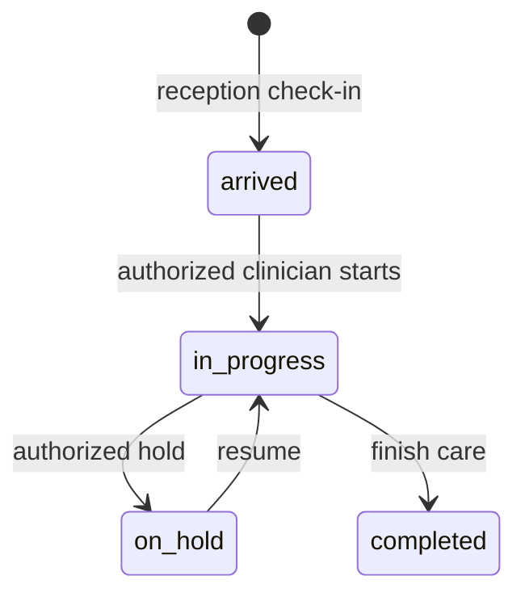

# Call center

Snapshot: **2026-10-31**, repository source audit. No application code or live database was changed. “Source-confirmed” describes inspected code, not a passed browser, deployment or hospital test. ⚠️ UNVERIFIED = unresolved or untested; 🚧 NOT IMPLEMENTED = absent from the inspected ownership/routes; 🐞 SUSPECTED BUG = evidence needs a focused reproduction. Testing VPS and legacy LAN deployments are distinct. Actual VPS state and actual hospital configuration are not inferred from this checkout.

## 1. Purpose — who this person is in the hospital

Reads CRM workspace guidance and confirms upcoming follow-ups by phone. No clinical record access (R13). This is a **system role**, not an HR Position. An Employee's job title grants no access by itself; an AppUser must hold this role through UserRole. `apps/api/src/auth/permissions.ts:80`; `apps/api/prisma/schema.prisma:967`.

## 2. Responsibilities — daily / per-shift / monthly

The procedures below describe the coded work this role supports. Daily: check assigned work and correct patient/source identity before saving. Per shift: hand over unresolved work and sign out of shared devices. Monthly: review unresolved exceptions with the designated supervisor. These frequencies are **recommended SOP assignments, ⚠️ not application-enforced duties**. The hospital must approve ownership and cadence. Capability source: `apps/web/src/pages/CrmPage.tsx:1`.

## 3. Prerequisites — before this person can work

An active User, facility, password change completion and the listed permission grants are required. Optional module screens also require enablement. Clinical accounts created through Users are refused; use Employee-linked onboarding for Doctor, Nurse, Lab technician and Pharmacist. HR self service requires an Employee link even for nonclinical accounts. Doctor accounts additionally require a clinical Position and linked Practitioner/department membership. Required workflow-specific catalogs and balances are in [the dependency matrix](../03-dependency-matrix.md). `apps/api/src/common/guards/jwt-auth.guard.ts:1`; `apps/api/src/modules/users/users.service.ts:73`; `apps/api/src/modules/staff/staff.service.ts:566`.

## 4. Permissions

Each cell lists exact permission codes, rather than implying every action in a module is allowed. Verb grouping is for reading only; some permissions appear in more than one column. Conditional rules and all denied permissions are in [the master matrix](../07-permission-matrix.md). Database grant drift is ⚠️ UNVERIFIED on the VPS.

| Module | View | Create | Edit | Delete/Cancel | Approve | Print/Export | Source (file:line) |
| --- | --- | --- | --- | --- | --- | --- | --- |
| reception | No matching grant | No matching grant | No matching grant | No matching grant | No matching grant | No matching grant | Denied by absence: `apps/api/src/auth/permissions.ts:1` |
| hr | hr.self.view | hr.leave.request | No matching grant | No matching grant | No matching grant | No matching grant | apps/api/src/auth/permissions.ts:136; apps/api/src/auth/permissions.ts:148 |
| crm | crm.read; crm.appointments.write | crm.contacts.write; crm.leads.write; crm.interactions.write; crm.calls.write; crm.tasks.write; crm.appointments.write | No matching grant | No matching grant | No matching grant | No matching grant | apps/api/src/auth/permissions.ts:153; apps/api/src/auth/permissions.ts:155; apps/api/src/auth/permissions.ts:157; apps/api/src/auth/permissions.ts:159; apps/api/src/auth/permissions.ts:161; apps/api/src/auth/permissions.ts:162; apps/api/src/auth/permissions.ts:164; apps/api/src/auth/permissions.ts:165 |
| payroll | No matching grant | No matching grant | No matching grant | No matching grant | No matching grant | No matching grant | Denied by absence: `apps/api/src/auth/permissions.ts:1` |
| finance | No matching grant | No matching grant | No matching grant | No matching grant | No matching grant | No matching grant | Denied by absence: `apps/api/src/auth/permissions.ts:1` |
| auth | auth.login; auth.me | No matching grant | No matching grant | No matching grant | No matching grant | No matching grant | apps/api/src/auth/permissions.ts:199; apps/api/src/auth/permissions.ts:222 |
| user | No matching grant | No matching grant | No matching grant | No matching grant | No matching grant | No matching grant | Denied by absence: `apps/api/src/auth/permissions.ts:1` |
| role | No matching grant | No matching grant | No matching grant | No matching grant | No matching grant | No matching grant | Denied by absence: `apps/api/src/auth/permissions.ts:1` |
| facility | No matching grant | No matching grant | No matching grant | No matching grant | No matching grant | No matching grant | Denied by absence: `apps/api/src/auth/permissions.ts:1` |
| department | No matching grant | No matching grant | No matching grant | No matching grant | No matching grant | No matching grant | Denied by absence: `apps/api/src/auth/permissions.ts:1` |
| room | No matching grant | No matching grant | No matching grant | No matching grant | No matching grant | No matching grant | Denied by absence: `apps/api/src/auth/permissions.ts:1` |
| practitioner | No matching grant | No matching grant | No matching grant | No matching grant | No matching grant | No matching grant | Denied by absence: `apps/api/src/auth/permissions.ts:1` |
| service | No matching grant | No matching grant | No matching grant | No matching grant | No matching grant | No matching grant | Denied by absence: `apps/api/src/auth/permissions.ts:1` |
| price | No matching grant | No matching grant | No matching grant | No matching grant | No matching grant | No matching grant | Denied by absence: `apps/api/src/auth/permissions.ts:1` |
| drug | No matching grant | No matching grant | No matching grant | No matching grant | No matching grant | No matching grant | Denied by absence: `apps/api/src/auth/permissions.ts:1` |
| labtest | No matching grant | No matching grant | No matching grant | No matching grant | No matching grant | No matching grant | Denied by absence: `apps/api/src/auth/permissions.ts:1` |
| panel | No matching grant | No matching grant | No matching grant | No matching grant | No matching grant | No matching grant | Denied by absence: `apps/api/src/auth/permissions.ts:1` |
| template | No matching grant | No matching grant | No matching grant | No matching grant | No matching grant | No matching grant | Denied by absence: `apps/api/src/auth/permissions.ts:1` |
| setting | No matching grant | No matching grant | No matching grant | No matching grant | No matching grant | No matching grant | Denied by absence: `apps/api/src/auth/permissions.ts:1` |
| patient | No matching grant | No matching grant | No matching grant | No matching grant | No matching grant | No matching grant | Denied by absence: `apps/api/src/auth/permissions.ts:1` |
| allergy | No matching grant | No matching grant | No matching grant | No matching grant | No matching grant | No matching grant | Denied by absence: `apps/api/src/auth/permissions.ts:1` |
| visit | No matching grant | No matching grant | No matching grant | No matching grant | No matching grant | No matching grant | Denied by absence: `apps/api/src/auth/permissions.ts:1` |
| appointment | No matching grant | No matching grant | No matching grant | No matching grant | No matching grant | No matching grant | Denied by absence: `apps/api/src/auth/permissions.ts:1` |
| vitals | No matching grant | No matching grant | No matching grant | No matching grant | No matching grant | No matching grant | Denied by absence: `apps/api/src/auth/permissions.ts:1` |
| diagnosis | No matching grant | No matching grant | No matching grant | No matching grant | No matching grant | No matching grant | Denied by absence: `apps/api/src/auth/permissions.ts:1` |
| clinical_note | No matching grant | No matching grant | No matching grant | No matching grant | No matching grant | No matching grant | Denied by absence: `apps/api/src/auth/permissions.ts:1` |
| attachment | No matching grant | No matching grant | No matching grant | No matching grant | No matching grant | No matching grant | Denied by absence: `apps/api/src/auth/permissions.ts:1` |
| prescription | No matching grant | No matching grant | No matching grant | No matching grant | No matching grant | No matching grant | Denied by absence: `apps/api/src/auth/permissions.ts:1` |
| interaction | No matching grant | No matching grant | No matching grant | No matching grant | No matching grant | No matching grant | Denied by absence: `apps/api/src/auth/permissions.ts:1` |
| follow_up | follow_up.read | follow_up.respond | No matching grant | No matching grant | No matching grant | No matching grant | apps/api/src/auth/permissions.ts:469; apps/api/src/auth/permissions.ts:477 |
| lab_order | No matching grant | No matching grant | No matching grant | No matching grant | No matching grant | No matching grant | Denied by absence: `apps/api/src/auth/permissions.ts:1` |
| lab | No matching grant | No matching grant | No matching grant | No matching grant | No matching grant | No matching grant | Denied by absence: `apps/api/src/auth/permissions.ts:1` |
| lab_result | No matching grant | No matching grant | No matching grant | No matching grant | No matching grant | No matching grant | Denied by absence: `apps/api/src/auth/permissions.ts:1` |
| pharmacy | No matching grant | No matching grant | No matching grant | No matching grant | No matching grant | No matching grant | Denied by absence: `apps/api/src/auth/permissions.ts:1` |
| invoice | No matching grant | No matching grant | No matching grant | No matching grant | No matching grant | No matching grant | Denied by absence: `apps/api/src/auth/permissions.ts:1` |
| payment | No matching grant | No matching grant | No matching grant | No matching grant | No matching grant | No matching grant | Denied by absence: `apps/api/src/auth/permissions.ts:1` |
| refund | No matching grant | No matching grant | No matching grant | No matching grant | No matching grant | No matching grant | Denied by absence: `apps/api/src/auth/permissions.ts:1` |
| discount | No matching grant | No matching grant | No matching grant | No matching grant | No matching grant | No matching grant | Denied by absence: `apps/api/src/auth/permissions.ts:1` |
| lab_charge | No matching grant | No matching grant | No matching grant | No matching grant | No matching grant | No matching grant | Denied by absence: `apps/api/src/auth/permissions.ts:1` |
| report | No matching grant | No matching grant | No matching grant | No matching grant | No matching grant | No matching grant | Denied by absence: `apps/api/src/auth/permissions.ts:1` |
| audit_log | No matching grant | No matching grant | No matching grant | No matching grant | No matching grant | No matching grant | Denied by absence: `apps/api/src/auth/permissions.ts:1` |
| error_log | No matching grant | No matching grant | No matching grant | No matching grant | No matching grant | No matching grant | Denied by absence: `apps/api/src/auth/permissions.ts:1` |
| data | No matching grant | No matching grant | No matching grant | No matching grant | No matching grant | No matching grant | Denied by absence: `apps/api/src/auth/permissions.ts:1` |

## 5. What they CANNOT do (and who does it instead)

Anything absent from this role's grants is denied, including on a screen reached by manually entering its URL. Multiple roles may expand authority; this document assumes this role alone. Admin manages configuration and users; receptionist registers patients and takes lab collections; doctor writes diagnoses/notes/prescriptions; lab_tech enters/verifies lab results; pharmacist confirms medicine handover; finance roles follow independent approval and posting checks. **Admin alone is not a clinical author.** Exact exceptions and conditions: `apps/api/src/auth/permissions.ts:1`; `apps/api/src/common/guards/permissions.guard.ts:1`.

## 6. Screens they use — navigation path

English menu labels below come from the locale file. The Main group has no translated heading in the current English dictionary. Listed visibility does not prove every button is authorized. `apps/web/src/i18n/locales/en.json:1`.

| Menu group › item | URL | Module prerequisite | Source |
| --- | --- | --- | --- |
| Main › CRM | /crm | crm | `apps/web/src/auth/nav.ts:1` |
| Clinical › Follow-ups | /follow-ups | Core | `apps/web/src/auth/nav.ts:1` |

⚠️ The shared ALL_ROLES menu array omits call_center even though HR self/leave permissions include it. CRM and Follow-ups have explicit call_center entries. See the gap report. `apps/web/src/auth/nav.ts:34`

## 7. Button & action reference

These are source locations on menu-linked or permission-linked screens, including reusable controls. **Rows are an inventory, not a grant.** Read the endpoint permission against Section 4; branch-dependent visibility not proven for this role is ⚠️ UNVERIFIED. Administrator includes the complete UI inventory to guarantee no source location is silently omitted, including clinical controls the administrator cannot use. Side effects are direct static service effects; nested helpers may add effects. Runtime behavior and physical printing are not verified by this table.

| ID / source | Screen / component | Button / action (English; Dari where available) | Where | What it does / handler | Preconditions / disabled when | Side effects / trace evidence | Reversible? how | API endpoint | Permission required | Audited? |
| --- | --- | --- | --- | --- | --- | --- | --- | --- | --- | --- |
| A0001 apps/web/src/AppRoot.tsx:23 | AppRoot | FirstRunLanguagePicker | AppRoot / FirstRunLanguagePicker | Local handler / ⚠️ semantic review; onChosen: {() => setHasChosen(true)} | No explicit disabled attribute; surrounding conditions: !hasChosen ? ( <FirstRunLanguagePicker onChosen={() => setHasChosen(true)} /> ) : ( <QueryClientProvider client={queryClient}> {/* AuthProvider above the router: the route components (ProtectedRoute, | ⚠️ UNVERIFIED: inspect handler and linked API call inventory | ⚠️ Use documented cancel/reversal workflow; no generic undo | No statically resolved endpoint | ⚠️ UI local / endpoint-specific; menu is not permission | Local actions have no automatic DB audit; downstream action ⚠️ UNVERIFIED |
| A0034 apps/web/src/components/CrmAppointments.tsx:150 | CrmPage | Try again / تلاش دوباره | CrmAppointments / Button | Local handler / ⚠️ semantic review; onClick: {() => void options.refetch()} | No explicit disabled attribute; surrounding conditions: options.isError && ( 
 {t('crm.loadError')}{' '} <Button onClick={() => void options.refetch()}> {t('crm.retry')} </Button> 
 ) | ⚠️ UNVERIFIED: inspect handler and linked API call inventory | ⚠️ Use documented cancel/reversal workflow; no generic undo | No statically resolved endpoint | ⚠️ UI local / endpoint-specific; menu is not permission | Local actions have no automatic DB audit; downstream action ⚠️ UNVERIFIED |
| A0035 apps/web/src/components/CrmAppointments.tsx:158 | CrmPage | Contacts and family / مخاطبین و خانواده | CrmAppointments / Link | Navigation; "/crm?tab=contacts" | No explicit disabled attribute; surrounding conditions: !options.isPending && !links.length && ( 
 {t('crmAppointments.verify')}{' '} <Link to="/crm?tab=contacts" className="text-primary underline"> {t('crmLeads.tabs.contacts')} </Lin | Changes browser destination; target: "/crm?tab=contacts" | Browser Back | No statically resolved endpoint | ⚠️ UI local / endpoint-specific; menu is not permission | Local actions have no automatic DB audit; downstream action ⚠️ UNVERIFIED |
| A0036 apps/web/src/components/CrmAppointments.tsx:166 | CrmPage | Choose / انتخاب کنید | CrmAppointments / select | Form input / selection; onChange: {(e) => { setLink(e.target.value) edit() }} | No explicit disabled attribute | Changes form selection; persistence occurs on submission | Edit again before saving | No statically resolved endpoint | ⚠️ UI local / endpoint-specific; menu is not permission | Local actions have no automatic DB audit; downstream action ⚠️ UNVERIFIED |
| A0037 apps/web/src/components/CrmAppointments.tsx:184 | CrmPage | Appointment date / تاریخ ملاقات | CrmAppointments / Input | Form input / selection; onChange: {(e) => { setDate(e.target.value) edit() }}; onInput: {(e) => { setDate(e.currentTarget.value) edit() }} | No explicit disabled attribute | Changes form selection; persistence occurs on submission | Edit again before saving | No statically resolved endpoint | ⚠️ UI local / endpoint-specific; menu is not permission | Local actions have no automatic DB audit; downstream action ⚠️ UNVERIFIED |
| A0038 apps/web/src/components/CrmAppointments.tsx:202 | CrmPage | Book appointment / Department / Choose / Provider / Choose / Start time / Duration (minutes) / Confirm working hours with the provider before booking. This view shows existing reservations; it does not define clinic opening hours. / CRM could not be loaded. / Existing provider reservations / This provider has date-only bookings on this day. Ask reception to review them before booking a time. / No existing reservations for this provider on this day. / Book appointment / Could not save the contact. Try again. / Appointment booked. Reception sees the same booking. / ثبت ملاقات / بخش / انتخاب کنید / داکتر / انتخاب کنید / زمان شروع / مدت (دقیقه) / پیش از ثبت، ساعت کاری را با داکتر تأیید کنید. این صفحه ملاقات‌های موجود را نشان می‌دهد، نه ساعت کاری کلینیک. / بارگذاری انجام نشد. / ملاقات‌های موجود داکتر / این داکتر در این روز ملاقات بدون ساعت دارد. پیش از تعیین ساعت از پذیرش بخواهید آن‌ها را بررسی کند. / برای این داکتر در این روز ملاقات موجود نیست. / ثبت ملاقات / ذخیره تماس ممکن نشد. دوباره تلاش کنید. / ملاقات ثبت شد. پذیرش همین ملاقات را می‌بیند. | CrmAppointments / form | Server request; onSubmit: {submit} | No explicit disabled attribute; surrounding conditions: selected && options.data?.canWrite && ( <Card className="p-5"> <form className="space-y-4" onSubmit={submit}> <h3 className="font-semibold">{t('crmAppointments.book')}</h3> 
 { setDepartment(e.target.value) setProvider('') edit() }} | No explicit disabled attribute; surrounding conditions: selected && options.data?.canWrite && ( <Card className="p-5"> <form className="space-y-4" onSubmit={submit}> <h3 className="font-semibold">{t('crmAppointments.book')}</h3> 
 { setProvider(e.target.value) edit() }} | No explicit disabled attribute; surrounding conditions: selected && options.data?.canWrite && ( <Card className="p-5"> <form className="space-y-4" onSubmit={submit}> <h3 className="font-semibold">{t('crmAppointments.book')}</h3> 
 { setTime(e.target.value) edit() }}; onInput: {(e) => { setTime(e.currentTarget.value) edit() }} | No explicit disabled attribute; surrounding conditions: selected && options.data?.canWrite && ( <Card className="p-5"> <form className="space-y-4" onSubmit={submit}> <h3 className="font-semibold">{t('crmAppointments.book')}</h3> 
 { setDuration(Number(e.target.value)) edit() }} | No explicit disabled attribute; surrounding conditions: selected && options.data?.canWrite && ( <Card className="p-5"> <form className="space-y-4" onSubmit={submit}> <h3 className="font-semibold">{t('crmAppointments.book')}</h3> 
 <form className="space-y-4" onSubmit={submit}> <h3 className="font-semibold">{t('crmAppointments.book')}</h3> 
 cancel.mutate(a.id)} | {cancel.isPending}; surrounding conditions: cancelId === a.id ? ( 
 
{t('crmAppointments.confirmCancel')}
 <Button disabled={cancel.isPending; options.data?.canWrite && ['booked', 'arrived'].includes(a.status) && (cancelId === a.id ? ( 
 
{t('crmAppoint; visible && book.data?.items.map((a) => ( 
 
 {a.endsAt ? `${format(a.scheduledAt)} — ${format(a.endsAt | apps/api/src/modules/crm/crm-appointments.service.ts:236; appointment.findFirst | ⚠️ Use documented cancel/reversal workflow; no generic undo | POST /crm/appointments/:id/cancel (apps/api/src/modules/crm/crm-appointments.controller.ts:65) | crm.appointments.write | App request context + audited Prisma writes; read audit is endpoint-specific. Root/manual scripts are outside this coverage. |
| A0045 apps/web/src/components/CrmAppointments.tsx:360 | CrmPage | Keep appointment / حفظ ملاقات | CrmAppointments / Button | Local handler / ⚠️ semantic review; onClick: {() => setCancel(null)} | No explicit disabled attribute; surrounding conditions: cancelId === a.id ? ( 
 
{t('crmAppointments.confirmCancel')}
 <Button disabled={cancel.isPending; options.data?.canWrite && ['booked', 'arrived'].includes(a.status) && (cancelId === a.id ? ( 
 
{t('crmAppoint; visible && book.data?.items.map((a) => ( 
 
 {a.endsAt ? `${format(a.scheduledAt)} — ${format(a.endsAt | ⚠️ UNVERIFIED: inspect handler and linked API call inventory | ⚠️ Use documented cancel/reversal workflow; no generic undo | No statically resolved endpoint | ⚠️ UI local / endpoint-specific; menu is not permission | Local actions have no automatic DB audit; downstream action ⚠️ UNVERIFIED |
| A0046 apps/web/src/components/CrmAppointments.tsx:365 | CrmPage | Cancel appointment / لغو ملاقات | CrmAppointments / Button | Local handler / ⚠️ semantic review; onClick: {() => { edit() setCancel(a.id) }} | No explicit disabled attribute; surrounding conditions: cancelId === a.id ? ( 
 
{t('crmAppointments.confirmCancel')}
 <Button disabled={cancel.isPending; options.data?.canWrite && ['booked', 'arrived'].includes(a.status) && (cancelId === a.id ? ( 
 
{t('crmAppoint; visible && book.data?.items.map((a) => ( 
 
 {a.endsAt ? `${format(a.scheduledAt)} — ${format(a.endsAt | ⚠️ UNVERIFIED: inspect handler and linked API call inventory | ⚠️ Use documented cancel/reversal workflow; no generic undo | No statically resolved endpoint | ⚠️ UI local / endpoint-specific; menu is not permission | Local actions have no automatic DB audit; downstream action ⚠️ UNVERIFIED |
| A0047 apps/web/src/components/CrmCalls.tsx:48 | CrmPage | {values.map((v) => ( {t(`crmCalls.values.${v}`, { defaultValue: t(`crmTimeline.values.${v}`), })} ))} | Choice / select | Form input / selection; onChange: {(e) => onChange(e.target.value)} | No explicit disabled attribute | Changes form selection; persistence occurs on submission | Edit again before saving | No statically resolved endpoint | ⚠️ UI local / endpoint-specific; menu is not permission | Local actions have no automatic DB audit; downstream action ⚠️ UNVERIFIED |
| A0048 apps/web/src/components/CrmCalls.tsx:129 | CrmPage | Log a call / ثبت تماس | CrmCalls / Button | Local handler / ⚠️ semantic review; onClick: {() => { setCallback(null) setAdding(true) setSelected(null) }} | No explicit disabled attribute; surrounding conditions: query.data?.canWrite && ( <Button onClick={() => { setCallback(null) setAdding(true) setSelected(null) }} > {t('crmCalls.add')} </Bu | ⚠️ UNVERIFIED: inspect handler and linked API call inventory | ⚠️ Use documented cancel/reversal workflow; no generic undo | No statically resolved endpoint | ⚠️ UI local / endpoint-specific; menu is not permission | Local actions have no automatic DB audit; downstream action ⚠️ UNVERIFIED |
| A0049 apps/web/src/components/CrmCalls.tsx:139 | CrmPage | Pending actions / اقدامات در انتظار | CrmCalls / Button | Local handler / ⚠️ semantic review; onClick: {() => { setPending('pending') setPage(1) }} | No explicit disabled attribute | ⚠️ UNVERIFIED: inspect handler and linked API call inventory | ⚠️ Use documented cancel/reversal workflow; no generic undo | No statically resolved endpoint | ⚠️ UI local / endpoint-specific; menu is not permission | Local actions have no automatic DB audit; downstream action ⚠️ UNVERIFIED |
| A0050 apps/web/src/components/CrmCalls.tsx:149 | CrmPage | Reload / بارگذاری دوباره | CrmCalls / Button | Local handler / ⚠️ semantic review; onClick: {() => void query.refetch()} | No explicit disabled attribute | ⚠️ UNVERIFIED: inspect handler and linked API call inventory | ⚠️ Use documented cancel/reversal workflow; no generic undo | No statically resolved endpoint | ⚠️ UI local / endpoint-specific; menu is not permission | Local actions have no automatic DB audit; downstream action ⚠️ UNVERIFIED |
| A0051 apps/web/src/components/CrmCalls.tsx:153 | CrmPage | Open existing patient follow-ups / باز کردن پیگیری‌های فعلی مریضان | CrmCalls / Link | Navigation; "/follow-ups" | No explicit disabled attribute; surrounding conditions: query.data?.canViewFollowUps && ( <Link className="self-center text-sm text-primary underline" to="/follow-ups" > {t('crm.existingFollowUps')} </Link> ) | Changes browser destination; target: "/follow-ups" | Browser Back | No statically resolved endpoint | ⚠️ UI local / endpoint-specific; menu is not permission | Local actions have no automatic DB audit; downstream action ⚠️ UNVERIFIED |
| A0052 apps/web/src/components/CrmCalls.tsx:163 | CrmPage | CallForm | CrmCalls / CallForm | Local handler / ⚠️ semantic review; onCancel: {() => { setAdding(false) setCallback(null) }}; onSaved: {saved} | No explicit disabled attribute; surrounding conditions: adding && (!callback &#124;&#124; Date.parse(callback.interaction.visibleUntil) > now) && ( <CallForm key={callback?.id ?? 'new'} callback={callback} onCancel={() => { setAdding(fals | ⚠️ UNVERIFIED: inspect handler and linked API call inventory | ⚠️ Use documented cancel/reversal workflow; no generic undo | No statically resolved endpoint | ⚠️ UI local / endpoint-specific; menu is not permission | Local actions have no automatic DB audit; downstream action ⚠️ UNVERIFIED |
| A0053 apps/web/src/components/CrmCalls.tsx:173 | CrmPage | Search / جستجو | CrmCalls / form | Local handler / ⚠️ semantic review; onSubmit: {(e) => { e.preventDefault() setSearch(q) setPage(1) }} | No explicit disabled attribute | ⚠️ UNVERIFIED: inspect handler and linked API call inventory | ⚠️ Use documented cancel/reversal workflow; no generic undo | No statically resolved endpoint | ⚠️ UI local / endpoint-specific; menu is not permission | Local actions have no automatic DB audit; downstream action ⚠️ UNVERIFIED |
| A0054 apps/web/src/components/CrmCalls.tsx:181 | CrmPage | Search phone, contact or lead / جستجوی شماره، مخاطب یا سرنخ | CrmCalls / Input | Form input / selection; onChange: {(e) => setQ(e.target.value)} | No explicit disabled attribute | Changes form selection; persistence occurs on submission | Edit again before saving | No statically resolved endpoint | ⚠️ UI local / endpoint-specific; menu is not permission | Local actions have no automatic DB audit; downstream action ⚠️ UNVERIFIED |
| A0055 apps/web/src/components/CrmCalls.tsx:188 | CrmPage | Search / جستجو | CrmCalls / Button | ⚠️ No direct handler (submit/child behavior); {(e) => { e.preventDefault() setSearch(q) setPage(1) }} | No explicit disabled attribute | ⚠️ UNVERIFIED: inspect handler and linked API call inventory | ⚠️ Use documented cancel/reversal workflow; no generic undo | No statically resolved endpoint | ⚠️ UI local / endpoint-specific; menu is not permission | Local actions have no automatic DB audit; downstream action ⚠️ UNVERIFIED |
| A0056 apps/web/src/components/CrmCalls.tsx:193 | CrmPage | { setState(v) setPage(1) }} /> { setDirection(v) setPage(1) }} /> { setPending(v) setPage(1) }} /> | CrmCalls / Choice | Local handler / ⚠️ semantic review; onChange: {(v) => { setState(v) setPage(1) }} | No explicit disabled attribute | ⚠️ UNVERIFIED: inspect handler and linked API call inventory | ⚠️ Use documented cancel/reversal workflow; no generic undo | No statically resolved endpoint | ⚠️ UI local / endpoint-specific; menu is not permission | Local actions have no automatic DB audit; downstream action ⚠️ UNVERIFIED |
| A0057 apps/web/src/components/CrmCalls.tsx:202 | CrmPage | { setState(v) setPage(1) }} /> { setDirection(v) setPage(1) }} /> { setPending(v) setPage(1) }} /> | CrmCalls / Choice | Local handler / ⚠️ semantic review; onChange: {(v) => { setDirection(v) setPage(1) }} | No explicit disabled attribute | ⚠️ UNVERIFIED: inspect handler and linked API call inventory | ⚠️ Use documented cancel/reversal workflow; no generic undo | No statically resolved endpoint | ⚠️ UI local / endpoint-specific; menu is not permission | Local actions have no automatic DB audit; downstream action ⚠️ UNVERIFIED |
| A0058 apps/web/src/components/CrmCalls.tsx:211 | CrmPage | { setState(v) setPage(1) }} /> { setDirection(v) setPage(1) }} /> { setPending(v) setPage(1) }} /> | CrmCalls / Choice | Local handler / ⚠️ semantic review; onChange: {(v) => { setPending(v) setPage(1) }} | No explicit disabled attribute | ⚠️ UNVERIFIED: inspect handler and linked API call inventory | ⚠️ Use documented cancel/reversal workflow; no generic undo | No statically resolved endpoint | ⚠️ UI local / endpoint-specific; menu is not permission | Local actions have no automatic DB audit; downstream action ⚠️ UNVERIFIED |
| A0059 apps/web/src/components/CrmCalls.tsx:254 | CrmPage | Call details / جزئیات تماس | CrmCalls / Button | Local handler / ⚠️ semantic review; onClick: {() => { setSelected(c.id) setAdding(false) }} | No explicit disabled attribute; surrounding conditions: query.data && !query.isError && query.data.items.every( (c) => Date.parse(c.interaction.visibleUntil) > now, ) && ( <> {!query.data.items.length && 
{t('crmCalls.empty')}
} | ⚠️ UNVERIFIED: inspect handler and linked API call inventory | ⚠️ Use documented cancel/reversal workflow; no generic undo | No statically resolved endpoint | ⚠️ UI local / endpoint-specific; menu is not permission | Local actions have no automatic DB audit; downstream action ⚠️ UNVERIFIED |
| A0060 apps/web/src/components/CrmCalls.tsx:267 | CrmPage | Previous / قبلی | CrmCalls / Button | Local handler / ⚠️ semantic review; onClick: {() => setPage(page - 1)} | {page === 1}; surrounding conditions: query.data && !query.isError && query.data.items.every( (c) => Date.parse(c.interaction.visibleUntil) > now, ) && ( <> {!query.data.items.length && 
{t('crmCalls.empty')}
} | ⚠️ UNVERIFIED: inspect handler and linked API call inventory | ⚠️ Use documented cancel/reversal workflow; no generic undo | No statically resolved endpoint | ⚠️ UI local / endpoint-specific; menu is not permission | Local actions have no automatic DB audit; downstream action ⚠️ UNVERIFIED |
| A0061 apps/web/src/components/CrmCalls.tsx:277 | CrmPage | Next / بعدی | CrmCalls / Button | Local handler / ⚠️ semantic review; onClick: {() => setPage(page + 1)} | {page * 25 >= query.data.total}; surrounding conditions: query.data && !query.isError && query.data.items.every( (c) => Date.parse(c.interaction.visibleUntil) > now, ) && ( <> {!query.data.items.length && 
{t('crmCalls.empty')}
} | ⚠️ UNVERIFIED: inspect handler and linked API call inventory | ⚠️ Use documented cancel/reversal workflow; no generic undo | No statically resolved endpoint | ⚠️ UI local / endpoint-specific; menu is not permission | Local actions have no automatic DB audit; downstream action ⚠️ UNVERIFIED |
| A0062 apps/web/src/components/CrmCalls.tsx:288 | CrmPage | {selected} | CrmCalls / CallDetail | Local handler / ⚠️ semantic review; onClose: {() => setSelected(null)}; onCallback: {(c) => { setCallback(c) setSelected(null) setAdding(true) }} | No explicit disabled attribute; surrounding conditions: selected && ( <CallDetail key={selected} id={selected} canWrite={query.data?.canWrite ?? false} onClose={() => setSelected(null)} onCallback={(c) => { setCallback(c) | ⚠️ UNVERIFIED: inspect handler and linked API call inventory | ⚠️ Use documented cancel/reversal workflow; no generic undo | No statically resolved endpoint | ⚠️ UI local / endpoint-specific; menu is not permission | Local actions have no automatic DB audit; downstream action ⚠️ UNVERIFIED |
| A0063 apps/web/src/components/CrmCalls.tsx:417 | CrmPage | A phone match does not verify identity. Use the contact workspace to check the caller and their authority before discussing a patient. / Search / Select a record / CRM could not be loaded. / This outbound attempt retains the original caller and subject. Complete the original action separately when it is resolved. / Open contacts for identity, authority and consent checks / CRM could not be loaded. / Preferred channel: / Permission to contact: / General inquiry / Times use your browser time zone: / Check the caller, times and required fields. Missed and unanswered calls require a next action. Patient discussion requires a current authorized caller check. / The interaction could not be saved. / Save call / Cancel / تطابق شماره هویت را تأیید نمی‌کند. پیش از صحبت دربارهٔ مریض، هویت و صلاحیت تماس‌گیرنده را در بخش مخاطبین بررسی کنید. / جستجو / انتخاب سابقه / بارگذاری انجام نشد. / این تماس خروجی به تماس‌گیرنده و موضوع اصلی مرتبط می‌ماند. پس از حل موضوع، اقدام اصلی را جداگانه تکمیل کنید. / باز کردن مخاطبین برای بررسی هویت، صلاحیت و رضایت / بارگذاری انجام نشد. / راه ارتباط ترجیحی: / اجازهٔ تماس: / درخواست عمومی / زمان‌ها مطابق منطقهٔ زمانی مرورگر است: / تماس‌گیرنده، زمان‌ها و معلومات ضروری را بررسی کنید. تماس بی‌پاسخ نیاز به اقدام بعدی دارد. بحث دربارهٔ مریض نیاز به تأیید معتبر تماس‌گیرنده دارد. / تعامل ذخیره نشد. / ذخیرهٔ تماس / لغو | CallForm / form | Local handler / ⚠️ semantic review; onSubmit: {submit}; onChange: {() => { setKey(crypto.randomUUID()) mutation.reset() }} | No explicit disabled attribute | ⚠️ UNVERIFIED: inspect handler and linked API call inventory | ⚠️ Use documented cancel/reversal workflow; no generic undo | No statically resolved endpoint | ⚠️ UI local / endpoint-specific; menu is not permission | Local actions have no automatic DB audit; downstream action ⚠️ UNVERIFIED |
| A0064 apps/web/src/components/CrmCalls.tsx:432 | CrmPage | Choice | CallForm / Choice | Local handler / ⚠️ semantic review; onChange: {(v) => { setSubject(v) setContactId(null) setLeadId(null) setLinkId(null) setPurpose('enquiry') setSearch('') setSearchTerm('') }} | No explicit disabled attribute; surrounding conditions: !callback && ( <> <Choice label={t('crmCalls.subject')} value={subject} values={['unknown', 'contact', 'lead']} onChange={(v) => { setSubject(v) | ⚠️ UNVERIFIED: inspect handler and linked API call inventory | ⚠️ Use documented cancel/reversal workflow; no generic undo | No statically resolved endpoint | ⚠️ UI local / endpoint-specific; menu is not permission | Local actions have no automatic DB audit; downstream action ⚠️ UNVERIFIED |
| A0065 apps/web/src/components/CrmCalls.tsx:449 | CrmPage | Search caller records / جستجوی سوابق تماس‌گیرنده | CallForm / Input | Form input / selection; onChange: {(e) => setSearch(e.target.value)} | No explicit disabled attribute; surrounding conditions: subject !== 'unknown' && ( <> 
 <Input aria-label={t('crmCalls.searchSubject')} value={search} maxLength=; !callback && ( <> <Choice label={t('crmCalls.subject')} value={subject} values={['unknown', 'contact', 'lead']} onChange={(v) => { setSubject(v) | Changes form selection; persistence occurs on submission | Edit again before saving | No statically resolved endpoint | ⚠️ UI local / endpoint-specific; menu is not permission | Local actions have no automatic DB audit; downstream action ⚠️ UNVERIFIED |
| A0066 apps/web/src/components/CrmCalls.tsx:455 | CrmPage | Search / جستجو | CallForm / Button | Server request; onClick: {() => setSearchTerm(search)} | No explicit disabled attribute; surrounding conditions: subject !== 'unknown' && ( <> 
 <Input aria-label={t('crmCalls.searchSubject')} value={search} maxLength=; !callback && ( <> <Choice label={t('crmCalls.subject')} value={subject} values={['unknown', 'contact', 'lead']} onChange={(v) => { setSubject(v) | apps/api/src/modules/crm/crm-calls.service.ts:124; crmCall.create | ⚠️ Use documented cancel/reversal workflow; no generic undo | POST /crm/calls (apps/api/src/modules/crm/crm-calls.controller.ts:52) | crm.calls.write | App request context + audited Prisma writes; read audit is endpoint-specific. Root/manual scripts are outside this coverage. |
| A0067 apps/web/src/components/CrmCalls.tsx:463 | CrmPage | Select a record / انتخاب سابقه | CallForm / select | Form input / selection; onChange: {(e) => { setLinkId(null) setPurpose('enquiry') if (subject === 'lead') { const l = leads.data?.items.find( (x) => x.id === e.target.value, ) setLeadId(l?.id ?? null) setContactId(l?.contactId ?? null) } else { const c = contacts.data?.items.find( (x) => x.id === e.target.value, ) setContactId(c?.id ?? null) setPhone(c?.phone ?? '') } }} | No explicit disabled attribute; surrounding conditions: subject !== 'unknown' && ( <> 
 <Input aria-label={t('crmCalls.searchSubject')} value={search} maxLength=; !callback && ( <> <Choice label={t('crmCalls.subject')} value={subject} values={['unknown', 'contact', 'lead']} onChange={(v) => { setSubject(v) | Changes form selection; persistence occurs on submission | Edit again before saving | No statically resolved endpoint | ⚠️ UI local / endpoint-specific; menu is not permission | Local actions have no automatic DB audit; downstream action ⚠️ UNVERIFIED |
| A0068 apps/web/src/components/CrmCalls.tsx:509 | CrmPage | setPhone(e.target.value)} /> | CallForm / Input | Form input / selection; onChange: {(e) => setPhone(e.target.value)} | {!!callback} | Changes form selection; persistence occurs on submission | Edit again before saving | No statically resolved endpoint | ⚠️ UI local / endpoint-specific; menu is not permission | Local actions have no automatic DB audit; downstream action ⚠️ UNVERIFIED |
| A0069 apps/web/src/components/CrmCalls.tsx:518 | CrmPage | Open contacts for identity, authority and consent checks / باز کردن مخاطبین برای بررسی هویت، صلاحیت و رضایت | CallForm / Link | Navigation; {submit} | No explicit disabled attribute; surrounding conditions: contactId && ( <> <Link className="text-sm text-primary underline" to="/crm?tab=contacts" > {t('crmCalls.checkContact')} </Link> {detail.isE | Changes browser destination; target: "/crm?tab=contacts" | Browser Back | No statically resolved endpoint | ⚠️ UI local / endpoint-specific; menu is not permission | Local actions have no automatic DB audit; downstream action ⚠️ UNVERIFIED |
| A0070 apps/web/src/components/CrmCalls.tsx:546 | CrmPage | General inquiry / درخواست عمومی | CallForm / select | Form input / selection; onChange: {(e) => { setLinkId(e.target.value &#124;&#124; null) setPurpose( e.target.value ? visibleLinks.find((l) => l.id === e.target.value) ?.authority === 'follow_up' ? 'follow_up' : 'scheduling' : 'enquiry', ) }} | No explicit disabled attribute; surrounding conditions: !callback && ( <> <Field label={t('crmCalls.relationship')}> <select className={control} value={linkId ?? ''} onChange={(e) => { ; contactId && ( <> <Link className="text-sm text-primary underline" to="/crm?tab=contacts" > {t('crmCalls.checkContact')} </Link> {detail.isE | Changes form selection; persistence occurs on submission | Edit again before saving | No statically resolved endpoint | ⚠️ UI local / endpoint-specific; menu is not permission | Local actions have no automatic DB audit; downstream action ⚠️ UNVERIFIED |
| A0071 apps/web/src/components/CrmCalls.tsx:570 | CrmPage | Choice | CallForm / Choice | Local handler / ⚠️ semantic review; onChange: {(v) => setPurpose(v as typeof purpose)} | No explicit disabled attribute; surrounding conditions: linkId && ( <Choice label={t('crmTimeline.purpose')} value={purpose} values={ visibleLinks.find((l) => l.id === linkId)?.authority === ; !callback && ( <> <Field label={t('crmCalls.relationship')}> <select className={control} value={linkId ?? ''} onChange={(e) => { ; contactId && ( <> <Link className="text-sm text-primary underline" to="/crm?tab=contacts" > {t('crmCalls.checkContact')} </Link> {detail.isE | ⚠️ UNVERIFIED: inspect handler and linked API call inventory | ⚠️ Use documented cancel/reversal workflow; no generic undo | No statically resolved endpoint | ⚠️ UI local / endpoint-specific; menu is not permission | Local actions have no automatic DB audit; downstream action ⚠️ UNVERIFIED |
| A0072 apps/web/src/components/CrmCalls.tsx:591 | CrmPage | Choice | CallForm / Choice | Local handler / ⚠️ semantic review; onChange: {(v) => { setDirection(v) if (state !== 'answered') setState(v === 'inbound' ? 'missed' : 'no_answer') }} | No explicit disabled attribute; surrounding conditions: !callback && ( <Choice label={t('crmTimeline.direction')} value={direction} values={['inbound', 'outbound']} onChange={(v) => { setDirection(v) | ⚠️ UNVERIFIED: inspect handler and linked API call inventory | ⚠️ Use documented cancel/reversal workflow; no generic undo | No statically resolved endpoint | ⚠️ UI local / endpoint-specific; menu is not permission | Local actions have no automatic DB audit; downstream action ⚠️ UNVERIFIED |
| A0073 apps/web/src/components/CrmCalls.tsx:602 | CrmPage | {!callback && ( { setDirection(v) if (state !== 'answered') setState(v === 'inbound' ? 'missed' : 'no_answer') }} /> )} { setState(v) if (v !== 'answered') setAction('callback') }} /> setStarted(e.target.value)} /> {state === 'answered' && ( setEnded(e.target.value)} /> )} | CallForm / Choice | Local handler / ⚠️ semantic review; onChange: {(v) => { setState(v) if (v !== 'answered') setAction('callback') }} | No explicit disabled attribute | ⚠️ UNVERIFIED: inspect handler and linked API call inventory | ⚠️ Use documented cancel/reversal workflow; no generic undo | No statically resolved endpoint | ⚠️ UI local / endpoint-specific; menu is not permission | Local actions have no automatic DB audit; downstream action ⚠️ UNVERIFIED |
| A0074 apps/web/src/components/CrmCalls.tsx:615 | CrmPage | setStarted(e.target.value)} /> | CallForm / Input | Form input / selection; onChange: {(e) => setStarted(e.target.value)} | No explicit disabled attribute | Changes form selection; persistence occurs on submission | Edit again before saving | No statically resolved endpoint | ⚠️ UI local / endpoint-specific; menu is not permission | Local actions have no automatic DB audit; downstream action ⚠️ UNVERIFIED |
| A0075 apps/web/src/components/CrmCalls.tsx:624 | CrmPage | setEnded(e.target.value)} /> | CallForm / Input | Form input / selection; onChange: {(e) => setEnded(e.target.value)} | No explicit disabled attribute; surrounding conditions: state === 'answered' && ( <Field label={t('crmCalls.ended')}> <Input type="datetime-local" required value={ended} onChange={(e) => setEnded(e.target.v | Changes form selection; persistence occurs on submission | Edit again before saving | No statically resolved endpoint | ⚠️ UI local / endpoint-specific; menu is not permission | Local actions have no automatic DB audit; downstream action ⚠️ UNVERIFIED |
| A0076 apps/web/src/components/CrmCalls.tsx:638 | CrmPage | setSummary(e.target.value)} /> | CallForm / textarea | Form input / selection; onChange: {(e) => setSummary(e.target.value)} | No explicit disabled attribute | Changes form selection; persistence occurs on submission | Edit again before saving | No statically resolved endpoint | ⚠️ UI local / endpoint-specific; menu is not permission | Local actions have no automatic DB audit; downstream action ⚠️ UNVERIFIED |
| A0077 apps/web/src/components/CrmCalls.tsx:649 | CrmPage | Choice | CallForm / Choice | Local handler / ⚠️ semantic review; onChange: {setOutcome} | No explicit disabled attribute; surrounding conditions: state === 'answered' && ( <Choice label={t('crmTimeline.outcome')} value={outcome} values={CRM_INTERACTION_OUTCOMES.filter((v) => v !== 'no_response')} onChange={setOutcome} | ⚠️ UNVERIFIED: inspect handler and linked API call inventory | ⚠️ Use documented cancel/reversal workflow; no generic undo | No statically resolved endpoint | ⚠️ UI local / endpoint-specific; menu is not permission | Local actions have no automatic DB audit; downstream action ⚠️ UNVERIFIED |
| A0078 apps/web/src/components/CrmCalls.tsx:656 | CrmPage | Search / Select a record / CRM could not be loaded. / This outbound attempt retains the original caller and subject. Complete the original action separately when it is resolved. / Open contacts for identity, authority and consent checks / CRM could not be loaded. / Preferred channel: / Permission to contact: / General inquiry / Times use your browser time zone: / جستجو / انتخاب سابقه / بارگذاری انجام نشد. / این تماس خروجی به تماس‌گیرنده و موضوع اصلی مرتبط می‌ماند. پس از حل موضوع، اقدام اصلی را جداگانه تکمیل کنید. / باز کردن مخاطبین برای بررسی هویت، صلاحیت و رضایت / بارگذاری انجام نشد. / راه ارتباط ترجیحی: / اجازهٔ تماس: / درخواست عمومی / زمان‌ها مطابق منطقهٔ زمانی مرورگر است: | CallForm / Choice | Local handler / ⚠️ semantic review; onChange: {setAction} | No explicit disabled attribute | ⚠️ UNVERIFIED: inspect handler and linked API call inventory | ⚠️ Use documented cancel/reversal workflow; no generic undo | No statically resolved endpoint | ⚠️ UI local / endpoint-specific; menu is not permission | Local actions have no automatic DB audit; downstream action ⚠️ UNVERIFIED |
| A0079 apps/web/src/components/CrmCalls.tsx:668 | CrmPage | setActionNote(e.target.value)} /> | CallForm / textarea | Form input / selection; onChange: {(e) => setActionNote(e.target.value)} | No explicit disabled attribute; surrounding conditions: action !== 'none' && ( <Field label={t('crmCalls.actionNote')}> <textarea className={control} required minLength={3} maxLength={500} value={actionNo | Changes form selection; persistence occurs on submission | Edit again before saving | No statically resolved endpoint | ⚠️ UI local / endpoint-specific; menu is not permission | Local actions have no automatic DB audit; downstream action ⚠️ UNVERIFIED |
| A0080 apps/web/src/components/CrmCalls.tsx:686 | CrmPage | Save call / ذخیرهٔ تماس | CallForm / Button | Server request; {submit} | {mutation.isPending} | apps/api/src/modules/crm/crm-calls.service.ts:124; crmCall.create | ⚠️ Use documented cancel/reversal workflow; no generic undo | POST /crm/calls (apps/api/src/modules/crm/crm-calls.controller.ts:52) | crm.calls.write | App request context + audited Prisma writes; read audit is endpoint-specific. Root/manual scripts are outside this coverage. |
| A0081 apps/web/src/components/CrmCalls.tsx:689 | CrmPage | Cancel / لغو | CallForm / Button | Server request; onClick: {onCancel} | {mutation.isPending} | apps/api/src/modules/crm/crm-calls.service.ts:124; crmCall.create | ⚠️ Use documented cancel/reversal workflow; no generic undo | POST /crm/calls (apps/api/src/modules/crm/crm-calls.controller.ts:52) | crm.calls.write | App request context + audited Prisma writes; read audit is endpoint-specific. Root/manual scripts are outside this coverage. |
| A0082 apps/web/src/components/CrmCalls.tsx:768 | CrmPage | Close / بستن | CallDetail / Button | Local handler / ⚠️ semantic review; onClick: {onClose} | No explicit disabled attribute | ⚠️ UNVERIFIED: inspect handler and linked API call inventory | ⚠️ Use documented cancel/reversal workflow; no generic undo | No statically resolved endpoint | ⚠️ UI local / endpoint-specific; menu is not permission | Local actions have no automatic DB audit; downstream action ⚠️ UNVERIFIED |
| A0083 apps/web/src/components/CrmCalls.tsx:813 | CrmPage | Create task / ایجاد وظیفه | CallDetail / Link | Navigation; {`/crm?tab=tasks&interactionId=${c.interaction.id}`} | No explicit disabled attribute; surrounding conditions: canWrite && !c.interaction.voided && ( <Link className="self-center text-sm text-primary underline" to={`/crm?tab=tasks&interactionId=${c.interaction.id}`} > {t('cr; c && !query.isError && Date.parse(c.interaction.visibleUntil) > now && ( <> 
 <bdi dir="ltr">{c.callerPhone &#124;&#124; t('crmCalls.unknownPhone')}</bdi> ·{' '} {t(`crmCalls.values.${c.state}`)} ·{' '} | Changes browser destination; target: {`/crm?tab=tasks&interactionId=${c.interaction.id}`} | Browser Back | No statically resolved endpoint | ⚠️ UI local / endpoint-specific; menu is not permission | Local actions have no automatic DB audit; downstream action ⚠️ UNVERIFIED |
| A0084 apps/web/src/components/CrmCalls.tsx:821 | CrmPage | Record callback / ثبت تماس مجدد | CallDetail / Button | Local handler / ⚠️ semantic review; onClick: {() => onCallback(c)} | No explicit disabled attribute; surrounding conditions: canWrite && !c.interaction.voided && ( <Button variant="outline" onClick={() => onCallback(c)}> {t('crmCalls.callback')} </Button> ); c && !query.isError && Date.parse(c.interaction.visibleUntil) > now && ( <> 
 <bdi dir="ltr">{c.callerPhone &#124;&#124; t('crmCalls.unknownPhone')}</bdi> ·{' '} {t(`crmCalls.values.${c.state}`)} ·{' '} | ⚠️ UNVERIFIED: inspect handler and linked API call inventory | ⚠️ Use documented cancel/reversal workflow; no generic undo | No statically resolved endpoint | ⚠️ UI local / endpoint-specific; menu is not permission | Local actions have no automatic DB audit; downstream action ⚠️ UNVERIFIED |
| A0085 apps/web/src/components/CrmCalls.tsx:826 | CrmPage | Correct entry / اصلاح ثبت | CallDetail / Button | Local handler / ⚠️ semantic review; onClick: {() => { setEditing(true) setSummary(c.interaction.summary) setReason('') setWithdraw(false) }} | No explicit disabled attribute; surrounding conditions: c.interaction.canCorrect && ( <Button variant="outline" onClick={() => { setEditing(true) setSummary(c.interaction.summary) setReason('') ; c && !query.isError && Date.parse(c.interaction.visibleUntil) > now && ( <> 
 <bdi dir="ltr">{c.callerPhone &#124;&#124; t('crmCalls.unknownPhone')}</bdi> ·{' '} {t(`crmCalls.values.${c.state}`)} ·{' '} | ⚠️ UNVERIFIED: inspect handler and linked API call inventory | ⚠️ Use documented cancel/reversal workflow; no generic undo | No statically resolved endpoint | ⚠️ UI local / endpoint-specific; menu is not permission | Local actions have no automatic DB audit; downstream action ⚠️ UNVERIFIED |
| A0086 apps/web/src/components/CrmCalls.tsx:840 | CrmPage | Complete action / تکمیل اقدام | CallDetail / form | Server request; onSubmit: {(e) => { e.preventDefault() complete.mutate(c.version) }} | No explicit disabled attribute; surrounding conditions: c.canComplete && ( <form className="space-y-2 border-t pt-3" onSubmit={(e) => { e.preventDefault() complete.mutate(c.version) }} > ; c && !query.isError && Date.parse(c.interaction.visibleUntil) > now && ( <> 
 <bdi dir="ltr">{c.callerPhone &#124;&#124; t('crmCalls.unknownPhone')}</bdi> ·{' '} {t(`crmCalls.values.${c.state}`)} ·{' '} | apps/api/src/modules/crm/crm-calls.service.ts:185; crmCall.update | ⚠️ Use documented cancel/reversal workflow; no generic undo | POST /crm/calls/:id/complete (apps/api/src/modules/crm/crm-calls.controller.ts:55) | crm.calls.write | App request context + audited Prisma writes; read audit is endpoint-specific. Root/manual scripts are outside this coverage. |
| A0087 apps/web/src/components/CrmCalls.tsx:848 | CrmPage | setNote(e.target.value)} /> | CallDetail / textarea | Form input / selection; onChange: {(e) => setNote(e.target.value)} | No explicit disabled attribute; surrounding conditions: c.canComplete && ( <form className="space-y-2 border-t pt-3" onSubmit={(e) => { e.preventDefault() complete.mutate(c.version) }} > ; c && !query.isError && Date.parse(c.interaction.visibleUntil) > now && ( <> 
 <bdi dir="ltr">{c.callerPhone &#124;&#124; t('crmCalls.unknownPhone')}</bdi> ·{' '} {t(`crmCalls.values.${c.state}`)} ·{' '} | Changes form selection; persistence occurs on submission | Edit again before saving | No statically resolved endpoint | ⚠️ UI local / endpoint-specific; menu is not permission | Local actions have no automatic DB audit; downstream action ⚠️ UNVERIFIED |
| A0088 apps/web/src/components/CrmCalls.tsx:857 | CrmPage | Complete action / تکمیل اقدام | CallDetail / Button | Server request; {(e) => { e.preventDefault() complete.mutate(c.version) }} | {complete.isPending}; surrounding conditions: c.canComplete && ( <form className="space-y-2 border-t pt-3" onSubmit={(e) => { e.preventDefault() complete.mutate(c.version) }} > ; c && !query.isError && Date.parse(c.interaction.visibleUntil) > now && ( <> 
 <bdi dir="ltr">{c.callerPhone &#124;&#124; t('crmCalls.unknownPhone')}</bdi> ·{' '} {t(`crmCalls.values.${c.state}`)} ·{' '} | apps/api/src/modules/crm/crm-calls.service.ts:185; crmCall.update | ⚠️ Use documented cancel/reversal workflow; no generic undo | POST /crm/calls/:id/complete (apps/api/src/modules/crm/crm-calls.controller.ts:55) | crm.calls.write | App request context + audited Prisma writes; read audit is endpoint-specific. Root/manual scripts are outside this coverage. |
| A0089 apps/web/src/components/CrmCalls.tsx:863 | CrmPage | Withdraw this entry / Save call / لغو این ثبت / ذخیرهٔ تماس | CallDetail / form | Server request; onSubmit: {(e) => { e.preventDefault() const valid = correctCrmInteractionSchema.safeParse({ expectedVersion: c.interaction.version, summary, outcome: c.interaction.outcome, reason, voided: withdraw, }).success setInvalid(!valid) if (valid) correct.mutate() }} | No explicit disabled attribute; surrounding conditions: editing && ( <form className="space-y-2 border-t pt-3" onSubmit={(e) => { e.preventDefault() const valid = correctCrmInteractionSchema.safeParse({ exp; c && !query.isError && Date.parse(c.interaction.visibleUntil) > now && ( <> 
 <bdi dir="ltr">{c.callerPhone &#124;&#124; t('crmCalls.unknownPhone')}</bdi> ·{' '} {t(`crmCalls.values.${c.state}`)} ·{' '} | apps/api/src/modules/crm/crm-timeline.service.ts:304; crmInteraction.update, crmInteractionRevision.create | ⚠️ Use documented cancel/reversal workflow; no generic undo | PUT /crm/timeline/:id (apps/api/src/modules/crm/crm-timeline.controller.ts:62) | crm.interactions.write | App request context + audited Prisma writes; read audit is endpoint-specific. Root/manual scripts are outside this coverage. |
| A0090 apps/web/src/components/CrmCalls.tsx:879 | CrmPage | setSummary(e.target.value)} /> | CallDetail / textarea | Form input / selection; onChange: {(e) => setSummary(e.target.value)} | No explicit disabled attribute; surrounding conditions: editing && ( <form className="space-y-2 border-t pt-3" onSubmit={(e) => { e.preventDefault() const valid = correctCrmInteractionSchema.safeParse({ exp; c && !query.isError && Date.parse(c.interaction.visibleUntil) > now && ( <> 
 <bdi dir="ltr">{c.callerPhone &#124;&#124; t('crmCalls.unknownPhone')}</bdi> ·{' '} {t(`crmCalls.values.${c.state}`)} ·{' '} | Changes form selection; persistence occurs on submission | Edit again before saving | No statically resolved endpoint | ⚠️ UI local / endpoint-specific; menu is not permission | Local actions have no automatic DB audit; downstream action ⚠️ UNVERIFIED |
| A0091 apps/web/src/components/CrmCalls.tsx:889 | CrmPage | setReason(e.target.value)} /> | CallDetail / Input | Form input / selection; onChange: {(e) => setReason(e.target.value)} | No explicit disabled attribute; surrounding conditions: editing && ( <form className="space-y-2 border-t pt-3" onSubmit={(e) => { e.preventDefault() const valid = correctCrmInteractionSchema.safeParse({ exp; c && !query.isError && Date.parse(c.interaction.visibleUntil) > now && ( <> 
 <bdi dir="ltr">{c.callerPhone &#124;&#124; t('crmCalls.unknownPhone')}</bdi> ·{' '} {t(`crmCalls.values.${c.state}`)} ·{' '} | Changes form selection; persistence occurs on submission | Edit again before saving | No statically resolved endpoint | ⚠️ UI local / endpoint-specific; menu is not permission | Local actions have no automatic DB audit; downstream action ⚠️ UNVERIFIED |
| A0092 apps/web/src/components/CrmCalls.tsx:898 | CrmPage | Withdraw this entry / لغو این ثبت | CallDetail / input | Form input / selection; onChange: {(e) => setWithdraw(e.target.checked)} | No explicit disabled attribute; surrounding conditions: editing && ( <form className="space-y-2 border-t pt-3" onSubmit={(e) => { e.preventDefault() const valid = correctCrmInteractionSchema.safeParse({ exp; c && !query.isError && Date.parse(c.interaction.visibleUntil) > now && ( <> 
 <bdi dir="ltr">{c.callerPhone &#124;&#124; t('crmCalls.unknownPhone')}</bdi> ·{' '} {t(`crmCalls.values.${c.state}`)} ·{' '} | Changes form selection; persistence occurs on submission | Edit again before saving | No statically resolved endpoint | ⚠️ UI local / endpoint-specific; menu is not permission | Local actions have no automatic DB audit; downstream action ⚠️ UNVERIFIED |
| A0093 apps/web/src/components/CrmCalls.tsx:905 | CrmPage | Save call / ذخیرهٔ تماس | CallDetail / Button | Server request; {(e) => { e.preventDefault() const valid = correctCrmInteractionSchema.safeParse({ expectedVersion: c.interaction.version, summary, outcome: c.interaction.outcome, reason, voided: withdraw, }).success setInvalid(!valid) if (valid) correct.mutate() }} | {correct.isPending}; surrounding conditions: editing && ( <form className="space-y-2 border-t pt-3" onSubmit={(e) => { e.preventDefault() const valid = correctCrmInteractionSchema.safeParse({ exp; c && !query.isError && Date.parse(c.interaction.visibleUntil) > now && ( <> 
 <bdi dir="ltr">{c.callerPhone &#124;&#124; t('crmCalls.unknownPhone')}</bdi> ·{' '} {t(`crmCalls.values.${c.state}`)} ·{' '} | apps/api/src/modules/crm/crm-timeline.service.ts:304; crmInteraction.update, crmInteractionRevision.create | ⚠️ Use documented cancel/reversal workflow; no generic undo | PUT /crm/timeline/:id (apps/api/src/modules/crm/crm-timeline.controller.ts:62) | crm.interactions.write | App request context + audited Prisma writes; read audit is endpoint-specific. Root/manual scripts are outside this coverage. |
| A0094 apps/web/src/components/CrmContacts.tsx:53 | CrmPage | {options.map((v) => ( {t(`crmContacts.values.${v}`)} ))} | Select / select | Form input / selection; onChange: {(e) => onChange(e.target.value)} | No explicit disabled attribute | Changes form selection; persistence occurs on submission | Edit again before saving | No statically resolved endpoint | ⚠️ UI local / endpoint-specific; menu is not permission | Local actions have no automatic DB audit; downstream action ⚠️ UNVERIFIED |
| A0095 apps/web/src/components/CrmContacts.tsx:89 | CrmPage | New contact / تماس جدید | CrmContacts / Button | Local handler / ⚠️ semantic review; onClick: {() => { setSelected(null) setCreating(true) }} | No explicit disabled attribute | ⚠️ UNVERIFIED: inspect handler and linked API call inventory | ⚠️ Use documented cancel/reversal workflow; no generic undo | No statically resolved endpoint | ⚠️ UI local / endpoint-specific; menu is not permission | Local actions have no automatic DB audit; downstream action ⚠️ UNVERIFIED |
| A0096 apps/web/src/components/CrmContacts.tsx:99 | CrmPage | Name, phone or email / Search / Search / Show archived / نام، شماره یا ایمیل / جستجو / جستجو / نمایش بایگانی | CrmContacts / form | Local handler / ⚠️ semantic review; onSubmit: {(e) => { e.preventDefault() setSearch(q) setPage(1) }} | No explicit disabled attribute | ⚠️ UNVERIFIED: inspect handler and linked API call inventory | ⚠️ Use documented cancel/reversal workflow; no generic undo | No statically resolved endpoint | ⚠️ UI local / endpoint-specific; menu is not permission | Local actions have no automatic DB audit; downstream action ⚠️ UNVERIFIED |
| A0097 apps/web/src/components/CrmContacts.tsx:107 | CrmPage | Search / جستجو | CrmContacts / Input | Form input / selection; onChange: {(e) => setQ(e.target.value)} | No explicit disabled attribute | Changes form selection; persistence occurs on submission | Edit again before saving | No statically resolved endpoint | ⚠️ UI local / endpoint-specific; menu is not permission | Local actions have no automatic DB audit; downstream action ⚠️ UNVERIFIED |
| A0098 apps/web/src/components/CrmContacts.tsx:115 | CrmPage | Search / جستجو | CrmContacts / Button | ⚠️ No direct handler (submit/child behavior); {(e) => { e.preventDefault() setSearch(q) setPage(1) }} | No explicit disabled attribute | ⚠️ UNVERIFIED: inspect handler and linked API call inventory | ⚠️ Use documented cancel/reversal workflow; no generic undo | No statically resolved endpoint | ⚠️ UI local / endpoint-specific; menu is not permission | Local actions have no automatic DB audit; downstream action ⚠️ UNVERIFIED |
| A0099 apps/web/src/components/CrmContacts.tsx:119 | CrmPage | Show archived / نمایش بایگانی | CrmContacts / input | Form input / selection; onChange: {(e) => { setArchived(e.target.checked) setPage(1) }} | No explicit disabled attribute | Changes form selection; persistence occurs on submission | Edit again before saving | No statically resolved endpoint | ⚠️ UI local / endpoint-specific; menu is not permission | Local actions have no automatic DB audit; downstream action ⚠️ UNVERIFIED |
| A0100 apps/web/src/components/CrmContacts.tsx:134 | CrmPage | Try again / تلاش دوباره | CrmContacts / Button | Local handler / ⚠️ semantic review; onClick: {() => void query.refetch()} | No explicit disabled attribute; surrounding conditions: query.isError && ( 
 {t('crm.loadError')}{' '} <Button variant="outline" onClick={() => void query.refetch()}> {t('crm.retry')} </Button> 
 ) | ⚠️ UNVERIFIED: inspect handler and linked API call inventory | ⚠️ Use documented cancel/reversal workflow; no generic undo | No statically resolved endpoint | ⚠️ UI local / endpoint-specific; menu is not permission | Local actions have no automatic DB audit; downstream action ⚠️ UNVERIFIED |
| A0101 apps/web/src/components/CrmContacts.tsx:143 | CrmPage | Do not contact / تماس نگیرید | CrmContacts / button | Local handler / ⚠️ semantic review; onClick: {() => { setSelected(c.id) setCreating(false) }} | No explicit disabled attribute; surrounding conditions: query.data && !query.isError && ( <> 
 {query.data.items.map((c) => ( <button key={c.id} onClick={() => { | ⚠️ UNVERIFIED: inspect handler and linked API call inventory | ⚠️ Use documented cancel/reversal workflow; no generic undo | No statically resolved endpoint | ⚠️ UI local / endpoint-specific; menu is not permission | Local actions have no automatic DB audit; downstream action ⚠️ UNVERIFIED |
| A0102 apps/web/src/components/CrmContacts.tsx:167 | CrmPage | Previous / قبلی | CrmContacts / Button | Local handler / ⚠️ semantic review; onClick: {() => setPage((p) => p - 1)} | {page === 1}; surrounding conditions: query.data && !query.isError && ( <> 
 {query.data.items.map((c) => ( <button key={c.id} onClick={() => { | ⚠️ UNVERIFIED: inspect handler and linked API call inventory | ⚠️ Use documented cancel/reversal workflow; no generic undo | No statically resolved endpoint | ⚠️ UI local / endpoint-specific; menu is not permission | Local actions have no automatic DB audit; downstream action ⚠️ UNVERIFIED |
| A0103 apps/web/src/components/CrmContacts.tsx:178 | CrmPage | Next / بعدی | CrmContacts / Button | Local handler / ⚠️ semantic review; onClick: {() => setPage((p) => p + 1)} | {page * 25 >= query.data.total}; surrounding conditions: query.data && !query.isError && ( <> 
 {query.data.items.map((c) => ( <button key={c.id} onClick={() => { | ⚠️ UNVERIFIED: inspect handler and linked API call inventory | ⚠️ Use documented cancel/reversal workflow; no generic undo | No statically resolved endpoint | ⚠️ UI local / endpoint-specific; menu is not permission | Local actions have no automatic DB audit; downstream action ⚠️ UNVERIFIED |
| A0104 apps/web/src/components/CrmContacts.tsx:189 | CrmPage | ContactForm | CrmContacts / ContactForm | Local handler / ⚠️ semantic review; onSaved: {(id) => { setCreating(false) setSelected(id) }}; onClose: {() => setCreating(false)} | No explicit disabled attribute; surrounding conditions: creating && ( <ContactForm onSaved={(id) => { setCreating(false) setSelected(id) }} onClose={() => setCreating(false)} /> ) | ⚠️ UNVERIFIED: inspect handler and linked API call inventory | ⚠️ Use documented cancel/reversal workflow; no generic undo | No statically resolved endpoint | ⚠️ UI local / endpoint-specific; menu is not permission | Local actions have no automatic DB audit; downstream action ⚠️ UNVERIFIED |
| A0105 apps/web/src/components/CrmContacts.tsx:198 | CrmPage | {selected} | CrmContacts / ContactDetail | Local handler / ⚠️ semantic review; onClose: {() => setSelected(null)} | No explicit disabled attribute; surrounding conditions: selected && ( <ContactDetail key={selected} id={selected} onClose={() => setSelected(null)} /> ) | ⚠️ UNVERIFIED: inspect handler and linked API call inventory | ⚠️ Use documented cancel/reversal workflow; no generic undo | No statically resolved endpoint | ⚠️ UI local / endpoint-specific; menu is not permission | Local actions have no automatic DB audit; downstream action ⚠️ UNVERIFIED |
| A0106 apps/web/src/components/CrmContacts.tsx:287 | CrmPage | Use practical contact instructions only. Do not enter diagnoses, clinical notes, ID numbers or verification answers. / Possible duplicates found. A shared phone does not identify a person. Open an existing contact or confirm a separate person. / I reviewed these contacts; this is a separate person. / Check the name, email and phone numbers (7–15 digits). / Could not save the contact. Try again. / Save contact / Close / فقط رهنمود عملی تماس را بنویسید؛ تشخیص، یادداشت طبی، شماره هویت یا پاسخ تأیید را ثبت نکنید. / تماس‌های مشابه پیدا شد. شماره مشترک هویت شخص را ثابت نمی‌کند. تماس موجود را باز کنید یا شخص جداگانه را تأیید کنید. / بررسی کردم؛ این شخص جداگانه است. / نام، ایمیل و شماره‌ها (۷ تا ۱۵ رقم) را بررسی کنید. / ذخیره تماس ممکن نشد. دوباره تلاش کنید. / ذخیره تماس / بستن | ContactForm / form | Server request; onSubmit: {submit} | No explicit disabled attribute | apps/api/src/modules/crm/crm-contacts.service.ts:144; crmContact.update; apps/api/src/modules/crm/crm-contacts.service.ts:127; crmContact.create | ⚠️ Use documented cancel/reversal workflow; no generic undo | PUT /crm/contacts/:id (apps/api/src/modules/crm/crm-contacts.controller.ts:69); POST /crm/contacts (apps/api/src/modules/crm/crm-contacts.controller.ts:64) | crm.contacts.write; crm.contacts.write | App request context + audited Prisma writes; read audit is endpoint-specific. Root/manual scripts are outside this coverage. |
| A0107 apps/web/src/components/CrmContacts.tsx:297 | CrmPage | set(key, e.target.value)} required={key === 'name'} maxLength={key === 'name' ? 120 : key === 'email' ? 160 : 40} type={key === 'email' ? 'email' : 'text'} /> | ContactForm / Input | Form input / selection; onChange: {(e) => set(key, e.target.value)} | No explicit disabled attribute | Changes form selection; persistence occurs on submission | Edit again before saving | No statically resolved endpoint | ⚠️ UI local / endpoint-specific; menu is not permission | Local actions have no automatic DB audit; downstream action ⚠️ UNVERIFIED |
| A0108 apps/web/src/components/CrmContacts.tsx:306 | CrmPage | Use practical contact instructions only. Do not enter diagnoses, clinical notes, ID numbers or verification answers. / فقط رهنمود عملی تماس را بنویسید؛ تشخیص، یادداشت طبی، شماره هویت یا پاسخ تأیید را ثبت نکنید. | ContactForm / Select | Form input / selection; onChange: {(v) => set('language', v)} | No explicit disabled attribute | Changes form selection; persistence occurs on submission | Edit again before saving | No statically resolved endpoint | ⚠️ UI local / endpoint-specific; menu is not permission | Local actions have no automatic DB audit; downstream action ⚠️ UNVERIFIED |
| A0109 apps/web/src/components/CrmContacts.tsx:312 | CrmPage | Use practical contact instructions only. Do not enter diagnoses, clinical notes, ID numbers or verification answers. / فقط رهنمود عملی تماس را بنویسید؛ تشخیص، یادداشت طبی، شماره هویت یا پاسخ تأیید را ثبت نکنید. | ContactForm / Select | Form input / selection; onChange: {(v) => set('preferredChannel', v)} | No explicit disabled attribute | Changes form selection; persistence occurs on submission | Edit again before saving | No statically resolved endpoint | ⚠️ UI local / endpoint-specific; menu is not permission | Local actions have no automatic DB audit; downstream action ⚠️ UNVERIFIED |
| A0110 apps/web/src/components/CrmContacts.tsx:320 | CrmPage | set('safeInstructions', e.target.value)} /> | ContactForm / textarea | Form input / selection; onChange: {(e) => set('safeInstructions', e.target.value)} | No explicit disabled attribute | Changes form selection; persistence occurs on submission | Edit again before saving | No statically resolved endpoint | ⚠️ UI local / endpoint-specific; menu is not permission | Local actions have no automatic DB audit; downstream action ⚠️ UNVERIFIED |
| A0111 apps/web/src/components/CrmContacts.tsx:333 | CrmPage | set(key, e.target.checked)} /> {t(`crmContacts.${key}`)} | ContactForm / input | Form input / selection; onChange: {(e) => set(key, e.target.checked)} | No explicit disabled attribute | Changes form selection; persistence occurs on submission | Edit again before saving | No statically resolved endpoint | ⚠️ UI local / endpoint-specific; menu is not permission | Local actions have no automatic DB audit; downstream action ⚠️ UNVERIFIED |
| A0112 apps/web/src/components/CrmContacts.tsx:351 | CrmPage | {c.name} | ContactForm / Button | Local handler / ⚠️ semantic review; onClick: {() => onSaved(c.id)} | No explicit disabled attribute; surrounding conditions: !!candidates.length && ( 
 
{t('crmContacts.duplicates')}
 <ul> {candidates.m | ⚠️ UNVERIFIED: inspect handler and linked API call inventory | ⚠️ Use documented cancel/reversal workflow; no generic undo | No statically resolved endpoint | ⚠️ UI local / endpoint-specific; menu is not permission | Local actions have no automatic DB audit; downstream action ⚠️ UNVERIFIED |
| A0113 apps/web/src/components/CrmContacts.tsx:362 | CrmPage | I reviewed these contacts; this is a separate person. / بررسی کردم؛ این شخص جداگانه است. | ContactForm / input | Form input / selection; onChange: {(e) => setReviewed(e.target.checked)} | No explicit disabled attribute; surrounding conditions: !!candidates.length && ( 
 
{t('crmContacts.duplicates')}
 <ul> {candidates.m | Changes form selection; persistence occurs on submission | Edit again before saving | No statically resolved endpoint | ⚠️ UI local / endpoint-specific; menu is not permission | Local actions have no automatic DB audit; downstream action ⚠️ UNVERIFIED |
| A0114 apps/web/src/components/CrmContacts.tsx:378 | CrmPage | Save contact / ذخیره تماس | ContactForm / Button | ⚠️ No direct handler (submit/child behavior); {submit} | {mutation.isPending &#124;&#124; (!!candidates.length && !reviewed)} | ⚠️ UNVERIFIED: inspect handler and linked API call inventory | ⚠️ Use documented cancel/reversal workflow; no generic undo | No statically resolved endpoint | ⚠️ UI local / endpoint-specific; menu is not permission | Local actions have no automatic DB audit; downstream action ⚠️ UNVERIFIED |
| A0115 apps/web/src/components/CrmContacts.tsx:384 | CrmPage | Close / بستن | ContactForm / Button | Local handler / ⚠️ semantic review; onClick: {onClose} | No explicit disabled attribute | ⚠️ UNVERIFIED: inspect handler and linked API call inventory | ⚠️ Use documented cancel/reversal workflow; no generic undo | No statically resolved endpoint | ⚠️ UI local / endpoint-specific; menu is not permission | Local actions have no automatic DB audit; downstream action ⚠️ UNVERIFIED |
| A0116 apps/web/src/components/CrmContacts.tsx:428 | CrmPage | Try again / تلاش دوباره | ContactDetail / Button | Local handler / ⚠️ semantic review; onClick: {() => void query.refetch()} | No explicit disabled attribute | ⚠️ UNVERIFIED: inspect handler and linked API call inventory | ⚠️ Use documented cancel/reversal workflow; no generic undo | No statically resolved endpoint | ⚠️ UI local / endpoint-specific; menu is not permission | Local actions have no automatic DB audit; downstream action ⚠️ UNVERIFIED |
| A0117 apps/web/src/components/CrmContacts.tsx:433 | CrmPage | ContactForm | ContactDetail / ContactForm | Local handler / ⚠️ semantic review; onClose: {() => setEditing(false)}; onSaved: {() => { setEditing(false) void query.refetch() }} | No explicit disabled attribute | ⚠️ UNVERIFIED: inspect handler and linked API call inventory | ⚠️ Use documented cancel/reversal workflow; no generic undo | No statically resolved endpoint | ⚠️ UI local / endpoint-specific; menu is not permission | Local actions have no automatic DB audit; downstream action ⚠️ UNVERIFIED |
| A0118 apps/web/src/components/CrmContacts.tsx:453 | CrmPage | Edit contact / ویرایش تماس | ContactDetail / Button | Local handler / ⚠️ semantic review; onClick: {() => setEditing(true)} | No explicit disabled attribute | ⚠️ UNVERIFIED: inspect handler and linked API call inventory | ⚠️ Use documented cancel/reversal workflow; no generic undo | No statically resolved endpoint | ⚠️ UI local / endpoint-specific; menu is not permission | Local actions have no automatic DB audit; downstream action ⚠️ UNVERIFIED |
| A0119 apps/web/src/components/CrmContacts.tsx:456 | CrmPage | Reload contact / بارگذاری دوباره تماس | ContactDetail / Button | Local handler / ⚠️ semantic review; onClick: {() => void query.refetch()} | No explicit disabled attribute | ⚠️ UNVERIFIED: inspect handler and linked API call inventory | ⚠️ Use documented cancel/reversal workflow; no generic undo | No statically resolved endpoint | ⚠️ UI local / endpoint-specific; menu is not permission | Local actions have no automatic DB audit; downstream action ⚠️ UNVERIFIED |
| A0120 apps/web/src/components/CrmContacts.tsx:459 | CrmPage | Close / بستن | ContactDetail / Button | Local handler / ⚠️ semantic review; onClick: {onClose} | No explicit disabled attribute | ⚠️ UNVERIFIED: inspect handler and linked API call inventory | ⚠️ Use documented cancel/reversal workflow; no generic undo | No statically resolved endpoint | ⚠️ UI local / endpoint-specific; menu is not permission | Local actions have no automatic DB audit; downstream action ⚠️ UNVERIFIED |
| A0121 apps/web/src/components/CrmContacts.tsx:488 | CrmPage | Appointments / ملاقات‌ها | ContactDetail / Link | Navigation; {`/crm?tab=appointments&contactId=${id}`} | No explicit disabled attribute | Changes browser destination; target: {`/crm?tab=appointments&contactId=${id}`} | Browser Back | No statically resolved endpoint | ⚠️ UI local / endpoint-specific; menu is not permission | Local actions have no automatic DB audit; downstream action ⚠️ UNVERIFIED |
| A0122 apps/web/src/components/CrmContacts.tsx:593 | CrmPage | Link existing patient / Link existing patient / ارتباط با مریض موجود / ارتباط با مریض موجود | LinkForm / form | Local handler / ⚠️ semantic review; onSubmit: {(e) => { e.preventDefault() submit('relationships', { mrn, patientName, relationship }) }} | No explicit disabled attribute | ⚠️ UNVERIFIED: inspect handler and linked API call inventory | ⚠️ Use documented cancel/reversal workflow; no generic undo | No statically resolved endpoint | ⚠️ UI local / endpoint-specific; menu is not permission | Local actions have no automatic DB audit; downstream action ⚠️ UNVERIFIED |
| A0123 apps/web/src/components/CrmContacts.tsx:603 | CrmPage | setMrn(e.target.value)} /> | LinkForm / Input | Form input / selection; onChange: {(e) => setMrn(e.target.value)} | No explicit disabled attribute | Changes form selection; persistence occurs on submission | Edit again before saving | No statically resolved endpoint | ⚠️ UI local / endpoint-specific; menu is not permission | Local actions have no automatic DB audit; downstream action ⚠️ UNVERIFIED |
| A0124 apps/web/src/components/CrmContacts.tsx:611 | CrmPage | setPatientName(e.target.value)} /> | LinkForm / Input | Form input / selection; onChange: {(e) => setPatientName(e.target.value)} | No explicit disabled attribute | Changes form selection; persistence occurs on submission | Edit again before saving | No statically resolved endpoint | ⚠️ UI local / endpoint-specific; menu is not permission | Local actions have no automatic DB audit; downstream action ⚠️ UNVERIFIED |
| A0125 apps/web/src/components/CrmContacts.tsx:618 | CrmPage | setMrn(e.target.value)} /> setPatientName(e.target.value)} /> | LinkForm / Select | Form input / selection; onChange: {setRelationship} | No explicit disabled attribute | Changes form selection; persistence occurs on submission | Edit again before saving | No statically resolved endpoint | ⚠️ UI local / endpoint-specific; menu is not permission | Local actions have no automatic DB audit; downstream action ⚠️ UNVERIFIED |
| A0126 apps/web/src/components/CrmContacts.tsx:633 | CrmPage | Link existing patient / ارتباط با مریض موجود | LinkForm / Button | ⚠️ No direct handler (submit/child behavior); {(e) => { e.preventDefault() submit('relationships', { mrn, patientName, relationship }) }} | No explicit disabled attribute | ⚠️ UNVERIFIED: inspect handler and linked API call inventory | ⚠️ Use documented cancel/reversal workflow; no generic undo | No statically resolved endpoint | ⚠️ UI local / endpoint-specific; menu is not permission | Local actions have no automatic DB audit; downstream action ⚠️ UNVERIFIED |
| A0127 apps/web/src/components/CrmContacts.tsx:679 | CrmPage | I confirmed the patient or legal representative authorized this contact and scope. / Save authorization / تأیید کردم که مریض یا نماینده قانونی، این شخص و محدوده را اجازه داده است. / ذخیره اجازه | Relationship / form | Local handler / ⚠️ semantic review; onSubmit: {(e) => { e.preventDefault() submit( `relationships/${link.id}`, { relationship: link.relationship, authority, source, authorityConfirmed: confirmed, }, true, ) }} | No explicit disabled attribute; surrounding conditions: canAuthorize && ( <form className="space-y-3" onSubmit={(e) => { e.preventDefault() submit( `relationships/${link.id}`, { relationship: link.rel | ⚠️ UNVERIFIED: inspect handler and linked API call inventory | ⚠️ Use documented cancel/reversal workflow; no generic undo | No statically resolved endpoint | ⚠️ UI local / endpoint-specific; menu is not permission | Local actions have no automatic DB audit; downstream action ⚠️ UNVERIFIED |
| A0128 apps/web/src/components/CrmContacts.tsx:696 | CrmPage | Select | Relationship / Select | Form input / selection; onChange: {setAuthority} | No explicit disabled attribute; surrounding conditions: canAuthorize && ( <form className="space-y-3" onSubmit={(e) => { e.preventDefault() submit( `relationships/${link.id}`, { relationship: link.rel | Changes form selection; persistence occurs on submission | Edit again before saving | No statically resolved endpoint | ⚠️ UI local / endpoint-specific; menu is not permission | Local actions have no automatic DB audit; downstream action ⚠️ UNVERIFIED |
| A0129 apps/web/src/components/CrmContacts.tsx:708 | CrmPage | Select | Relationship / Select | Form input / selection; onChange: {setSource} | No explicit disabled attribute; surrounding conditions: canAuthorize && ( <form className="space-y-3" onSubmit={(e) => { e.preventDefault() submit( `relationships/${link.id}`, { relationship: link.rel | Changes form selection; persistence occurs on submission | Edit again before saving | No statically resolved endpoint | ⚠️ UI local / endpoint-specific; menu is not permission | Local actions have no automatic DB audit; downstream action ⚠️ UNVERIFIED |
| A0130 apps/web/src/components/CrmContacts.tsx:716 | CrmPage | I confirmed the patient or legal representative authorized this contact and scope. / تأیید کردم که مریض یا نماینده قانونی، این شخص و محدوده را اجازه داده است. | Relationship / input | Form input / selection; onChange: {(e) => setConfirmed(e.target.checked)} | No explicit disabled attribute; surrounding conditions: canAuthorize && ( <form className="space-y-3" onSubmit={(e) => { e.preventDefault() submit( `relationships/${link.id}`, { relationship: link.rel | Changes form selection; persistence occurs on submission | Edit again before saving | No statically resolved endpoint | ⚠️ UI local / endpoint-specific; menu is not permission | Local actions have no automatic DB audit; downstream action ⚠️ UNVERIFIED |
| A0131 apps/web/src/components/CrmContacts.tsx:723 | CrmPage | Save authorization / ذخیره اجازه | Relationship / Button | ⚠️ No direct handler (submit/child behavior); {(e) => { e.preventDefault() submit( `relationships/${link.id}`, { relationship: link.relationship, authority, source, authorityConfirmed: confirmed, }, true, ) }} | {!['pending', 'revoked'].includes(authority) && !confirmed}; surrounding conditions: canAuthorize && ( <form className="space-y-3" onSubmit={(e) => { e.preventDefault() submit( `relationships/${link.id}`, { relationship: link.rel | ⚠️ UNVERIFIED: inspect handler and linked API call inventory | ⚠️ Use documented cancel/reversal workflow; no generic undo | No statically resolved endpoint | ⚠️ UI local / endpoint-specific; menu is not permission | Local actions have no automatic DB audit; downstream action ⚠️ UNVERIFIED |
| A0132 apps/web/src/components/CrmContacts.tsx:734 | CrmPage | Identity matched using the selected method (not a phone match). / Current authority to discuss this patient was confirmed. / هویت با روش انتخاب‌شده تطبیق شد (نه فقط شماره تلفن). / اجازه فعلی برای گفتگو درباره این مریض تأیید شد. | Relationship / form | Local handler / ⚠️ semantic review; onSubmit: {(e) => { e.preventDefault() submit(`relationships/${link.id}/verify`, { method, identityMatched: identity, authorityMatched: permission, }) }} | No explicit disabled attribute; surrounding conditions: link.patientAvailable && !['pending', 'revoked'].includes(link.authority) && ( <form className="space-y-3 border-t pt-3" onSubmit={(e) => { e.preventDefault() submit(`rel | ⚠️ UNVERIFIED: inspect handler and linked API call inventory | ⚠️ Use documented cancel/reversal workflow; no generic undo | No statically resolved endpoint | ⚠️ UI local / endpoint-specific; menu is not permission | Local actions have no automatic DB audit; downstream action ⚠️ UNVERIFIED |
| A0133 apps/web/src/components/CrmContacts.tsx:745 | CrmPage | Identity matched using the selected method (not a phone match). / Current authority to discuss this patient was confirmed. / هویت با روش انتخاب‌شده تطبیق شد (نه فقط شماره تلفن). / اجازه فعلی برای گفتگو درباره این مریض تأیید شد. | Relationship / Select | Form input / selection; onChange: {setMethod} | No explicit disabled attribute; surrounding conditions: link.patientAvailable && !['pending', 'revoked'].includes(link.authority) && ( <form className="space-y-3 border-t pt-3" onSubmit={(e) => { e.preventDefault() submit(`rel | Changes form selection; persistence occurs on submission | Edit again before saving | No statically resolved endpoint | ⚠️ UI local / endpoint-specific; menu is not permission | Local actions have no automatic DB audit; downstream action ⚠️ UNVERIFIED |
| A0134 apps/web/src/components/CrmContacts.tsx:752 | CrmPage | Identity matched using the selected method (not a phone match). / هویت با روش انتخاب‌شده تطبیق شد (نه فقط شماره تلفن). | Relationship / input | Form input / selection; onChange: {(e) => setIdentity(e.target.checked)} | No explicit disabled attribute; surrounding conditions: link.patientAvailable && !['pending', 'revoked'].includes(link.authority) && ( <form className="space-y-3 border-t pt-3" onSubmit={(e) => { e.preventDefault() submit(`rel | Changes form selection; persistence occurs on submission | Edit again before saving | No statically resolved endpoint | ⚠️ UI local / endpoint-specific; menu is not permission | Local actions have no automatic DB audit; downstream action ⚠️ UNVERIFIED |
| A0135 apps/web/src/components/CrmContacts.tsx:760 | CrmPage | Current authority to discuss this patient was confirmed. / اجازه فعلی برای گفتگو درباره این مریض تأیید شد. | Relationship / input | Form input / selection; onChange: {(e) => setPermission(e.target.checked)} | No explicit disabled attribute; surrounding conditions: link.patientAvailable && !['pending', 'revoked'].includes(link.authority) && ( <form className="space-y-3 border-t pt-3" onSubmit={(e) => { e.preventDefault() submit(`rel | Changes form selection; persistence occurs on submission | Edit again before saving | No statically resolved endpoint | ⚠️ UI local / endpoint-specific; menu is not permission | Local actions have no automatic DB audit; downstream action ⚠️ UNVERIFIED |
| A0136 apps/web/src/components/CrmContacts.tsx:767 | CrmPage | {t( identity && permission ? 'crmContacts.verify' : 'crmContacts.recordFailed', )} | Relationship / Button | ⚠️ No direct handler (submit/child behavior); {(e) => { e.preventDefault() submit(`relationships/${link.id}/verify`, { method, identityMatched: identity, authorityMatched: permission, }) }} | No explicit disabled attribute; surrounding conditions: link.patientAvailable && !['pending', 'revoked'].includes(link.authority) && ( <form className="space-y-3 border-t pt-3" onSubmit={(e) => { e.preventDefault() submit(`rel | ⚠️ UNVERIFIED: inspect handler and linked API call inventory | ⚠️ Use documented cancel/reversal workflow; no generic undo | No statically resolved endpoint | ⚠️ UI local / endpoint-specific; menu is not permission | Local actions have no automatic DB audit; downstream action ⚠️ UNVERIFIED |
| A0137 apps/web/src/components/CrmContacts.tsx:793 | CrmPage | Record communication consent / Record an explicit decision from the contact or authorized representative. A preference alone is not consent. Withdrawal preserves history. / Contact enquiries only / Relationship / Record decision / ثبت رضایت ارتباط / تصمیم صریح شخص یا نماینده مجاز را ثبت کنید. ترجیح ارتباط به‌تنهایی رضایت نیست. لغو رضایت تاریخچه را حفظ می‌کند. / فقط پرسش عمومی تماس / رابطه / ثبت تصمیم | ConsentForm / form | Local handler / ⚠️ semantic review; onSubmit: {(e) => { e.preventDefault() submit('consents', { linkId: linkId &#124;&#124; null, channel, purpose, status, source, }) }} | No explicit disabled attribute | ⚠️ UNVERIFIED: inspect handler and linked API call inventory | ⚠️ Use documented cancel/reversal workflow; no generic undo | No statically resolved endpoint | ⚠️ UI local / endpoint-specific; menu is not permission | Local actions have no automatic DB audit; downstream action ⚠️ UNVERIFIED |
| A0138 apps/web/src/components/CrmContacts.tsx:812 | CrmPage | Contact enquiries only / Relationship / فقط پرسش عمومی تماس / رابطه | ConsentForm / select | Form input / selection; onChange: {(e) => { setLinkId(e.target.value) setPurpose(e.target.value ? 'scheduling' : 'enquiry') }} | No explicit disabled attribute | Changes form selection; persistence occurs on submission | Edit again before saving | No statically resolved endpoint | ⚠️ UI local / endpoint-specific; menu is not permission | Local actions have no automatic DB audit; downstream action ⚠️ UNVERIFIED |
| A0139 apps/web/src/components/CrmContacts.tsx:829 | CrmPage | Contact enquiries only / Relationship / فقط پرسش عمومی تماس / رابطه | ConsentForm / Select | Form input / selection; onChange: {setChannel} | No explicit disabled attribute | Changes form selection; persistence occurs on submission | Edit again before saving | No statically resolved endpoint | ⚠️ UI local / endpoint-specific; menu is not permission | Local actions have no automatic DB audit; downstream action ⚠️ UNVERIFIED |
| A0140 apps/web/src/components/CrmContacts.tsx:835 | CrmPage | Contact enquiries only / Relationship / فقط پرسش عمومی تماس / رابطه | ConsentForm / Select | Form input / selection; onChange: {setPurpose} | No explicit disabled attribute | Changes form selection; persistence occurs on submission | Edit again before saving | No statically resolved endpoint | ⚠️ UI local / endpoint-specific; menu is not permission | Local actions have no automatic DB audit; downstream action ⚠️ UNVERIFIED |
| A0141 apps/web/src/components/CrmContacts.tsx:841 | CrmPage | Contact enquiries only / Relationship / فقط پرسش عمومی تماس / رابطه | ConsentForm / Select | Form input / selection; onChange: {setStatus} | No explicit disabled attribute | Changes form selection; persistence occurs on submission | Edit again before saving | No statically resolved endpoint | ⚠️ UI local / endpoint-specific; menu is not permission | Local actions have no automatic DB audit; downstream action ⚠️ UNVERIFIED |
| A0142 apps/web/src/components/CrmContacts.tsx:847 | CrmPage | Contact enquiries only / Relationship / فقط پرسش عمومی تماس / رابطه | ConsentForm / Select | Form input / selection; onChange: {setSource} | No explicit disabled attribute | Changes form selection; persistence occurs on submission | Edit again before saving | No statically resolved endpoint | ⚠️ UI local / endpoint-specific; menu is not permission | Local actions have no automatic DB audit; downstream action ⚠️ UNVERIFIED |
| A0143 apps/web/src/components/CrmContacts.tsx:854 | CrmPage | Record decision / ثبت تصمیم | ConsentForm / Button | ⚠️ No direct handler (submit/child behavior); {(e) => { e.preventDefault() submit('consents', { linkId: linkId &#124;&#124; null, channel, purpose, status, source, }) }} | No explicit disabled attribute | ⚠️ UNVERIFIED: inspect handler and linked API call inventory | ⚠️ Use documented cancel/reversal workflow; no generic undo | No statically resolved endpoint | ⚠️ UI local / endpoint-specific; menu is not permission | Local actions have no automatic DB audit; downstream action ⚠️ UNVERIFIED |
| A0144 apps/web/src/components/CrmLeads.tsx:52 | CrmPage | {options.map((v) => ( {t(`crmLeads.values.${v}`)} ))} | Select / select | Form input / selection; onChange: {(e) => onChange(e.target.value)} | No explicit disabled attribute | Changes form selection; persistence occurs on submission | Edit again before saving | No statically resolved endpoint | ⚠️ UI local / endpoint-specific; menu is not permission | Local actions have no automatic DB audit; downstream action ⚠️ UNVERIFIED |
| A0145 apps/web/src/components/CrmLeads.tsx:103 | CrmPage | New inquiry / درخواست جدید | CrmLeads / Button | Local handler / ⚠️ semantic review; onClick: {() => { setSelected(null) setCreating(true) }} | {!options.data} | ⚠️ UNVERIFIED: inspect handler and linked API call inventory | ⚠️ Use documented cancel/reversal workflow; no generic undo | No statically resolved endpoint | ⚠️ UI local / endpoint-specific; menu is not permission | Local actions have no automatic DB audit; downstream action ⚠️ UNVERIFIED |
| A0146 apps/web/src/components/CrmLeads.tsx:113 | CrmPage | Search leads / جستجوی درخواست‌ها | CrmLeads / form | Local handler / ⚠️ semantic review; onSubmit: {(e) => { e.preventDefault() setSearch(q) setPage(1) }} | No explicit disabled attribute | ⚠️ UNVERIFIED: inspect handler and linked API call inventory | ⚠️ Use documented cancel/reversal workflow; no generic undo | No statically resolved endpoint | ⚠️ UI local / endpoint-specific; menu is not permission | Local actions have no automatic DB audit; downstream action ⚠️ UNVERIFIED |
| A0147 apps/web/src/components/CrmLeads.tsx:121 | CrmPage | Search leads / جستجوی درخواست‌ها | CrmLeads / Input | Form input / selection; onChange: {(e) => setQ(e.target.value)} | No explicit disabled attribute | Changes form selection; persistence occurs on submission | Edit again before saving | No statically resolved endpoint | ⚠️ UI local / endpoint-specific; menu is not permission | Local actions have no automatic DB audit; downstream action ⚠️ UNVERIFIED |
| A0148 apps/web/src/components/CrmLeads.tsx:128 | CrmPage | Search leads / جستجوی درخواست‌ها | CrmLeads / Button | ⚠️ No direct handler (submit/child behavior); {(e) => { e.preventDefault() setSearch(q) setPage(1) }} | No explicit disabled attribute | ⚠️ UNVERIFIED: inspect handler and linked API call inventory | ⚠️ Use documented cancel/reversal workflow; no generic undo | No statically resolved endpoint | ⚠️ UI local / endpoint-specific; menu is not permission | Local actions have no automatic DB audit; downstream action ⚠️ UNVERIFIED |
| A0149 apps/web/src/components/CrmLeads.tsx:133 | CrmPage | { setStatus(v) setPage(1) }} options={['all', ...CRM_LEAD_STATUSES]} /> { setSource(v) setPage(1) }} options={['all', ...CRM_LEAD_SOURCES]} /> { setOwner(e.target.value) setPage(1) }} > {['all', 'mine', 'unassigned'].map((v) => ( {t(`crmLeads.values.${v}`)} ))} {options.data?.canAssign && options.data.owners.map((o) => ( {o.name} ))} | CrmLeads / Select | Form input / selection; onChange: {(v) => { setStatus(v) setPage(1) }} | No explicit disabled attribute | Changes form selection; persistence occurs on submission | Edit again before saving | No statically resolved endpoint | ⚠️ UI local / endpoint-specific; menu is not permission | Local actions have no automatic DB audit; downstream action ⚠️ UNVERIFIED |
| A0150 apps/web/src/components/CrmLeads.tsx:142 | CrmPage | { setStatus(v) setPage(1) }} options={['all', ...CRM_LEAD_STATUSES]} /> { setSource(v) setPage(1) }} options={['all', ...CRM_LEAD_SOURCES]} /> { setOwner(e.target.value) setPage(1) }} > {['all', 'mine', 'unassigned'].map((v) => ( {t(`crmLeads.values.${v}`)} ))} {options.data?.canAssign && options.data.owners.map((o) => ( {o.name} ))} | CrmLeads / Select | Form input / selection; onChange: {(v) => { setSource(v) setPage(1) }} | No explicit disabled attribute | Changes form selection; persistence occurs on submission | Edit again before saving | No statically resolved endpoint | ⚠️ UI local / endpoint-specific; menu is not permission | Local actions have no automatic DB audit; downstream action ⚠️ UNVERIFIED |
| A0151 apps/web/src/components/CrmLeads.tsx:152 | CrmPage | {['all', 'mine', 'unassigned'].map((v) => ( {t(`crmLeads.values.${v}`)} ))} {options.data?.canAssign && options.data.owners.map((o) => ( {o.name} ))} | CrmLeads / select | Form input / selection; onChange: {(e) => { setOwner(e.target.value) setPage(1) }} | No explicit disabled attribute | Changes form selection; persistence occurs on submission | Edit again before saving | No statically resolved endpoint | ⚠️ UI local / endpoint-specific; menu is not permission | Local actions have no automatic DB audit; downstream action ⚠️ UNVERIFIED |
| A0152 apps/web/src/components/CrmLeads.tsx:180 | CrmPage | Try again / تلاش دوباره | CrmLeads / Button | Local handler / ⚠️ semantic review; onClick: {() => { void query.refetch() void options.refetch() }} | No explicit disabled attribute; surrounding conditions: (query.isError &#124;&#124; options.isError) && ( 
 {t('crmLeads.loadError')}{' '} <Button variant="outline" onClick={() => { void query.refetch() void opt | ⚠️ UNVERIFIED: inspect handler and linked API call inventory | ⚠️ Use documented cancel/reversal workflow; no generic undo | No statically resolved endpoint | ⚠️ UI local / endpoint-specific; menu is not permission | Local actions have no automatic DB audit; downstream action ⚠️ UNVERIFIED |
| A0153 apps/web/src/components/CrmLeads.tsx:213 | CrmPage | {l.title} | CrmLeads / button | Local handler / ⚠️ semantic review; onClick: {() => open(l.id)} | No explicit disabled attribute | ⚠️ UNVERIFIED: inspect handler and linked API call inventory | ⚠️ Use documented cancel/reversal workflow; no generic undo | No statically resolved endpoint | ⚠️ UI local / endpoint-specific; menu is not permission | Local actions have no automatic DB audit; downstream action ⚠️ UNVERIFIED |
| A0154 apps/web/src/components/CrmLeads.tsx:243 | CrmPage | Previous / قبلی | CrmLeads / Button | Local handler / ⚠️ semantic review; onClick: {() => setPage((p) => p - 1)} | {page === 1}; surrounding conditions: query.data && !query.isError && ( <> 
 <table className="w-full text-sm"> <thead className="bg-muted"> <tr> {['i | ⚠️ UNVERIFIED: inspect handler and linked API call inventory | ⚠️ Use documented cancel/reversal workflow; no generic undo | No statically resolved endpoint | ⚠️ UI local / endpoint-specific; menu is not permission | Local actions have no automatic DB audit; downstream action ⚠️ UNVERIFIED |
| A0155 apps/web/src/components/CrmLeads.tsx:254 | CrmPage | Next / بعدی | CrmLeads / Button | Local handler / ⚠️ semantic review; onClick: {() => setPage((p) => p + 1)} | {page * 25 >= query.data.total}; surrounding conditions: query.data && !query.isError && ( <> 
 <table className="w-full text-sm"> <thead className="bg-muted"> <tr> {['i | ⚠️ UNVERIFIED: inspect handler and linked API call inventory | ⚠️ Use documented cancel/reversal workflow; no generic undo | No statically resolved endpoint | ⚠️ UI local / endpoint-specific; menu is not permission | Local actions have no automatic DB audit; downstream action ⚠️ UNVERIFIED |
| A0156 apps/web/src/components/CrmLeads.tsx:265 | CrmPage | LeadForm | CrmLeads / LeadForm | Local handler / ⚠️ semantic review; onSaved: {open}; onCancel: {() => setCreating(false)} | No explicit disabled attribute; surrounding conditions: creating && options.data && ( <LeadForm options={options.data} onSaved={open} onCancel={() => setCreating(false)} /> ) | ⚠️ UNVERIFIED: inspect handler and linked API call inventory | ⚠️ Use documented cancel/reversal workflow; no generic undo | No statically resolved endpoint | ⚠️ UI local / endpoint-specific; menu is not permission | Local actions have no automatic DB audit; downstream action ⚠️ UNVERIFIED |
| A0157 apps/web/src/components/CrmLeads.tsx:272 | CrmPage | {selected} | CrmLeads / LeadDetail | Local handler / ⚠️ semantic review; onClose: {() => setSelected(null)}; onOpen: {open} | No explicit disabled attribute; surrounding conditions: selected && options.data && ( <LeadDetail key={selected} id={selected} options={options.data} onClose={() => setSelected(null)} onOpen={open} /> ) | ⚠️ UNVERIFIED: inspect handler and linked API call inventory | ⚠️ Use documented cancel/reversal workflow; no generic undo | No statically resolved endpoint | ⚠️ UI local / endpoint-specific; menu is not permission | Local actions have no automatic DB audit; downstream action ⚠️ UNVERIFIED |
| A0158 apps/web/src/components/CrmLeads.tsx:318 | CrmPage | Try again / تلاش دوباره | LeadDetail / Button | Local handler / ⚠️ semantic review; onClick: {() => void query.refetch()} | No explicit disabled attribute | ⚠️ UNVERIFIED: inspect handler and linked API call inventory | ⚠️ Use documented cancel/reversal workflow; no generic undo | No statically resolved endpoint | ⚠️ UI local / endpoint-specific; menu is not permission | Local actions have no automatic DB audit; downstream action ⚠️ UNVERIFIED |
| A0159 apps/web/src/components/CrmLeads.tsx:323 | CrmPage | LeadForm | LeadDetail / LeadForm | Local handler / ⚠️ semantic review; onCancel: {() => setEditing(false)}; onSaved: {(leadId) => { setEditing(false) onOpen(leadId) }} | No explicit disabled attribute | ⚠️ UNVERIFIED: inspect handler and linked API call inventory | ⚠️ Use documented cancel/reversal workflow; no generic undo | No statically resolved endpoint | ⚠️ UI local / endpoint-specific; menu is not permission | Local actions have no automatic DB audit; downstream action ⚠️ UNVERIFIED |
| A0160 apps/web/src/components/CrmLeads.tsx:338 | CrmPage | Assign to me / به من واگذار شود | LeadDetail / Button | Server request; onClick: {() => claim.mutate(d.lead.version)} | {claim.isPending}; surrounding conditions: d.lead.canClaim && ( <Button disabled={claim.isPending} onClick={() => claim.mutate(d.lead.version)} > {t('crmLeads.claim')} </Button> ) | apps/api/src/modules/crm/crm-leads.service.ts:360; crmLead.update | ⚠️ Use documented cancel/reversal workflow; no generic undo | POST /crm/leads/:id/claim (apps/api/src/modules/crm/crm-leads.controller.ts:75) | crm.leads.write | App request context + audited Prisma writes; read audit is endpoint-specific. Root/manual scripts are outside this coverage. |
| A0161 apps/web/src/components/CrmLeads.tsx:346 | CrmPage | {t( d.lead.status === 'closed' ? 'crmLeads.reopen' : 'crmLeads.edit', )} | LeadDetail / Button | Local handler / ⚠️ semantic review; onClick: {() => setEditing(true)} | No explicit disabled attribute; surrounding conditions: d.lead.canEdit && ( <Button variant="outline" onClick={() => setEditing(true)}> {t( d.lead.status === 'closed' ? 'crmLeads.reopen' : 'crmLeads.edit', )} </Button> ) | ⚠️ UNVERIFIED: inspect handler and linked API call inventory | ⚠️ Use documented cancel/reversal workflow; no generic undo | No statically resolved endpoint | ⚠️ UI local / endpoint-specific; menu is not permission | Local actions have no automatic DB audit; downstream action ⚠️ UNVERIFIED |
| A0162 apps/web/src/components/CrmLeads.tsx:352 | CrmPage | Reload / بارگذاری دوباره | LeadDetail / Button | Local handler / ⚠️ semantic review; onClick: {() => void query.refetch()} | No explicit disabled attribute | ⚠️ UNVERIFIED: inspect handler and linked API call inventory | ⚠️ Use documented cancel/reversal workflow; no generic undo | No statically resolved endpoint | ⚠️ UI local / endpoint-specific; menu is not permission | Local actions have no automatic DB audit; downstream action ⚠️ UNVERIFIED |
| A0163 apps/web/src/components/CrmLeads.tsx:355 | CrmPage | Close / بستن | LeadDetail / Button | Local handler / ⚠️ semantic review; onClick: {onClose} | No explicit disabled attribute | ⚠️ UNVERIFIED: inspect handler and linked API call inventory | ⚠️ Use documented cancel/reversal workflow; no generic undo | No statically resolved endpoint | ⚠️ UI local / endpoint-specific; menu is not permission | Local actions have no automatic DB audit; downstream action ⚠️ UNVERIFIED |
| A0164 apps/web/src/components/CrmLeads.tsx:415 | CrmPage | Appointments / ملاقات‌ها | LeadDetail / Link | Navigation; {`/crm?tab=appointments&contactId=${d.lead.contactId}&leadId=${d.lead.id}`} | No explicit disabled attribute; surrounding conditions: d.lead.contactId && ( <Link className="text-primary underline" to={`/crm?tab=appointments&contactId=${d.lead.contactId}&leadId=${d.lead.id}`} > {t('crmAppointments.title')} </Link> | Changes browser destination; target: {`/crm?tab=appointments&contactId=${d.lead.contactId}&leadId=${d.lead.id}`} | Browser Back | No statically resolved endpoint | ⚠️ UI local / endpoint-specific; menu is not permission | Local actions have no automatic DB audit; downstream action ⚠️ UNVERIFIED |
| A0165 apps/web/src/components/CrmLeads.tsx:554 | CrmPage | Record service needs only. Keep diagnoses, clinical notes and identity document details out of this form. / Unassigned / Unavailable owner / Source / Original source retained / Contact / No contact linked / Remove contact link / Find contact / Choose an existing CRM contact. To add one, use the Contacts and family tab. / Loading CRM… / CRM could not be loaded. / No contacts found. / Qualification / This confirms an inquiry is ready for follow-up. It does not confirm clinical eligibility or permission to contact. / Similar open inquiries exist. Open and review them before adding a separate lead. / I reviewed these inquiries; this is a separate request. / Check the required fields. Qualification needs a contact, owner, service interest and both confirmations. Reopening needs a reason. / Could not save the lead. / Save lead / Cancel / فقط نیاز به خدمات را ثبت کنید. تشخیص، یادداشت طبی و جزئیات اسناد هویت را در این فورم وارد نکنید. / بدون مسئول / مسئول در دسترس نیست / منبع / منبع اصلی حفظ می‌شود / مخاطب / مخاطب مرتبط نیست / حذف ارتباط با مخاطب / یافتن مخاطب / مخاطب موجود CRM را انتخاب کنید. برای افزودن مخاطب به بخش مخاطبین و خانواده بروید. / در حال بارگذاری… / بارگذاری انجام نشد. / تماسی یافت نشد. / تأیید آمادگی / این تأیید فقط آمادگی درخواست برای پیگیری است و تأیید صلاحیت طبی یا اجازه تماس نیست. / درخواست‌های باز مشابه وجود دارد. پیش از افزودن درخواست جداگانه آن‌ها را بررسی کنید. / این درخواست‌ها را بررسی کردم؛ این یک درخواست جداگانه است. / خانه‌های ضروری را بررسی کنید. تأیید آمادگی به مخاطب، مسئول، خدمت و هر دو تأیید نیاز دارد. برای بازگشایی دلیل لازم است. / درخواست ذخیره نشد. / ذخیره درخواست / لغو | LeadForm / form | Server request; onSubmit: {submit} | No explicit disabled attribute | apps/api/src/modules/crm/crm-leads.service.ts:283; crmLeadPatient.findFirst, crmLead.update, crmLeadStatusChange.create; apps/api/src/modules/crm/crm-leads.service.ts:243; crmLead.create, crmLeadStatusChange.create | ⚠️ Use documented cancel/reversal workflow; no generic undo | PUT /crm/leads/:id (apps/api/src/modules/crm/crm-leads.controller.ts:70); POST /crm/leads (apps/api/src/modules/crm/crm-leads.controller.ts:65) | crm.leads.write; crm.leads.write | App request context + audited Prisma writes; read audit is endpoint-specific. Root/manual scripts are outside this coverage. |
| A0166 apps/web/src/components/CrmLeads.tsx:567 | CrmPage | set('title', e.target.value)} /> | LeadForm / Input | Form input / selection; onChange: {(e) => set('title', e.target.value)} | No explicit disabled attribute | Changes form selection; persistence occurs on submission | Edit again before saving | No statically resolved endpoint | ⚠️ UI local / endpoint-specific; menu is not permission | Local actions have no automatic DB audit; downstream action ⚠️ UNVERIFIED |
| A0167 apps/web/src/components/CrmLeads.tsx:577 | CrmPage | set('serviceInterest', e.target.value)} /> {options.serviceAreas.map((s) => ( ))} | LeadForm / Input | Form input / selection; onChange: {(e) => set('serviceInterest', e.target.value)} | No explicit disabled attribute | Changes form selection; persistence occurs on submission | Edit again before saving | No statically resolved endpoint | ⚠️ UI local / endpoint-specific; menu is not permission | Local actions have no automatic DB audit; downstream action ⚠️ UNVERIFIED |
| A0168 apps/web/src/components/CrmLeads.tsx:590 | CrmPage | Unassigned / Unavailable owner / بدون مسئول / مسئول در دسترس نیست | LeadForm / select | Form input / selection; onChange: {(e) => set('ownerId', e.target.value &#124;&#124; null)} | {!options.canAssign} | Changes form selection; persistence occurs on submission | Edit again before saving | No statically resolved endpoint | ⚠️ UI local / endpoint-specific; menu is not permission | Local actions have no automatic DB audit; downstream action ⚠️ UNVERIFIED |
| A0169 apps/web/src/components/CrmLeads.tsx:621 | CrmPage | { setSource(v as typeof source) changed() }} options={CRM_LEAD_SOURCES} /> { setSourceDetail(e.target.value) changed() }} /> | LeadForm / Select | Form input / selection; onChange: {(v) => { setSource(v as typeof source) changed() }} | No explicit disabled attribute; surrounding conditions: lead ? ( 
 {t('crmLeads.source')}: {t(`crmLeads.values.${source}`)} ·{' '} {sourceDetail &#124;&#124; '—'}{' '}  ({t(' | Changes form selection; persistence occurs on submission | Edit again before saving | No statically resolved endpoint | ⚠️ UI local / endpoint-specific; menu is not permission | Local actions have no automatic DB audit; downstream action ⚠️ UNVERIFIED |
| A0170 apps/web/src/components/CrmLeads.tsx:631 | CrmPage | { setSourceDetail(e.target.value) changed() }} /> | LeadForm / Input | Form input / selection; onChange: {(e) => { setSourceDetail(e.target.value) changed() }} | No explicit disabled attribute; surrounding conditions: lead ? ( 
 {t('crmLeads.source')}: {t(`crmLeads.values.${source}`)} ·{' '} {sourceDetail &#124;&#124; '—'}{' '}  ({t(' | Changes form selection; persistence occurs on submission | Edit again before saving | No statically resolved endpoint | ⚠️ UI local / endpoint-specific; menu is not permission | Local actions have no automatic DB audit; downstream action ⚠️ UNVERIFIED |
| A0171 apps/web/src/components/CrmLeads.tsx:648 | CrmPage | Remove contact link / حذف ارتباط با مخاطب | LeadForm / Button | Local handler / ⚠️ semantic review; onClick: {() => { set('contactId', null) setContactName('') }} | No explicit disabled attribute; surrounding conditions: data.contactId && ( <Button type="button" variant="outline" onClick={() => { set('contactId', null) setContactName('') }} | ⚠️ UNVERIFIED: inspect handler and linked API call inventory | ⚠️ Use documented cancel/reversal workflow; no generic undo | No statically resolved endpoint | ⚠️ UI local / endpoint-specific; menu is not permission | Local actions have no automatic DB audit; downstream action ⚠️ UNVERIFIED |
| A0172 apps/web/src/components/CrmLeads.tsx:660 | CrmPage | Find contact / یافتن مخاطب | LeadForm / Input | Form input / selection; onChange: {(e) => setQ(e.target.value)} | No explicit disabled attribute | Changes form selection; persistence occurs on submission | Edit again before saving | No statically resolved endpoint | ⚠️ UI local / endpoint-specific; menu is not permission | Local actions have no automatic DB audit; downstream action ⚠️ UNVERIFIED |
| A0173 apps/web/src/components/CrmLeads.tsx:667 | CrmPage | Find contact / یافتن مخاطب | LeadForm / Button | Local handler / ⚠️ semantic review; onClick: {() => setSearch(q.trim())} | {q.trim().length < 2} | ⚠️ UNVERIFIED: inspect handler and linked API call inventory | ⚠️ Use documented cancel/reversal workflow; no generic undo | No statically resolved endpoint | ⚠️ UI local / endpoint-specific; menu is not permission | Local actions have no automatic DB audit; downstream action ⚠️ UNVERIFIED |
| A0174 apps/web/src/components/CrmLeads.tsx:684 | CrmPage | {c.name} · {c.phone &#124;&#124; c.email &#124;&#124; '—'} | LeadForm / Button | Local handler / ⚠️ semantic review; onClick: {() => choose(c)} | No explicit disabled attribute; surrounding conditions: search && contacts.data && ( 
 {contacts.data.items.map((c) => ( <Button type="button" variant="outline" | ⚠️ UNVERIFIED: inspect handler and linked API call inventory | ⚠️ Use documented cancel/reversal workflow; no generic undo | No statically resolved endpoint | ⚠️ UI local / endpoint-specific; menu is not permission | Local actions have no automatic DB audit; downstream action ⚠️ UNVERIFIED |
| A0175 apps/web/src/components/CrmLeads.tsx:698 | CrmPage | Select | LeadForm / Select | Form input / selection; onChange: {(v) => { setStatus(v as CrmLeadStatus) changed() }} | No explicit disabled attribute; surrounding conditions: lead && ( <Select label={t('crmLeads.status')} value={status} onChange={(v) => { setStatus(v as CrmLeadStatus) changed() }} op | Changes form selection; persistence occurs on submission | Edit again before saving | No statically resolved endpoint | ⚠️ UI local / endpoint-specific; menu is not permission | Local actions have no automatic DB audit; downstream action ⚠️ UNVERIFIED |
| A0176 apps/web/src/components/CrmLeads.tsx:719 | CrmPage | set(k, e.target.checked)} /> {t(`crmLeads.${k}`)} | LeadForm / input | Form input / selection; onChange: {(e) => set(k, e.target.checked)} | No explicit disabled attribute | Changes form selection; persistence occurs on submission | Edit again before saving | No statically resolved endpoint | ⚠️ UI local / endpoint-specific; menu is not permission | Local actions have no automatic DB audit; downstream action ⚠️ UNVERIFIED |
| A0177 apps/web/src/components/CrmLeads.tsx:728 | CrmPage | set('qualificationNotes', e.target.value)} /> | LeadForm / textarea | Form input / selection; onChange: {(e) => set('qualificationNotes', e.target.value)} | No explicit disabled attribute | Changes form selection; persistence occurs on submission | Edit again before saving | No statically resolved endpoint | ⚠️ UI local / endpoint-specific; menu is not permission | Local actions have no automatic DB audit; downstream action ⚠️ UNVERIFIED |
| A0178 apps/web/src/components/CrmLeads.tsx:737 | CrmPage | Select | LeadForm / Select | Form input / selection; onChange: {(v) => { setOutcome(v) changed() }} | No explicit disabled attribute; surrounding conditions: status === 'closed' && ( <Select label={t('crmLeads.outcome')} value={outcome} onChange={(v) => { setOutcome(v) changed() }} o | Changes form selection; persistence occurs on submission | Edit again before saving | No statically resolved endpoint | ⚠️ UI local / endpoint-specific; menu is not permission | Local actions have no automatic DB audit; downstream action ⚠️ UNVERIFIED |
| A0179 apps/web/src/components/CrmLeads.tsx:755 | CrmPage | { setReason(e.target.value) changed() }} /> | LeadForm / textarea | Form input / selection; onChange: {(e) => { setReason(e.target.value) changed() }} | No explicit disabled attribute; surrounding conditions: lead && status !== lead.status && ( <Field label={t( lead.status === 'closed' ? 'crmLeads.reopenReason' : 'crmLeads.changeReason', )} > | Changes form selection; persistence occurs on submission | Edit again before saving | No statically resolved endpoint | ⚠️ UI local / endpoint-specific; menu is not permission | Local actions have no automatic DB audit; downstream action ⚠️ UNVERIFIED |
| A0180 apps/web/src/components/CrmLeads.tsx:774 | CrmPage | {c.title} | LeadForm / Button | Local handler / ⚠️ semantic review; onClick: {() => onSaved(c.id)} | No explicit disabled attribute; surrounding conditions: !!candidates.length && ( 
 
{t('crmLeads.duplicateHint')}
 {candidates.map((c) | ⚠️ UNVERIFIED: inspect handler and linked API call inventory | ⚠️ Use documented cancel/reversal workflow; no generic undo | No statically resolved endpoint | ⚠️ UI local / endpoint-specific; menu is not permission | Local actions have no automatic DB audit; downstream action ⚠️ UNVERIFIED |
| A0181 apps/web/src/components/CrmLeads.tsx:784 | CrmPage | I reviewed these inquiries; this is a separate request. / این درخواست‌ها را بررسی کردم؛ این یک درخواست جداگانه است. | LeadForm / input | Form input / selection; onChange: {(e) => { setReviewed(e.target.checked) setKey(crypto.randomUUID()) }} | No explicit disabled attribute; surrounding conditions: !!candidates.length && ( 
 
{t('crmLeads.duplicateHint')}
 {candidates.map((c) | Changes form selection; persistence occurs on submission | Edit again before saving | No statically resolved endpoint | ⚠️ UI local / endpoint-specific; menu is not permission | Local actions have no automatic DB audit; downstream action ⚠️ UNVERIFIED |
| A0182 apps/web/src/components/CrmLeads.tsx:807 | CrmPage | Save lead / ذخیره درخواست | LeadForm / Button | Server request; {submit} | {!!candidates.length && !reviewed} | apps/api/src/modules/crm/crm-leads.service.ts:283; crmLeadPatient.findFirst, crmLead.update, crmLeadStatusChange.create; apps/api/src/modules/crm/crm-leads.service.ts:243; crmLead.create, crmLeadStatusChange.create | ⚠️ Use documented cancel/reversal workflow; no generic undo | PUT /crm/leads/:id (apps/api/src/modules/crm/crm-leads.controller.ts:70); POST /crm/leads (apps/api/src/modules/crm/crm-leads.controller.ts:65) | crm.leads.write; crm.leads.write | App request context + audited Prisma writes; read audit is endpoint-specific. Root/manual scripts are outside this coverage. |
| A0183 apps/web/src/components/CrmLeads.tsx:810 | CrmPage | Cancel / لغو | LeadForm / Button | Local handler / ⚠️ semantic review; onClick: {onCancel} | No explicit disabled attribute | ⚠️ UNVERIFIED: inspect handler and linked API call inventory | ⚠️ Use documented cancel/reversal workflow; no generic undo | No statically resolved endpoint | ⚠️ UI local / endpoint-specific; menu is not permission | Local actions have no automatic DB audit; downstream action ⚠️ UNVERIFIED |
| A0184 apps/web/src/components/CrmPatientLink.tsx:68 | CrmPage | Try again / تلاش دوباره | CrmPatientLink / Button | Local handler / ⚠️ semantic review; onClick: {() => void query.refetch()} | No explicit disabled attribute | ⚠️ UNVERIFIED: inspect handler and linked API call inventory | ⚠️ Use documented cancel/reversal workflow; no generic undo | No statically resolved endpoint | ⚠️ UI local / endpoint-specific; menu is not permission | Local actions have no automatic DB audit; downstream action ⚠️ UNVERIFIED |
| A0185 apps/web/src/components/CrmPatientLink.tsx:118 | CrmPage | Choose a verified patient / بیمار تأییدشده را انتخاب کنید | CrmPatientLink / select | Form input / selection; onChange: {(e) => { setLinkId(e.target.value); setRegister(false); change(); }} | No explicit disabled attribute; surrounding conditions: data.canLink && ( <> <label className="grid gap-1"> {t("crmPatients.choose")} <select className="rounded border bg-background p-2" value={linkId} onChange={ | Changes form selection; persistence occurs on submission | Edit again before saving | No statically resolved endpoint | ⚠️ UI local / endpoint-specific; menu is not permission | Local actions have no automatic DB audit; downstream action ⚠️ UNVERIFIED |
| A0186 apps/web/src/components/CrmPatientLink.tsx:138 | CrmPage | ⚠️ crm.tabs.contacts / ⚠️ | CrmPatientLink / Link | Navigation; "/crm?tab=contacts" | No explicit disabled attribute; surrounding conditions: !candidates.length && ( 
 {t("crmPatients.noCandidates")}{" "} <Link className="underline" to="/crm?tab=contacts"> {t("crm.tabs.contacts")} </Link> ; data.canLink && ( <> <label className="grid gap-1"> {t("crmPatients.choose")} <select className="rounded border bg-background p-2" value={linkId} onChange={ | Changes browser destination; target: "/crm?tab=contacts" | Browser Back | No statically resolved endpoint | ⚠️ UI local / endpoint-specific; menu is not permission | Local actions have no automatic DB audit; downstream action ⚠️ UNVERIFIED |
| A0187 apps/web/src/components/CrmPatientLink.tsx:144 | CrmPage | {t(register ? "crmPatients.useExisting" : "crmPatients.register")} | CrmPatientLink / Button | Local handler / ⚠️ semantic review; onClick: {() => { setRegister(!register); setAck(false); change(); }} | No explicit disabled attribute; surrounding conditions: data.canRegister && ( <Button variant="outline" onClick={() => { setRegister(!register); setAck(false); change(); }} > ; data.canLink && ( <> <label className="grid gap-1"> {t("crmPatients.choose")} <select className="rounded border bg-background p-2" value={linkId} onChange={ | ⚠️ UNVERIFIED: inspect handler and linked API call inventory | ⚠️ Use documented cancel/reversal workflow; no generic undo | No statically resolved endpoint | ⚠️ UI local / endpoint-specific; menu is not permission | Local actions have no automatic DB audit; downstream action ⚠️ UNVERIFIED |
| A0188 apps/web/src/components/CrmPatientLink.tsx:156 | CrmPage | Registration uses the existing patient master and MRN issuer. Contact authority remains pending until separately approved in Contacts. / Relationship / ثبت از دفتر اصلی بیماران و شماره پرونده موجود استفاده می‌کند. اجازه مخاطب باید جداگانه تأیید شود. / نسبت | CrmPatientLink / div | Local handler / ⚠️ semantic review; onChange: {() => { setAck(false); change(); }} | No explicit disabled attribute; surrounding conditions: register && ( 
 { setAck(false); change(); }} > 
{t("crmPatients.registrationNotice"); data.canLink && ( <> <label className="grid gap-1"> {t("crmPatients.choose")} <select className="rounded border bg-background p-2" value={linkId} onChange={ | ⚠️ UNVERIFIED: inspect handler and linked API call inventory | ⚠️ Use documented cancel/reversal workflow; no generic undo | No statically resolved endpoint | ⚠️ UI local / endpoint-specific; menu is not permission | Local actions have no automatic DB audit; downstream action ⚠️ UNVERIFIED |
| A0189 apps/web/src/components/CrmPatientLink.tsx:171 | CrmPage | {[ "self", "parent", "spouse", "sibling", "child", "guardian", "other", ].map((r) => ( {t(`crmContacts.values.${r}`, { defaultValue: r })} ))} | CrmPatientLink / select | Form input / selection; onChange: {(e) => setRelationship(e.target.value)} | No explicit disabled attribute; surrounding conditions: register && ( 
 { setAck(false); change(); }} > 
{t("crmPatients.registrationNotice"); data.canLink && ( <> <label className="grid gap-1"> {t("crmPatients.choose")} <select className="rounded border bg-background p-2" value={linkId} onChange={ | Changes form selection; persistence occurs on submission | Edit again before saving | No statically resolved endpoint | ⚠️ UI local / endpoint-specific; menu is not permission | Local actions have no automatic DB audit; downstream action ⚠️ UNVERIFIED |
| A0190 apps/web/src/components/CrmPatientLink.tsx:198 | CrmPage | I reviewed these candidates and confirm this is a separate person. / موارد مشابه را بررسی کردم و تأیید می‌کنم این فرد جداگانه است. | CrmPatientLink / input | Form input / selection; onChange: {(e) => { setAck(e.target.checked); setKey(crypto.randomUUID()); }} | No explicit disabled attribute; surrounding conditions: matches && ( <> <DuplicateNotice matches={matches} tone="blocking" /> 
{t("crmPatients.existingHint")}
 <label className="flex gap-2"> <input type=; data.canLink && ( <> <label className="grid gap-1"> {t("crmPatients.choose")} <select className="rounded border bg-background p-2" value={linkId} onChange={ | Changes form selection; persistence occurs on submission | Edit again before saving | No statically resolved endpoint | ⚠️ UI local / endpoint-specific; menu is not permission | Local actions have no automatic DB audit; downstream action ⚠️ UNVERIFIED |
| A0191 apps/web/src/components/CrmPatientLink.tsx:211 | CrmPage | I checked the patient identity independently of the phone number. / هویت بیمار را مستقل از شماره تلفن بررسی کردم. | CrmPatientLink / input | Form input / selection; onChange: {(e) => { setIdentity(e.target.checked); change(); }} | No explicit disabled attribute; surrounding conditions: data.canLink && ( <> <label className="grid gap-1"> {t("crmPatients.choose")} <select className="rounded border bg-background p-2" value={linkId} onChange={ | Changes form selection; persistence occurs on submission | Edit again before saving | No statically resolved endpoint | ⚠️ UI local / endpoint-specific; menu is not permission | Local actions have no automatic DB audit; downstream action ⚠️ UNVERIFIED |
| A0192 apps/web/src/components/CrmPatientLink.tsx:222 | CrmPage | I reviewed existing patient records and possible duplicates. / پرونده‌های موجود و موارد تکراری احتمالی را بررسی کردم. | CrmPatientLink / input | Form input / selection; onChange: {(e) => { setReviewed(e.target.checked); change(); }} | No explicit disabled attribute; surrounding conditions: data.canLink && ( <> <label className="grid gap-1"> {t("crmPatients.choose")} <select className="rounded border bg-background p-2" value={linkId} onChange={ | Changes form selection; persistence occurs on submission | Edit again before saving | No statically resolved endpoint | ⚠️ UI local / endpoint-specific; menu is not permission | Local actions have no automatic DB audit; downstream action ⚠️ UNVERIFIED |
| A0193 apps/web/src/components/CrmPatientLink.tsx:232 | CrmPage | {t(register ? "crmPatients.registerLink" : "crmPatients.link")} | CrmPatientLink / Button | ⚠️ Dynamic API trace; onClick: {save} | { mutation.isPending &#124;&#124; !identity &#124;&#124; !reviewed &#124;&#124; (!register && !candidates.some((c) => c.linkId === linkId)) }; surrounding conditions: data.canLink && ( <> <label className="grid gap-1"> {t("crmPatients.choose")} <select className="rounded border bg-background p-2" value={linkId} onChange={ | ⚠️ UNVERIFIED: inspect handler and linked API call inventory | ⚠️ Use documented cancel/reversal workflow; no generic undo | apiPost `/crm/leads/${leadId}/patient/${operation}` | ⚠️ UI local / endpoint-specific; menu is not permission | Local actions have no automatic DB audit; downstream action ⚠️ UNVERIFIED |
| A0194 apps/web/src/components/CrmPatientLink.tsx:250 | CrmPage | {[ "wrong_patient", "wrong_lead", "duplicate_inquiry", "authorization_withdrawn", ].map((r) => ( {t(`crmPatients.reasons.${r}`)} ))} | CrmPatientLink / select | Form input / selection; onChange: {(e) => { setReason(e.target.value); change(); }} | No explicit disabled attribute; surrounding conditions: data.canUnlink && ( 
 
{t("crmPatients.correctionNotice")}
 <label> {t("crmPatients.reason")}{" "} <select className="round | Changes form selection; persistence occurs on submission | Edit again before saving | No statically resolved endpoint | ⚠️ UI local / endpoint-specific; menu is not permission | Local actions have no automatic DB audit; downstream action ⚠️ UNVERIFIED |
| A0195 apps/web/src/components/CrmPatientLink.tsx:270 | CrmPage | {t( confirmUnlink ? "crmPatients.confirmUnlink" : "crmPatients.unlink", )} | CrmPatientLink / Button | ⚠️ Dynamic API trace; onClick: {() => { if (!confirmUnlink) { setConfirmUnlink(true); return; } mutation.mutate({ operation: "unlink", body: { expectedVersion: data.expectedVersion, idempotencyKey: key, reason, }, }); }} | {mutation.isPending}; surrounding conditions: data.canUnlink && ( 
 
{t("crmPatients.correctionNotice")}
 <label> {t("crmPatients.reason")}{" "} <select className="round | ⚠️ UNVERIFIED: inspect handler and linked API call inventory | ⚠️ Use documented cancel/reversal workflow; no generic undo | apiPost `/crm/leads/${leadId}/patient/${operation}` | ⚠️ UI local / endpoint-specific; menu is not permission | Local actions have no automatic DB audit; downstream action ⚠️ UNVERIFIED |
| A0196 apps/web/src/components/CrmTasks.tsx:45 | CrmPage | {values.map((v) => ( {t(`crmTasks.values.${v}`)} ))} | Choice / select | Form input / selection; onChange: {(e) => onChange(e.target.value)} | No explicit disabled attribute | Changes form selection; persistence occurs on submission | Edit again before saving | No statically resolved endpoint | ⚠️ UI local / endpoint-specific; menu is not permission | Local actions have no automatic DB audit; downstream action ⚠️ UNVERIFIED |
| A0197 apps/web/src/components/CrmTasks.tsx:117 | CrmPage | My tasks / وظایف من | CrmTasks / Button | Local handler / ⚠️ semantic review; onClick: {() => { setOwner('mine') setQueue('all') setStatus('active') setPage(1) }} | No explicit disabled attribute | ⚠️ UNVERIFIED: inspect handler and linked API call inventory | ⚠️ Use documented cancel/reversal workflow; no generic undo | No statically resolved endpoint | ⚠️ UI local / endpoint-specific; menu is not permission | Local actions have no automatic DB audit; downstream action ⚠️ UNVERIFIED |
| A0198 apps/web/src/components/CrmTasks.tsx:128 | CrmPage | Overdue / گذشته از مهلت | CrmTasks / Button | Local handler / ⚠️ semantic review; onClick: {() => { setQueue('overdue') setStatus('active') setPage(1) }} | No explicit disabled attribute | ⚠️ UNVERIFIED: inspect handler and linked API call inventory | ⚠️ Use documented cancel/reversal workflow; no generic undo | No statically resolved endpoint | ⚠️ UI local / endpoint-specific; menu is not permission | Local actions have no automatic DB audit; downstream action ⚠️ UNVERIFIED |
| A0199 apps/web/src/components/CrmTasks.tsx:138 | CrmPage | My reminders / یادآوری‌های من | CrmTasks / Button | Local handler / ⚠️ semantic review; onClick: {() => { setQueue('reminders') setOwner('mine') setStatus('active') setPage(1) }} | No explicit disabled attribute | ⚠️ UNVERIFIED: inspect handler and linked API call inventory | ⚠️ Use documented cancel/reversal workflow; no generic undo | No statically resolved endpoint | ⚠️ UI local / endpoint-specific; menu is not permission | Local actions have no automatic DB audit; downstream action ⚠️ UNVERIFIED |
| A0200 apps/web/src/components/CrmTasks.tsx:156 | CrmPage | Reload / بارگذاری دوباره | CrmTasks / Button | Local handler / ⚠️ semantic review; onClick: {() => void refreshed()} | No explicit disabled attribute | ⚠️ UNVERIFIED: inspect handler and linked API call inventory | ⚠️ Use documented cancel/reversal workflow; no generic undo | No statically resolved endpoint | ⚠️ UI local / endpoint-specific; menu is not permission | Local actions have no automatic DB audit; downstream action ⚠️ UNVERIFIED |
| A0201 apps/web/src/components/CrmTasks.tsx:162 | CrmPage | Calls / تماس‌ها | CrmTasks / Link | Navigation; "/crm?tab=calls" | No explicit disabled attribute | Changes browser destination; target: "/crm?tab=calls" | Browser Back | No statically resolved endpoint | ⚠️ UI local / endpoint-specific; menu is not permission | Local actions have no automatic DB audit; downstream action ⚠️ UNVERIFIED |
| A0202 apps/web/src/components/CrmTasks.tsx:166 | CrmPage | Leads / درخواست‌ها | CrmTasks / Link | Navigation; "/crm?tab=leads" | No explicit disabled attribute | Changes browser destination; target: "/crm?tab=leads" | Browser Back | No statically resolved endpoint | ⚠️ UI local / endpoint-specific; menu is not permission | Local actions have no automatic DB audit; downstream action ⚠️ UNVERIFIED |
| A0203 apps/web/src/components/CrmTasks.tsx:170 | CrmPage | Contacts and family / مخاطبین و خانواده | CrmTasks / Link | Navigation; "/crm?tab=contacts" | No explicit disabled attribute | Changes browser destination; target: "/crm?tab=contacts" | Browser Back | No statically resolved endpoint | ⚠️ UI local / endpoint-specific; menu is not permission | Local actions have no automatic DB audit; downstream action ⚠️ UNVERIFIED |
| A0204 apps/web/src/components/CrmTasks.tsx:175 | CrmPage | TaskForm | CrmTasks / TaskForm | Local handler / ⚠️ semantic review; onCancel: {() => setParams({ tab: 'tasks' })}; onSaved: {async (id) => { setParams({ tab: 'tasks' }) setSelected(id) setOwner('all') setStatus('all') setQueue('all') await refreshed() }} | No explicit disabled attribute; surrounding conditions: source && ( <TaskForm key={source} sourceId={source} onCancel={() => setParams({ tab: 'tasks' })} onSaved={async (id) => { setParams({ tab: 'tasks' }) setSelected(id) | ⚠️ UNVERIFIED: inspect handler and linked API call inventory | ⚠️ Use documented cancel/reversal workflow; no generic undo | No statically resolved endpoint | ⚠️ UI local / endpoint-specific; menu is not permission | Local actions have no automatic DB audit; downstream action ⚠️ UNVERIFIED |
| A0205 apps/web/src/components/CrmTasks.tsx:189 | CrmPage | Search / جستجو | CrmTasks / form | Local handler / ⚠️ semantic review; onSubmit: {(e) => { e.preventDefault() setSearch(q) setPage(1) }} | No explicit disabled attribute | ⚠️ UNVERIFIED: inspect handler and linked API call inventory | ⚠️ Use documented cancel/reversal workflow; no generic undo | No statically resolved endpoint | ⚠️ UI local / endpoint-specific; menu is not permission | Local actions have no automatic DB audit; downstream action ⚠️ UNVERIFIED |
| A0206 apps/web/src/components/CrmTasks.tsx:197 | CrmPage | Search task title or contact / جستجوی عنوان وظیفه یا مخاطب | CrmTasks / Input | Form input / selection; onChange: {(e) => setQ(e.target.value)} | No explicit disabled attribute | Changes form selection; persistence occurs on submission | Edit again before saving | No statically resolved endpoint | ⚠️ UI local / endpoint-specific; menu is not permission | Local actions have no automatic DB audit; downstream action ⚠️ UNVERIFIED |
| A0207 apps/web/src/components/CrmTasks.tsx:204 | CrmPage | Search / جستجو | CrmTasks / Button | ⚠️ No direct handler (submit/child behavior); {(e) => { e.preventDefault() setSearch(q) setPage(1) }} | No explicit disabled attribute | ⚠️ UNVERIFIED: inspect handler and linked API call inventory | ⚠️ Use documented cancel/reversal workflow; no generic undo | No statically resolved endpoint | ⚠️ UI local / endpoint-specific; menu is not permission | Local actions have no automatic DB audit; downstream action ⚠️ UNVERIFIED |
| A0208 apps/web/src/components/CrmTasks.tsx:209 | CrmPage | { setOwner(v) setPage(1) }} /> { setStatus(v) setPage(1) }} /> { setPriority(v) setPage(1) }} /> { setQueue(v) setPage(1) }} /> | CrmTasks / Choice | Local handler / ⚠️ semantic review; onChange: {(v) => { setOwner(v) setPage(1) }} | No explicit disabled attribute | ⚠️ UNVERIFIED: inspect handler and linked API call inventory | ⚠️ Use documented cancel/reversal workflow; no generic undo | No statically resolved endpoint | ⚠️ UI local / endpoint-specific; menu is not permission | Local actions have no automatic DB audit; downstream action ⚠️ UNVERIFIED |
| A0209 apps/web/src/components/CrmTasks.tsx:218 | CrmPage | { setOwner(v) setPage(1) }} /> { setStatus(v) setPage(1) }} /> { setPriority(v) setPage(1) }} /> { setQueue(v) setPage(1) }} /> | CrmTasks / Choice | Local handler / ⚠️ semantic review; onChange: {(v) => { setStatus(v) setPage(1) }} | No explicit disabled attribute | ⚠️ UNVERIFIED: inspect handler and linked API call inventory | ⚠️ Use documented cancel/reversal workflow; no generic undo | No statically resolved endpoint | ⚠️ UI local / endpoint-specific; menu is not permission | Local actions have no automatic DB audit; downstream action ⚠️ UNVERIFIED |
| A0210 apps/web/src/components/CrmTasks.tsx:227 | CrmPage | { setOwner(v) setPage(1) }} /> { setStatus(v) setPage(1) }} /> { setPriority(v) setPage(1) }} /> { setQueue(v) setPage(1) }} /> | CrmTasks / Choice | Local handler / ⚠️ semantic review; onChange: {(v) => { setPriority(v) setPage(1) }} | No explicit disabled attribute | ⚠️ UNVERIFIED: inspect handler and linked API call inventory | ⚠️ Use documented cancel/reversal workflow; no generic undo | No statically resolved endpoint | ⚠️ UI local / endpoint-specific; menu is not permission | Local actions have no automatic DB audit; downstream action ⚠️ UNVERIFIED |
| A0211 apps/web/src/components/CrmTasks.tsx:236 | CrmPage | { setOwner(v) setPage(1) }} /> { setStatus(v) setPage(1) }} /> { setPriority(v) setPage(1) }} /> { setQueue(v) setPage(1) }} /> | CrmTasks / Choice | Local handler / ⚠️ semantic review; onChange: {(v) => { setQueue(v) setPage(1) }} | No explicit disabled attribute | ⚠️ UNVERIFIED: inspect handler and linked API call inventory | ⚠️ Use documented cancel/reversal workflow; no generic undo | No statically resolved endpoint | ⚠️ UI local / endpoint-specific; menu is not permission | Local actions have no automatic DB audit; downstream action ⚠️ UNVERIFIED |
| A0212 apps/web/src/components/CrmTasks.tsx:274 | CrmPage | Task details / جزئیات وظیفه | CrmTasks / Button | Local handler / ⚠️ semantic review; onClick: {() => setSelected(r.id)} | No explicit disabled attribute; surrounding conditions: query.data && !query.isError && query.data.items.every( (r) => Date.parse(r.interaction.visibleUntil) > now, ) && ( <> <ol className="space-y-2"> {query.data.items.map((r | ⚠️ UNVERIFIED: inspect handler and linked API call inventory | ⚠️ Use documented cancel/reversal workflow; no generic undo | No statically resolved endpoint | ⚠️ UI local / endpoint-specific; menu is not permission | Local actions have no automatic DB audit; downstream action ⚠️ UNVERIFIED |
| A0213 apps/web/src/components/CrmTasks.tsx:282 | CrmPage | Previous / قبلی | CrmTasks / Button | Local handler / ⚠️ semantic review; onClick: {() => setPage(page - 1)} | {page === 1}; surrounding conditions: query.data && !query.isError && query.data.items.every( (r) => Date.parse(r.interaction.visibleUntil) > now, ) && ( <> <ol className="space-y-2"> {query.data.items.map((r | ⚠️ UNVERIFIED: inspect handler and linked API call inventory | ⚠️ Use documented cancel/reversal workflow; no generic undo | No statically resolved endpoint | ⚠️ UI local / endpoint-specific; menu is not permission | Local actions have no automatic DB audit; downstream action ⚠️ UNVERIFIED |
| A0214 apps/web/src/components/CrmTasks.tsx:292 | CrmPage | Next / بعدی | CrmTasks / Button | Local handler / ⚠️ semantic review; onClick: {() => setPage(page + 1)} | {page * 25 >= query.data.total}; surrounding conditions: query.data && !query.isError && query.data.items.every( (r) => Date.parse(r.interaction.visibleUntil) > now, ) && ( <> <ol className="space-y-2"> {query.data.items.map((r | ⚠️ UNVERIFIED: inspect handler and linked API call inventory | ⚠️ Use documented cancel/reversal workflow; no generic undo | No statically resolved endpoint | ⚠️ UI local / endpoint-specific; menu is not permission | Local actions have no automatic DB audit; downstream action ⚠️ UNVERIFIED |
| A0215 apps/web/src/components/CrmTasks.tsx:303 | CrmPage | {selected} | CrmTasks / TaskDetail | Local handler / ⚠️ semantic review; onClose: {() => setSelected(null)} | No explicit disabled attribute; surrounding conditions: selected && ( <TaskDetail key={selected} id={selected} onClose={() => setSelected(null)} /> ) | ⚠️ UNVERIFIED: inspect handler and linked API call inventory | ⚠️ Use documented cancel/reversal workflow; no generic undo | No statically resolved endpoint | ⚠️ UI local / endpoint-specific; menu is not permission | Local actions have no automatic DB audit; downstream action ⚠️ UNVERIFIED |
| A0216 apps/web/src/components/CrmTasks.tsx:431 | CrmPage | Cancel / لغو | TaskForm / Button | Local handler / ⚠️ semantic review; onClick: {onCancel} | No explicit disabled attribute | ⚠️ UNVERIFIED: inspect handler and linked API call inventory | ⚠️ Use documented cancel/reversal workflow; no generic undo | No statically resolved endpoint | ⚠️ UI local / endpoint-specific; menu is not permission | Local actions have no automatic DB audit; downstream action ⚠️ UNVERIFIED |
| A0217 apps/web/src/components/CrmTasks.tsx:445 | CrmPage | Unassigned / Times use your browser time zone: / No clinical follow-up link / Check required fields and dates. Reminder must be at or before due time, and due time must precede source expiry. Closed tasks need an outcome. / Check required fields and dates. Reminder must be at or before due time, and due time must precede source expiry. Closed tasks need an outcome. / Save task / بدون مسئول / زمان‌ها مطابق منطقهٔ زمانی مرورگر است: / بدون ارتباط با پیگیری طبی / معلومات و زمان‌ها را بررسی کنید. یادآوری باید پیش از مهلت یا همزمان آن باشد، مهلت پیش از ختم دسترسی منبع باشد و وظیفهٔ بسته نتیجه داشته باشد. / معلومات و زمان‌ها را بررسی کنید. یادآوری باید پیش از مهلت یا همزمان آن باشد، مهلت پیش از ختم دسترسی منبع باشد و وظیفهٔ بسته نتیجه داشته باشد. / ذخیرهٔ وظیفه | TaskForm / form | Local handler / ⚠️ semantic review; onSubmit: {submit}; onChange: {() => { setKey(crypto.randomUUID()) mutation.reset() }} | No explicit disabled attribute; surrounding conditions: !validSource ? ( 
{t('crmTasks.sourceUnavailable')}
 ) : ( <> 
{source.data!.interaction.summary}
 
 ; source.isError &#124;&#124; options.isError ? ( 
{t('crm.loadError')}
 ) : !validSource ? ( 
{t('crmTasks.sourceUnavailable')}
 ) : ( <> 
{source | ⚠️ UNVERIFIED: inspect handler and linked API call inventory | ⚠️ Use documented cancel/reversal workflow; no generic undo | No statically resolved endpoint | ⚠️ UI local / endpoint-specific; menu is not permission | Local actions have no automatic DB audit; downstream action ⚠️ UNVERIFIED |
| A0218 apps/web/src/components/CrmTasks.tsx:458 | CrmPage | setTitle(e.target.value)} /> | TaskForm / Input | Form input / selection; onChange: {(e) => setTitle(e.target.value)} | No explicit disabled attribute; surrounding conditions: !validSource ? ( 
{t('crmTasks.sourceUnavailable')}
 ) : ( <> 
{source.data!.interaction.summary}
 
 ; source.isError &#124;&#124; options.isError ? ( 
{t('crm.loadError')}
 ) : !validSource ? ( 
{t('crmTasks.sourceUnavailable')}
 ) : ( <> 
{source | Changes form selection; persistence occurs on submission | Edit again before saving | No statically resolved endpoint | ⚠️ UI local / endpoint-specific; menu is not permission | Local actions have no automatic DB audit; downstream action ⚠️ UNVERIFIED |
| A0219 apps/web/src/components/CrmTasks.tsx:467 | CrmPage | setNotes(e.target.value)} /> | TaskForm / textarea | Form input / selection; onChange: {(e) => setNotes(e.target.value)} | No explicit disabled attribute; surrounding conditions: !validSource ? ( 
{t('crmTasks.sourceUnavailable')}
 ) : ( <> 
{source.data!.interaction.summary}
 
 ; source.isError &#124;&#124; options.isError ? ( 
{t('crm.loadError')}
 ) : !validSource ? ( 
{t('crmTasks.sourceUnavailable')}
 ) : ( <> 
{source | Changes form selection; persistence occurs on submission | Edit again before saving | No statically resolved endpoint | ⚠️ UI local / endpoint-specific; menu is not permission | Local actions have no automatic DB audit; downstream action ⚠️ UNVERIFIED |
| A0220 apps/web/src/components/CrmTasks.tsx:477 | CrmPage | Unassigned / بدون مسئول | TaskForm / select | Form input / selection; onChange: {(e) => { setOwner(e.target.value) setOwnerChanged(true) }} | {!options.data?.canAssign}; surrounding conditions: !validSource ? ( 
{t('crmTasks.sourceUnavailable')}
 ) : ( <> 
{source.data!.interaction.summary}
 
 ; source.isError &#124;&#124; options.isError ? ( 
{t('crm.loadError')}
 ) : !validSource ? ( 
{t('crmTasks.sourceUnavailable')}
 ) : ( <> 
{source | Changes form selection; persistence occurs on submission | Edit again before saving | No statically resolved endpoint | ⚠️ UI local / endpoint-specific; menu is not permission | Local actions have no automatic DB audit; downstream action ⚠️ UNVERIFIED |
| A0221 apps/web/src/components/CrmTasks.tsx:502 | CrmPage | Unassigned / بدون مسئول | TaskForm / Choice | Local handler / ⚠️ semantic review; onChange: {(v) => setPriority(v as typeof priority)} | No explicit disabled attribute; surrounding conditions: !validSource ? ( 
{t('crmTasks.sourceUnavailable')}
 ) : ( <> 
{source.data!.interaction.summary}
 
 ; source.isError &#124;&#124; options.isError ? ( 
{t('crm.loadError')}
 ) : !validSource ? ( 
{t('crmTasks.sourceUnavailable')}
 ) : ( <> 
{source | ⚠️ UNVERIFIED: inspect handler and linked API call inventory | ⚠️ Use documented cancel/reversal workflow; no generic undo | No statically resolved endpoint | ⚠️ UI local / endpoint-specific; menu is not permission | Local actions have no automatic DB audit; downstream action ⚠️ UNVERIFIED |
| A0222 apps/web/src/components/CrmTasks.tsx:509 | CrmPage | { setDue(e.currentTarget.value) setKey(crypto.randomUUID()) mutation.reset() }} onChange={(e) => setDue(e.target.value)} /> | TaskForm / Input | Form input / selection; onInput: {(e) => { setDue(e.currentTarget.value) setKey(crypto.randomUUID()) mutation.reset() }}; onChange: {(e) => setDue(e.target.value)} | No explicit disabled attribute; surrounding conditions: !validSource ? ( 
{t('crmTasks.sourceUnavailable')}
 ) : ( <> 
{source.data!.interaction.summary}
 
 ; source.isError &#124;&#124; options.isError ? ( 
{t('crm.loadError')}
 ) : !validSource ? ( 
{t('crmTasks.sourceUnavailable')}
 ) : ( <> 
{source | Changes form selection; persistence occurs on submission | Edit again before saving | No statically resolved endpoint | ⚠️ UI local / endpoint-specific; menu is not permission | Local actions have no automatic DB audit; downstream action ⚠️ UNVERIFIED |
| A0223 apps/web/src/components/CrmTasks.tsx:522 | CrmPage | { setReminder(e.currentTarget.value) setKey(crypto.randomUUID()) mutation.reset() }} onChange={(e) => setReminder(e.target.value)} /> | TaskForm / Input | Form input / selection; onInput: {(e) => { setReminder(e.currentTarget.value) setKey(crypto.randomUUID()) mutation.reset() }}; onChange: {(e) => setReminder(e.target.value)} | No explicit disabled attribute; surrounding conditions: !validSource ? ( 
{t('crmTasks.sourceUnavailable')}
 ) : ( <> 
{source.data!.interaction.summary}
 
 ; source.isError &#124;&#124; options.isError ? ( 
{t('crm.loadError')}
 ) : !validSource ? ( 
{t('crmTasks.sourceUnavailable')}
 ) : ( <> 
{source | Changes form selection; persistence occurs on submission | Edit again before saving | No statically resolved endpoint | ⚠️ UI local / endpoint-specific; menu is not permission | Local actions have no automatic DB audit; downstream action ⚠️ UNVERIFIED |
| A0224 apps/web/src/components/CrmTasks.tsx:540 | CrmPage | No clinical follow-up link / بدون ارتباط با پیگیری طبی | TaskForm / select | Form input / selection; onChange: {(e) => setPrescription(e.target.value)} | No explicit disabled attribute; surrounding conditions: !existing && !!followUps.data?.items.length && ( <Field label={t('crmTasks.clinical')}> <select className={control} value={prescription} onChange=; !validSource ? ( 
{t('crmTasks.sourceUnavailable')}
 ) : ( <> 
{source.data!.interaction.summary}
 
 ; source.isError &#124;&#124; options.isError ? ( 
{t('crm.loadError')}
 ) : !validSource ? ( 
{t('crmTasks.sourceUnavailable')}
 ) : ( <> 
{source | Changes form selection; persistence occurs on submission | Edit again before saving | No statically resolved endpoint | ⚠️ UI local / endpoint-specific; menu is not permission | Local actions have no automatic DB audit; downstream action ⚠️ UNVERIFIED |
| A0225 apps/web/src/components/CrmTasks.tsx:556 | CrmPage | Choice | TaskForm / Choice | Local handler / ⚠️ semantic review; onChange: {(v) => setStatus(v as typeof status)} | No explicit disabled attribute; surrounding conditions: existing && ( <> <Choice label={t('crmTasks.status')} value={status} values={ ['completed', 'cancelled'].includes(existing.s; !validSource ? ( 
{t('crmTasks.sourceUnavailable')}
 ) : ( <> 
{source.data!.interaction.summary}
 
 ; source.isError &#124;&#124; options.isError ? ( 
{t('crm.loadError')}
 ) : !validSource ? ( 
{t('crmTasks.sourceUnavailable')}
 ) : ( <> 
{source | ⚠️ UNVERIFIED: inspect handler and linked API call inventory | ⚠️ Use documented cancel/reversal workflow; no generic undo | No statically resolved endpoint | ⚠️ UI local / endpoint-specific; menu is not permission | Local actions have no automatic DB audit; downstream action ⚠️ UNVERIFIED |
| A0226 apps/web/src/components/CrmTasks.tsx:568 | CrmPage | setOutcome(e.target.value)} /> | TaskForm / textarea | Form input / selection; onChange: {(e) => setOutcome(e.target.value)} | No explicit disabled attribute; surrounding conditions: ['completed', 'cancelled'].includes(status) && ( <Field label={t('crmTasks.outcome')}> <textarea className={control} required ; existing && ( <> <Choice label={t('crmTasks.status')} value={status} values={ ['completed', 'cancelled'].includes(existing.s | Changes form selection; persistence occurs on submission | Edit again before saving | No statically resolved endpoint | ⚠️ UI local / endpoint-specific; menu is not permission | Local actions have no automatic DB audit; downstream action ⚠️ UNVERIFIED |
| A0227 apps/web/src/components/CrmTasks.tsx:579 | CrmPage | setReason(e.target.value)} /> | TaskForm / Input | Form input / selection; onChange: {(e) => setReason(e.target.value)} | No explicit disabled attribute; surrounding conditions: existing && ( <> <Choice label={t('crmTasks.status')} value={status} values={ ['completed', 'cancelled'].includes(existing.s; !validSource ? ( 
{t('crmTasks.sourceUnavailable')}
 ) : ( <> 
{source.data!.interaction.summary}
 
 ; source.isError &#124;&#124; options.isError ? ( 
{t('crm.loadError')}
 ) : !validSource ? ( 
{t('crmTasks.sourceUnavailable')}
 ) : ( <> 
{source | Changes form selection; persistence occurs on submission | Edit again before saving | No statically resolved endpoint | ⚠️ UI local / endpoint-specific; menu is not permission | Local actions have no automatic DB audit; downstream action ⚠️ UNVERIFIED |
| A0228 apps/web/src/components/CrmTasks.tsx:596 | CrmPage | Save task / ذخیرهٔ وظیفه | TaskForm / Button | Server request; {submit} | {mutation.isPending &#124;&#124; !options.data}; surrounding conditions: !validSource ? ( 
{t('crmTasks.sourceUnavailable')}
 ) : ( <> 
{source.data!.interaction.summary}
 
 ; source.isError &#124;&#124; options.isError ? ( 
{t('crm.loadError')}
 ) : !validSource ? ( 
{t('crmTasks.sourceUnavailable')}
 ) : ( <> 
{source | apps/api/src/modules/crm/crm-tasks.service.ts:332; crmTask.update; apps/api/src/modules/crm/crm-tasks.service.ts:276; prescription.findFirst, crmTask.create | ⚠️ Use documented cancel/reversal workflow; no generic undo | PUT /crm/tasks/:id (apps/api/src/modules/crm/crm-tasks.controller.ts:71); POST /crm/tasks (apps/api/src/modules/crm/crm-tasks.controller.ts:68) | crm.tasks.write; crm.tasks.write | App request context + audited Prisma writes; read audit is endpoint-specific. Root/manual scripts are outside this coverage. |
| A0229 apps/web/src/components/CrmTasks.tsx:646 | CrmPage | Close / بستن | TaskDetail / Button | Local handler / ⚠️ semantic review; onClick: {onClose} | No explicit disabled attribute | ⚠️ UNVERIFIED: inspect handler and linked API call inventory | ⚠️ Use documented cancel/reversal workflow; no generic undo | No statically resolved endpoint | ⚠️ UI local / endpoint-specific; menu is not permission | Local actions have no automatic DB audit; downstream action ⚠️ UNVERIFIED |
| A0230 apps/web/src/components/CrmTasks.tsx:681 | CrmPage | Call details / جزئیات تماس | TaskDetail / Link | Navigation; {`/crm?tab=calls&callId=${r.interaction.callId}`} | No explicit disabled attribute; surrounding conditions: r.interaction.callId && ( <Link className="text-primary underline" to={`/crm?tab=calls&callId=${r.interaction.callId}`} > {t('crmCalls.details')} </Link> ; r && !query.isError && Date.parse(r.interaction.visibleUntil) > now && ( <> <h4 className="font-semibold">{r.title}</h4> 
{r.notes}
 
 {r.ownerName &#124;&#124; | Changes browser destination; target: {`/crm?tab=calls&callId=${r.interaction.callId}`} | Browser Back | No statically resolved endpoint | ⚠️ UI local / endpoint-specific; menu is not permission | Local actions have no automatic DB audit; downstream action ⚠️ UNVERIFIED |
| A0231 apps/web/src/components/CrmTasks.tsx:692 | CrmPage | Open existing patient follow-ups / باز کردن پیگیری‌های فعلی مریضان | TaskDetail / Link | Navigation; "/follow-ups" | No explicit disabled attribute; surrounding conditions: r.prescriptionId && ( 
 {t('crmTasks.clinical')}:{' '} {r.followUpDate &#124;&#124; t('crmTasks.noCurrentDate')} ·{' '} <Link className="text-primary underline" to="/follow-ups"> ; r && !query.isError && Date.parse(r.interaction.visibleUntil) > now && ( <> <h4 className="font-semibold">{r.title}</h4> 
{r.notes}
 
 {r.ownerName &#124;&#124; | Changes browser destination; target: "/follow-ups" | Browser Back | No statically resolved endpoint | ⚠️ UI local / endpoint-specific; menu is not permission | Local actions have no automatic DB audit; downstream action ⚠️ UNVERIFIED |
| A0232 apps/web/src/components/CrmTasks.tsx:699 | CrmPage | {t( ['completed', 'cancelled'].includes(r.status) ? 'crmTasks.reopen' : 'crmTasks.edit', )} | TaskDetail / Button | Local handler / ⚠️ semantic review; onClick: {() => setEditing(true)} | No explicit disabled attribute; surrounding conditions: r.canEdit && ( <Button variant="outline" onClick={() => setEditing(true)}> {t( ['completed', 'cancelled'].includes(r.status) ? 'crmTasks.reopen' : 'crmT; r && !query.isError && Date.parse(r.interaction.visibleUntil) > now && ( <> <h4 className="font-semibold">{r.title}</h4> 
{r.notes}
 
 {r.ownerName &#124;&#124; | ⚠️ UNVERIFIED: inspect handler and linked API call inventory | ⚠️ Use documented cancel/reversal workflow; no generic undo | No statically resolved endpoint | ⚠️ UI local / endpoint-specific; menu is not permission | Local actions have no automatic DB audit; downstream action ⚠️ UNVERIFIED |
| A0233 apps/web/src/components/CrmTasks.tsx:708 | CrmPage | Claim task / قبول مسئولیت وظیفه | TaskDetail / Button | ⚠️ Dynamic API trace; onClick: {() => mutation.mutate('claim')} | {mutation.isPending}; surrounding conditions: r.canClaim && ( <Button disabled={mutation.isPending} onClick={() => mutation.mutate('claim')} > {t('crmTasks.claim')} </Button> ); r && !query.isError && Date.parse(r.interaction.visibleUntil) > now && ( <> <h4 className="font-semibold">{r.title}</h4> 
{r.notes}
 
 {r.ownerName &#124;&#124; | ⚠️ UNVERIFIED: inspect handler and linked API call inventory | ⚠️ Use documented cancel/reversal workflow; no generic undo | apiPost `/crm/tasks/${id}/${action}` | ⚠️ UI local / endpoint-specific; menu is not permission | Local actions have no automatic DB audit; downstream action ⚠️ UNVERIFIED |
| A0234 apps/web/src/components/CrmTasks.tsx:716 | CrmPage | Acknowledge reminder / تأیید دیدن یادآوری | TaskDetail / Button | ⚠️ Dynamic API trace; onClick: {() => mutation.mutate('acknowledge')} | {mutation.isPending}; surrounding conditions: r.canAcknowledge && r.reminderDue && ( <Button disabled={mutation.isPending} onClick={() => mutation.mutate('acknowledge')} > {t('crmTasks.acknowledge')} ; r && !query.isError && Date.parse(r.interaction.visibleUntil) > now && ( <> <h4 className="font-semibold">{r.title}</h4> 
{r.notes}
 
 {r.ownerName &#124;&#124; | ⚠️ UNVERIFIED: inspect handler and linked API call inventory | ⚠️ Use documented cancel/reversal workflow; no generic undo | apiPost `/crm/tasks/${id}/${action}` | ⚠️ UI local / endpoint-specific; menu is not permission | Local actions have no automatic DB audit; downstream action ⚠️ UNVERIFIED |
| A0235 apps/web/src/components/CrmTasks.tsx:725 | CrmPage | TaskForm | TaskDetail / TaskForm | Local handler / ⚠️ semantic review; onCancel: {() => setEditing(false)}; onSaved: {refresh} | No explicit disabled attribute; surrounding conditions: editing && ( <TaskForm key={`${id}-${r.version}`} sourceId={r.interaction.id} existing={r} onCancel={() => setEditing(false)} onSaved={refresh} />; r && !query.isError && Date.parse(r.interaction.visibleUntil) > now && ( <> <h4 className="font-semibold">{r.title}</h4> 
{r.notes}
 
 {r.ownerName &#124;&#124; | ⚠️ UNVERIFIED: inspect handler and linked API call inventory | ⚠️ Use documented cancel/reversal workflow; no generic undo | No statically resolved endpoint | ⚠️ UI local / endpoint-specific; menu is not permission | Local actions have no automatic DB audit; downstream action ⚠️ UNVERIFIED |
| A0236 apps/web/src/components/CrmTasks.tsx:734 | CrmPage | Escalate to urgent / ارجاع با اولویت عاجل | TaskDetail / form | ⚠️ Dynamic API trace; onSubmit: {(e) => { e.preventDefault() mutation.mutate('escalate') }} | No explicit disabled attribute; surrounding conditions: r.canEdit && ['open', 'in_progress'].includes(r.status) && ( <form className="flex flex-wrap gap-2" onSubmit={(e) => { e.preventDefault() mutation.mutate('escalate') ; r && !query.isError && Date.parse(r.interaction.visibleUntil) > now && ( <> <h4 className="font-semibold">{r.title}</h4> 
{r.notes}
 
 {r.ownerName &#124;&#124; | ⚠️ UNVERIFIED: inspect handler and linked API call inventory | ⚠️ Use documented cancel/reversal workflow; no generic undo | apiPost `/crm/tasks/${id}/${action}` | ⚠️ UI local / endpoint-specific; menu is not permission | Local actions have no automatic DB audit; downstream action ⚠️ UNVERIFIED |
| A0237 apps/web/src/components/CrmTasks.tsx:741 | CrmPage | Reason for escalation / دلیل ارجاع عاجل | TaskDetail / Input | Form input / selection; onChange: {(e) => setReason(e.target.value)} | No explicit disabled attribute; surrounding conditions: r.canEdit && ['open', 'in_progress'].includes(r.status) && ( <form className="flex flex-wrap gap-2" onSubmit={(e) => { e.preventDefault() mutation.mutate('escalate') ; r && !query.isError && Date.parse(r.interaction.visibleUntil) > now && ( <> <h4 className="font-semibold">{r.title}</h4> 
{r.notes}
 
 {r.ownerName &#124;&#124; | Changes form selection; persistence occurs on submission | Edit again before saving | No statically resolved endpoint | ⚠️ UI local / endpoint-specific; menu is not permission | Local actions have no automatic DB audit; downstream action ⚠️ UNVERIFIED |
| A0238 apps/web/src/components/CrmTasks.tsx:750 | CrmPage | Escalate to urgent / ارجاع با اولویت عاجل | TaskDetail / Button | ⚠️ Dynamic API trace; {(e) => { e.preventDefault() mutation.mutate('escalate') }} | {mutation.isPending}; surrounding conditions: r.canEdit && ['open', 'in_progress'].includes(r.status) && ( <form className="flex flex-wrap gap-2" onSubmit={(e) => { e.preventDefault() mutation.mutate('escalate') ; r && !query.isError && Date.parse(r.interaction.visibleUntil) > now && ( <> <h4 className="font-semibold">{r.title}</h4> 
{r.notes}
 
 {r.ownerName &#124;&#124; | ⚠️ UNVERIFIED: inspect handler and linked API call inventory | ⚠️ Use documented cancel/reversal workflow; no generic undo | apiPost `/crm/tasks/${id}/${action}` | ⚠️ UI local / endpoint-specific; menu is not permission | Local actions have no automatic DB audit; downstream action ⚠️ UNVERIFIED |
| A0239 apps/web/src/components/CrmTimeline.tsx:51 | CrmPage | {values.map((v) => ( {t(`crmTimeline.values.${v}`)} ))} | Select / select | Form input / selection; onChange: {(e) => onChange(e.target.value)} | No explicit disabled attribute | Changes form selection; persistence occurs on submission | Edit again before saving | No statically resolved endpoint | ⚠️ UI local / endpoint-specific; menu is not permission | Local actions have no automatic DB audit; downstream action ⚠️ UNVERIFIED |
| A0240 apps/web/src/components/CrmTimeline.tsx:103 | CrmPage | Record interaction / ثبت تعامل | CrmTimeline / Button | Local handler / ⚠️ semantic review; onClick: {() => { setEditing(null) setAdding(true) }} | No explicit disabled attribute; surrounding conditions: query.data?.canWrite && ( <Button variant="outline" onClick={() => { setEditing(null) setAdding(true) }} > {t('crmTimeline.add')} </Bu | ⚠️ UNVERIFIED: inspect handler and linked API call inventory | ⚠️ Use documented cancel/reversal workflow; no generic undo | No statically resolved endpoint | ⚠️ UI local / endpoint-specific; menu is not permission | Local actions have no automatic DB audit; downstream action ⚠️ UNVERIFIED |
| A0241 apps/web/src/components/CrmTimeline.tsx:113 | CrmPage | Reload / بارگذاری دوباره | CrmTimeline / Button | Local handler / ⚠️ semantic review; onClick: {() => void query.refetch()} | No explicit disabled attribute | ⚠️ UNVERIFIED: inspect handler and linked API call inventory | ⚠️ Use documented cancel/reversal workflow; no generic undo | No statically resolved endpoint | ⚠️ UI local / endpoint-specific; menu is not permission | Local actions have no automatic DB audit; downstream action ⚠️ UNVERIFIED |
| A0242 apps/web/src/components/CrmTimeline.tsx:119 | CrmPage | { setChannel(s) setPage(1) }} /> { setDirection(s) setPage(1) }} /> | CrmTimeline / Select | Form input / selection; onChange: {(s) => { setChannel(s) setPage(1) }} | No explicit disabled attribute | Changes form selection; persistence occurs on submission | Edit again before saving | No statically resolved endpoint | ⚠️ UI local / endpoint-specific; menu is not permission | Local actions have no automatic DB audit; downstream action ⚠️ UNVERIFIED |
| A0243 apps/web/src/components/CrmTimeline.tsx:128 | CrmPage | { setChannel(s) setPage(1) }} /> { setDirection(s) setPage(1) }} /> | CrmTimeline / Select | Form input / selection; onChange: {(s) => { setDirection(s) setPage(1) }} | No explicit disabled attribute | Changes form selection; persistence occurs on submission | Edit again before saving | No statically resolved endpoint | ⚠️ UI local / endpoint-specific; menu is not permission | Local actions have no automatic DB audit; downstream action ⚠️ UNVERIFIED |
| A0244 apps/web/src/components/CrmTimeline.tsx:175 | CrmPage | Create task / ایجاد وظیفه | CrmTimeline / Link | Navigation; {`/crm?tab=tasks&interactionId=${item.id}`} | No explicit disabled attribute; surrounding conditions: query.data.canWrite && !item.voided && ( <Link className="self-center text-sm text-primary underline" to={`/crm?tab=tasks&interactionId=${item.id}`} | Changes browser destination; target: {`/crm?tab=tasks&interactionId=${item.id}`} | Browser Back | No statically resolved endpoint | ⚠️ UI local / endpoint-specific; menu is not permission | Local actions have no automatic DB audit; downstream action ⚠️ UNVERIFIED |
| A0245 apps/web/src/components/CrmTimeline.tsx:183 | CrmPage | Call details / جزئیات تماس | CrmTimeline / Link | Navigation; {`/crm?tab=calls&callId=${item.callId}`} | No explicit disabled attribute; surrounding conditions: item.callId && ( <Link className="self-center text-sm text-primary underline" to={`/crm?tab=calls&callId=${item.callId}`} > | Changes browser destination; target: {`/crm?tab=calls&callId=${item.callId}`} | Browser Back | No statically resolved endpoint | ⚠️ UI local / endpoint-specific; menu is not permission | Local actions have no automatic DB audit; downstream action ⚠️ UNVERIFIED |
| A0246 apps/web/src/components/CrmTimeline.tsx:191 | CrmPage | Correct entry / اصلاح ثبت | CrmTimeline / Button | Local handler / ⚠️ semantic review; onClick: {() => { setAdding(false) setEditing(item) }} | No explicit disabled attribute; surrounding conditions: item.canCorrect && ( <Button variant="outline" onClick={() => { setAdding(false) setEditing(item) | ⚠️ UNVERIFIED: inspect handler and linked API call inventory | ⚠️ Use documented cancel/reversal workflow; no generic undo | No statically resolved endpoint | ⚠️ UI local / endpoint-specific; menu is not permission | Local actions have no automatic DB audit; downstream action ⚠️ UNVERIFIED |
| A0247 apps/web/src/components/CrmTimeline.tsx:201 | CrmPage | Revision history / تاریخچه اصلاحات | CrmTimeline / Button | Local handler / ⚠️ semantic review; onClick: {() => setHistory(history === item.id ? null : item.id) } | No explicit disabled attribute; surrounding conditions: query.data && !query.isError && query.data.items.every( (item) => new Date(item.visibleUntil).getTime() > now, ) && ( <> <ol className="space-y-3"> {query.data.items.map( | ⚠️ UNVERIFIED: inspect handler and linked API call inventory | ⚠️ Use documented cancel/reversal workflow; no generic undo | No statically resolved endpoint | ⚠️ UI local / endpoint-specific; menu is not permission | Local actions have no automatic DB audit; downstream action ⚠️ UNVERIFIED |
| A0248 apps/web/src/components/CrmTimeline.tsx:220 | CrmPage | Previous / قبلی | CrmTimeline / Button | Local handler / ⚠️ semantic review; onClick: {() => setPage((p) => p - 1)} | {page === 1}; surrounding conditions: query.data && !query.isError && query.data.items.every( (item) => new Date(item.visibleUntil).getTime() > now, ) && ( <> <ol className="space-y-3"> {query.data.items.map( | ⚠️ UNVERIFIED: inspect handler and linked API call inventory | ⚠️ Use documented cancel/reversal workflow; no generic undo | No statically resolved endpoint | ⚠️ UI local / endpoint-specific; menu is not permission | Local actions have no automatic DB audit; downstream action ⚠️ UNVERIFIED |
| A0249 apps/web/src/components/CrmTimeline.tsx:231 | CrmPage | Next / بعدی | CrmTimeline / Button | Local handler / ⚠️ semantic review; onClick: {() => setPage((p) => p + 1)} | {page * 25 >= query.data.total}; surrounding conditions: query.data && !query.isError && query.data.items.every( (item) => new Date(item.visibleUntil).getTime() > now, ) && ( <> <ol className="space-y-3"> {query.data.items.map( | ⚠️ UNVERIFIED: inspect handler and linked API call inventory | ⚠️ Use documented cancel/reversal workflow; no generic undo | No statically resolved endpoint | ⚠️ UI local / endpoint-specific; menu is not permission | Local actions have no automatic DB audit; downstream action ⚠️ UNVERIFIED |
| A0250 apps/web/src/components/CrmTimeline.tsx:389 | CrmPage | Record service coordination only. Do not enter diagnoses, therapy notes, medications or identity document details. / General inquiry — no patient reference / For a patient entry, complete the caller check in Contacts and family first. Only authorized relationships are available. / Patient references could not be loaded. / Withdraw this entry / The original remains in revision history. Subject, time and channel cannot be changed; withdraw a mistaken entry and record a new one. / Check the required fields and event time. / The interaction could not be saved. / Save interaction / Cancel / فقط هماهنگی خدمات را ثبت کنید. تشخیص، یادداشت درمان، دوا یا جزئیات سند هویت را وارد نکنید. / درخواست عمومی — بدون مرجع بیمار / برای ثبت مربوط به بیمار، ابتدا هویت تماس‌گیرنده را در مخاطبین و خانواده بررسی کنید. فقط روابط مجاز نمایش داده می‌شود. / مراجع بیمار بارگذاری نشد. / لغو این ثبت / نسخه اصلی در تاریخچه باقی می‌ماند. موضوع، زمان و کانال قابل تغییر نیست؛ ثبت اشتباه را لغو و ثبت جدید ایجاد کنید. / خانه‌های ضروری و زمان تعامل را بررسی کنید. / تعامل ذخیره نشد. / ذخیره تعامل / لغو | InteractionForm / form | Server request; onSubmit: {submit} | No explicit disabled attribute | apps/api/src/modules/crm/crm-timeline.service.ts:304; crmInteraction.update, crmInteractionRevision.create; apps/api/src/modules/crm/crm-timeline.service.ts:288; Delegated operation: inspect linked service | ⚠️ Use documented cancel/reversal workflow; no generic undo | PUT /crm/timeline/:id (apps/api/src/modules/crm/crm-timeline.controller.ts:62); POST /crm/timeline (apps/api/src/modules/crm/crm-timeline.controller.ts:57) | crm.interactions.write; crm.interactions.write | App request context + audited Prisma writes; read audit is endpoint-specific. Root/manual scripts are outside this coverage. |
| A0251 apps/web/src/components/CrmTimeline.tsx:400 | CrmPage | { setChannel(s) change() }} /> { setDirection(s) change() }} /> | InteractionForm / Select | Form input / selection; onChange: {(s) => { setChannel(s) change() }} | No explicit disabled attribute; surrounding conditions: !original && ( <> 
 <Select label={t('crmTimeline.channel')} value={channel} values={CRM_INTERACTION_CHANNELS} | Changes form selection; persistence occurs on submission | Edit again before saving | No statically resolved endpoint | ⚠️ UI local / endpoint-specific; menu is not permission | Local actions have no automatic DB audit; downstream action ⚠️ UNVERIFIED |
| A0252 apps/web/src/components/CrmTimeline.tsx:409 | CrmPage | { setChannel(s) change() }} /> { setDirection(s) change() }} /> | InteractionForm / Select | Form input / selection; onChange: {(s) => { setDirection(s) change() }} | No explicit disabled attribute; surrounding conditions: !original && ( <> 
 <Select label={t('crmTimeline.channel')} value={channel} values={CRM_INTERACTION_CHANNELS} | Changes form selection; persistence occurs on submission | Edit again before saving | No statically resolved endpoint | ⚠️ UI local / endpoint-specific; menu is not permission | Local actions have no automatic DB audit; downstream action ⚠️ UNVERIFIED |
| A0253 apps/web/src/components/CrmTimeline.tsx:422 | CrmPage | { setWhen(e.target.value) change() }} /> | InteractionForm / Input | Form input / selection; onChange: {(e) => { setWhen(e.target.value) change() }} | No explicit disabled attribute; surrounding conditions: !original && ( <> 
 <Select label={t('crmTimeline.channel')} value={channel} values={CRM_INTERACTION_CHANNELS} | Changes form selection; persistence occurs on submission | Edit again before saving | No statically resolved endpoint | ⚠️ UI local / endpoint-specific; menu is not permission | Local actions have no automatic DB audit; downstream action ⚠️ UNVERIFIED |
| A0254 apps/web/src/components/CrmTimeline.tsx:433 | CrmPage | General inquiry — no patient reference / درخواست عمومی — بدون مرجع بیمار | InteractionForm / select | Form input / selection; onChange: {(e) => { const id = e.target.value setLinkId(id) setPurpose( id ? links.find((l) => l.id === id)?.authority === 'follow_up' ? 'follow_up' : 'scheduling' : 'enquiry', ) change() }} | No explicit disabled attribute; surrounding conditions: !original && ( <> 
 <Select label={t('crmTimeline.channel')} value={channel} values={CRM_INTERACTION_CHANNELS} | Changes form selection; persistence occurs on submission | Edit again before saving | No statically resolved endpoint | ⚠️ UI local / endpoint-specific; menu is not permission | Local actions have no automatic DB audit; downstream action ⚠️ UNVERIFIED |
| A0255 apps/web/src/components/CrmTimeline.tsx:467 | CrmPage | Select | InteractionForm / Select | Form input / selection; onChange: {(s) => { setPurpose(s) change() }} | No explicit disabled attribute; surrounding conditions: linkId && ( <Select label={t('crmTimeline.purpose')} value={purpose} values={ authority === 'both' ? ['scheduling', 'follow_up'] ; !original && ( <> 
 <Select label={t('crmTimeline.channel')} value={channel} values={CRM_INTERACTION_CHANNELS} | Changes form selection; persistence occurs on submission | Edit again before saving | No statically resolved endpoint | ⚠️ UI local / endpoint-specific; menu is not permission | Local actions have no automatic DB audit; downstream action ⚠️ UNVERIFIED |
| A0256 apps/web/src/components/CrmTimeline.tsx:484 | CrmPage | { setSummary(e.target.value) change() }} /> | InteractionForm / textarea | Form input / selection; onChange: {(e) => { setSummary(e.target.value) change() }} | No explicit disabled attribute | Changes form selection; persistence occurs on submission | Edit again before saving | No statically resolved endpoint | ⚠️ UI local / endpoint-specific; menu is not permission | Local actions have no automatic DB audit; downstream action ⚠️ UNVERIFIED |
| A0257 apps/web/src/components/CrmTimeline.tsx:496 | CrmPage | General inquiry — no patient reference / For a patient entry, complete the caller check in Contacts and family first. Only authorized relationships are available. / Patient references could not be loaded. / Withdraw this entry / The original remains in revision history. Subject, time and channel cannot be changed; withdraw a mistaken entry and record a new one. / Check the required fields and event time. / The interaction could not be saved. / Save interaction / Cancel / درخواست عمومی — بدون مرجع بیمار / برای ثبت مربوط به بیمار، ابتدا هویت تماس‌گیرنده را در مخاطبین و خانواده بررسی کنید. فقط روابط مجاز نمایش داده می‌شود. / مراجع بیمار بارگذاری نشد. / لغو این ثبت / نسخه اصلی در تاریخچه باقی می‌ماند. موضوع، زمان و کانال قابل تغییر نیست؛ ثبت اشتباه را لغو و ثبت جدید ایجاد کنید. / خانه‌های ضروری و زمان تعامل را بررسی کنید. / تعامل ذخیره نشد. / ذخیره تعامل / لغو | InteractionForm / Select | Form input / selection; onChange: {(s) => { setOutcome(s as typeof outcome) change() }} | No explicit disabled attribute | Changes form selection; persistence occurs on submission | Edit again before saving | No statically resolved endpoint | ⚠️ UI local / endpoint-specific; menu is not permission | Local actions have no automatic DB audit; downstream action ⚠️ UNVERIFIED |
| A0258 apps/web/src/components/CrmTimeline.tsx:510 | CrmPage | setReason(e.target.value)} /> | InteractionForm / textarea | Form input / selection; onChange: {(e) => setReason(e.target.value)} | No explicit disabled attribute; surrounding conditions: original && ( <> <Field label={t('crmTimeline.reason')}> <textarea required minLength={3} maxLength={300} className={control} | Changes form selection; persistence occurs on submission | Edit again before saving | No statically resolved endpoint | ⚠️ UI local / endpoint-specific; menu is not permission | Local actions have no automatic DB audit; downstream action ⚠️ UNVERIFIED |
| A0259 apps/web/src/components/CrmTimeline.tsx:520 | CrmPage | Withdraw this entry / لغو این ثبت | InteractionForm / input | Form input / selection; onChange: {(e) => setVoided(e.target.checked)} | No explicit disabled attribute; surrounding conditions: original && ( <> <Field label={t('crmTimeline.reason')}> <textarea required minLength={3} maxLength={300} className={control} | Changes form selection; persistence occurs on submission | Edit again before saving | No statically resolved endpoint | ⚠️ UI local / endpoint-specific; menu is not permission | Local actions have no automatic DB audit; downstream action ⚠️ UNVERIFIED |
| A0260 apps/web/src/components/CrmTimeline.tsx:539 | CrmPage | Save interaction / ذخیره تعامل | InteractionForm / Button | Server request; {submit} | No explicit disabled attribute | apps/api/src/modules/crm/crm-timeline.service.ts:304; crmInteraction.update, crmInteractionRevision.create; apps/api/src/modules/crm/crm-timeline.service.ts:288; Delegated operation: inspect linked service | ⚠️ Use documented cancel/reversal workflow; no generic undo | PUT /crm/timeline/:id (apps/api/src/modules/crm/crm-timeline.controller.ts:62); POST /crm/timeline (apps/api/src/modules/crm/crm-timeline.controller.ts:57) | crm.interactions.write; crm.interactions.write | App request context + audited Prisma writes; read audit is endpoint-specific. Root/manual scripts are outside this coverage. |
| A0261 apps/web/src/components/CrmTimeline.tsx:540 | CrmPage | Cancel / لغو | InteractionForm / Button | Server request; onClick: {close} | No explicit disabled attribute | apps/api/src/modules/crm/crm-timeline.service.ts:304; crmInteraction.update, crmInteractionRevision.create; apps/api/src/modules/crm/crm-timeline.service.ts:288; Delegated operation: inspect linked service | ⚠️ Use documented cancel/reversal workflow; no generic undo | PUT /crm/timeline/:id (apps/api/src/modules/crm/crm-timeline.controller.ts:62); POST /crm/timeline (apps/api/src/modules/crm/crm-timeline.controller.ts:57) | crm.interactions.write; crm.interactions.write | App request context + audited Prisma writes; read audit is endpoint-specific. Root/manual scripts are outside this coverage. |
| A0421 apps/web/src/components/FirstRunLanguagePicker.tsx:39 | FirstRunLanguagePicker | {meta.nativeName} | FirstRunLanguagePicker / button | Local handler / ⚠️ semantic review; onClick: {() => choose(code)} | No explicit disabled attribute | ⚠️ UNVERIFIED: inspect handler and linked API call inventory | ⚠️ Use documented cancel/reversal workflow; no generic undo | No statically resolved endpoint | ⚠️ UI local / endpoint-specific; menu is not permission | Local actions have no automatic DB audit; downstream action ⚠️ UNVERIFIED |
| A0464 apps/web/src/components/LanguageToggle.tsx:30 | LanguageToggle | {meta.nativeName} | LanguageToggle / button | Local handler / ⚠️ semantic review; onClick: {() => select(code)} | No explicit disabled attribute | ⚠️ UNVERIFIED: inspect handler and linked API call inventory | ⚠️ Use documented cancel/reversal workflow; no generic undo | No statically resolved endpoint | ⚠️ UI local / endpoint-specific; menu is not permission | Local actions have no automatic DB audit; downstream action ⚠️ UNVERIFIED |
| A0477 apps/web/src/components/PatientFormFields.tsx:66 | CrmPage, PatientDetailPage, ReceptionPage | {label} onChange(toWesternDigits(e.target.value).replace(/[^\d]/g, ''))} /> | AgeBox / Input | Form input / selection; onChange: {(e) => onChange(toWesternDigits(e.target.value).replace(/[^\d]/g, ''))} | No explicit disabled attribute | Changes form selection; persistence occurs on submission | Edit again before saving | No statically resolved endpoint | ⚠️ UI local / endpoint-specific; menu is not permission | Local actions have no automatic DB audit; downstream action ⚠️ UNVERIFIED |
| A0478 apps/web/src/components/PatientFormFields.tsx:110 | CrmPage, PatientDetailPage, ReceptionPage | set('firstName', e.target.value)} /> | PatientFormFields / Input | Form input / selection; onChange: {(e) => set('firstName', e.target.value)} | No explicit disabled attribute | Changes form selection; persistence occurs on submission | Edit again before saving | No statically resolved endpoint | ⚠️ UI local / endpoint-specific; menu is not permission | Local actions have no automatic DB audit; downstream action ⚠️ UNVERIFIED |
| A0479 apps/web/src/components/PatientFormFields.tsx:121 | CrmPage, PatientDetailPage, ReceptionPage | Leave blank if the patient has no family name. / اگر بیمار تخلص ندارد، خالی بگذارید. | PatientFormFields / Input | Form input / selection; onChange: {(e) => set('lastName', e.target.value)} | No explicit disabled attribute | Changes form selection; persistence occurs on submission | Edit again before saving | No statically resolved endpoint | ⚠️ UI local / endpoint-specific; menu is not permission | Local actions have no automatic DB audit; downstream action ⚠️ UNVERIFIED |
| A0480 apps/web/src/components/PatientFormFields.tsx:134 | CrmPage, PatientDetailPage, ReceptionPage | {t(`patients.gender.${value}`)} | PatientFormFields / Button | Local handler / ⚠️ semantic review; onClick: {() => set('gender', value)} | No explicit disabled attribute | ⚠️ UNVERIFIED: inspect handler and linked API call inventory | ⚠️ Use documented cancel/reversal workflow; no generic undo | No statically resolved endpoint | ⚠️ UI local / endpoint-specific; menu is not permission | Local actions have no automatic DB audit; downstream action ⚠️ UNVERIFIED |
| A0481 apps/web/src/components/PatientFormFields.tsx:151 | CrmPage, PatientDetailPage, ReceptionPage | set('ageYears', value)} /> set('ageMonths', value)} /> set('ageDays', value)} /> | PatientFormFields / AgeBox | Local handler / ⚠️ semantic review; onChange: {(value) => set('ageYears', value)} | No explicit disabled attribute | ⚠️ UNVERIFIED: inspect handler and linked API call inventory | ⚠️ Use documented cancel/reversal workflow; no generic undo | No statically resolved endpoint | ⚠️ UI local / endpoint-specific; menu is not permission | Local actions have no automatic DB audit; downstream action ⚠️ UNVERIFIED |
| A0482 apps/web/src/components/PatientFormFields.tsx:158 | CrmPage, PatientDetailPage, ReceptionPage | set('ageYears', value)} /> set('ageMonths', value)} /> set('ageDays', value)} /> | PatientFormFields / AgeBox | Local handler / ⚠️ semantic review; onChange: {(value) => set('ageMonths', value)} | No explicit disabled attribute | ⚠️ UNVERIFIED: inspect handler and linked API call inventory | ⚠️ Use documented cancel/reversal workflow; no generic undo | No statically resolved endpoint | ⚠️ UI local / endpoint-specific; menu is not permission | Local actions have no automatic DB audit; downstream action ⚠️ UNVERIFIED |
| A0483 apps/web/src/components/PatientFormFields.tsx:165 | CrmPage, PatientDetailPage, ReceptionPage | set('ageYears', value)} /> set('ageMonths', value)} /> set('ageDays', value)} /> | PatientFormFields / AgeBox | Local handler / ⚠️ semantic review; onChange: {(value) => set('ageDays', value)} | No explicit disabled attribute | ⚠️ UNVERIFIED: inspect handler and linked API call inventory | ⚠️ Use documented cancel/reversal workflow; no generic undo | No statically resolved endpoint | ⚠️ UI local / endpoint-specific; menu is not permission | Local actions have no automatic DB audit; downstream action ⚠️ UNVERIFIED |
| A0484 apps/web/src/components/PatientFormFields.tsx:177 | CrmPage, PatientDetailPage, ReceptionPage | {/* dir="ltr" even under RTL — a phone number renders scrambled otherwise. */} set('phone', toWesternDigits(e.target.value))} /> {belowPhone} | PatientFormFields / Input | Form input / selection; onChange: {(e) => set('phone', toWesternDigits(e.target.value))} | No explicit disabled attribute | Changes form selection; persistence occurs on submission | Edit again before saving | No statically resolved endpoint | ⚠️ UI local / endpoint-specific; menu is not permission | Local actions have no automatic DB audit; downstream action ⚠️ UNVERIFIED |
| A0485 apps/web/src/components/PatientFormFields.tsx:192 | CrmPage, PatientDetailPage, ReceptionPage | set('address', e.target.value)} /> | PatientFormFields / Input | Form input / selection; onChange: {(e) => set('address', e.target.value)} | No explicit disabled attribute | Changes form selection; persistence occurs on submission | Edit again before saving | No statically resolved endpoint | ⚠️ UI local / endpoint-specific; menu is not permission | Local actions have no automatic DB audit; downstream action ⚠️ UNVERIFIED |
| A0486 apps/web/src/components/PatientFormFields.tsx:201 | CrmPage, PatientDetailPage, ReceptionPage | More details / معلومات بیشتر | PatientFormFields / button | Local handler / ⚠️ semantic review; onClick: {() => setShowMore((open) => !open)} | No explicit disabled attribute | ⚠️ UNVERIFIED: inspect handler and linked API call inventory | ⚠️ Use documented cancel/reversal workflow; no generic undo | No statically resolved endpoint | ⚠️ UI local / endpoint-specific; menu is not permission | Local actions have no automatic DB audit; downstream action ⚠️ UNVERIFIED |
| A0487 apps/web/src/components/PatientFormFields.tsx:218 | CrmPage, PatientDetailPage, ReceptionPage | set('prefix', e.target.value)} /> | PatientFormFields / Input | Form input / selection; onChange: {(e) => set('prefix', e.target.value)} | No explicit disabled attribute; surrounding conditions: showMore && ( 
 <Field id="prefix" label={t('patients.fields.prefix')}> <Input id="prefix" value={values.prefix} autoComplete | Changes form selection; persistence occurs on submission | Edit again before saving | No statically resolved endpoint | ⚠️ UI local / endpoint-specific; menu is not permission | Local actions have no automatic DB audit; downstream action ⚠️ UNVERIFIED |
| A0488 apps/web/src/components/PatientFormFields.tsx:227 | CrmPage, PatientDetailPage, ReceptionPage | Only if the patient knows it. The age above is enough. / تنها اگر بیمار آن را می‌داند. سن بالا کافی است. | PatientFormFields / Input | Form input / selection; onChange: {(e) => set('dateOfBirth', e.target.value)} | No explicit disabled attribute; surrounding conditions: showMore && ( 
 <Field id="prefix" label={t('patients.fields.prefix')}> <Input id="prefix" value={values.prefix} autoComplete | Changes form selection; persistence occurs on submission | Edit again before saving | No statically resolved endpoint | ⚠️ UI local / endpoint-specific; menu is not permission | Local actions have no automatic DB audit; downstream action ⚠️ UNVERIFIED |
| A0489 apps/web/src/components/PatientFormFields.tsx:238 | CrmPage, PatientDetailPage, ReceptionPage | set('guardianName', e.target.value)} /> | PatientFormFields / Input | Form input / selection; onChange: {(e) => set('guardianName', e.target.value)} | No explicit disabled attribute; surrounding conditions: showMore && ( 
 <Field id="prefix" label={t('patients.fields.prefix')}> <Input id="prefix" value={values.prefix} autoComplete | Changes form selection; persistence occurs on submission | Edit again before saving | No statically resolved endpoint | ⚠️ UI local / endpoint-specific; menu is not permission | Local actions have no automatic DB audit; downstream action ⚠️ UNVERIFIED |
| A0490 apps/web/src/components/PatientFormFields.tsx:247 | CrmPage, PatientDetailPage, ReceptionPage | Not specified / مشخص نشده | PatientFormFields / select | Form input / selection; onChange: {(e) => set('guardianRelation', e.target.value)} | No explicit disabled attribute; surrounding conditions: showMore && ( 
 <Field id="prefix" label={t('patients.fields.prefix')}> <Input id="prefix" value={values.prefix} autoComplete | Changes form selection; persistence occurs on submission | Edit again before saving | No statically resolved endpoint | ⚠️ UI local / endpoint-specific; menu is not permission | Local actions have no automatic DB audit; downstream action ⚠️ UNVERIFIED |
| A0491 apps/web/src/components/PatientFormFields.tsx:263 | CrmPage, PatientDetailPage, ReceptionPage | set('altPhone', toWesternDigits(e.target.value))} /> | PatientFormFields / Input | Form input / selection; onChange: {(e) => set('altPhone', toWesternDigits(e.target.value))} | No explicit disabled attribute; surrounding conditions: showMore && ( 
 <Field id="prefix" label={t('patients.fields.prefix')}> <Input id="prefix" value={values.prefix} autoComplete | Changes form selection; persistence occurs on submission | Edit again before saving | No statically resolved endpoint | ⚠️ UI local / endpoint-specific; menu is not permission | Local actions have no automatic DB audit; downstream action ⚠️ UNVERIFIED |
| A0492 apps/web/src/components/PatientFormFields.tsx:275 | CrmPage, PatientDetailPage, ReceptionPage | set('district', e.target.value)} /> | PatientFormFields / Input | Form input / selection; onChange: {(e) => set('district', e.target.value)} | No explicit disabled attribute; surrounding conditions: showMore && ( 
 <Field id="prefix" label={t('patients.fields.prefix')}> <Input id="prefix" value={values.prefix} autoComplete | Changes form selection; persistence occurs on submission | Edit again before saving | No statically resolved endpoint | ⚠️ UI local / endpoint-specific; menu is not permission | Local actions have no automatic DB audit; downstream action ⚠️ UNVERIFIED |
| A0493 apps/web/src/components/PatientFormFields.tsx:283 | CrmPage, PatientDetailPage, ReceptionPage | set('province', e.target.value)} /> | PatientFormFields / Input | Form input / selection; onChange: {(e) => set('province', e.target.value)} | No explicit disabled attribute; surrounding conditions: showMore && ( 
 <Field id="prefix" label={t('patients.fields.prefix')}> <Input id="prefix" value={values.prefix} autoComplete | Changes form selection; persistence occurs on submission | Edit again before saving | No statically resolved endpoint | ⚠️ UI local / endpoint-specific; menu is not permission | Local actions have no automatic DB audit; downstream action ⚠️ UNVERIFIED |
| A0494 apps/web/src/components/PatientFormFields.tsx:294 | CrmPage, PatientDetailPage, ReceptionPage | set('nationalId', e.target.value)} /> | PatientFormFields / Input | Form input / selection; onChange: {(e) => set('nationalId', e.target.value)} | No explicit disabled attribute; surrounding conditions: showMore && ( 
 <Field id="prefix" label={t('patients.fields.prefix')}> <Input id="prefix" value={values.prefix} autoComplete | Changes form selection; persistence occurs on submission | Edit again before saving | No statically resolved endpoint | ⚠️ UI local / endpoint-specific; menu is not permission | Local actions have no automatic DB audit; downstream action ⚠️ UNVERIFIED |
| A0495 apps/web/src/components/PatientFormFields.tsx:303 | CrmPage, PatientDetailPage, ReceptionPage | set('passportNo', e.target.value)} /> | PatientFormFields / Input | Form input / selection; onChange: {(e) => set('passportNo', e.target.value)} | No explicit disabled attribute; surrounding conditions: showMore && ( 
 <Field id="prefix" label={t('patients.fields.prefix')}> <Input id="prefix" value={values.prefix} autoComplete | Changes form selection; persistence occurs on submission | Edit again before saving | No statically resolved endpoint | ⚠️ UI local / endpoint-specific; menu is not permission | Local actions have no automatic DB audit; downstream action ⚠️ UNVERIFIED |
| A0496 apps/web/src/components/PatientFormFields.tsx:315 | CrmPage, PatientDetailPage, ReceptionPage | set('occupation', e.target.value)} /> | PatientFormFields / Input | Form input / selection; onChange: {(e) => set('occupation', e.target.value)} | No explicit disabled attribute; surrounding conditions: showMore && ( 
 <Field id="prefix" label={t('patients.fields.prefix')}> <Input id="prefix" value={values.prefix} autoComplete | Changes form selection; persistence occurs on submission | Edit again before saving | No statically resolved endpoint | ⚠️ UI local / endpoint-specific; menu is not permission | Local actions have no automatic DB audit; downstream action ⚠️ UNVERIFIED |
| A0497 apps/web/src/components/PatientFormFields.tsx:323 | CrmPage, PatientDetailPage, ReceptionPage | set('nationality', e.target.value)} /> | PatientFormFields / Input | Form input / selection; onChange: {(e) => set('nationality', e.target.value)} | No explicit disabled attribute; surrounding conditions: showMore && ( 
 <Field id="prefix" label={t('patients.fields.prefix')}> <Input id="prefix" value={values.prefix} autoComplete | Changes form selection; persistence occurs on submission | Edit again before saving | No statically resolved endpoint | ⚠️ UI local / endpoint-specific; menu is not permission | Local actions have no automatic DB audit; downstream action ⚠️ UNVERIFIED |
| A0498 apps/web/src/components/PatientFormFields.tsx:333 | CrmPage, PatientDetailPage, ReceptionPage | set('bloodGroup', e.target.value)} /> | PatientFormFields / Input | Form input / selection; onChange: {(e) => set('bloodGroup', e.target.value)} | No explicit disabled attribute; surrounding conditions: showMore && ( 
 <Field id="prefix" label={t('patients.fields.prefix')}> <Input id="prefix" value={values.prefix} autoComplete | Changes form selection; persistence occurs on submission | Edit again before saving | No statically resolved endpoint | ⚠️ UI local / endpoint-specific; menu is not permission | Local actions have no automatic DB audit; downstream action ⚠️ UNVERIFIED |
| A0538 apps/web/src/components/Sidebar.tsx:35 | Sidebar | div | Sidebar / div | Local handler / ⚠️ semantic review; onClick: {onClose} | No explicit disabled attribute; surrounding conditions: open && ( 
 ) | ⚠️ UNVERIFIED: inspect handler and linked API call inventory | ⚠️ Use documented cancel/reversal workflow; no generic undo | No statically resolved endpoint | ⚠️ UI local / endpoint-specific; menu is not permission | Local actions have no automatic DB audit; downstream action ⚠️ UNVERIFIED |
| A0539 apps/web/src/components/Sidebar.tsx:71 | Sidebar | {Icon && } {t(`nav.${item.key}`)} {item.key === 'collections' && } | Sidebar / NavLink | Navigation; onClick: {onClose} | No explicit disabled attribute | Changes browser destination; target: {item.to} | Browser Back | No statically resolved endpoint | ⚠️ UI local / endpoint-specific; menu is not permission | Local actions have no automatic DB audit; downstream action ⚠️ UNVERIFIED |
| A0540 apps/web/src/components/ThemeToggle.tsx:15 | ThemeToggle | {t(theme === 'dark' ? 'theme.toLight' : 'theme.toDark')} | ThemeToggle / Button | Local handler / ⚠️ semantic review; onClick: {toggle} | No explicit disabled attribute | ⚠️ UNVERIFIED: inspect handler and linked API call inventory | ⚠️ Use documented cancel/reversal workflow; no generic undo | No statically resolved endpoint | ⚠️ UI local / endpoint-specific; menu is not permission | Local actions have no automatic DB audit; downstream action ⚠️ UNVERIFIED |
| A0544 apps/web/src/components/ui/input.tsx:11 | AppointmentsPage, ChangePasswordPage, CollectionsPage, ConsultPage, CrmPage, DepartmentsPage, DrugsPage, FinancePage, FollowUpsPage, HrPage, IcdLookupPage, InteractionCheckerPage, InvoicesPage, LabPanelsPage, LabQueuePage, LabTestsPage, MyConsultationsPage, PatientDetailPage, PatientsPage, PharmacyPage, PractitionersPage, QueuePage, ReceptionOperationsPage, ReceptionPage, ReportsPage, ServicesPage, SettingsPage, StartVisitPage, TillPage, UsersPage | input | Input / input | Form input / selection; ⚠️ UNVERIFIED | No explicit disabled attribute | Changes form selection; persistence occurs on submission | Edit again before saving | No statically resolved endpoint | ⚠️ UI local / endpoint-specific; menu is not permission | Local actions have no automatic DB audit; downstream action ⚠️ UNVERIFIED |
| A0551 apps/web/src/layouts/RootLayout.tsx:26 | RootLayout | Open menu / Signed in as {{name}} / ⚠️ auth.password.title / Sign out / باز کردن منو / وارد شده به عنوان {{name}} / ⚠️ / خروج | RootLayout / Sidebar | Local handler / ⚠️ semantic review; onClose: {() => setSidebarOpen(false)} | No explicit disabled attribute | ⚠️ UNVERIFIED: inspect handler and linked API call inventory | ⚠️ Use documented cancel/reversal workflow; no generic undo | No statically resolved endpoint | ⚠️ UI local / endpoint-specific; menu is not permission | Local actions have no automatic DB audit; downstream action ⚠️ UNVERIFIED |
| A0552 apps/web/src/layouts/RootLayout.tsx:35 | RootLayout | Open menu / باز کردن منو | RootLayout / Button | Local handler / ⚠️ semantic review; onClick: {() => setSidebarOpen(true)} | No explicit disabled attribute | ⚠️ UNVERIFIED: inspect handler and linked API call inventory | ⚠️ Use documented cancel/reversal workflow; no generic undo | No statically resolved endpoint | ⚠️ UI local / endpoint-specific; menu is not permission | Local actions have no automatic DB audit; downstream action ⚠️ UNVERIFIED |
| A0553 apps/web/src/layouts/RootLayout.tsx:53 | RootLayout | ⚠️ auth.password.title / ⚠️ | RootLayout / Link | Navigation; "/change-password" | No explicit disabled attribute | Changes browser destination; target: "/change-password" | Browser Back | No statically resolved endpoint | ⚠️ UI local / endpoint-specific; menu is not permission | Local actions have no automatic DB audit; downstream action ⚠️ UNVERIFIED |
| A0554 apps/web/src/layouts/RootLayout.tsx:56 | RootLayout | Sign out / خروج | RootLayout / Button | Local handler / ⚠️ semantic review; onClick: {logout} | No explicit disabled attribute | ⚠️ UNVERIFIED: inspect handler and linked API call inventory | ⚠️ Use documented cancel/reversal workflow; no generic undo | No statically resolved endpoint | ⚠️ UI local / endpoint-specific; menu is not permission | Local actions have no automatic DB audit; downstream action ⚠️ UNVERIFIED |
| A0570 apps/web/src/pages/ChangePasswordPage.tsx:53 | ChangePasswordPage | ⚠️ auth.password.current / ⚠️ auth.password.new / ⚠️ auth.password.confirm / ⚠️ auth.password.save / ⚠️ / ⚠️ / ⚠️ / ⚠️ | ChangePasswordPage / form | Server request; onSubmit: {(event) => { void submit(event) }} | No explicit disabled attribute; surrounding conditions: done ? <> 
{t('auth.password.done', 'Password changed. Sign in again with your new password.')}
 <Button onClick={() => { logout(); navigate('/login', { replace: true }) }}>{t('auth.password.signInAgai | apps/api/src/auth/auth.service.ts:354; appUser.findFirst, appUser.updateMany, session.updateMany | ⚠️ Use documented cancel/reversal workflow; no generic undo | POST /auth/change-password (apps/api/src/auth/auth.controller.ts:93) | auth.me | App request context + audited Prisma writes; read audit is endpoint-specific. Root/manual scripts are outside this coverage. |
| A0574 apps/web/src/pages/ChangePasswordPage.tsx:64 | ChangePasswordPage | ⚠️ auth.password.save / ⚠️ | ChangePasswordPage / Button | Server request; {(event) => { void submit(event) }} | {busy}; surrounding conditions: done ? <> 
{t('auth.password.done', 'Password changed. Sign in again with your new password.')}
 <Button onClick={() => { logout(); navigate('/login', { replace: true }) }}>{t('auth.password.signInAgai | apps/api/src/auth/auth.service.ts:354; appUser.findFirst, appUser.updateMany, session.updateMany | ⚠️ Use documented cancel/reversal workflow; no generic undo | POST /auth/change-password (apps/api/src/auth/auth.controller.ts:93) | auth.me | App request context + audited Prisma writes; read audit is endpoint-specific. Root/manual scripts are outside this coverage. |
| A0593 apps/web/src/pages/CrmPage.tsx:63 | CrmPage | Manage facility modules / مدیریت بخش‌های شفاخانه | CrmPage / Link | Navigation; "/modules" | No explicit disabled attribute; surrounding conditions: roles.includes('admin') && ( <Link className="text-primary underline" to="/modules"> {t('crm.manageModules')} </Link> ); query.isError && ( <Card className="space-y-3 p-6"> 
 {t( query.error instanceof ApiError && query.error.status === 403 ? 'crm.unavailable' : 'crm.lo | Changes browser destination; target: "/modules" | Browser Back | No statically resolved endpoint | ⚠️ UI local / endpoint-specific; menu is not permission | Local actions have no automatic DB audit; downstream action ⚠️ UNVERIFIED |
| A0594 apps/web/src/pages/CrmPage.tsx:67 | CrmPage | Try again / تلاش دوباره | CrmPage / Button | Local handler / ⚠️ semantic review; onClick: {() => void query.refetch()} | No explicit disabled attribute; surrounding conditions: query.isError && ( <Card className="space-y-3 p-6"> 
 {t( query.error instanceof ApiError && query.error.status === 403 ? 'crm.unavailable' : 'crm.lo | ⚠️ UNVERIFIED: inspect handler and linked API call inventory | ⚠️ Use documented cancel/reversal workflow; no generic undo | No statically resolved endpoint | ⚠️ UI local / endpoint-specific; menu is not permission | Local actions have no automatic DB audit; downstream action ⚠️ UNVERIFIED |
| A0595 apps/web/src/pages/CrmPage.tsx:85 | CrmPage | {t(`crmLeads.tabs.${tab}`)} | CrmPage / Button | Local handler / ⚠️ semantic review; onClick: {() => setParams({ tab })} | No explicit disabled attribute; surrounding conditions: data && !query.isError && ( <> <nav className="flex flex-wrap gap-2" aria-label={t('nav.crm')}> {( [ 'leads', 'contacts', 'calls', ' | ⚠️ UNVERIFIED: inspect handler and linked API call inventory | ⚠️ Use documented cancel/reversal workflow; no generic undo | No statically resolved endpoint | ⚠️ UI local / endpoint-specific; menu is not permission | Local actions have no automatic DB audit; downstream action ⚠️ UNVERIFIED |
| A0596 apps/web/src/pages/CrmPage.tsx:167 | CrmPage | Open existing patient follow-ups / باز کردن پیگیری‌های فعلی مریضان | CrmPage / Link | Navigation; "/follow-ups" | No explicit disabled attribute; surrounding conditions: section === 'workspace' && ( <> 
 <Card className="gap-2 p-5"> <Headset className="size-5 text-primary" /> <h2 className; data && !query.isError && ( <> <nav className="flex flex-wrap gap-2" aria-label={t('nav.crm')}> {( [ 'leads', 'contacts', 'calls', ' | Changes browser destination; target: "/follow-ups" | Browser Back | No statically resolved endpoint | ⚠️ UI local / endpoint-specific; menu is not permission | Local actions have no automatic DB audit; downstream action ⚠️ UNVERIFIED |
| A0597 apps/web/src/pages/CrmPage.tsx:175 | CrmPage | CrmSettingsForm | CrmPage / CrmSettingsForm | Local handler / ⚠️ semantic review; onReload: {async () => { await query.refetch() setReload((value) => value + 1) }} | No explicit disabled attribute; surrounding conditions: data.canConfigure && ( <CrmSettingsForm key={reload} settings={data.settings} onReload={async () => { await query.refetch() setRel; section === 'workspace' && ( <> 
 <Card className="gap-2 p-5"> <Headset className="size-5 text-primary" /> <h2 className; data && !query.isError && ( <> <nav className="flex flex-wrap gap-2" aria-label={t('nav.crm')}> {( [ 'leads', 'contacts', 'calls', ' | ⚠️ UNVERIFIED: inspect handler and linked API call inventory | ⚠️ Use documented cancel/reversal workflow; no generic undo | No statically resolved endpoint | ⚠️ UI local / endpoint-specific; menu is not permission | Local actions have no automatic DB audit; downstream action ⚠️ UNVERIFIED |
| A0598 apps/web/src/pages/CrmPage.tsx:242 | CrmPage | Timeline visibility retention (days) / 30–3650 days; applies to new entries from their event time. Expired entries are hidden. Database and backup deletion require a separate retention procedure. / Workspace name / Service areas / One area per line, up to 20. These labels do not determine clinical admission eligibility. / Staffed clinical / emergency escalation contact / Safe contact instructions / Enter a workspace name and up to 20 distinct service areas of at most 80 characters each. / Settings saved. / Reload saved settings / مدت نمایش تاریخچه (روز) / ۳۰ تا ۳۶۵۰ روز؛ برای ثبت‌های جدید از زمان تعامل محاسبه می‌شود. سوابق منقضی پنهان می‌شود. حذف از دیتابیس و پشتیبان به روش جداگانه نیاز دارد. / نام فضای کاری / بخش‌های خدمات / هر بخش در یک سطر، حداکثر ۲۰ بخش. این عنوان‌ها شرایط پذیرش کلینیکی را تعیین نمی‌کنند. / راه تماس با مسئول کلینیکی یا عاجل / رهنمودهای تماس مصون / نام فضای کاری و حداکثر ۲۰ بخش متفاوت با طول حداکثر ۸۰ حرف وارد کنید. / تنظیمات ذخیره شد. / بارگذاری تنظیمات ذخیره‌شده | CrmSettingsForm / form | Server request; onSubmit: {submit} | No explicit disabled attribute | apps/api/src/modules/crm/crm.service.ts:38; setting.findUnique, setting.upsert | ⚠️ Use documented cancel/reversal workflow; no generic undo | PUT /crm/settings (apps/api/src/modules/crm/crm.controller.ts:33) | crm.configure; ⚠️ This role lacks: crm.configure | App request context + audited Prisma writes; read audit is endpoint-specific. Root/manual scripts are outside this coverage. |
| A0599 apps/web/src/pages/CrmPage.tsx:246 | CrmPage | Timeline visibility retention (days) / 30–3650 days; applies to new entries from their event time. Expired entries are hidden. Database and backup deletion require a separate retention procedure. / مدت نمایش تاریخچه (روز) / ۳۰ تا ۳۶۵۰ روز؛ برای ثبت‌های جدید از زمان تعامل محاسبه می‌شود. سوابق منقضی پنهان می‌شود. حذف از دیتابیس و پشتیبان به روش جداگانه نیاز دارد. | CrmSettingsForm / Input | Form input / selection; onChange: {(e) => setRetention(Number(e.target.value))} | No explicit disabled attribute | Changes form selection; persistence occurs on submission | Edit again before saving | No statically resolved endpoint | ⚠️ UI local / endpoint-specific; menu is not permission | Local actions have no automatic DB audit; downstream action ⚠️ UNVERIFIED |
| A0600 apps/web/src/pages/CrmPage.tsx:261 | CrmPage | Workspace name / نام فضای کاری | CrmSettingsForm / Input | Form input / selection; onChange: {(e) => setName(e.target.value)} | No explicit disabled attribute | Changes form selection; persistence occurs on submission | Edit again before saving | No statically resolved endpoint | ⚠️ UI local / endpoint-specific; menu is not permission | Local actions have no automatic DB audit; downstream action ⚠️ UNVERIFIED |
| A0601 apps/web/src/pages/CrmPage.tsx:274 | CrmPage | Service areas / One area per line, up to 20. These labels do not determine clinical admission eligibility. / بخش‌های خدمات / هر بخش در یک سطر، حداکثر ۲۰ بخش. این عنوان‌ها شرایط پذیرش کلینیکی را تعیین نمی‌کنند. | CrmSettingsForm / textarea | Form input / selection; onChange: {(e) => setAreas(e.target.value)} | No explicit disabled attribute | Changes form selection; persistence occurs on submission | Edit again before saving | No statically resolved endpoint | ⚠️ UI local / endpoint-specific; menu is not permission | Local actions have no automatic DB audit; downstream action ⚠️ UNVERIFIED |
| A0602 apps/web/src/pages/CrmPage.tsx:284 | CrmPage | Staffed clinical / emergency escalation contact / راه تماس با مسئول کلینیکی یا عاجل | CrmSettingsForm / Input | Form input / selection; onChange: {(e) => setEscalation(e.target.value)} | No explicit disabled attribute | Changes form selection; persistence occurs on submission | Edit again before saving | No statically resolved endpoint | ⚠️ UI local / endpoint-specific; menu is not permission | Local actions have no automatic DB audit; downstream action ⚠️ UNVERIFIED |
| A0603 apps/web/src/pages/CrmPage.tsx:295 | CrmPage | Safe contact instructions / رهنمودهای تماس مصون | CrmSettingsForm / textarea | Form input / selection; onChange: {(e) => setInstructions(e.target.value)} | No explicit disabled attribute | Changes form selection; persistence occurs on submission | Edit again before saving | No statically resolved endpoint | ⚠️ UI local / endpoint-specific; menu is not permission | Local actions have no automatic DB audit; downstream action ⚠️ UNVERIFIED |
| A0604 apps/web/src/pages/CrmPage.tsx:327 | CrmPage | {t(mutation.isPending ? 'crm.saving' : 'crm.save')} | CrmSettingsForm / Button | Server request; {submit} | {mutation.isPending &#124;&#124; conflict} | apps/api/src/modules/crm/crm.service.ts:38; setting.findUnique, setting.upsert | ⚠️ Use documented cancel/reversal workflow; no generic undo | PUT /crm/settings (apps/api/src/modules/crm/crm.controller.ts:33) | crm.configure; ⚠️ This role lacks: crm.configure | App request context + audited Prisma writes; read audit is endpoint-specific. Root/manual scripts are outside this coverage. |
| A0605 apps/web/src/pages/CrmPage.tsx:330 | CrmPage | Reload saved settings / بارگذاری تنظیمات ذخیره‌شده | CrmSettingsForm / Button | Local handler / ⚠️ semantic review; onClick: {() => void onReload()} | {mutation.isPending} | ⚠️ UNVERIFIED: inspect handler and linked API call inventory | ⚠️ Use documented cancel/reversal workflow; no generic undo | No statically resolved endpoint | ⚠️ UI local / endpoint-specific; menu is not permission | Local actions have no automatic DB audit; downstream action ⚠️ UNVERIFIED |
| A0711 apps/web/src/pages/FollowUpsPage.tsx:77 | FollowUpsPage | From / از | FollowUpsPage / Input | Form input / selection; onChange: {(event) => setFrom(event.target.value)} | No explicit disabled attribute | Changes form selection; persistence occurs on submission | Edit again before saving | No statically resolved endpoint | ⚠️ UI local / endpoint-specific; menu is not permission | Local actions have no automatic DB audit; downstream action ⚠️ UNVERIFIED |
| A0712 apps/web/src/pages/FollowUpsPage.tsx:87 | FollowUpsPage | To / تا | FollowUpsPage / Input | Form input / selection; onChange: {(event) => setTo(event.target.value)} | No explicit disabled attribute | Changes form selection; persistence occurs on submission | Edit again before saving | No statically resolved endpoint | ⚠️ UI local / endpoint-specific; menu is not permission | Local actions have no automatic DB audit; downstream action ⚠️ UNVERIFIED |
| A0713 apps/web/src/pages/FollowUpsPage.tsx:97 | FollowUpsPage | Earlier window / مدت قبلی | FollowUpsPage / Button | Local handler / ⚠️ semantic review; onClick: {() => shiftWindow(-(FOLLOW_UP_DEFAULT_DAYS + 1))} | {!data} | ⚠️ UNVERIFIED: inspect handler and linked API call inventory | ⚠️ Use documented cancel/reversal workflow; no generic undo | No statically resolved endpoint | ⚠️ UI local / endpoint-specific; menu is not permission | Local actions have no automatic DB audit; downstream action ⚠️ UNVERIFIED |
| A0714 apps/web/src/pages/FollowUpsPage.tsx:105 | FollowUpsPage | Later window / مدت بعدی | FollowUpsPage / Button | Local handler / ⚠️ semantic review; onClick: {() => shiftWindow(FOLLOW_UP_DEFAULT_DAYS + 1)} | {!data} | ⚠️ UNVERIFIED: inspect handler and linked API call inventory | ⚠️ Use documented cancel/reversal workflow; no generic undo | No statically resolved endpoint | ⚠️ UI local / endpoint-specific; menu is not permission | Local actions have no automatic DB audit; downstream action ⚠️ UNVERIFIED |
| A0715 apps/web/src/pages/FollowUpsPage.tsx:115 | FollowUpsPage | Only those not seen / تنها آنانی که دیده نشده‌اند | FollowUpsPage / input | Form input / selection; onChange: {(event) => setOnlyMissed(event.target.checked)} | No explicit disabled attribute | Changes form selection; persistence occurs on submission | Edit again before saving | No statically resolved endpoint | ⚠️ UI local / endpoint-specific; menu is not permission | Local actions have no automatic DB audit; downstream action ⚠️ UNVERIFIED |
| A0716 apps/web/src/pages/FollowUpsPage.tsx:124 | FollowUpsPage | Refresh / تازه‌سازی | FollowUpsPage / Button | Local handler / ⚠️ semantic review; onClick: {() => void followUps.refetch()} | {followUps.isFetching} | ⚠️ UNVERIFIED: inspect handler and linked API call inventory | ⚠️ Use documented cancel/reversal workflow; no generic undo | No statically resolved endpoint | ⚠️ UI local / endpoint-specific; menu is not permission | Local actions have no automatic DB audit; downstream action ⚠️ UNVERIFIED |
| A0717 apps/web/src/pages/FollowUpsPage.tsx:220 | FollowUpsPage | No phone number / Seen / Not seen / Open the visit / شمارهٔ تیلفون ندارد / دیده شده / دیده نشده / باز کردن ملاقات | FollowUpRow / Card | Local handler / ⚠️ semantic review; onClick: {isCallCenterOnly ? undefined : openConsult}; onKeyDown: { isCallCenterOnly ? undefined : (event) => { if (event.key === 'Enter' &#124;&#124; event.key === ' ') { event.preventDefault() openConsult() } } } | No explicit disabled attribute | ⚠️ UNVERIFIED: inspect handler and linked API call inventory | ⚠️ Use documented cancel/reversal workflow; no generic undo | No statically resolved endpoint | ⚠️ UI local / endpoint-specific; menu is not permission | Local actions have no automatic DB audit; downstream action ⚠️ UNVERIFIED |
| A0718 apps/web/src/pages/FollowUpsPage.tsx:250 | FollowUpsPage | {followUp.patientName} | FollowUpRow / Link | Navigation; onClick: {(event) => event.stopPropagation()} | No explicit disabled attribute; surrounding conditions: isCallCenterOnly ? ( {followUp.patientName} ) : ( <Link to={`/patients/${followUp.patientId}`} onClick={(event) => event.stopPropagat | Changes browser destination; target: {`/patients/${followUp.patientId}`} | Browser Back | No statically resolved endpoint | ⚠️ UI local / endpoint-specific; menu is not permission | Local actions have no automatic DB audit; downstream action ⚠️ UNVERIFIED |
| A0719 apps/web/src/pages/FollowUpsPage.tsx:269 | FollowUpsPage | {followUp.patientPhone} | FollowUpRow / a | Navigation; onClick: {(event) => event.stopPropagation()} | No explicit disabled attribute; surrounding conditions: followUp.patientPhone ? ( <a href={`tel:${followUp.patientPhone}`} onClick={(event) => event.stopPropagation()} className="inline-flex items-center gap-1.5 text-sm text-primary hover:underline" | Changes browser destination; target: {`tel:${followUp.patientPhone}`} | Browser Back | No statically resolved endpoint | ⚠️ UI local / endpoint-specific; menu is not permission | Local actions have no automatic DB audit; downstream action ⚠️ UNVERIFIED |
| A0720 apps/web/src/pages/FollowUpsPage.tsx:294 | FollowUpsPage | div | FollowUpRow / div | Local handler / ⚠️ semantic review; onClick: {(event) => event.stopPropagation()} | No explicit disabled attribute; surrounding conditions: canRespond && ( 
 event.stopPropagation()}> <RespondControls prescriptionId={followUp.prescriptionId} /> 
 ) | ⚠️ UNVERIFIED: inspect handler and linked API call inventory | ⚠️ Use documented cancel/reversal workflow; no generic undo | No statically resolved endpoint | ⚠️ UI local / endpoint-specific; menu is not permission | Local actions have no automatic DB audit; downstream action ⚠️ UNVERIFIED |
| A0721 apps/web/src/pages/FollowUpsPage.tsx:303 | FollowUpsPage | Open the visit / باز کردن ملاقات | FollowUpRow / Link | Navigation; onClick: {(event) => event.stopPropagation()} | No explicit disabled attribute; surrounding conditions: !isCallCenterOnly && ( <Link to={`/consult/${followUp.visitId}`} onClick={(event) => event.stopPropagation()} className="inline-flex items-center gap-1.5 text-sm text-primary hover:underline" > | Changes browser destination; target: {`/consult/${followUp.visitId}`} | Browser Back | No statically resolved endpoint | ⚠️ UI local / endpoint-specific; menu is not permission | Local actions have no automatic DB audit; downstream action ⚠️ UNVERIFIED |
| A0722 apps/web/src/pages/FollowUpsPage.tsx:344 | FollowUpsPage | What did they say? / Save / Cancel / چه گفت؟ / ذخیره / لغو | RespondControls / Input | Form input / selection; onChange: {(event) => setNote(event.target.value)} | No explicit disabled attribute | Changes form selection; persistence occurs on submission | Edit again before saving | No statically resolved endpoint | ⚠️ UI local / endpoint-specific; menu is not permission | Local actions have no automatic DB audit; downstream action ⚠️ UNVERIFIED |
| A0723 apps/web/src/pages/FollowUpsPage.tsx:351 | FollowUpsPage | Save / ذخیره | RespondControls / Button | Server request; onClick: {() => send('custom', note)} | {respond.isPending} | apps/api/src/modules/follow-up/follow-up.service.ts:100; prescription.findFirst, followUpResponse.create | ⚠️ Use documented cancel/reversal workflow; no generic undo | POST /follow-ups/:prescriptionId/respond (apps/api/src/modules/follow-up/follow-up.controller.ts:57) | follow_up.respond | App request context + audited Prisma writes; read audit is endpoint-specific. Root/manual scripts are outside this coverage. |
| A0724 apps/web/src/pages/FollowUpsPage.tsx:359 | FollowUpsPage | Cancel / لغو | RespondControls / Button | Local handler / ⚠️ semantic review; onClick: {() => setShowCustom(false)} | No explicit disabled attribute | ⚠️ UNVERIFIED: inspect handler and linked API call inventory | ⚠️ Use documented cancel/reversal workflow; no generic undo | No statically resolved endpoint | ⚠️ UI local / endpoint-specific; menu is not permission | Local actions have no automatic DB audit; downstream action ⚠️ UNVERIFIED |
| A0725 apps/web/src/pages/FollowUpsPage.tsx:368 | FollowUpsPage | Coming / می‌آید | RespondControls / Button | Server request; onClick: {() => send('coming')} | {respond.isPending} | apps/api/src/modules/follow-up/follow-up.service.ts:100; prescription.findFirst, followUpResponse.create | ⚠️ Use documented cancel/reversal workflow; no generic undo | POST /follow-ups/:prescriptionId/respond (apps/api/src/modules/follow-up/follow-up.controller.ts:57) | follow_up.respond | App request context + audited Prisma writes; read audit is endpoint-specific. Root/manual scripts are outside this coverage. |
| A0726 apps/web/src/pages/FollowUpsPage.tsx:377 | FollowUpsPage | Not coming / نمی‌آید | RespondControls / Button | Server request; onClick: {() => send('not_coming')} | {respond.isPending} | apps/api/src/modules/follow-up/follow-up.service.ts:100; prescription.findFirst, followUpResponse.create | ⚠️ Use documented cancel/reversal workflow; no generic undo | POST /follow-ups/:prescriptionId/respond (apps/api/src/modules/follow-up/follow-up.controller.ts:57) | follow_up.respond | App request context + audited Prisma writes; read audit is endpoint-specific. Root/manual scripts are outside this coverage. |
| A0727 apps/web/src/pages/FollowUpsPage.tsx:386 | FollowUpsPage | Custom / یادداشت | RespondControls / Button | Local handler / ⚠️ semantic review; onClick: {() => setShowCustom(true)} | No explicit disabled attribute | ⚠️ UNVERIFIED: inspect handler and linked API call inventory | ⚠️ Use documented cancel/reversal workflow; no generic undo | No statically resolved endpoint | ⚠️ UI local / endpoint-specific; menu is not permission | Local actions have no automatic DB audit; downstream action ⚠️ UNVERIFIED |
| A0774 apps/web/src/pages/HrPage.tsx:878 | HrPage | Request leave {canApprove && ( My record {employees.data?.items.map((e) => ( {e.fullName} ))} )} Select… {types.data?.map((t) => ( {t.nameEn} ))} Submit request | Leave / form | Server request; onSubmit: {submit} | No explicit disabled attribute | apps/api/src/modules/staff/staff-operations.service.ts:200; employee.findFirst, leaveType.findFirst, leaveRequest.count, leaveRequest.create | ⚠️ Use documented cancel/reversal workflow; no generic undo | POST /hr/leave-requests (apps/api/src/modules/staff/staff-operations.controller.ts:95) | hr.leave.request | App request context + audited Prisma writes; read audit is endpoint-specific. Root/manual scripts are outside this coverage. |
| A0778 apps/web/src/pages/HrPage.tsx:911 | HrPage | Submit request | Leave / Button | Server request; {submit} | No explicit disabled attribute | apps/api/src/modules/staff/staff-operations.service.ts:200; employee.findFirst, leaveType.findFirst, leaveRequest.count, leaveRequest.create | ⚠️ Use documented cancel/reversal workflow; no generic undo | POST /hr/leave-requests (apps/api/src/modules/staff/staff-operations.controller.ts:95) | hr.leave.request | App request context + audited Prisma writes; read audit is endpoint-specific. Root/manual scripts are outside this coverage. |

## 8. Step-by-step procedures

1. **Find a follow-up.** Open Follow-ups. Review the due patient, safe contact context and planned date; record the response with the available confirmation/custom-note controls. Sources: `apps/web/src/pages/CrmPage.tsx:1`; [action reference](../_audit/ui-actions.md); [workflow service traces](../_audit/endpoint-effects.md).

2. **Work CRM.** Open CRM when enabled. Use Contacts, Leads, Calls, Tasks and Appointments according to the tab controls. Verify the caller and authorized relationship before patient-linked scheduling. Sources: `apps/web/src/pages/CrmPage.tsx:1`; [action reference](../_audit/ui-actions.md); [workflow service traces](../_audit/endpoint-effects.md).

3. **Arrange an appointment.** Use the CRM appointment flow for an authorized existing-patient link; handle provider/patient overlap errors by selecting another time. Sources: `apps/web/src/pages/CrmPage.tsx:1`; [action reference](../_audit/ui-actions.md); [workflow service traces](../_audit/endpoint-effects.md).

4. **Hand over pending work.** Review unresolved calls/tasks and due follow-ups. Do not add clinical diagnoses or psychiatric notes to CRM free text. Sources: `apps/web/src/pages/CrmPage.tsx:1`; [action reference](../_audit/ui-actions.md); [workflow service traces](../_audit/endpoint-effects.md).

For account onboarding use [Day 0](../02-initial-setup-runbook.md); for status-sensitive money, lab and dispensing operations use [Workflows](../04-workflows.md). These steps describe code paths and have not been executed as hospital UAT in this task.

## 9. Status flows they touch

Only execute transitions allowed by the endpoint and current role. These diagrams show a supported path; they do not imply this role can perform every transition.

Visit contract: `packages/shared/src/visit.ts:47`. Cancel/entered_in_error are separate controlled actions, not an undo button. Other role-specific states are in [04-workflows.md](../04-workflows.md) and the [enum inventory](../_inventory.md#enums-and-declared-states).

## 10. Common errors & what to do

| Exact message | Cause | What to do |
| --- | --- | --- |
| Change your temporary password before using the system. | Password-change flag is set | Open Change password; set a different permanent password. `apps/api/src/common/guards/jwt-auth.guard.ts:132` |
| Missing permission: <permission> | This account does not hold the endpoint grant | Ask the administrator to check intended roles; do not share another user's login. `apps/api/src/common/guards/permissions.guard.ts:93` |
| Module not enabled: <module> | Optional module is off | Ask the administrator to review Modules. `apps/api/src/common/guards/module.guard.ts:71` |
| Your account is not linked to an employee record. | HR self-service account has no Employee link | Ask the administrator to inspect employee/account onboarding. `apps/api/src/modules/staff/staff.service.ts:266` |

All exact business-rule messages, including amount/state/date/reference errors, are in [validation messages](../_audit/validation-messages.md). A generic UI error can hide a more specific API response; report the screen, action and timestamp without passwords or patient notes.

## 11. Handover / end-of-shift duties

Recommended SOP: finish or explicitly hand over pending records; reconcile any physical cash handled against Till and source receipts; identify uncollected samples/unverified results/undispensed paid prescriptions appropriate to the role; lock or sign out of shared devices. A saved shift handover does not itself reconcile GL balances. These duties need hospital approval. Relevant implemented screens: `apps/web/src/pages/ReceptionOperationsPage.tsx:1`; `apps/web/src/pages/TillPage.tsx:1`; `apps/web/src/layouts/RootLayout.tsx:1`.

## 12. Reports they can see

| Permission | Qualification | Source |
| --- | --- | --- |

If this table is empty, no report permission in those families is granted to this role. Screen visibility and exact filter/export affordances are in Section 7. Do not treat aggregate reporting authority as permission to read psychiatric notes.
