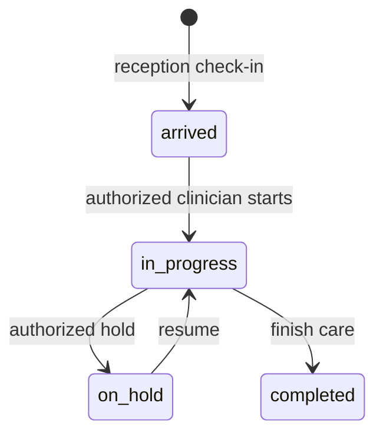

# Lab technician

Snapshot: **2026-10-31**, repository source audit. No application code or live database was changed. “Source-confirmed” describes inspected code, not a passed browser, deployment or hospital test. ⚠️ UNVERIFIED = unresolved or untested; 🚧 NOT IMPLEMENTED = absent from the inspected ownership/routes; 🐞 SUSPECTED BUG = evidence needs a focused reproduction. Testing VPS and legacy LAN deployments are distinct. Actual VPS state and actual hospital configuration are not inferred from this checkout.

## 1. Purpose — who this person is in the hospital

Lab queue, samples, results. This is a **system role**, not an HR Position. An Employee's job title grants no access by itself; an AppUser must hold this role through UserRole. `apps/api/src/auth/permissions.ts:65`; `apps/api/prisma/schema.prisma:967`.

## 2. Responsibilities — daily / per-shift / monthly

The procedures below describe the coded work this role supports. Daily: check assigned work and correct patient/source identity before saving. Per shift: hand over unresolved work and sign out of shared devices. Monthly: review unresolved exceptions with the designated supervisor. These frequencies are **recommended SOP assignments, ⚠️ not application-enforced duties**. The hospital must approve ownership and cadence. Capability source: `apps/web/src/pages/LabQueuePage.tsx:1`.

## 3. Prerequisites — before this person can work

An active User, facility, password change completion and the listed permission grants are required. Optional module screens also require enablement. Clinical accounts created through Users are refused; use Employee-linked onboarding for Doctor, Nurse, Lab technician and Pharmacist. HR self service requires an Employee link even for nonclinical accounts. Doctor accounts additionally require a clinical Position and linked Practitioner/department membership. Required workflow-specific catalogs and balances are in [the dependency matrix](../03-dependency-matrix.md). `apps/api/src/common/guards/jwt-auth.guard.ts:1`; `apps/api/src/modules/users/users.service.ts:73`; `apps/api/src/modules/staff/staff.service.ts:566`.

## 4. Permissions

Each cell lists exact permission codes, rather than implying every action in a module is allowed. Verb grouping is for reading only; some permissions appear in more than one column. Conditional rules and all denied permissions are in [the master matrix](../07-permission-matrix.md). Database grant drift is ⚠️ UNVERIFIED on the VPS.

| Module | View | Create | Edit | Delete/Cancel | Approve | Print/Export | Source (file:line) |
| --- | --- | --- | --- | --- | --- | --- | --- |
| reception | No matching grant | No matching grant | No matching grant | No matching grant | No matching grant | No matching grant | Denied by absence: `apps/api/src/auth/permissions.ts:1` |
| hr | hr.roster.view; hr.self.view | hr.leave.request | No matching grant | No matching grant | No matching grant | No matching grant | apps/api/src/auth/permissions.ts:136; apps/api/src/auth/permissions.ts:142; apps/api/src/auth/permissions.ts:148 |
| crm | No matching grant | No matching grant | No matching grant | No matching grant | No matching grant | No matching grant | Denied by absence: `apps/api/src/auth/permissions.ts:1` |
| payroll | No matching grant | No matching grant | No matching grant | No matching grant | No matching grant | No matching grant | Denied by absence: `apps/api/src/auth/permissions.ts:1` |
| finance | No matching grant | No matching grant | No matching grant | No matching grant | No matching grant | No matching grant | Denied by absence: `apps/api/src/auth/permissions.ts:1` |
| auth | auth.login; auth.me | No matching grant | No matching grant | No matching grant | No matching grant | No matching grant | apps/api/src/auth/permissions.ts:199; apps/api/src/auth/permissions.ts:222 |
| user | No matching grant | No matching grant | No matching grant | No matching grant | No matching grant | No matching grant | Denied by absence: `apps/api/src/auth/permissions.ts:1` |
| role | No matching grant | No matching grant | No matching grant | No matching grant | No matching grant | No matching grant | Denied by absence: `apps/api/src/auth/permissions.ts:1` |
| facility | No matching grant | No matching grant | No matching grant | No matching grant | No matching grant | No matching grant | Denied by absence: `apps/api/src/auth/permissions.ts:1` |
| department | No matching grant | No matching grant | No matching grant | No matching grant | No matching grant | No matching grant | Denied by absence: `apps/api/src/auth/permissions.ts:1` |
| room | No matching grant | No matching grant | No matching grant | No matching grant | No matching grant | No matching grant | Denied by absence: `apps/api/src/auth/permissions.ts:1` |
| practitioner | No matching grant | No matching grant | No matching grant | No matching grant | No matching grant | No matching grant | Denied by absence: `apps/api/src/auth/permissions.ts:1` |
| service | No matching grant | No matching grant | No matching grant | No matching grant | No matching grant | No matching grant | Denied by absence: `apps/api/src/auth/permissions.ts:1` |
| price | No matching grant | No matching grant | No matching grant | No matching grant | No matching grant | No matching grant | Denied by absence: `apps/api/src/auth/permissions.ts:1` |
| drug | No matching grant | No matching grant | No matching grant | No matching grant | No matching grant | No matching grant | Denied by absence: `apps/api/src/auth/permissions.ts:1` |
| labtest | No matching grant | No matching grant | labtest.manage (R9) | No matching grant | No matching grant | No matching grant | apps/api/src/auth/permissions.ts:269 |
| panel | No matching grant | No matching grant | No matching grant | No matching grant | No matching grant | No matching grant | Denied by absence: `apps/api/src/auth/permissions.ts:1` |
| template | No matching grant | No matching grant | No matching grant | No matching grant | No matching grant | No matching grant | Denied by absence: `apps/api/src/auth/permissions.ts:1` |
| setting | No matching grant | No matching grant | No matching grant | No matching grant | No matching grant | No matching grant | Denied by absence: `apps/api/src/auth/permissions.ts:1` |
| patient | patient.read_demographics; patient.read_clinical (R8) | No matching grant | No matching grant | No matching grant | No matching grant | No matching grant | apps/api/src/auth/permissions.ts:307; apps/api/src/auth/permissions.ts:320 |
| allergy | No matching grant | No matching grant | No matching grant | No matching grant | No matching grant | No matching grant | Denied by absence: `apps/api/src/auth/permissions.ts:1` |
| visit | No matching grant | No matching grant | No matching grant | No matching grant | No matching grant | No matching grant | Denied by absence: `apps/api/src/auth/permissions.ts:1` |
| appointment | No matching grant | No matching grant | No matching grant | No matching grant | No matching grant | No matching grant | Denied by absence: `apps/api/src/auth/permissions.ts:1` |
| vitals | No matching grant | No matching grant | No matching grant | No matching grant | No matching grant | No matching grant | Denied by absence: `apps/api/src/auth/permissions.ts:1` |
| diagnosis | No matching grant | No matching grant | No matching grant | No matching grant | No matching grant | No matching grant | Denied by absence: `apps/api/src/auth/permissions.ts:1` |
| clinical_note | No matching grant | No matching grant | No matching grant | No matching grant | No matching grant | No matching grant | Denied by absence: `apps/api/src/auth/permissions.ts:1` |
| attachment | No matching grant | attachment.upload | No matching grant | No matching grant | No matching grant | No matching grant | apps/api/src/auth/permissions.ts:429 |
| prescription | No matching grant | No matching grant | No matching grant | No matching grant | No matching grant | No matching grant | Denied by absence: `apps/api/src/auth/permissions.ts:1` |
| interaction | No matching grant | No matching grant | No matching grant | No matching grant | No matching grant | No matching grant | Denied by absence: `apps/api/src/auth/permissions.ts:1` |
| follow_up | No matching grant | No matching grant | No matching grant | No matching grant | No matching grant | No matching grant | Denied by absence: `apps/api/src/auth/permissions.ts:1` |
| lab_order | lab_order.read_queue | No matching grant | No matching grant | No matching grant | No matching grant | No matching grant | apps/api/src/auth/permissions.ts:481 |
| lab | lab.amend_result (R4) | lab.collect_sample | No matching grant | No matching grant | lab.verify_result | lab.print_result | apps/api/src/auth/permissions.ts:483; apps/api/src/auth/permissions.ts:484; apps/api/src/auth/permissions.ts:486; apps/api/src/auth/permissions.ts:487; apps/api/src/auth/permissions.ts:490 |
| lab_result | lab_result.read | No matching grant | No matching grant | No matching grant | No matching grant | No matching grant | apps/api/src/auth/permissions.ts:488 |
| pharmacy | No matching grant | No matching grant | No matching grant | No matching grant | No matching grant | No matching grant | Denied by absence: `apps/api/src/auth/permissions.ts:1` |
| invoice | No matching grant | No matching grant | No matching grant | No matching grant | No matching grant | No matching grant | Denied by absence: `apps/api/src/auth/permissions.ts:1` |
| payment | No matching grant | No matching grant | No matching grant | No matching grant | No matching grant | No matching grant | Denied by absence: `apps/api/src/auth/permissions.ts:1` |
| refund | No matching grant | No matching grant | No matching grant | No matching grant | No matching grant | No matching grant | Denied by absence: `apps/api/src/auth/permissions.ts:1` |
| discount | No matching grant | No matching grant | No matching grant | No matching grant | No matching grant | No matching grant | Denied by absence: `apps/api/src/auth/permissions.ts:1` |
| lab_charge | No matching grant | No matching grant | No matching grant | No matching grant | No matching grant | No matching grant | Denied by absence: `apps/api/src/auth/permissions.ts:1` |
| report | No matching grant | No matching grant | No matching grant | No matching grant | No matching grant | No matching grant | Denied by absence: `apps/api/src/auth/permissions.ts:1` |
| audit_log | No matching grant | No matching grant | No matching grant | No matching grant | No matching grant | No matching grant | Denied by absence: `apps/api/src/auth/permissions.ts:1` |
| error_log | No matching grant | No matching grant | No matching grant | No matching grant | No matching grant | No matching grant | Denied by absence: `apps/api/src/auth/permissions.ts:1` |
| data | No matching grant | No matching grant | No matching grant | No matching grant | No matching grant | No matching grant | Denied by absence: `apps/api/src/auth/permissions.ts:1` |

## 5. What they CANNOT do (and who does it instead)

Anything absent from this role's grants is denied, including on a screen reached by manually entering its URL. Multiple roles may expand authority; this document assumes this role alone. Admin manages configuration and users; receptionist registers patients and takes lab collections; doctor writes diagnoses/notes/prescriptions; lab_tech enters/verifies lab results; pharmacist confirms medicine handover; finance roles follow independent approval and posting checks. **Admin alone is not a clinical author.** Exact exceptions and conditions: `apps/api/src/auth/permissions.ts:1`; `apps/api/src/common/guards/permissions.guard.ts:1`.

## 6. Screens they use — navigation path

English menu labels below come from the locale file. The Main group has no translated heading in the current English dictionary. Listed visibility does not prove every button is authorized. `apps/web/src/i18n/locales/en.json:1`.

| Menu group › item | URL | Module prerequisite | Source |
| --- | --- | --- | --- |
| Administration › Human resources | /hr | hr | `apps/web/src/auth/nav.ts:1` |
| Main › Dashboard | / | Core | `apps/web/src/auth/nav.ts:1` |
| Clinical › Lab | /lab | lab | `apps/web/src/auth/nav.ts:1` |
| Administration › Lab tests | /lab-tests | lab | `apps/web/src/auth/nav.ts:1` |

## 7. Button & action reference

These are source locations on menu-linked or permission-linked screens, including reusable controls. **Rows are an inventory, not a grant.** Read the endpoint permission against Section 4; branch-dependent visibility not proven for this role is ⚠️ UNVERIFIED. Administrator includes the complete UI inventory to guarantee no source location is silently omitted, including clinical controls the administrator cannot use. Side effects are direct static service effects; nested helpers may add effects. Runtime behavior and physical printing are not verified by this table.

| ID / source | Screen / component | Button / action (English; Dari where available) | Where | What it does / handler | Preconditions / disabled when | Side effects / trace evidence | Reversible? how | API endpoint | Permission required | Audited? |
| --- | --- | --- | --- | --- | --- | --- | --- | --- | --- | --- |
| A0001 apps/web/src/AppRoot.tsx:23 | AppRoot | FirstRunLanguagePicker | AppRoot / FirstRunLanguagePicker | Local handler / ⚠️ semantic review; onChosen: {() => setHasChosen(true)} | No explicit disabled attribute; surrounding conditions: !hasChosen ? ( <FirstRunLanguagePicker onChosen={() => setHasChosen(true)} /> ) : ( <QueryClientProvider client={queryClient}> {/* AuthProvider above the router: the route components (ProtectedRoute, | ⚠️ UNVERIFIED: inspect handler and linked API call inventory | ⚠️ Use documented cancel/reversal workflow; no generic undo | No statically resolved endpoint | ⚠️ UI local / endpoint-specific; menu is not permission | Local actions have no automatic DB audit; downstream action ⚠️ UNVERIFIED |
| A0288 apps/web/src/components/FinanceDateInput.tsx:21 | FinancePage, HrPage | "Shamsi date: YYYY-MM-DD (1350–1499)" | FinanceDateInput / Input | Form input / selection; onChange: {(event) => { const entered = event.target.value setEdit({ source: value, text: entered }) try { const converted = shamsiToGregorian(entered) event.target.setCustomValidity('') setEdit(null) onChange(converted) } catch { event.target.setCustomValidity('Enter a valid Shamsi date, for example 1404-07-05.') } }} | No explicit disabled attribute | Changes form selection; persistence occurs on submission | Edit again before saving | No statically resolved endpoint | ⚠️ UI local / endpoint-specific; menu is not permission | Local actions have no automatic DB audit; downstream action ⚠️ UNVERIFIED |
| A0421 apps/web/src/components/FirstRunLanguagePicker.tsx:39 | FirstRunLanguagePicker | {meta.nativeName} | FirstRunLanguagePicker / button | Local handler / ⚠️ semantic review; onClick: {() => choose(code)} | No explicit disabled attribute | ⚠️ UNVERIFIED: inspect handler and linked API call inventory | ⚠️ Use documented cancel/reversal workflow; no generic undo | No statically resolved endpoint | ⚠️ UI local / endpoint-specific; menu is not permission | Local actions have no automatic DB audit; downstream action ⚠️ UNVERIFIED |
| A0464 apps/web/src/components/LanguageToggle.tsx:30 | LanguageToggle | {meta.nativeName} | LanguageToggle / button | Local handler / ⚠️ semantic review; onClick: {() => select(code)} | No explicit disabled attribute | ⚠️ UNVERIFIED: inspect handler and linked API call inventory | ⚠️ Use documented cancel/reversal workflow; no generic undo | No statically resolved endpoint | ⚠️ UI local / endpoint-specific; menu is not permission | Local actions have no automatic DB audit; downstream action ⚠️ UNVERIFIED |
| A0538 apps/web/src/components/Sidebar.tsx:35 | Sidebar | div | Sidebar / div | Local handler / ⚠️ semantic review; onClick: {onClose} | No explicit disabled attribute; surrounding conditions: open && ( 
 ) | ⚠️ UNVERIFIED: inspect handler and linked API call inventory | ⚠️ Use documented cancel/reversal workflow; no generic undo | No statically resolved endpoint | ⚠️ UI local / endpoint-specific; menu is not permission | Local actions have no automatic DB audit; downstream action ⚠️ UNVERIFIED |
| A0539 apps/web/src/components/Sidebar.tsx:71 | Sidebar | {Icon && } {t(`nav.${item.key}`)} {item.key === 'collections' && } | Sidebar / NavLink | Navigation; onClick: {onClose} | No explicit disabled attribute | Changes browser destination; target: {item.to} | Browser Back | No statically resolved endpoint | ⚠️ UI local / endpoint-specific; menu is not permission | Local actions have no automatic DB audit; downstream action ⚠️ UNVERIFIED |
| A0540 apps/web/src/components/ThemeToggle.tsx:15 | ThemeToggle | {t(theme === 'dark' ? 'theme.toLight' : 'theme.toDark')} | ThemeToggle / Button | Local handler / ⚠️ semantic review; onClick: {toggle} | No explicit disabled attribute | ⚠️ UNVERIFIED: inspect handler and linked API call inventory | ⚠️ Use documented cancel/reversal workflow; no generic undo | No statically resolved endpoint | ⚠️ UI local / endpoint-specific; menu is not permission | Local actions have no automatic DB audit; downstream action ⚠️ UNVERIFIED |
| A0544 apps/web/src/components/ui/input.tsx:11 | AppointmentsPage, ChangePasswordPage, CollectionsPage, ConsultPage, CrmPage, DepartmentsPage, DrugsPage, FinancePage, FollowUpsPage, HrPage, IcdLookupPage, InteractionCheckerPage, InvoicesPage, LabPanelsPage, LabQueuePage, LabTestsPage, MyConsultationsPage, PatientDetailPage, PatientsPage, PharmacyPage, PractitionersPage, QueuePage, ReceptionOperationsPage, ReceptionPage, ReportsPage, ServicesPage, SettingsPage, StartVisitPage, TillPage, UsersPage | input | Input / input | Form input / selection; ⚠️ UNVERIFIED | No explicit disabled attribute | Changes form selection; persistence occurs on submission | Edit again before saving | No statically resolved endpoint | ⚠️ UI local / endpoint-specific; menu is not permission | Local actions have no automatic DB audit; downstream action ⚠️ UNVERIFIED |
| A0545 apps/web/src/components/ui/select.tsx:14 | AppointmentsPage, CollectionsPage, ConsultPage, DepartmentsPage, HrPage, InvoicesPage, LabQueuePage, LabTestsPage, PatientDetailPage, PharmacyPage, PractitionersPage, QueuePage, ReceptionOperationsPage, ReportsPage, ServicesPage, StartVisitPage, UsersPage | {children} | Select / select | Form input / selection; ⚠️ UNVERIFIED | No explicit disabled attribute | Changes form selection; persistence occurs on submission | Edit again before saving | No statically resolved endpoint | ⚠️ UI local / endpoint-specific; menu is not permission | Local actions have no automatic DB audit; downstream action ⚠️ UNVERIFIED |
| A0551 apps/web/src/layouts/RootLayout.tsx:26 | RootLayout | Open menu / Signed in as {{name}} / ⚠️ auth.password.title / Sign out / باز کردن منو / وارد شده به عنوان {{name}} / ⚠️ / خروج | RootLayout / Sidebar | Local handler / ⚠️ semantic review; onClose: {() => setSidebarOpen(false)} | No explicit disabled attribute | ⚠️ UNVERIFIED: inspect handler and linked API call inventory | ⚠️ Use documented cancel/reversal workflow; no generic undo | No statically resolved endpoint | ⚠️ UI local / endpoint-specific; menu is not permission | Local actions have no automatic DB audit; downstream action ⚠️ UNVERIFIED |
| A0552 apps/web/src/layouts/RootLayout.tsx:35 | RootLayout | Open menu / باز کردن منو | RootLayout / Button | Local handler / ⚠️ semantic review; onClick: {() => setSidebarOpen(true)} | No explicit disabled attribute | ⚠️ UNVERIFIED: inspect handler and linked API call inventory | ⚠️ Use documented cancel/reversal workflow; no generic undo | No statically resolved endpoint | ⚠️ UI local / endpoint-specific; menu is not permission | Local actions have no automatic DB audit; downstream action ⚠️ UNVERIFIED |
| A0553 apps/web/src/layouts/RootLayout.tsx:53 | RootLayout | ⚠️ auth.password.title / ⚠️ | RootLayout / Link | Navigation; "/change-password" | No explicit disabled attribute | Changes browser destination; target: "/change-password" | Browser Back | No statically resolved endpoint | ⚠️ UI local / endpoint-specific; menu is not permission | Local actions have no automatic DB audit; downstream action ⚠️ UNVERIFIED |
| A0554 apps/web/src/layouts/RootLayout.tsx:56 | RootLayout | Sign out / خروج | RootLayout / Button | Local handler / ⚠️ semantic review; onClick: {logout} | No explicit disabled attribute | ⚠️ UNVERIFIED: inspect handler and linked API call inventory | ⚠️ Use documented cancel/reversal workflow; no generic undo | No statically resolved endpoint | ⚠️ UI local / endpoint-specific; menu is not permission | Local actions have no automatic DB audit; downstream action ⚠️ UNVERIFIED |
| A0570 apps/web/src/pages/ChangePasswordPage.tsx:53 | ChangePasswordPage | ⚠️ auth.password.current / ⚠️ auth.password.new / ⚠️ auth.password.confirm / ⚠️ auth.password.save / ⚠️ / ⚠️ / ⚠️ / ⚠️ | ChangePasswordPage / form | Server request; onSubmit: {(event) => { void submit(event) }} | No explicit disabled attribute; surrounding conditions: done ? <> 
{t('auth.password.done', 'Password changed. Sign in again with your new password.')}
 <Button onClick={() => { logout(); navigate('/login', { replace: true }) }}>{t('auth.password.signInAgai | apps/api/src/auth/auth.service.ts:354; appUser.findFirst, appUser.updateMany, session.updateMany | ⚠️ Use documented cancel/reversal workflow; no generic undo | POST /auth/change-password (apps/api/src/auth/auth.controller.ts:93) | auth.me | App request context + audited Prisma writes; read audit is endpoint-specific. Root/manual scripts are outside this coverage. |
| A0574 apps/web/src/pages/ChangePasswordPage.tsx:64 | ChangePasswordPage | ⚠️ auth.password.save / ⚠️ | ChangePasswordPage / Button | Server request; {(event) => { void submit(event) }} | {busy}; surrounding conditions: done ? <> 
{t('auth.password.done', 'Password changed. Sign in again with your new password.')}
 <Button onClick={() => { logout(); navigate('/login', { replace: true }) }}>{t('auth.password.signInAgai | apps/api/src/auth/auth.service.ts:354; appUser.findFirst, appUser.updateMany, session.updateMany | ⚠️ Use documented cancel/reversal workflow; no generic undo | POST /auth/change-password (apps/api/src/auth/auth.controller.ts:93) | auth.me | App request context + audited Prisma writes; read audit is endpoint-specific. Root/manual scripts are outside this coverage. |
| A0728 apps/web/src/pages/HomePage.tsx:106 | HomePage | Open workspace / باز کردن محیط کاری | HomePage / Link | Navigation; {item.to} | No explicit disabled attribute | Changes browser destination; target: {item.to} | Browser Back | No statically resolved endpoint | ⚠️ UI local / endpoint-specific; menu is not permission | Local actions have no automatic DB audit; downstream action ⚠️ UNVERIFIED |
| A0729 apps/web/src/pages/HrPage.tsx:172 | HrPage | {x[0].toUpperCase() + x.slice(1)} | HrPage / Button | Local handler / ⚠️ semantic review; onClick: {() => setParams({ tab: x })} | No explicit disabled attribute | ⚠️ UNVERIFIED: inspect handler and linked API call inventory | ⚠️ Use documented cancel/reversal workflow; no generic undo | No statically resolved endpoint | ⚠️ UI local / endpoint-specific; menu is not permission | Local actions have no automatic DB audit; downstream action ⚠️ UNVERIFIED |
| A0730 apps/web/src/pages/HrPage.tsx:258 | HrPage | Employee register setQ(e.target.value)} /> | Employees / Input | Form input / selection; onChange: {(e) => setQ(e.target.value)} | No explicit disabled attribute | Changes form selection; persistence occurs on submission | Edit again before saving | No statically resolved endpoint | ⚠️ UI local / endpoint-specific; menu is not permission | Local actions have no automatic DB audit; downstream action ⚠️ UNVERIFIED |
| A0731 apps/web/src/pages/HrPage.tsx:272 | HrPage | {e.employeeNo} {e.fullName} {e.departmentName} {e.positionTitle} {e.status} | Employees / tr | Local handler / ⚠️ semantic review; onClick: {() => setSelectedId(e.id)} | No explicit disabled attribute; surrounding conditions: list.isPending ? ( 
Loading employees…
 ) : ( <Table headings={["No.", "Employee", "Department", "Position", "Status"]} > {list.data?.items.map((e) => ( <tr | ⚠️ UNVERIFIED: inspect handler and linked API call inventory | ⚠️ Use documented cancel/reversal workflow; no generic undo | No statically resolved endpoint | ⚠️ UI local / endpoint-specific; menu is not permission | Local actions have no automatic DB audit; downstream action ⚠️ UNVERIFIED |
| A0732 apps/web/src/pages/HrPage.tsx:299 | HrPage | Create a clinical position | Employees / Link | Navigation; "/hr?tab=settings" | No explicit disabled attribute; surrounding conditions: refs.positionsLoaded && refs.positions.length === 0 && ( 
 
 Create an active clinical pos; selectedId && detail.data ? ( <EmployeeDetail employee={detail.data} /> ) : ( <Card className="space-y-4 p-5"> {refs.positionsLoaded && refs.positions.length === 0 && ( 
 ( {d.name} ))} Select… {refs.positions.map((p) => ( {p.titleEn} ))} Permanent Fixed term Part time Temporary Volunteer Create employee {notice && {notice} } | Employees / form | Server request; onSubmit: {submit} | No explicit disabled attribute; surrounding conditions: selectedId && detail.data ? ( <EmployeeDetail employee={detail.data} /> ) : ( <Card className="space-y-4 p-5"> {refs.positionsLoaded && refs.positions.length === 0 && ( 
 ) : ( <Card className="space-y-4 p-5"> {refs.positionsLoaded && refs.positions.length === 0 && ( 
 ) : ( <Card className="space-y-4 p-5"> {refs.positionsLoaded && refs.positions.length === 0 && ( 
 ) : ( <Card className="space-y-4 p-5"> {refs.positionsLoaded && refs.positions.length === 0 && ( 
 ) : ( <Card className="space-y-4 p-5"> {refs.positionsLoaded && refs.positions.length === 0 && ( 
 ) : ( <Card className="space-y-4 p-5"> {refs.positionsLoaded && refs.positions.length === 0 && ( 
 ( {d.name} ))} | Employees / Select | Form input / selection; {submit} | No explicit disabled attribute; surrounding conditions: selectedId && detail.data ? ( <EmployeeDetail employee={detail.data} /> ) : ( <Card className="space-y-4 p-5"> {refs.positionsLoaded && refs.positions.length === 0 && ( 
 ( {p.titleEn} ))} | Employees / Select | Form input / selection; {submit} | No explicit disabled attribute; surrounding conditions: selectedId && detail.data ? ( <EmployeeDetail employee={detail.data} /> ) : ( <Card className="space-y-4 p-5"> {refs.positionsLoaded && refs.positions.length === 0 && ( 
 ) : ( <Card className="space-y-4 p-5"> {refs.positionsLoaded && refs.positions.length === 0 && ( 
 ) : ( <Card className="space-y-4 p-5"> {refs.positionsLoaded && refs.positions.length === 0 && ( 
 ) : ( <Card className="space-y-4 p-5"> {refs.positionsLoaded && refs.positions.length === 0 && ( 
 { e.preventDefault(); const f = new FormData(e.currentTarget); const file = f.get("file"); if (file instanceof File) upload.mutate({ file, title: String(f.get("title")), type: String(f.get("type")), }); }} | No explicit disabled attribute | apps/api/src/modules/staff/staff.service.ts:369; employeeDocument.create | ⚠️ Use documented cancel/reversal workflow; no generic undo | POST /employees/:id/documents (apps/api/src/modules/staff/staff.controller.ts:100) | hr.document.manage; ⚠️ This role lacks: hr.document.manage | App request context + audited Prisma writes; read audit is endpoint-specific. Root/manual scripts are outside this coverage. |
| A0747 apps/web/src/pages/HrPage.tsx:507 | HrPage | Private documents Identity Contract Education License Training Other Upload | EmployeeDetail / Input | Form input / selection; {(e) => { e.preventDefault(); const f = new FormData(e.currentTarget); const file = f.get("file"); if (file instanceof File) upload.mutate({ file, title: String(f.get("title")), type: String(f.get("type")), }); }} | No explicit disabled attribute | Changes form selection; persistence occurs on submission | Edit again before saving | No statically resolved endpoint | ⚠️ UI local / endpoint-specific; menu is not permission | Local actions have no automatic DB audit; downstream action ⚠️ UNVERIFIED |
| A0748 apps/web/src/pages/HrPage.tsx:508 | HrPage | Identity Contract Education License Training Other | EmployeeDetail / Select | Form input / selection; {(e) => { e.preventDefault(); const f = new FormData(e.currentTarget); const file = f.get("file"); if (file instanceof File) upload.mutate({ file, title: String(f.get("title")), type: String(f.get("type")), }); }} | No explicit disabled attribute | Changes form selection; persistence occurs on submission | Edit again before saving | No statically resolved endpoint | ⚠️ UI local / endpoint-specific; menu is not permission | Local actions have no automatic DB audit; downstream action ⚠️ UNVERIFIED |
| A0749 apps/web/src/pages/HrPage.tsx:516 | HrPage | Private documents Identity Contract Education License Training Other Upload | EmployeeDetail / Input | Form input / selection; {(e) => { e.preventDefault(); const f = new FormData(e.currentTarget); const file = f.get("file"); if (file instanceof File) upload.mutate({ file, title: String(f.get("title")), type: String(f.get("type")), }); }} | No explicit disabled attribute | Changes form selection; persistence occurs on submission | Edit again before saving | No statically resolved endpoint | ⚠️ UI local / endpoint-specific; menu is not permission | Local actions have no automatic DB audit; downstream action ⚠️ UNVERIFIED |
| A0750 apps/web/src/pages/HrPage.tsx:522 | HrPage | Upload | EmployeeDetail / Button | Server request; {(e) => { e.preventDefault(); const f = new FormData(e.currentTarget); const file = f.get("file"); if (file instanceof File) upload.mutate({ file, title: String(f.get("title")), type: String(f.get("type")), }); }} | No explicit disabled attribute | apps/api/src/modules/staff/staff.service.ts:369; employeeDocument.create | ⚠️ Use documented cancel/reversal workflow; no generic undo | POST /employees/:id/documents (apps/api/src/modules/staff/staff.controller.ts:100) | hr.document.manage; ⚠️ This role lacks: hr.document.manage | App request context + audited Prisma writes; read audit is endpoint-specific. Root/manual scripts are outside this coverage. |
| A0751 apps/web/src/pages/HrPage.tsx:526 | HrPage | {d.title} ( {Math.ceil(d.sizeBytes / 1024)} KB) | EmployeeDetail / button | Server request; onClick: {() => void apiDownload( `/employees/${employee.id}/documents/${d.id}/download`, ) } | No explicit disabled attribute | apps/api/src/modules/staff/staff.service.ts:401; employeeDocument.findFirst | ⚠️ Use documented cancel/reversal workflow; no generic undo | GET /employees/:id/documents/:documentId/download (apps/api/src/modules/staff/staff.controller.ts:111) | hr.document.manage; ⚠️ This role lacks: hr.document.manage | App request context + audited Prisma writes; read audit is endpoint-specific. Root/manual scripts are outside this coverage. |
| A0752 apps/web/src/pages/HrPage.tsx:545 | HrPage | Create system account Select role… Doctor Nurse Lab technician Pharmacist Receptionist Payroll officer Accountant Create linked account | EmployeeDetail / form | Server request; onSubmit: {(e) => { e.preventDefault(); const f = new FormData(e.currentTarget); account.mutate({ username: f.get("username"), password: f.get("password"), email: f.get("email") &#124;&#124; null, roleCodes: [f.get("role")], }); }} | No explicit disabled attribute; surrounding conditions: employee.userId ? ( 
 <strong>System account:</strong> linked 
 ) : ( <form className="space-y-2" onSubmit={(e) => { e.preventD | apps/api/src/modules/staff/staff.service.ts:566; role.findMany, appUser.findUnique, practitioner.findUnique, employee.findFirst, practitioner.findFirst, appUser.create, userRole.createMany, employee.update, practitioner.update, practitioner.create, practitionerDepartment.upsert | ⚠️ Use documented cancel/reversal workflow; no generic undo | POST /employees/:id/account (apps/api/src/modules/staff/staff.controller.ts:141) | user.create; ⚠️ This role lacks: user.create | App request context + audited Prisma writes; read audit is endpoint-specific. Root/manual scripts are outside this coverage. |
| A0753 apps/web/src/pages/HrPage.tsx:559 | HrPage | Create system account Select role… Doctor Nurse Lab technician Pharmacist Receptionist Payroll officer Accountant Create linked account | EmployeeDetail / Input | Form input / selection; {(e) => { e.preventDefault(); const f = new FormData(e.currentTarget); account.mutate({ username: f.get("username"), password: f.get("password"), email: f.get("email") &#124;&#124; null, roleCodes: [f.get("role")], }); }} | No explicit disabled attribute; surrounding conditions: employee.userId ? ( 
 <strong>System account:</strong> linked 
 ) : ( <form className="space-y-2" onSubmit={(e) => { e.preventD | Changes form selection; persistence occurs on submission | Edit again before saving | No statically resolved endpoint | ⚠️ UI local / endpoint-specific; menu is not permission | Local actions have no automatic DB audit; downstream action ⚠️ UNVERIFIED |
| A0754 apps/web/src/pages/HrPage.tsx:560 | HrPage | Create system account Select role… Doctor Nurse Lab technician Pharmacist Receptionist Payroll officer Accountant Create linked account | EmployeeDetail / Input | Form input / selection; {(e) => { e.preventDefault(); const f = new FormData(e.currentTarget); account.mutate({ username: f.get("username"), password: f.get("password"), email: f.get("email") &#124;&#124; null, roleCodes: [f.get("role")], }); }} | No explicit disabled attribute; surrounding conditions: employee.userId ? ( 
 <strong>System account:</strong> linked 
 ) : ( <form className="space-y-2" onSubmit={(e) => { e.preventD | Changes form selection; persistence occurs on submission | Edit again before saving | No statically resolved endpoint | ⚠️ UI local / endpoint-specific; menu is not permission | Local actions have no automatic DB audit; downstream action ⚠️ UNVERIFIED |
| A0755 apps/web/src/pages/HrPage.tsx:561 | HrPage | Create system account Select role… Doctor Nurse Lab technician Pharmacist Receptionist Payroll officer Accountant Create linked account | EmployeeDetail / Input | Form input / selection; {(e) => { e.preventDefault(); const f = new FormData(e.currentTarget); account.mutate({ username: f.get("username"), password: f.get("password"), email: f.get("email") &#124;&#124; null, roleCodes: [f.get("role")], }); }} | No explicit disabled attribute; surrounding conditions: employee.userId ? ( 
 <strong>System account:</strong> linked 
 ) : ( <form className="space-y-2" onSubmit={(e) => { e.preventD | Changes form selection; persistence occurs on submission | Edit again before saving | No statically resolved endpoint | ⚠️ UI local / endpoint-specific; menu is not permission | Local actions have no automatic DB audit; downstream action ⚠️ UNVERIFIED |
| A0756 apps/web/src/pages/HrPage.tsx:568 | HrPage | Select role… Doctor Nurse Lab technician Pharmacist Receptionist Payroll officer Accountant | EmployeeDetail / Select | Form input / selection; {(e) => { e.preventDefault(); const f = new FormData(e.currentTarget); account.mutate({ username: f.get("username"), password: f.get("password"), email: f.get("email") &#124;&#124; null, roleCodes: [f.get("role")], }); }} | No explicit disabled attribute; surrounding conditions: employee.userId ? ( 
 <strong>System account:</strong> linked 
 ) : ( <form className="space-y-2" onSubmit={(e) => { e.preventD | Changes form selection; persistence occurs on submission | Edit again before saving | No statically resolved endpoint | ⚠️ UI local / endpoint-specific; menu is not permission | Local actions have no automatic DB audit; downstream action ⚠️ UNVERIFIED |
| A0757 apps/web/src/pages/HrPage.tsx:578 | HrPage | Create linked account | EmployeeDetail / Button | Server request; {(e) => { e.preventDefault(); const f = new FormData(e.currentTarget); account.mutate({ username: f.get("username"), password: f.get("password"), email: f.get("email") &#124;&#124; null, roleCodes: [f.get("role")], }); }} | No explicit disabled attribute; surrounding conditions: employee.userId ? ( 
 <strong>System account:</strong> linked 
 ) : ( <form className="space-y-2" onSubmit={(e) => { e.preventD | apps/api/src/modules/staff/staff.service.ts:566; role.findMany, appUser.findUnique, practitioner.findUnique, employee.findFirst, practitioner.findFirst, appUser.create, userRole.createMany, employee.update, practitioner.update, practitioner.create, practitionerDepartment.upsert | ⚠️ Use documented cancel/reversal workflow; no generic undo | POST /employees/:id/account (apps/api/src/modules/staff/staff.controller.ts:141) | user.create; ⚠️ This role lacks: user.create | App request context + audited Prisma writes; read audit is endpoint-specific. Root/manual scripts are outside this coverage. |
| A0758 apps/web/src/pages/HrPage.tsx:582 | HrPage | Add credential Professional license Education Certification Training Other Blocks clinical work after expiry Save credential | EmployeeDetail / form | Server request; onSubmit: {(e) => { e.preventDefault(); const f = new FormData(e.currentTarget); credential.mutate({ type: f.get("type"), name: f.get("name"), issuingAuthority: f.get("authority") &#124;&#124; null, referenceNo: f.get("reference") &#124;&#124; null, expiresOn: f.get("expiresOn") &#124;&#124; null, blocksClinicalWork: f.get("blocks") === "on", }); }} | No explicit disabled attribute | apps/api/src/modules/staff/staff.service.ts:437; credential.create | ⚠️ Use documented cancel/reversal workflow; no generic undo | POST /employees/:id/credentials (apps/api/src/modules/staff/staff.controller.ts:134) | hr.credential.manage; ⚠️ This role lacks: hr.credential.manage | App request context + audited Prisma writes; read audit is endpoint-specific. Root/manual scripts are outside this coverage. |
| A0759 apps/web/src/pages/HrPage.tsx:598 | HrPage | Add credential Professional license Education Certification Training Other Blocks clinical work after expiry Save credential | EmployeeDetail / Input | Form input / selection; {(e) => { e.preventDefault(); const f = new FormData(e.currentTarget); credential.mutate({ type: f.get("type"), name: f.get("name"), issuingAuthority: f.get("authority") &#124;&#124; null, referenceNo: f.get("reference") &#124;&#124; null, expiresOn: f.get("expiresOn") &#124;&#124; null, blocksClinicalWork: f.get("blocks") === "on", }); }} | No explicit disabled attribute | Changes form selection; persistence occurs on submission | Edit again before saving | No statically resolved endpoint | ⚠️ UI local / endpoint-specific; menu is not permission | Local actions have no automatic DB audit; downstream action ⚠️ UNVERIFIED |
| A0760 apps/web/src/pages/HrPage.tsx:599 | HrPage | Professional license Education Certification Training Other | EmployeeDetail / Select | Form input / selection; {(e) => { e.preventDefault(); const f = new FormData(e.currentTarget); credential.mutate({ type: f.get("type"), name: f.get("name"), issuingAuthority: f.get("authority") &#124;&#124; null, referenceNo: f.get("reference") &#124;&#124; null, expiresOn: f.get("expiresOn") &#124;&#124; null, blocksClinicalWork: f.get("blocks") === "on", }); }} | No explicit disabled attribute | Changes form selection; persistence occurs on submission | Edit again before saving | No statically resolved endpoint | ⚠️ UI local / endpoint-specific; menu is not permission | Local actions have no automatic DB audit; downstream action ⚠️ UNVERIFIED |
| A0761 apps/web/src/pages/HrPage.tsx:606 | HrPage | Add credential Professional license Education Certification Training Other Blocks clinical work after expiry Save credential | EmployeeDetail / Input | Form input / selection; {(e) => { e.preventDefault(); const f = new FormData(e.currentTarget); credential.mutate({ type: f.get("type"), name: f.get("name"), issuingAuthority: f.get("authority") &#124;&#124; null, referenceNo: f.get("reference") &#124;&#124; null, expiresOn: f.get("expiresOn") &#124;&#124; null, blocksClinicalWork: f.get("blocks") === "on", }); }} | No explicit disabled attribute | Changes form selection; persistence occurs on submission | Edit again before saving | No statically resolved endpoint | ⚠️ UI local / endpoint-specific; menu is not permission | Local actions have no automatic DB audit; downstream action ⚠️ UNVERIFIED |
| A0762 apps/web/src/pages/HrPage.tsx:607 | HrPage | Add credential Professional license Education Certification Training Other Blocks clinical work after expiry Save credential | EmployeeDetail / Input | Form input / selection; {(e) => { e.preventDefault(); const f = new FormData(e.currentTarget); credential.mutate({ type: f.get("type"), name: f.get("name"), issuingAuthority: f.get("authority") &#124;&#124; null, referenceNo: f.get("reference") &#124;&#124; null, expiresOn: f.get("expiresOn") &#124;&#124; null, blocksClinicalWork: f.get("blocks") === "on", }); }} | No explicit disabled attribute | Changes form selection; persistence occurs on submission | Edit again before saving | No statically resolved endpoint | ⚠️ UI local / endpoint-specific; menu is not permission | Local actions have no automatic DB audit; downstream action ⚠️ UNVERIFIED |
| A0763 apps/web/src/pages/HrPage.tsx:612 | HrPage | Blocks clinical work after expiry | EmployeeDetail / input | Form input / selection; {(e) => { e.preventDefault(); const f = new FormData(e.currentTarget); credential.mutate({ type: f.get("type"), name: f.get("name"), issuingAuthority: f.get("authority") &#124;&#124; null, referenceNo: f.get("reference") &#124;&#124; null, expiresOn: f.get("expiresOn") &#124;&#124; null, blocksClinicalWork: f.get("blocks") === "on", }); }} | No explicit disabled attribute | Changes form selection; persistence occurs on submission | Edit again before saving | No statically resolved endpoint | ⚠️ UI local / endpoint-specific; menu is not permission | Local actions have no automatic DB audit; downstream action ⚠️ UNVERIFIED |
| A0764 apps/web/src/pages/HrPage.tsx:615 | HrPage | Save credential | EmployeeDetail / Button | Server request; {(e) => { e.preventDefault(); const f = new FormData(e.currentTarget); credential.mutate({ type: f.get("type"), name: f.get("name"), issuingAuthority: f.get("authority") &#124;&#124; null, referenceNo: f.get("reference") &#124;&#124; null, expiresOn: f.get("expiresOn") &#124;&#124; null, blocksClinicalWork: f.get("blocks") === "on", }); }} | No explicit disabled attribute | apps/api/src/modules/staff/staff.service.ts:437; credential.create | ⚠️ Use documented cancel/reversal workflow; no generic undo | POST /employees/:id/credentials (apps/api/src/modules/staff/staff.controller.ts:134) | hr.credential.manage; ⚠️ This role lacks: hr.credential.manage | App request context + audited Prisma writes; read audit is endpoint-specific. Root/manual scripts are outside this coverage. |
| A0765 apps/web/src/pages/HrPage.tsx:618 | HrPage | Exit employee | EmployeeDetail / Button | Server request; onClick: {() => { if ( window.confirm( "Exit this employee and disable the linked user account?", ) ) exit.mutate(); }} | No explicit disabled attribute; surrounding conditions: employee.status !== "exited" && ( <Button variant="destructive" size="sm" onClick={() => { if ( window.confirm( "Exit this employee and disable the linked user | apps/api/src/modules/staff/staff.service.ts:342; employee.findFirst, employee.update, appUser.update, session.updateMany | ⚠️ Use documented cancel/reversal workflow; no generic undo | POST /employees/:id/exit (apps/api/src/modules/staff/staff.controller.ts:92) | hr.employee.exit; ⚠️ This role lacks: hr.employee.exit | App request context + audited Prisma writes; read audit is endpoint-specific. Root/manual scripts are outside this coverage. |
| A0766 apps/web/src/pages/HrPage.tsx:666 | HrPage | All credentials {credentialStateSchema.options.map((s) => ( {s.replaceAll("_", " ")} ))} | Credentials / Select | Form input / selection; onChange: {(e) => setState(e.target.value)} | No explicit disabled attribute | Changes form selection; persistence occurs on submission | Edit again before saving | No statically resolved endpoint | ⚠️ UI local / endpoint-specific; menu is not permission | Local actions have no automatic DB audit; downstream action ⚠️ UNVERIFIED |
| A0767 apps/web/src/pages/HrPage.tsx:678 | HrPage | CSV | Credentials / Button | Local handler / ⚠️ semantic review; onClick: {() => downloadTable("hr-credentials", exportRows)} | No explicit disabled attribute | ⚠️ UNVERIFIED: inspect handler and linked API call inventory | ⚠️ Use documented cancel/reversal workflow; no generic undo | No statically resolved endpoint | ⚠️ UI local / endpoint-specific; menu is not permission | Local actions have no automatic DB audit; downstream action ⚠️ UNVERIFIED |
| A0768 apps/web/src/pages/HrPage.tsx:684 | HrPage | Excel | Credentials / Button | Local handler / ⚠️ semantic review; onClick: {() => downloadTable("hr-credentials", exportRows, true)} | No explicit disabled attribute | ⚠️ UNVERIFIED: inspect handler and linked API call inventory | ⚠️ Use documented cancel/reversal workflow; no generic undo | No statically resolved endpoint | ⚠️ UI local / endpoint-specific; menu is not permission | Local actions have no automatic DB audit; downstream action ⚠️ UNVERIFIED |
| A0769 apps/web/src/pages/HrPage.tsx:775 | HrPage | FinanceDateInput | Attendance / FinanceDateInput | Local handler / ⚠️ semantic review; onChange: {setDate} | No explicit disabled attribute | ⚠️ UNVERIFIED: inspect handler and linked API call inventory | ⚠️ Use documented cancel/reversal workflow; no generic undo | No statically resolved endpoint | ⚠️ UI local / endpoint-specific; menu is not permission | Local actions have no automatic DB audit; downstream action ⚠️ UNVERIFIED |
| A0770 apps/web/src/pages/HrPage.tsx:778 | HrPage | CSV | Attendance / Button | Local handler / ⚠️ semantic review; onClick: {() => downloadTable("hr-attendance-month", reportRows)} | No explicit disabled attribute | ⚠️ UNVERIFIED: inspect handler and linked API call inventory | ⚠️ Use documented cancel/reversal workflow; no generic undo | No statically resolved endpoint | ⚠️ UI local / endpoint-specific; menu is not permission | Local actions have no automatic DB audit; downstream action ⚠️ UNVERIFIED |
| A0771 apps/web/src/pages/HrPage.tsx:784 | HrPage | Excel | Attendance / Button | Local handler / ⚠️ semantic review; onClick: {() => downloadTable("hr-attendance-month", reportRows, true) } | No explicit disabled attribute | ⚠️ UNVERIFIED: inspect handler and linked API call inventory | ⚠️ Use documented cancel/reversal workflow; no generic undo | No statically resolved endpoint | ⚠️ UI local / endpoint-specific; menu is not permission | Local actions have no automatic DB audit; downstream action ⚠️ UNVERIFIED |
| A0772 apps/web/src/pages/HrPage.tsx:792 | HrPage | Save attendance | Attendance / Button | Server request; onClick: {() => save.mutate()} | {!query.data?.length &#124;&#124; save.isPending} | apps/api/src/modules/staff/staff-operations.service.ts:453; employee.count, attendanceDay.findFirst, attendanceDay.update, attendanceDay.create | ⚠️ Use documented cancel/reversal workflow; no generic undo | PUT /hr/attendance (apps/api/src/modules/staff/staff-operations.controller.ts:128) | hr.attendance.mark; ⚠️ This role lacks: hr.attendance.mark | App request context + audited Prisma writes; read audit is endpoint-specific. Root/manual scripts are outside this coverage. |
| A0773 apps/web/src/pages/HrPage.tsx:806 | HrPage | Present Absent Late On leave | Attendance / Select | Form input / selection; onChange: {(e) => setMarks((m) => ({ ...m, [r.employeeId]: e.target.value })) } | { r.source === "holiday" &#124;&#124; r.source === "rest_day" &#124;&#124; r.status === "on_leave" } | Changes form selection; persistence occurs on submission | Edit again before saving | No statically resolved endpoint | ⚠️ UI local / endpoint-specific; menu is not permission | Local actions have no automatic DB audit; downstream action ⚠️ UNVERIFIED |
| A0774 apps/web/src/pages/HrPage.tsx:878 | HrPage | Request leave {canApprove && ( My record {employees.data?.items.map((e) => ( {e.fullName} ))} )} Select… {types.data?.map((t) => ( {t.nameEn} ))} Submit request | Leave / form | Server request; onSubmit: {submit} | No explicit disabled attribute | apps/api/src/modules/staff/staff-operations.service.ts:200; employee.findFirst, leaveType.findFirst, leaveRequest.count, leaveRequest.create | ⚠️ Use documented cancel/reversal workflow; no generic undo | POST /hr/leave-requests (apps/api/src/modules/staff/staff-operations.controller.ts:95) | hr.leave.request | App request context + audited Prisma writes; read audit is endpoint-specific. Root/manual scripts are outside this coverage. |
| A0775 apps/web/src/pages/HrPage.tsx:882 | HrPage | My record {employees.data?.items.map((e) => ( {e.fullName} ))} | Leave / Select | Form input / selection; {submit} | No explicit disabled attribute; surrounding conditions: canApprove && ( <Field label="Employee"> <Select name="employeeId" defaultValue=""> <option value="">My record</option> {employees.data?.items.map((e) => ( <option | Changes form selection; persistence occurs on submission | Edit again before saving | No statically resolved endpoint | ⚠️ UI local / endpoint-specific; menu is not permission | Local actions have no automatic DB audit; downstream action ⚠️ UNVERIFIED |
| A0776 apps/web/src/pages/HrPage.tsx:893 | HrPage | Select… {types.data?.map((t) => ( {t.nameEn} ))} | Leave / Select | Form input / selection; {submit} | No explicit disabled attribute | Changes form selection; persistence occurs on submission | Edit again before saving | No statically resolved endpoint | ⚠️ UI local / endpoint-specific; menu is not permission | Local actions have no automatic DB audit; downstream action ⚠️ UNVERIFIED |
| A0777 apps/web/src/pages/HrPage.tsx:909 | HrPage | Input | Leave / Input | Form input / selection; {submit} | No explicit disabled attribute | Changes form selection; persistence occurs on submission | Edit again before saving | No statically resolved endpoint | ⚠️ UI local / endpoint-specific; menu is not permission | Local actions have no automatic DB audit; downstream action ⚠️ UNVERIFIED |
| A0778 apps/web/src/pages/HrPage.tsx:911 | HrPage | Submit request | Leave / Button | Server request; {submit} | No explicit disabled attribute | apps/api/src/modules/staff/staff-operations.service.ts:200; employee.findFirst, leaveType.findFirst, leaveRequest.count, leaveRequest.create | ⚠️ Use documented cancel/reversal workflow; no generic undo | POST /hr/leave-requests (apps/api/src/modules/staff/staff-operations.controller.ts:95) | hr.leave.request | App request context + audited Prisma writes; read audit is endpoint-specific. Root/manual scripts are outside this coverage. |
| A0779 apps/web/src/pages/HrPage.tsx:919 | HrPage | {mine ? "Show all" : "Show mine"} | Leave / Button | Local handler / ⚠️ semantic review; onClick: {() => setMine((x) => !x)} | No explicit disabled attribute; surrounding conditions: canApprove && ( <Button variant="outline" size="sm" onClick={() => setMine((x) => !x)} > {mine ? "Show all" : "Show mine"} </Button> ) | ⚠️ UNVERIFIED: inspect handler and linked API call inventory | ⚠️ Use documented cancel/reversal workflow; no generic undo | No statically resolved endpoint | ⚠️ UI local / endpoint-specific; menu is not permission | Local actions have no automatic DB audit; downstream action ⚠️ UNVERIFIED |
| A0780 apps/web/src/pages/HrPage.tsx:943 | HrPage | Approve | Leave / Button | Server request; onClick: {() => decide.mutate({ id: r.id, decision: "approve" }) } | No explicit disabled attribute; surrounding conditions: canApprove && r.status === "submitted" && (  <Button size="sm" onClick={() => decide.mutate({ id: r.id, d | apps/api/src/modules/staff/staff-operations.service.ts:315; leaveRequest.findFirst, leaveRequest.update, attendanceDay.findFirst, attendanceDay.update, attendanceDay.create | ⚠️ Use documented cancel/reversal workflow; no generic undo | POST /hr/leave-requests/:id/decision (apps/api/src/modules/staff/staff-operations.controller.ts:101) | hr.leave.approve; ⚠️ This role lacks: hr.leave.approve | App request context + audited Prisma writes; read audit is endpoint-specific. Root/manual scripts are outside this coverage. |
| A0781 apps/web/src/pages/HrPage.tsx:951 | HrPage | Reject | Leave / Button | Server request; onClick: {() => decide.mutate({ id: r.id, decision: "reject" }) } | No explicit disabled attribute; surrounding conditions: canApprove && r.status === "submitted" && (  <Button size="sm" onClick={() => decide.mutate({ id: r.id, d | apps/api/src/modules/staff/staff-operations.service.ts:315; leaveRequest.findFirst, leaveRequest.update, attendanceDay.findFirst, attendanceDay.update, attendanceDay.create | ⚠️ Use documented cancel/reversal workflow; no generic undo | POST /hr/leave-requests/:id/decision (apps/api/src/modules/staff/staff-operations.controller.ts:101) | hr.leave.approve; ⚠️ This role lacks: hr.leave.approve | App request context + audited Prisma writes; read audit is endpoint-specific. Root/manual scripts are outside this coverage. |
| A0782 apps/web/src/pages/HrPage.tsx:1080 | HrPage | Select… {employees.data?.items.map((e) => ( {e.fullName} ))} Select… {shifts.data?.map((s) => ( {s.nameEn} ))} Assign | Roster / form | Server request; onSubmit: {submit} | No explicit disabled attribute; surrounding conditions: canEdit && ( <Card className="p-5"> <form className="grid gap-3 md:grid-cols-5" onSubmit={submit}> <Field label="Employee"> <Select name="employeeId" required defaultValue=""> <opt | apps/api/src/modules/staff/staff-operations.service.ts:631; employee.findFirst, shiftType.findFirst, leaveRequest.count, rosterEntry.create | ⚠️ Use documented cancel/reversal workflow; no generic undo | POST /hr/roster (apps/api/src/modules/staff/staff-operations.controller.ts:161) | hr.roster.edit; ⚠️ This role lacks: hr.roster.edit | App request context + audited Prisma writes; read audit is endpoint-specific. Root/manual scripts are outside this coverage. |
| A0783 apps/web/src/pages/HrPage.tsx:1082 | HrPage | Select… {employees.data?.items.map((e) => ( {e.fullName} ))} | Roster / Select | Form input / selection; {submit} | No explicit disabled attribute; surrounding conditions: canEdit && ( <Card className="p-5"> <form className="grid gap-3 md:grid-cols-5" onSubmit={submit}> <Field label="Employee"> <Select name="employeeId" required defaultValue=""> <opt | Changes form selection; persistence occurs on submission | Edit again before saving | No statically resolved endpoint | ⚠️ UI local / endpoint-specific; menu is not permission | Local actions have no automatic DB audit; downstream action ⚠️ UNVERIFIED |
| A0784 apps/web/src/pages/HrPage.tsx:1092 | HrPage | Select… {shifts.data?.map((s) => ( {s.nameEn} ))} | Roster / Select | Form input / selection; {submit} | No explicit disabled attribute; surrounding conditions: canEdit && ( <Card className="p-5"> <form className="grid gap-3 md:grid-cols-5" onSubmit={submit}> <Field label="Employee"> <Select name="employeeId" required defaultValue=""> <opt | Changes form selection; persistence occurs on submission | Edit again before saving | No statically resolved endpoint | ⚠️ UI local / endpoint-specific; menu is not permission | Local actions have no automatic DB audit; downstream action ⚠️ UNVERIFIED |
| A0785 apps/web/src/pages/HrPage.tsx:1105 | HrPage | "on_call" | Roster / Input | Form input / selection; {submit} | No explicit disabled attribute; surrounding conditions: canEdit && ( <Card className="p-5"> <form className="grid gap-3 md:grid-cols-5" onSubmit={submit}> <Field label="Employee"> <Select name="employeeId" required defaultValue=""> <opt | Changes form selection; persistence occurs on submission | Edit again before saving | No statically resolved endpoint | ⚠️ UI local / endpoint-specific; menu is not permission | Local actions have no automatic DB audit; downstream action ⚠️ UNVERIFIED |
| A0786 apps/web/src/pages/HrPage.tsx:1108 | HrPage | Assign | Roster / Button | Server request; {submit} | No explicit disabled attribute; surrounding conditions: canEdit && ( <Card className="p-5"> <form className="grid gap-3 md:grid-cols-5" onSubmit={submit}> <Field label="Employee"> <Select name="employeeId" required defaultValue=""> <opt | apps/api/src/modules/staff/staff-operations.service.ts:631; employee.findFirst, shiftType.findFirst, leaveRequest.count, rosterEntry.create | ⚠️ Use documented cancel/reversal workflow; no generic undo | POST /hr/roster (apps/api/src/modules/staff/staff-operations.controller.ts:161) | hr.roster.edit; ⚠️ This role lacks: hr.roster.edit | App request context + audited Prisma writes; read audit is endpoint-specific. Root/manual scripts are outside this coverage. |
| A0787 apps/web/src/pages/HrPage.tsx:1117 | HrPage | FinanceDateInput | Roster / FinanceDateInput | Local handler / ⚠️ semantic review; onChange: {setFrom} | No explicit disabled attribute | ⚠️ UNVERIFIED: inspect handler and linked API call inventory | ⚠️ Use documented cancel/reversal workflow; no generic undo | No statically resolved endpoint | ⚠️ UI local / endpoint-specific; menu is not permission | Local actions have no automatic DB audit; downstream action ⚠️ UNVERIFIED |
| A0788 apps/web/src/pages/HrPage.tsx:1120 | HrPage | FinanceDateInput | Roster / FinanceDateInput | Local handler / ⚠️ semantic review; onChange: {setTo} | No explicit disabled attribute | ⚠️ UNVERIFIED: inspect handler and linked API call inventory | ⚠️ Use documented cancel/reversal workflow; no generic undo | No statically resolved endpoint | ⚠️ UI local / endpoint-specific; menu is not permission | Local actions have no automatic DB audit; downstream action ⚠️ UNVERIFIED |
| A0789 apps/web/src/pages/HrPage.tsx:1124 | HrPage | Copy previous week | Roster / Button | Server request; onClick: {() => copy.mutate()} | No explicit disabled attribute; surrounding conditions: canEdit && ( <> <Button variant="outline" onClick={() => copy.mutate()}> Copy previous week </Button> <Button onClick={() => publish.mutate()}>Publish roster</Button> | apps/api/src/modules/staff/staff-operations.service.ts:675; rosterEntry.findMany, rosterEntry.upsert | ⚠️ Use documented cancel/reversal workflow; no generic undo | POST /hr/roster/copy (apps/api/src/modules/staff/staff-operations.controller.ts:167) | hr.roster.edit; ⚠️ This role lacks: hr.roster.edit | App request context + audited Prisma writes; read audit is endpoint-specific. Root/manual scripts are outside this coverage. |
| A0790 apps/web/src/pages/HrPage.tsx:1127 | HrPage | Publish roster | Roster / Button | Server request; onClick: {() => publish.mutate()} | No explicit disabled attribute; surrounding conditions: canEdit && ( <> <Button variant="outline" onClick={() => copy.mutate()}> Copy previous week </Button> <Button onClick={() => publish.mutate()}>Publish roster</Button> | apps/api/src/modules/staff/staff-operations.service.ts:728; rosterEntry.findMany, rosterEntry.updateMany, hrNotification.createMany | ⚠️ Use documented cancel/reversal workflow; no generic undo | POST /hr/roster/publish (apps/api/src/modules/staff/staff-operations.controller.ts:179) | hr.roster.edit; ⚠️ This role lacks: hr.roster.edit | App request context + audited Prisma writes; read audit is endpoint-specific. Root/manual scripts are outside this coverage. |
| A0791 apps/web/src/pages/HrPage.tsx:1186 | HrPage | Open salary and payroll | HrSettings / Link | Navigation; "/finance?payrollRun=" | No explicit disabled attribute | Changes browser destination; target: "/finance?payrollRun=" | Browser Back | No statically resolved endpoint | ⚠️ UI local / endpoint-specific; menu is not permission | Local actions have no automatic DB audit; downstream action ⚠️ UNVERIFIED |
| A0792 apps/web/src/pages/HrPage.tsx:1191 | HrPage | HR calendar and controls Weekly rest days {["Sun", "Mon", "Tue", "Wed", "Thu", "Fri", "Sat"].map((d, i) => ( {d} ))} Save controls | HrSettings / form | Server request; onSubmit: {(e) => { e.preventDefault(); const f = new FormData(e.currentTarget); saveConfig.mutate({ weeklyRestDays: f.getAll("rest").map(Number), leavePastEntryDays: Number(f.get("past")), maxConsecutiveNightShifts: Number(f.get("nights")), credentialReminderDays: [90, 60, 30, 0], staffingRequirements: config.data?.staffingRequirements ?? [], }); }} | No explicit disabled attribute | apps/api/src/modules/staff/staff.service.ts:557; setting.upsert | ⚠️ Use documented cancel/reversal workflow; no generic undo | PUT /hr/config (apps/api/src/modules/staff/staff.controller.ts:219) | hr.employee.edit; ⚠️ This role lacks: hr.employee.edit | App request context + audited Prisma writes; read audit is endpoint-specific. Root/manual scripts are outside this coverage. |
| A0793 apps/web/src/pages/HrPage.tsx:1218 | HrPage | {d} | HrSettings / input | Form input / selection; {(e) => { e.preventDefault(); const f = new FormData(e.currentTarget); saveConfig.mutate({ weeklyRestDays: f.getAll("rest").map(Number), leavePastEntryDays: Number(f.get("past")), maxConsecutiveNightShifts: Number(f.get("nights")), credentialReminderDays: [90, 60, 30, 0], staffingRequirements: config.data?.staffingRequirements ?? [], }); }} | No explicit disabled attribute | Changes form selection; persistence occurs on submission | Edit again before saving | No statically resolved endpoint | ⚠️ UI local / endpoint-specific; menu is not permission | Local actions have no automatic DB audit; downstream action ⚠️ UNVERIFIED |
| A0794 apps/web/src/pages/HrPage.tsx:1230 | HrPage | Input | HrSettings / Input | Form input / selection; {(e) => { e.preventDefault(); const f = new FormData(e.currentTarget); saveConfig.mutate({ weeklyRestDays: f.getAll("rest").map(Number), leavePastEntryDays: Number(f.get("past")), maxConsecutiveNightShifts: Number(f.get("nights")), credentialReminderDays: [90, 60, 30, 0], staffingRequirements: config.data?.staffingRequirements ?? [], }); }} | No explicit disabled attribute | Changes form selection; persistence occurs on submission | Edit again before saving | No statically resolved endpoint | ⚠️ UI local / endpoint-specific; menu is not permission | Local actions have no automatic DB audit; downstream action ⚠️ UNVERIFIED |
| A0795 apps/web/src/pages/HrPage.tsx:1238 | HrPage | Input | HrSettings / Input | Form input / selection; {(e) => { e.preventDefault(); const f = new FormData(e.currentTarget); saveConfig.mutate({ weeklyRestDays: f.getAll("rest").map(Number), leavePastEntryDays: Number(f.get("past")), maxConsecutiveNightShifts: Number(f.get("nights")), credentialReminderDays: [90, 60, 30, 0], staffingRequirements: config.data?.staffingRequirements ?? [], }); }} | No explicit disabled attribute | Changes form selection; persistence occurs on submission | Edit again before saving | No statically resolved endpoint | ⚠️ UI local / endpoint-specific; menu is not permission | Local actions have no automatic DB audit; downstream action ⚠️ UNVERIFIED |
| A0796 apps/web/src/pages/HrPage.tsx:1245 | HrPage | Save controls | HrSettings / Button | Server request; {(e) => { e.preventDefault(); const f = new FormData(e.currentTarget); saveConfig.mutate({ weeklyRestDays: f.getAll("rest").map(Number), leavePastEntryDays: Number(f.get("past")), maxConsecutiveNightShifts: Number(f.get("nights")), credentialReminderDays: [90, 60, 30, 0], staffingRequirements: config.data?.staffingRequirements ?? [], }); }} | No explicit disabled attribute | apps/api/src/modules/staff/staff.service.ts:557; setting.upsert | ⚠️ Use documented cancel/reversal workflow; no generic undo | PUT /hr/config (apps/api/src/modules/staff/staff.controller.ts:219) | hr.employee.edit; ⚠️ This role lacks: hr.employee.edit | App request context + audited Prisma writes; read audit is endpoint-specific. Root/manual scripts are outside this coverage. |
| A0797 apps/web/src/pages/HrPage.tsx:1250 | HrPage | Minimum shift coverage {config.data?.staffingRequirements.length ? `${config.data.staffingRequirements.length} coverage rule(s) configured.` : "No coverage rules configured."} Select… {refs.departments.map((d) => ( {d.name} ))} Select… {shifts.data?.map((s) => ( {s.nameEn} ))} Add coverage rule | HrSettings / form | Server request; onSubmit: {(e) => { e.preventDefault(); if (!config.data) return; const f = new FormData(e.currentTarget); saveConfig.mutate({ ...config.data, staffingRequirements: [ ...config.data.staffingRequirements, { departmentId: String(f.get("departmentId")), shiftTypeId: String(f.get("shiftTypeId")), minimumStaff: Number(f.get("minimumStaff")), roleOnShift: String(f.get("roleOnShift") &#124;&#124; "") &#124;&#124; null, }, ], }); }} | No explicit disabled attribute | apps/api/src/modules/staff/staff.service.ts:557; setting.upsert | ⚠️ Use documented cancel/reversal workflow; no generic undo | PUT /hr/config (apps/api/src/modules/staff/staff.controller.ts:219) | hr.employee.edit; ⚠️ This role lacks: hr.employee.edit | App request context + audited Prisma writes; read audit is endpoint-specific. Root/manual scripts are outside this coverage. |
| A0798 apps/web/src/pages/HrPage.tsx:1277 | HrPage | Select… {refs.departments.map((d) => ( {d.name} ))} | HrSettings / Select | Form input / selection; {(e) => { e.preventDefault(); if (!config.data) return; const f = new FormData(e.currentTarget); saveConfig.mutate({ ...config.data, staffingRequirements: [ ...config.data.staffingRequirements, { departmentId: String(f.get("departmentId")), shiftTypeId: String(f.get("shiftTypeId")), minimumStaff: Number(f.get("minimumStaff")), roleOnShift: String(f.get("roleOnShift") &#124;&#124; "") &#124;&#124; null, }, ], }); }} | No explicit disabled attribute | Changes form selection; persistence occurs on submission | Edit again before saving | No statically resolved endpoint | ⚠️ UI local / endpoint-specific; menu is not permission | Local actions have no automatic DB audit; downstream action ⚠️ UNVERIFIED |
| A0799 apps/web/src/pages/HrPage.tsx:1287 | HrPage | Select… {shifts.data?.map((s) => ( {s.nameEn} ))} | HrSettings / Select | Form input / selection; {(e) => { e.preventDefault(); if (!config.data) return; const f = new FormData(e.currentTarget); saveConfig.mutate({ ...config.data, staffingRequirements: [ ...config.data.staffingRequirements, { departmentId: String(f.get("departmentId")), shiftTypeId: String(f.get("shiftTypeId")), minimumStaff: Number(f.get("minimumStaff")), roleOnShift: String(f.get("roleOnShift") &#124;&#124; "") &#124;&#124; null, }, ], }); }} | No explicit disabled attribute | Changes form selection; persistence occurs on submission | Edit again before saving | No statically resolved endpoint | ⚠️ UI local / endpoint-specific; menu is not permission | Local actions have no automatic DB audit; downstream action ⚠️ UNVERIFIED |
| A0800 apps/web/src/pages/HrPage.tsx:1297 | HrPage | Input | HrSettings / Input | Form input / selection; {(e) => { e.preventDefault(); if (!config.data) return; const f = new FormData(e.currentTarget); saveConfig.mutate({ ...config.data, staffingRequirements: [ ...config.data.staffingRequirements, { departmentId: String(f.get("departmentId")), shiftTypeId: String(f.get("shiftTypeId")), minimumStaff: Number(f.get("minimumStaff")), roleOnShift: String(f.get("roleOnShift") &#124;&#124; "") &#124;&#124; null, }, ], }); }} | No explicit disabled attribute | Changes form selection; persistence occurs on submission | Edit again before saving | No statically resolved endpoint | ⚠️ UI local / endpoint-specific; menu is not permission | Local actions have no automatic DB audit; downstream action ⚠️ UNVERIFIED |
| A0801 apps/web/src/pages/HrPage.tsx:1300 | HrPage | "on_call" | HrSettings / Input | Form input / selection; {(e) => { e.preventDefault(); if (!config.data) return; const f = new FormData(e.currentTarget); saveConfig.mutate({ ...config.data, staffingRequirements: [ ...config.data.staffingRequirements, { departmentId: String(f.get("departmentId")), shiftTypeId: String(f.get("shiftTypeId")), minimumStaff: Number(f.get("minimumStaff")), roleOnShift: String(f.get("roleOnShift") &#124;&#124; "") &#124;&#124; null, }, ], }); }} | No explicit disabled attribute | Changes form selection; persistence occurs on submission | Edit again before saving | No statically resolved endpoint | ⚠️ UI local / endpoint-specific; menu is not permission | Local actions have no automatic DB audit; downstream action ⚠️ UNVERIFIED |
| A0802 apps/web/src/pages/HrPage.tsx:1302 | HrPage | Add coverage rule | HrSettings / Button | Server request; {(e) => { e.preventDefault(); if (!config.data) return; const f = new FormData(e.currentTarget); saveConfig.mutate({ ...config.data, staffingRequirements: [ ...config.data.staffingRequirements, { departmentId: String(f.get("departmentId")), shiftTypeId: String(f.get("shiftTypeId")), minimumStaff: Number(f.get("minimumStaff")), roleOnShift: String(f.get("roleOnShift") &#124;&#124; "") &#124;&#124; null, }, ], }); }} | {!config.data} | apps/api/src/modules/staff/staff.service.ts:557; setting.upsert | ⚠️ Use documented cancel/reversal workflow; no generic undo | PUT /hr/config (apps/api/src/modules/staff/staff.controller.ts:219) | hr.employee.edit; ⚠️ This role lacks: hr.employee.edit | App request context + audited Prisma writes; read audit is endpoint-specific. Root/manual scripts are outside this coverage. |
| A0803 apps/web/src/pages/HrPage.tsx:1306 | HrPage | Positions {refs.positions.map((p) => p.titleEn).join(" · ") &#124;&#124; "No positions configured"} Clinical position Add position | HrSettings / form | Server request; onSubmit: {(e) => { e.preventDefault(); const f = new FormData(e.currentTarget); add.mutate({ path: "/hr/positions", body: { titleEn: f.get("titleEn"), titlePrs: f.get("titlePrs") &#124;&#124; null, titlePs: f.get("titlePs") &#124;&#124; null, category: f.get("category") &#124;&#124; null, isClinical: f.get("clinical") === "on", isActive: true, }, }); }} | No explicit disabled attribute | apps/api/src/modules/staff/staff.service.ts:166; position.create | ⚠️ Use documented cancel/reversal workflow; no generic undo | POST /hr/positions (apps/api/src/modules/staff/staff.controller.ts:175) | hr.employee.edit; ⚠️ This role lacks: hr.employee.edit | App request context + audited Prisma writes; read audit is endpoint-specific. Root/manual scripts are outside this coverage. |
| A0804 apps/web/src/pages/HrPage.tsx:1329 | HrPage | Positions {refs.positions.map((p) => p.titleEn).join(" · ") &#124;&#124; "No positions configured"} Clinical position Add position | HrSettings / Input | Form input / selection; {(e) => { e.preventDefault(); const f = new FormData(e.currentTarget); add.mutate({ path: "/hr/positions", body: { titleEn: f.get("titleEn"), titlePrs: f.get("titlePrs") &#124;&#124; null, titlePs: f.get("titlePs") &#124;&#124; null, category: f.get("category") &#124;&#124; null, isClinical: f.get("clinical") === "on", isActive: true, }, }); }} | No explicit disabled attribute | Changes form selection; persistence occurs on submission | Edit again before saving | No statically resolved endpoint | ⚠️ UI local / endpoint-specific; menu is not permission | Local actions have no automatic DB audit; downstream action ⚠️ UNVERIFIED |
| A0805 apps/web/src/pages/HrPage.tsx:1330 | HrPage | Positions {refs.positions.map((p) => p.titleEn).join(" · ") &#124;&#124; "No positions configured"} Clinical position Add position | HrSettings / Input | Form input / selection; {(e) => { e.preventDefault(); const f = new FormData(e.currentTarget); add.mutate({ path: "/hr/positions", body: { titleEn: f.get("titleEn"), titlePrs: f.get("titlePrs") &#124;&#124; null, titlePs: f.get("titlePs") &#124;&#124; null, category: f.get("category") &#124;&#124; null, isClinical: f.get("clinical") === "on", isActive: true, }, }); }} | No explicit disabled attribute | Changes form selection; persistence occurs on submission | Edit again before saving | No statically resolved endpoint | ⚠️ UI local / endpoint-specific; menu is not permission | Local actions have no automatic DB audit; downstream action ⚠️ UNVERIFIED |
| A0806 apps/web/src/pages/HrPage.tsx:1331 | HrPage | Positions {refs.positions.map((p) => p.titleEn).join(" · ") &#124;&#124; "No positions configured"} Clinical position Add position | HrSettings / Input | Form input / selection; {(e) => { e.preventDefault(); const f = new FormData(e.currentTarget); add.mutate({ path: "/hr/positions", body: { titleEn: f.get("titleEn"), titlePrs: f.get("titlePrs") &#124;&#124; null, titlePs: f.get("titlePs") &#124;&#124; null, category: f.get("category") &#124;&#124; null, isClinical: f.get("clinical") === "on", isActive: true, }, }); }} | No explicit disabled attribute | Changes form selection; persistence occurs on submission | Edit again before saving | No statically resolved endpoint | ⚠️ UI local / endpoint-specific; menu is not permission | Local actions have no automatic DB audit; downstream action ⚠️ UNVERIFIED |
| A0807 apps/web/src/pages/HrPage.tsx:1332 | HrPage | Positions {refs.positions.map((p) => p.titleEn).join(" · ") &#124;&#124; "No positions configured"} Clinical position Add position | HrSettings / Input | Form input / selection; {(e) => { e.preventDefault(); const f = new FormData(e.currentTarget); add.mutate({ path: "/hr/positions", body: { titleEn: f.get("titleEn"), titlePrs: f.get("titlePrs") &#124;&#124; null, titlePs: f.get("titlePs") &#124;&#124; null, category: f.get("category") &#124;&#124; null, isClinical: f.get("clinical") === "on", isActive: true, }, }); }} | No explicit disabled attribute | Changes form selection; persistence occurs on submission | Edit again before saving | No statically resolved endpoint | ⚠️ UI local / endpoint-specific; menu is not permission | Local actions have no automatic DB audit; downstream action ⚠️ UNVERIFIED |
| A0808 apps/web/src/pages/HrPage.tsx:1334 | HrPage | Clinical position | HrSettings / input | Form input / selection; {(e) => { e.preventDefault(); const f = new FormData(e.currentTarget); add.mutate({ path: "/hr/positions", body: { titleEn: f.get("titleEn"), titlePrs: f.get("titlePrs") &#124;&#124; null, titlePs: f.get("titlePs") &#124;&#124; null, category: f.get("category") &#124;&#124; null, isClinical: f.get("clinical") === "on", isActive: true, }, }); }} | No explicit disabled attribute | Changes form selection; persistence occurs on submission | Edit again before saving | No statically resolved endpoint | ⚠️ UI local / endpoint-specific; menu is not permission | Local actions have no automatic DB audit; downstream action ⚠️ UNVERIFIED |
| A0809 apps/web/src/pages/HrPage.tsx:1336 | HrPage | Add position | HrSettings / Button | Server request; {(e) => { e.preventDefault(); const f = new FormData(e.currentTarget); add.mutate({ path: "/hr/positions", body: { titleEn: f.get("titleEn"), titlePrs: f.get("titlePrs") &#124;&#124; null, titlePs: f.get("titlePs") &#124;&#124; null, category: f.get("category") &#124;&#124; null, isClinical: f.get("clinical") === "on", isActive: true, }, }); }} | No explicit disabled attribute | apps/api/src/modules/staff/staff.service.ts:166; position.create | ⚠️ Use documented cancel/reversal workflow; no generic undo | POST /hr/positions (apps/api/src/modules/staff/staff.controller.ts:175) | hr.employee.edit; ⚠️ This role lacks: hr.employee.edit | App request context + audited Prisma writes; read audit is endpoint-specific. Root/manual scripts are outside this coverage. |
| A0810 apps/web/src/pages/HrPage.tsx:1340 | HrPage | Leave types {leaveTypes.data ?.map((x) => `${x.code} (${x.annualEntitlement ?? "unlimited"})`) .join(" · ")} Paid Requires attachment Add leave type | HrSettings / form | Server request; onSubmit: {(e) => { e.preventDefault(); const f = new FormData(e.currentTarget); add.mutate({ path: "/hr/leave-types", body: { code: f.get("code"), nameEn: f.get("name"), annualEntitlement: f.get("days") ? Number(f.get("days")) : null, requiresAttachment: f.get("attachment") === "on", isPaid: f.get("paid") === "on", isActive: true, }, }); }} | No explicit disabled attribute | apps/api/src/modules/staff/staff-operations.service.ts:44; leaveType.create | ⚠️ Use documented cancel/reversal workflow; no generic undo | POST /hr/leave-types (apps/api/src/modules/staff/staff-operations.controller.ts:59) | hr.leave.approve; ⚠️ This role lacks: hr.leave.approve | App request context + audited Prisma writes; read audit is endpoint-specific. Root/manual scripts are outside this coverage. |
| A0811 apps/web/src/pages/HrPage.tsx:1364 | HrPage | Leave types {leaveTypes.data ?.map((x) => `${x.code} (${x.annualEntitlement ?? "unlimited"})`) .join(" · ")} Paid Requires attachment Add leave type | HrSettings / Input | Form input / selection; {(e) => { e.preventDefault(); const f = new FormData(e.currentTarget); add.mutate({ path: "/hr/leave-types", body: { code: f.get("code"), nameEn: f.get("name"), annualEntitlement: f.get("days") ? Number(f.get("days")) : null, requiresAttachment: f.get("attachment") === "on", isPaid: f.get("paid") === "on", isActive: true, }, }); }} | No explicit disabled attribute | Changes form selection; persistence occurs on submission | Edit again before saving | No statically resolved endpoint | ⚠️ UI local / endpoint-specific; menu is not permission | Local actions have no automatic DB audit; downstream action ⚠️ UNVERIFIED |
| A0812 apps/web/src/pages/HrPage.tsx:1365 | HrPage | Leave types {leaveTypes.data ?.map((x) => `${x.code} (${x.annualEntitlement ?? "unlimited"})`) .join(" · ")} Paid Requires attachment Add leave type | HrSettings / Input | Form input / selection; {(e) => { e.preventDefault(); const f = new FormData(e.currentTarget); add.mutate({ path: "/hr/leave-types", body: { code: f.get("code"), nameEn: f.get("name"), annualEntitlement: f.get("days") ? Number(f.get("days")) : null, requiresAttachment: f.get("attachment") === "on", isPaid: f.get("paid") === "on", isActive: true, }, }); }} | No explicit disabled attribute | Changes form selection; persistence occurs on submission | Edit again before saving | No statically resolved endpoint | ⚠️ UI local / endpoint-specific; menu is not permission | Local actions have no automatic DB audit; downstream action ⚠️ UNVERIFIED |
| A0813 apps/web/src/pages/HrPage.tsx:1366 | HrPage | Leave types {leaveTypes.data ?.map((x) => `${x.code} (${x.annualEntitlement ?? "unlimited"})`) .join(" · ")} Paid Requires attachment Add leave type | HrSettings / Input | Form input / selection; {(e) => { e.preventDefault(); const f = new FormData(e.currentTarget); add.mutate({ path: "/hr/leave-types", body: { code: f.get("code"), nameEn: f.get("name"), annualEntitlement: f.get("days") ? Number(f.get("days")) : null, requiresAttachment: f.get("attachment") === "on", isPaid: f.get("paid") === "on", isActive: true, }, }); }} | No explicit disabled attribute | Changes form selection; persistence occurs on submission | Edit again before saving | No statically resolved endpoint | ⚠️ UI local / endpoint-specific; menu is not permission | Local actions have no automatic DB audit; downstream action ⚠️ UNVERIFIED |
| A0814 apps/web/src/pages/HrPage.tsx:1368 | HrPage | Paid | HrSettings / input | Form input / selection; {(e) => { e.preventDefault(); const f = new FormData(e.currentTarget); add.mutate({ path: "/hr/leave-types", body: { code: f.get("code"), nameEn: f.get("name"), annualEntitlement: f.get("days") ? Number(f.get("days")) : null, requiresAttachment: f.get("attachment") === "on", isPaid: f.get("paid") === "on", isActive: true, }, }); }} | No explicit disabled attribute | Changes form selection; persistence occurs on submission | Edit again before saving | No statically resolved endpoint | ⚠️ UI local / endpoint-specific; menu is not permission | Local actions have no automatic DB audit; downstream action ⚠️ UNVERIFIED |
| A0815 apps/web/src/pages/HrPage.tsx:1371 | HrPage | Requires attachment | HrSettings / input | Form input / selection; {(e) => { e.preventDefault(); const f = new FormData(e.currentTarget); add.mutate({ path: "/hr/leave-types", body: { code: f.get("code"), nameEn: f.get("name"), annualEntitlement: f.get("days") ? Number(f.get("days")) : null, requiresAttachment: f.get("attachment") === "on", isPaid: f.get("paid") === "on", isActive: true, }, }); }} | No explicit disabled attribute | Changes form selection; persistence occurs on submission | Edit again before saving | No statically resolved endpoint | ⚠️ UI local / endpoint-specific; menu is not permission | Local actions have no automatic DB audit; downstream action ⚠️ UNVERIFIED |
| A0816 apps/web/src/pages/HrPage.tsx:1373 | HrPage | Add leave type | HrSettings / Button | Server request; {(e) => { e.preventDefault(); const f = new FormData(e.currentTarget); add.mutate({ path: "/hr/leave-types", body: { code: f.get("code"), nameEn: f.get("name"), annualEntitlement: f.get("days") ? Number(f.get("days")) : null, requiresAttachment: f.get("attachment") === "on", isPaid: f.get("paid") === "on", isActive: true, }, }); }} | No explicit disabled attribute | apps/api/src/modules/staff/staff-operations.service.ts:44; leaveType.create | ⚠️ Use documented cancel/reversal workflow; no generic undo | POST /hr/leave-types (apps/api/src/modules/staff/staff-operations.controller.ts:59) | hr.leave.approve; ⚠️ This role lacks: hr.leave.approve | App request context + audited Prisma writes; read audit is endpoint-specific. Root/manual scripts are outside this coverage. |
| A0817 apps/web/src/pages/HrPage.tsx:1377 | HrPage | Shift types {shifts.data ?.map((x) => `${x.nameEn} ${x.startsAt}–${x.endsAt}`) .join(" · ")} Add shift | HrSettings / form | Server request; onSubmit: {(e) => { e.preventDefault(); const f = new FormData(e.currentTarget); add.mutate({ path: "/hr/shift-types", body: { code: f.get("code"), nameEn: f.get("name"), startsAt: f.get("startsAt"), endsAt: f.get("endsAt"), color: f.get("color") &#124;&#124; null, isActive: true, }, }); }} | No explicit disabled attribute | apps/api/src/modules/staff/staff-operations.service.ts:522; shiftType.create | ⚠️ Use documented cancel/reversal workflow; no generic undo | POST /hr/shift-types (apps/api/src/modules/staff/staff-operations.controller.ts:137) | hr.roster.edit; ⚠️ This role lacks: hr.roster.edit | App request context + audited Prisma writes; read audit is endpoint-specific. Root/manual scripts are outside this coverage. |
| A0818 apps/web/src/pages/HrPage.tsx:1401 | HrPage | Shift types {shifts.data ?.map((x) => `${x.nameEn} ${x.startsAt}–${x.endsAt}`) .join(" · ")} Add shift | HrSettings / Input | Form input / selection; {(e) => { e.preventDefault(); const f = new FormData(e.currentTarget); add.mutate({ path: "/hr/shift-types", body: { code: f.get("code"), nameEn: f.get("name"), startsAt: f.get("startsAt"), endsAt: f.get("endsAt"), color: f.get("color") &#124;&#124; null, isActive: true, }, }); }} | No explicit disabled attribute | Changes form selection; persistence occurs on submission | Edit again before saving | No statically resolved endpoint | ⚠️ UI local / endpoint-specific; menu is not permission | Local actions have no automatic DB audit; downstream action ⚠️ UNVERIFIED |
| A0819 apps/web/src/pages/HrPage.tsx:1402 | HrPage | Shift types {shifts.data ?.map((x) => `${x.nameEn} ${x.startsAt}–${x.endsAt}`) .join(" · ")} Add shift | HrSettings / Input | Form input / selection; {(e) => { e.preventDefault(); const f = new FormData(e.currentTarget); add.mutate({ path: "/hr/shift-types", body: { code: f.get("code"), nameEn: f.get("name"), startsAt: f.get("startsAt"), endsAt: f.get("endsAt"), color: f.get("color") &#124;&#124; null, isActive: true, }, }); }} | No explicit disabled attribute | Changes form selection; persistence occurs on submission | Edit again before saving | No statically resolved endpoint | ⚠️ UI local / endpoint-specific; menu is not permission | Local actions have no automatic DB audit; downstream action ⚠️ UNVERIFIED |
| A0820 apps/web/src/pages/HrPage.tsx:1404 | HrPage | Input | HrSettings / Input | Form input / selection; {(e) => { e.preventDefault(); const f = new FormData(e.currentTarget); add.mutate({ path: "/hr/shift-types", body: { code: f.get("code"), nameEn: f.get("name"), startsAt: f.get("startsAt"), endsAt: f.get("endsAt"), color: f.get("color") &#124;&#124; null, isActive: true, }, }); }} | No explicit disabled attribute | Changes form selection; persistence occurs on submission | Edit again before saving | No statically resolved endpoint | ⚠️ UI local / endpoint-specific; menu is not permission | Local actions have no automatic DB audit; downstream action ⚠️ UNVERIFIED |
| A0821 apps/web/src/pages/HrPage.tsx:1407 | HrPage | Input | HrSettings / Input | Form input / selection; {(e) => { e.preventDefault(); const f = new FormData(e.currentTarget); add.mutate({ path: "/hr/shift-types", body: { code: f.get("code"), nameEn: f.get("name"), startsAt: f.get("startsAt"), endsAt: f.get("endsAt"), color: f.get("color") &#124;&#124; null, isActive: true, }, }); }} | No explicit disabled attribute | Changes form selection; persistence occurs on submission | Edit again before saving | No statically resolved endpoint | ⚠️ UI local / endpoint-specific; menu is not permission | Local actions have no automatic DB audit; downstream action ⚠️ UNVERIFIED |
| A0822 apps/web/src/pages/HrPage.tsx:1409 | HrPage | Shift types {shifts.data ?.map((x) => `${x.nameEn} ${x.startsAt}–${x.endsAt}`) .join(" · ")} Add shift | HrSettings / Input | Form input / selection; {(e) => { e.preventDefault(); const f = new FormData(e.currentTarget); add.mutate({ path: "/hr/shift-types", body: { code: f.get("code"), nameEn: f.get("name"), startsAt: f.get("startsAt"), endsAt: f.get("endsAt"), color: f.get("color") &#124;&#124; null, isActive: true, }, }); }} | No explicit disabled attribute | Changes form selection; persistence occurs on submission | Edit again before saving | No statically resolved endpoint | ⚠️ UI local / endpoint-specific; menu is not permission | Local actions have no automatic DB audit; downstream action ⚠️ UNVERIFIED |
| A0823 apps/web/src/pages/HrPage.tsx:1410 | HrPage | Add shift | HrSettings / Button | Server request; {(e) => { e.preventDefault(); const f = new FormData(e.currentTarget); add.mutate({ path: "/hr/shift-types", body: { code: f.get("code"), nameEn: f.get("name"), startsAt: f.get("startsAt"), endsAt: f.get("endsAt"), color: f.get("color") &#124;&#124; null, isActive: true, }, }); }} | No explicit disabled attribute | apps/api/src/modules/staff/staff-operations.service.ts:522; shiftType.create | ⚠️ Use documented cancel/reversal workflow; no generic undo | POST /hr/shift-types (apps/api/src/modules/staff/staff-operations.controller.ts:137) | hr.roster.edit; ⚠️ This role lacks: hr.roster.edit | App request context + audited Prisma writes; read audit is endpoint-specific. Root/manual scripts are outside this coverage. |
| A0852 apps/web/src/pages/LabQueuePage.tsx:137 | LabQueuePage | Date / تاریخ | LabQueuePage / Input | Form input / selection; onChange: {(e) => setDate(e.target.value)} | No explicit disabled attribute | Changes form selection; persistence occurs on submission | Edit again before saving | No statically resolved endpoint | ⚠️ UI local / endpoint-specific; menu is not permission | Local actions have no automatic DB audit; downstream action ⚠️ UNVERIFIED |
| A0853 apps/web/src/pages/LabQueuePage.tsx:148 | LabQueuePage | All active / همه فعال | LabQueuePage / Select | Form input / selection; onChange: {(e) => setStatus(e.target.value as LabOrderItemStatus &#124; '')} | No explicit disabled attribute | Changes form selection; persistence occurs on submission | Edit again before saving | No statically resolved endpoint | ⚠️ UI local / endpoint-specific; menu is not permission | Local actions have no automatic DB audit; downstream action ⚠️ UNVERIFIED |
| A0854 apps/web/src/pages/LabQueuePage.tsx:162 | LabQueuePage | Refresh / تازه‌سازی | LabQueuePage / Button | Local handler / ⚠️ semantic review; onClick: {() => void queue.refetch()} | {queue.isFetching} | ⚠️ UNVERIFIED: inspect handler and linked API call inventory | ⚠️ Use documented cancel/reversal workflow; no generic undo | No statically resolved endpoint | ⚠️ UI local / endpoint-specific; menu is not permission | Local actions have no automatic DB audit; downstream action ⚠️ UNVERIFIED |
| A0855 apps/web/src/pages/LabQueuePage.tsx:240 | LabQueuePage | {group.patientName} | OrderCard / Link | Navigation; {`/consult/${group.visitId}`} | No explicit disabled attribute | Changes browser destination; target: {`/consult/${group.visitId}`} | Browser Back | No statically resolved endpoint | ⚠️ UI local / endpoint-specific; menu is not permission | Local actions have no automatic DB audit; downstream action ⚠️ UNVERIFIED |
| A0856 apps/web/src/pages/LabQueuePage.tsx:306 | LabQueuePage | Collecting… / Collect sample ({{count}}) / در حال نمونه‌گیری… / نمونه‌گیری ({{count}}) | OrderCard / Button | Server request; onClick: {() => collect.mutate(ready.map((entry) => entry.itemId))} | {collect.isPending}; surrounding conditions: mayCollect && ready.length > 0 && ( 
 {/* Says what happened rather than silently doing nothing — the common refusal is the desk not yet pai | apps/api/src/modules/lab-order/lab-sample.service.ts:32; labOrderItem.findMany, invoiceItem.findMany, labOrderItem.count, labOrderItem.update | ⚠️ Use documented cancel/reversal workflow; no generic undo | POST /lab-queue/collect (apps/api/src/modules/lab-order/lab-queue.controller.ts:69) | lab.collect_sample | App request context + audited Prisma writes; read audit is endpoint-specific. Root/manual scripts are outside this coverage. |
| A0857 apps/web/src/pages/LabQueuePage.tsx:330 | LabQueuePage | Verifying… / Verify ({{count}}) / در حال تأیید… / تأیید ({{count}}) | OrderCard / Button | Server request; onClick: {() => verify.mutate(resulted.map((entry) => entry.itemId))} | {verify.isPending}; surrounding conditions: mayVerify && resulted.length > 0 && ( 
 {verify.isError && ( 
 {verify.error instanceof | apps/api/src/modules/lab-order/lab-result.service.ts:190; labOrderItem.findMany, labOrderItem.count, labResult.update, labOrderItem.update | ⚠️ Use documented cancel/reversal workflow; no generic undo | POST /lab-queue/verify (apps/api/src/modules/lab-order/lab-queue.controller.ts:101) | lab.verify_result | App request context + audited Prisma writes; read audit is endpoint-specific. Root/manual scripts are outside this coverage. |
| A0858 apps/web/src/pages/LabQueuePage.tsx:370 | LabQueuePage | … / Save / Could not save the result. / … / ذخیره / نتیجه ذخیره نشد. | ResultCell / Input | Server request; onChange: {(e) => setValue(e.target.value)}; onKeyDown: {(e) => { if (e.key === 'Enter') { e.preventDefault() submit() } }} | No explicit disabled attribute | apps/api/src/modules/lab-order/lab-result.service.ts:39; labOrderItem.findFirst, labResult.upsert, labOrderItem.update | ⚠️ Use documented cancel/reversal workflow; no generic undo | PUT /lab-queue/items/:itemId/result (apps/api/src/modules/lab-order/lab-queue.controller.ts:83) | lab.enter_result | App request context + audited Prisma writes; read audit is endpoint-specific. Root/manual scripts are outside this coverage. |
| A0859 apps/web/src/pages/LabQueuePage.tsx:384 | LabQueuePage | … / Save / … / ذخیره | ResultCell / Button | Server request; onClick: {submit} | {save.isPending &#124;&#124; !value.trim()} | apps/api/src/modules/lab-order/lab-result.service.ts:39; labOrderItem.findFirst, labResult.upsert, labOrderItem.update | ⚠️ Use documented cancel/reversal workflow; no generic undo | PUT /lab-queue/items/:itemId/result (apps/api/src/modules/lab-order/lab-queue.controller.ts:83) | lab.enter_result | App request context + audited Prisma writes; read audit is endpoint-specific. Root/manual scripts are outside this coverage. |
| A0860 apps/web/src/pages/LabQueuePage.tsx:405 | LabQueuePage | Edit result / ویرایش نتیجه | ResultCell / Button | Local handler / ⚠️ semantic review; onClick: {() => { setValue(result.value) setEditing(true) }} | No explicit disabled attribute; surrounding conditions: mayEnter && entry.status === 'resulted' && ( <Button type="button" size="icon-sm" variant="ghost" aria-label={t('labQueue.result.edit')} onClick={() => { se | ⚠️ UNVERIFIED: inspect handler and linked API call inventory | ⚠️ Use documented cancel/reversal workflow; no generic undo | No statically resolved endpoint | ⚠️ UI local / endpoint-specific; menu is not permission | Local actions have no automatic DB audit; downstream action ⚠️ UNVERIFIED |
| A0861 apps/web/src/pages/LabTestsPage.tsx:142 | LabTestsPage | Code / Name / Name (Dari) / Name (Pashto) / Specimen / Unit / LOINC code / Price / AFN / Saving… / Add test / کود / نام / نام (دری) / نام (پشتو) / نمونه / واحد / کود LOINC / قیمت / افغانی / در حال ذخیره… / افزودن آزمایش | CreateLabTestForm / form | Server request; onSubmit: {onSubmit} | No explicit disabled attribute | apps/api/src/modules/lab-test/lab-test.service.ts:101; labTest.findUnique, labTest.create | ⚠️ Use documented cancel/reversal workflow; no generic undo | POST /lab-tests (apps/api/src/modules/lab-test/lab-test.controller.ts:55) | labtest.manage | App request context + audited Prisma writes; read audit is endpoint-specific. Root/manual scripts are outside this coverage. |
| A0862 apps/web/src/pages/LabTestsPage.tsx:146 | LabTestsPage | Code / کود | CreateLabTestForm / Input | Form input / selection; onChange: {(e) => setCode(e.target.value)} | No explicit disabled attribute | Changes form selection; persistence occurs on submission | Edit again before saving | No statically resolved endpoint | ⚠️ UI local / endpoint-specific; menu is not permission | Local actions have no automatic DB audit; downstream action ⚠️ UNVERIFIED |
| A0863 apps/web/src/pages/LabTestsPage.tsx:150 | LabTestsPage | Name / نام | CreateLabTestForm / Input | Form input / selection; onChange: {(e) => setName(e.target.value)} | No explicit disabled attribute | Changes form selection; persistence occurs on submission | Edit again before saving | No statically resolved endpoint | ⚠️ UI local / endpoint-specific; menu is not permission | Local actions have no automatic DB audit; downstream action ⚠️ UNVERIFIED |
| A0864 apps/web/src/pages/LabTestsPage.tsx:157 | LabTestsPage | Name (Dari) / نام (دری) | CreateLabTestForm / Input | Form input / selection; onChange: {(e) => setNameLocalPrs(e.target.value)} | No explicit disabled attribute | Changes form selection; persistence occurs on submission | Edit again before saving | No statically resolved endpoint | ⚠️ UI local / endpoint-specific; menu is not permission | Local actions have no automatic DB audit; downstream action ⚠️ UNVERIFIED |
| A0865 apps/web/src/pages/LabTestsPage.tsx:166 | LabTestsPage | Name (Pashto) / نام (پشتو) | CreateLabTestForm / Input | Form input / selection; onChange: {(e) => setNameLocalPs(e.target.value)} | No explicit disabled attribute | Changes form selection; persistence occurs on submission | Edit again before saving | No statically resolved endpoint | ⚠️ UI local / endpoint-specific; menu is not permission | Local actions have no automatic DB audit; downstream action ⚠️ UNVERIFIED |
| A0866 apps/web/src/pages/LabTestsPage.tsx:178 | LabTestsPage | Specimen / نمونه | CreateLabTestForm / Input | Form input / selection; onChange: {(e) => setSpecimen(e.target.value)} | No explicit disabled attribute | Changes form selection; persistence occurs on submission | Edit again before saving | No statically resolved endpoint | ⚠️ UI local / endpoint-specific; menu is not permission | Local actions have no automatic DB audit; downstream action ⚠️ UNVERIFIED |
| A0867 apps/web/src/pages/LabTestsPage.tsx:187 | LabTestsPage | Unit / واحد | CreateLabTestForm / Input | Form input / selection; onChange: {(e) => setUnit(e.target.value)} | No explicit disabled attribute | Changes form selection; persistence occurs on submission | Edit again before saving | No statically resolved endpoint | ⚠️ UI local / endpoint-specific; menu is not permission | Local actions have no automatic DB audit; downstream action ⚠️ UNVERIFIED |
| A0868 apps/web/src/pages/LabTestsPage.tsx:197 | LabTestsPage | LOINC code / کود LOINC | CreateLabTestForm / Input | Form input / selection; onChange: {(e) => setLoincCode(e.target.value)} | No explicit disabled attribute | Changes form selection; persistence occurs on submission | Edit again before saving | No statically resolved endpoint | ⚠️ UI local / endpoint-specific; menu is not permission | Local actions have no automatic DB audit; downstream action ⚠️ UNVERIFIED |
| A0869 apps/web/src/pages/LabTestsPage.tsx:208 | LabTestsPage | Price / AFN / قیمت / افغانی | CreateLabTestForm / Input | Form input / selection; onChange: {(e) => setPrice(e.target.value)} | No explicit disabled attribute | Changes form selection; persistence occurs on submission | Edit again before saving | No statically resolved endpoint | ⚠️ UI local / endpoint-specific; menu is not permission | Local actions have no automatic DB audit; downstream action ⚠️ UNVERIFIED |
| A0870 apps/web/src/pages/LabTestsPage.tsx:225 | LabTestsPage | Saving… / Add test / در حال ذخیره… / افزودن آزمایش | CreateLabTestForm / Button | Server request; {onSubmit} | {createTest.isPending} | apps/api/src/modules/lab-test/lab-test.service.ts:116; labTest.update | ⚠️ Use documented cancel/reversal workflow; no generic undo | PATCH /lab-tests/:id (apps/api/src/modules/lab-test/lab-test.controller.ts:69) | labtest.manage | App request context + audited Prisma writes; read audit is endpoint-specific. Root/manual scripts are outside this coverage. |
| A0871 apps/web/src/pages/LabTestsPage.tsx:245 | LabTestsPage | Edit test / ویرایش آزمایش | LabTestRow / button | Local handler / ⚠️ semantic review; onClick: {() => setIsEditing((v) => !v)} | No explicit disabled attribute | ⚠️ UNVERIFIED: inspect handler and linked API call inventory | ⚠️ Use documented cancel/reversal workflow; no generic undo | No statically resolved endpoint | ⚠️ UI local / endpoint-specific; menu is not permission | Local actions have no automatic DB audit; downstream action ⚠️ UNVERIFIED |
| A0872 apps/web/src/pages/LabTestsPage.tsx:279 | LabTestsPage | Deactivate / Reactivate / غیرفعال‌سازی / فعال‌سازی مجدد | LabTestRow / Button | Local handler / ⚠️ semantic review; onClick: {() => setActive.mutate({ id: test.id, isActive: !test.isActive })} | {setActive.isPending} | ⚠️ UNVERIFIED: inspect handler and linked API call inventory | ⚠️ Use documented cancel/reversal workflow; no generic undo | No statically resolved endpoint | ⚠️ UI local / endpoint-specific; menu is not permission | Local actions have no automatic DB audit; downstream action ⚠️ UNVERIFIED |
| A0873 apps/web/src/pages/LabTestsPage.tsx:293 | LabTestsPage | setIsEditing(false)} /> | LabTestRow / LabTestEditor | Local handler / ⚠️ semantic review; onDone: {() => setIsEditing(false)} | No explicit disabled attribute; surrounding conditions: isEditing && ( <tr className="border-b border-border last:border-0 bg-muted/30"> <td /> <td colSpan={6} className="space-y-5 p-3"> <LabTestEditor test={test} onDone={() => setIsEditing(false)} /> | ⚠️ UNVERIFIED: inspect handler and linked API call inventory | ⚠️ Use documented cancel/reversal workflow; no generic undo | No statically resolved endpoint | ⚠️ UI local / endpoint-specific; menu is not permission | Local actions have no automatic DB audit; downstream action ⚠️ UNVERIFIED |
| A0874 apps/web/src/pages/LabTestsPage.tsx:340 | LabTestsPage | Name / Name (Dari) / Name (Pashto) / Specimen / Unit / LOINC code / Price / AFN / Saving… / Save / نام / نام (دری) / نام (پشتو) / نمونه / واحد / کود LOINC / قیمت / افغانی / در حال ذخیره… / ذخیره | LabTestEditor / form | Server request; onSubmit: {onSubmit} | No explicit disabled attribute | apps/api/src/modules/lab-test/lab-test.service.ts:116; labTest.update | ⚠️ Use documented cancel/reversal workflow; no generic undo | PATCH /lab-tests/:id (apps/api/src/modules/lab-test/lab-test.controller.ts:69) | labtest.manage | App request context + audited Prisma writes; read audit is endpoint-specific. Root/manual scripts are outside this coverage. |
| A0875 apps/web/src/pages/LabTestsPage.tsx:346 | LabTestsPage | Name / نام | LabTestEditor / Input | Form input / selection; onChange: {(e) => setName(e.target.value)} | No explicit disabled attribute | Changes form selection; persistence occurs on submission | Edit again before saving | No statically resolved endpoint | ⚠️ UI local / endpoint-specific; menu is not permission | Local actions have no automatic DB audit; downstream action ⚠️ UNVERIFIED |
| A0876 apps/web/src/pages/LabTestsPage.tsx:352 | LabTestsPage | Name (Dari) / نام (دری) | LabTestEditor / Input | Form input / selection; onChange: {(e) => setNameLocalPrs(e.target.value)} | No explicit disabled attribute | Changes form selection; persistence occurs on submission | Edit again before saving | No statically resolved endpoint | ⚠️ UI local / endpoint-specific; menu is not permission | Local actions have no automatic DB audit; downstream action ⚠️ UNVERIFIED |
| A0877 apps/web/src/pages/LabTestsPage.tsx:363 | LabTestsPage | Name (Pashto) / نام (پشتو) | LabTestEditor / Input | Form input / selection; onChange: {(e) => setNameLocalPs(e.target.value)} | No explicit disabled attribute | Changes form selection; persistence occurs on submission | Edit again before saving | No statically resolved endpoint | ⚠️ UI local / endpoint-specific; menu is not permission | Local actions have no automatic DB audit; downstream action ⚠️ UNVERIFIED |
| A0878 apps/web/src/pages/LabTestsPage.tsx:374 | LabTestsPage | Specimen / نمونه | LabTestEditor / Input | Form input / selection; onChange: {(e) => setSpecimen(e.target.value)} | No explicit disabled attribute | Changes form selection; persistence occurs on submission | Edit again before saving | No statically resolved endpoint | ⚠️ UI local / endpoint-specific; menu is not permission | Local actions have no automatic DB audit; downstream action ⚠️ UNVERIFIED |
| A0879 apps/web/src/pages/LabTestsPage.tsx:384 | LabTestsPage | Unit / واحد | LabTestEditor / Input | Form input / selection; onChange: {(e) => setUnit(e.target.value)} | No explicit disabled attribute | Changes form selection; persistence occurs on submission | Edit again before saving | No statically resolved endpoint | ⚠️ UI local / endpoint-specific; menu is not permission | Local actions have no automatic DB audit; downstream action ⚠️ UNVERIFIED |
| A0880 apps/web/src/pages/LabTestsPage.tsx:395 | LabTestsPage | LOINC code / کود LOINC | LabTestEditor / Input | Form input / selection; onChange: {(e) => setLoincCode(e.target.value)} | No explicit disabled attribute | Changes form selection; persistence occurs on submission | Edit again before saving | No statically resolved endpoint | ⚠️ UI local / endpoint-specific; menu is not permission | Local actions have no automatic DB audit; downstream action ⚠️ UNVERIFIED |
| A0881 apps/web/src/pages/LabTestsPage.tsx:406 | LabTestsPage | Price / AFN / قیمت / افغانی | LabTestEditor / Input | Form input / selection; onChange: {(e) => setPrice(e.target.value)} | No explicit disabled attribute | Changes form selection; persistence occurs on submission | Edit again before saving | No statically resolved endpoint | ⚠️ UI local / endpoint-specific; menu is not permission | Local actions have no automatic DB audit; downstream action ⚠️ UNVERIFIED |
| A0882 apps/web/src/pages/LabTestsPage.tsx:420 | LabTestsPage | Saving… / Save / در حال ذخیره… / ذخیره | LabTestEditor / Button | Server request; {onSubmit} | {updateTest.isPending} | apps/api/src/modules/reference-range/reference-range.service.ts:75; referenceRange.create | ⚠️ Use documented cancel/reversal workflow; no generic undo | POST /lab-tests/:testId/ranges (apps/api/src/modules/reference-range/reference-range.controller.ts:44) | labtest.manage | App request context + audited Prisma writes; read audit is endpoint-specific. Root/manual scripts are outside this coverage. |
| A0883 apps/web/src/pages/LabTestsPage.tsx:483 | LabTestsPage | Remove range / حذف محدوده | ReferenceRangesPanel / Button | Server request; onClick: {() => deleteRange.mutate(range.id)} | {deleteRange.isPending}; surrounding conditions: rangesQuery.data.ranges.length === 0 ? ( 
{t('referenceRanges.empty')}
 ) : ( <ul className="divide-y divide-border rounded-md border border-border"> {ra; rangesQuery.data && (rangesQuery.data.ranges.length === 0 ? ( 
{t('referenceRanges.empty')}
 ) : ( <ul className="divide-y divide-border rounded-md border bo | apps/api/src/modules/reference-range/reference-range.service.ts:106; referenceRange.delete | ⚠️ Use documented cancel/reversal workflow; no generic undo | DELETE /lab-tests/:testId/ranges/:rangeId (apps/api/src/modules/reference-range/reference-range.controller.ts:80) | labtest.manage | App request context + audited Prisma writes; read audit is endpoint-specific. Root/manual scripts are outside this coverage. |
| A0884 apps/web/src/pages/LabTestsPage.tsx:547 | LabTestsPage | Sex / Any / From age / To age / Low / High / Text result / e.g. Negative / Saving… / Add range / جنسیت / هر کدام / از سن / تا سن / پایین / بالا / نتیجهٔ متنی / مثلاً منفی / در حال ذخیره… / افزودن محدوده | AddReferenceRangeForm / form | Server request; onSubmit: {onSubmit} | No explicit disabled attribute | apps/api/src/modules/reference-range/reference-range.service.ts:75; referenceRange.create | ⚠️ Use documented cancel/reversal workflow; no generic undo | POST /lab-tests/:testId/ranges (apps/api/src/modules/reference-range/reference-range.controller.ts:44) | labtest.manage | App request context + audited Prisma writes; read audit is endpoint-specific. Root/manual scripts are outside this coverage. |
| A0885 apps/web/src/pages/LabTestsPage.tsx:553 | LabTestsPage | Any / هر کدام | AddReferenceRangeForm / Select | Form input / selection; onChange: {(e) => setGender(e.target.value)} | No explicit disabled attribute | Changes form selection; persistence occurs on submission | Edit again before saving | No statically resolved endpoint | ⚠️ UI local / endpoint-specific; menu is not permission | Local actions have no automatic DB audit; downstream action ⚠️ UNVERIFIED |
| A0886 apps/web/src/pages/LabTestsPage.tsx:570 | LabTestsPage | From age / از سن | AddReferenceRangeForm / Input | Form input / selection; onChange: {(e) => setMinAge(e.target.value)} | No explicit disabled attribute | Changes form selection; persistence occurs on submission | Edit again before saving | No statically resolved endpoint | ⚠️ UI local / endpoint-specific; menu is not permission | Local actions have no automatic DB audit; downstream action ⚠️ UNVERIFIED |
| A0887 apps/web/src/pages/LabTestsPage.tsx:582 | LabTestsPage | To age / تا سن | AddReferenceRangeForm / Input | Form input / selection; onChange: {(e) => setMaxAge(e.target.value)} | No explicit disabled attribute | Changes form selection; persistence occurs on submission | Edit again before saving | No statically resolved endpoint | ⚠️ UI local / endpoint-specific; menu is not permission | Local actions have no automatic DB audit; downstream action ⚠️ UNVERIFIED |
| A0888 apps/web/src/pages/LabTestsPage.tsx:594 | LabTestsPage | Low / پایین | AddReferenceRangeForm / Input | Form input / selection; onChange: {(e) => setLow(e.target.value)} | No explicit disabled attribute | Changes form selection; persistence occurs on submission | Edit again before saving | No statically resolved endpoint | ⚠️ UI local / endpoint-specific; menu is not permission | Local actions have no automatic DB audit; downstream action ⚠️ UNVERIFIED |
| A0889 apps/web/src/pages/LabTestsPage.tsx:606 | LabTestsPage | High / بالا | AddReferenceRangeForm / Input | Form input / selection; onChange: {(e) => setHigh(e.target.value)} | No explicit disabled attribute | Changes form selection; persistence occurs on submission | Edit again before saving | No statically resolved endpoint | ⚠️ UI local / endpoint-specific; menu is not permission | Local actions have no automatic DB audit; downstream action ⚠️ UNVERIFIED |
| A0890 apps/web/src/pages/LabTestsPage.tsx:618 | LabTestsPage | Text result / e.g. Negative / نتیجهٔ متنی / مثلاً منفی | AddReferenceRangeForm / Input | Form input / selection; onChange: {(e) => setTextValue(e.target.value)} | No explicit disabled attribute | Changes form selection; persistence occurs on submission | Edit again before saving | No statically resolved endpoint | ⚠️ UI local / endpoint-specific; menu is not permission | Local actions have no automatic DB audit; downstream action ⚠️ UNVERIFIED |
| A0891 apps/web/src/pages/LabTestsPage.tsx:631 | LabTestsPage | Saving… / Add range / در حال ذخیره… / افزودن محدوده | AddReferenceRangeForm / Button | Server request; {onSubmit} | {createRange.isPending} | apps/api/src/modules/reference-range/reference-range.service.ts:75; referenceRange.create | ⚠️ Use documented cancel/reversal workflow; no generic undo | POST /lab-tests/:testId/ranges (apps/api/src/modules/reference-range/reference-range.controller.ts:44) | labtest.manage | App request context + audited Prisma writes; read audit is endpoint-specific. Root/manual scripts are outside this coverage. |

## 8. Step-by-step procedures

1. **Prepare the worklist.** Open Lab. Find the order and identify the patient and selected tests. Confirm that priced test lines have been paid. Sources: `apps/web/src/pages/LabQueuePage.tsx:1`; [action reference](../_audit/ui-actions.md); [workflow service traces](../_audit/endpoint-effects.md).

2. **Collect and process.** Select still-ordered eligible items and collect samples. Enter the results using the configured test units/ranges. Resolve validation before saving. Sources: `apps/web/src/pages/LabQueuePage.tsx:1`; [action reference](../_audit/ui-actions.md); [workflow service traces](../_audit/endpoint-effects.md).

3. **Verify and release.** Review resulted items then verify. Print released results using the lab report controls. An incorrect verified result requires amendment with preserved provenance. Sources: `apps/web/src/pages/LabQueuePage.tsx:1`; [action reference](../_audit/ui-actions.md); [workflow service traces](../_audit/endpoint-effects.md).

4. **Review catalog proposals.** Use Lab tests under the applicable proposal/approval restrictions. Administrator approval is a distinct catalog responsibility. Sources: `apps/web/src/pages/LabQueuePage.tsx:1`; [action reference](../_audit/ui-actions.md); [workflow service traces](../_audit/endpoint-effects.md).

For account onboarding use [Day 0](../02-initial-setup-runbook.md); for status-sensitive money, lab and dispensing operations use [Workflows](../04-workflows.md). These steps describe code paths and have not been executed as hospital UAT in this task.

## 9. Status flows they touch

Only execute transitions allowed by the endpoint and current role. These diagrams show a supported path; they do not imply this role can perform every transition.

Visit contract: `packages/shared/src/visit.ts:47`. Cancel/entered_in_error are separate controlled actions, not an undo button. Other role-specific states are in [04-workflows.md](../04-workflows.md) and the [enum inventory](../_inventory.md#enums-and-declared-states).

## 10. Common errors & what to do

| Exact message | Cause | What to do |
| --- | --- | --- |
| Change your temporary password before using the system. | Password-change flag is set | Open Change password; set a different permanent password. `apps/api/src/common/guards/jwt-auth.guard.ts:132` |
| Missing permission: <permission> | This account does not hold the endpoint grant | Ask the administrator to check intended roles; do not share another user's login. `apps/api/src/common/guards/permissions.guard.ts:93` |
| Module not enabled: <module> | Optional module is off | Ask the administrator to review Modules. `apps/api/src/common/guards/module.guard.ts:71` |
| Your account is not linked to an employee record. | HR self-service account has no Employee link | Ask the administrator to inspect employee/account onboarding. `apps/api/src/modules/staff/staff.service.ts:266` |

All exact business-rule messages, including amount/state/date/reference errors, are in [validation messages](../_audit/validation-messages.md). A generic UI error can hide a more specific API response; report the screen, action and timestamp without passwords or patient notes.

## 11. Handover / end-of-shift duties

Recommended SOP: finish or explicitly hand over pending records; reconcile any physical cash handled against Till and source receipts; identify uncollected samples/unverified results/undispensed paid prescriptions appropriate to the role; lock or sign out of shared devices. A saved shift handover does not itself reconcile GL balances. These duties need hospital approval. Relevant implemented screens: `apps/web/src/pages/ReceptionOperationsPage.tsx:1`; `apps/web/src/pages/TillPage.tsx:1`; `apps/web/src/layouts/RootLayout.tsx:1`.

## 12. Reports they can see

| Permission | Qualification | Source |
| --- | --- | --- |

If this table is empty, no report permission in those families is granted to this role. Screen visibility and exact filter/export affordances are in Section 7. Do not treat aggregate reporting authority as permission to read psychiatric notes.
