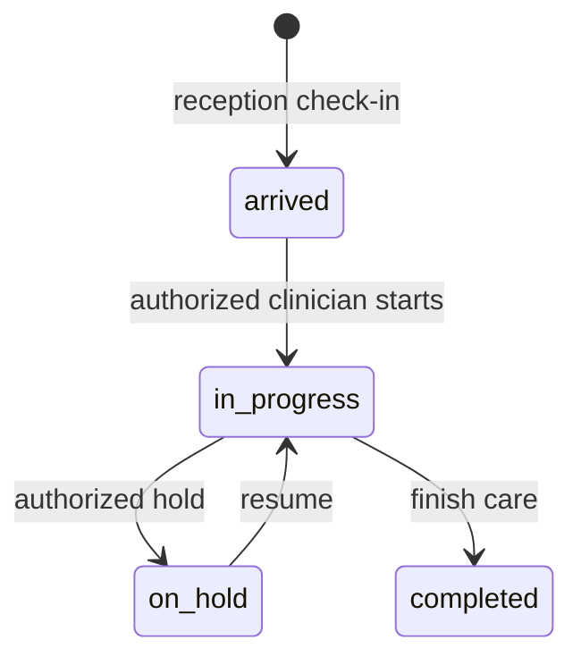

# Nurse

Snapshot: **2026-10-31**, repository source audit. No application code or live database was changed. “Source-confirmed” describes inspected code, not a passed browser, deployment or hospital test. ⚠️ UNVERIFIED = unresolved or untested; 🚧 NOT IMPLEMENTED = absent from the inspected ownership/routes; 🐞 SUSPECTED BUG = evidence needs a focused reproduction. Testing VPS and legacy LAN deployments are distinct. Actual VPS state and actual hospital configuration are not inferred from this checkout.

## 1. Purpose — who this person is in the hospital

Vitals, triage, allergies. Limited clinical read (R7). This is a **system role**, not an HR Position. An Employee's job title grants no access by itself; an AppUser must hold this role through UserRole. `apps/api/src/auth/permissions.ts:55`; `apps/api/prisma/schema.prisma:967`.

## 2. Responsibilities — daily / per-shift / monthly

The procedures below describe the coded work this role supports. Daily: check assigned work and correct patient/source identity before saving. Per shift: hand over unresolved work and sign out of shared devices. Monthly: review unresolved exceptions with the designated supervisor. These frequencies are **recommended SOP assignments, ⚠️ not application-enforced duties**. The hospital must approve ownership and cadence. Capability source: `apps/web/src/components/VitalsTab.tsx:1`.

## 3. Prerequisites — before this person can work

An active User, facility, password change completion and the listed permission grants are required. Optional module screens also require enablement. Clinical accounts created through Users are refused; use Employee-linked onboarding for Doctor, Nurse, Lab technician and Pharmacist. HR self service requires an Employee link even for nonclinical accounts. Doctor accounts additionally require a clinical Position and linked Practitioner/department membership. Required workflow-specific catalogs and balances are in [the dependency matrix](../03-dependency-matrix.md). `apps/api/src/common/guards/jwt-auth.guard.ts:1`; `apps/api/src/modules/users/users.service.ts:73`; `apps/api/src/modules/staff/staff.service.ts:566`.

## 4. Permissions

Each cell lists exact permission codes, rather than implying every action in a module is allowed. Verb grouping is for reading only; some permissions appear in more than one column. Conditional rules and all denied permissions are in [the master matrix](../07-permission-matrix.md). Database grant drift is ⚠️ UNVERIFIED on the VPS.

| Module | View | Create | Edit | Delete/Cancel | Approve | Print/Export | Source (file:line) |
| --- | --- | --- | --- | --- | --- | --- | --- |
| reception | reception.read | No matching grant | reception.manage_beds | No matching grant | No matching grant | No matching grant | apps/api/src/auth/permissions.ts:121; apps/api/src/auth/permissions.ts:123 |
| hr | hr.roster.view; hr.self.view | hr.leave.request | No matching grant | No matching grant | No matching grant | No matching grant | apps/api/src/auth/permissions.ts:136; apps/api/src/auth/permissions.ts:142; apps/api/src/auth/permissions.ts:148 |
| crm | No matching grant | No matching grant | No matching grant | No matching grant | No matching grant | No matching grant | Denied by absence: `apps/api/src/auth/permissions.ts:1` |
| payroll | No matching grant | No matching grant | No matching grant | No matching grant | No matching grant | No matching grant | Denied by absence: `apps/api/src/auth/permissions.ts:1` |
| finance | No matching grant | No matching grant | No matching grant | No matching grant | No matching grant | No matching grant | Denied by absence: `apps/api/src/auth/permissions.ts:1` |
| auth | auth.login; auth.me | No matching grant | No matching grant | No matching grant | No matching grant | No matching grant | apps/api/src/auth/permissions.ts:199; apps/api/src/auth/permissions.ts:222 |
| user | No matching grant | No matching grant | No matching grant | No matching grant | No matching grant | No matching grant | Denied by absence: `apps/api/src/auth/permissions.ts:1` |
| role | No matching grant | No matching grant | No matching grant | No matching grant | No matching grant | No matching grant | Denied by absence: `apps/api/src/auth/permissions.ts:1` |
| facility | No matching grant | No matching grant | No matching grant | No matching grant | No matching grant | No matching grant | Denied by absence: `apps/api/src/auth/permissions.ts:1` |
| department | No matching grant | No matching grant | No matching grant | No matching grant | No matching grant | No matching grant | Denied by absence: `apps/api/src/auth/permissions.ts:1` |
| room | No matching grant | No matching grant | No matching grant | No matching grant | No matching grant | No matching grant | Denied by absence: `apps/api/src/auth/permissions.ts:1` |
| practitioner | No matching grant | No matching grant | No matching grant | No matching grant | No matching grant | No matching grant | Denied by absence: `apps/api/src/auth/permissions.ts:1` |
| service | No matching grant | No matching grant | No matching grant | No matching grant | No matching grant | No matching grant | Denied by absence: `apps/api/src/auth/permissions.ts:1` |
| price | No matching grant | No matching grant | No matching grant | No matching grant | No matching grant | No matching grant | Denied by absence: `apps/api/src/auth/permissions.ts:1` |
| drug | drug.read | No matching grant | No matching grant | No matching grant | No matching grant | No matching grant | apps/api/src/auth/permissions.ts:267 |
| labtest | No matching grant | No matching grant | No matching grant | No matching grant | No matching grant | No matching grant | Denied by absence: `apps/api/src/auth/permissions.ts:1` |
| panel | No matching grant | No matching grant | No matching grant | No matching grant | No matching grant | No matching grant | Denied by absence: `apps/api/src/auth/permissions.ts:1` |
| template | template.read | No matching grant | No matching grant | No matching grant | No matching grant | No matching grant | apps/api/src/auth/permissions.ts:284 |
| setting | No matching grant | No matching grant | No matching grant | No matching grant | No matching grant | No matching grant | Denied by absence: `apps/api/src/auth/permissions.ts:1` |
| patient | patient.search; patient.read_demographics; patient.read_clinical (R7) | No matching grant | No matching grant | No matching grant | No matching grant | No matching grant | apps/api/src/auth/permissions.ts:301; apps/api/src/auth/permissions.ts:307; apps/api/src/auth/permissions.ts:320 |
| allergy | allergy.read | allergy.record | No matching grant | No matching grant | No matching grant | No matching grant | apps/api/src/auth/permissions.ts:342; apps/api/src/auth/permissions.ts:344 |
| visit | visit.read_queue | visit.record_complaint | visit.change_status | No matching grant | No matching grant | No matching grant | apps/api/src/auth/permissions.ts:348; apps/api/src/auth/permissions.ts:361; apps/api/src/auth/permissions.ts:375 |
| appointment | appointment.read | No matching grant | No matching grant | No matching grant | No matching grant | No matching grant | apps/api/src/auth/permissions.ts:400 |
| vitals | vitals.read | vitals.record | No matching grant | No matching grant | No matching grant | No matching grant | apps/api/src/auth/permissions.ts:418; apps/api/src/auth/permissions.ts:419 |
| diagnosis | No matching grant | No matching grant | No matching grant | No matching grant | No matching grant | No matching grant | Denied by absence: `apps/api/src/auth/permissions.ts:1` |
| clinical_note | No matching grant | No matching grant | No matching grant | No matching grant | No matching grant | No matching grant | Denied by absence: `apps/api/src/auth/permissions.ts:1` |
| attachment | attachment.read | attachment.upload | No matching grant | No matching grant | No matching grant | No matching grant | apps/api/src/auth/permissions.ts:429; apps/api/src/auth/permissions.ts:430 |
| prescription | prescription.read (R7) | No matching grant | No matching grant | No matching grant | No matching grant | No matching grant | apps/api/src/auth/permissions.ts:435 |
| interaction | No matching grant | No matching grant | No matching grant | No matching grant | No matching grant | No matching grant | Denied by absence: `apps/api/src/auth/permissions.ts:1` |
| follow_up | No matching grant | No matching grant | No matching grant | No matching grant | No matching grant | No matching grant | Denied by absence: `apps/api/src/auth/permissions.ts:1` |
| lab_order | No matching grant | No matching grant | No matching grant | No matching grant | No matching grant | No matching grant | Denied by absence: `apps/api/src/auth/permissions.ts:1` |
| lab | No matching grant | lab.collect_sample (R9) | No matching grant | No matching grant | No matching grant | No matching grant | apps/api/src/auth/permissions.ts:483 |
| lab_result | lab_result.read (R7) | No matching grant | No matching grant | No matching grant | No matching grant | No matching grant | apps/api/src/auth/permissions.ts:488 |
| pharmacy | No matching grant | No matching grant | No matching grant | No matching grant | No matching grant | No matching grant | Denied by absence: `apps/api/src/auth/permissions.ts:1` |
| invoice | No matching grant | No matching grant | No matching grant | No matching grant | No matching grant | No matching grant | Denied by absence: `apps/api/src/auth/permissions.ts:1` |
| payment | No matching grant | No matching grant | No matching grant | No matching grant | No matching grant | No matching grant | Denied by absence: `apps/api/src/auth/permissions.ts:1` |
| refund | No matching grant | No matching grant | No matching grant | No matching grant | No matching grant | No matching grant | Denied by absence: `apps/api/src/auth/permissions.ts:1` |
| discount | No matching grant | No matching grant | No matching grant | No matching grant | No matching grant | No matching grant | Denied by absence: `apps/api/src/auth/permissions.ts:1` |
| lab_charge | No matching grant | No matching grant | No matching grant | No matching grant | No matching grant | No matching grant | Denied by absence: `apps/api/src/auth/permissions.ts:1` |
| report | No matching grant | No matching grant | No matching grant | No matching grant | No matching grant | No matching grant | Denied by absence: `apps/api/src/auth/permissions.ts:1` |
| audit_log | No matching grant | No matching grant | No matching grant | No matching grant | No matching grant | No matching grant | Denied by absence: `apps/api/src/auth/permissions.ts:1` |
| error_log | No matching grant | No matching grant | No matching grant | No matching grant | No matching grant | No matching grant | Denied by absence: `apps/api/src/auth/permissions.ts:1` |
| data | No matching grant | No matching grant | No matching grant | No matching grant | No matching grant | No matching grant | Denied by absence: `apps/api/src/auth/permissions.ts:1` |

## 5. What they CANNOT do (and who does it instead)

Anything absent from this role's grants is denied, including on a screen reached by manually entering its URL. Multiple roles may expand authority; this document assumes this role alone. Admin manages configuration and users; receptionist registers patients and takes lab collections; doctor writes diagnoses/notes/prescriptions; lab_tech enters/verifies lab results; pharmacist confirms medicine handover; finance roles follow independent approval and posting checks. **Admin alone is not a clinical author.** Exact exceptions and conditions: `apps/api/src/auth/permissions.ts:1`; `apps/api/src/common/guards/permissions.guard.ts:1`.

## 6. Screens they use — navigation path

English menu labels below come from the locale file. The Main group has no translated heading in the current English dictionary. Listed visibility does not prove every button is authorized. `apps/web/src/i18n/locales/en.json:1`.

| Menu group › item | URL | Module prerequisite | Source |
| --- | --- | --- | --- |
| Administration › Human resources | /hr | hr | `apps/web/src/auth/nav.ts:1` |
| Main › Dashboard | / | Core | `apps/web/src/auth/nav.ts:1` |
| Clinical › Reception operations | /reception/operations | Core | `apps/web/src/auth/nav.ts:1` |
| Clinical › Queue | /queue | Core | `apps/web/src/auth/nav.ts:1` |
| Clinical › Appointments | /appointments | Core | `apps/web/src/auth/nav.ts:1` |
| Clinical › Patients | /patients | Core | `apps/web/src/auth/nav.ts:1` |

## 7. Button & action reference

These are source locations on menu-linked or permission-linked screens, including reusable controls. **Rows are an inventory, not a grant.** Read the endpoint permission against Section 4; branch-dependent visibility not proven for this role is ⚠️ UNVERIFIED. Administrator includes the complete UI inventory to guarantee no source location is silently omitted, including clinical controls the administrator cannot use. Side effects are direct static service effects; nested helpers may add effects. Runtime behavior and physical printing are not verified by this table.

| ID / source | Screen / component | Button / action (English; Dari where available) | Where | What it does / handler | Preconditions / disabled when | Side effects / trace evidence | Reversible? how | API endpoint | Permission required | Audited? |
| --- | --- | --- | --- | --- | --- | --- | --- | --- | --- | --- |
| A0001 apps/web/src/AppRoot.tsx:23 | AppRoot | FirstRunLanguagePicker | AppRoot / FirstRunLanguagePicker | Local handler / ⚠️ semantic review; onChosen: {() => setHasChosen(true)} | No explicit disabled attribute; surrounding conditions: !hasChosen ? ( <FirstRunLanguagePicker onChosen={() => setHasChosen(true)} /> ) : ( <QueryClientProvider client={queryClient}> {/* AuthProvider above the router: the route components (ProtectedRoute, | ⚠️ UNVERIFIED: inspect handler and linked API call inventory | ⚠️ Use documented cancel/reversal workflow; no generic undo | No statically resolved endpoint | ⚠️ UI local / endpoint-specific; menu is not permission | Local actions have no automatic DB audit; downstream action ⚠️ UNVERIFIED |
| A0002 apps/web/src/components/AllergyEditor.tsx:72 | ConsultPage | Record an allergy / ثبت حساسیت | AllergyEditor / Button | Local handler / ⚠️ semantic review; onClick: {() => setOpen((o) => !o)} | No explicit disabled attribute | ⚠️ UNVERIFIED: inspect handler and linked API call inventory | ⚠️ Use documented cancel/reversal workflow; no generic undo | No statically resolved endpoint | ⚠️ UI local / endpoint-specific; menu is not permission | Local actions have no automatic DB audit; downstream action ⚠️ UNVERIFIED |
| A0003 apps/web/src/components/AllergyEditor.tsx:89 | ConsultPage | Substance / Severity / Choose… / Reaction / Saving… / Save allergy / Could not save that allergy. Nothing was recorded. / ماده / شدت / انتخاب کنید… / واکنش / در حال ذخیره… / ذخیرهٔ حساسیت / ذخیرهٔ آن حساسیت ناکام شد. چیزی ثبت نشد. | AllergyEditor / form | Local handler / ⚠️ semantic review; onSubmit: {onSubmit} | No explicit disabled attribute; surrounding conditions: open && ( <Card className="p-4"> <form onSubmit={onSubmit} className="flex flex-wrap items-end gap-3"> 
 <Label htmlFor="allergySubstance">{t('allergies | ⚠️ UNVERIFIED: inspect handler and linked API call inventory | ⚠️ Use documented cancel/reversal workflow; no generic undo | No statically resolved endpoint | ⚠️ UI local / endpoint-specific; menu is not permission | Local actions have no automatic DB audit; downstream action ⚠️ UNVERIFIED |
| A0004 apps/web/src/components/AllergyEditor.tsx:92 | ConsultPage | Substance / ماده | AllergyEditor / Input | Form input / selection; onChange: {(e) => setSubstance(e.target.value)} | No explicit disabled attribute; surrounding conditions: open && ( <Card className="p-4"> <form onSubmit={onSubmit} className="flex flex-wrap items-end gap-3"> 
 <Label htmlFor="allergySubstance">{t('allergies | Changes form selection; persistence occurs on submission | Edit again before saving | No statically resolved endpoint | ⚠️ UI local / endpoint-specific; menu is not permission | Local actions have no automatic DB audit; downstream action ⚠️ UNVERIFIED |
| A0005 apps/web/src/components/AllergyEditor.tsx:106 | ConsultPage | Choose… / انتخاب کنید… | AllergyEditor / Select | Form input / selection; onChange: {(e) => setSeverity(e.target.value as AllergySeverity &#124; '')} | No explicit disabled attribute; surrounding conditions: open && ( <Card className="p-4"> <form onSubmit={onSubmit} className="flex flex-wrap items-end gap-3"> 
 <Label htmlFor="allergySubstance">{t('allergies | Changes form selection; persistence occurs on submission | Edit again before saving | No statically resolved endpoint | ⚠️ UI local / endpoint-specific; menu is not permission | Local actions have no automatic DB audit; downstream action ⚠️ UNVERIFIED |
| A0006 apps/web/src/components/AllergyEditor.tsx:122 | ConsultPage | Reaction / واکنش | AllergyEditor / Input | Form input / selection; onChange: {(e) => setReaction(e.target.value)} | No explicit disabled attribute; surrounding conditions: open && ( <Card className="p-4"> <form onSubmit={onSubmit} className="flex flex-wrap items-end gap-3"> 
 <Label htmlFor="allergySubstance">{t('allergies | Changes form selection; persistence occurs on submission | Edit again before saving | No statically resolved endpoint | ⚠️ UI local / endpoint-specific; menu is not permission | Local actions have no automatic DB audit; downstream action ⚠️ UNVERIFIED |
| A0007 apps/web/src/components/AllergyEditor.tsx:130 | ConsultPage | Saving… / Save allergy / در حال ذخیره… / ذخیرهٔ حساسیت | AllergyEditor / Button | ⚠️ No direct handler (submit/child behavior); {onSubmit} | {add.isPending}; surrounding conditions: open && ( <Card className="p-4"> <form onSubmit={onSubmit} className="flex flex-wrap items-end gap-3"> 
 <Label htmlFor="allergySubstance">{t('allergies | ⚠️ UNVERIFIED: inspect handler and linked API call inventory | ⚠️ Use documented cancel/reversal workflow; no generic undo | No statically resolved endpoint | ⚠️ UI local / endpoint-specific; menu is not permission | Local actions have no automatic DB audit; downstream action ⚠️ UNVERIFIED |
| A0008 apps/web/src/components/AllergyEditor.tsx:145 | ConsultPage | AllergyRow | AllergyEditor / AllergyRow | Local handler / ⚠️ semantic review; onToggle: {() => update.mutate({ id: allergy.id, input: { substance: allergy.substance, drugId: allergy.drugId, reaction: allergy.reaction, severity: allergy.severity, isActive: !allergy.isActive, }, }) } | No explicit disabled attribute; surrounding conditions: allergies.length > 0 && ( <ul className="mt-4 space-y-1 border-t border-border pt-3"> {allergies.map((allergy) => ( <AllergyRow key={allergy.id} allergy={allergy}; open && ( <Card className="p-4"> <form onSubmit={onSubmit} className="flex flex-wrap items-end gap-3"> 
 <Label htmlFor="allergySubstance">{t('allergies | ⚠️ UNVERIFIED: inspect handler and linked API call inventory | ⚠️ Use documented cancel/reversal workflow; no generic undo | No statically resolved endpoint | ⚠️ UI local / endpoint-specific; menu is not permission | Local actions have no automatic DB audit; downstream action ⚠️ UNVERIFIED |
| A0009 apps/web/src/components/AllergyEditor.tsx:195 | ConsultPage | Retract / Restore / پس‌گرفتن / بازگرداندن | AllergyRow / Button | Local handler / ⚠️ semantic review; onClick: {onToggle} | {busy} | ⚠️ UNVERIFIED: inspect handler and linked API call inventory | ⚠️ Use documented cancel/reversal workflow; no generic undo | No statically resolved endpoint | ⚠️ UI local / endpoint-specific; menu is not permission | Local actions have no automatic DB audit; downstream action ⚠️ UNVERIFIED |
| A0010 apps/web/src/components/BookFollowUp.tsx:98 | ConsultPage, PatientDetailPage | Date / Department / Choose a department / With you, when the patient returns. / Doctor / Any doctor / Reason / Could not book that. Nothing was saved. / Booked for {{date}}. / Booking… / Book / تاریخ / بخش / بخش را انتخاب کنید / با شما، وقتی مریض بیرته راشي. / داکتر / هر داکتر / دلیل / ثبت ناکام شد. چیزی ذخیره نشد. / برای {{date}} ثبت شد. / در حال ثبت… / ثبت | BookFollowUp / form | Server request; onSubmit: {onSubmit} | No explicit disabled attribute | apps/api/src/modules/appointment/appointment.service.ts:76; Delegated operation: inspect linked service | ⚠️ Use documented cancel/reversal workflow; no generic undo | POST /appointments (apps/api/src/modules/appointment/appointment.controller.ts:46) | appointment.create; ⚠️ This role lacks: appointment.create | App request context + audited Prisma writes; read audit is endpoint-specific. Root/manual scripts are outside this coverage. |
| A0011 apps/web/src/components/BookFollowUp.tsx:104 | ConsultPage, PatientDetailPage | Date / تاریخ | BookFollowUp / Input | Form input / selection; onChange: {(e) => setScheduledOn(e.target.value)} | No explicit disabled attribute | Changes form selection; persistence occurs on submission | Edit again before saving | No statically resolved endpoint | ⚠️ UI local / endpoint-specific; menu is not permission | Local actions have no automatic DB audit; downstream action ⚠️ UNVERIFIED |
| A0012 apps/web/src/components/BookFollowUp.tsx:118 | ConsultPage, PatientDetailPage | Choose a department / بخش را انتخاب کنید | BookFollowUp / Select | Form input / selection; onChange: {(e) => { setDepartmentId(e.target.value) setPractitionerId('') }} | No explicit disabled attribute | Changes form selection; persistence occurs on submission | Edit again before saving | No statically resolved endpoint | ⚠️ UI local / endpoint-specific; menu is not permission | Local actions have no automatic DB audit; downstream action ⚠️ UNVERIFIED |
| A0013 apps/web/src/components/BookFollowUp.tsx:140 | ConsultPage, PatientDetailPage | Any doctor / هر داکتر | BookFollowUp / Select | Form input / selection; onChange: {(e) => setPractitionerId(e.target.value)} | {!departmentId}; surrounding conditions: lockToSelf ? ( 
{t('appointments.book.withYou')}
 ) : ( 
 <Label htmlFor="apptPractitioner">{t('visits.fields.practitioner')} | Changes form selection; persistence occurs on submission | Edit again before saving | No statically resolved endpoint | ⚠️ UI local / endpoint-specific; menu is not permission | Local actions have no automatic DB audit; downstream action ⚠️ UNVERIFIED |
| A0014 apps/web/src/components/BookFollowUp.tsx:159 | ConsultPage, PatientDetailPage | Reason / دلیل | BookFollowUp / Input | Form input / selection; onChange: {(e) => setReason(e.target.value)} | No explicit disabled attribute | Changes form selection; persistence occurs on submission | Edit again before saving | No statically resolved endpoint | ⚠️ UI local / endpoint-specific; menu is not permission | Local actions have no automatic DB audit; downstream action ⚠️ UNVERIFIED |
| A0015 apps/web/src/components/BookFollowUp.tsx:178 | ConsultPage, PatientDetailPage | Booking… / Book / در حال ثبت… / ثبت | BookFollowUp / Button | Server request; {onSubmit} | {create.isPending &#124;&#124; !scheduledOn &#124;&#124; !departmentId} | apps/api/src/modules/appointment/appointment.service.ts:76; Delegated operation: inspect linked service | ⚠️ Use documented cancel/reversal workflow; no generic undo | POST /appointments (apps/api/src/modules/appointment/appointment.controller.ts:46) | appointment.create; ⚠️ This role lacks: appointment.create | App request context + audited Prisma writes; read audit is endpoint-specific. Root/manual scripts are outside this coverage. |
| A0016 apps/web/src/components/ComplaintTab.tsx:84 | ConsultPage | Chief complaint / What the patient came in with, in plain words. The desk’s version is here already — replace it with yours. / Saving… / Save complaint / Could not save the complaint. Nothing was changed. / شکایت اصلی / آنچه مریض با آن آمده، به زبان ساده. نسخهٔ پذیرش اینجاست — آن را با نوشتهٔ خود جاگزین کنید. / در حال ذخیره… / ذخیرهٔ شکایت / ذخیرهٔ شکایت ناکام شد. چیزی تغییر نکرد. | ComplaintTab / form | Server request; onSubmit: {onSubmit} | No explicit disabled attribute | apps/api/src/modules/visit/visit.service.ts:338; visit.findFirst, visit.update | ⚠️ Use documented cancel/reversal workflow; no generic undo | PATCH /visits/:id/complaint (apps/api/src/modules/visit/visit.controller.ts:144) | visit.record_complaint | App request context + audited Prisma writes; read audit is endpoint-specific. Root/manual scripts are outside this coverage. |
| A0017 apps/web/src/components/ComplaintTab.tsx:87 | ConsultPage | Chief complaint / What the patient came in with, in plain words. The desk’s version is here already — replace it with yours. / شکایت اصلی / آنچه مریض با آن آمده، به زبان ساده. نسخهٔ پذیرش اینجاست — آن را با نوشتهٔ خود جاگزین کنید. | ComplaintTab / Textarea | Form input / selection; onChange: {(e) => setText(e.target.value)} | {!open} | Changes form selection; persistence occurs on submission | Edit again before saving | No statically resolved endpoint | ⚠️ UI local / endpoint-specific; menu is not permission | Local actions have no automatic DB audit; downstream action ⚠️ UNVERIFIED |
| A0018 apps/web/src/components/ComplaintTab.tsx:100 | ConsultPage | Saving… / Save complaint / در حال ذخیره… / ذخیرهٔ شکایت | ComplaintTab / Button | Server request; {onSubmit} | {!isDirty &#124;&#124; update.isPending}; surrounding conditions: open && ( 
 <Button type="submit" disabled={!isDirty &#124;&#124; update.isPending}> {update.isPending ? t('complaint.saving') : t('complaint.save')} | apps/api/src/modules/visit/visit.service.ts:338; visit.findFirst, visit.update | ⚠️ Use documented cancel/reversal workflow; no generic undo | PATCH /visits/:id/complaint (apps/api/src/modules/visit/visit.controller.ts:144) | visit.record_complaint | App request context + audited Prisma writes; read audit is endpoint-specific. Root/manual scripts are outside this coverage. |
| A0019 apps/web/src/components/ComplaintTab.tsx:116 | ConsultPage | TemplatePicker | ComplaintTab / TemplatePicker | Local handler / ⚠️ semantic review; onPick: {append} | No explicit disabled attribute; surrounding conditions: open && ( <TemplatePicker // Narrowed rather than trusted: /templates?type=complaint already returns one // kind, and the guard is what stops a future caller with a wrong query string // handing a five- | ⚠️ UNVERIFIED: inspect handler and linked API call inventory | ⚠️ Use documented cancel/reversal workflow; no generic undo | No statically resolved endpoint | ⚠️ UI local / endpoint-specific; menu is not permission | Local actions have no automatic DB audit; downstream action ⚠️ UNVERIFIED |
| A0020 apps/web/src/components/ComplaintTab.tsx:154 | ConsultPage | {template.content.text} | TemplatePicker / Button | Local handler / ⚠️ semantic review; onClick: {() => onPick(template.content.text)} | No explicit disabled attribute | ⚠️ UNVERIFIED: inspect handler and linked API call inventory | ⚠️ Use documented cancel/reversal workflow; no generic undo | No statically resolved endpoint | ⚠️ UI local / endpoint-specific; menu is not permission | Local actions have no automatic DB audit; downstream action ⚠️ UNVERIFIED |
| A0021 apps/web/src/components/ComplaintTab.tsx:189 | ConsultPage | Save as phrase / ذخیره به‌حیث عبارت | SaveAsTemplate / Button | Local handler / ⚠️ semantic review; onClick: {() => setOpen(true)} | No explicit disabled attribute | ⚠️ UNVERIFIED: inspect handler and linked API call inventory | ⚠️ Use documented cancel/reversal workflow; no generic undo | No statically resolved endpoint | ⚠️ UI local / endpoint-specific; menu is not permission | Local actions have no automatic DB audit; downstream action ⚠️ UNVERIFIED |
| A0022 apps/web/src/components/ComplaintTab.tsx:200 | ConsultPage | Name it / نام آن | SaveAsTemplate / Input | Form input / selection; onChange: {(e) => setName(e.target.value)} | No explicit disabled attribute | Changes form selection; persistence occurs on submission | Edit again before saving | No statically resolved endpoint | ⚠️ UI local / endpoint-specific; menu is not permission | Local actions have no automatic DB audit; downstream action ⚠️ UNVERIFIED |
| A0023 apps/web/src/components/ComplaintTab.tsx:208 | ConsultPage | Saving… / Save phrase / در حال ذخیره… / ذخیرهٔ عبارت | SaveAsTemplate / Button | Server request; onClick: {() => create.mutate( { type: 'complaint', name: name.trim(), content: { text: phrase }, shared: false }, { onSuccess: () => { setOpen(false) setName('') }, }, ) } | {create.isPending &#124;&#124; name.trim().length < 2} | apps/api/src/modules/template/template.service.ts:85; template.create | ⚠️ Use documented cancel/reversal workflow; no generic undo | POST /templates (apps/api/src/modules/template/template.controller.ts:53) | template.manage.own; ⚠️ This role lacks: template.manage.own | App request context + audited Prisma writes; read audit is endpoint-specific. Root/manual scripts are outside this coverage. |
| A0024 apps/web/src/components/ComplaintTab.tsx:226 | ConsultPage | Cancel / لغو | SaveAsTemplate / Button | Local handler / ⚠️ semantic review; onClick: {() => setOpen(false)} | No explicit disabled attribute | ⚠️ UNVERIFIED: inspect handler and linked API call inventory | ⚠️ Use documented cancel/reversal workflow; no generic undo | No statically resolved endpoint | ⚠️ UI local / endpoint-specific; menu is not permission | Local actions have no automatic DB audit; downstream action ⚠️ UNVERIFIED |
| A0025 apps/web/src/components/ConsultActions.tsx:196 | ConsultPage | Save and leave / ذخیره و خروج | ConsultActions / Button | Local handler / ⚠️ semantic review; onClick: {() => { void save().then((ok) => { if (ok) void navigate('/queue') }) }} | {busy}; surrounding conditions: confirmLeave && ( 
 void navigate('/queue')} | No explicit disabled attribute; surrounding conditions: confirmLeave && ( 
 setConfirmLeave(false)} | No explicit disabled attribute; surrounding conditions: confirmLeave && ( 
 onPaperSizeChange(event.target.value as PaperSize)} | No explicit disabled attribute | Changes form selection; persistence occurs on submission | Edit again before saving | No statically resolved endpoint | ⚠️ UI local / endpoint-specific; menu is not permission | Local actions have no automatic DB audit; downstream action ⚠️ UNVERIFIED |
| A0030 apps/web/src/components/ConsultActions.tsx:267 | ConsultPage | Paper / کاغذ | ConsultActions / KeyAction | Local handler / ⚠️ semantic review; onRun: {saveAndPrint} | {busy} | ⚠️ UNVERIFIED: inspect handler and linked API call inventory | ⚠️ Use documented cancel/reversal workflow; no generic undo | No statically resolved endpoint | ⚠️ UI local / endpoint-specific; menu is not permission | Local actions have no automatic DB audit; downstream action ⚠️ UNVERIFIED |
| A0031 apps/web/src/components/ConsultActions.tsx:274 | ConsultPage | Paper / کاغذ | ConsultActions / KeyAction | Server request; onRun: {saveAndFinish} | {busy} | apps/api/src/modules/visit/visit.service.ts:390; visit.findFirst, visit.update | ⚠️ Use documented cancel/reversal workflow; no generic undo | PATCH /visits/:id/status (apps/api/src/modules/visit/visit.controller.ts:117) | visit.change_status | App request context + audited Prisma writes; read audit is endpoint-specific. Root/manual scripts are outside this coverage. |
| A0032 apps/web/src/components/ConsultActions.tsx:281 | ConsultPage | Paper / کاغذ | ConsultActions / KeyAction | Local handler / ⚠️ semantic review; onRun: {leave} | No explicit disabled attribute | ⚠️ UNVERIFIED: inspect handler and linked API call inventory | ⚠️ Use documented cancel/reversal workflow; no generic undo | No statically resolved endpoint | ⚠️ UI local / endpoint-specific; menu is not permission | Local actions have no automatic DB audit; downstream action ⚠️ UNVERIFIED |
| A0033 apps/web/src/components/ConsultActions.tsx:301 | ConsultPage | {label} {hint} | KeyAction / Button | Local handler / ⚠️ semantic review; onClick: {() => void onRun()} | {disabled} | ⚠️ UNVERIFIED: inspect handler and linked API call inventory | ⚠️ Use documented cancel/reversal workflow; no generic undo | No statically resolved endpoint | ⚠️ UI local / endpoint-specific; menu is not permission | Local actions have no automatic DB audit; downstream action ⚠️ UNVERIFIED |
| A0262 apps/web/src/components/DiagnosisTab.tsx:94 | ConsultPage | Diagnosis / Coded as / Clear code / Certainty / Primary / Saving… / Add diagnosis / Could not save that diagnosis. Nothing was recorded. / تشخیص / کود / پاک کردن کود / درجهٔ یقین / اصلی / در حال ذخیره… / افزودن تشخیص / ذخیرهٔ آن تشخیص ناکام شد. چیزی ثبت نشد. | DiagnosisTab / form | Local handler / ⚠️ semantic review; onSubmit: {onSubmit} | No explicit disabled attribute; surrounding conditions: open && ( <Card className="p-4"> <form onSubmit={onSubmit} className="space-y-4"> 
 <Label htmlFor="diagnosisText">{t('diagnosis.label')}</Label> <Input | ⚠️ UNVERIFIED: inspect handler and linked API call inventory | ⚠️ Use documented cancel/reversal workflow; no generic undo | No statically resolved endpoint | ⚠️ UI local / endpoint-specific; menu is not permission | Local actions have no automatic DB audit; downstream action ⚠️ UNVERIFIED |
| A0263 apps/web/src/components/DiagnosisTab.tsx:97 | ConsultPage | Diagnosis / Coded as / Clear code / تشخیص / کود / پاک کردن کود | DiagnosisTab / Input | Form input / selection; onChange: {(e) => { setText(e.target.value) // Typing over a picked diagnosis unpicks the code. Leaving it attached // would file the doctor's words under somebody else's number. setIcdCode(null) }} | No explicit disabled attribute; surrounding conditions: open && ( <Card className="p-4"> <form onSubmit={onSubmit} className="space-y-4"> 
 <Label htmlFor="diagnosisText">{t('diagnosis.label')}</Label> <Input | Changes form selection; persistence occurs on submission | Edit again before saving | No statically resolved endpoint | ⚠️ UI local / endpoint-specific; menu is not permission | Local actions have no automatic DB audit; downstream action ⚠️ UNVERIFIED |
| A0264 apps/web/src/components/DiagnosisTab.tsx:114 | ConsultPage | Clear code / پاک کردن کود | DiagnosisTab / button | Local handler / ⚠️ semantic review; onClick: {() => setIcdCode(null)} | No explicit disabled attribute; surrounding conditions: icdCode && ( 
 {t('diagnosis.coded')}{' '}  {icdCode} ; open && ( <Card className="p-4"> <form onSubmit={onSubmit} className="space-y-4"> 
 <Label htmlFor="diagnosisText">{t('diagnosis.label')}</Label> <Input | ⚠️ UNVERIFIED: inspect handler and linked API call inventory | ⚠️ Use documented cancel/reversal workflow; no generic undo | No statically resolved endpoint | ⚠️ UI local / endpoint-specific; menu is not permission | Local actions have no automatic DB audit; downstream action ⚠️ UNVERIFIED |
| A0265 apps/web/src/components/DiagnosisTab.tsx:130 | ConsultPage | {code.code} {code.title} | DiagnosisTab / button | Local handler / ⚠️ semantic review; onClick: {() => pick(code)} | No explicit disabled attribute; surrounding conditions: !icdCode && icdQuery.data && icdQuery.data.results.length > 0 && ( <ul className="max-h-48 space-y-1 overflow-y-auto rounded-lg border border-border p-1"> {icdQuery.data.results.map((code) => ( | ⚠️ UNVERIFIED: inspect handler and linked API call inventory | ⚠️ Use documented cancel/reversal workflow; no generic undo | No statically resolved endpoint | ⚠️ UI local / endpoint-specific; menu is not permission | Local actions have no automatic DB audit; downstream action ⚠️ UNVERIFIED |
| A0266 apps/web/src/components/DiagnosisTab.tsx:148 | ConsultPage | {DIAGNOSIS_CERTAINTIES.map((value) => ( {t(`diagnosis.certainties.${value}`)} ))} | DiagnosisTab / Select | Form input / selection; onChange: {(e) => setCertainty(e.target.value as DiagnosisCertainty)} | No explicit disabled attribute; surrounding conditions: open && ( <Card className="p-4"> <form onSubmit={onSubmit} className="space-y-4"> 
 <Label htmlFor="diagnosisText">{t('diagnosis.label')}</Label> <Input | Changes form selection; persistence occurs on submission | Edit again before saving | No statically resolved endpoint | ⚠️ UI local / endpoint-specific; menu is not permission | Local actions have no automatic DB audit; downstream action ⚠️ UNVERIFIED |
| A0267 apps/web/src/components/DiagnosisTab.tsx:162 | ConsultPage | Primary / اصلی | DiagnosisTab / input | Form input / selection; onChange: {(e) => setIsPrimary(e.target.checked)} | No explicit disabled attribute; surrounding conditions: open && ( <Card className="p-4"> <form onSubmit={onSubmit} className="space-y-4"> 
 <Label htmlFor="diagnosisText">{t('diagnosis.label')}</Label> <Input | Changes form selection; persistence occurs on submission | Edit again before saving | No statically resolved endpoint | ⚠️ UI local / endpoint-specific; menu is not permission | Local actions have no automatic DB audit; downstream action ⚠️ UNVERIFIED |
| A0268 apps/web/src/components/DiagnosisTab.tsx:171 | ConsultPage | Saving… / Add diagnosis / در حال ذخیره… / افزودن تشخیص | DiagnosisTab / Button | ⚠️ No direct handler (submit/child behavior); {onSubmit} | {!isDirty &#124;&#124; add.isPending}; surrounding conditions: open && ( <Card className="p-4"> <form onSubmit={onSubmit} className="space-y-4"> 
 <Label htmlFor="diagnosisText">{t('diagnosis.label')}</Label> <Input | ⚠️ UNVERIFIED: inspect handler and linked API call inventory | ⚠️ Use documented cancel/reversal workflow; no generic undo | No statically resolved endpoint | ⚠️ UI local / endpoint-specific; menu is not permission | Local actions have no automatic DB audit; downstream action ⚠️ UNVERIFIED |
| A0269 apps/web/src/components/DiagnosisTab.tsx:192 | ConsultPage | DiagnosisRow | DiagnosisTab / DiagnosisRow | Local handler / ⚠️ semantic review; onMakePrimary: {() => update.mutate({ id: diagnosis.id, input: { text: diagnosis.text, icdCode: diagnosis.icdCode, certainty: diagnosis.certainty, notes: diagnosis.notes, isPrimary: true, }, }) }; onRemove: {() => remove.mutate(diagnosis.id)} | No explicit disabled attribute; surrounding conditions: diagnoses.length === 0 ? ( 
{t('diagnosis.none')}
 ) : ( <ul className="space-y-2"> {diagnoses.map((diagnosis) => ( <DiagnosisRow key={; listQuery.isPending ? ( 
{t('diagnosis.loading')}
 ) : diagnoses.length === 0 ? ( 
{t('diagnosis.none')}
 ) : ( | ⚠️ UNVERIFIED: inspect handler and linked API call inventory | ⚠️ Use documented cancel/reversal workflow; no generic undo | No statically resolved endpoint | ⚠️ UI local / endpoint-specific; menu is not permission | Local actions have no automatic DB audit; downstream action ⚠️ UNVERIFIED |
| A0270 apps/web/src/components/DiagnosisTab.tsx:255 | ConsultPage | Make primary / اصلی ساختن | DiagnosisRow / Button | Local handler / ⚠️ semantic review; onClick: {onMakePrimary} | No explicit disabled attribute; surrounding conditions: editable && ( <Button type="button" size="sm" variant="ghost" onClick={onMakePrimary}> <Star className="size-4" aria-hidden /> {t('diagnosis.makePrimary')} </Button> ); diagnosis.isPrimary ? ( <Badge variant="active">{t('diagnosis.primary')}</Badge> ) : ( editable && ( <Button type="button" size="sm" variant="ghost" onClick={onMakePrimary}> <Star classN | ⚠️ UNVERIFIED: inspect handler and linked API call inventory | ⚠️ Use documented cancel/reversal workflow; no generic undo | No statically resolved endpoint | ⚠️ UI local / endpoint-specific; menu is not permission | Local actions have no automatic DB audit; downstream action ⚠️ UNVERIFIED |
| A0271 apps/web/src/components/DiagnosisTab.tsx:267 | ConsultPage | Remove diagnosis / حذف تشخیص | DiagnosisRow / Button | Local handler / ⚠️ semantic review; onClick: {onRemove} | No explicit disabled attribute; surrounding conditions: editable && ( <Button type="button" size="icon-sm" variant="ghost" aria-label={t('diagnosis.remove')} onClick={onRemove} > <Trash2 className="size-4 | ⚠️ UNVERIFIED: inspect handler and linked API call inventory | ⚠️ Use documented cancel/reversal workflow; no generic undo | No statically resolved endpoint | ⚠️ UI local / endpoint-specific; menu is not permission | Local actions have no automatic DB audit; downstream action ⚠️ UNVERIFIED |
| A0288 apps/web/src/components/FinanceDateInput.tsx:21 | FinancePage, HrPage | "Shamsi date: YYYY-MM-DD (1350–1499)" | FinanceDateInput / Input | Form input / selection; onChange: {(event) => { const entered = event.target.value setEdit({ source: value, text: entered }) try { const converted = shamsiToGregorian(entered) event.target.setCustomValidity('') setEdit(null) onChange(converted) } catch { event.target.setCustomValidity('Enter a valid Shamsi date, for example 1404-07-05.') } }} | No explicit disabled attribute | Changes form selection; persistence occurs on submission | Edit again before saving | No statically resolved endpoint | ⚠️ UI local / endpoint-specific; menu is not permission | Local actions have no automatic DB audit; downstream action ⚠️ UNVERIFIED |
| A0421 apps/web/src/components/FirstRunLanguagePicker.tsx:39 | FirstRunLanguagePicker | {meta.nativeName} | FirstRunLanguagePicker / button | Local handler / ⚠️ semantic review; onClick: {() => choose(code)} | No explicit disabled attribute | ⚠️ UNVERIFIED: inspect handler and linked API call inventory | ⚠️ Use documented cancel/reversal workflow; no generic undo | No statically resolved endpoint | ⚠️ UI local / endpoint-specific; menu is not permission | Local actions have no automatic DB audit; downstream action ⚠️ UNVERIFIED |
| A0422 apps/web/src/components/HistoryTab.tsx:103 | ConsultPage | Last {{count}} months / {{count}} ماه اخیر | HistoryTab / Select | Form input / selection; onChange: {(event) => setMonths(Number(event.target.value))} | No explicit disabled attribute | Changes form selection; persistence occurs on submission | Edit again before saving | No statically resolved endpoint | ⚠️ UI local / endpoint-specific; menu is not permission | Local actions have no automatic DB audit; downstream action ⚠️ UNVERIFIED |
| A0423 apps/web/src/components/HistoryTab.tsx:128 | ConsultPage | VisitCard | HistoryTab / VisitCard | Local handler / ⚠️ semantic review; onPrintLabResults: {setPrintVisit} | No explicit disabled attribute; surrounding conditions: visits.length === 0 ? ( <Card className="p-8 text-center"> {/* "Nothing recorded" and not "no history" — the difference matters on a screen where a blank space reads as a fact about the patient. */} | ⚠️ UNVERIFIED: inspect handler and linked API call inventory | ⚠️ Use documented cancel/reversal workflow; no generic undo | No statically resolved endpoint | ⚠️ UI local / endpoint-specific; menu is not permission | Local actions have no automatic DB audit; downstream action ⚠️ UNVERIFIED |
| A0424 apps/web/src/components/HistoryTab.tsx:193 | ConsultPage | Open / باز کردن | VisitCard / Link | Navigation; {`/consult/${visit.id}`} | No explicit disabled attribute | Changes browser destination; target: {`/consult/${visit.id}`} | Browser Back | No statically resolved endpoint | ⚠️ UI local / endpoint-specific; menu is not permission | Local actions have no automatic DB audit; downstream action ⚠️ UNVERIFIED |
| A0425 apps/web/src/components/HistoryTab.tsx:246 | ConsultPage | LabResultsBlock | VisitCard / LabResultsBlock | Local handler / ⚠️ semantic review; onToggle: {(index) => setExcluded((current) => { const next = new Set(current) if (next.has(index)) next.delete(index) else next.add(index) return next }) }; onPrint: {() => onPrintLabResults({ ...visit, labResults: visit.labResults.filter((_, index) => !excluded.has(index)), }) } | No explicit disabled attribute; surrounding conditions: visit.labResults.length > 0 && ( <LabResultsBlock labResults={visit.labResults} excluded={excluded} onToggle={(index) => setExcluded((current) => { const next = new Set(current | ⚠️ UNVERIFIED: inspect handler and linked API call inventory | ⚠️ Use documented cancel/reversal workflow; no generic undo | No statically resolved endpoint | ⚠️ UI local / endpoint-specific; menu is not permission | Local actions have no automatic DB audit; downstream action ⚠️ UNVERIFIED |
| A0426 apps/web/src/components/HistoryTab.tsx:349 | ConsultPage | Print results / چاپ نتایج | LabResultsBlock / Button | Local handler / ⚠️ semantic review; onClick: {onPrint} | {!anyIncluded} | ⚠️ UNVERIFIED: inspect handler and linked API call inventory | ⚠️ Use documented cancel/reversal workflow; no generic undo | No statically resolved endpoint | ⚠️ UI local / endpoint-specific; menu is not permission | Local actions have no automatic DB audit; downstream action ⚠️ UNVERIFIED |
| A0427 apps/web/src/components/HistoryTab.tsx:358 | ConsultPage | Include {{test}} on the printed report / شامل کردن {{test}} در گزارش چاپی | LabResultsBlock / input | Form input / selection; onChange: {() => onToggle(index)} | No explicit disabled attribute; surrounding conditions: item.value != null && ( <input type="checkbox" className="size-4 accent-primary" checked={!excluded.has(index)} onChange={() => onToggle(index)} a | Changes form selection; persistence occurs on submission | Edit again before saving | No statically resolved endpoint | ⚠️ UI local / endpoint-specific; menu is not permission | Local actions have no automatic DB audit; downstream action ⚠️ UNVERIFIED |
| A0456 apps/web/src/components/LabsTab.tsx:163 | ConsultPage | TestPicker | LabsTab / TestPicker | Local handler / ⚠️ semantic review; onPick: {addTest} | No explicit disabled attribute; surrounding conditions: open && ( <TestPicker tests={(catalog.data?.tests ?? []).filter((test) => !chosen.has(test.id))} onPick={addTest} /> ) | ⚠️ UNVERIFIED: inspect handler and linked API call inventory | ⚠️ Use documented cancel/reversal workflow; no generic undo | No statically resolved endpoint | ⚠️ UI local / endpoint-specific; menu is not permission | Local actions have no automatic DB audit; downstream action ⚠️ UNVERIFIED |
| A0457 apps/web/src/components/LabsTab.tsx:190 | ConsultPage | Remove test / حذف آزمایش | LabsTab / Button | Local handler / ⚠️ semantic review; onClick: {() => setRows((current) => current.filter((_, i) => i !== index))} | No explicit disabled attribute; surrounding conditions: removable && ( <Button type="button" size="icon-sm" variant="ghost" aria-label={t('labs.removeRow')} onClick={ | ⚠️ UNVERIFIED: inspect handler and linked API call inventory | ⚠️ Use documented cancel/reversal workflow; no generic undo | No statically resolved endpoint | ⚠️ UI local / endpoint-specific; menu is not permission | Local actions have no automatic DB audit; downstream action ⚠️ UNVERIFIED |
| A0458 apps/web/src/components/LabsTab.tsx:226 | ConsultPage | Clinical note / یادداشت طبی | LabsTab / Textarea | Form input / selection; onChange: {(e) => setNote(e.target.value)} | {!open} | Changes form selection; persistence occurs on submission | Edit again before saving | No statically resolved endpoint | ⚠️ UI local / endpoint-specific; menu is not permission | Local actions have no automatic DB audit; downstream action ⚠️ UNVERIFIED |
| A0459 apps/web/src/components/LabsTab.tsx:238 | ConsultPage | Saving… / Save order / در حال ثبت… / ثبت سفارش | LabsTab / Button | Server request; onClick: {() => void doSave().catch(() => undefined)} | {!isDirty &#124;&#124; save.isPending}; surrounding conditions: open && ( 
 <Button type="button" disabled={!isDirty &#124;&#124; save.isPending} onClick={() => void doSave().catch(() => undefined)} > | apps/api/src/modules/lab-order/lab-order.service.ts:63; labTest.findMany, labOrder.findFirst, labOrder.create, labOrder.update, invoiceItem.findMany, labOrderItem.delete, labOrderItem.create, labOrderItem.count, labOrder.delete | ⚠️ Use documented cancel/reversal workflow; no generic undo | PUT /visits/:id/lab-order (apps/api/src/modules/lab-order/lab-order.controller.ts:49) | lab_order.create; ⚠️ This role lacks: lab_order.create | App request context + audited Prisma writes; read audit is endpoint-specific. Root/manual scripts are outside this coverage. |
| A0460 apps/web/src/components/LabsTab.tsx:283 | ConsultPage | Print results / چاپ نتایج | LabResultsView / Button | Local handler / ⚠️ semantic review; onClick: {() => printTarget('lab')} | {!anyIncluded} | ⚠️ UNVERIFIED: inspect handler and linked API call inventory | ⚠️ Use documented cancel/reversal workflow; no generic undo | No statically resolved endpoint | ⚠️ UI local / endpoint-specific; menu is not permission | Local actions have no automatic DB audit; downstream action ⚠️ UNVERIFIED |
| A0461 apps/web/src/components/LabsTab.tsx:298 | ConsultPage | Include {{test}} on the printed report / شامل کردن {{test}} در گزارش چاپی | LabResultsView / input | Form input / selection; onChange: {() => toggle(item.itemId)} | No explicit disabled attribute; surrounding conditions: item.value != null && ( <input type="checkbox" className="size-4 accent-primary" checked={!isExcluded(item.itemId)} onChange={() => toggle(item.itemId)} | Changes form selection; persistence occurs on submission | Edit again before saving | No statically resolved endpoint | ⚠️ UI local / endpoint-specific; menu is not permission | Local actions have no automatic DB audit; downstream action ⚠️ UNVERIFIED |
| A0462 apps/web/src/components/LabsTab.tsx:407 | ConsultPage | Add a test / No charge / افزودن آزمایش / بدون هزینه | TestPicker / Input | Form input / selection; onChange: {(e) => onQueryChange(e.target.value)}; onKeyDown: {(e) => { if (e.key !== 'Enter' &#124;&#124; matches.length === 0) return e.preventDefault() pick(matches[0]) }} | No explicit disabled attribute | Changes form selection; persistence occurs on submission | Edit again before saving | No statically resolved endpoint | ⚠️ UI local / endpoint-specific; menu is not permission | Local actions have no automatic DB audit; downstream action ⚠️ UNVERIFIED |
| A0463 apps/web/src/components/LabsTab.tsx:422 | ConsultPage | No charge / بدون هزینه | TestPicker / button | Local handler / ⚠️ semantic review; onClick: {() => pick(test)} | No explicit disabled attribute; surrounding conditions: matches.length > 0 && ( <ul className="max-h-56 space-y-1 overflow-y-auto rounded-lg border border-border p-1"> {matches.map((test) => ( <li key={test.id}> <button type="button" | ⚠️ UNVERIFIED: inspect handler and linked API call inventory | ⚠️ Use documented cancel/reversal workflow; no generic undo | No statically resolved endpoint | ⚠️ UI local / endpoint-specific; menu is not permission | Local actions have no automatic DB audit; downstream action ⚠️ UNVERIFIED |
| A0464 apps/web/src/components/LanguageToggle.tsx:30 | LanguageToggle | {meta.nativeName} | LanguageToggle / button | Local handler / ⚠️ semantic review; onClick: {() => select(code)} | No explicit disabled attribute | ⚠️ UNVERIFIED: inspect handler and linked API call inventory | ⚠️ Use documented cancel/reversal workflow; no generic undo | No statically resolved endpoint | ⚠️ UI local / endpoint-specific; menu is not permission | Local actions have no automatic DB audit; downstream action ⚠️ UNVERIFIED |
| A0465 apps/web/src/components/NotesTab.tsx:258 | ConsultPage | Saving… / Save notes / Written by {{name}} / This visit is closed. The notes are the record now. / در حال ذخیره… / ذخیرهٔ یادداشت‌ها / نوشتهٔ {{name}} / این ملاقات بسته است. یادداشت‌ها حالا سند اند. | NotesTab / SectionStrip | Local handler / ⚠️ semantic review; onChange: {setSection} | No explicit disabled attribute | ⚠️ UNVERIFIED: inspect handler and linked API call inventory | ⚠️ Use documented cancel/reversal workflow; no generic undo | No statically resolved endpoint | ⚠️ UI local / endpoint-specific; menu is not permission | Local actions have no automatic DB audit; downstream action ⚠️ UNVERIFIED |
| A0466 apps/web/src/components/NotesTab.tsx:270 | ConsultPage | RiskForm | NotesTab / RiskForm | Local handler / ⚠️ semantic review; onChange: {(next) => setDrafts((current) => ({ ...current, risk_assessment: next }))} | {!open}; surrounding conditions: section === 'risk_assessment' ? ( <RiskForm draft={drafts.risk_assessment} disabled={!open} onChange={(next) => setDrafts((current) => ({ ...current, risk_assessment: next }))} /> | ⚠️ UNVERIFIED: inspect handler and linked API call inventory | ⚠️ Use documented cancel/reversal workflow; no generic undo | No statically resolved endpoint | ⚠️ UI local / endpoint-specific; menu is not permission | Local actions have no automatic DB audit; downstream action ⚠️ UNVERIFIED |
| A0467 apps/web/src/components/NotesTab.tsx:276 | ConsultPage | TextForm | NotesTab / TextForm | Local handler / ⚠️ semantic review; onChange: {(field, value) => setDrafts((current) => ({ ...current, [section]: { ...current[section], [field]: value }, })) } | {!open}; surrounding conditions: section === 'risk_assessment' ? ( <RiskForm draft={drafts.risk_assessment} disabled={!open} onChange={(next) => setDrafts((current) => ({ ...current, risk_assessment: next }))} /> | ⚠️ UNVERIFIED: inspect handler and linked API call inventory | ⚠️ Use documented cancel/reversal workflow; no generic undo | No statically resolved endpoint | ⚠️ UI local / endpoint-specific; menu is not permission | Local actions have no automatic DB audit; downstream action ⚠️ UNVERIFIED |
| A0468 apps/web/src/components/NotesTab.tsx:293 | ConsultPage | Saving… / Save notes / در حال ذخیره… / ذخیرهٔ یادداشت‌ها | NotesTab / Button | Server request; onClick: {() => void save().catch(() => undefined)} | {dirtyTypes.length === 0 &#124;&#124; saveNote.isPending}; surrounding conditions: open && ( <Button type="button" disabled={dirtyTypes.length === 0 &#124;&#124; saveNote.isPending} onClick={() => void save().catch(() => undefined)} > {saveNote.isPendin | apps/api/src/modules/clinical-note/clinical-note.service.ts:79; clinicalNote.findFirst, clinicalNote.update, clinicalNote.create | ⚠️ Use documented cancel/reversal workflow; no generic undo | PUT /visits/:id/notes (apps/api/src/modules/clinical-note/clinical-note.controller.ts:54) | clinical_note.write; ⚠️ This role lacks: clinical_note.write | App request context + audited Prisma writes; read audit is endpoint-specific. Root/manual scripts are outside this coverage. |
| A0469 apps/web/src/components/NotesTab.tsx:335 | ConsultPage | {t(`notes.type.${noteType}`)} {(written.includes(noteType) &#124;&#124; dirty.includes(noteType)) && ( )} {/* The one derived value that belongs on a button: a doctor should not have to open the risk section to learn there is a reason to. */} {noteType === 'risk_assessment' && risk !== 'none' && ( {t(`notes.risk.level.${risk}`)} )} | SectionStrip / button | Local handler / ⚠️ semantic review; onClick: {() => onChange(noteType)} | No explicit disabled attribute | ⚠️ UNVERIFIED: inspect handler and linked API call inventory | ⚠️ Use documented cancel/reversal workflow; no generic undo | No statically resolved endpoint | ⚠️ UI local / endpoint-specific; menu is not permission | Local actions have no automatic DB audit; downstream action ⚠️ UNVERIFIED |
| A0470 apps/web/src/components/NotesTab.tsx:392 | ConsultPage | QuickPicks | TextForm / QuickPicks | Local handler / ⚠️ semantic review; onPick: {(phrase) => onChange(field, append(draft[field], phrase))} | {disabled}; surrounding conditions: section === 'mse' && ( <QuickPicks field={field} disabled={disabled} onPick={(phrase) => onChange(field, append(draft[field], phrase))} /> ) | ⚠️ UNVERIFIED: inspect handler and linked API call inventory | ⚠️ Use documented cancel/reversal workflow; no generic undo | No statically resolved endpoint | ⚠️ UI local / endpoint-specific; menu is not permission | Local actions have no automatic DB audit; downstream action ⚠️ UNVERIFIED |
| A0471 apps/web/src/components/NotesTab.tsx:398 | ConsultPage | {t(`notes.field.${field}`)} {/* Task 4.4's stacking, applied to the one section with a standard vocabulary. The phrases go INTO the box and can then be edited — a picker that replaced the box would be the dropdown this contract deliberately refused to be. */} {section === 'mse' && ( onChange(field, append(draft[field], phrase))} /> )} onChange(field, event.target.value)} /> | TextForm / Textarea | Form input / selection; onChange: {(event) => onChange(field, event.target.value)} | {disabled} | Changes form selection; persistence occurs on submission | Edit again before saving | No statically resolved endpoint | ⚠️ UI local / endpoint-specific; menu is not permission | Local actions have no automatic DB audit; downstream action ⚠️ UNVERIFIED |
| A0472 apps/web/src/components/NotesTab.tsx:427 | ConsultPage | {phrase} | QuickPicks / Button | Local handler / ⚠️ semantic review; onClick: {() => onPick(phrase)} | No explicit disabled attribute | ⚠️ UNVERIFIED: inspect handler and linked API call inventory | ⚠️ Use documented cancel/reversal workflow; no generic undo | No statically resolved endpoint | ⚠️ UI local / endpoint-specific; menu is not permission | Local actions have no automatic DB audit; downstream action ⚠️ UNVERIFIED |
| A0473 apps/web/src/components/NotesTab.tsx:485 | ConsultPage | {t(`notes.risk.domain.${domain}`)} onChange({ ...draft, domains: { ...draft.domains, [domain]: { ...entry, detail: event.target.value }, }, }) } /> | RiskForm / Textarea | Form input / selection; onChange: {(event) => onChange({ ...draft, domains: { ...draft.domains, [domain]: { ...entry, detail: event.target.value }, }, }) } | {disabled} | Changes form selection; persistence occurs on submission | Edit again before saving | No statically resolved endpoint | ⚠️ UI local / endpoint-specific; menu is not permission | Local actions have no automatic DB audit; downstream action ⚠️ UNVERIFIED |
| A0474 apps/web/src/components/NotesTab.tsx:504 | ConsultPage | {RISK_LEVELS.map((level) => ( {t(`notes.risk.level.${level}`)} ))} | RiskForm / Select | Form input / selection; onChange: {(event) => onChange({ ...draft, domains: { ...draft.domains, [domain]: { ...entry, level: event.target.value as RiskLevel }, }, }) } | {disabled} | Changes form selection; persistence occurs on submission | Edit again before saving | No statically resolved endpoint | ⚠️ UI local / endpoint-specific; menu is not permission | Local actions have no automatic DB audit; downstream action ⚠️ UNVERIFIED |
| A0475 apps/web/src/components/NotesTab.tsx:535 | ConsultPage | Protective factors / عوامل محافظتی | RiskForm / Textarea | Form input / selection; onChange: {(event) => onChange({ ...draft, protectiveFactors: event.target.value })} | {disabled} | Changes form selection; persistence occurs on submission | Edit again before saving | No statically resolved endpoint | ⚠️ UI local / endpoint-specific; menu is not permission | Local actions have no automatic DB audit; downstream action ⚠️ UNVERIFIED |
| A0476 apps/web/src/components/NotesTab.tsx:546 | ConsultPage | Plan — what is being done about it / This patient is at moderate or high risk. Write what is being done about it. / پلان — چه اقدامی صورت می‌گیرد / این مریض در خطر متوسط یا بلند است. بنویسید چه اقدامی صورت می‌گیرد. | RiskForm / Textarea | Form input / selection; onChange: {(event) => onChange({ ...draft, plan: event.target.value })} | {disabled} | Changes form selection; persistence occurs on submission | Edit again before saving | No statically resolved endpoint | ⚠️ UI local / endpoint-specific; menu is not permission | Local actions have no automatic DB audit; downstream action ⚠️ UNVERIFIED |
| A0504 apps/web/src/components/PrescriptionTab.tsx:487 | ConsultPage | PrescriptionTemplates | PrescriptionTab / PrescriptionTemplates | Server request; onApply: {applyTemplate}; onSave: {saveAsTemplate}; onDelete: {(id) => deleteTemplate.mutate(id)} | No explicit disabled attribute; surrounding conditions: open && ( <PrescriptionTemplates templates={(templatesQuery.data?.templates ?? []).filter(isPrescriptionTemplate)} drugs={formulary.data?.drugs ?? []} onApply={applyTemplate} onSave={saveAsTem | apps/api/src/modules/template/template.service.ts:153; template.findFirst, template.delete | ⚠️ Use documented cancel/reversal workflow; no generic undo | DELETE /templates/:id (apps/api/src/modules/template/template.controller.ts:79) | template.manage.own; ⚠️ This role lacks: template.manage.own | App request context + audited Prisma writes; read audit is endpoint-specific. Root/manual scripts are outside this coverage. |
| A0505 apps/web/src/components/PrescriptionTab.tsx:506 | ConsultPage | CopyLast | PrescriptionTab / CopyLast | Local handler / ⚠️ semantic review; onCopy: {copyLast} | {save.isPending}; surrounding conditions: open && last && ( <CopyLast last={last} onCopy={copyLast} disabled={save.isPending} /> ) | ⚠️ UNVERIFIED: inspect handler and linked API call inventory | ⚠️ Use documented cancel/reversal workflow; no generic undo | No statically resolved endpoint | ⚠️ UI local / endpoint-specific; menu is not permission | Local actions have no automatic DB audit; downstream action ⚠️ UNVERIFIED |
| A0506 apps/web/src/components/PrescriptionTab.tsx:509 | ConsultPage | DrugPicker | PrescriptionTab / DrugPicker | Local handler / ⚠️ semantic review; onPick: {addDrug} | No explicit disabled attribute; surrounding conditions: open && <DrugPicker drugs={formulary.data?.drugs ?? []} onPick={addDrug} /> | ⚠️ UNVERIFIED: inspect handler and linked API call inventory | ⚠️ Use documented cancel/reversal workflow; no generic undo | No statically resolved endpoint | ⚠️ UI local / endpoint-specific; menu is not permission | Local actions have no automatic DB audit; downstream action ⚠️ UNVERIFIED |
| A0507 apps/web/src/components/PrescriptionTab.tsx:521 | ConsultPage | Remove this drug / حذف این دوا | PrescriptionTab / Button | Local handler / ⚠️ semantic review; onClick: {() => setRows((current) => current.filter((_, i) => i !== index))} | No explicit disabled attribute; surrounding conditions: open && ( <Button type="button" size="icon-sm" variant="ghost" className="ms-auto" aria-label={t('prescription | ⚠️ UNVERIFIED: inspect handler and linked API call inventory | ⚠️ Use documented cancel/reversal workflow; no generic undo | No statically resolved endpoint | ⚠️ UI local / endpoint-specific; menu is not permission | Local actions have no automatic DB audit; downstream action ⚠️ UNVERIFIED |
| A0508 apps/web/src/components/PrescriptionTab.tsx:540 | ConsultPage | Qty / Instructions / تعداد / هدایات | PrescriptionTab / CodePicker | Form input / selection; onChange: {(dose) => setRowAndSuggestQuantity(index, { dose })} | {!open}; surrounding conditions: rows.length === 0 ? ( 
{t('prescription.none')}
 ) : ( <ul className="space-y-2"> {rows.map((row, index) => ( <li key={row.id ?? `new-${index}`}> | Changes form selection; persistence occurs on submission | Edit again before saving | No statically resolved endpoint | ⚠️ UI local / endpoint-specific; menu is not permission | Local actions have no automatic DB audit; downstream action ⚠️ UNVERIFIED |
| A0509 apps/web/src/components/PrescriptionTab.tsx:550 | ConsultPage | Qty / Instructions / تعداد / هدایات | PrescriptionTab / CodePicker | Form input / selection; onChange: {(frequency) => setRowAndSuggestQuantity(index, { frequency })} | {!open}; surrounding conditions: rows.length === 0 ? ( 
{t('prescription.none')}
 ) : ( <ul className="space-y-2"> {rows.map((row, index) => ( <li key={row.id ?? `new-${index}`}> | Changes form selection; persistence occurs on submission | Edit again before saving | No statically resolved endpoint | ⚠️ UI local / endpoint-specific; menu is not permission | Local actions have no automatic DB audit; downstream action ⚠️ UNVERIFIED |
| A0510 apps/web/src/components/PrescriptionTab.tsx:559 | ConsultPage | Qty / Instructions / تعداد / هدایات | PrescriptionTab / CodePicker | Form input / selection; onChange: {(duration) => setRowAndSuggestQuantity(index, { duration })} | {!open}; surrounding conditions: rows.length === 0 ? ( 
{t('prescription.none')}
 ) : ( <ul className="space-y-2"> {rows.map((row, index) => ( <li key={row.id ?? `new-${index}`}> | Changes form selection; persistence occurs on submission | Edit again before saving | No statically resolved endpoint | ⚠️ UI local / endpoint-specific; menu is not permission | Local actions have no automatic DB audit; downstream action ⚠️ UNVERIFIED |
| A0511 apps/web/src/components/PrescriptionTab.tsx:580 | ConsultPage | Qty / تعداد | PrescriptionTab / Input | Form input / selection; onChange: {(e) => setRow(index, { quantity: e.target.value.replace(/\D/g, '').slice(0, 4), quantityIsSuggested: false, }) } | {!open}; surrounding conditions: rows.length === 0 ? ( 
{t('prescription.none')}
 ) : ( <ul className="space-y-2"> {rows.map((row, index) => ( <li key={row.id ?? `new-${index}`}> | Changes form selection; persistence occurs on submission | Edit again before saving | No statically resolved endpoint | ⚠️ UI local / endpoint-specific; menu is not permission | Local actions have no automatic DB audit; downstream action ⚠️ UNVERIFIED |
| A0512 apps/web/src/components/PrescriptionTab.tsx:595 | ConsultPage | Qty / Instructions / تعداد / هدایات | PrescriptionTab / CodePicker | Form input / selection; onChange: {(route) => setRow(index, { route })} | {!open}; surrounding conditions: rows.length === 0 ? ( 
{t('prescription.none')}
 ) : ( <ul className="space-y-2"> {rows.map((row, index) => ( <li key={row.id ?? `new-${index}`}> | Changes form selection; persistence occurs on submission | Edit again before saving | No statically resolved endpoint | ⚠️ UI local / endpoint-specific; menu is not permission | Local actions have no automatic DB audit; downstream action ⚠️ UNVERIFIED |
| A0513 apps/web/src/components/PrescriptionTab.tsx:608 | ConsultPage | Instructions / هدایات | PrescriptionTab / Input | Form input / selection; onChange: {(e) => setRow(index, { instructions: e.target.value })} | {!open}; surrounding conditions: rows.length === 0 ? ( 
{t('prescription.none')}
 ) : ( <ul className="space-y-2"> {rows.map((row, index) => ( <li key={row.id ?? `new-${index}`}> | Changes form selection; persistence occurs on submission | Edit again before saving | No statically resolved endpoint | ⚠️ UI local / endpoint-specific; menu is not permission | Local actions have no automatic DB audit; downstream action ⚠️ UNVERIFIED |
| A0514 apps/web/src/components/PrescriptionTab.tsx:620 | ConsultPage | {entry.label} | PrescriptionTab / button | Local handler / ⚠️ semantic review; onClick: {() => setRow(index, { instructions: row.instructions.includes(entry.code) ? row.instructions : [row.instructions.trim(), entry.code] .filter(Boolean) .join(' '), }) } | No explicit disabled attribute; surrounding conditions: open && ( 
 {INSTRUCTION_CODES.map((entry) => ( <button key={entry.code} ty | ⚠️ UNVERIFIED: inspect handler and linked API call inventory | ⚠️ Use documented cancel/reversal workflow; no generic undo | No statically resolved endpoint | ⚠️ UI local / endpoint-specific; menu is not permission | Local actions have no automatic DB audit; downstream action ⚠️ UNVERIFIED |
| A0515 apps/web/src/components/PrescriptionTab.tsx:650 | ConsultPage | Advice / مشوره | PrescriptionTab / Textarea | Form input / selection; onChange: {(e) => setAdvice(e.target.value)} | {!open} | Changes form selection; persistence occurs on submission | Edit again before saving | No statically resolved endpoint | ⚠️ UI local / endpoint-specific; menu is not permission | Local actions have no automatic DB audit; downstream action ⚠️ UNVERIFIED |
| A0516 apps/web/src/components/PrescriptionTab.tsx:660 | ConsultPage | Could not save that regimen. / No drugs on this prescription yet. / Qty / Instructions / Advice / Saving… / Save prescription / Could not save the prescription. Nothing was changed. / این نسخهٔ آماده ذخیره نشد. / هنوز دوایی در این نسخه نیست. / تعداد / هدایات / مشوره / در حال ذخیره… / ذخیرهٔ نسخه / ذخیرهٔ نسخه ناکام شد. چیزی تغییر نکرد. | PrescriptionTab / FollowUp | Local handler / ⚠️ semantic review; onChange: {setFollowUpDate} | {!open} | ⚠️ UNVERIFIED: inspect handler and linked API call inventory | ⚠️ Use documented cancel/reversal workflow; no generic undo | No statically resolved endpoint | ⚠️ UI local / endpoint-specific; menu is not permission | Local actions have no automatic DB audit; downstream action ⚠️ UNVERIFIED |
| A0517 apps/web/src/components/PrescriptionTab.tsx:664 | ConsultPage | InteractionPanel | PrescriptionTab / InteractionPanel | Local handler / ⚠️ semantic review; onReason: {setInteractionAck} | No explicit disabled attribute; surrounding conditions: interactions.length > 0 && ( <InteractionPanel interactions={interactions} needsAck={needsAck} reason={interactionAck} onReason={setInteractionAck} refused={refusedInteractions !== n | ⚠️ UNVERIFIED: inspect handler and linked API call inventory | ⚠️ Use documented cancel/reversal workflow; no generic undo | No statically resolved endpoint | ⚠️ UI local / endpoint-specific; menu is not permission | Local actions have no automatic DB audit; downstream action ⚠️ UNVERIFIED |
| A0518 apps/web/src/components/PrescriptionTab.tsx:676 | ConsultPage | AllergyBlock | PrescriptionTab / AllergyBlock | Local handler / ⚠️ semantic review; onReason: {(drugId, reason) => setOverrides((current) => ({ ...current, [drugId]: reason }))} | No explicit disabled attribute; surrounding conditions: conflicts && ( <AllergyBlock conflicts={conflicts} reasons={overrides} onReason={(drugId, reason) => setOverrides((current) => ({ ...current, [drugId]: reason }))} /> ) | ⚠️ UNVERIFIED: inspect handler and linked API call inventory | ⚠️ Use documented cancel/reversal workflow; no generic undo | No statically resolved endpoint | ⚠️ UI local / endpoint-specific; menu is not permission | Local actions have no automatic DB audit; downstream action ⚠️ UNVERIFIED |
| A0519 apps/web/src/components/PrescriptionTab.tsx:685 | ConsultPage | Saving… / Save prescription / در حال ذخیره… / ذخیرهٔ نسخه | PrescriptionTab / Button | Server request; onClick: {() => void doSave().catch(() => undefined)} | {!isDirty &#124;&#124; save.isPending}; surrounding conditions: open && ( 
 <Button type="button" disabled={!isDirty &#124;&#124; save.isPending} onClick={() => void doSave().catch(() => undefined)} > | apps/api/src/modules/prescription/prescription.service.ts:112; prescription.findFirst, invoiceItem.count, prescriptionItem.delete, prescription.delete, drug.findMany, prescription.create, prescription.update, prescriptionItem.update, prescriptionItem.create | ⚠️ Use documented cancel/reversal workflow; no generic undo | PUT /visits/:id/prescription (apps/api/src/modules/prescription/prescription.controller.ts:69) | prescription.write; ⚠️ This role lacks: prescription.write | App request context + audited Prisma writes; read audit is endpoint-specific. Root/manual scripts are outside this coverage. |
| A0520 apps/web/src/components/PrescriptionTab.tsx:752 | ConsultPage | No review / بدون مراجعه | FollowUp / Input | Form input / selection; onChange: {(event) => onChange(event.target.value)} | {disabled} | Changes form selection; persistence occurs on submission | Edit again before saving | No statically resolved endpoint | ⚠️ UI local / endpoint-specific; menu is not permission | Local actions have no automatic DB audit; downstream action ⚠️ UNVERIFIED |
| A0521 apps/web/src/components/PrescriptionTab.tsx:763 | ConsultPage | {t(`prescription.followUp.${preset.key}`)} | FollowUp / Button | Local handler / ⚠️ semantic review; onClick: {() => onChange(inDays(preset.days))} | No explicit disabled attribute; surrounding conditions: !disabled && PRESETS.map((preset) => ( <Button key={preset.key} type="button" size="sm" variant="outline" onClick={() => onChange(inDays(preset.days | ⚠️ UNVERIFIED: inspect handler and linked API call inventory | ⚠️ Use documented cancel/reversal workflow; no generic undo | No statically resolved endpoint | ⚠️ UI local / endpoint-specific; menu is not permission | Local actions have no automatic DB audit; downstream action ⚠️ UNVERIFIED |
| A0522 apps/web/src/components/PrescriptionTab.tsx:774 | ConsultPage | No review / بدون مراجعه | FollowUp / Button | Local handler / ⚠️ semantic review; onClick: {() => onChange('')} | No explicit disabled attribute; surrounding conditions: !disabled && value && ( <Button type="button" size="sm" variant="ghost" onClick={() => onChange('')}> {t('prescription.followUp.clear')} </Button> ) | ⚠️ UNVERIFIED: inspect handler and linked API call inventory | ⚠️ Use documented cancel/reversal workflow; no generic undo | No statically resolved endpoint | ⚠️ UI local / endpoint-specific; menu is not permission | Local actions have no automatic DB audit; downstream action ⚠️ UNVERIFIED |
| A0523 apps/web/src/components/PrescriptionTab.tsx:843 | ConsultPage | {{count}} drugs / Hospital / {{count}} دوا / شفاخانه | PrescriptionTemplates / button | Local handler / ⚠️ semantic review; onClick: {() => onApply(template)} | {busy}; surrounding conditions: templates.length === 0 ? ( 
{t('prescription.templates.none')}
 ) : ( <ul className="flex flex-wrap gap-2"> {templates.map((template) => { const with | ⚠️ UNVERIFIED: inspect handler and linked API call inventory | ⚠️ Use documented cancel/reversal workflow; no generic undo | No statically resolved endpoint | ⚠️ UI local / endpoint-specific; menu is not permission | Local actions have no automatic DB audit; downstream action ⚠️ UNVERIFIED |
| A0524 apps/web/src/components/PrescriptionTab.tsx:863 | ConsultPage | Delete {{name}} / حذف {{name}} | PrescriptionTemplates / Button | Local handler / ⚠️ semantic review; onClick: {() => onDelete(template.id)} | {busy}; surrounding conditions: template.isMine && ( <Button type="button" size="icon-sm" variant="ghost" disabled={busy} aria-label={t('prescription.temp | ⚠️ UNVERIFIED: inspect handler and linked API call inventory | ⚠️ Use documented cancel/reversal workflow; no generic undo | No statically resolved endpoint | ⚠️ UI local / endpoint-specific; menu is not permission | Local actions have no automatic DB audit; downstream action ⚠️ UNVERIFIED |
| A0525 apps/web/src/components/PrescriptionTab.tsx:891 | ConsultPage | Name it / نام بگذارید | PrescriptionTemplates / Input | Form input / selection; onChange: {(e) => setName(e.target.value)} | No explicit disabled attribute; surrounding conditions: saving ? ( 
 
 <Label htmlFor="rxTemplateName">{t('prescription.templates.name')}</Label> <Input id="rxTemplate | Changes form selection; persistence occurs on submission | Edit again before saving | No statically resolved endpoint | ⚠️ UI local / endpoint-specific; menu is not permission | Local actions have no automatic DB audit; downstream action ⚠️ UNVERIFIED |
| A0526 apps/web/src/components/PrescriptionTab.tsx:899 | ConsultPage | Save regimen / ذخیرهٔ نسخهٔ آماده | PrescriptionTemplates / Button | Local handler / ⚠️ semantic review; onClick: {() => { onSave(name.trim()) setName('') setSaving(false) }} | {name.trim().length < 2 &#124;&#124; busy}; surrounding conditions: saving ? ( 
 
 <Label htmlFor="rxTemplateName">{t('prescription.templates.name')}</Label> <Input id="rxTemplate | ⚠️ UNVERIFIED: inspect handler and linked API call inventory | ⚠️ Use documented cancel/reversal workflow; no generic undo | No statically resolved endpoint | ⚠️ UI local / endpoint-specific; menu is not permission | Local actions have no automatic DB audit; downstream action ⚠️ UNVERIFIED |
| A0527 apps/web/src/components/PrescriptionTab.tsx:910 | ConsultPage | Cancel / لغو | PrescriptionTemplates / Button | Local handler / ⚠️ semantic review; onClick: {() => setSaving(false)} | No explicit disabled attribute; surrounding conditions: saving ? ( 
 
 <Label htmlFor="rxTemplateName">{t('prescription.templates.name')}</Label> <Input id="rxTemplate | ⚠️ UNVERIFIED: inspect handler and linked API call inventory | ⚠️ Use documented cancel/reversal workflow; no generic undo | No statically resolved endpoint | ⚠️ UI local / endpoint-specific; menu is not permission | Local actions have no automatic DB audit; downstream action ⚠️ UNVERIFIED |
| A0528 apps/web/src/components/PrescriptionTab.tsx:918 | ConsultPage | Save this sheet as a regimen / این نسخه را به‌حیث نسخهٔ آماده ذخیره کن | PrescriptionTemplates / Button | Local handler / ⚠️ semantic review; onClick: {() => setSaving(true)} | No explicit disabled attribute; surrounding conditions: canSave && ( <Button type="button" variant="outline" size="sm" onClick={() => setSaving(true)}> <BookmarkPlus className="size-4" aria-hidden /> {t('prescription.templates.save')} </Button> ; saving ? ( 
 
 <Label htmlFor="rxTemplateName">{t('prescription.templates.name')}</Label> <Input id="rxTemplate | ⚠️ UNVERIFIED: inspect handler and linked API call inventory | ⚠️ Use documented cancel/reversal workflow; no generic undo | No statically resolved endpoint | ⚠️ UI local / endpoint-specific; menu is not permission | Local actions have no automatic DB audit; downstream action ⚠️ UNVERIFIED |
| A0529 apps/web/src/components/PrescriptionTab.tsx:958 | ConsultPage | Copy last prescription — {{date}}, {{count}} medicines / کاپی نسخهٔ قبلی — {{date}}، {{count}} دوا | CopyLast / Button | Local handler / ⚠️ semantic review; onClick: {onCopy} | {disabled} | ⚠️ UNVERIFIED: inspect handler and linked API call inventory | ⚠️ Use documented cancel/reversal workflow; no generic undo | No statically resolved endpoint | ⚠️ UI local / endpoint-specific; menu is not permission | Local actions have no automatic DB audit; downstream action ⚠️ UNVERIFIED |
| A0530 apps/web/src/components/PrescriptionTab.tsx:1013 | ConsultPage | Add a drug / افزودن دوا | DrugPicker / Input | Form input / selection; onChange: {(e) => setQuery(e.target.value)}; onKeyDown: {(e) => { if (e.key !== 'Enter' &#124;&#124; matches.length === 0) return // Enter would submit an enclosing form; here it means "the first one". e.preventDefault() pick(matches[0]) }} | No explicit disabled attribute | Changes form selection; persistence occurs on submission | Edit again before saving | No statically resolved endpoint | ⚠️ UI local / endpoint-specific; menu is not permission | Local actions have no automatic DB audit; downstream action ⚠️ UNVERIFIED |
| A0531 apps/web/src/components/PrescriptionTab.tsx:1029 | ConsultPage | {drugLabel(drug)} {/* What will be filled in, shown before it is — so the doctor knows what they are accepting rather than discovering it in five boxes. */} {[drug.defaultRoute, drug.defaultFreq, drug.defaultDuration] .filter(Boolean) .join(' · ')} | DrugPicker / button | Local handler / ⚠️ semantic review; onClick: {() => pick(drug)} | No explicit disabled attribute; surrounding conditions: matches.length > 0 && ( <ul className="max-h-56 space-y-1 overflow-y-auto rounded-lg border border-border p-1"> {matches.map((drug) => ( <li key={drug.id}> <button type="button" | ⚠️ UNVERIFIED: inspect handler and linked API call inventory | ⚠️ Use documented cancel/reversal workflow; no generic undo | No statically resolved endpoint | ⚠️ UI local / endpoint-specific; menu is not permission | Local actions have no automatic DB audit; downstream action ⚠️ UNVERIFIED |
| A0532 apps/web/src/components/PrescriptionTab.tsx:1097 | ConsultPage | Reason for prescribing {{drug}} / دلیل تجویز {{drug}} | AllergyBlock / Input | Form input / selection; onChange: {(e) => onReason(conflict.drugId, e.target.value)} | No explicit disabled attribute | Changes form selection; persistence occurs on submission | Edit again before saving | No statically resolved endpoint | ⚠️ UI local / endpoint-specific; menu is not permission | Local actions have no automatic DB audit; downstream action ⚠️ UNVERIFIED |
| A0533 apps/web/src/components/PrescriptionTab.tsx:1185 | ConsultPage | Why is this combination intended? / چرا این ترکیب در نظر گرفته شده؟ | InteractionPanel / Input | Form input / selection; onChange: {(e) => onReason(e.target.value)} | No explicit disabled attribute; surrounding conditions: needsAck && ( 
 <Label htmlFor="interactionAck">{t('prescription.interactions.reason')}</Label> <Input id="interactionAck" value={reason} placeholde | Changes form selection; persistence occurs on submission | Edit again before saving | No statically resolved endpoint | ⚠️ UI local / endpoint-specific; menu is not permission | Local actions have no automatic DB audit; downstream action ⚠️ UNVERIFIED |
| A0538 apps/web/src/components/Sidebar.tsx:35 | Sidebar | div | Sidebar / div | Local handler / ⚠️ semantic review; onClick: {onClose} | No explicit disabled attribute; surrounding conditions: open && ( 
 ) | ⚠️ UNVERIFIED: inspect handler and linked API call inventory | ⚠️ Use documented cancel/reversal workflow; no generic undo | No statically resolved endpoint | ⚠️ UI local / endpoint-specific; menu is not permission | Local actions have no automatic DB audit; downstream action ⚠️ UNVERIFIED |
| A0539 apps/web/src/components/Sidebar.tsx:71 | Sidebar | {Icon && } {t(`nav.${item.key}`)} {item.key === 'collections' && } | Sidebar / NavLink | Navigation; onClick: {onClose} | No explicit disabled attribute | Changes browser destination; target: {item.to} | Browser Back | No statically resolved endpoint | ⚠️ UI local / endpoint-specific; menu is not permission | Local actions have no automatic DB audit; downstream action ⚠️ UNVERIFIED |
| A0540 apps/web/src/components/ThemeToggle.tsx:15 | ThemeToggle | {t(theme === 'dark' ? 'theme.toLight' : 'theme.toDark')} | ThemeToggle / Button | Local handler / ⚠️ semantic review; onClick: {toggle} | No explicit disabled attribute | ⚠️ UNVERIFIED: inspect handler and linked API call inventory | ⚠️ Use documented cancel/reversal workflow; no generic undo | No statically resolved endpoint | ⚠️ UI local / endpoint-specific; menu is not permission | Local actions have no automatic DB audit; downstream action ⚠️ UNVERIFIED |
| A0541 apps/web/src/components/TrendsTab.tsx:58 | ConsultPage | Last {{count}} months / {{count}} ماه اخیر | TrendsTab / Select | Form input / selection; onChange: {(event) => setMonths(Number(event.target.value))} | No explicit disabled attribute | Changes form selection; persistence occurs on submission | Edit again before saving | No statically resolved endpoint | ⚠️ UI local / endpoint-specific; menu is not permission | Local actions have no automatic DB audit; downstream action ⚠️ UNVERIFIED |
| A0542 apps/web/src/components/ui/code-picker.tsx:125 | ConsultPage | setOpen(true)} onClick={() => setOpen(true)} onChange={(e) => { setQuery(e.target.value) setOpen(true) }} onKeyDown={onKeyDown} className={cn( 'h-10 w-full rounded-lg border bg-background px-3 pe-8 text-sm text-foreground', 'placeholder:text-muted-foreground focus-visible:outline-2 focus-visible:outline-offset-2 focus-visible:outline-ring', 'disabled:cursor-not-allowed disabled:opacity-60', invalid ? 'border-destructive' : 'border-input', )} /> | CodePicker / input | Form input / selection; onFocus: {() => setOpen(true)}; onClick: {() => setOpen(true)}; onChange: {(e) => { setQuery(e.target.value) setOpen(true) }}; onKeyDown: {onKeyDown} | {disabled} | Changes form selection; persistence occurs on submission | Edit again before saving | No statically resolved endpoint | ⚠️ UI local / endpoint-specific; menu is not permission | Local actions have no automatic DB audit; downstream action ⚠️ UNVERIFIED |
| A0543 apps/web/src/components/ui/code-picker.tsx:176 | ConsultPage | {entry.code} {entry.label} {entry.code === value && } | CodePicker / button | Local handler / ⚠️ semantic review; onMouseDown: {(e) => { e.preventDefault() commit(entry.code) }}; onMouseEnter: {() => setActive(index)} | No explicit disabled attribute; surrounding conditions: open && ( <ul id={listId} role="listbox" className="absolute z-20 mt-1 max-h-60 w-56 overflow-y-auto rounded-lg border border-border bg-popover p-1 shadow-lg" > {matches.length === 0 & | ⚠️ UNVERIFIED: inspect handler and linked API call inventory | ⚠️ Use documented cancel/reversal workflow; no generic undo | No statically resolved endpoint | ⚠️ UI local / endpoint-specific; menu is not permission | Local actions have no automatic DB audit; downstream action ⚠️ UNVERIFIED |
| A0544 apps/web/src/components/ui/input.tsx:11 | AppointmentsPage, ChangePasswordPage, CollectionsPage, ConsultPage, CrmPage, DepartmentsPage, DrugsPage, FinancePage, FollowUpsPage, HrPage, IcdLookupPage, InteractionCheckerPage, InvoicesPage, LabPanelsPage, LabQueuePage, LabTestsPage, MyConsultationsPage, PatientDetailPage, PatientsPage, PharmacyPage, PractitionersPage, QueuePage, ReceptionOperationsPage, ReceptionPage, ReportsPage, ServicesPage, SettingsPage, StartVisitPage, TillPage, UsersPage | input | Input / input | Form input / selection; ⚠️ UNVERIFIED | No explicit disabled attribute | Changes form selection; persistence occurs on submission | Edit again before saving | No statically resolved endpoint | ⚠️ UI local / endpoint-specific; menu is not permission | Local actions have no automatic DB audit; downstream action ⚠️ UNVERIFIED |
| A0545 apps/web/src/components/ui/select.tsx:14 | AppointmentsPage, CollectionsPage, ConsultPage, DepartmentsPage, HrPage, InvoicesPage, LabQueuePage, LabTestsPage, PatientDetailPage, PharmacyPage, PractitionersPage, QueuePage, ReceptionOperationsPage, ReportsPage, ServicesPage, StartVisitPage, UsersPage | {children} | Select / select | Form input / selection; ⚠️ UNVERIFIED | No explicit disabled attribute | Changes form selection; persistence occurs on submission | Edit again before saving | No statically resolved endpoint | ⚠️ UI local / endpoint-specific; menu is not permission | Local actions have no automatic DB audit; downstream action ⚠️ UNVERIFIED |
| A0547 apps/web/src/components/ui/textarea.tsx:6 | ConsultPage, DrugsPage, ReportsPage, StartVisitPage | textarea | Textarea / textarea | Form input / selection; ⚠️ UNVERIFIED | No explicit disabled attribute | Changes form selection; persistence occurs on submission | Edit again before saving | No statically resolved endpoint | ⚠️ UI local / endpoint-specific; menu is not permission | Local actions have no automatic DB audit; downstream action ⚠️ UNVERIFIED |
| A0548 apps/web/src/components/VitalsTab.tsx:108 | ConsultPage | Recording… / Record reading / BMI / Could not record that reading. Nothing was saved. / All optional. Record what you measured and leave the rest blank. / در حال ثبت… / ثبت اندازه‌گیری / BMI / ثبت این اندازه‌گیری ناکام شد. چیزی ذخیره نشد. / همه اختیاری است. آنچه اندازه گرفتید ثبت کنید و بقیه را خالی بگذارید. | VitalsTab / form | Server request; onSubmit: {onSubmit} | No explicit disabled attribute; surrounding conditions: open && ( <Card className="p-4"> <form onSubmit={onSubmit} className="space-y-4"> 
 {FIELDS.map(({ field, unit, step }) => { | apps/api/src/modules/vitals/vitals.service.ts:51; visit.findFirst, vitals.create | ⚠️ Use documented cancel/reversal workflow; no generic undo | POST /visits/:id/vitals (apps/api/src/modules/vitals/vitals.controller.ts:41) | vitals.record | App request context + audited Prisma writes; read audit is endpoint-specific. Root/manual scripts are outside this coverage. |
| A0549 apps/web/src/components/VitalsTab.tsx:120 | ConsultPage | {t(`vitals.fields.${field}`)}{' '} ({unit}) setValues((v) => ({ ...v, [field]: e.target.value }))} /> {errors[field] && ( {errors[field]} )} | VitalsTab / Input | Form input / selection; onChange: {(e) => setValues((v) => ({ ...v, [field]: e.target.value }))} | No explicit disabled attribute; surrounding conditions: open && ( <Card className="p-4"> <form onSubmit={onSubmit} className="space-y-4"> 
 {FIELDS.map(({ field, unit, step }) => { | Changes form selection; persistence occurs on submission | Edit again before saving | No statically resolved endpoint | ⚠️ UI local / endpoint-specific; menu is not permission | Local actions have no automatic DB audit; downstream action ⚠️ UNVERIFIED |
| A0550 apps/web/src/components/VitalsTab.tsx:141 | ConsultPage | Recording… / Record reading / در حال ثبت… / ثبت اندازه‌گیری | VitalsTab / Button | Server request; {onSubmit} | {!isDirty &#124;&#124; record.isPending}; surrounding conditions: open && ( <Card className="p-4"> <form onSubmit={onSubmit} className="space-y-4"> 
 {FIELDS.map(({ field, unit, step }) => { | apps/api/src/modules/vitals/vitals.service.ts:51; visit.findFirst, vitals.create | ⚠️ Use documented cancel/reversal workflow; no generic undo | POST /visits/:id/vitals (apps/api/src/modules/vitals/vitals.controller.ts:41) | vitals.record | App request context + audited Prisma writes; read audit is endpoint-specific. Root/manual scripts are outside this coverage. |
| A0551 apps/web/src/layouts/RootLayout.tsx:26 | RootLayout | Open menu / Signed in as {{name}} / ⚠️ auth.password.title / Sign out / باز کردن منو / وارد شده به عنوان {{name}} / ⚠️ / خروج | RootLayout / Sidebar | Local handler / ⚠️ semantic review; onClose: {() => setSidebarOpen(false)} | No explicit disabled attribute | ⚠️ UNVERIFIED: inspect handler and linked API call inventory | ⚠️ Use documented cancel/reversal workflow; no generic undo | No statically resolved endpoint | ⚠️ UI local / endpoint-specific; menu is not permission | Local actions have no automatic DB audit; downstream action ⚠️ UNVERIFIED |
| A0552 apps/web/src/layouts/RootLayout.tsx:35 | RootLayout | Open menu / باز کردن منو | RootLayout / Button | Local handler / ⚠️ semantic review; onClick: {() => setSidebarOpen(true)} | No explicit disabled attribute | ⚠️ UNVERIFIED: inspect handler and linked API call inventory | ⚠️ Use documented cancel/reversal workflow; no generic undo | No statically resolved endpoint | ⚠️ UI local / endpoint-specific; menu is not permission | Local actions have no automatic DB audit; downstream action ⚠️ UNVERIFIED |
| A0553 apps/web/src/layouts/RootLayout.tsx:53 | RootLayout | ⚠️ auth.password.title / ⚠️ | RootLayout / Link | Navigation; "/change-password" | No explicit disabled attribute | Changes browser destination; target: "/change-password" | Browser Back | No statically resolved endpoint | ⚠️ UI local / endpoint-specific; menu is not permission | Local actions have no automatic DB audit; downstream action ⚠️ UNVERIFIED |
| A0554 apps/web/src/layouts/RootLayout.tsx:56 | RootLayout | Sign out / خروج | RootLayout / Button | Local handler / ⚠️ semantic review; onClick: {logout} | No explicit disabled attribute | ⚠️ UNVERIFIED: inspect handler and linked API call inventory | ⚠️ Use documented cancel/reversal workflow; no generic undo | No statically resolved endpoint | ⚠️ UI local / endpoint-specific; menu is not permission | Local actions have no automatic DB audit; downstream action ⚠️ UNVERIFIED |
| A0555 apps/web/src/pages/AppointmentsPage.tsx:61 | AppointmentsPage | One day / یک روز | AppointmentsPage / Button | Local handler / ⚠️ semantic review; onClick: {() => setUpcoming(false)} | No explicit disabled attribute | ⚠️ UNVERIFIED: inspect handler and linked API call inventory | ⚠️ Use documented cancel/reversal workflow; no generic undo | No statically resolved endpoint | ⚠️ UI local / endpoint-specific; menu is not permission | Local actions have no automatic DB audit; downstream action ⚠️ UNVERIFIED |
| A0556 apps/web/src/pages/AppointmentsPage.tsx:68 | AppointmentsPage | Upcoming / پیش رو | AppointmentsPage / Button | Local handler / ⚠️ semantic review; onClick: {() => setUpcoming(true)} | No explicit disabled attribute | ⚠️ UNVERIFIED: inspect handler and linked API call inventory | ⚠️ Use documented cancel/reversal workflow; no generic undo | No statically resolved endpoint | ⚠️ UI local / endpoint-specific; menu is not permission | Local actions have no automatic DB audit; downstream action ⚠️ UNVERIFIED |
| A0557 apps/web/src/pages/AppointmentsPage.tsx:81 | AppointmentsPage | From / Date / از / تاریخ | AppointmentsPage / Input | Form input / selection; onChange: {(e) => setDate(e.target.value)} | No explicit disabled attribute | Changes form selection; persistence occurs on submission | Edit again before saving | No statically resolved endpoint | ⚠️ UI local / endpoint-specific; menu is not permission | Local actions have no automatic DB audit; downstream action ⚠️ UNVERIFIED |
| A0558 apps/web/src/pages/AppointmentsPage.tsx:92 | AppointmentsPage | All departments / همه بخش‌ها | AppointmentsPage / Select | Form input / selection; onChange: {(e) => setDepartmentId(e.target.value)} | No explicit disabled attribute | Changes form selection; persistence occurs on submission | Edit again before saving | No statically resolved endpoint | ⚠️ UI local / endpoint-specific; menu is not permission | Local actions have no automatic DB audit; downstream action ⚠️ UNVERIFIED |
| A0559 apps/web/src/pages/AppointmentsPage.tsx:161 | AppointmentsPage | {appointment.patientName} | AppointmentRow / Link | Navigation; {`/patients/${appointment.patientId}`} | No explicit disabled attribute | Changes browser destination; target: {`/patients/${appointment.patientId}`} | Browser Back | No statically resolved endpoint | ⚠️ UI local / endpoint-specific; menu is not permission | Local actions have no automatic DB audit; downstream action ⚠️ UNVERIFIED |
| A0560 apps/web/src/pages/AppointmentsPage.tsx:238 | AppointmentsPage | Reschedule | AppointmentRow / Button | Local handler / ⚠️ semantic review; onClick: {() => setEditing((value) => !value)} | No explicit disabled attribute; surrounding conditions: canClose && open && ( 
 
 <Button type="button" size="sm" variant="outline" onClick={() => setEditing((value) | ⚠️ UNVERIFIED: inspect handler and linked API call inventory | ⚠️ Use documented cancel/reversal workflow; no generic undo | No statically resolved endpoint | ⚠️ UI local / endpoint-specific; menu is not permission | Local actions have no automatic DB audit; downstream action ⚠️ UNVERIFIED |
| A0561 apps/web/src/pages/AppointmentsPage.tsx:241 | AppointmentsPage | Did not come / نیامد | AppointmentRow / Button | Server request; onClick: {() => close.mutate({ status: 'no_show', reason: 'No-show at scheduled time' }) } | {close.isPending}; surrounding conditions: canClose && open && ( 
 
 <Button type="button" size="sm" variant="outline" onClick={() => setEditing((value) | apps/api/src/modules/appointment/appointment.service.ts:230; Delegated operation: inspect linked service | ⚠️ Use documented cancel/reversal workflow; no generic undo | PATCH /appointments/:id/close (apps/api/src/modules/appointment/appointment.controller.ts:82) | appointment.read | App request context + audited Prisma writes; read audit is endpoint-specific. Root/manual scripts are outside this coverage. |
| A0562 apps/web/src/pages/AppointmentsPage.tsx:252 | AppointmentsPage | Cancel / لغو | AppointmentRow / Button | Server request; onClick: {() => close.mutate({ status: 'cancelled', reason: cancelReason }) } | {close.isPending &#124;&#124; !cancelReason.trim()}; surrounding conditions: canClose && open && ( 
 
 <Button type="button" size="sm" variant="outline" onClick={() => setEditing((value) | apps/api/src/modules/appointment/appointment.service.ts:230; Delegated operation: inspect linked service | ⚠️ Use documented cancel/reversal workflow; no generic undo | PATCH /appointments/:id/close (apps/api/src/modules/appointment/appointment.controller.ts:82) | appointment.read | App request context + audited Prisma writes; read audit is endpoint-specific. Root/manual scripts are outside this coverage. |
| A0563 apps/web/src/pages/AppointmentsPage.tsx:264 | AppointmentsPage | Did not come / Cancel / That did not go through. / نیامد / لغو / انجام نشد. | AppointmentRow / Input | Form input / selection; onChange: {(e) => setCancelReason(e.target.value)} | No explicit disabled attribute; surrounding conditions: canClose && open && ( 
 
 <Button type="button" size="sm" variant="outline" onClick={() => setEditing((value) | Changes form selection; persistence occurs on submission | Edit again before saving | No statically resolved endpoint | ⚠️ UI local / endpoint-specific; menu is not permission | Local actions have no automatic DB audit; downstream action ⚠️ UNVERIFIED |
| A0564 apps/web/src/pages/AppointmentsPage.tsx:265 | AppointmentsPage | {departments.map((department) => {department.name} )} Save new appointment {reschedule.isError && Could not reschedule appointment. } | AppointmentRow / form | Server request; onSubmit: {(event) => { event.preventDefault() const form = new FormData(event.currentTarget) reschedule.mutate({ departmentId: form.get('departmentId') as string, practitionerId: appointment.practitionerId, scheduledOn: form.get('scheduledOn') as string, reason: form.get('reason') as string, appointmentReason: appointment.reason ?? '', idempotencyKey: crypto.randomUUID(), }, { onSuccess: () => setEditing(false) }) }} | No explicit disabled attribute; surrounding conditions: editing && <form className="grid w-full min-w-72 gap-2 rounded-md border bg-muted/30 p-3" onSubmit={(event) => { event.preventDefault() const form = new FormData(event.currentTarget) reschedule.muta; canClose && open && ( 
 
 <Button type="button" size="sm" variant="outline" onClick={() => setEditing((value) | apps/api/src/modules/appointment/appointment.service.ts:238; appointment.findFirst | ⚠️ Use documented cancel/reversal workflow; no generic undo | PATCH /appointments/:id/reschedule (apps/api/src/modules/appointment/appointment.controller.ts:107) | appointment.cancel; ⚠️ This role lacks: appointment.cancel | App request context + audited Prisma writes; read audit is endpoint-specific. Root/manual scripts are outside this coverage. |
| A0565 apps/web/src/pages/AppointmentsPage.tsx:277 | AppointmentsPage | {departments.map((department) => {department.name} )} | AppointmentRow / Select | Form input / selection; {(event) => { event.preventDefault() const form = new FormData(event.currentTarget) reschedule.mutate({ departmentId: form.get('departmentId') as string, practitionerId: appointment.practitionerId, scheduledOn: form.get('scheduledOn') as string, reason: form.get('reason') as string, appointmentReason: appointment.reason ?? '', idempotencyKey: crypto.randomUUID(), }, { onSuccess: () => setEditing(false) }) }} | No explicit disabled attribute; surrounding conditions: editing && <form className="grid w-full min-w-72 gap-2 rounded-md border bg-muted/30 p-3" onSubmit={(event) => { event.preventDefault() const form = new FormData(event.currentTarget) reschedule.muta; canClose && open && ( 
 
 <Button type="button" size="sm" variant="outline" onClick={() => setEditing((value) | Changes form selection; persistence occurs on submission | Edit again before saving | No statically resolved endpoint | ⚠️ UI local / endpoint-specific; menu is not permission | Local actions have no automatic DB audit; downstream action ⚠️ UNVERIFIED |
| A0566 apps/web/src/pages/AppointmentsPage.tsx:278 | AppointmentsPage | {departments.map((department) => {department.name} )} Save new appointment {reschedule.isError && Could not reschedule appointment. } | AppointmentRow / Input | Form input / selection; {(event) => { event.preventDefault() const form = new FormData(event.currentTarget) reschedule.mutate({ departmentId: form.get('departmentId') as string, practitionerId: appointment.practitionerId, scheduledOn: form.get('scheduledOn') as string, reason: form.get('reason') as string, appointmentReason: appointment.reason ?? '', idempotencyKey: crypto.randomUUID(), }, { onSuccess: () => setEditing(false) }) }} | No explicit disabled attribute; surrounding conditions: editing && <form className="grid w-full min-w-72 gap-2 rounded-md border bg-muted/30 p-3" onSubmit={(event) => { event.preventDefault() const form = new FormData(event.currentTarget) reschedule.muta; canClose && open && ( 
 
 <Button type="button" size="sm" variant="outline" onClick={() => setEditing((value) | Changes form selection; persistence occurs on submission | Edit again before saving | No statically resolved endpoint | ⚠️ UI local / endpoint-specific; menu is not permission | Local actions have no automatic DB audit; downstream action ⚠️ UNVERIFIED |
| A0567 apps/web/src/pages/AppointmentsPage.tsx:279 | AppointmentsPage | {departments.map((department) => {department.name} )} Save new appointment {reschedule.isError && Could not reschedule appointment. } | AppointmentRow / Input | Form input / selection; {(event) => { event.preventDefault() const form = new FormData(event.currentTarget) reschedule.mutate({ departmentId: form.get('departmentId') as string, practitionerId: appointment.practitionerId, scheduledOn: form.get('scheduledOn') as string, reason: form.get('reason') as string, appointmentReason: appointment.reason ?? '', idempotencyKey: crypto.randomUUID(), }, { onSuccess: () => setEditing(false) }) }} | No explicit disabled attribute; surrounding conditions: editing && <form className="grid w-full min-w-72 gap-2 rounded-md border bg-muted/30 p-3" onSubmit={(event) => { event.preventDefault() const form = new FormData(event.currentTarget) reschedule.muta; canClose && open && ( 
 
 <Button type="button" size="sm" variant="outline" onClick={() => setEditing((value) | Changes form selection; persistence occurs on submission | Edit again before saving | No statically resolved endpoint | ⚠️ UI local / endpoint-specific; menu is not permission | Local actions have no automatic DB audit; downstream action ⚠️ UNVERIFIED |
| A0568 apps/web/src/pages/AppointmentsPage.tsx:280 | AppointmentsPage | Save new appointment | AppointmentRow / Button | Server request; {(event) => { event.preventDefault() const form = new FormData(event.currentTarget) reschedule.mutate({ departmentId: form.get('departmentId') as string, practitionerId: appointment.practitionerId, scheduledOn: form.get('scheduledOn') as string, reason: form.get('reason') as string, appointmentReason: appointment.reason ?? '', idempotencyKey: crypto.randomUUID(), }, { onSuccess: () => setEditing(false) }) }} | {reschedule.isPending}; surrounding conditions: editing && <form className="grid w-full min-w-72 gap-2 rounded-md border bg-muted/30 p-3" onSubmit={(event) => { event.preventDefault() const form = new FormData(event.currentTarget) reschedule.muta; canClose && open && ( 
 
 <Button type="button" size="sm" variant="outline" onClick={() => setEditing((value) | apps/api/src/modules/appointment/appointment.service.ts:238; appointment.findFirst | ⚠️ Use documented cancel/reversal workflow; no generic undo | PATCH /appointments/:id/reschedule (apps/api/src/modules/appointment/appointment.controller.ts:107) | appointment.cancel; ⚠️ This role lacks: appointment.cancel | App request context + audited Prisma writes; read audit is endpoint-specific. Root/manual scripts are outside this coverage. |
| A0570 apps/web/src/pages/ChangePasswordPage.tsx:53 | ChangePasswordPage | ⚠️ auth.password.current / ⚠️ auth.password.new / ⚠️ auth.password.confirm / ⚠️ auth.password.save / ⚠️ / ⚠️ / ⚠️ / ⚠️ | ChangePasswordPage / form | Server request; onSubmit: {(event) => { void submit(event) }} | No explicit disabled attribute; surrounding conditions: done ? <> 
{t('auth.password.done', 'Password changed. Sign in again with your new password.')}
 <Button onClick={() => { logout(); navigate('/login', { replace: true }) }}>{t('auth.password.signInAgai | apps/api/src/auth/auth.service.ts:354; appUser.findFirst, appUser.updateMany, session.updateMany | ⚠️ Use documented cancel/reversal workflow; no generic undo | POST /auth/change-password (apps/api/src/auth/auth.controller.ts:93) | auth.me | App request context + audited Prisma writes; read audit is endpoint-specific. Root/manual scripts are outside this coverage. |
| A0574 apps/web/src/pages/ChangePasswordPage.tsx:64 | ChangePasswordPage | ⚠️ auth.password.save / ⚠️ | ChangePasswordPage / Button | Server request; {(event) => { void submit(event) }} | {busy}; surrounding conditions: done ? <> 
{t('auth.password.done', 'Password changed. Sign in again with your new password.')}
 <Button onClick={() => { logout(); navigate('/login', { replace: true }) }}>{t('auth.password.signInAgai | apps/api/src/auth/auth.service.ts:354; appUser.findFirst, appUser.updateMany, session.updateMany | ⚠️ Use documented cancel/reversal workflow; no generic undo | POST /auth/change-password (apps/api/src/auth/auth.controller.ts:93) | auth.me | App request context + audited Prisma writes; read audit is endpoint-specific. Root/manual scripts are outside this coverage. |
| A0587 apps/web/src/pages/ConsultPage.tsx:140 | ConsultPage | {/* ABOVE the patient header, not below it (task 4.6). It is the first thing on the screen because it is the first thing that should stop a doctor, and it came in the same request as the header so it paints at the same moment. */} , complaint: , diagnosis: , prescription: , labs: , notes: , history: ( ), trends: , }} /> | ConsultPage / ConsultTabs | Local handler / ⚠️ semantic review; onChange: {setTab} | No explicit disabled attribute | ⚠️ UNVERIFIED: inspect handler and linked API call inventory | ⚠️ Use documented cancel/reversal workflow; no generic undo | No statically resolved endpoint | ⚠️ UI local / endpoint-specific; menu is not permission | Local actions have no automatic DB audit; downstream action ⚠️ UNVERIFIED |
| A0588 apps/web/src/pages/ConsultPage.tsx:161 | ConsultPage | {/* ABOVE the patient header, not below it (task 4.6). It is the first thing on the screen because it is the first thing that should stop a doctor, and it came in the same request as the header so it paints at the same moment. */} , complaint: , diagnosis: , prescription: , labs: , notes: , history: ( ), trends: , }} /> | ConsultPage / ConsultActions | Local handler / ⚠️ semantic review; onPaperSizeChange: {setPaperSize} | No explicit disabled attribute | ⚠️ UNVERIFIED: inspect handler and linked API call inventory | ⚠️ Use documented cancel/reversal workflow; no generic undo | No statically resolved endpoint | ⚠️ UI local / endpoint-specific; menu is not permission | Local actions have no automatic DB audit; downstream action ⚠️ UNVERIFIED |
| A0589 apps/web/src/pages/ConsultPage.tsx:186 | ConsultPage | Back to the queue / بازگشت به نوبت | BackToQueue / Link | Navigation; "/queue" | No explicit disabled attribute | Changes browser destination; target: "/queue" | Browser Back | No statically resolved endpoint | ⚠️ UI local / endpoint-specific; menu is not permission | Local actions have no automatic DB audit; downstream action ⚠️ UNVERIFIED |
| A0590 apps/web/src/pages/ConsultPage.tsx:299 | ConsultPage | Starting… / Start consultation / در حال شروع… / شروع معاینه | StartConsultation / Button | Server request; onClick: {() => change.mutate({ status: 'in_progress', note: null })} | {change.isPending} | apps/api/src/modules/visit/visit.service.ts:390; visit.findFirst, visit.update | ⚠️ Use documented cancel/reversal workflow; no generic undo | PATCH /visits/:id/status (apps/api/src/modules/visit/visit.controller.ts:117) | visit.change_status | App request context + audited Prisma writes; read audit is endpoint-specific. Root/manual scripts are outside this coverage. |
| A0591 apps/web/src/pages/ConsultPage.tsx:382 | ConsultPage | Consultation sections / بخش‌های معاینه | ConsultTabs / div | Local handler / ⚠️ semantic review; onKeyDown: {onKeyDown} | No explicit disabled attribute | ⚠️ UNVERIFIED: inspect handler and linked API call inventory | ⚠️ Use documented cancel/reversal workflow; no generic undo | No statically resolved endpoint | ⚠️ UI local / endpoint-specific; menu is not permission | Local actions have no automatic DB audit; downstream action ⚠️ UNVERIFIED |
| A0592 apps/web/src/pages/ConsultPage.tsx:390 | ConsultPage | {t(`consult.tabs.${key}`)} {/* The shortcut, written where it is learned. Hidden from screen readers, which announce position in the strip anyway. */} {index + 1} | ConsultTabs / button | Local handler / ⚠️ semantic review; onClick: {() => onChange(key)} | No explicit disabled attribute | ⚠️ UNVERIFIED: inspect handler and linked API call inventory | ⚠️ Use documented cancel/reversal workflow; no generic undo | No statically resolved endpoint | ⚠️ UI local / endpoint-specific; menu is not permission | Local actions have no automatic DB audit; downstream action ⚠️ UNVERIFIED |
| A0728 apps/web/src/pages/HomePage.tsx:106 | HomePage | Open workspace / باز کردن محیط کاری | HomePage / Link | Navigation; {item.to} | No explicit disabled attribute | Changes browser destination; target: {item.to} | Browser Back | No statically resolved endpoint | ⚠️ UI local / endpoint-specific; menu is not permission | Local actions have no automatic DB audit; downstream action ⚠️ UNVERIFIED |
| A0729 apps/web/src/pages/HrPage.tsx:172 | HrPage | {x[0].toUpperCase() + x.slice(1)} | HrPage / Button | Local handler / ⚠️ semantic review; onClick: {() => setParams({ tab: x })} | No explicit disabled attribute | ⚠️ UNVERIFIED: inspect handler and linked API call inventory | ⚠️ Use documented cancel/reversal workflow; no generic undo | No statically resolved endpoint | ⚠️ UI local / endpoint-specific; menu is not permission | Local actions have no automatic DB audit; downstream action ⚠️ UNVERIFIED |
| A0730 apps/web/src/pages/HrPage.tsx:258 | HrPage | Employee register setQ(e.target.value)} /> | Employees / Input | Form input / selection; onChange: {(e) => setQ(e.target.value)} | No explicit disabled attribute | Changes form selection; persistence occurs on submission | Edit again before saving | No statically resolved endpoint | ⚠️ UI local / endpoint-specific; menu is not permission | Local actions have no automatic DB audit; downstream action ⚠️ UNVERIFIED |
| A0731 apps/web/src/pages/HrPage.tsx:272 | HrPage | {e.employeeNo} {e.fullName} {e.departmentName} {e.positionTitle} {e.status} | Employees / tr | Local handler / ⚠️ semantic review; onClick: {() => setSelectedId(e.id)} | No explicit disabled attribute; surrounding conditions: list.isPending ? ( 
Loading employees…
 ) : ( <Table headings={["No.", "Employee", "Department", "Position", "Status"]} > {list.data?.items.map((e) => ( <tr | ⚠️ UNVERIFIED: inspect handler and linked API call inventory | ⚠️ Use documented cancel/reversal workflow; no generic undo | No statically resolved endpoint | ⚠️ UI local / endpoint-specific; menu is not permission | Local actions have no automatic DB audit; downstream action ⚠️ UNVERIFIED |
| A0732 apps/web/src/pages/HrPage.tsx:299 | HrPage | Create a clinical position | Employees / Link | Navigation; "/hr?tab=settings" | No explicit disabled attribute; surrounding conditions: refs.positionsLoaded && refs.positions.length === 0 && ( 
 
 Create an active clinical pos; selectedId && detail.data ? ( <EmployeeDetail employee={detail.data} /> ) : ( <Card className="space-y-4 p-5"> {refs.positionsLoaded && refs.positions.length === 0 && ( 
 ( {d.name} ))} Select… {refs.positions.map((p) => ( {p.titleEn} ))} Permanent Fixed term Part time Temporary Volunteer Create employee {notice && {notice} } | Employees / form | Server request; onSubmit: {submit} | No explicit disabled attribute; surrounding conditions: selectedId && detail.data ? ( <EmployeeDetail employee={detail.data} /> ) : ( <Card className="space-y-4 p-5"> {refs.positionsLoaded && refs.positions.length === 0 && ( 
 ) : ( <Card className="space-y-4 p-5"> {refs.positionsLoaded && refs.positions.length === 0 && ( 
 ) : ( <Card className="space-y-4 p-5"> {refs.positionsLoaded && refs.positions.length === 0 && ( 
 ) : ( <Card className="space-y-4 p-5"> {refs.positionsLoaded && refs.positions.length === 0 && ( 
 ) : ( <Card className="space-y-4 p-5"> {refs.positionsLoaded && refs.positions.length === 0 && ( 
 ) : ( <Card className="space-y-4 p-5"> {refs.positionsLoaded && refs.positions.length === 0 && ( 
 ( {d.name} ))} | Employees / Select | Form input / selection; {submit} | No explicit disabled attribute; surrounding conditions: selectedId && detail.data ? ( <EmployeeDetail employee={detail.data} /> ) : ( <Card className="space-y-4 p-5"> {refs.positionsLoaded && refs.positions.length === 0 && ( 
 ( {p.titleEn} ))} | Employees / Select | Form input / selection; {submit} | No explicit disabled attribute; surrounding conditions: selectedId && detail.data ? ( <EmployeeDetail employee={detail.data} /> ) : ( <Card className="space-y-4 p-5"> {refs.positionsLoaded && refs.positions.length === 0 && ( 
 ) : ( <Card className="space-y-4 p-5"> {refs.positionsLoaded && refs.positions.length === 0 && ( 
 ) : ( <Card className="space-y-4 p-5"> {refs.positionsLoaded && refs.positions.length === 0 && ( 
 ) : ( <Card className="space-y-4 p-5"> {refs.positionsLoaded && refs.positions.length === 0 && ( 
 { e.preventDefault(); const f = new FormData(e.currentTarget); const file = f.get("file"); if (file instanceof File) upload.mutate({ file, title: String(f.get("title")), type: String(f.get("type")), }); }} | No explicit disabled attribute | apps/api/src/modules/staff/staff.service.ts:369; employeeDocument.create | ⚠️ Use documented cancel/reversal workflow; no generic undo | POST /employees/:id/documents (apps/api/src/modules/staff/staff.controller.ts:100) | hr.document.manage; ⚠️ This role lacks: hr.document.manage | App request context + audited Prisma writes; read audit is endpoint-specific. Root/manual scripts are outside this coverage. |
| A0747 apps/web/src/pages/HrPage.tsx:507 | HrPage | Private documents Identity Contract Education License Training Other Upload | EmployeeDetail / Input | Form input / selection; {(e) => { e.preventDefault(); const f = new FormData(e.currentTarget); const file = f.get("file"); if (file instanceof File) upload.mutate({ file, title: String(f.get("title")), type: String(f.get("type")), }); }} | No explicit disabled attribute | Changes form selection; persistence occurs on submission | Edit again before saving | No statically resolved endpoint | ⚠️ UI local / endpoint-specific; menu is not permission | Local actions have no automatic DB audit; downstream action ⚠️ UNVERIFIED |
| A0748 apps/web/src/pages/HrPage.tsx:508 | HrPage | Identity Contract Education License Training Other | EmployeeDetail / Select | Form input / selection; {(e) => { e.preventDefault(); const f = new FormData(e.currentTarget); const file = f.get("file"); if (file instanceof File) upload.mutate({ file, title: String(f.get("title")), type: String(f.get("type")), }); }} | No explicit disabled attribute | Changes form selection; persistence occurs on submission | Edit again before saving | No statically resolved endpoint | ⚠️ UI local / endpoint-specific; menu is not permission | Local actions have no automatic DB audit; downstream action ⚠️ UNVERIFIED |
| A0749 apps/web/src/pages/HrPage.tsx:516 | HrPage | Private documents Identity Contract Education License Training Other Upload | EmployeeDetail / Input | Form input / selection; {(e) => { e.preventDefault(); const f = new FormData(e.currentTarget); const file = f.get("file"); if (file instanceof File) upload.mutate({ file, title: String(f.get("title")), type: String(f.get("type")), }); }} | No explicit disabled attribute | Changes form selection; persistence occurs on submission | Edit again before saving | No statically resolved endpoint | ⚠️ UI local / endpoint-specific; menu is not permission | Local actions have no automatic DB audit; downstream action ⚠️ UNVERIFIED |
| A0750 apps/web/src/pages/HrPage.tsx:522 | HrPage | Upload | EmployeeDetail / Button | Server request; {(e) => { e.preventDefault(); const f = new FormData(e.currentTarget); const file = f.get("file"); if (file instanceof File) upload.mutate({ file, title: String(f.get("title")), type: String(f.get("type")), }); }} | No explicit disabled attribute | apps/api/src/modules/staff/staff.service.ts:369; employeeDocument.create | ⚠️ Use documented cancel/reversal workflow; no generic undo | POST /employees/:id/documents (apps/api/src/modules/staff/staff.controller.ts:100) | hr.document.manage; ⚠️ This role lacks: hr.document.manage | App request context + audited Prisma writes; read audit is endpoint-specific. Root/manual scripts are outside this coverage. |
| A0751 apps/web/src/pages/HrPage.tsx:526 | HrPage | {d.title} ( {Math.ceil(d.sizeBytes / 1024)} KB) | EmployeeDetail / button | Server request; onClick: {() => void apiDownload( `/employees/${employee.id}/documents/${d.id}/download`, ) } | No explicit disabled attribute | apps/api/src/modules/staff/staff.service.ts:401; employeeDocument.findFirst | ⚠️ Use documented cancel/reversal workflow; no generic undo | GET /employees/:id/documents/:documentId/download (apps/api/src/modules/staff/staff.controller.ts:111) | hr.document.manage; ⚠️ This role lacks: hr.document.manage | App request context + audited Prisma writes; read audit is endpoint-specific. Root/manual scripts are outside this coverage. |
| A0752 apps/web/src/pages/HrPage.tsx:545 | HrPage | Create system account Select role… Doctor Nurse Lab technician Pharmacist Receptionist Payroll officer Accountant Create linked account | EmployeeDetail / form | Server request; onSubmit: {(e) => { e.preventDefault(); const f = new FormData(e.currentTarget); account.mutate({ username: f.get("username"), password: f.get("password"), email: f.get("email") &#124;&#124; null, roleCodes: [f.get("role")], }); }} | No explicit disabled attribute; surrounding conditions: employee.userId ? ( 
 <strong>System account:</strong> linked 
 ) : ( <form className="space-y-2" onSubmit={(e) => { e.preventD | apps/api/src/modules/staff/staff.service.ts:566; role.findMany, appUser.findUnique, practitioner.findUnique, employee.findFirst, practitioner.findFirst, appUser.create, userRole.createMany, employee.update, practitioner.update, practitioner.create, practitionerDepartment.upsert | ⚠️ Use documented cancel/reversal workflow; no generic undo | POST /employees/:id/account (apps/api/src/modules/staff/staff.controller.ts:141) | user.create; ⚠️ This role lacks: user.create | App request context + audited Prisma writes; read audit is endpoint-specific. Root/manual scripts are outside this coverage. |
| A0753 apps/web/src/pages/HrPage.tsx:559 | HrPage | Create system account Select role… Doctor Nurse Lab technician Pharmacist Receptionist Payroll officer Accountant Create linked account | EmployeeDetail / Input | Form input / selection; {(e) => { e.preventDefault(); const f = new FormData(e.currentTarget); account.mutate({ username: f.get("username"), password: f.get("password"), email: f.get("email") &#124;&#124; null, roleCodes: [f.get("role")], }); }} | No explicit disabled attribute; surrounding conditions: employee.userId ? ( 
 <strong>System account:</strong> linked 
 ) : ( <form className="space-y-2" onSubmit={(e) => { e.preventD | Changes form selection; persistence occurs on submission | Edit again before saving | No statically resolved endpoint | ⚠️ UI local / endpoint-specific; menu is not permission | Local actions have no automatic DB audit; downstream action ⚠️ UNVERIFIED |
| A0754 apps/web/src/pages/HrPage.tsx:560 | HrPage | Create system account Select role… Doctor Nurse Lab technician Pharmacist Receptionist Payroll officer Accountant Create linked account | EmployeeDetail / Input | Form input / selection; {(e) => { e.preventDefault(); const f = new FormData(e.currentTarget); account.mutate({ username: f.get("username"), password: f.get("password"), email: f.get("email") &#124;&#124; null, roleCodes: [f.get("role")], }); }} | No explicit disabled attribute; surrounding conditions: employee.userId ? ( 
 <strong>System account:</strong> linked 
 ) : ( <form className="space-y-2" onSubmit={(e) => { e.preventD | Changes form selection; persistence occurs on submission | Edit again before saving | No statically resolved endpoint | ⚠️ UI local / endpoint-specific; menu is not permission | Local actions have no automatic DB audit; downstream action ⚠️ UNVERIFIED |
| A0755 apps/web/src/pages/HrPage.tsx:561 | HrPage | Create system account Select role… Doctor Nurse Lab technician Pharmacist Receptionist Payroll officer Accountant Create linked account | EmployeeDetail / Input | Form input / selection; {(e) => { e.preventDefault(); const f = new FormData(e.currentTarget); account.mutate({ username: f.get("username"), password: f.get("password"), email: f.get("email") &#124;&#124; null, roleCodes: [f.get("role")], }); }} | No explicit disabled attribute; surrounding conditions: employee.userId ? ( 
 <strong>System account:</strong> linked 
 ) : ( <form className="space-y-2" onSubmit={(e) => { e.preventD | Changes form selection; persistence occurs on submission | Edit again before saving | No statically resolved endpoint | ⚠️ UI local / endpoint-specific; menu is not permission | Local actions have no automatic DB audit; downstream action ⚠️ UNVERIFIED |
| A0756 apps/web/src/pages/HrPage.tsx:568 | HrPage | Select role… Doctor Nurse Lab technician Pharmacist Receptionist Payroll officer Accountant | EmployeeDetail / Select | Form input / selection; {(e) => { e.preventDefault(); const f = new FormData(e.currentTarget); account.mutate({ username: f.get("username"), password: f.get("password"), email: f.get("email") &#124;&#124; null, roleCodes: [f.get("role")], }); }} | No explicit disabled attribute; surrounding conditions: employee.userId ? ( 
 <strong>System account:</strong> linked 
 ) : ( <form className="space-y-2" onSubmit={(e) => { e.preventD | Changes form selection; persistence occurs on submission | Edit again before saving | No statically resolved endpoint | ⚠️ UI local / endpoint-specific; menu is not permission | Local actions have no automatic DB audit; downstream action ⚠️ UNVERIFIED |
| A0757 apps/web/src/pages/HrPage.tsx:578 | HrPage | Create linked account | EmployeeDetail / Button | Server request; {(e) => { e.preventDefault(); const f = new FormData(e.currentTarget); account.mutate({ username: f.get("username"), password: f.get("password"), email: f.get("email") &#124;&#124; null, roleCodes: [f.get("role")], }); }} | No explicit disabled attribute; surrounding conditions: employee.userId ? ( 
 <strong>System account:</strong> linked 
 ) : ( <form className="space-y-2" onSubmit={(e) => { e.preventD | apps/api/src/modules/staff/staff.service.ts:566; role.findMany, appUser.findUnique, practitioner.findUnique, employee.findFirst, practitioner.findFirst, appUser.create, userRole.createMany, employee.update, practitioner.update, practitioner.create, practitionerDepartment.upsert | ⚠️ Use documented cancel/reversal workflow; no generic undo | POST /employees/:id/account (apps/api/src/modules/staff/staff.controller.ts:141) | user.create; ⚠️ This role lacks: user.create | App request context + audited Prisma writes; read audit is endpoint-specific. Root/manual scripts are outside this coverage. |
| A0758 apps/web/src/pages/HrPage.tsx:582 | HrPage | Add credential Professional license Education Certification Training Other Blocks clinical work after expiry Save credential | EmployeeDetail / form | Server request; onSubmit: {(e) => { e.preventDefault(); const f = new FormData(e.currentTarget); credential.mutate({ type: f.get("type"), name: f.get("name"), issuingAuthority: f.get("authority") &#124;&#124; null, referenceNo: f.get("reference") &#124;&#124; null, expiresOn: f.get("expiresOn") &#124;&#124; null, blocksClinicalWork: f.get("blocks") === "on", }); }} | No explicit disabled attribute | apps/api/src/modules/staff/staff.service.ts:437; credential.create | ⚠️ Use documented cancel/reversal workflow; no generic undo | POST /employees/:id/credentials (apps/api/src/modules/staff/staff.controller.ts:134) | hr.credential.manage; ⚠️ This role lacks: hr.credential.manage | App request context + audited Prisma writes; read audit is endpoint-specific. Root/manual scripts are outside this coverage. |
| A0759 apps/web/src/pages/HrPage.tsx:598 | HrPage | Add credential Professional license Education Certification Training Other Blocks clinical work after expiry Save credential | EmployeeDetail / Input | Form input / selection; {(e) => { e.preventDefault(); const f = new FormData(e.currentTarget); credential.mutate({ type: f.get("type"), name: f.get("name"), issuingAuthority: f.get("authority") &#124;&#124; null, referenceNo: f.get("reference") &#124;&#124; null, expiresOn: f.get("expiresOn") &#124;&#124; null, blocksClinicalWork: f.get("blocks") === "on", }); }} | No explicit disabled attribute | Changes form selection; persistence occurs on submission | Edit again before saving | No statically resolved endpoint | ⚠️ UI local / endpoint-specific; menu is not permission | Local actions have no automatic DB audit; downstream action ⚠️ UNVERIFIED |
| A0760 apps/web/src/pages/HrPage.tsx:599 | HrPage | Professional license Education Certification Training Other | EmployeeDetail / Select | Form input / selection; {(e) => { e.preventDefault(); const f = new FormData(e.currentTarget); credential.mutate({ type: f.get("type"), name: f.get("name"), issuingAuthority: f.get("authority") &#124;&#124; null, referenceNo: f.get("reference") &#124;&#124; null, expiresOn: f.get("expiresOn") &#124;&#124; null, blocksClinicalWork: f.get("blocks") === "on", }); }} | No explicit disabled attribute | Changes form selection; persistence occurs on submission | Edit again before saving | No statically resolved endpoint | ⚠️ UI local / endpoint-specific; menu is not permission | Local actions have no automatic DB audit; downstream action ⚠️ UNVERIFIED |
| A0761 apps/web/src/pages/HrPage.tsx:606 | HrPage | Add credential Professional license Education Certification Training Other Blocks clinical work after expiry Save credential | EmployeeDetail / Input | Form input / selection; {(e) => { e.preventDefault(); const f = new FormData(e.currentTarget); credential.mutate({ type: f.get("type"), name: f.get("name"), issuingAuthority: f.get("authority") &#124;&#124; null, referenceNo: f.get("reference") &#124;&#124; null, expiresOn: f.get("expiresOn") &#124;&#124; null, blocksClinicalWork: f.get("blocks") === "on", }); }} | No explicit disabled attribute | Changes form selection; persistence occurs on submission | Edit again before saving | No statically resolved endpoint | ⚠️ UI local / endpoint-specific; menu is not permission | Local actions have no automatic DB audit; downstream action ⚠️ UNVERIFIED |
| A0762 apps/web/src/pages/HrPage.tsx:607 | HrPage | Add credential Professional license Education Certification Training Other Blocks clinical work after expiry Save credential | EmployeeDetail / Input | Form input / selection; {(e) => { e.preventDefault(); const f = new FormData(e.currentTarget); credential.mutate({ type: f.get("type"), name: f.get("name"), issuingAuthority: f.get("authority") &#124;&#124; null, referenceNo: f.get("reference") &#124;&#124; null, expiresOn: f.get("expiresOn") &#124;&#124; null, blocksClinicalWork: f.get("blocks") === "on", }); }} | No explicit disabled attribute | Changes form selection; persistence occurs on submission | Edit again before saving | No statically resolved endpoint | ⚠️ UI local / endpoint-specific; menu is not permission | Local actions have no automatic DB audit; downstream action ⚠️ UNVERIFIED |
| A0763 apps/web/src/pages/HrPage.tsx:612 | HrPage | Blocks clinical work after expiry | EmployeeDetail / input | Form input / selection; {(e) => { e.preventDefault(); const f = new FormData(e.currentTarget); credential.mutate({ type: f.get("type"), name: f.get("name"), issuingAuthority: f.get("authority") &#124;&#124; null, referenceNo: f.get("reference") &#124;&#124; null, expiresOn: f.get("expiresOn") &#124;&#124; null, blocksClinicalWork: f.get("blocks") === "on", }); }} | No explicit disabled attribute | Changes form selection; persistence occurs on submission | Edit again before saving | No statically resolved endpoint | ⚠️ UI local / endpoint-specific; menu is not permission | Local actions have no automatic DB audit; downstream action ⚠️ UNVERIFIED |
| A0764 apps/web/src/pages/HrPage.tsx:615 | HrPage | Save credential | EmployeeDetail / Button | Server request; {(e) => { e.preventDefault(); const f = new FormData(e.currentTarget); credential.mutate({ type: f.get("type"), name: f.get("name"), issuingAuthority: f.get("authority") &#124;&#124; null, referenceNo: f.get("reference") &#124;&#124; null, expiresOn: f.get("expiresOn") &#124;&#124; null, blocksClinicalWork: f.get("blocks") === "on", }); }} | No explicit disabled attribute | apps/api/src/modules/staff/staff.service.ts:437; credential.create | ⚠️ Use documented cancel/reversal workflow; no generic undo | POST /employees/:id/credentials (apps/api/src/modules/staff/staff.controller.ts:134) | hr.credential.manage; ⚠️ This role lacks: hr.credential.manage | App request context + audited Prisma writes; read audit is endpoint-specific. Root/manual scripts are outside this coverage. |
| A0765 apps/web/src/pages/HrPage.tsx:618 | HrPage | Exit employee | EmployeeDetail / Button | Server request; onClick: {() => { if ( window.confirm( "Exit this employee and disable the linked user account?", ) ) exit.mutate(); }} | No explicit disabled attribute; surrounding conditions: employee.status !== "exited" && ( <Button variant="destructive" size="sm" onClick={() => { if ( window.confirm( "Exit this employee and disable the linked user | apps/api/src/modules/staff/staff.service.ts:342; employee.findFirst, employee.update, appUser.update, session.updateMany | ⚠️ Use documented cancel/reversal workflow; no generic undo | POST /employees/:id/exit (apps/api/src/modules/staff/staff.controller.ts:92) | hr.employee.exit; ⚠️ This role lacks: hr.employee.exit | App request context + audited Prisma writes; read audit is endpoint-specific. Root/manual scripts are outside this coverage. |
| A0766 apps/web/src/pages/HrPage.tsx:666 | HrPage | All credentials {credentialStateSchema.options.map((s) => ( {s.replaceAll("_", " ")} ))} | Credentials / Select | Form input / selection; onChange: {(e) => setState(e.target.value)} | No explicit disabled attribute | Changes form selection; persistence occurs on submission | Edit again before saving | No statically resolved endpoint | ⚠️ UI local / endpoint-specific; menu is not permission | Local actions have no automatic DB audit; downstream action ⚠️ UNVERIFIED |
| A0767 apps/web/src/pages/HrPage.tsx:678 | HrPage | CSV | Credentials / Button | Local handler / ⚠️ semantic review; onClick: {() => downloadTable("hr-credentials", exportRows)} | No explicit disabled attribute | ⚠️ UNVERIFIED: inspect handler and linked API call inventory | ⚠️ Use documented cancel/reversal workflow; no generic undo | No statically resolved endpoint | ⚠️ UI local / endpoint-specific; menu is not permission | Local actions have no automatic DB audit; downstream action ⚠️ UNVERIFIED |
| A0768 apps/web/src/pages/HrPage.tsx:684 | HrPage | Excel | Credentials / Button | Local handler / ⚠️ semantic review; onClick: {() => downloadTable("hr-credentials", exportRows, true)} | No explicit disabled attribute | ⚠️ UNVERIFIED: inspect handler and linked API call inventory | ⚠️ Use documented cancel/reversal workflow; no generic undo | No statically resolved endpoint | ⚠️ UI local / endpoint-specific; menu is not permission | Local actions have no automatic DB audit; downstream action ⚠️ UNVERIFIED |
| A0769 apps/web/src/pages/HrPage.tsx:775 | HrPage | FinanceDateInput | Attendance / FinanceDateInput | Local handler / ⚠️ semantic review; onChange: {setDate} | No explicit disabled attribute | ⚠️ UNVERIFIED: inspect handler and linked API call inventory | ⚠️ Use documented cancel/reversal workflow; no generic undo | No statically resolved endpoint | ⚠️ UI local / endpoint-specific; menu is not permission | Local actions have no automatic DB audit; downstream action ⚠️ UNVERIFIED |
| A0770 apps/web/src/pages/HrPage.tsx:778 | HrPage | CSV | Attendance / Button | Local handler / ⚠️ semantic review; onClick: {() => downloadTable("hr-attendance-month", reportRows)} | No explicit disabled attribute | ⚠️ UNVERIFIED: inspect handler and linked API call inventory | ⚠️ Use documented cancel/reversal workflow; no generic undo | No statically resolved endpoint | ⚠️ UI local / endpoint-specific; menu is not permission | Local actions have no automatic DB audit; downstream action ⚠️ UNVERIFIED |
| A0771 apps/web/src/pages/HrPage.tsx:784 | HrPage | Excel | Attendance / Button | Local handler / ⚠️ semantic review; onClick: {() => downloadTable("hr-attendance-month", reportRows, true) } | No explicit disabled attribute | ⚠️ UNVERIFIED: inspect handler and linked API call inventory | ⚠️ Use documented cancel/reversal workflow; no generic undo | No statically resolved endpoint | ⚠️ UI local / endpoint-specific; menu is not permission | Local actions have no automatic DB audit; downstream action ⚠️ UNVERIFIED |
| A0772 apps/web/src/pages/HrPage.tsx:792 | HrPage | Save attendance | Attendance / Button | Server request; onClick: {() => save.mutate()} | {!query.data?.length &#124;&#124; save.isPending} | apps/api/src/modules/staff/staff-operations.service.ts:453; employee.count, attendanceDay.findFirst, attendanceDay.update, attendanceDay.create | ⚠️ Use documented cancel/reversal workflow; no generic undo | PUT /hr/attendance (apps/api/src/modules/staff/staff-operations.controller.ts:128) | hr.attendance.mark; ⚠️ This role lacks: hr.attendance.mark | App request context + audited Prisma writes; read audit is endpoint-specific. Root/manual scripts are outside this coverage. |
| A0773 apps/web/src/pages/HrPage.tsx:806 | HrPage | Present Absent Late On leave | Attendance / Select | Form input / selection; onChange: {(e) => setMarks((m) => ({ ...m, [r.employeeId]: e.target.value })) } | { r.source === "holiday" &#124;&#124; r.source === "rest_day" &#124;&#124; r.status === "on_leave" } | Changes form selection; persistence occurs on submission | Edit again before saving | No statically resolved endpoint | ⚠️ UI local / endpoint-specific; menu is not permission | Local actions have no automatic DB audit; downstream action ⚠️ UNVERIFIED |
| A0774 apps/web/src/pages/HrPage.tsx:878 | HrPage | Request leave {canApprove && ( My record {employees.data?.items.map((e) => ( {e.fullName} ))} )} Select… {types.data?.map((t) => ( {t.nameEn} ))} Submit request | Leave / form | Server request; onSubmit: {submit} | No explicit disabled attribute | apps/api/src/modules/staff/staff-operations.service.ts:200; employee.findFirst, leaveType.findFirst, leaveRequest.count, leaveRequest.create | ⚠️ Use documented cancel/reversal workflow; no generic undo | POST /hr/leave-requests (apps/api/src/modules/staff/staff-operations.controller.ts:95) | hr.leave.request | App request context + audited Prisma writes; read audit is endpoint-specific. Root/manual scripts are outside this coverage. |
| A0775 apps/web/src/pages/HrPage.tsx:882 | HrPage | My record {employees.data?.items.map((e) => ( {e.fullName} ))} | Leave / Select | Form input / selection; {submit} | No explicit disabled attribute; surrounding conditions: canApprove && ( <Field label="Employee"> <Select name="employeeId" defaultValue=""> <option value="">My record</option> {employees.data?.items.map((e) => ( <option | Changes form selection; persistence occurs on submission | Edit again before saving | No statically resolved endpoint | ⚠️ UI local / endpoint-specific; menu is not permission | Local actions have no automatic DB audit; downstream action ⚠️ UNVERIFIED |
| A0776 apps/web/src/pages/HrPage.tsx:893 | HrPage | Select… {types.data?.map((t) => ( {t.nameEn} ))} | Leave / Select | Form input / selection; {submit} | No explicit disabled attribute | Changes form selection; persistence occurs on submission | Edit again before saving | No statically resolved endpoint | ⚠️ UI local / endpoint-specific; menu is not permission | Local actions have no automatic DB audit; downstream action ⚠️ UNVERIFIED |
| A0777 apps/web/src/pages/HrPage.tsx:909 | HrPage | Input | Leave / Input | Form input / selection; {submit} | No explicit disabled attribute | Changes form selection; persistence occurs on submission | Edit again before saving | No statically resolved endpoint | ⚠️ UI local / endpoint-specific; menu is not permission | Local actions have no automatic DB audit; downstream action ⚠️ UNVERIFIED |
| A0778 apps/web/src/pages/HrPage.tsx:911 | HrPage | Submit request | Leave / Button | Server request; {submit} | No explicit disabled attribute | apps/api/src/modules/staff/staff-operations.service.ts:200; employee.findFirst, leaveType.findFirst, leaveRequest.count, leaveRequest.create | ⚠️ Use documented cancel/reversal workflow; no generic undo | POST /hr/leave-requests (apps/api/src/modules/staff/staff-operations.controller.ts:95) | hr.leave.request | App request context + audited Prisma writes; read audit is endpoint-specific. Root/manual scripts are outside this coverage. |
| A0779 apps/web/src/pages/HrPage.tsx:919 | HrPage | {mine ? "Show all" : "Show mine"} | Leave / Button | Local handler / ⚠️ semantic review; onClick: {() => setMine((x) => !x)} | No explicit disabled attribute; surrounding conditions: canApprove && ( <Button variant="outline" size="sm" onClick={() => setMine((x) => !x)} > {mine ? "Show all" : "Show mine"} </Button> ) | ⚠️ UNVERIFIED: inspect handler and linked API call inventory | ⚠️ Use documented cancel/reversal workflow; no generic undo | No statically resolved endpoint | ⚠️ UI local / endpoint-specific; menu is not permission | Local actions have no automatic DB audit; downstream action ⚠️ UNVERIFIED |
| A0780 apps/web/src/pages/HrPage.tsx:943 | HrPage | Approve | Leave / Button | Server request; onClick: {() => decide.mutate({ id: r.id, decision: "approve" }) } | No explicit disabled attribute; surrounding conditions: canApprove && r.status === "submitted" && (  <Button size="sm" onClick={() => decide.mutate({ id: r.id, d | apps/api/src/modules/staff/staff-operations.service.ts:315; leaveRequest.findFirst, leaveRequest.update, attendanceDay.findFirst, attendanceDay.update, attendanceDay.create | ⚠️ Use documented cancel/reversal workflow; no generic undo | POST /hr/leave-requests/:id/decision (apps/api/src/modules/staff/staff-operations.controller.ts:101) | hr.leave.approve; ⚠️ This role lacks: hr.leave.approve | App request context + audited Prisma writes; read audit is endpoint-specific. Root/manual scripts are outside this coverage. |
| A0781 apps/web/src/pages/HrPage.tsx:951 | HrPage | Reject | Leave / Button | Server request; onClick: {() => decide.mutate({ id: r.id, decision: "reject" }) } | No explicit disabled attribute; surrounding conditions: canApprove && r.status === "submitted" && (  <Button size="sm" onClick={() => decide.mutate({ id: r.id, d | apps/api/src/modules/staff/staff-operations.service.ts:315; leaveRequest.findFirst, leaveRequest.update, attendanceDay.findFirst, attendanceDay.update, attendanceDay.create | ⚠️ Use documented cancel/reversal workflow; no generic undo | POST /hr/leave-requests/:id/decision (apps/api/src/modules/staff/staff-operations.controller.ts:101) | hr.leave.approve; ⚠️ This role lacks: hr.leave.approve | App request context + audited Prisma writes; read audit is endpoint-specific. Root/manual scripts are outside this coverage. |
| A0782 apps/web/src/pages/HrPage.tsx:1080 | HrPage | Select… {employees.data?.items.map((e) => ( {e.fullName} ))} Select… {shifts.data?.map((s) => ( {s.nameEn} ))} Assign | Roster / form | Server request; onSubmit: {submit} | No explicit disabled attribute; surrounding conditions: canEdit && ( <Card className="p-5"> <form className="grid gap-3 md:grid-cols-5" onSubmit={submit}> <Field label="Employee"> <Select name="employeeId" required defaultValue=""> <opt | apps/api/src/modules/staff/staff-operations.service.ts:631; employee.findFirst, shiftType.findFirst, leaveRequest.count, rosterEntry.create | ⚠️ Use documented cancel/reversal workflow; no generic undo | POST /hr/roster (apps/api/src/modules/staff/staff-operations.controller.ts:161) | hr.roster.edit; ⚠️ This role lacks: hr.roster.edit | App request context + audited Prisma writes; read audit is endpoint-specific. Root/manual scripts are outside this coverage. |
| A0783 apps/web/src/pages/HrPage.tsx:1082 | HrPage | Select… {employees.data?.items.map((e) => ( {e.fullName} ))} | Roster / Select | Form input / selection; {submit} | No explicit disabled attribute; surrounding conditions: canEdit && ( <Card className="p-5"> <form className="grid gap-3 md:grid-cols-5" onSubmit={submit}> <Field label="Employee"> <Select name="employeeId" required defaultValue=""> <opt | Changes form selection; persistence occurs on submission | Edit again before saving | No statically resolved endpoint | ⚠️ UI local / endpoint-specific; menu is not permission | Local actions have no automatic DB audit; downstream action ⚠️ UNVERIFIED |
| A0784 apps/web/src/pages/HrPage.tsx:1092 | HrPage | Select… {shifts.data?.map((s) => ( {s.nameEn} ))} | Roster / Select | Form input / selection; {submit} | No explicit disabled attribute; surrounding conditions: canEdit && ( <Card className="p-5"> <form className="grid gap-3 md:grid-cols-5" onSubmit={submit}> <Field label="Employee"> <Select name="employeeId" required defaultValue=""> <opt | Changes form selection; persistence occurs on submission | Edit again before saving | No statically resolved endpoint | ⚠️ UI local / endpoint-specific; menu is not permission | Local actions have no automatic DB audit; downstream action ⚠️ UNVERIFIED |
| A0785 apps/web/src/pages/HrPage.tsx:1105 | HrPage | "on_call" | Roster / Input | Form input / selection; {submit} | No explicit disabled attribute; surrounding conditions: canEdit && ( <Card className="p-5"> <form className="grid gap-3 md:grid-cols-5" onSubmit={submit}> <Field label="Employee"> <Select name="employeeId" required defaultValue=""> <opt | Changes form selection; persistence occurs on submission | Edit again before saving | No statically resolved endpoint | ⚠️ UI local / endpoint-specific; menu is not permission | Local actions have no automatic DB audit; downstream action ⚠️ UNVERIFIED |
| A0786 apps/web/src/pages/HrPage.tsx:1108 | HrPage | Assign | Roster / Button | Server request; {submit} | No explicit disabled attribute; surrounding conditions: canEdit && ( <Card className="p-5"> <form className="grid gap-3 md:grid-cols-5" onSubmit={submit}> <Field label="Employee"> <Select name="employeeId" required defaultValue=""> <opt | apps/api/src/modules/staff/staff-operations.service.ts:631; employee.findFirst, shiftType.findFirst, leaveRequest.count, rosterEntry.create | ⚠️ Use documented cancel/reversal workflow; no generic undo | POST /hr/roster (apps/api/src/modules/staff/staff-operations.controller.ts:161) | hr.roster.edit; ⚠️ This role lacks: hr.roster.edit | App request context + audited Prisma writes; read audit is endpoint-specific. Root/manual scripts are outside this coverage. |
| A0787 apps/web/src/pages/HrPage.tsx:1117 | HrPage | FinanceDateInput | Roster / FinanceDateInput | Local handler / ⚠️ semantic review; onChange: {setFrom} | No explicit disabled attribute | ⚠️ UNVERIFIED: inspect handler and linked API call inventory | ⚠️ Use documented cancel/reversal workflow; no generic undo | No statically resolved endpoint | ⚠️ UI local / endpoint-specific; menu is not permission | Local actions have no automatic DB audit; downstream action ⚠️ UNVERIFIED |
| A0788 apps/web/src/pages/HrPage.tsx:1120 | HrPage | FinanceDateInput | Roster / FinanceDateInput | Local handler / ⚠️ semantic review; onChange: {setTo} | No explicit disabled attribute | ⚠️ UNVERIFIED: inspect handler and linked API call inventory | ⚠️ Use documented cancel/reversal workflow; no generic undo | No statically resolved endpoint | ⚠️ UI local / endpoint-specific; menu is not permission | Local actions have no automatic DB audit; downstream action ⚠️ UNVERIFIED |
| A0789 apps/web/src/pages/HrPage.tsx:1124 | HrPage | Copy previous week | Roster / Button | Server request; onClick: {() => copy.mutate()} | No explicit disabled attribute; surrounding conditions: canEdit && ( <> <Button variant="outline" onClick={() => copy.mutate()}> Copy previous week </Button> <Button onClick={() => publish.mutate()}>Publish roster</Button> | apps/api/src/modules/staff/staff-operations.service.ts:675; rosterEntry.findMany, rosterEntry.upsert | ⚠️ Use documented cancel/reversal workflow; no generic undo | POST /hr/roster/copy (apps/api/src/modules/staff/staff-operations.controller.ts:167) | hr.roster.edit; ⚠️ This role lacks: hr.roster.edit | App request context + audited Prisma writes; read audit is endpoint-specific. Root/manual scripts are outside this coverage. |
| A0790 apps/web/src/pages/HrPage.tsx:1127 | HrPage | Publish roster | Roster / Button | Server request; onClick: {() => publish.mutate()} | No explicit disabled attribute; surrounding conditions: canEdit && ( <> <Button variant="outline" onClick={() => copy.mutate()}> Copy previous week </Button> <Button onClick={() => publish.mutate()}>Publish roster</Button> | apps/api/src/modules/staff/staff-operations.service.ts:728; rosterEntry.findMany, rosterEntry.updateMany, hrNotification.createMany | ⚠️ Use documented cancel/reversal workflow; no generic undo | POST /hr/roster/publish (apps/api/src/modules/staff/staff-operations.controller.ts:179) | hr.roster.edit; ⚠️ This role lacks: hr.roster.edit | App request context + audited Prisma writes; read audit is endpoint-specific. Root/manual scripts are outside this coverage. |
| A0791 apps/web/src/pages/HrPage.tsx:1186 | HrPage | Open salary and payroll | HrSettings / Link | Navigation; "/finance?payrollRun=" | No explicit disabled attribute | Changes browser destination; target: "/finance?payrollRun=" | Browser Back | No statically resolved endpoint | ⚠️ UI local / endpoint-specific; menu is not permission | Local actions have no automatic DB audit; downstream action ⚠️ UNVERIFIED |
| A0792 apps/web/src/pages/HrPage.tsx:1191 | HrPage | HR calendar and controls Weekly rest days {["Sun", "Mon", "Tue", "Wed", "Thu", "Fri", "Sat"].map((d, i) => ( {d} ))} Save controls | HrSettings / form | Server request; onSubmit: {(e) => { e.preventDefault(); const f = new FormData(e.currentTarget); saveConfig.mutate({ weeklyRestDays: f.getAll("rest").map(Number), leavePastEntryDays: Number(f.get("past")), maxConsecutiveNightShifts: Number(f.get("nights")), credentialReminderDays: [90, 60, 30, 0], staffingRequirements: config.data?.staffingRequirements ?? [], }); }} | No explicit disabled attribute | apps/api/src/modules/staff/staff.service.ts:557; setting.upsert | ⚠️ Use documented cancel/reversal workflow; no generic undo | PUT /hr/config (apps/api/src/modules/staff/staff.controller.ts:219) | hr.employee.edit; ⚠️ This role lacks: hr.employee.edit | App request context + audited Prisma writes; read audit is endpoint-specific. Root/manual scripts are outside this coverage. |
| A0793 apps/web/src/pages/HrPage.tsx:1218 | HrPage | {d} | HrSettings / input | Form input / selection; {(e) => { e.preventDefault(); const f = new FormData(e.currentTarget); saveConfig.mutate({ weeklyRestDays: f.getAll("rest").map(Number), leavePastEntryDays: Number(f.get("past")), maxConsecutiveNightShifts: Number(f.get("nights")), credentialReminderDays: [90, 60, 30, 0], staffingRequirements: config.data?.staffingRequirements ?? [], }); }} | No explicit disabled attribute | Changes form selection; persistence occurs on submission | Edit again before saving | No statically resolved endpoint | ⚠️ UI local / endpoint-specific; menu is not permission | Local actions have no automatic DB audit; downstream action ⚠️ UNVERIFIED |
| A0794 apps/web/src/pages/HrPage.tsx:1230 | HrPage | Input | HrSettings / Input | Form input / selection; {(e) => { e.preventDefault(); const f = new FormData(e.currentTarget); saveConfig.mutate({ weeklyRestDays: f.getAll("rest").map(Number), leavePastEntryDays: Number(f.get("past")), maxConsecutiveNightShifts: Number(f.get("nights")), credentialReminderDays: [90, 60, 30, 0], staffingRequirements: config.data?.staffingRequirements ?? [], }); }} | No explicit disabled attribute | Changes form selection; persistence occurs on submission | Edit again before saving | No statically resolved endpoint | ⚠️ UI local / endpoint-specific; menu is not permission | Local actions have no automatic DB audit; downstream action ⚠️ UNVERIFIED |
| A0795 apps/web/src/pages/HrPage.tsx:1238 | HrPage | Input | HrSettings / Input | Form input / selection; {(e) => { e.preventDefault(); const f = new FormData(e.currentTarget); saveConfig.mutate({ weeklyRestDays: f.getAll("rest").map(Number), leavePastEntryDays: Number(f.get("past")), maxConsecutiveNightShifts: Number(f.get("nights")), credentialReminderDays: [90, 60, 30, 0], staffingRequirements: config.data?.staffingRequirements ?? [], }); }} | No explicit disabled attribute | Changes form selection; persistence occurs on submission | Edit again before saving | No statically resolved endpoint | ⚠️ UI local / endpoint-specific; menu is not permission | Local actions have no automatic DB audit; downstream action ⚠️ UNVERIFIED |
| A0796 apps/web/src/pages/HrPage.tsx:1245 | HrPage | Save controls | HrSettings / Button | Server request; {(e) => { e.preventDefault(); const f = new FormData(e.currentTarget); saveConfig.mutate({ weeklyRestDays: f.getAll("rest").map(Number), leavePastEntryDays: Number(f.get("past")), maxConsecutiveNightShifts: Number(f.get("nights")), credentialReminderDays: [90, 60, 30, 0], staffingRequirements: config.data?.staffingRequirements ?? [], }); }} | No explicit disabled attribute | apps/api/src/modules/staff/staff.service.ts:557; setting.upsert | ⚠️ Use documented cancel/reversal workflow; no generic undo | PUT /hr/config (apps/api/src/modules/staff/staff.controller.ts:219) | hr.employee.edit; ⚠️ This role lacks: hr.employee.edit | App request context + audited Prisma writes; read audit is endpoint-specific. Root/manual scripts are outside this coverage. |
| A0797 apps/web/src/pages/HrPage.tsx:1250 | HrPage | Minimum shift coverage {config.data?.staffingRequirements.length ? `${config.data.staffingRequirements.length} coverage rule(s) configured.` : "No coverage rules configured."} Select… {refs.departments.map((d) => ( {d.name} ))} Select… {shifts.data?.map((s) => ( {s.nameEn} ))} Add coverage rule | HrSettings / form | Server request; onSubmit: {(e) => { e.preventDefault(); if (!config.data) return; const f = new FormData(e.currentTarget); saveConfig.mutate({ ...config.data, staffingRequirements: [ ...config.data.staffingRequirements, { departmentId: String(f.get("departmentId")), shiftTypeId: String(f.get("shiftTypeId")), minimumStaff: Number(f.get("minimumStaff")), roleOnShift: String(f.get("roleOnShift") &#124;&#124; "") &#124;&#124; null, }, ], }); }} | No explicit disabled attribute | apps/api/src/modules/staff/staff.service.ts:557; setting.upsert | ⚠️ Use documented cancel/reversal workflow; no generic undo | PUT /hr/config (apps/api/src/modules/staff/staff.controller.ts:219) | hr.employee.edit; ⚠️ This role lacks: hr.employee.edit | App request context + audited Prisma writes; read audit is endpoint-specific. Root/manual scripts are outside this coverage. |
| A0798 apps/web/src/pages/HrPage.tsx:1277 | HrPage | Select… {refs.departments.map((d) => ( {d.name} ))} | HrSettings / Select | Form input / selection; {(e) => { e.preventDefault(); if (!config.data) return; const f = new FormData(e.currentTarget); saveConfig.mutate({ ...config.data, staffingRequirements: [ ...config.data.staffingRequirements, { departmentId: String(f.get("departmentId")), shiftTypeId: String(f.get("shiftTypeId")), minimumStaff: Number(f.get("minimumStaff")), roleOnShift: String(f.get("roleOnShift") &#124;&#124; "") &#124;&#124; null, }, ], }); }} | No explicit disabled attribute | Changes form selection; persistence occurs on submission | Edit again before saving | No statically resolved endpoint | ⚠️ UI local / endpoint-specific; menu is not permission | Local actions have no automatic DB audit; downstream action ⚠️ UNVERIFIED |
| A0799 apps/web/src/pages/HrPage.tsx:1287 | HrPage | Select… {shifts.data?.map((s) => ( {s.nameEn} ))} | HrSettings / Select | Form input / selection; {(e) => { e.preventDefault(); if (!config.data) return; const f = new FormData(e.currentTarget); saveConfig.mutate({ ...config.data, staffingRequirements: [ ...config.data.staffingRequirements, { departmentId: String(f.get("departmentId")), shiftTypeId: String(f.get("shiftTypeId")), minimumStaff: Number(f.get("minimumStaff")), roleOnShift: String(f.get("roleOnShift") &#124;&#124; "") &#124;&#124; null, }, ], }); }} | No explicit disabled attribute | Changes form selection; persistence occurs on submission | Edit again before saving | No statically resolved endpoint | ⚠️ UI local / endpoint-specific; menu is not permission | Local actions have no automatic DB audit; downstream action ⚠️ UNVERIFIED |
| A0800 apps/web/src/pages/HrPage.tsx:1297 | HrPage | Input | HrSettings / Input | Form input / selection; {(e) => { e.preventDefault(); if (!config.data) return; const f = new FormData(e.currentTarget); saveConfig.mutate({ ...config.data, staffingRequirements: [ ...config.data.staffingRequirements, { departmentId: String(f.get("departmentId")), shiftTypeId: String(f.get("shiftTypeId")), minimumStaff: Number(f.get("minimumStaff")), roleOnShift: String(f.get("roleOnShift") &#124;&#124; "") &#124;&#124; null, }, ], }); }} | No explicit disabled attribute | Changes form selection; persistence occurs on submission | Edit again before saving | No statically resolved endpoint | ⚠️ UI local / endpoint-specific; menu is not permission | Local actions have no automatic DB audit; downstream action ⚠️ UNVERIFIED |
| A0801 apps/web/src/pages/HrPage.tsx:1300 | HrPage | "on_call" | HrSettings / Input | Form input / selection; {(e) => { e.preventDefault(); if (!config.data) return; const f = new FormData(e.currentTarget); saveConfig.mutate({ ...config.data, staffingRequirements: [ ...config.data.staffingRequirements, { departmentId: String(f.get("departmentId")), shiftTypeId: String(f.get("shiftTypeId")), minimumStaff: Number(f.get("minimumStaff")), roleOnShift: String(f.get("roleOnShift") &#124;&#124; "") &#124;&#124; null, }, ], }); }} | No explicit disabled attribute | Changes form selection; persistence occurs on submission | Edit again before saving | No statically resolved endpoint | ⚠️ UI local / endpoint-specific; menu is not permission | Local actions have no automatic DB audit; downstream action ⚠️ UNVERIFIED |
| A0802 apps/web/src/pages/HrPage.tsx:1302 | HrPage | Add coverage rule | HrSettings / Button | Server request; {(e) => { e.preventDefault(); if (!config.data) return; const f = new FormData(e.currentTarget); saveConfig.mutate({ ...config.data, staffingRequirements: [ ...config.data.staffingRequirements, { departmentId: String(f.get("departmentId")), shiftTypeId: String(f.get("shiftTypeId")), minimumStaff: Number(f.get("minimumStaff")), roleOnShift: String(f.get("roleOnShift") &#124;&#124; "") &#124;&#124; null, }, ], }); }} | {!config.data} | apps/api/src/modules/staff/staff.service.ts:557; setting.upsert | ⚠️ Use documented cancel/reversal workflow; no generic undo | PUT /hr/config (apps/api/src/modules/staff/staff.controller.ts:219) | hr.employee.edit; ⚠️ This role lacks: hr.employee.edit | App request context + audited Prisma writes; read audit is endpoint-specific. Root/manual scripts are outside this coverage. |
| A0803 apps/web/src/pages/HrPage.tsx:1306 | HrPage | Positions {refs.positions.map((p) => p.titleEn).join(" · ") &#124;&#124; "No positions configured"} Clinical position Add position | HrSettings / form | Server request; onSubmit: {(e) => { e.preventDefault(); const f = new FormData(e.currentTarget); add.mutate({ path: "/hr/positions", body: { titleEn: f.get("titleEn"), titlePrs: f.get("titlePrs") &#124;&#124; null, titlePs: f.get("titlePs") &#124;&#124; null, category: f.get("category") &#124;&#124; null, isClinical: f.get("clinical") === "on", isActive: true, }, }); }} | No explicit disabled attribute | apps/api/src/modules/staff/staff.service.ts:166; position.create | ⚠️ Use documented cancel/reversal workflow; no generic undo | POST /hr/positions (apps/api/src/modules/staff/staff.controller.ts:175) | hr.employee.edit; ⚠️ This role lacks: hr.employee.edit | App request context + audited Prisma writes; read audit is endpoint-specific. Root/manual scripts are outside this coverage. |
| A0804 apps/web/src/pages/HrPage.tsx:1329 | HrPage | Positions {refs.positions.map((p) => p.titleEn).join(" · ") &#124;&#124; "No positions configured"} Clinical position Add position | HrSettings / Input | Form input / selection; {(e) => { e.preventDefault(); const f = new FormData(e.currentTarget); add.mutate({ path: "/hr/positions", body: { titleEn: f.get("titleEn"), titlePrs: f.get("titlePrs") &#124;&#124; null, titlePs: f.get("titlePs") &#124;&#124; null, category: f.get("category") &#124;&#124; null, isClinical: f.get("clinical") === "on", isActive: true, }, }); }} | No explicit disabled attribute | Changes form selection; persistence occurs on submission | Edit again before saving | No statically resolved endpoint | ⚠️ UI local / endpoint-specific; menu is not permission | Local actions have no automatic DB audit; downstream action ⚠️ UNVERIFIED |
| A0805 apps/web/src/pages/HrPage.tsx:1330 | HrPage | Positions {refs.positions.map((p) => p.titleEn).join(" · ") &#124;&#124; "No positions configured"} Clinical position Add position | HrSettings / Input | Form input / selection; {(e) => { e.preventDefault(); const f = new FormData(e.currentTarget); add.mutate({ path: "/hr/positions", body: { titleEn: f.get("titleEn"), titlePrs: f.get("titlePrs") &#124;&#124; null, titlePs: f.get("titlePs") &#124;&#124; null, category: f.get("category") &#124;&#124; null, isClinical: f.get("clinical") === "on", isActive: true, }, }); }} | No explicit disabled attribute | Changes form selection; persistence occurs on submission | Edit again before saving | No statically resolved endpoint | ⚠️ UI local / endpoint-specific; menu is not permission | Local actions have no automatic DB audit; downstream action ⚠️ UNVERIFIED |
| A0806 apps/web/src/pages/HrPage.tsx:1331 | HrPage | Positions {refs.positions.map((p) => p.titleEn).join(" · ") &#124;&#124; "No positions configured"} Clinical position Add position | HrSettings / Input | Form input / selection; {(e) => { e.preventDefault(); const f = new FormData(e.currentTarget); add.mutate({ path: "/hr/positions", body: { titleEn: f.get("titleEn"), titlePrs: f.get("titlePrs") &#124;&#124; null, titlePs: f.get("titlePs") &#124;&#124; null, category: f.get("category") &#124;&#124; null, isClinical: f.get("clinical") === "on", isActive: true, }, }); }} | No explicit disabled attribute | Changes form selection; persistence occurs on submission | Edit again before saving | No statically resolved endpoint | ⚠️ UI local / endpoint-specific; menu is not permission | Local actions have no automatic DB audit; downstream action ⚠️ UNVERIFIED |
| A0807 apps/web/src/pages/HrPage.tsx:1332 | HrPage | Positions {refs.positions.map((p) => p.titleEn).join(" · ") &#124;&#124; "No positions configured"} Clinical position Add position | HrSettings / Input | Form input / selection; {(e) => { e.preventDefault(); const f = new FormData(e.currentTarget); add.mutate({ path: "/hr/positions", body: { titleEn: f.get("titleEn"), titlePrs: f.get("titlePrs") &#124;&#124; null, titlePs: f.get("titlePs") &#124;&#124; null, category: f.get("category") &#124;&#124; null, isClinical: f.get("clinical") === "on", isActive: true, }, }); }} | No explicit disabled attribute | Changes form selection; persistence occurs on submission | Edit again before saving | No statically resolved endpoint | ⚠️ UI local / endpoint-specific; menu is not permission | Local actions have no automatic DB audit; downstream action ⚠️ UNVERIFIED |
| A0808 apps/web/src/pages/HrPage.tsx:1334 | HrPage | Clinical position | HrSettings / input | Form input / selection; {(e) => { e.preventDefault(); const f = new FormData(e.currentTarget); add.mutate({ path: "/hr/positions", body: { titleEn: f.get("titleEn"), titlePrs: f.get("titlePrs") &#124;&#124; null, titlePs: f.get("titlePs") &#124;&#124; null, category: f.get("category") &#124;&#124; null, isClinical: f.get("clinical") === "on", isActive: true, }, }); }} | No explicit disabled attribute | Changes form selection; persistence occurs on submission | Edit again before saving | No statically resolved endpoint | ⚠️ UI local / endpoint-specific; menu is not permission | Local actions have no automatic DB audit; downstream action ⚠️ UNVERIFIED |
| A0809 apps/web/src/pages/HrPage.tsx:1336 | HrPage | Add position | HrSettings / Button | Server request; {(e) => { e.preventDefault(); const f = new FormData(e.currentTarget); add.mutate({ path: "/hr/positions", body: { titleEn: f.get("titleEn"), titlePrs: f.get("titlePrs") &#124;&#124; null, titlePs: f.get("titlePs") &#124;&#124; null, category: f.get("category") &#124;&#124; null, isClinical: f.get("clinical") === "on", isActive: true, }, }); }} | No explicit disabled attribute | apps/api/src/modules/staff/staff.service.ts:166; position.create | ⚠️ Use documented cancel/reversal workflow; no generic undo | POST /hr/positions (apps/api/src/modules/staff/staff.controller.ts:175) | hr.employee.edit; ⚠️ This role lacks: hr.employee.edit | App request context + audited Prisma writes; read audit is endpoint-specific. Root/manual scripts are outside this coverage. |
| A0810 apps/web/src/pages/HrPage.tsx:1340 | HrPage | Leave types {leaveTypes.data ?.map((x) => `${x.code} (${x.annualEntitlement ?? "unlimited"})`) .join(" · ")} Paid Requires attachment Add leave type | HrSettings / form | Server request; onSubmit: {(e) => { e.preventDefault(); const f = new FormData(e.currentTarget); add.mutate({ path: "/hr/leave-types", body: { code: f.get("code"), nameEn: f.get("name"), annualEntitlement: f.get("days") ? Number(f.get("days")) : null, requiresAttachment: f.get("attachment") === "on", isPaid: f.get("paid") === "on", isActive: true, }, }); }} | No explicit disabled attribute | apps/api/src/modules/staff/staff-operations.service.ts:44; leaveType.create | ⚠️ Use documented cancel/reversal workflow; no generic undo | POST /hr/leave-types (apps/api/src/modules/staff/staff-operations.controller.ts:59) | hr.leave.approve; ⚠️ This role lacks: hr.leave.approve | App request context + audited Prisma writes; read audit is endpoint-specific. Root/manual scripts are outside this coverage. |
| A0811 apps/web/src/pages/HrPage.tsx:1364 | HrPage | Leave types {leaveTypes.data ?.map((x) => `${x.code} (${x.annualEntitlement ?? "unlimited"})`) .join(" · ")} Paid Requires attachment Add leave type | HrSettings / Input | Form input / selection; {(e) => { e.preventDefault(); const f = new FormData(e.currentTarget); add.mutate({ path: "/hr/leave-types", body: { code: f.get("code"), nameEn: f.get("name"), annualEntitlement: f.get("days") ? Number(f.get("days")) : null, requiresAttachment: f.get("attachment") === "on", isPaid: f.get("paid") === "on", isActive: true, }, }); }} | No explicit disabled attribute | Changes form selection; persistence occurs on submission | Edit again before saving | No statically resolved endpoint | ⚠️ UI local / endpoint-specific; menu is not permission | Local actions have no automatic DB audit; downstream action ⚠️ UNVERIFIED |
| A0812 apps/web/src/pages/HrPage.tsx:1365 | HrPage | Leave types {leaveTypes.data ?.map((x) => `${x.code} (${x.annualEntitlement ?? "unlimited"})`) .join(" · ")} Paid Requires attachment Add leave type | HrSettings / Input | Form input / selection; {(e) => { e.preventDefault(); const f = new FormData(e.currentTarget); add.mutate({ path: "/hr/leave-types", body: { code: f.get("code"), nameEn: f.get("name"), annualEntitlement: f.get("days") ? Number(f.get("days")) : null, requiresAttachment: f.get("attachment") === "on", isPaid: f.get("paid") === "on", isActive: true, }, }); }} | No explicit disabled attribute | Changes form selection; persistence occurs on submission | Edit again before saving | No statically resolved endpoint | ⚠️ UI local / endpoint-specific; menu is not permission | Local actions have no automatic DB audit; downstream action ⚠️ UNVERIFIED |
| A0813 apps/web/src/pages/HrPage.tsx:1366 | HrPage | Leave types {leaveTypes.data ?.map((x) => `${x.code} (${x.annualEntitlement ?? "unlimited"})`) .join(" · ")} Paid Requires attachment Add leave type | HrSettings / Input | Form input / selection; {(e) => { e.preventDefault(); const f = new FormData(e.currentTarget); add.mutate({ path: "/hr/leave-types", body: { code: f.get("code"), nameEn: f.get("name"), annualEntitlement: f.get("days") ? Number(f.get("days")) : null, requiresAttachment: f.get("attachment") === "on", isPaid: f.get("paid") === "on", isActive: true, }, }); }} | No explicit disabled attribute | Changes form selection; persistence occurs on submission | Edit again before saving | No statically resolved endpoint | ⚠️ UI local / endpoint-specific; menu is not permission | Local actions have no automatic DB audit; downstream action ⚠️ UNVERIFIED |
| A0814 apps/web/src/pages/HrPage.tsx:1368 | HrPage | Paid | HrSettings / input | Form input / selection; {(e) => { e.preventDefault(); const f = new FormData(e.currentTarget); add.mutate({ path: "/hr/leave-types", body: { code: f.get("code"), nameEn: f.get("name"), annualEntitlement: f.get("days") ? Number(f.get("days")) : null, requiresAttachment: f.get("attachment") === "on", isPaid: f.get("paid") === "on", isActive: true, }, }); }} | No explicit disabled attribute | Changes form selection; persistence occurs on submission | Edit again before saving | No statically resolved endpoint | ⚠️ UI local / endpoint-specific; menu is not permission | Local actions have no automatic DB audit; downstream action ⚠️ UNVERIFIED |
| A0815 apps/web/src/pages/HrPage.tsx:1371 | HrPage | Requires attachment | HrSettings / input | Form input / selection; {(e) => { e.preventDefault(); const f = new FormData(e.currentTarget); add.mutate({ path: "/hr/leave-types", body: { code: f.get("code"), nameEn: f.get("name"), annualEntitlement: f.get("days") ? Number(f.get("days")) : null, requiresAttachment: f.get("attachment") === "on", isPaid: f.get("paid") === "on", isActive: true, }, }); }} | No explicit disabled attribute | Changes form selection; persistence occurs on submission | Edit again before saving | No statically resolved endpoint | ⚠️ UI local / endpoint-specific; menu is not permission | Local actions have no automatic DB audit; downstream action ⚠️ UNVERIFIED |
| A0816 apps/web/src/pages/HrPage.tsx:1373 | HrPage | Add leave type | HrSettings / Button | Server request; {(e) => { e.preventDefault(); const f = new FormData(e.currentTarget); add.mutate({ path: "/hr/leave-types", body: { code: f.get("code"), nameEn: f.get("name"), annualEntitlement: f.get("days") ? Number(f.get("days")) : null, requiresAttachment: f.get("attachment") === "on", isPaid: f.get("paid") === "on", isActive: true, }, }); }} | No explicit disabled attribute | apps/api/src/modules/staff/staff-operations.service.ts:44; leaveType.create | ⚠️ Use documented cancel/reversal workflow; no generic undo | POST /hr/leave-types (apps/api/src/modules/staff/staff-operations.controller.ts:59) | hr.leave.approve; ⚠️ This role lacks: hr.leave.approve | App request context + audited Prisma writes; read audit is endpoint-specific. Root/manual scripts are outside this coverage. |
| A0817 apps/web/src/pages/HrPage.tsx:1377 | HrPage | Shift types {shifts.data ?.map((x) => `${x.nameEn} ${x.startsAt}–${x.endsAt}`) .join(" · ")} Add shift | HrSettings / form | Server request; onSubmit: {(e) => { e.preventDefault(); const f = new FormData(e.currentTarget); add.mutate({ path: "/hr/shift-types", body: { code: f.get("code"), nameEn: f.get("name"), startsAt: f.get("startsAt"), endsAt: f.get("endsAt"), color: f.get("color") &#124;&#124; null, isActive: true, }, }); }} | No explicit disabled attribute | apps/api/src/modules/staff/staff-operations.service.ts:522; shiftType.create | ⚠️ Use documented cancel/reversal workflow; no generic undo | POST /hr/shift-types (apps/api/src/modules/staff/staff-operations.controller.ts:137) | hr.roster.edit; ⚠️ This role lacks: hr.roster.edit | App request context + audited Prisma writes; read audit is endpoint-specific. Root/manual scripts are outside this coverage. |
| A0818 apps/web/src/pages/HrPage.tsx:1401 | HrPage | Shift types {shifts.data ?.map((x) => `${x.nameEn} ${x.startsAt}–${x.endsAt}`) .join(" · ")} Add shift | HrSettings / Input | Form input / selection; {(e) => { e.preventDefault(); const f = new FormData(e.currentTarget); add.mutate({ path: "/hr/shift-types", body: { code: f.get("code"), nameEn: f.get("name"), startsAt: f.get("startsAt"), endsAt: f.get("endsAt"), color: f.get("color") &#124;&#124; null, isActive: true, }, }); }} | No explicit disabled attribute | Changes form selection; persistence occurs on submission | Edit again before saving | No statically resolved endpoint | ⚠️ UI local / endpoint-specific; menu is not permission | Local actions have no automatic DB audit; downstream action ⚠️ UNVERIFIED |
| A0819 apps/web/src/pages/HrPage.tsx:1402 | HrPage | Shift types {shifts.data ?.map((x) => `${x.nameEn} ${x.startsAt}–${x.endsAt}`) .join(" · ")} Add shift | HrSettings / Input | Form input / selection; {(e) => { e.preventDefault(); const f = new FormData(e.currentTarget); add.mutate({ path: "/hr/shift-types", body: { code: f.get("code"), nameEn: f.get("name"), startsAt: f.get("startsAt"), endsAt: f.get("endsAt"), color: f.get("color") &#124;&#124; null, isActive: true, }, }); }} | No explicit disabled attribute | Changes form selection; persistence occurs on submission | Edit again before saving | No statically resolved endpoint | ⚠️ UI local / endpoint-specific; menu is not permission | Local actions have no automatic DB audit; downstream action ⚠️ UNVERIFIED |
| A0820 apps/web/src/pages/HrPage.tsx:1404 | HrPage | Input | HrSettings / Input | Form input / selection; {(e) => { e.preventDefault(); const f = new FormData(e.currentTarget); add.mutate({ path: "/hr/shift-types", body: { code: f.get("code"), nameEn: f.get("name"), startsAt: f.get("startsAt"), endsAt: f.get("endsAt"), color: f.get("color") &#124;&#124; null, isActive: true, }, }); }} | No explicit disabled attribute | Changes form selection; persistence occurs on submission | Edit again before saving | No statically resolved endpoint | ⚠️ UI local / endpoint-specific; menu is not permission | Local actions have no automatic DB audit; downstream action ⚠️ UNVERIFIED |
| A0821 apps/web/src/pages/HrPage.tsx:1407 | HrPage | Input | HrSettings / Input | Form input / selection; {(e) => { e.preventDefault(); const f = new FormData(e.currentTarget); add.mutate({ path: "/hr/shift-types", body: { code: f.get("code"), nameEn: f.get("name"), startsAt: f.get("startsAt"), endsAt: f.get("endsAt"), color: f.get("color") &#124;&#124; null, isActive: true, }, }); }} | No explicit disabled attribute | Changes form selection; persistence occurs on submission | Edit again before saving | No statically resolved endpoint | ⚠️ UI local / endpoint-specific; menu is not permission | Local actions have no automatic DB audit; downstream action ⚠️ UNVERIFIED |
| A0822 apps/web/src/pages/HrPage.tsx:1409 | HrPage | Shift types {shifts.data ?.map((x) => `${x.nameEn} ${x.startsAt}–${x.endsAt}`) .join(" · ")} Add shift | HrSettings / Input | Form input / selection; {(e) => { e.preventDefault(); const f = new FormData(e.currentTarget); add.mutate({ path: "/hr/shift-types", body: { code: f.get("code"), nameEn: f.get("name"), startsAt: f.get("startsAt"), endsAt: f.get("endsAt"), color: f.get("color") &#124;&#124; null, isActive: true, }, }); }} | No explicit disabled attribute | Changes form selection; persistence occurs on submission | Edit again before saving | No statically resolved endpoint | ⚠️ UI local / endpoint-specific; menu is not permission | Local actions have no automatic DB audit; downstream action ⚠️ UNVERIFIED |
| A0823 apps/web/src/pages/HrPage.tsx:1410 | HrPage | Add shift | HrSettings / Button | Server request; {(e) => { e.preventDefault(); const f = new FormData(e.currentTarget); add.mutate({ path: "/hr/shift-types", body: { code: f.get("code"), nameEn: f.get("name"), startsAt: f.get("startsAt"), endsAt: f.get("endsAt"), color: f.get("color") &#124;&#124; null, isActive: true, }, }); }} | No explicit disabled attribute | apps/api/src/modules/staff/staff-operations.service.ts:522; shiftType.create | ⚠️ Use documented cancel/reversal workflow; no generic undo | POST /hr/shift-types (apps/api/src/modules/staff/staff-operations.controller.ts:137) | hr.roster.edit; ⚠️ This role lacks: hr.roster.edit | App request context + audited Prisma writes; read audit is endpoint-specific. Root/manual scripts are outside this coverage. |
| A0852 apps/web/src/pages/LabQueuePage.tsx:137 | LabQueuePage | Date / تاریخ | LabQueuePage / Input | Form input / selection; onChange: {(e) => setDate(e.target.value)} | No explicit disabled attribute | Changes form selection; persistence occurs on submission | Edit again before saving | No statically resolved endpoint | ⚠️ UI local / endpoint-specific; menu is not permission | Local actions have no automatic DB audit; downstream action ⚠️ UNVERIFIED |
| A0853 apps/web/src/pages/LabQueuePage.tsx:148 | LabQueuePage | All active / همه فعال | LabQueuePage / Select | Form input / selection; onChange: {(e) => setStatus(e.target.value as LabOrderItemStatus &#124; '')} | No explicit disabled attribute | Changes form selection; persistence occurs on submission | Edit again before saving | No statically resolved endpoint | ⚠️ UI local / endpoint-specific; menu is not permission | Local actions have no automatic DB audit; downstream action ⚠️ UNVERIFIED |
| A0854 apps/web/src/pages/LabQueuePage.tsx:162 | LabQueuePage | Refresh / تازه‌سازی | LabQueuePage / Button | Local handler / ⚠️ semantic review; onClick: {() => void queue.refetch()} | {queue.isFetching} | ⚠️ UNVERIFIED: inspect handler and linked API call inventory | ⚠️ Use documented cancel/reversal workflow; no generic undo | No statically resolved endpoint | ⚠️ UI local / endpoint-specific; menu is not permission | Local actions have no automatic DB audit; downstream action ⚠️ UNVERIFIED |
| A0855 apps/web/src/pages/LabQueuePage.tsx:240 | LabQueuePage | {group.patientName} | OrderCard / Link | Navigation; {`/consult/${group.visitId}`} | No explicit disabled attribute | Changes browser destination; target: {`/consult/${group.visitId}`} | Browser Back | No statically resolved endpoint | ⚠️ UI local / endpoint-specific; menu is not permission | Local actions have no automatic DB audit; downstream action ⚠️ UNVERIFIED |
| A0856 apps/web/src/pages/LabQueuePage.tsx:306 | LabQueuePage | Collecting… / Collect sample ({{count}}) / در حال نمونه‌گیری… / نمونه‌گیری ({{count}}) | OrderCard / Button | Server request; onClick: {() => collect.mutate(ready.map((entry) => entry.itemId))} | {collect.isPending}; surrounding conditions: mayCollect && ready.length > 0 && ( 
 {/* Says what happened rather than silently doing nothing — the common refusal is the desk not yet pai | apps/api/src/modules/lab-order/lab-sample.service.ts:32; labOrderItem.findMany, invoiceItem.findMany, labOrderItem.count, labOrderItem.update | ⚠️ Use documented cancel/reversal workflow; no generic undo | POST /lab-queue/collect (apps/api/src/modules/lab-order/lab-queue.controller.ts:69) | lab.collect_sample | App request context + audited Prisma writes; read audit is endpoint-specific. Root/manual scripts are outside this coverage. |
| A0857 apps/web/src/pages/LabQueuePage.tsx:330 | LabQueuePage | Verifying… / Verify ({{count}}) / در حال تأیید… / تأیید ({{count}}) | OrderCard / Button | Server request; onClick: {() => verify.mutate(resulted.map((entry) => entry.itemId))} | {verify.isPending}; surrounding conditions: mayVerify && resulted.length > 0 && ( 
 {verify.isError && ( 
 {verify.error instanceof | apps/api/src/modules/lab-order/lab-result.service.ts:190; labOrderItem.findMany, labOrderItem.count, labResult.update, labOrderItem.update | ⚠️ Use documented cancel/reversal workflow; no generic undo | POST /lab-queue/verify (apps/api/src/modules/lab-order/lab-queue.controller.ts:101) | lab.verify_result; ⚠️ This role lacks: lab.verify_result | App request context + audited Prisma writes; read audit is endpoint-specific. Root/manual scripts are outside this coverage. |
| A0858 apps/web/src/pages/LabQueuePage.tsx:370 | LabQueuePage | … / Save / Could not save the result. / … / ذخیره / نتیجه ذخیره نشد. | ResultCell / Input | Server request; onChange: {(e) => setValue(e.target.value)}; onKeyDown: {(e) => { if (e.key === 'Enter') { e.preventDefault() submit() } }} | No explicit disabled attribute | apps/api/src/modules/lab-order/lab-result.service.ts:39; labOrderItem.findFirst, labResult.upsert, labOrderItem.update | ⚠️ Use documented cancel/reversal workflow; no generic undo | PUT /lab-queue/items/:itemId/result (apps/api/src/modules/lab-order/lab-queue.controller.ts:83) | lab.enter_result; ⚠️ This role lacks: lab.enter_result | App request context + audited Prisma writes; read audit is endpoint-specific. Root/manual scripts are outside this coverage. |
| A0859 apps/web/src/pages/LabQueuePage.tsx:384 | LabQueuePage | … / Save / … / ذخیره | ResultCell / Button | Server request; onClick: {submit} | {save.isPending &#124;&#124; !value.trim()} | apps/api/src/modules/lab-order/lab-result.service.ts:39; labOrderItem.findFirst, labResult.upsert, labOrderItem.update | ⚠️ Use documented cancel/reversal workflow; no generic undo | PUT /lab-queue/items/:itemId/result (apps/api/src/modules/lab-order/lab-queue.controller.ts:83) | lab.enter_result; ⚠️ This role lacks: lab.enter_result | App request context + audited Prisma writes; read audit is endpoint-specific. Root/manual scripts are outside this coverage. |
| A0860 apps/web/src/pages/LabQueuePage.tsx:405 | LabQueuePage | Edit result / ویرایش نتیجه | ResultCell / Button | Local handler / ⚠️ semantic review; onClick: {() => { setValue(result.value) setEditing(true) }} | No explicit disabled attribute; surrounding conditions: mayEnter && entry.status === 'resulted' && ( <Button type="button" size="icon-sm" variant="ghost" aria-label={t('labQueue.result.edit')} onClick={() => { se | ⚠️ UNVERIFIED: inspect handler and linked API call inventory | ⚠️ Use documented cancel/reversal workflow; no generic undo | No statically resolved endpoint | ⚠️ UI local / endpoint-specific; menu is not permission | Local actions have no automatic DB audit; downstream action ⚠️ UNVERIFIED |
| A0914 apps/web/src/pages/PatientsPage.tsx:54 | PatientsPage | Name, MRN, or phone… / نام، شمارهٔ دوسیه یا تماس… | PatientsPage / Input | Form input / selection; onChange: {(e) => setInput(e.target.value)} | No explicit disabled attribute | Changes form selection; persistence occurs on submission | Edit again before saving | No statically resolved endpoint | ⚠️ UI local / endpoint-specific; menu is not permission | Local actions have no automatic DB audit; downstream action ⚠️ UNVERIFIED |
| A0915 apps/web/src/pages/PatientsPage.tsx:63 | PatientsPage | Register patient / ثبت بیمار | PatientsPage / Link | Navigation; "/reception" | No explicit disabled attribute; surrounding conditions: canRegister && ( <Link to="/reception" className={cn(buttonVariants())}> <UserPlus className="size-4" aria-hidden /> {t('patients.search.register')} </Link> ) | Changes browser destination; target: "/reception" | Browser Back | No statically resolved endpoint | ⚠️ UI local / endpoint-specific; menu is not permission | Local actions have no automatic DB audit; downstream action ⚠️ UNVERIFIED |
| A0916 apps/web/src/pages/PatientsPage.tsx:83 | PatientsPage | Register a new patient / ثبت بیمار جدید | PatientsPage / Link | Navigation; "/reception" | No explicit disabled attribute; surrounding conditions: canRegister && ( <Link to="/reception" className={cn(buttonVariants({ variant: 'outline' }))}> <UserPlus className="size-4" aria-hidden /> {t('patients.search.registerInstead')} ; results.length === 0 && !searchQuery.isPending ? ( 
 
 {term ? t('patients.search.empty') : t('patients.search.none')} </p; !searchQuery.isError && ( <section className="space-y-3"> {results.length === 0 && !searchQuery.isPending ? ( 
 
 {ter | Changes browser destination; target: "/reception" | Browser Back | No statically resolved endpoint | ⚠️ UI local / endpoint-specific; menu is not permission | Local actions have no automatic DB audit; downstream action ⚠️ UNVERIFIED |
| A0917 apps/web/src/pages/PatientsPage.tsx:120 | PatientsPage | Previous / قبلی | PatientsPage / Button | Local handler / ⚠️ semantic review; onClick: {() => setPage((p) => Math.max(1, p - 1))} | {page <= 1}; surrounding conditions: pageCount > 1 && ( 
 
 {t('patients.search.page', { page, pageCount })} ; results.length === 0 && !searchQuery.isPending ? ( 
 
 {term ? t('patients.search.empty') : t('patients.search.none')} 
 setPage((p) => Math.min(pageCount, p + 1))} | {page >= pageCount}; surrounding conditions: pageCount > 1 && ( 
 
 {t('patients.search.page', { page, pageCount })} ; results.length === 0 && !searchQuery.isPending ? ( 
 
 {term ? t('patients.search.empty') : t('patients.search.none')} 
 change.mutate({ status: to, note: null })} | {change.isPending} | apps/api/src/modules/visit/visit.service.ts:390; visit.findFirst, visit.update | ⚠️ Use documented cancel/reversal workflow; no generic undo | PATCH /visits/:id/status (apps/api/src/modules/visit/visit.controller.ts:117) | visit.change_status | App request context + audited Prisma writes; read audit is endpoint-specific. Root/manual scripts are outside this coverage. |
| A0974 apps/web/src/pages/ReceptionOperationsPage.tsx:56 | ReceptionOperationsPage | {label} | ReceptionOperationsPage / Button | Local handler / ⚠️ semantic review; onClick: {() => setTab(key)} | No explicit disabled attribute | ⚠️ UNVERIFIED: inspect handler and linked API call inventory | ⚠️ Use documented cancel/reversal workflow; no generic undo | No statically resolved endpoint | ⚠️ UI local / endpoint-specific; menu is not permission | Local actions have no automatic DB audit; downstream action ⚠️ UNVERIFIED |
| A0975 apps/web/src/pages/ReceptionOperationsPage.tsx:117 | ReceptionOperationsPage | Admission Transfer Discharge Queue priority Duplicate merge review Routine Urgent Emergency Choose when required {data.departments.filter((d:any)=>d.type==='ipd').map((d:any)=> {d.name} )} Unassigned {data.beds.filter((b:any)=>b.status==='available').map((b:any)=> {b.code} · {b.label} )} None {data.beds.filter((b:any)=>b.status==='occupied').map((b:any)=> {b.code} · {b.label} )} Submit request Emergency arrival | DeskPanel / PatientPicker | Local handler / ⚠️ semantic review; onChange: {setPatient} | No explicit disabled attribute; surrounding conditions: canCoordinate && 
 <FormCard title="Clinical coordination request" subtitle="Reception requests; a doctor or administrator approves clinical decisions."> <PatientPicker value={patient} | ⚠️ UNVERIFIED: inspect handler and linked API call inventory | ⚠️ Use documented cancel/reversal workflow; no generic undo | No statically resolved endpoint | ⚠️ UI local / endpoint-specific; menu is not permission | Local actions have no automatic DB audit; downstream action ⚠️ UNVERIFIED |
| A0976 apps/web/src/pages/ReceptionOperationsPage.tsx:118 | ReceptionOperationsPage | Admission Transfer Discharge Queue priority Duplicate merge review Routine Urgent Emergency Choose when required {data.departments.filter((d:any)=>d.type==='ipd').map((d:any)=> {d.name} )} Unassigned {data.beds.filter((b:any)=>b.status==='available').map((b:any)=> {b.code} · {b.label} )} None {data.beds.filter((b:any)=>b.status==='occupied').map((b:any)=> {b.code} · {b.label} )} Submit request Emergency arrival | DeskPanel / form | Local handler / ⚠️ semantic review; onSubmit: {createRequest} | No explicit disabled attribute; surrounding conditions: canCoordinate && 
 <FormCard title="Clinical coordination request" subtitle="Reception requests; a doctor or administrator approves clinical decisions."> <PatientPicker value={patient} | ⚠️ UNVERIFIED: inspect handler and linked API call inventory | ⚠️ Use documented cancel/reversal workflow; no generic undo | No statically resolved endpoint | ⚠️ UI local / endpoint-specific; menu is not permission | Local actions have no automatic DB audit; downstream action ⚠️ UNVERIFIED |
| A0977 apps/web/src/pages/ReceptionOperationsPage.tsx:119 | ReceptionOperationsPage | Admission Transfer Discharge Queue priority Duplicate merge review | DeskPanel / Select | Form input / selection; {createRequest} | No explicit disabled attribute; surrounding conditions: canCoordinate && 
 <FormCard title="Clinical coordination request" subtitle="Reception requests; a doctor or administrator approves clinical decisions."> <PatientPicker value={patient} | Changes form selection; persistence occurs on submission | Edit again before saving | No statically resolved endpoint | ⚠️ UI local / endpoint-specific; menu is not permission | Local actions have no automatic DB audit; downstream action ⚠️ UNVERIFIED |
| A0978 apps/web/src/pages/ReceptionOperationsPage.tsx:120 | ReceptionOperationsPage | Routine Urgent Emergency | DeskPanel / Select | Form input / selection; {createRequest} | No explicit disabled attribute; surrounding conditions: canCoordinate && 
 <FormCard title="Clinical coordination request" subtitle="Reception requests; a doctor or administrator approves clinical decisions."> <PatientPicker value={patient} | Changes form selection; persistence occurs on submission | Edit again before saving | No statically resolved endpoint | ⚠️ UI local / endpoint-specific; menu is not permission | Local actions have no automatic DB audit; downstream action ⚠️ UNVERIFIED |
| A0979 apps/web/src/pages/ReceptionOperationsPage.tsx:121 | ReceptionOperationsPage | Choose when required {data.departments.filter((d:any)=>d.type==='ipd').map((d:any)=> {d.name} )} | DeskPanel / Select | Form input / selection; {createRequest} | No explicit disabled attribute; surrounding conditions: canCoordinate && 
 <FormCard title="Clinical coordination request" subtitle="Reception requests; a doctor or administrator approves clinical decisions."> <PatientPicker value={patient} | Changes form selection; persistence occurs on submission | Edit again before saving | No statically resolved endpoint | ⚠️ UI local / endpoint-specific; menu is not permission | Local actions have no automatic DB audit; downstream action ⚠️ UNVERIFIED |
| A0980 apps/web/src/pages/ReceptionOperationsPage.tsx:122 | ReceptionOperationsPage | Unassigned {data.beds.filter((b:any)=>b.status==='available').map((b:any)=> {b.code} · {b.label} )} | DeskPanel / Select | Form input / selection; {createRequest} | No explicit disabled attribute; surrounding conditions: canCoordinate && 
 <FormCard title="Clinical coordination request" subtitle="Reception requests; a doctor or administrator approves clinical decisions."> <PatientPicker value={patient} | Changes form selection; persistence occurs on submission | Edit again before saving | No statically resolved endpoint | ⚠️ UI local / endpoint-specific; menu is not permission | Local actions have no automatic DB audit; downstream action ⚠️ UNVERIFIED |
| A0981 apps/web/src/pages/ReceptionOperationsPage.tsx:123 | ReceptionOperationsPage | None {data.beds.filter((b:any)=>b.status==='occupied').map((b:any)=> {b.code} · {b.label} )} | DeskPanel / Select | Form input / selection; {createRequest} | No explicit disabled attribute; surrounding conditions: canCoordinate && 
 <FormCard title="Clinical coordination request" subtitle="Reception requests; a doctor or administrator approves clinical decisions."> <PatientPicker value={patient} | Changes form selection; persistence occurs on submission | Edit again before saving | No statically resolved endpoint | ⚠️ UI local / endpoint-specific; menu is not permission | Local actions have no automatic DB audit; downstream action ⚠️ UNVERIFIED |
| A0982 apps/web/src/pages/ReceptionOperationsPage.tsx:124 | ReceptionOperationsPage | "Required for transfer, discharge or priority" | DeskPanel / Input | Form input / selection; {createRequest} | No explicit disabled attribute; surrounding conditions: canCoordinate && 
 <FormCard title="Clinical coordination request" subtitle="Reception requests; a doctor or administrator approves clinical decisions."> <PatientPicker value={patient} | Changes form selection; persistence occurs on submission | Edit again before saving | No statically resolved endpoint | ⚠️ UI local / endpoint-specific; menu is not permission | Local actions have no automatic DB audit; downstream action ⚠️ UNVERIFIED |
| A0983 apps/web/src/pages/ReceptionOperationsPage.tsx:125 | ReceptionOperationsPage | "Required for merge review" | DeskPanel / Input | Form input / selection; {createRequest} | No explicit disabled attribute; surrounding conditions: canCoordinate && 
 <FormCard title="Clinical coordination request" subtitle="Reception requests; a doctor or administrator approves clinical decisions."> <PatientPicker value={patient} | Changes form selection; persistence occurs on submission | Edit again before saving | No statically resolved endpoint | ⚠️ UI local / endpoint-specific; menu is not permission | Local actions have no automatic DB audit; downstream action ⚠️ UNVERIFIED |
| A0984 apps/web/src/pages/ReceptionOperationsPage.tsx:126 | ReceptionOperationsPage | Input | DeskPanel / Input | Form input / selection; {createRequest} | No explicit disabled attribute; surrounding conditions: canCoordinate && 
 <FormCard title="Clinical coordination request" subtitle="Reception requests; a doctor or administrator approves clinical decisions."> <PatientPicker value={patient} | Changes form selection; persistence occurs on submission | Edit again before saving | No statically resolved endpoint | ⚠️ UI local / endpoint-specific; menu is not permission | Local actions have no automatic DB audit; downstream action ⚠️ UNVERIFIED |
| A0985 apps/web/src/pages/ReceptionOperationsPage.tsx:127 | ReceptionOperationsPage | Input | DeskPanel / Input | Form input / selection; {createRequest} | No explicit disabled attribute; surrounding conditions: canCoordinate && 
 <FormCard title="Clinical coordination request" subtitle="Reception requests; a doctor or administrator approves clinical decisions."> <PatientPicker value={patient} | Changes form selection; persistence occurs on submission | Edit again before saving | No statically resolved endpoint | ⚠️ UI local / endpoint-specific; menu is not permission | Local actions have no automatic DB audit; downstream action ⚠️ UNVERIFIED |
| A0986 apps/web/src/pages/ReceptionOperationsPage.tsx:128 | ReceptionOperationsPage | Submit request | DeskPanel / Button | ⚠️ No direct handler (submit/child behavior); {createRequest} | {!patient &#124;&#124; request.isPending}; surrounding conditions: canCoordinate && 
 <FormCard title="Clinical coordination request" subtitle="Reception requests; a doctor or administrator approves clinical decisions."> <PatientPicker value={patient} | ⚠️ UNVERIFIED: inspect handler and linked API call inventory | ⚠️ Use documented cancel/reversal workflow; no generic undo | No statically resolved endpoint | ⚠️ UI local / endpoint-specific; menu is not permission | Local actions have no automatic DB audit; downstream action ⚠️ UNVERIFIED |
| A0987 apps/web/src/pages/ReceptionOperationsPage.tsx:128 | ReceptionOperationsPage | Emergency arrival | DeskPanel / Link | Navigation; {createRequest} | No explicit disabled attribute; surrounding conditions: canCoordinate && 
 <FormCard title="Clinical coordination request" subtitle="Reception requests; a doctor or administrator approves clinical decisions."> <PatientPicker value={patient} | Changes browser destination; target: "/reception?type=emergency" | Browser Back | No statically resolved endpoint | ⚠️ UI local / endpoint-specific; menu is not permission | Local actions have no automatic DB audit; downstream action ⚠️ UNVERIFIED |
| A0988 apps/web/src/pages/ReceptionOperationsPage.tsx:133 | ReceptionOperationsPage | Choose {data.departments.map((d:any)=> {d.name} )} Routine Urgent Emergency Add to waitlist Open slot calendar | DeskPanel / PatientPicker | Local handler / ⚠️ semantic review; onChange: {setPatient} | No explicit disabled attribute; surrounding conditions: canCoordinate && 
 <FormCard title="Clinical coordination request" subtitle="Reception requests; a doctor or administrator approves clinical decisions."> <PatientPicker value={patient} | ⚠️ UNVERIFIED: inspect handler and linked API call inventory | ⚠️ Use documented cancel/reversal workflow; no generic undo | No statically resolved endpoint | ⚠️ UI local / endpoint-specific; menu is not permission | Local actions have no automatic DB audit; downstream action ⚠️ UNVERIFIED |
| A0989 apps/web/src/pages/ReceptionOperationsPage.tsx:134 | ReceptionOperationsPage | Choose {data.departments.map((d:any)=> {d.name} )} Routine Urgent Emergency Add to waitlist Open slot calendar | DeskPanel / form | Local handler / ⚠️ semantic review; onSubmit: {addWaitlist} | No explicit disabled attribute; surrounding conditions: canCoordinate && 
 <FormCard title="Clinical coordination request" subtitle="Reception requests; a doctor or administrator approves clinical decisions."> <PatientPicker value={patient} | ⚠️ UNVERIFIED: inspect handler and linked API call inventory | ⚠️ Use documented cancel/reversal workflow; no generic undo | No statically resolved endpoint | ⚠️ UI local / endpoint-specific; menu is not permission | Local actions have no automatic DB audit; downstream action ⚠️ UNVERIFIED |
| A0990 apps/web/src/pages/ReceptionOperationsPage.tsx:135 | ReceptionOperationsPage | Choose {data.departments.map((d:any)=> {d.name} )} | DeskPanel / Select | Form input / selection; {addWaitlist} | No explicit disabled attribute; surrounding conditions: canCoordinate && 
 <FormCard title="Clinical coordination request" subtitle="Reception requests; a doctor or administrator approves clinical decisions."> <PatientPicker value={patient} | Changes form selection; persistence occurs on submission | Edit again before saving | No statically resolved endpoint | ⚠️ UI local / endpoint-specific; menu is not permission | Local actions have no automatic DB audit; downstream action ⚠️ UNVERIFIED |
| A0991 apps/web/src/pages/ReceptionOperationsPage.tsx:136 | ReceptionOperationsPage | Input | DeskPanel / Input | Form input / selection; {addWaitlist} | No explicit disabled attribute; surrounding conditions: canCoordinate && 
 <FormCard title="Clinical coordination request" subtitle="Reception requests; a doctor or administrator approves clinical decisions."> <PatientPicker value={patient} | Changes form selection; persistence occurs on submission | Edit again before saving | No statically resolved endpoint | ⚠️ UI local / endpoint-specific; menu is not permission | Local actions have no automatic DB audit; downstream action ⚠️ UNVERIFIED |
| A0992 apps/web/src/pages/ReceptionOperationsPage.tsx:137 | ReceptionOperationsPage | Routine Urgent Emergency | DeskPanel / Select | Form input / selection; {addWaitlist} | No explicit disabled attribute; surrounding conditions: canCoordinate && 
 <FormCard title="Clinical coordination request" subtitle="Reception requests; a doctor or administrator approves clinical decisions."> <PatientPicker value={patient} | Changes form selection; persistence occurs on submission | Edit again before saving | No statically resolved endpoint | ⚠️ UI local / endpoint-specific; menu is not permission | Local actions have no automatic DB audit; downstream action ⚠️ UNVERIFIED |
| A0993 apps/web/src/pages/ReceptionOperationsPage.tsx:138 | ReceptionOperationsPage | Input | DeskPanel / Input | Form input / selection; {addWaitlist} | No explicit disabled attribute; surrounding conditions: canCoordinate && 
 <FormCard title="Clinical coordination request" subtitle="Reception requests; a doctor or administrator approves clinical decisions."> <PatientPicker value={patient} | Changes form selection; persistence occurs on submission | Edit again before saving | No statically resolved endpoint | ⚠️ UI local / endpoint-specific; menu is not permission | Local actions have no automatic DB audit; downstream action ⚠️ UNVERIFIED |
| A0994 apps/web/src/pages/ReceptionOperationsPage.tsx:139 | ReceptionOperationsPage | Add to waitlist | DeskPanel / Button | ⚠️ No direct handler (submit/child behavior); {addWaitlist} | {!patient &#124;&#124; waitlist.isPending}; surrounding conditions: canCoordinate && 
 <FormCard title="Clinical coordination request" subtitle="Reception requests; a doctor or administrator approves clinical decisions."> <PatientPicker value={patient} | ⚠️ UNVERIFIED: inspect handler and linked API call inventory | ⚠️ Use documented cancel/reversal workflow; no generic undo | No statically resolved endpoint | ⚠️ UI local / endpoint-specific; menu is not permission | Local actions have no automatic DB audit; downstream action ⚠️ UNVERIFIED |
| A0995 apps/web/src/pages/ReceptionOperationsPage.tsx:139 | ReceptionOperationsPage | Open slot calendar | DeskPanel / Link | Navigation; {addWaitlist} | No explicit disabled attribute; surrounding conditions: canCoordinate && 
 <FormCard title="Clinical coordination request" subtitle="Reception requests; a doctor or administrator approves clinical decisions."> <PatientPicker value={patient} | Changes browser destination; target: "/appointments" | Browser Back | No statically resolved endpoint | ⚠️ UI local / endpoint-specific; menu is not permission | Local actions have no automatic DB audit; downstream action ⚠️ UNVERIFIED |
| A0996 apps/web/src/pages/ReceptionOperationsPage.tsx:145 | ReceptionOperationsPage | IPD department {data.departments.filter((d:any)=>d.type==='ipd').map((d:any)=> {d.name} )} Available Maintenance Cleaning Add bed | DeskPanel / form | Local handler / ⚠️ semantic review; onSubmit: {(event)=>{event.preventDefault(); const f=new FormData(event.currentTarget); createBed.mutate({departmentId:f.get('departmentId'),roomId:null,code:f.get('code'),label:f.get('label'),status:f.get('status'),notes:'',isActive:true},{onSuccess:()=>event.currentTarget.reset()})}} | No explicit disabled attribute; surrounding conditions: canManageBeds && <FormCard title="Bed register" subtitle="Nursing or administration maintains operational bed status."> <form className="grid gap-3 sm:grid-cols-5" onSubmit={(event)=>{event.preventDefault(); const f=new FormData(event | ⚠️ UNVERIFIED: inspect handler and linked API call inventory | ⚠️ Use documented cancel/reversal workflow; no generic undo | No statically resolved endpoint | ⚠️ UI local / endpoint-specific; menu is not permission | Local actions have no automatic DB audit; downstream action ⚠️ UNVERIFIED |
| A0997 apps/web/src/pages/ReceptionOperationsPage.tsx:146 | ReceptionOperationsPage | IPD department {data.departments.filter((d:any)=>d.type==='ipd').map((d:any)=> {d.name} )} | DeskPanel / Select | Form input / selection; {(event)=>{event.preventDefault(); const f=new FormData(event.currentTarget); createBed.mutate({departmentId:f.get('departmentId'),roomId:null,code:f.get('code'),label:f.get('label'),status:f.get('status'),notes:'',isActive:true},{onSuccess:()=>event.currentTarget.reset()})}} | No explicit disabled attribute; surrounding conditions: canManageBeds && <FormCard title="Bed register" subtitle="Nursing or administration maintains operational bed status."> <form className="grid gap-3 sm:grid-cols-5" onSubmit={(event)=>{event.preventDefault(); const f=new FormData(event | Changes form selection; persistence occurs on submission | Edit again before saving | No statically resolved endpoint | ⚠️ UI local / endpoint-specific; menu is not permission | Local actions have no automatic DB audit; downstream action ⚠️ UNVERIFIED |
| A0998 apps/web/src/pages/ReceptionOperationsPage.tsx:147 | ReceptionOperationsPage | IPD department {data.departments.filter((d:any)=>d.type==='ipd').map((d:any)=> {d.name} )} Available Maintenance Cleaning Add bed | DeskPanel / Input | Form input / selection; {(event)=>{event.preventDefault(); const f=new FormData(event.currentTarget); createBed.mutate({departmentId:f.get('departmentId'),roomId:null,code:f.get('code'),label:f.get('label'),status:f.get('status'),notes:'',isActive:true},{onSuccess:()=>event.currentTarget.reset()})}} | No explicit disabled attribute; surrounding conditions: canManageBeds && <FormCard title="Bed register" subtitle="Nursing or administration maintains operational bed status."> <form className="grid gap-3 sm:grid-cols-5" onSubmit={(event)=>{event.preventDefault(); const f=new FormData(event | Changes form selection; persistence occurs on submission | Edit again before saving | No statically resolved endpoint | ⚠️ UI local / endpoint-specific; menu is not permission | Local actions have no automatic DB audit; downstream action ⚠️ UNVERIFIED |
| A0999 apps/web/src/pages/ReceptionOperationsPage.tsx:147 | ReceptionOperationsPage | IPD department {data.departments.filter((d:any)=>d.type==='ipd').map((d:any)=> {d.name} )} Available Maintenance Cleaning Add bed | DeskPanel / Input | Form input / selection; {(event)=>{event.preventDefault(); const f=new FormData(event.currentTarget); createBed.mutate({departmentId:f.get('departmentId'),roomId:null,code:f.get('code'),label:f.get('label'),status:f.get('status'),notes:'',isActive:true},{onSuccess:()=>event.currentTarget.reset()})}} | No explicit disabled attribute; surrounding conditions: canManageBeds && <FormCard title="Bed register" subtitle="Nursing or administration maintains operational bed status."> <form className="grid gap-3 sm:grid-cols-5" onSubmit={(event)=>{event.preventDefault(); const f=new FormData(event | Changes form selection; persistence occurs on submission | Edit again before saving | No statically resolved endpoint | ⚠️ UI local / endpoint-specific; menu is not permission | Local actions have no automatic DB audit; downstream action ⚠️ UNVERIFIED |
| A1000 apps/web/src/pages/ReceptionOperationsPage.tsx:148 | ReceptionOperationsPage | Available Maintenance Cleaning | DeskPanel / Select | Form input / selection; {(event)=>{event.preventDefault(); const f=new FormData(event.currentTarget); createBed.mutate({departmentId:f.get('departmentId'),roomId:null,code:f.get('code'),label:f.get('label'),status:f.get('status'),notes:'',isActive:true},{onSuccess:()=>event.currentTarget.reset()})}} | No explicit disabled attribute; surrounding conditions: canManageBeds && <FormCard title="Bed register" subtitle="Nursing or administration maintains operational bed status."> <form className="grid gap-3 sm:grid-cols-5" onSubmit={(event)=>{event.preventDefault(); const f=new FormData(event | Changes form selection; persistence occurs on submission | Edit again before saving | No statically resolved endpoint | ⚠️ UI local / endpoint-specific; menu is not permission | Local actions have no automatic DB audit; downstream action ⚠️ UNVERIFIED |
| A1001 apps/web/src/pages/ReceptionOperationsPage.tsx:149 | ReceptionOperationsPage | Add bed | DeskPanel / Button | ⚠️ No direct handler (submit/child behavior); {(event)=>{event.preventDefault(); const f=new FormData(event.currentTarget); createBed.mutate({departmentId:f.get('departmentId'),roomId:null,code:f.get('code'),label:f.get('label'),status:f.get('status'),notes:'',isActive:true},{onSuccess:()=>event.currentTarget.reset()})}} | {createBed.isPending}; surrounding conditions: canManageBeds && <FormCard title="Bed register" subtitle="Nursing or administration maintains operational bed status."> <form className="grid gap-3 sm:grid-cols-5" onSubmit={(event)=>{event.preventDefault(); const f=new FormData(event | ⚠️ UNVERIFIED: inspect handler and linked API call inventory | ⚠️ Use documented cancel/reversal workflow; no generic undo | No statically resolved endpoint | ⚠️ UI local / endpoint-specific; menu is not permission | Local actions have no automatic DB audit; downstream action ⚠️ UNVERIFIED |
| A1002 apps/web/src/pages/ReceptionOperationsPage.tsx:158 | ReceptionOperationsPage | Change status… Available Cleaning Maintenance | BedRow / Select | Form input / selection; onChange: {e=>{if(e.target.value)update.mutate({status:e.target.value});e.currentTarget.value=''}} | No explicit disabled attribute; surrounding conditions: canManage&&<Select defaultValue="" onChange={e=>{if(e.target.value)update.mutate({status:e.target.value});e.currentTarget.value=''}} className="h-8 w-40"><option value="">Change status…</option><option value="available">Available</option><o | Changes form selection; persistence occurs on submission | Edit again before saving | No statically resolved endpoint | ⚠️ UI local / endpoint-specific; menu is not permission | Local actions have no automatic DB audit; downstream action ⚠️ UNVERIFIED |
| A1003 apps/web/src/pages/ReceptionOperationsPage.tsx:162 | ReceptionOperationsPage | Approve | CareRequestRow / Button | Local handler / ⚠️ semantic review; onClick: {()=>review.mutate({status:'approved',note:''})} | No explicit disabled attribute; surrounding conditions: canReview&&row.status==='pending'&&<><Button size="sm" onClick={()=>review.mutate({status:'approved',note:''})}>Approve</Button><Button size="sm" variant="outline" onClick={()=>review.mutate({status:'rejected',note:'Not approved by clinical | ⚠️ UNVERIFIED: inspect handler and linked API call inventory | ⚠️ Use documented cancel/reversal workflow; no generic undo | No statically resolved endpoint | ⚠️ UI local / endpoint-specific; menu is not permission | Local actions have no automatic DB audit; downstream action ⚠️ UNVERIFIED |
| A1004 apps/web/src/pages/ReceptionOperationsPage.tsx:162 | ReceptionOperationsPage | Reject | CareRequestRow / Button | Local handler / ⚠️ semantic review; onClick: {()=>review.mutate({status:'rejected',note:'Not approved by clinical reviewer'})} | No explicit disabled attribute; surrounding conditions: canReview&&row.status==='pending'&&<><Button size="sm" onClick={()=>review.mutate({status:'approved',note:''})}>Approve</Button><Button size="sm" variant="outline" onClick={()=>review.mutate({status:'rejected',note:'Not approved by clinical | ⚠️ UNVERIFIED: inspect handler and linked API call inventory | ⚠️ Use documented cancel/reversal workflow; no generic undo | No statically resolved endpoint | ⚠️ UI local / endpoint-specific; menu is not permission | Local actions have no automatic DB audit; downstream action ⚠️ UNVERIFIED |
| A1005 apps/web/src/pages/ReceptionOperationsPage.tsx:162 | ReceptionOperationsPage | Complete | CareRequestRow / Button | Local handler / ⚠️ semantic review; onClick: {()=>review.mutate({status:'completed',note:''})} | No explicit disabled attribute; surrounding conditions: canReview&&row.status==='approved'&&<Button size="sm" onClick={()=>review.mutate({status:'completed',note:''})}>Complete</Button> | ⚠️ UNVERIFIED: inspect handler and linked API call inventory | ⚠️ Use documented cancel/reversal workflow; no generic undo | No statically resolved endpoint | ⚠️ UI local / endpoint-specific; menu is not permission | Local actions have no automatic DB audit; downstream action ⚠️ UNVERIFIED |
| A1006 apps/web/src/pages/ReceptionOperationsPage.tsx:168 | ReceptionOperationsPage | Mark offered | WaitlistRow / Button | Local handler / ⚠️ semantic review; onClick: {()=>update.mutate({status:'offered',appointmentId:null,note:row.note})} | No explicit disabled attribute; surrounding conditions: row.status==='waiting'&&<Button size="sm" variant="outline" onClick={()=>update.mutate({status:'offered',appointmentId:null,note:row.note})}>Mark offered</Button> | ⚠️ UNVERIFIED: inspect handler and linked API call inventory | ⚠️ Use documented cancel/reversal workflow; no generic undo | No statically resolved endpoint | ⚠️ UI local / endpoint-specific; menu is not permission | Local actions have no automatic DB audit; downstream action ⚠️ UNVERIFIED |
| A1007 apps/web/src/pages/ReceptionOperationsPage.tsx:168 | ReceptionOperationsPage | "Booked appointment ID" | WaitlistRow / Input | Form input / selection; onChange: {e=>setAppointmentId(e.target.value)} | No explicit disabled attribute; surrounding conditions: row.status==='offered'&&<><Input className="h-8 w-52" value={appointmentId} onChange={e=>setAppointmentId(e.target.value)} placeholder="Booked appointment ID"/><Button size="sm" disabled={!appointmentId} onClick={()=>update.mutate({status:' | Changes form selection; persistence occurs on submission | Edit again before saving | No statically resolved endpoint | ⚠️ UI local / endpoint-specific; menu is not permission | Local actions have no automatic DB audit; downstream action ⚠️ UNVERIFIED |
| A1008 apps/web/src/pages/ReceptionOperationsPage.tsx:168 | ReceptionOperationsPage | Link booking | WaitlistRow / Button | Local handler / ⚠️ semantic review; onClick: {()=>update.mutate({status:'booked',appointmentId,note:row.note})} | {!appointmentId}; surrounding conditions: row.status==='offered'&&<><Input className="h-8 w-52" value={appointmentId} onChange={e=>setAppointmentId(e.target.value)} placeholder="Booked appointment ID"/><Button size="sm" disabled={!appointmentId} onClick={()=>update.mutate({status:' | ⚠️ UNVERIFIED: inspect handler and linked API call inventory | ⚠️ Use documented cancel/reversal workflow; no generic undo | No statically resolved endpoint | ⚠️ UI local / endpoint-specific; menu is not permission | Local actions have no automatic DB audit; downstream action ⚠️ UNVERIFIED |
| A1009 apps/web/src/pages/ReceptionOperationsPage.tsx:183 | ReceptionOperationsPage | {patient&& Identifiers & patient record printReceptionForm('registration') }> Registration form printReceptionForm('consent')}> Consent form } | PatientServices / PatientPicker | Local handler / ⚠️ semantic review; onChange: {setPatient} | No explicit disabled attribute | ⚠️ UNVERIFIED: inspect handler and linked API call inventory | ⚠️ Use documented cancel/reversal workflow; no generic undo | No statically resolved endpoint | ⚠️ UI local / endpoint-specific; menu is not permission | Local actions have no automatic DB audit; downstream action ⚠️ UNVERIFIED |
| A1010 apps/web/src/pages/ReceptionOperationsPage.tsx:183 | ReceptionOperationsPage | Identifiers & patient record | PatientServices / Link | Navigation; {`/patients/${patient.id}`} | No explicit disabled attribute; surrounding conditions: patient&&
<Link className={buttonVariants({variant:'outline'})} to={`/patients/${patient.id}`}>Identifiers & patient record</Link><Button variant="outline" onClick={()=>printReceptionForm('registrat | Changes browser destination; target: {`/patients/${patient.id}`} | Browser Back | No statically resolved endpoint | ⚠️ UI local / endpoint-specific; menu is not permission | Local actions have no automatic DB audit; downstream action ⚠️ UNVERIFIED |
| A1011 apps/web/src/pages/ReceptionOperationsPage.tsx:183 | ReceptionOperationsPage | Registration form | PatientServices / Button | Local handler / ⚠️ semantic review; onClick: {()=>printReceptionForm('registration') } | No explicit disabled attribute; surrounding conditions: patient&&
<Link className={buttonVariants({variant:'outline'})} to={`/patients/${patient.id}`}>Identifiers & patient record</Link><Button variant="outline" onClick={()=>printReceptionForm('registrat | ⚠️ UNVERIFIED: inspect handler and linked API call inventory | ⚠️ Use documented cancel/reversal workflow; no generic undo | No statically resolved endpoint | ⚠️ UI local / endpoint-specific; menu is not permission | Local actions have no automatic DB audit; downstream action ⚠️ UNVERIFIED |
| A1012 apps/web/src/pages/ReceptionOperationsPage.tsx:183 | ReceptionOperationsPage | Consent form | PatientServices / Button | Local handler / ⚠️ semantic review; onClick: {()=>printReceptionForm('consent')} | No explicit disabled attribute; surrounding conditions: patient&&
<Link className={buttonVariants({variant:'outline'})} to={`/patients/${patient.id}`}>Identifiers & patient record</Link><Button variant="outline" onClick={()=>printReceptionForm('registrat | ⚠️ UNVERIFIED: inspect handler and linked API call inventory | ⚠️ Use documented cancel/reversal workflow; no generic undo | No statically resolved endpoint | ⚠️ UI local / endpoint-specific; menu is not permission | Local actions have no automatic DB audit; downstream action ⚠️ UNVERIFIED |
| A1013 apps/web/src/pages/ReceptionOperationsPage.tsx:187 | ReceptionOperationsPage | Guardian Emergency Family Other Save contact consent | PatientServices / form | Local handler / ⚠️ semantic review; onSubmit: {e=>{e.preventDefault();const f=new FormData(e.currentTarget);contact.mutate({name:f.get('name'),relationship:f.get('relationship'),phone:f.get('phone'),kind:f.get('kind'),isPrimary:f.get('isPrimary')==='on',isEmergency:f.get('isEmergency')==='on',canCall:f.get('canCall')==='on',canSms:f.get('canSms')==='on',canWhatsapp:f.get('canWhatsapp')==='on',safeInstructions:f.get('safeInstructions')&#124;&#124;''},{onSuccess:()=>e.currentTarget.reset()})}} | No explicit disabled attribute; surrounding conditions: patient&&<><ReceptionPrintForms patient={patient}/>
 <FormCard title="Guardian, emergency contact & privacy" subtitle="Messages are allowed only through an explicitly consented contact."> | ⚠️ UNVERIFIED: inspect handler and linked API call inventory | ⚠️ Use documented cancel/reversal workflow; no generic undo | No statically resolved endpoint | ⚠️ UI local / endpoint-specific; menu is not permission | Local actions have no automatic DB audit; downstream action ⚠️ UNVERIFIED |
| A1014 apps/web/src/pages/ReceptionOperationsPage.tsx:188 | ReceptionOperationsPage | Guardian Emergency Family Other Save contact consent | PatientServices / Input | Form input / selection; {e=>{e.preventDefault();const f=new FormData(e.currentTarget);contact.mutate({name:f.get('name'),relationship:f.get('relationship'),phone:f.get('phone'),kind:f.get('kind'),isPrimary:f.get('isPrimary')==='on',isEmergency:f.get('isEmergency')==='on',canCall:f.get('canCall')==='on',canSms:f.get('canSms')==='on',canWhatsapp:f.get('canWhatsapp')==='on',safeInstructions:f.get('safeInstructions')&#124;&#124;''},{onSuccess:()=>e.currentTarget.reset()})}} | No explicit disabled attribute; surrounding conditions: patient&&<><ReceptionPrintForms patient={patient}/>
 <FormCard title="Guardian, emergency contact & privacy" subtitle="Messages are allowed only through an explicitly consented contact."> | Changes form selection; persistence occurs on submission | Edit again before saving | No statically resolved endpoint | ⚠️ UI local / endpoint-specific; menu is not permission | Local actions have no automatic DB audit; downstream action ⚠️ UNVERIFIED |
| A1015 apps/web/src/pages/ReceptionOperationsPage.tsx:188 | ReceptionOperationsPage | Guardian Emergency Family Other Save contact consent | PatientServices / Input | Form input / selection; {e=>{e.preventDefault();const f=new FormData(e.currentTarget);contact.mutate({name:f.get('name'),relationship:f.get('relationship'),phone:f.get('phone'),kind:f.get('kind'),isPrimary:f.get('isPrimary')==='on',isEmergency:f.get('isEmergency')==='on',canCall:f.get('canCall')==='on',canSms:f.get('canSms')==='on',canWhatsapp:f.get('canWhatsapp')==='on',safeInstructions:f.get('safeInstructions')&#124;&#124;''},{onSuccess:()=>e.currentTarget.reset()})}} | No explicit disabled attribute; surrounding conditions: patient&&<><ReceptionPrintForms patient={patient}/>
 <FormCard title="Guardian, emergency contact & privacy" subtitle="Messages are allowed only through an explicitly consented contact."> | Changes form selection; persistence occurs on submission | Edit again before saving | No statically resolved endpoint | ⚠️ UI local / endpoint-specific; menu is not permission | Local actions have no automatic DB audit; downstream action ⚠️ UNVERIFIED |
| A1016 apps/web/src/pages/ReceptionOperationsPage.tsx:188 | ReceptionOperationsPage | Guardian Emergency Family Other Save contact consent | PatientServices / Input | Form input / selection; {e=>{e.preventDefault();const f=new FormData(e.currentTarget);contact.mutate({name:f.get('name'),relationship:f.get('relationship'),phone:f.get('phone'),kind:f.get('kind'),isPrimary:f.get('isPrimary')==='on',isEmergency:f.get('isEmergency')==='on',canCall:f.get('canCall')==='on',canSms:f.get('canSms')==='on',canWhatsapp:f.get('canWhatsapp')==='on',safeInstructions:f.get('safeInstructions')&#124;&#124;''},{onSuccess:()=>e.currentTarget.reset()})}} | No explicit disabled attribute; surrounding conditions: patient&&<><ReceptionPrintForms patient={patient}/>
 <FormCard title="Guardian, emergency contact & privacy" subtitle="Messages are allowed only through an explicitly consented contact."> | Changes form selection; persistence occurs on submission | Edit again before saving | No statically resolved endpoint | ⚠️ UI local / endpoint-specific; menu is not permission | Local actions have no automatic DB audit; downstream action ⚠️ UNVERIFIED |
| A1017 apps/web/src/pages/ReceptionOperationsPage.tsx:188 | ReceptionOperationsPage | Guardian Emergency Family Other | PatientServices / Select | Form input / selection; {e=>{e.preventDefault();const f=new FormData(e.currentTarget);contact.mutate({name:f.get('name'),relationship:f.get('relationship'),phone:f.get('phone'),kind:f.get('kind'),isPrimary:f.get('isPrimary')==='on',isEmergency:f.get('isEmergency')==='on',canCall:f.get('canCall')==='on',canSms:f.get('canSms')==='on',canWhatsapp:f.get('canWhatsapp')==='on',safeInstructions:f.get('safeInstructions')&#124;&#124;''},{onSuccess:()=>e.currentTarget.reset()})}} | No explicit disabled attribute; surrounding conditions: patient&&<><ReceptionPrintForms patient={patient}/>
 <FormCard title="Guardian, emergency contact & privacy" subtitle="Messages are allowed only through an explicitly consented contact."> | Changes form selection; persistence occurs on submission | Edit again before saving | No statically resolved endpoint | ⚠️ UI local / endpoint-specific; menu is not permission | Local actions have no automatic DB audit; downstream action ⚠️ UNVERIFIED |
| A1018 apps/web/src/pages/ReceptionOperationsPage.tsx:189 | ReceptionOperationsPage | Guardian Emergency Family Other Save contact consent | PatientServices / Input | Form input / selection; {e=>{e.preventDefault();const f=new FormData(e.currentTarget);contact.mutate({name:f.get('name'),relationship:f.get('relationship'),phone:f.get('phone'),kind:f.get('kind'),isPrimary:f.get('isPrimary')==='on',isEmergency:f.get('isEmergency')==='on',canCall:f.get('canCall')==='on',canSms:f.get('canSms')==='on',canWhatsapp:f.get('canWhatsapp')==='on',safeInstructions:f.get('safeInstructions')&#124;&#124;''},{onSuccess:()=>e.currentTarget.reset()})}} | No explicit disabled attribute; surrounding conditions: patient&&<><ReceptionPrintForms patient={patient}/>
 <FormCard title="Guardian, emergency contact & privacy" subtitle="Messages are allowed only through an explicitly consented contact."> | Changes form selection; persistence occurs on submission | Edit again before saving | No statically resolved endpoint | ⚠️ UI local / endpoint-specific; menu is not permission | Local actions have no automatic DB audit; downstream action ⚠️ UNVERIFIED |
| A1019 apps/web/src/pages/ReceptionOperationsPage.tsx:190 | ReceptionOperationsPage | Save contact consent | PatientServices / Button | ⚠️ No direct handler (submit/child behavior); {e=>{e.preventDefault();const f=new FormData(e.currentTarget);contact.mutate({name:f.get('name'),relationship:f.get('relationship'),phone:f.get('phone'),kind:f.get('kind'),isPrimary:f.get('isPrimary')==='on',isEmergency:f.get('isEmergency')==='on',canCall:f.get('canCall')==='on',canSms:f.get('canSms')==='on',canWhatsapp:f.get('canWhatsapp')==='on',safeInstructions:f.get('safeInstructions')&#124;&#124;''},{onSuccess:()=>e.currentTarget.reset()})}} | {contact.isPending}; surrounding conditions: patient&&<><ReceptionPrintForms patient={patient}/>
 <FormCard title="Guardian, emergency contact & privacy" subtitle="Messages are allowed only through an explicitly consented contact."> | ⚠️ UNVERIFIED: inspect handler and linked API call inventory | ⚠️ Use documented cancel/reversal workflow; no generic undo | No statically resolved endpoint | ⚠️ UI local / endpoint-specific; menu is not permission | Local actions have no automatic DB audit; downstream action ⚠️ UNVERIFIED |
| A1020 apps/web/src/pages/ReceptionOperationsPage.tsx:195 | ReceptionOperationsPage | Identity Referral Consent Insurance Other setFileName(e.target.files?.[0]?.name&#124;&#124;'')}/> Upload document | PatientServices / form | Local handler / ⚠️ semantic review; onSubmit: {upload} | No explicit disabled attribute; surrounding conditions: patient&&<><ReceptionPrintForms patient={patient}/>
 <FormCard title="Guardian, emergency contact & privacy" subtitle="Messages are allowed only through an explicitly consented contact."> | ⚠️ UNVERIFIED: inspect handler and linked API call inventory | ⚠️ Use documented cancel/reversal workflow; no generic undo | No statically resolved endpoint | ⚠️ UI local / endpoint-specific; menu is not permission | Local actions have no automatic DB audit; downstream action ⚠️ UNVERIFIED |
| A1021 apps/web/src/pages/ReceptionOperationsPage.tsx:195 | ReceptionOperationsPage | Identity Referral Consent Insurance Other | PatientServices / Select | Form input / selection; {upload} | No explicit disabled attribute; surrounding conditions: patient&&<><ReceptionPrintForms patient={patient}/>
 <FormCard title="Guardian, emergency contact & privacy" subtitle="Messages are allowed only through an explicitly consented contact."> | Changes form selection; persistence occurs on submission | Edit again before saving | No statically resolved endpoint | ⚠️ UI local / endpoint-specific; menu is not permission | Local actions have no automatic DB audit; downstream action ⚠️ UNVERIFIED |
| A1022 apps/web/src/pages/ReceptionOperationsPage.tsx:195 | ReceptionOperationsPage | Identity Referral Consent Insurance Other setFileName(e.target.files?.[0]?.name&#124;&#124;'')}/> Upload document | PatientServices / Input | Form input / selection; onChange: {e=>setFileName(e.target.files?.[0]?.name&#124;&#124;'')} | No explicit disabled attribute; surrounding conditions: patient&&<><ReceptionPrintForms patient={patient}/>
 <FormCard title="Guardian, emergency contact & privacy" subtitle="Messages are allowed only through an explicitly consented contact."> | Changes form selection; persistence occurs on submission | Edit again before saving | No statically resolved endpoint | ⚠️ UI local / endpoint-specific; menu is not permission | Local actions have no automatic DB audit; downstream action ⚠️ UNVERIFIED |
| A1023 apps/web/src/pages/ReceptionOperationsPage.tsx:195 | ReceptionOperationsPage | Upload document | PatientServices / Button | ⚠️ No direct handler (submit/child behavior); {upload} | {!fileName&#124;&#124;document.isPending}; surrounding conditions: patient&&<><ReceptionPrintForms patient={patient}/>
 <FormCard title="Guardian, emergency contact & privacy" subtitle="Messages are allowed only through an explicitly consented contact."> | ⚠️ UNVERIFIED: inspect handler and linked API call inventory | ⚠️ Use documented cancel/reversal workflow; no generic undo | No statically resolved endpoint | ⚠️ UI local / endpoint-specific; menu is not permission | Local actions have no automatic DB audit; downstream action ⚠️ UNVERIFIED |
| A1024 apps/web/src/pages/ReceptionOperationsPage.tsx:196 | ReceptionOperationsPage | {d.fileName} {d.category} · {Math.ceil(d.sizeBytes/1024)} KB | PatientServices / button | Local handler / ⚠️ semantic review; onClick: {()=>downloadPatientDocument(patient.id,d.id)} | No explicit disabled attribute; surrounding conditions: patient&&<><ReceptionPrintForms patient={patient}/>
 <FormCard title="Guardian, emergency contact & privacy" subtitle="Messages are allowed only through an explicitly consented contact."> | ⚠️ UNVERIFIED: inspect handler and linked API call inventory | ⚠️ Use documented cancel/reversal workflow; no generic undo | No statically resolved endpoint | ⚠️ UI local / endpoint-specific; menu is not permission | Local actions have no automatic DB audit; downstream action ⚠️ UNVERIFIED |
| A1025 apps/web/src/pages/ReceptionOperationsPage.tsx:199 | ReceptionOperationsPage | Choose panel {data.panels.map((p:any)=> {p.name} )} Pending verification Eligible Ineligible Expired Save coverage | PatientServices / form | Local handler / ⚠️ semantic review; onSubmit: {e=>{e.preventDefault();const f=new FormData(e.currentTarget);coverage.mutate({panelId:f.get('panelId'),memberNo:f.get('memberNo'),status:f.get('status'),validFrom:f.get('validFrom')&#124;&#124;null,validTo:f.get('validTo')&#124;&#124;null,notes:f.get('notes')&#124;&#124;''},{onSuccess:()=>e.currentTarget.reset()})}} | No explicit disabled attribute; surrounding conditions: patient&&<><ReceptionPrintForms patient={patient}/>
 <FormCard title="Guardian, emergency contact & privacy" subtitle="Messages are allowed only through an explicitly consented contact."> | ⚠️ UNVERIFIED: inspect handler and linked API call inventory | ⚠️ Use documented cancel/reversal workflow; no generic undo | No statically resolved endpoint | ⚠️ UI local / endpoint-specific; menu is not permission | Local actions have no automatic DB audit; downstream action ⚠️ UNVERIFIED |
| A1026 apps/web/src/pages/ReceptionOperationsPage.tsx:199 | ReceptionOperationsPage | Choose panel {data.panels.map((p:any)=> {p.name} )} | PatientServices / Select | Form input / selection; {e=>{e.preventDefault();const f=new FormData(e.currentTarget);coverage.mutate({panelId:f.get('panelId'),memberNo:f.get('memberNo'),status:f.get('status'),validFrom:f.get('validFrom')&#124;&#124;null,validTo:f.get('validTo')&#124;&#124;null,notes:f.get('notes')&#124;&#124;''},{onSuccess:()=>e.currentTarget.reset()})}} | No explicit disabled attribute; surrounding conditions: patient&&<><ReceptionPrintForms patient={patient}/>
 <FormCard title="Guardian, emergency contact & privacy" subtitle="Messages are allowed only through an explicitly consented contact."> | Changes form selection; persistence occurs on submission | Edit again before saving | No statically resolved endpoint | ⚠️ UI local / endpoint-specific; menu is not permission | Local actions have no automatic DB audit; downstream action ⚠️ UNVERIFIED |
| A1027 apps/web/src/pages/ReceptionOperationsPage.tsx:199 | ReceptionOperationsPage | Choose panel {data.panels.map((p:any)=> {p.name} )} Pending verification Eligible Ineligible Expired Save coverage | PatientServices / Input | Form input / selection; {e=>{e.preventDefault();const f=new FormData(e.currentTarget);coverage.mutate({panelId:f.get('panelId'),memberNo:f.get('memberNo'),status:f.get('status'),validFrom:f.get('validFrom')&#124;&#124;null,validTo:f.get('validTo')&#124;&#124;null,notes:f.get('notes')&#124;&#124;''},{onSuccess:()=>e.currentTarget.reset()})}} | No explicit disabled attribute; surrounding conditions: patient&&<><ReceptionPrintForms patient={patient}/>
 <FormCard title="Guardian, emergency contact & privacy" subtitle="Messages are allowed only through an explicitly consented contact."> | Changes form selection; persistence occurs on submission | Edit again before saving | No statically resolved endpoint | ⚠️ UI local / endpoint-specific; menu is not permission | Local actions have no automatic DB audit; downstream action ⚠️ UNVERIFIED |
| A1028 apps/web/src/pages/ReceptionOperationsPage.tsx:199 | ReceptionOperationsPage | Pending verification Eligible Ineligible Expired | PatientServices / Select | Form input / selection; {e=>{e.preventDefault();const f=new FormData(e.currentTarget);coverage.mutate({panelId:f.get('panelId'),memberNo:f.get('memberNo'),status:f.get('status'),validFrom:f.get('validFrom')&#124;&#124;null,validTo:f.get('validTo')&#124;&#124;null,notes:f.get('notes')&#124;&#124;''},{onSuccess:()=>e.currentTarget.reset()})}} | No explicit disabled attribute; surrounding conditions: patient&&<><ReceptionPrintForms patient={patient}/>
 <FormCard title="Guardian, emergency contact & privacy" subtitle="Messages are allowed only through an explicitly consented contact."> | Changes form selection; persistence occurs on submission | Edit again before saving | No statically resolved endpoint | ⚠️ UI local / endpoint-specific; menu is not permission | Local actions have no automatic DB audit; downstream action ⚠️ UNVERIFIED |
| A1029 apps/web/src/pages/ReceptionOperationsPage.tsx:199 | ReceptionOperationsPage | Choose panel {data.panels.map((p:any)=> {p.name} )} Pending verification Eligible Ineligible Expired Save coverage | PatientServices / Input | Form input / selection; {e=>{e.preventDefault();const f=new FormData(e.currentTarget);coverage.mutate({panelId:f.get('panelId'),memberNo:f.get('memberNo'),status:f.get('status'),validFrom:f.get('validFrom')&#124;&#124;null,validTo:f.get('validTo')&#124;&#124;null,notes:f.get('notes')&#124;&#124;''},{onSuccess:()=>e.currentTarget.reset()})}} | No explicit disabled attribute; surrounding conditions: patient&&<><ReceptionPrintForms patient={patient}/>
 <FormCard title="Guardian, emergency contact & privacy" subtitle="Messages are allowed only through an explicitly consented contact."> | Changes form selection; persistence occurs on submission | Edit again before saving | No statically resolved endpoint | ⚠️ UI local / endpoint-specific; menu is not permission | Local actions have no automatic DB audit; downstream action ⚠️ UNVERIFIED |
| A1030 apps/web/src/pages/ReceptionOperationsPage.tsx:199 | ReceptionOperationsPage | Choose panel {data.panels.map((p:any)=> {p.name} )} Pending verification Eligible Ineligible Expired Save coverage | PatientServices / Input | Form input / selection; {e=>{e.preventDefault();const f=new FormData(e.currentTarget);coverage.mutate({panelId:f.get('panelId'),memberNo:f.get('memberNo'),status:f.get('status'),validFrom:f.get('validFrom')&#124;&#124;null,validTo:f.get('validTo')&#124;&#124;null,notes:f.get('notes')&#124;&#124;''},{onSuccess:()=>e.currentTarget.reset()})}} | No explicit disabled attribute; surrounding conditions: patient&&<><ReceptionPrintForms patient={patient}/>
 <FormCard title="Guardian, emergency contact & privacy" subtitle="Messages are allowed only through an explicitly consented contact."> | Changes form selection; persistence occurs on submission | Edit again before saving | No statically resolved endpoint | ⚠️ UI local / endpoint-specific; menu is not permission | Local actions have no automatic DB audit; downstream action ⚠️ UNVERIFIED |
| A1031 apps/web/src/pages/ReceptionOperationsPage.tsx:199 | ReceptionOperationsPage | Choose panel {data.panels.map((p:any)=> {p.name} )} Pending verification Eligible Ineligible Expired Save coverage | PatientServices / Input | Form input / selection; {e=>{e.preventDefault();const f=new FormData(e.currentTarget);coverage.mutate({panelId:f.get('panelId'),memberNo:f.get('memberNo'),status:f.get('status'),validFrom:f.get('validFrom')&#124;&#124;null,validTo:f.get('validTo')&#124;&#124;null,notes:f.get('notes')&#124;&#124;''},{onSuccess:()=>e.currentTarget.reset()})}} | No explicit disabled attribute; surrounding conditions: patient&&<><ReceptionPrintForms patient={patient}/>
 <FormCard title="Guardian, emergency contact & privacy" subtitle="Messages are allowed only through an explicitly consented contact."> | Changes form selection; persistence occurs on submission | Edit again before saving | No statically resolved endpoint | ⚠️ UI local / endpoint-specific; menu is not permission | Local actions have no automatic DB audit; downstream action ⚠️ UNVERIFIED |
| A1032 apps/web/src/pages/ReceptionOperationsPage.tsx:199 | ReceptionOperationsPage | Save coverage | PatientServices / Button | ⚠️ No direct handler (submit/child behavior); {e=>{e.preventDefault();const f=new FormData(e.currentTarget);coverage.mutate({panelId:f.get('panelId'),memberNo:f.get('memberNo'),status:f.get('status'),validFrom:f.get('validFrom')&#124;&#124;null,validTo:f.get('validTo')&#124;&#124;null,notes:f.get('notes')&#124;&#124;''},{onSuccess:()=>e.currentTarget.reset()})}} | {coverage.isPending}; surrounding conditions: patient&&<><ReceptionPrintForms patient={patient}/>
 <FormCard title="Guardian, emergency contact & privacy" subtitle="Messages are allowed only through an explicitly consented contact."> | ⚠️ UNVERIFIED: inspect handler and linked API call inventory | ⚠️ Use documented cancel/reversal workflow; no generic undo | No statically resolved endpoint | ⚠️ UI local / endpoint-specific; menu is not permission | Local actions have no automatic DB audit; downstream action ⚠️ UNVERIFIED |
| A1033 apps/web/src/pages/ReceptionOperationsPage.tsx:203 | ReceptionOperationsPage | Cash Card Bank transfer Mobile money Receive deposit | PatientServices / form | Local handler / ⚠️ semantic review; onSubmit: {e=>{e.preventDefault();const f=new FormData(e.currentTarget);deposit.mutate({patientId:patient.id,amount:f.get('amount'),method:f.get('method'),reference:f.get('reference')&#124;&#124;''},{onSuccess:()=>e.currentTarget.reset()})}} | No explicit disabled attribute; surrounding conditions: patient&&<><ReceptionPrintForms patient={patient}/>
 <FormCard title="Guardian, emergency contact & privacy" subtitle="Messages are allowed only through an explicitly consented contact."> | ⚠️ UNVERIFIED: inspect handler and linked API call inventory | ⚠️ Use documented cancel/reversal workflow; no generic undo | No statically resolved endpoint | ⚠️ UI local / endpoint-specific; menu is not permission | Local actions have no automatic DB audit; downstream action ⚠️ UNVERIFIED |
| A1034 apps/web/src/pages/ReceptionOperationsPage.tsx:203 | ReceptionOperationsPage | Cash Card Bank transfer Mobile money Receive deposit | PatientServices / Input | Form input / selection; {e=>{e.preventDefault();const f=new FormData(e.currentTarget);deposit.mutate({patientId:patient.id,amount:f.get('amount'),method:f.get('method'),reference:f.get('reference')&#124;&#124;''},{onSuccess:()=>e.currentTarget.reset()})}} | No explicit disabled attribute; surrounding conditions: patient&&<><ReceptionPrintForms patient={patient}/>
 <FormCard title="Guardian, emergency contact & privacy" subtitle="Messages are allowed only through an explicitly consented contact."> | Changes form selection; persistence occurs on submission | Edit again before saving | No statically resolved endpoint | ⚠️ UI local / endpoint-specific; menu is not permission | Local actions have no automatic DB audit; downstream action ⚠️ UNVERIFIED |
| A1035 apps/web/src/pages/ReceptionOperationsPage.tsx:203 | ReceptionOperationsPage | Cash Card Bank transfer Mobile money | PatientServices / Select | Form input / selection; {e=>{e.preventDefault();const f=new FormData(e.currentTarget);deposit.mutate({patientId:patient.id,amount:f.get('amount'),method:f.get('method'),reference:f.get('reference')&#124;&#124;''},{onSuccess:()=>e.currentTarget.reset()})}} | No explicit disabled attribute; surrounding conditions: patient&&<><ReceptionPrintForms patient={patient}/>
 <FormCard title="Guardian, emergency contact & privacy" subtitle="Messages are allowed only through an explicitly consented contact."> | Changes form selection; persistence occurs on submission | Edit again before saving | No statically resolved endpoint | ⚠️ UI local / endpoint-specific; menu is not permission | Local actions have no automatic DB audit; downstream action ⚠️ UNVERIFIED |
| A1036 apps/web/src/pages/ReceptionOperationsPage.tsx:203 | ReceptionOperationsPage | Cash Card Bank transfer Mobile money Receive deposit | PatientServices / Input | Form input / selection; {e=>{e.preventDefault();const f=new FormData(e.currentTarget);deposit.mutate({patientId:patient.id,amount:f.get('amount'),method:f.get('method'),reference:f.get('reference')&#124;&#124;''},{onSuccess:()=>e.currentTarget.reset()})}} | No explicit disabled attribute; surrounding conditions: patient&&<><ReceptionPrintForms patient={patient}/>
 <FormCard title="Guardian, emergency contact & privacy" subtitle="Messages are allowed only through an explicitly consented contact."> | Changes form selection; persistence occurs on submission | Edit again before saving | No statically resolved endpoint | ⚠️ UI local / endpoint-specific; menu is not permission | Local actions have no automatic DB audit; downstream action ⚠️ UNVERIFIED |
| A1037 apps/web/src/pages/ReceptionOperationsPage.tsx:203 | ReceptionOperationsPage | Receive deposit | PatientServices / Button | ⚠️ No direct handler (submit/child behavior); {e=>{e.preventDefault();const f=new FormData(e.currentTarget);deposit.mutate({patientId:patient.id,amount:f.get('amount'),method:f.get('method'),reference:f.get('reference')&#124;&#124;''},{onSuccess:()=>e.currentTarget.reset()})}} | {deposit.isPending}; surrounding conditions: patient&&<><ReceptionPrintForms patient={patient}/>
 <FormCard title="Guardian, emergency contact & privacy" subtitle="Messages are allowed only through an explicitly consented contact."> | ⚠️ UNVERIFIED: inspect handler and linked API call inventory | ⚠️ Use documented cancel/reversal workflow; no generic undo | No statically resolved endpoint | ⚠️ UI local / endpoint-specific; menu is not permission | Local actions have no automatic DB audit; downstream action ⚠️ UNVERIFIED |
| A1038 apps/web/src/pages/ReceptionOperationsPage.tsx:207 | ReceptionOperationsPage | Consented contact {profile.data?.contacts.map(c=> {c.name} · {c.phone} )} SMS WhatsApp Queue reminder | PatientServices / form | Local handler / ⚠️ semantic review; onSubmit: {e=>{e.preventDefault();const f=new FormData(e.currentTarget);reminder.mutate({patientId:patient.id,appointmentId:null,contactId:f.get('contactId')&#124;&#124;null,channel:f.get('channel'),destination:f.get('destination'),template:f.get('template'),scheduledFor:new Date(String(f.get('scheduledFor'))).toISOString()},{onSuccess:()=>e.currentTarget.reset()})}} | No explicit disabled attribute; surrounding conditions: patient&&<><ReceptionPrintForms patient={patient}/>
 <FormCard title="Guardian, emergency contact & privacy" subtitle="Messages are allowed only through an explicitly consented contact."> | ⚠️ UNVERIFIED: inspect handler and linked API call inventory | ⚠️ Use documented cancel/reversal workflow; no generic undo | No statically resolved endpoint | ⚠️ UI local / endpoint-specific; menu is not permission | Local actions have no automatic DB audit; downstream action ⚠️ UNVERIFIED |
| A1039 apps/web/src/pages/ReceptionOperationsPage.tsx:207 | ReceptionOperationsPage | Consented contact {profile.data?.contacts.map(c=> {c.name} · {c.phone} )} | PatientServices / Select | Form input / selection; {e=>{e.preventDefault();const f=new FormData(e.currentTarget);reminder.mutate({patientId:patient.id,appointmentId:null,contactId:f.get('contactId')&#124;&#124;null,channel:f.get('channel'),destination:f.get('destination'),template:f.get('template'),scheduledFor:new Date(String(f.get('scheduledFor'))).toISOString()},{onSuccess:()=>e.currentTarget.reset()})}} | No explicit disabled attribute; surrounding conditions: patient&&<><ReceptionPrintForms patient={patient}/>
 <FormCard title="Guardian, emergency contact & privacy" subtitle="Messages are allowed only through an explicitly consented contact."> | Changes form selection; persistence occurs on submission | Edit again before saving | No statically resolved endpoint | ⚠️ UI local / endpoint-specific; menu is not permission | Local actions have no automatic DB audit; downstream action ⚠️ UNVERIFIED |
| A1040 apps/web/src/pages/ReceptionOperationsPage.tsx:207 | ReceptionOperationsPage | SMS WhatsApp | PatientServices / Select | Form input / selection; {e=>{e.preventDefault();const f=new FormData(e.currentTarget);reminder.mutate({patientId:patient.id,appointmentId:null,contactId:f.get('contactId')&#124;&#124;null,channel:f.get('channel'),destination:f.get('destination'),template:f.get('template'),scheduledFor:new Date(String(f.get('scheduledFor'))).toISOString()},{onSuccess:()=>e.currentTarget.reset()})}} | No explicit disabled attribute; surrounding conditions: patient&&<><ReceptionPrintForms patient={patient}/>
 <FormCard title="Guardian, emergency contact & privacy" subtitle="Messages are allowed only through an explicitly consented contact."> | Changes form selection; persistence occurs on submission | Edit again before saving | No statically resolved endpoint | ⚠️ UI local / endpoint-specific; menu is not permission | Local actions have no automatic DB audit; downstream action ⚠️ UNVERIFIED |
| A1041 apps/web/src/pages/ReceptionOperationsPage.tsx:207 | ReceptionOperationsPage | Consented contact {profile.data?.contacts.map(c=> {c.name} · {c.phone} )} SMS WhatsApp Queue reminder | PatientServices / Input | Form input / selection; {e=>{e.preventDefault();const f=new FormData(e.currentTarget);reminder.mutate({patientId:patient.id,appointmentId:null,contactId:f.get('contactId')&#124;&#124;null,channel:f.get('channel'),destination:f.get('destination'),template:f.get('template'),scheduledFor:new Date(String(f.get('scheduledFor'))).toISOString()},{onSuccess:()=>e.currentTarget.reset()})}} | No explicit disabled attribute; surrounding conditions: patient&&<><ReceptionPrintForms patient={patient}/>
 <FormCard title="Guardian, emergency contact & privacy" subtitle="Messages are allowed only through an explicitly consented contact."> | Changes form selection; persistence occurs on submission | Edit again before saving | No statically resolved endpoint | ⚠️ UI local / endpoint-specific; menu is not permission | Local actions have no automatic DB audit; downstream action ⚠️ UNVERIFIED |
| A1042 apps/web/src/pages/ReceptionOperationsPage.tsx:207 | ReceptionOperationsPage | Consented contact {profile.data?.contacts.map(c=> {c.name} · {c.phone} )} SMS WhatsApp Queue reminder | PatientServices / Input | Form input / selection; {e=>{e.preventDefault();const f=new FormData(e.currentTarget);reminder.mutate({patientId:patient.id,appointmentId:null,contactId:f.get('contactId')&#124;&#124;null,channel:f.get('channel'),destination:f.get('destination'),template:f.get('template'),scheduledFor:new Date(String(f.get('scheduledFor'))).toISOString()},{onSuccess:()=>e.currentTarget.reset()})}} | No explicit disabled attribute; surrounding conditions: patient&&<><ReceptionPrintForms patient={patient}/>
 <FormCard title="Guardian, emergency contact & privacy" subtitle="Messages are allowed only through an explicitly consented contact."> | Changes form selection; persistence occurs on submission | Edit again before saving | No statically resolved endpoint | ⚠️ UI local / endpoint-specific; menu is not permission | Local actions have no automatic DB audit; downstream action ⚠️ UNVERIFIED |
| A1043 apps/web/src/pages/ReceptionOperationsPage.tsx:207 | ReceptionOperationsPage | Consented contact {profile.data?.contacts.map(c=> {c.name} · {c.phone} )} SMS WhatsApp Queue reminder | PatientServices / Input | Form input / selection; {e=>{e.preventDefault();const f=new FormData(e.currentTarget);reminder.mutate({patientId:patient.id,appointmentId:null,contactId:f.get('contactId')&#124;&#124;null,channel:f.get('channel'),destination:f.get('destination'),template:f.get('template'),scheduledFor:new Date(String(f.get('scheduledFor'))).toISOString()},{onSuccess:()=>e.currentTarget.reset()})}} | No explicit disabled attribute; surrounding conditions: patient&&<><ReceptionPrintForms patient={patient}/>
 <FormCard title="Guardian, emergency contact & privacy" subtitle="Messages are allowed only through an explicitly consented contact."> | Changes form selection; persistence occurs on submission | Edit again before saving | No statically resolved endpoint | ⚠️ UI local / endpoint-specific; menu is not permission | Local actions have no automatic DB audit; downstream action ⚠️ UNVERIFIED |
| A1044 apps/web/src/pages/ReceptionOperationsPage.tsx:207 | ReceptionOperationsPage | Queue reminder | PatientServices / Button | ⚠️ No direct handler (submit/child behavior); {e=>{e.preventDefault();const f=new FormData(e.currentTarget);reminder.mutate({patientId:patient.id,appointmentId:null,contactId:f.get('contactId')&#124;&#124;null,channel:f.get('channel'),destination:f.get('destination'),template:f.get('template'),scheduledFor:new Date(String(f.get('scheduledFor'))).toISOString()},{onSuccess:()=>e.currentTarget.reset()})}} | {reminder.isPending}; surrounding conditions: patient&&<><ReceptionPrintForms patient={patient}/>
 <FormCard title="Guardian, emergency contact & privacy" subtitle="Messages are allowed only through an explicitly consented contact."> | ⚠️ UNVERIFIED: inspect handler and linked API call inventory | ⚠️ Use documented cancel/reversal workflow; no generic undo | No statically resolved endpoint | ⚠️ UI local / endpoint-specific; menu is not permission | Local actions have no automatic DB audit; downstream action ⚠️ UNVERIFIED |
| A1045 apps/web/src/pages/ReceptionOperationsPage.tsx:213 | ReceptionOperationsPage | Refund | DepositRow / Button | Local handler / ⚠️ semantic review; onClick: {()=>close.mutate({status:'refunded',invoiceId:null,reason:'Refund authorised at reception'})} | No explicit disabled attribute; surrounding conditions: row.status==='active'&&<Button size="sm" variant="outline" onClick={()=>close.mutate({status:'refunded',invoiceId:null,reason:'Refund authorised at reception'})}>Refund</Button> | ⚠️ UNVERIFIED: inspect handler and linked API call inventory | ⚠️ Use documented cancel/reversal workflow; no generic undo | No statically resolved endpoint | ⚠️ UI local / endpoint-specific; menu is not permission | Local actions have no automatic DB audit; downstream action ⚠️ UNVERIFIED |
| A1046 apps/web/src/pages/ReceptionOperationsPage.tsx:220 | ReceptionOperationsPage | Next receptionist not assigned {data.staff.map((u:any)=> {u.name} )} Create handover | ShiftPanel / form | Local handler / ⚠️ semantic review; onSubmit: {e=>{e.preventDefault();const f=new FormData(e.currentTarget);handover.mutate({toUserId:f.get('toUserId')&#124;&#124;null,note:f.get('note')},{onSuccess:()=>e.currentTarget.reset()})}} | No explicit disabled attribute | ⚠️ UNVERIFIED: inspect handler and linked API call inventory | ⚠️ Use documented cancel/reversal workflow; no generic undo | No statically resolved endpoint | ⚠️ UI local / endpoint-specific; menu is not permission | Local actions have no automatic DB audit; downstream action ⚠️ UNVERIFIED |
| A1047 apps/web/src/pages/ReceptionOperationsPage.tsx:220 | ReceptionOperationsPage | Next receptionist not assigned {data.staff.map((u:any)=> {u.name} )} | ShiftPanel / Select | Form input / selection; {e=>{e.preventDefault();const f=new FormData(e.currentTarget);handover.mutate({toUserId:f.get('toUserId')&#124;&#124;null,note:f.get('note')},{onSuccess:()=>e.currentTarget.reset()})}} | No explicit disabled attribute | Changes form selection; persistence occurs on submission | Edit again before saving | No statically resolved endpoint | ⚠️ UI local / endpoint-specific; menu is not permission | Local actions have no automatic DB audit; downstream action ⚠️ UNVERIFIED |
| A1048 apps/web/src/pages/ReceptionOperationsPage.tsx:220 | ReceptionOperationsPage | Next receptionist not assigned {data.staff.map((u:any)=> {u.name} )} Create handover | ShiftPanel / Input | Form input / selection; {e=>{e.preventDefault();const f=new FormData(e.currentTarget);handover.mutate({toUserId:f.get('toUserId')&#124;&#124;null,note:f.get('note')},{onSuccess:()=>e.currentTarget.reset()})}} | No explicit disabled attribute | Changes form selection; persistence occurs on submission | Edit again before saving | No statically resolved endpoint | ⚠️ UI local / endpoint-specific; menu is not permission | Local actions have no automatic DB audit; downstream action ⚠️ UNVERIFIED |
| A1049 apps/web/src/pages/ReceptionOperationsPage.tsx:220 | ReceptionOperationsPage | Create handover | ShiftPanel / Button | ⚠️ No direct handler (submit/child behavior); {e=>{e.preventDefault();const f=new FormData(e.currentTarget);handover.mutate({toUserId:f.get('toUserId')&#124;&#124;null,note:f.get('note')},{onSuccess:()=>e.currentTarget.reset()})}} | {handover.isPending} | ⚠️ UNVERIFIED: inspect handler and linked API call inventory | ⚠️ Use documented cancel/reversal workflow; no generic undo | No statically resolved endpoint | ⚠️ UI local / endpoint-specific; menu is not permission | Local actions have no automatic DB audit; downstream action ⚠️ UNVERIFIED |
| A1050 apps/web/src/pages/ReceptionOperationsPage.tsx:221 | ReceptionOperationsPage | Close till | ShiftPanel / form | Local handler / ⚠️ semantic review; onSubmit: {e=>{e.preventDefault();const f=new FormData(e.currentTarget);till.mutate({startsAt:new Date(String(f.get('startsAt'))).toISOString(),endsAt:new Date(String(f.get('endsAt'))).toISOString(),opening:f.get('opening'),counted:f.get('counted'),note:f.get('note')&#124;&#124;''},{onSuccess:()=>e.currentTarget.reset()})}} | No explicit disabled attribute | ⚠️ UNVERIFIED: inspect handler and linked API call inventory | ⚠️ Use documented cancel/reversal workflow; no generic undo | No statically resolved endpoint | ⚠️ UI local / endpoint-specific; menu is not permission | Local actions have no automatic DB audit; downstream action ⚠️ UNVERIFIED |
| A1051 apps/web/src/pages/ReceptionOperationsPage.tsx:221 | ReceptionOperationsPage | Close till | ShiftPanel / Input | Form input / selection; {e=>{e.preventDefault();const f=new FormData(e.currentTarget);till.mutate({startsAt:new Date(String(f.get('startsAt'))).toISOString(),endsAt:new Date(String(f.get('endsAt'))).toISOString(),opening:f.get('opening'),counted:f.get('counted'),note:f.get('note')&#124;&#124;''},{onSuccess:()=>e.currentTarget.reset()})}} | No explicit disabled attribute | Changes form selection; persistence occurs on submission | Edit again before saving | No statically resolved endpoint | ⚠️ UI local / endpoint-specific; menu is not permission | Local actions have no automatic DB audit; downstream action ⚠️ UNVERIFIED |
| A1052 apps/web/src/pages/ReceptionOperationsPage.tsx:221 | ReceptionOperationsPage | Close till | ShiftPanel / Input | Form input / selection; {e=>{e.preventDefault();const f=new FormData(e.currentTarget);till.mutate({startsAt:new Date(String(f.get('startsAt'))).toISOString(),endsAt:new Date(String(f.get('endsAt'))).toISOString(),opening:f.get('opening'),counted:f.get('counted'),note:f.get('note')&#124;&#124;''},{onSuccess:()=>e.currentTarget.reset()})}} | No explicit disabled attribute | Changes form selection; persistence occurs on submission | Edit again before saving | No statically resolved endpoint | ⚠️ UI local / endpoint-specific; menu is not permission | Local actions have no automatic DB audit; downstream action ⚠️ UNVERIFIED |
| A1053 apps/web/src/pages/ReceptionOperationsPage.tsx:221 | ReceptionOperationsPage | Close till | ShiftPanel / Input | Form input / selection; {e=>{e.preventDefault();const f=new FormData(e.currentTarget);till.mutate({startsAt:new Date(String(f.get('startsAt'))).toISOString(),endsAt:new Date(String(f.get('endsAt'))).toISOString(),opening:f.get('opening'),counted:f.get('counted'),note:f.get('note')&#124;&#124;''},{onSuccess:()=>e.currentTarget.reset()})}} | No explicit disabled attribute | Changes form selection; persistence occurs on submission | Edit again before saving | No statically resolved endpoint | ⚠️ UI local / endpoint-specific; menu is not permission | Local actions have no automatic DB audit; downstream action ⚠️ UNVERIFIED |
| A1054 apps/web/src/pages/ReceptionOperationsPage.tsx:221 | ReceptionOperationsPage | Close till | ShiftPanel / Input | Form input / selection; {e=>{e.preventDefault();const f=new FormData(e.currentTarget);till.mutate({startsAt:new Date(String(f.get('startsAt'))).toISOString(),endsAt:new Date(String(f.get('endsAt'))).toISOString(),opening:f.get('opening'),counted:f.get('counted'),note:f.get('note')&#124;&#124;''},{onSuccess:()=>e.currentTarget.reset()})}} | No explicit disabled attribute | Changes form selection; persistence occurs on submission | Edit again before saving | No statically resolved endpoint | ⚠️ UI local / endpoint-specific; menu is not permission | Local actions have no automatic DB audit; downstream action ⚠️ UNVERIFIED |
| A1055 apps/web/src/pages/ReceptionOperationsPage.tsx:221 | ReceptionOperationsPage | Close till | ShiftPanel / Input | Form input / selection; {e=>{e.preventDefault();const f=new FormData(e.currentTarget);till.mutate({startsAt:new Date(String(f.get('startsAt'))).toISOString(),endsAt:new Date(String(f.get('endsAt'))).toISOString(),opening:f.get('opening'),counted:f.get('counted'),note:f.get('note')&#124;&#124;''},{onSuccess:()=>e.currentTarget.reset()})}} | No explicit disabled attribute | Changes form selection; persistence occurs on submission | Edit again before saving | No statically resolved endpoint | ⚠️ UI local / endpoint-specific; menu is not permission | Local actions have no automatic DB audit; downstream action ⚠️ UNVERIFIED |
| A1056 apps/web/src/pages/ReceptionOperationsPage.tsx:221 | ReceptionOperationsPage | Close till | ShiftPanel / Button | ⚠️ No direct handler (submit/child behavior); {e=>{e.preventDefault();const f=new FormData(e.currentTarget);till.mutate({startsAt:new Date(String(f.get('startsAt'))).toISOString(),endsAt:new Date(String(f.get('endsAt'))).toISOString(),opening:f.get('opening'),counted:f.get('counted'),note:f.get('note')&#124;&#124;''},{onSuccess:()=>e.currentTarget.reset()})}} | {till.isPending} | ⚠️ UNVERIFIED: inspect handler and linked API call inventory | ⚠️ Use documented cancel/reversal workflow; no generic undo | No statically resolved endpoint | ⚠️ UI local / endpoint-specific; menu is not permission | Local actions have no automatic DB audit; downstream action ⚠️ UNVERIFIED |
| A1057 apps/web/src/pages/ReceptionOperationsPage.tsx:225 | ReceptionOperationsPage | Acknowledge | HandoverRow / Button | Local handler / ⚠️ semantic review; onClick: {()=>update.mutate({status:'acknowledged'})} | No explicit disabled attribute; surrounding conditions: row.status==='open'&&<Button size="sm" onClick={()=>update.mutate({status:'acknowledged'})}>Acknowledge</Button> | ⚠️ UNVERIFIED: inspect handler and linked API call inventory | ⚠️ Use documented cancel/reversal workflow; no generic undo | No statically resolved endpoint | ⚠️ UI local / endpoint-specific; menu is not permission | Local actions have no automatic DB audit; downstream action ⚠️ UNVERIFIED |
| A1058 apps/web/src/pages/ReceptionOperationsPage.tsx:225 | ReceptionOperationsPage | Close | HandoverRow / Button | Local handler / ⚠️ semantic review; onClick: {()=>update.mutate({status:'closed'})} | No explicit disabled attribute; surrounding conditions: row.status==='acknowledged'&&<Button size="sm" variant="outline" onClick={()=>update.mutate({status:'closed'})}>Close</Button> | ⚠️ UNVERIFIED: inspect handler and linked API call inventory | ⚠️ Use documented cancel/reversal workflow; no generic undo | No statically resolved endpoint | ⚠️ UI local / endpoint-specific; menu is not permission | Local actions have no automatic DB audit; downstream action ⚠️ UNVERIFIED |
| A1059 apps/web/src/pages/ReceptionOperationsPage.tsx:226 | ReceptionOperationsPage | Approve close | TillRow / Button | Local handler / ⚠️ semantic review; onClick: {()=>approve.mutate({})} | No explicit disabled attribute; surrounding conditions: canSupervise&&<Button size="sm" onClick={()=>approve.mutate({})}>Approve close</Button>; row.approvedAt?<Status value="approved"/>:canSupervise&&<Button size="sm" onClick={()=>approve.mutate({})}>Approve close</Button> | ⚠️ UNVERIFIED: inspect handler and linked API call inventory | ⚠️ Use documented cancel/reversal workflow; no generic undo | No statically resolved endpoint | ⚠️ UI local / endpoint-specific; menu is not permission | Local actions have no automatic DB audit; downstream action ⚠️ UNVERIFIED |
| A1060 apps/web/src/pages/ReceptionOperationsPage.tsx:230 | ReceptionOperationsPage | Save local marker printReceptionForm('downtime')}> Print blank downtime form | DowntimePanel / form | Local handler / ⚠️ semantic review; onSubmit: {e=>{e.preventDefault();const f=new FormData(e.currentTarget);setDrafts(v=>[{id:crypto.randomUUID(),temporaryNo:String(f.get('temporaryNo')),createdAt:new Date().toISOString()},...v]);e.currentTarget.reset()}} | No explicit disabled attribute | ⚠️ UNVERIFIED: inspect handler and linked API call inventory | ⚠️ Use documented cancel/reversal workflow; no generic undo | No statically resolved endpoint | ⚠️ UI local / endpoint-specific; menu is not permission | Local actions have no automatic DB audit; downstream action ⚠️ UNVERIFIED |
| A1061 apps/web/src/pages/ReceptionOperationsPage.tsx:230 | ReceptionOperationsPage | Save local marker printReceptionForm('downtime')}> Print blank downtime form | DowntimePanel / Input | Form input / selection; {e=>{e.preventDefault();const f=new FormData(e.currentTarget);setDrafts(v=>[{id:crypto.randomUUID(),temporaryNo:String(f.get('temporaryNo')),createdAt:new Date().toISOString()},...v]);e.currentTarget.reset()}} | No explicit disabled attribute | Changes form selection; persistence occurs on submission | Edit again before saving | No statically resolved endpoint | ⚠️ UI local / endpoint-specific; menu is not permission | Local actions have no automatic DB audit; downstream action ⚠️ UNVERIFIED |
| A1062 apps/web/src/pages/ReceptionOperationsPage.tsx:230 | ReceptionOperationsPage | Save local marker | DowntimePanel / Button | ⚠️ No direct handler (submit/child behavior); {e=>{e.preventDefault();const f=new FormData(e.currentTarget);setDrafts(v=>[{id:crypto.randomUUID(),temporaryNo:String(f.get('temporaryNo')),createdAt:new Date().toISOString()},...v]);e.currentTarget.reset()}} | No explicit disabled attribute | ⚠️ UNVERIFIED: inspect handler and linked API call inventory | ⚠️ Use documented cancel/reversal workflow; no generic undo | No statically resolved endpoint | ⚠️ UI local / endpoint-specific; menu is not permission | Local actions have no automatic DB audit; downstream action ⚠️ UNVERIFIED |
| A1063 apps/web/src/pages/ReceptionOperationsPage.tsx:230 | ReceptionOperationsPage | Print blank downtime form | DowntimePanel / Button | Local handler / ⚠️ semantic review; onClick: {()=>printReceptionForm('downtime')} | No explicit disabled attribute | ⚠️ UNVERIFIED: inspect handler and linked API call inventory | ⚠️ Use documented cancel/reversal workflow; no generic undo | No statically resolved endpoint | ⚠️ UI local / endpoint-specific; menu is not permission | Local actions have no automatic DB audit; downstream action ⚠️ UNVERIFIED |
| A1064 apps/web/src/pages/ReceptionOperationsPage.tsx:230 | ReceptionOperationsPage | Re-enter online | DowntimePanel / Link | Navigation; "/reception" | No explicit disabled attribute | Changes browser destination; target: "/reception" | Browser Back | No statically resolved endpoint | ⚠️ UI local / endpoint-specific; menu is not permission | Local actions have no automatic DB audit; downstream action ⚠️ UNVERIFIED |
| A1065 apps/web/src/pages/ReceptionOperationsPage.tsx:230 | ReceptionOperationsPage | Delete verified marker | DowntimePanel / Button | Local handler / ⚠️ semantic review; onClick: {()=>setDrafts(v=>v.filter(x=>x.id!==d.id))} | No explicit disabled attribute | ⚠️ UNVERIFIED: inspect handler and linked API call inventory | ⚠️ Use documented cancel/reversal workflow; no generic undo | No statically resolved endpoint | ⚠️ UI local / endpoint-specific; menu is not permission | Local actions have no automatic DB audit; downstream action ⚠️ UNVERIFIED |
| A1066 apps/web/src/pages/ReceptionOperationsPage.tsx:232 | ReceptionOperationsPage | {onChange(null);setTerm(e.target.value)}} placeholder="MRN, name or phone" className="ps-9"/> {!value&&term.length>=2&&rows.length>0&& {rows.map(p=> onChange(p)}> {p.mrn} · {p.firstName} {p.lastName} · {p.phone} )} } | PatientPicker / Input | Form input / selection; onChange: {e=>{onChange(null);setTerm(e.target.value)}} | No explicit disabled attribute | Changes form selection; persistence occurs on submission | Edit again before saving | No statically resolved endpoint | ⚠️ UI local / endpoint-specific; menu is not permission | Local actions have no automatic DB audit; downstream action ⚠️ UNVERIFIED |
| A1067 apps/web/src/pages/ReceptionOperationsPage.tsx:232 | ReceptionOperationsPage | {p.mrn} · {p.firstName} {p.lastName} · {p.phone} | PatientPicker / button | Local handler / ⚠️ semantic review; onClick: {()=>onChange(p)} | No explicit disabled attribute; surrounding conditions: !value&&term.length>=2&&rows.length>0&&
{rows.map(p=><button type="button" key={p.id} className="block w-full px-3 py-2 text-start text- | ⚠️ UNVERIFIED: inspect handler and linked API call inventory | ⚠️ Use documented cancel/reversal workflow; no generic undo | No statically resolved endpoint | ⚠️ UI local / endpoint-specific; menu is not permission | Local actions have no automatic DB audit; downstream action ⚠️ UNVERIFIED |
| A1068 apps/web/src/pages/ReceptionOperationsPage.tsx:232 | ReceptionOperationsPage | Choose another patient | PatientPicker / button | Local handler / ⚠️ semantic review; onClick: {()=>onChange(null)} | No explicit disabled attribute; surrounding conditions: value&&<button type="button" className="mt-1 text-xs text-primary" onClick={()=>onChange(null)}>Choose another patient</button> | ⚠️ UNVERIFIED: inspect handler and linked API call inventory | ⚠️ Use documented cancel/reversal workflow; no generic undo | No statically resolved endpoint | ⚠️ UI local / endpoint-specific; menu is not permission | Local actions have no automatic DB audit; downstream action ⚠️ UNVERIFIED |
| A1069 apps/web/src/pages/ReceptionOperationsPage.tsx:238 | ReceptionOperationsPage | {name.replace(/([A-Z])/g,' $1').replace(/^./,c=>c.toUpperCase())} | Checks / input | Form input / selection; ⚠️ UNVERIFIED | No explicit disabled attribute | Changes form selection; persistence occurs on submission | Edit again before saving | No statically resolved endpoint | ⚠️ UI local / endpoint-specific; menu is not permission | Local actions have no automatic DB audit; downstream action ⚠️ UNVERIFIED |

## 8. Step-by-step procedures

1. **Work the queue.** Open Queue and choose the patient/visit you are caring for. Record permitted vitals, complaint and allergies; do not expect diagnosis or psychiatric-note writing authority. Sources: `apps/web/src/components/VitalsTab.tsx:1`; [action reference](../_audit/ui-actions.md); [workflow service traces](../_audit/endpoint-effects.md).

2. **Review roster and leave.** Open HR when enabled; review the roster and submit your own leave request from the linked employee identity. Sources: `apps/web/src/components/VitalsTab.tsx:1`; [action reference](../_audit/ui-actions.md); [workflow service traces](../_audit/endpoint-effects.md).

3. **Coordinate beds.** Use Reception operations for authorized bed-management tasks. Clinical care-request review is a separate doctor/admin permission. Do not treat coordination completion as a full clinical discharge. Sources: `apps/web/src/components/VitalsTab.tsx:1`; [action reference](../_audit/ui-actions.md); [workflow service traces](../_audit/endpoint-effects.md).

For account onboarding use [Day 0](../02-initial-setup-runbook.md); for status-sensitive money, lab and dispensing operations use [Workflows](../04-workflows.md). These steps describe code paths and have not been executed as hospital UAT in this task.

## 9. Status flows they touch

Only execute transitions allowed by the endpoint and current role. These diagrams show a supported path; they do not imply this role can perform every transition.

Visit contract: `packages/shared/src/visit.ts:47`. Cancel/entered_in_error are separate controlled actions, not an undo button. Other role-specific states are in [04-workflows.md](../04-workflows.md) and the [enum inventory](../_inventory.md#enums-and-declared-states).

## 10. Common errors & what to do

| Exact message | Cause | What to do |
| --- | --- | --- |
| Change your temporary password before using the system. | Password-change flag is set | Open Change password; set a different permanent password. `apps/api/src/common/guards/jwt-auth.guard.ts:132` |
| Missing permission: <permission> | This account does not hold the endpoint grant | Ask the administrator to check intended roles; do not share another user's login. `apps/api/src/common/guards/permissions.guard.ts:93` |
| Module not enabled: <module> | Optional module is off | Ask the administrator to review Modules. `apps/api/src/common/guards/module.guard.ts:71` |
| Your account is not linked to an employee record. | HR self-service account has no Employee link | Ask the administrator to inspect employee/account onboarding. `apps/api/src/modules/staff/staff.service.ts:266` |

All exact business-rule messages, including amount/state/date/reference errors, are in [validation messages](../_audit/validation-messages.md). A generic UI error can hide a more specific API response; report the screen, action and timestamp without passwords or patient notes.

## 11. Handover / end-of-shift duties

Recommended SOP: finish or explicitly hand over pending records; reconcile any physical cash handled against Till and source receipts; identify uncollected samples/unverified results/undispensed paid prescriptions appropriate to the role; lock or sign out of shared devices. A saved shift handover does not itself reconcile GL balances. These duties need hospital approval. Relevant implemented screens: `apps/web/src/pages/ReceptionOperationsPage.tsx:1`; `apps/web/src/pages/TillPage.tsx:1`; `apps/web/src/layouts/RootLayout.tsx:1`.

## 12. Reports they can see

| Permission | Qualification | Source |
| --- | --- | --- |

If this table is empty, no report permission in those families is granted to this role. Screen visibility and exact filter/export affordances are in Section 7. Do not treat aggregate reporting authority as permission to read psychiatric notes.
