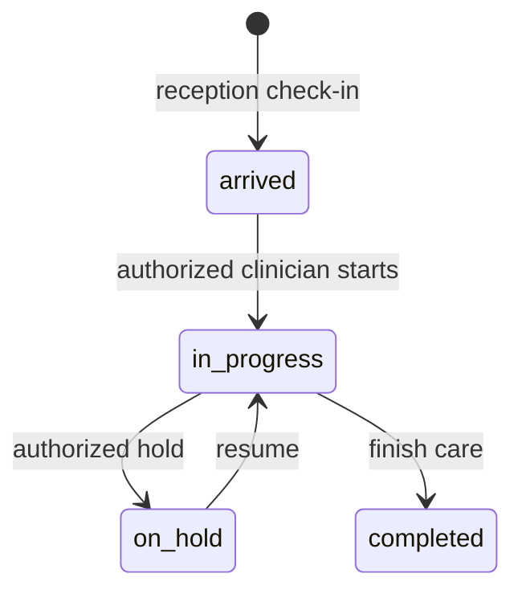

# Pharmacist

Snapshot: **2026-10-31**, repository source audit. No application code or live database was changed. “Source-confirmed” describes inspected code, not a passed browser, deployment or hospital test. ⚠️ UNVERIFIED = unresolved or untested; 🚧 NOT IMPLEMENTED = absent from the inspected ownership/routes; 🐞 SUSPECTED BUG = evidence needs a focused reproduction. Testing VPS and legacy LAN deployments are distinct. Actual VPS state and actual hospital configuration are not inferred from this checkout.

## 1. Purpose — who this person is in the hospital

Dispensing, pharmacy till. Sees drugs + allergies only (R6). This is a **system role**, not an HR Position. An Employee's job title grants no access by itself; an AppUser must hold this role through UserRole. `apps/api/src/auth/permissions.ts:70`; `apps/api/prisma/schema.prisma:967`.

## 2. Responsibilities — daily / per-shift / monthly

The procedures below describe the coded work this role supports. Daily: check assigned work and correct patient/source identity before saving. Per shift: hand over unresolved work and sign out of shared devices. Monthly: review unresolved exceptions with the designated supervisor. These frequencies are **recommended SOP assignments, ⚠️ not application-enforced duties**. The hospital must approve ownership and cadence. Capability source: `apps/web/src/pages/PharmacyPage.tsx:1`.

## 3. Prerequisites — before this person can work

An active User, facility, password change completion and the listed permission grants are required. Optional module screens also require enablement. Clinical accounts created through Users are refused; use Employee-linked onboarding for Doctor, Nurse, Lab technician and Pharmacist. HR self service requires an Employee link even for nonclinical accounts. Doctor accounts additionally require a clinical Position and linked Practitioner/department membership. Required workflow-specific catalogs and balances are in [the dependency matrix](../03-dependency-matrix.md). `apps/api/src/common/guards/jwt-auth.guard.ts:1`; `apps/api/src/modules/users/users.service.ts:73`; `apps/api/src/modules/staff/staff.service.ts:566`.

## 4. Permissions

Each cell lists exact permission codes, rather than implying every action in a module is allowed. Verb grouping is for reading only; some permissions appear in more than one column. Conditional rules and all denied permissions are in [the master matrix](../07-permission-matrix.md). Database grant drift is ⚠️ UNVERIFIED on the VPS.

| Module | View | Create | Edit | Delete/Cancel | Approve | Print/Export | Source (file:line) |
| --- | --- | --- | --- | --- | --- | --- | --- |
| reception | No matching grant | No matching grant | No matching grant | No matching grant | No matching grant | No matching grant | Denied by absence: `apps/api/src/auth/permissions.ts:1` |
| hr | hr.roster.view; hr.self.view | hr.leave.request | No matching grant | No matching grant | No matching grant | No matching grant | apps/api/src/auth/permissions.ts:136; apps/api/src/auth/permissions.ts:142; apps/api/src/auth/permissions.ts:148 |
| crm | No matching grant | No matching grant | No matching grant | No matching grant | No matching grant | No matching grant | Denied by absence: `apps/api/src/auth/permissions.ts:1` |
| payroll | No matching grant | No matching grant | No matching grant | No matching grant | No matching grant | No matching grant | Denied by absence: `apps/api/src/auth/permissions.ts:1` |
| finance | No matching grant | No matching grant | No matching grant | No matching grant | No matching grant | No matching grant | Denied by absence: `apps/api/src/auth/permissions.ts:1` |
| auth | auth.login; auth.me | No matching grant | No matching grant | No matching grant | No matching grant | No matching grant | apps/api/src/auth/permissions.ts:199; apps/api/src/auth/permissions.ts:222 |
| user | No matching grant | No matching grant | No matching grant | No matching grant | No matching grant | No matching grant | Denied by absence: `apps/api/src/auth/permissions.ts:1` |
| role | No matching grant | No matching grant | No matching grant | No matching grant | No matching grant | No matching grant | Denied by absence: `apps/api/src/auth/permissions.ts:1` |
| facility | No matching grant | No matching grant | No matching grant | No matching grant | No matching grant | No matching grant | Denied by absence: `apps/api/src/auth/permissions.ts:1` |
| department | No matching grant | No matching grant | No matching grant | No matching grant | No matching grant | No matching grant | Denied by absence: `apps/api/src/auth/permissions.ts:1` |
| room | No matching grant | No matching grant | No matching grant | No matching grant | No matching grant | No matching grant | Denied by absence: `apps/api/src/auth/permissions.ts:1` |
| practitioner | No matching grant | No matching grant | No matching grant | No matching grant | No matching grant | No matching grant | Denied by absence: `apps/api/src/auth/permissions.ts:1` |
| service | No matching grant | No matching grant | No matching grant | No matching grant | No matching grant | No matching grant | Denied by absence: `apps/api/src/auth/permissions.ts:1` |
| price | No matching grant | No matching grant | No matching grant | No matching grant | No matching grant | No matching grant | Denied by absence: `apps/api/src/auth/permissions.ts:1` |
| drug | drug.read | No matching grant | drug.manage (R9) | No matching grant | No matching grant | No matching grant | apps/api/src/auth/permissions.ts:253; apps/api/src/auth/permissions.ts:267 |
| labtest | No matching grant | No matching grant | No matching grant | No matching grant | No matching grant | No matching grant | Denied by absence: `apps/api/src/auth/permissions.ts:1` |
| panel | No matching grant | No matching grant | No matching grant | No matching grant | No matching grant | No matching grant | Denied by absence: `apps/api/src/auth/permissions.ts:1` |
| template | No matching grant | No matching grant | No matching grant | No matching grant | No matching grant | No matching grant | Denied by absence: `apps/api/src/auth/permissions.ts:1` |
| setting | No matching grant | No matching grant | No matching grant | No matching grant | No matching grant | No matching grant | Denied by absence: `apps/api/src/auth/permissions.ts:1` |
| patient | patient.read_demographics; patient.read_clinical (R6) | No matching grant | No matching grant | No matching grant | No matching grant | No matching grant | apps/api/src/auth/permissions.ts:307; apps/api/src/auth/permissions.ts:320 |
| allergy | allergy.read | No matching grant | No matching grant | No matching grant | No matching grant | No matching grant | apps/api/src/auth/permissions.ts:344 |
| visit | No matching grant | No matching grant | No matching grant | No matching grant | No matching grant | No matching grant | Denied by absence: `apps/api/src/auth/permissions.ts:1` |
| appointment | No matching grant | No matching grant | No matching grant | No matching grant | No matching grant | No matching grant | Denied by absence: `apps/api/src/auth/permissions.ts:1` |
| vitals | No matching grant | No matching grant | No matching grant | No matching grant | No matching grant | No matching grant | Denied by absence: `apps/api/src/auth/permissions.ts:1` |
| diagnosis | No matching grant | No matching grant | No matching grant | No matching grant | No matching grant | No matching grant | Denied by absence: `apps/api/src/auth/permissions.ts:1` |
| clinical_note | No matching grant | No matching grant | No matching grant | No matching grant | No matching grant | No matching grant | Denied by absence: `apps/api/src/auth/permissions.ts:1` |
| attachment | No matching grant | No matching grant | No matching grant | No matching grant | No matching grant | No matching grant | Denied by absence: `apps/api/src/auth/permissions.ts:1` |
| prescription | prescription.read | No matching grant | No matching grant | No matching grant | No matching grant | prescription.print | apps/api/src/auth/permissions.ts:435; apps/api/src/auth/permissions.ts:436 |
| interaction | interaction.check | No matching grant | No matching grant | No matching grant | No matching grant | No matching grant | apps/api/src/auth/permissions.ts:447 |
| follow_up | No matching grant | No matching grant | No matching grant | No matching grant | No matching grant | No matching grant | Denied by absence: `apps/api/src/auth/permissions.ts:1` |
| lab_order | No matching grant | No matching grant | No matching grant | No matching grant | No matching grant | No matching grant | Denied by absence: `apps/api/src/auth/permissions.ts:1` |
| lab | No matching grant | No matching grant | No matching grant | No matching grant | No matching grant | No matching grant | Denied by absence: `apps/api/src/auth/permissions.ts:1` |
| lab_result | No matching grant | No matching grant | No matching grant | No matching grant | No matching grant | No matching grant | Denied by absence: `apps/api/src/auth/permissions.ts:1` |
| pharmacy | pharmacy.read_queue; pharmacy.return_medicine (R5) | pharmacy.dispense | No matching grant | pharmacy.return_medicine (R5) | No matching grant | No matching grant | apps/api/src/auth/permissions.ts:493; apps/api/src/auth/permissions.ts:494; apps/api/src/auth/permissions.ts:495 |
| invoice | invoice.read (R12); invoice.list (R12) | invoice.create | No matching grant | No matching grant | No matching grant | invoice.print | apps/api/src/auth/permissions.ts:498; apps/api/src/auth/permissions.ts:503; apps/api/src/auth/permissions.ts:516; apps/api/src/auth/permissions.ts:517 |
| payment | No matching grant | payment.receive | No matching grant | payment.refund (R5) | No matching grant | No matching grant | apps/api/src/auth/permissions.ts:518; apps/api/src/auth/permissions.ts:519 |
| refund | No matching grant | No matching grant | No matching grant | No matching grant | No matching grant | refund.print | apps/api/src/auth/permissions.ts:520 |
| discount | No matching grant | No matching grant | No matching grant | No matching grant | No matching grant | No matching grant | apps/api/src/auth/permissions.ts:522 |
| lab_charge | No matching grant | No matching grant | No matching grant | No matching grant | No matching grant | No matching grant | Denied by absence: `apps/api/src/auth/permissions.ts:1` |
| report | No matching grant | No matching grant | No matching grant | No matching grant | No matching grant | No matching grant | Denied by absence: `apps/api/src/auth/permissions.ts:1` |
| audit_log | No matching grant | No matching grant | No matching grant | No matching grant | No matching grant | No matching grant | Denied by absence: `apps/api/src/auth/permissions.ts:1` |
| error_log | No matching grant | No matching grant | No matching grant | No matching grant | No matching grant | No matching grant | Denied by absence: `apps/api/src/auth/permissions.ts:1` |
| data | No matching grant | No matching grant | No matching grant | No matching grant | No matching grant | No matching grant | Denied by absence: `apps/api/src/auth/permissions.ts:1` |

## 5. What they CANNOT do (and who does it instead)

Anything absent from this role's grants is denied, including on a screen reached by manually entering its URL. Multiple roles may expand authority; this document assumes this role alone. Admin manages configuration and users; receptionist registers patients and takes lab collections; doctor writes diagnoses/notes/prescriptions; lab_tech enters/verifies lab results; pharmacist confirms medicine handover; finance roles follow independent approval and posting checks. **Admin alone is not a clinical author.** Exact exceptions and conditions: `apps/api/src/auth/permissions.ts:1`; `apps/api/src/common/guards/permissions.guard.ts:1`.

## 6. Screens they use — navigation path

English menu labels below come from the locale file. The Main group has no translated heading in the current English dictionary. Listed visibility does not prove every button is authorized. `apps/web/src/i18n/locales/en.json:1`.

| Menu group › item | URL | Module prerequisite | Source |
| --- | --- | --- | --- |
| Administration › Human resources | /hr | hr | `apps/web/src/auth/nav.ts:1` |
| Main › Dashboard | / | Core | `apps/web/src/auth/nav.ts:1` |
| Clinical › Interactions | /interactions | Core | `apps/web/src/auth/nav.ts:1` |
| Clinical › Pharmacy | /pharmacy | Core | `apps/web/src/auth/nav.ts:1` |
| Administration › Invoices | /invoices | Core | `apps/web/src/auth/nav.ts:1` |
| Administration › Collections | /collections | Core | `apps/web/src/auth/nav.ts:1` |
| Administration › Till | /till | Core | `apps/web/src/auth/nav.ts:1` |
| Administration › Drugs | /drugs | Core | `apps/web/src/auth/nav.ts:1` |

## 7. Button & action reference

These are source locations on menu-linked or permission-linked screens, including reusable controls. **Rows are an inventory, not a grant.** Read the endpoint permission against Section 4; branch-dependent visibility not proven for this role is ⚠️ UNVERIFIED. Administrator includes the complete UI inventory to guarantee no source location is silently omitted, including clinical controls the administrator cannot use. Side effects are direct static service effects; nested helpers may add effects. Runtime behavior and physical printing are not verified by this table.

| ID / source | Screen / component | Button / action (English; Dari where available) | Where | What it does / handler | Preconditions / disabled when | Side effects / trace evidence | Reversible? how | API endpoint | Permission required | Audited? |
| --- | --- | --- | --- | --- | --- | --- | --- | --- | --- | --- |
| A0001 apps/web/src/AppRoot.tsx:23 | AppRoot | FirstRunLanguagePicker | AppRoot / FirstRunLanguagePicker | Local handler / ⚠️ semantic review; onChosen: {() => setHasChosen(true)} | No explicit disabled attribute; surrounding conditions: !hasChosen ? ( <FirstRunLanguagePicker onChosen={() => setHasChosen(true)} /> ) : ( <QueryClientProvider client={queryClient}> {/* AuthProvider above the router: the route components (ProtectedRoute, | ⚠️ UNVERIFIED: inspect handler and linked API call inventory | ⚠️ Use documented cancel/reversal workflow; no generic undo | No statically resolved endpoint | ⚠️ UI local / endpoint-specific; menu is not permission | Local actions have no automatic DB audit; downstream action ⚠️ UNVERIFIED |
| A0288 apps/web/src/components/FinanceDateInput.tsx:21 | FinancePage, HrPage | "Shamsi date: YYYY-MM-DD (1350–1499)" | FinanceDateInput / Input | Form input / selection; onChange: {(event) => { const entered = event.target.value setEdit({ source: value, text: entered }) try { const converted = shamsiToGregorian(entered) event.target.setCustomValidity('') setEdit(null) onChange(converted) } catch { event.target.setCustomValidity('Enter a valid Shamsi date, for example 1404-07-05.') } }} | No explicit disabled attribute | Changes form selection; persistence occurs on submission | Edit again before saving | No statically resolved endpoint | ⚠️ UI local / endpoint-specific; menu is not permission | Local actions have no automatic DB audit; downstream action ⚠️ UNVERIFIED |
| A0421 apps/web/src/components/FirstRunLanguagePicker.tsx:39 | FirstRunLanguagePicker | {meta.nativeName} | FirstRunLanguagePicker / button | Local handler / ⚠️ semantic review; onClick: {() => choose(code)} | No explicit disabled attribute | ⚠️ UNVERIFIED: inspect handler and linked API call inventory | ⚠️ Use documented cancel/reversal workflow; no generic undo | No statically resolved endpoint | ⚠️ UI local / endpoint-specific; menu is not permission | Local actions have no automatic DB audit; downstream action ⚠️ UNVERIFIED |
| A0428 apps/web/src/components/InvoiceDetailView.tsx:84 | CollectionsPage, InvoicesPage, PharmacyPage | Back to invoices / بازگشت به صورت‌حساب‌ها | InvoiceDetailView / Button | Local handler / ⚠️ semantic review; onClick: {onBack} | No explicit disabled attribute | ⚠️ UNVERIFIED: inspect handler and linked API call inventory | ⚠️ Use documented cancel/reversal workflow; no generic undo | No statically resolved endpoint | ⚠️ UI local / endpoint-specific; menu is not permission | Local actions have no automatic DB audit; downstream action ⚠️ UNVERIFIED |
| A0429 apps/web/src/components/InvoiceDetailView.tsx:89 | CollectionsPage, InvoicesPage, PharmacyPage | Reprint receipt / چاپ دوباره رسید | InvoiceDetailView / Button | Browser print; onClick: {() => window.print()} | No explicit disabled attribute; surrounding conditions: canPrint && detail && ( <Button onClick={() => window.print()}> <Printer className="size-4" aria-hidden /> {t('invoices.reprint')} </Button> ) | ⚠️ UNVERIFIED: inspect handler and linked API call inventory | ⚠️ Use documented cancel/reversal workflow; no generic undo | No statically resolved endpoint | ⚠️ UI local / endpoint-specific; menu is not permission | Local actions have no automatic DB audit; downstream action ⚠️ UNVERIFIED |
| A0430 apps/web/src/components/InvoiceDetailView.tsx:116 | CollectionsPage, InvoicesPage, PharmacyPage | VisitBillsPanel | InvoiceDetailView / VisitBillsPanel | Local handler / ⚠️ semantic review; onOpen: {onOpen} | No explicit disabled attribute; surrounding conditions: detail.visit && ( <VisitBillsPanel visitId={detail.visit.id} currentInvoiceId={invoiceId} onOpen={onOpen} /> ); detail && ( <> {outstanding && ( 
 <Badge variant="warning"> {t('invoices.outstanding', { amount: outstanding, curr | ⚠️ UNVERIFIED: inspect handler and linked API call inventory | ⚠️ Use documented cancel/reversal workflow; no generic undo | No statically resolved endpoint | ⚠️ UI local / endpoint-specific; menu is not permission | Local actions have no automatic DB audit; downstream action ⚠️ UNVERIFIED |
| A0431 apps/web/src/components/InvoiceDetailView.tsx:148 | CollectionsPage, InvoicesPage, PharmacyPage | LabLinePaymentForm | InvoiceDetailView / LabLinePaymentForm | Local handler / ⚠️ semantic review; onPaid: {(amount) => setLastReceipt({ // The per-line lab endpoint settles the cash but does not issue a // receipt number the way the general till does, and — because only the // ticked lines were paid — this view has no cheap way to know whether // that closed the whole bill until the invoice refetches. receiptNo: null, amount, currency: detail.invoice.currency, settled: false, }) } | No explicit disabled attribute; surrounding conditions: detail.invoice.origin === 'lab' ? ( <LabLinePaymentForm invoiceId={invoiceId} patientId={detail.patient.id} items={detail.invoice.items} onPaid={(amount) => ; canReceive && outstanding && detail.invoice.status !== 'cancelled' && (detail.invoice.origin === 'lab' ? ( <LabLinePaymentForm invoiceId={invoiceId} patientId; detail && ( <> {outstanding && ( 
 <Badge variant="warning"> {t('invoices.outstanding', { amount: outstanding, curr | ⚠️ UNVERIFIED: inspect handler and linked API call inventory | ⚠️ Use documented cancel/reversal workflow; no generic undo | No statically resolved endpoint | ⚠️ UI local / endpoint-specific; menu is not permission | Local actions have no automatic DB audit; downstream action ⚠️ UNVERIFIED |
| A0432 apps/web/src/components/InvoiceDetailView.tsx:166 | CollectionsPage, InvoicesPage, PharmacyPage | PaymentForm | InvoiceDetailView / PaymentForm | Local handler / ⚠️ semantic review; onPaid: {(r) => setLastReceipt({ receiptNo: r.payment.receiptNo, amount: r.payment.amount, currency: r.currency, settled: r.status === 'paid', }) } | No explicit disabled attribute; surrounding conditions: detail.invoice.origin === 'lab' ? ( <LabLinePaymentForm invoiceId={invoiceId} patientId={detail.patient.id} items={detail.invoice.items} onPaid={(amount) => ; canReceive && outstanding && detail.invoice.status !== 'cancelled' && (detail.invoice.origin === 'lab' ? ( <LabLinePaymentForm invoiceId={invoiceId} patientId; detail && ( <> {outstanding && ( 
 <Badge variant="warning"> {t('invoices.outstanding', { amount: outstanding, curr | ⚠️ UNVERIFIED: inspect handler and linked API call inventory | ⚠️ Use documented cancel/reversal workflow; no generic undo | No statically resolved endpoint | ⚠️ UI local / endpoint-specific; menu is not permission | Local actions have no automatic DB audit; downstream action ⚠️ UNVERIFIED |
| A0433 apps/web/src/components/InvoiceDetailView.tsx:181 | CollectionsPage, InvoicesPage, PharmacyPage | PaymentsPanel | InvoiceDetailView / PaymentsPanel | Local handler / ⚠️ semantic review; onRefunded: {setRefundSlip} | No explicit disabled attribute; surrounding conditions: detail.payments.length > 0 && ( <PaymentsPanel invoiceId={invoiceId} payments={detail.payments} currency={detail.invoice.currency} canRefund={canRefund} onRef; detail && ( <> {outstanding && ( 
 <Badge variant="warning"> {t('invoices.outstanding', { amount: outstanding, curr | ⚠️ UNVERIFIED: inspect handler and linked API call inventory | ⚠️ Use documented cancel/reversal workflow; no generic undo | No statically resolved endpoint | ⚠️ UI local / endpoint-specific; menu is not permission | Local actions have no automatic DB audit; downstream action ⚠️ UNVERIFIED |
| A0434 apps/web/src/components/InvoiceDetailView.tsx:190 | CollectionsPage, InvoicesPage, PharmacyPage | RefundSlip | InvoiceDetailView / RefundSlip | Local handler / ⚠️ semantic review; onDone: {() => setRefundSlip(null)} | No explicit disabled attribute; surrounding conditions: refundSlip && ( <RefundSlip slip={refundSlip} facilityName={detail.facility.name} patientName={detail.patient.name} patientMrn={detail.patient.mrn} invoiceNo=; detail && ( <> {outstanding && ( 
 <Badge variant="warning"> {t('invoices.outstanding', { amount: outstanding, curr | ⚠️ UNVERIFIED: inspect handler and linked API call inventory | ⚠️ Use documented cancel/reversal workflow; no generic undo | No statically resolved endpoint | ⚠️ UI local / endpoint-specific; menu is not permission | Local actions have no automatic DB audit; downstream action ⚠️ UNVERIFIED |
| A0435 apps/web/src/components/InvoiceDetailView.tsx:250 | CollectionsPage, InvoicesPage, PharmacyPage | VisitBillRow | VisitBillsPanel / VisitBillRow | Local handler / ⚠️ semantic review; onOpen: {() => onOpen(bill.id)} | No explicit disabled attribute | ⚠️ UNVERIFIED: inspect handler and linked API call inventory | ⚠️ Use documented cancel/reversal workflow; no generic undo | No statically resolved endpoint | ⚠️ UI local / endpoint-specific; menu is not permission | Local actions have no automatic DB audit; downstream action ⚠️ UNVERIFIED |
| A0436 apps/web/src/components/InvoiceDetailView.tsx:300 | CollectionsPage, InvoicesPage, PharmacyPage | {{amount}} owed / {{amount}} باقی | VisitBillRow / button | Local handler / ⚠️ semantic review; onClick: {isCurrent ? undefined : onOpen} | No explicit disabled attribute | ⚠️ UNVERIFIED: inspect handler and linked API call inventory | ⚠️ Use documented cancel/reversal workflow; no generic undo | No statically resolved endpoint | ⚠️ UI local / endpoint-specific; menu is not permission | Local actions have no automatic DB audit; downstream action ⚠️ UNVERIFIED |
| A0437 apps/web/src/components/InvoiceDetailView.tsx:380 | CollectionsPage, InvoicesPage, PharmacyPage | toggle(item.refId!)} /> {item.description} | LabLinePaymentForm / input | Form input / selection; onChange: {() => toggle(item.refId!)} | {pay.isPending}; surrounding conditions: item.isPaid &#124;&#124; !item.refId ? (  {item.description}  ) : ( <label className="flex flex-1 items-center ga | Changes form selection; persistence occurs on submission | Edit again before saving | No statically resolved endpoint | ⚠️ UI local / endpoint-specific; menu is not permission | Local actions have no automatic DB audit; downstream action ⚠️ UNVERIFIED |
| A0438 apps/web/src/components/InvoiceDetailView.tsx:403 | CollectionsPage, InvoicesPage, PharmacyPage | Method / روش | LabLinePaymentForm / Select | Form input / selection; onChange: {(e) => setMethod(e.target.value as PaymentMethod)} | No explicit disabled attribute | Changes form selection; persistence occurs on submission | Edit again before saving | No statically resolved endpoint | ⚠️ UI local / endpoint-specific; menu is not permission | Local actions have no automatic DB audit; downstream action ⚠️ UNVERIFIED |
| A0439 apps/web/src/components/InvoiceDetailView.tsx:415 | CollectionsPage, InvoicesPage, PharmacyPage | Collecting… / Collect {{amount}} / در حال دریافت… / دریافت {{amount}} | LabLinePaymentForm / Button | Server request; onClick: {() => pay.mutate( { itemIds: chosen.map((i) => i.refId!), method }, { onSuccess: (r) => onPaid(r.amount) }, ) } | {chosen.length === 0 &#124;&#124; pay.isPending} | apps/api/src/modules/lab-billing/lab-billing.service.ts:141; invoiceItem.findMany, invoiceItem.count, invoiceItem.update, invoice.update, payment.create | ⚠️ Use documented cancel/reversal workflow; no generic undo | POST /lab-charges/pay (apps/api/src/modules/lab-billing/lab-billing.controller.ts:46) | lab_charge.collect; ⚠️ This role lacks: lab_charge.collect | App request context + audited Prisma writes; read audit is endpoint-specific. Root/manual scripts are outside this coverage. |
| A0440 apps/web/src/components/InvoiceDetailView.tsx:518 | CollectionsPage, InvoicesPage, PharmacyPage | Discount amount / Reason / Why the bill is reduced (required) / Applying… / Apply discount / مبلغ تخفیف / دلیل / دلیل کاهش صورت‌حساب (الزامی) / در حال اعمال… / اعمال تخفیف | DiscountForm / form | Server request; onSubmit: {submit} | No explicit disabled attribute | apps/api/src/modules/invoice/discount.service.ts:43; invoice.findFirst, invoice.update, invoiceItem.updateMany | ⚠️ Use documented cancel/reversal workflow; no generic undo | POST /invoices/:id/discount (apps/api/src/modules/invoice/invoice.controller.ts:165) | discount.apply | App request context + audited Prisma writes; read audit is endpoint-specific. Root/manual scripts are outside this coverage. |
| A0441 apps/web/src/components/InvoiceDetailView.tsx:523 | CollectionsPage, InvoicesPage, PharmacyPage | Discount amount / مبلغ تخفیف | DiscountForm / Input | Form input / selection; onChange: {(e) => setAmount(e.target.value)} | No explicit disabled attribute | Changes form selection; persistence occurs on submission | Edit again before saving | No statically resolved endpoint | ⚠️ UI local / endpoint-specific; menu is not permission | Local actions have no automatic DB audit; downstream action ⚠️ UNVERIFIED |
| A0442 apps/web/src/components/InvoiceDetailView.tsx:536 | CollectionsPage, InvoicesPage, PharmacyPage | Reason / Why the bill is reduced (required) / دلیل / دلیل کاهش صورت‌حساب (الزامی) | DiscountForm / Input | Form input / selection; onChange: {(e) => setReason(e.target.value)} | No explicit disabled attribute | Changes form selection; persistence occurs on submission | Edit again before saving | No statically resolved endpoint | ⚠️ UI local / endpoint-specific; menu is not permission | Local actions have no automatic DB audit; downstream action ⚠️ UNVERIFIED |
| A0443 apps/web/src/components/InvoiceDetailView.tsx:544 | CollectionsPage, InvoicesPage, PharmacyPage | Applying… / Apply discount / در حال اعمال… / اعمال تخفیف | DiscountForm / Button | Server request; {submit} | {!valid &#124;&#124; apply.isPending}; surrounding conditions: !showApproval && ( <Button type="submit" variant="outline" disabled={!valid &#124;&#124; apply.isPending}> {apply.isPending ? t('discount.applying') : t('discount.apply')} </Button> ) | apps/api/src/modules/invoice/discount.service.ts:43; invoice.findFirst, invoice.update, invoiceItem.updateMany | ⚠️ Use documented cancel/reversal workflow; no generic undo | POST /invoices/:id/discount (apps/api/src/modules/invoice/invoice.controller.ts:165) | discount.apply | App request context + audited Prisma writes; read audit is endpoint-specific. Root/manual scripts are outside this coverage. |
| A0444 apps/web/src/components/InvoiceDetailView.tsx:551 | CollectionsPage, InvoicesPage, PharmacyPage | Over 10% — an administrator must approve this discount. / Admin username / Admin password / Applying… / Approve & apply / بیش از ۱۰٪ — یک مدیر باید این تخفیف را تأیید کند. / نام کاربری مدیر / رمز عبور مدیر / در حال اعمال… / تأیید و اعمال | DiscountForm / form | Server request; onSubmit: {submit} | No explicit disabled attribute; surrounding conditions: showApproval && ( <form onSubmit={submit} className="space-y-2 rounded-md border border-warning/40 p-3"> 
{t('discount.approvalNeeded')}
 
 setApproverUsername(e.target.value)} | No explicit disabled attribute; surrounding conditions: showApproval && ( <form onSubmit={submit} className="space-y-2 rounded-md border border-warning/40 p-3"> 
{t('discount.approvalNeeded')}
 
 setApproverPassword(e.target.value)} | No explicit disabled attribute; surrounding conditions: showApproval && ( <form onSubmit={submit} className="space-y-2 rounded-md border border-warning/40 p-3"> 
{t('discount.approvalNeeded')}
 
 
{t('discount.approvalNeeded')}
 
 { setOpenFor(openFor === p.id ? null : p.id) setReason('') }} | No explicit disabled attribute; surrounding conditions: refundable ? ( <Button variant="ghost" className="h-7 px-2 text-xs" onClick={() => { setOpenFor(openFor === p.id ? null : p.id) ; p.isReversed ? ( <Badge variant="muted">{t('refund.reversed')}</Badge> ) : refundable ? ( <Button variant="ghost" className="h-7 px-2 text-xs" ; isRefundRow ? ( <Badge variant="danger">{t('refund.refundRow')}</Badge> ) : p.isReversed ? ( <Badge variant="muted">{t('refund.reversed')}</Badge> ) : refundable ? ( | ⚠️ UNVERIFIED: inspect handler and linked API call inventory | ⚠️ Use documented cancel/reversal workflow; no generic undo | No statically resolved endpoint | ⚠️ UI local / endpoint-specific; menu is not permission | Local actions have no automatic DB audit; downstream action ⚠️ UNVERIFIED |
| A0449 apps/web/src/components/InvoiceDetailView.tsx:715 | CollectionsPage, InvoicesPage, PharmacyPage | Reason for the refund (required) / Refunding… / Confirm refund / دلیل بازپرداخت (الزامی) / در حال بازپرداخت… / تأیید بازپرداخت | PaymentsPanel / Input | Form input / selection; onChange: {(e) => setReason(e.target.value)} | No explicit disabled attribute; surrounding conditions: openFor === p.id && ( 
 <Input value={reason} onChange={(e) => setReason(e.target.value)} placehold | Changes form selection; persistence occurs on submission | Edit again before saving | No statically resolved endpoint | ⚠️ UI local / endpoint-specific; menu is not permission | Local actions have no automatic DB audit; downstream action ⚠️ UNVERIFIED |
| A0450 apps/web/src/components/InvoiceDetailView.tsx:722 | CollectionsPage, InvoicesPage, PharmacyPage | Refunding… / Confirm refund / در حال بازپرداخت… / تأیید بازپرداخت | PaymentsPanel / Button | Server request; onClick: {() => submit(p.id)} | {reason.trim().length < 3 &#124;&#124; refund.isPending}; surrounding conditions: openFor === p.id && ( 
 <Input value={reason} onChange={(e) => setReason(e.target.value)} placehold | apps/api/src/modules/invoice/payment.service.ts:169; payment.findFirst, payment.updateMany, payment.create, invoice.update, invoiceItem.updateMany | ⚠️ Use documented cancel/reversal workflow; no generic undo | POST /invoices/:id/payments/:paymentId/refund (apps/api/src/modules/invoice/invoice.controller.ts:132) | payment.refund | App request context + audited Prisma writes; read audit is endpoint-specific. Root/manual scripts are outside this coverage. |
| A0451 apps/web/src/components/InvoiceDetailView.tsx:767 | CollectionsPage, InvoicesPage, PharmacyPage | Print refund slip / چاپ رسید بازپرداخت | RefundSlip / Button | Browser print; onClick: {() => window.print()} | No explicit disabled attribute; surrounding conditions: canPrint && ( <Button onClick={() => window.print()}> <Printer className="size-4" aria-hidden /> {t('refund.print')} </Button> ) | ⚠️ UNVERIFIED: inspect handler and linked API call inventory | ⚠️ Use documented cancel/reversal workflow; no generic undo | No statically resolved endpoint | ⚠️ UI local / endpoint-specific; menu is not permission | Local actions have no automatic DB audit; downstream action ⚠️ UNVERIFIED |
| A0452 apps/web/src/components/InvoiceDetailView.tsx:772 | CollectionsPage, InvoicesPage, PharmacyPage | Done / انجام شد | RefundSlip / Button | Local handler / ⚠️ semantic review; onClick: {onDone} | No explicit disabled attribute | ⚠️ UNVERIFIED: inspect handler and linked API call inventory | ⚠️ Use documented cancel/reversal workflow; no generic undo | No statically resolved endpoint | ⚠️ UI local / endpoint-specific; menu is not permission | Local actions have no automatic DB audit; downstream action ⚠️ UNVERIFIED |
| A0464 apps/web/src/components/LanguageToggle.tsx:30 | LanguageToggle | {meta.nativeName} | LanguageToggle / button | Local handler / ⚠️ semantic review; onClick: {() => select(code)} | No explicit disabled attribute | ⚠️ UNVERIFIED: inspect handler and linked API call inventory | ⚠️ Use documented cancel/reversal workflow; no generic undo | No statically resolved endpoint | ⚠️ UI local / endpoint-specific; menu is not permission | Local actions have no automatic DB audit; downstream action ⚠️ UNVERIFIED |
| A0499 apps/web/src/components/PaymentForm.tsx:63 | CollectionsPage, InvoicesPage, PharmacyPage | Amount / Method / Reference / Card slip or transfer no. (optional) / Taking… / Take payment / مبلغ / روش / مرجع / شماره رسید کارت یا انتقال (اختیاری) / در حال دریافت… / دریافت پول | PaymentForm / form | Server request; onSubmit: {submit} | No explicit disabled attribute | apps/api/src/modules/invoice/payment.service.ts:36; invoice.findFirst, invoice.updateMany, payment.create, invoiceItem.updateMany | ⚠️ Use documented cancel/reversal workflow; no generic undo | POST /invoices/:id/payments (apps/api/src/modules/invoice/invoice.controller.ts:107) | payment.receive | App request context + audited Prisma writes; read audit is endpoint-specific. Root/manual scripts are outside this coverage. |
| A0500 apps/web/src/components/PaymentForm.tsx:68 | CollectionsPage, InvoicesPage, PharmacyPage | Amount / مبلغ | PaymentForm / Input | Form input / selection; onChange: {(e) => setAmount(e.target.value)} | No explicit disabled attribute | Changes form selection; persistence occurs on submission | Edit again before saving | No statically resolved endpoint | ⚠️ UI local / endpoint-specific; menu is not permission | Local actions have no automatic DB audit; downstream action ⚠️ UNVERIFIED |
| A0501 apps/web/src/components/PaymentForm.tsx:82 | CollectionsPage, InvoicesPage, PharmacyPage | {PAYMENT_TENDERS.map((m) => ( {t(`payments.methodLabel.${m}`)} ))} | PaymentForm / Select | Form input / selection; onChange: {(e) => setMethod(e.target.value as PaymentTender)} | No explicit disabled attribute | Changes form selection; persistence occurs on submission | Edit again before saving | No statically resolved endpoint | ⚠️ UI local / endpoint-specific; menu is not permission | Local actions have no automatic DB audit; downstream action ⚠️ UNVERIFIED |
| A0502 apps/web/src/components/PaymentForm.tsx:99 | CollectionsPage, InvoicesPage, PharmacyPage | Reference / Card slip or transfer no. (optional) / مرجع / شماره رسید کارت یا انتقال (اختیاری) | PaymentForm / Input | Form input / selection; onChange: {(e) => setReference(e.target.value)} | No explicit disabled attribute | Changes form selection; persistence occurs on submission | Edit again before saving | No statically resolved endpoint | ⚠️ UI local / endpoint-specific; menu is not permission | Local actions have no automatic DB audit; downstream action ⚠️ UNVERIFIED |
| A0503 apps/web/src/components/PaymentForm.tsx:106 | CollectionsPage, InvoicesPage, PharmacyPage | Taking… / Take payment / در حال دریافت… / دریافت پول | PaymentForm / Button | Server request; {submit} | {!valid &#124;&#124; record.isPending} | apps/api/src/modules/invoice/payment.service.ts:36; invoice.findFirst, invoice.updateMany, payment.create, invoiceItem.updateMany | ⚠️ Use documented cancel/reversal workflow; no generic undo | POST /invoices/:id/payments (apps/api/src/modules/invoice/invoice.controller.ts:107) | payment.receive | App request context + audited Prisma writes; read audit is endpoint-specific. Root/manual scripts are outside this coverage. |
| A0538 apps/web/src/components/Sidebar.tsx:35 | Sidebar | div | Sidebar / div | Local handler / ⚠️ semantic review; onClick: {onClose} | No explicit disabled attribute; surrounding conditions: open && ( 
 ) | ⚠️ UNVERIFIED: inspect handler and linked API call inventory | ⚠️ Use documented cancel/reversal workflow; no generic undo | No statically resolved endpoint | ⚠️ UI local / endpoint-specific; menu is not permission | Local actions have no automatic DB audit; downstream action ⚠️ UNVERIFIED |
| A0539 apps/web/src/components/Sidebar.tsx:71 | Sidebar | {Icon && } {t(`nav.${item.key}`)} {item.key === 'collections' && } | Sidebar / NavLink | Navigation; onClick: {onClose} | No explicit disabled attribute | Changes browser destination; target: {item.to} | Browser Back | No statically resolved endpoint | ⚠️ UI local / endpoint-specific; menu is not permission | Local actions have no automatic DB audit; downstream action ⚠️ UNVERIFIED |
| A0540 apps/web/src/components/ThemeToggle.tsx:15 | ThemeToggle | {t(theme === 'dark' ? 'theme.toLight' : 'theme.toDark')} | ThemeToggle / Button | Local handler / ⚠️ semantic review; onClick: {toggle} | No explicit disabled attribute | ⚠️ UNVERIFIED: inspect handler and linked API call inventory | ⚠️ Use documented cancel/reversal workflow; no generic undo | No statically resolved endpoint | ⚠️ UI local / endpoint-specific; menu is not permission | Local actions have no automatic DB audit; downstream action ⚠️ UNVERIFIED |
| A0544 apps/web/src/components/ui/input.tsx:11 | AppointmentsPage, ChangePasswordPage, CollectionsPage, ConsultPage, CrmPage, DepartmentsPage, DrugsPage, FinancePage, FollowUpsPage, HrPage, IcdLookupPage, InteractionCheckerPage, InvoicesPage, LabPanelsPage, LabQueuePage, LabTestsPage, MyConsultationsPage, PatientDetailPage, PatientsPage, PharmacyPage, PractitionersPage, QueuePage, ReceptionOperationsPage, ReceptionPage, ReportsPage, ServicesPage, SettingsPage, StartVisitPage, TillPage, UsersPage | input | Input / input | Form input / selection; ⚠️ UNVERIFIED | No explicit disabled attribute | Changes form selection; persistence occurs on submission | Edit again before saving | No statically resolved endpoint | ⚠️ UI local / endpoint-specific; menu is not permission | Local actions have no automatic DB audit; downstream action ⚠️ UNVERIFIED |
| A0545 apps/web/src/components/ui/select.tsx:14 | AppointmentsPage, CollectionsPage, ConsultPage, DepartmentsPage, HrPage, InvoicesPage, LabQueuePage, LabTestsPage, PatientDetailPage, PharmacyPage, PractitionersPage, QueuePage, ReceptionOperationsPage, ReportsPage, ServicesPage, StartVisitPage, UsersPage | {children} | Select / select | Form input / selection; ⚠️ UNVERIFIED | No explicit disabled attribute | Changes form selection; persistence occurs on submission | Edit again before saving | No statically resolved endpoint | ⚠️ UI local / endpoint-specific; menu is not permission | Local actions have no automatic DB audit; downstream action ⚠️ UNVERIFIED |
| A0547 apps/web/src/components/ui/textarea.tsx:6 | ConsultPage, DrugsPage, ReportsPage, StartVisitPage | textarea | Textarea / textarea | Form input / selection; ⚠️ UNVERIFIED | No explicit disabled attribute | Changes form selection; persistence occurs on submission | Edit again before saving | No statically resolved endpoint | ⚠️ UI local / endpoint-specific; menu is not permission | Local actions have no automatic DB audit; downstream action ⚠️ UNVERIFIED |
| A0551 apps/web/src/layouts/RootLayout.tsx:26 | RootLayout | Open menu / Signed in as {{name}} / ⚠️ auth.password.title / Sign out / باز کردن منو / وارد شده به عنوان {{name}} / ⚠️ / خروج | RootLayout / Sidebar | Local handler / ⚠️ semantic review; onClose: {() => setSidebarOpen(false)} | No explicit disabled attribute | ⚠️ UNVERIFIED: inspect handler and linked API call inventory | ⚠️ Use documented cancel/reversal workflow; no generic undo | No statically resolved endpoint | ⚠️ UI local / endpoint-specific; menu is not permission | Local actions have no automatic DB audit; downstream action ⚠️ UNVERIFIED |
| A0552 apps/web/src/layouts/RootLayout.tsx:35 | RootLayout | Open menu / باز کردن منو | RootLayout / Button | Local handler / ⚠️ semantic review; onClick: {() => setSidebarOpen(true)} | No explicit disabled attribute | ⚠️ UNVERIFIED: inspect handler and linked API call inventory | ⚠️ Use documented cancel/reversal workflow; no generic undo | No statically resolved endpoint | ⚠️ UI local / endpoint-specific; menu is not permission | Local actions have no automatic DB audit; downstream action ⚠️ UNVERIFIED |
| A0553 apps/web/src/layouts/RootLayout.tsx:53 | RootLayout | ⚠️ auth.password.title / ⚠️ | RootLayout / Link | Navigation; "/change-password" | No explicit disabled attribute | Changes browser destination; target: "/change-password" | Browser Back | No statically resolved endpoint | ⚠️ UI local / endpoint-specific; menu is not permission | Local actions have no automatic DB audit; downstream action ⚠️ UNVERIFIED |
| A0554 apps/web/src/layouts/RootLayout.tsx:56 | RootLayout | Sign out / خروج | RootLayout / Button | Local handler / ⚠️ semantic review; onClick: {logout} | No explicit disabled attribute | ⚠️ UNVERIFIED: inspect handler and linked API call inventory | ⚠️ Use documented cancel/reversal workflow; no generic undo | No statically resolved endpoint | ⚠️ UI local / endpoint-specific; menu is not permission | Local actions have no automatic DB audit; downstream action ⚠️ UNVERIFIED |
| A0570 apps/web/src/pages/ChangePasswordPage.tsx:53 | ChangePasswordPage | ⚠️ auth.password.current / ⚠️ auth.password.new / ⚠️ auth.password.confirm / ⚠️ auth.password.save / ⚠️ / ⚠️ / ⚠️ / ⚠️ | ChangePasswordPage / form | Server request; onSubmit: {(event) => { void submit(event) }} | No explicit disabled attribute; surrounding conditions: done ? <> 
{t('auth.password.done', 'Password changed. Sign in again with your new password.')}
 <Button onClick={() => { logout(); navigate('/login', { replace: true }) }}>{t('auth.password.signInAgai | apps/api/src/auth/auth.service.ts:354; appUser.findFirst, appUser.updateMany, session.updateMany | ⚠️ Use documented cancel/reversal workflow; no generic undo | POST /auth/change-password (apps/api/src/auth/auth.controller.ts:93) | auth.me | App request context + audited Prisma writes; read audit is endpoint-specific. Root/manual scripts are outside this coverage. |
| A0574 apps/web/src/pages/ChangePasswordPage.tsx:64 | ChangePasswordPage | ⚠️ auth.password.save / ⚠️ | ChangePasswordPage / Button | Server request; {(event) => { void submit(event) }} | {busy}; surrounding conditions: done ? <> 
{t('auth.password.done', 'Password changed. Sign in again with your new password.')}
 <Button onClick={() => { logout(); navigate('/login', { replace: true }) }}>{t('auth.password.signInAgai | apps/api/src/auth/auth.service.ts:354; appUser.findFirst, appUser.updateMany, session.updateMany | ⚠️ Use documented cancel/reversal workflow; no generic undo | POST /auth/change-password (apps/api/src/auth/auth.controller.ts:93) | auth.me | App request context + audited Prisma writes; read audit is endpoint-specific. Root/manual scripts are outside this coverage. |
| A0577 apps/web/src/pages/CollectionsPage.tsx:107 | CollectionsPage | InvoiceDetailView | CollectionsPage / InvoiceDetailView | Local handler / ⚠️ semantic review; onBack: {() => setSelectedId(null)}; onOpen: {setSelectedId} | No explicit disabled attribute | ⚠️ UNVERIFIED: inspect handler and linked API call inventory | ⚠️ Use documented cancel/reversal workflow; no generic undo | No statically resolved endpoint | ⚠️ UI local / endpoint-specific; menu is not permission | Local actions have no automatic DB audit; downstream action ⚠️ UNVERIFIED |
| A0578 apps/web/src/pages/CollectionsPage.tsx:128 | CollectionsPage | Invoice number, patient name or MRN / شماره صورت‌حساب، نام مریض یا شماره فایل | CollectionsPage / Input | Form input / selection; onChange: {(e) => setInput(e.target.value)} | No explicit disabled attribute | Changes form selection; persistence occurs on submission | Edit again before saving | No statically resolved endpoint | ⚠️ UI local / endpoint-specific; menu is not permission | Local actions have no automatic DB audit; downstream action ⚠️ UNVERIFIED |
| A0579 apps/web/src/pages/CollectionsPage.tsx:138 | CollectionsPage | {t(`reports.presets.${p}`)} | CollectionsPage / Button | Local handler / ⚠️ semantic review; onClick: {() => applyPreset(p)} | No explicit disabled attribute | ⚠️ UNVERIFIED: inspect handler and linked API call inventory | ⚠️ Use documented cancel/reversal workflow; no generic undo | No statically resolved endpoint | ⚠️ UI local / endpoint-specific; menu is not permission | Local actions have no automatic DB audit; downstream action ⚠️ UNVERIFIED |
| A0580 apps/web/src/pages/CollectionsPage.tsx:150 | CollectionsPage | From / از | CollectionsPage / Input | Form input / selection; onChange: {(e) => { setFrom(e.target.value) setPreset(null) }} | No explicit disabled attribute | Changes form selection; persistence occurs on submission | Edit again before saving | No statically resolved endpoint | ⚠️ UI local / endpoint-specific; menu is not permission | Local actions have no automatic DB audit; downstream action ⚠️ UNVERIFIED |
| A0581 apps/web/src/pages/CollectionsPage.tsx:163 | CollectionsPage | To / تا | CollectionsPage / Input | Form input / selection; onChange: {(e) => { setTo(e.target.value) setPreset(null) }} | No explicit disabled attribute | Changes form selection; persistence occurs on submission | Edit again before saving | No statically resolved endpoint | ⚠️ UI local / endpoint-specific; menu is not permission | Local actions have no automatic DB audit; downstream action ⚠️ UNVERIFIED |
| A0582 apps/web/src/pages/CollectionsPage.tsx:175 | CollectionsPage | All dates / همه تاریخ‌ها | CollectionsPage / Button | Local handler / ⚠️ semantic review; onClick: {clearDates} | No explicit disabled attribute; surrounding conditions: (from &#124;&#124; to) && ( <Button variant="ghost" onClick={clearDates}> {t('collections.allDates')} </Button> ) | ⚠️ UNVERIFIED: inspect handler and linked API call inventory | ⚠️ Use documented cancel/reversal workflow; no generic undo | No statically resolved endpoint | ⚠️ UI local / endpoint-specific; menu is not permission | Local actions have no automatic DB audit; downstream action ⚠️ UNVERIFIED |
| A0583 apps/web/src/pages/CollectionsPage.tsx:208 | CollectionsPage | CollectionsRow | CollectionsPage / CollectionsRow | Local handler / ⚠️ semantic review; onOpen: {() => setSelectedId(bill.id)} | No explicit disabled attribute; surrounding conditions: bills.length === 0 && !listQuery.isPending ? ( 
 {total === 0 && !q && !from && !to ? t('collections.empty') : t('collections.noMatch')} 
 ) : ( | ⚠️ UNVERIFIED: inspect handler and linked API call inventory | ⚠️ Use documented cancel/reversal workflow; no generic undo | No statically resolved endpoint | ⚠️ UI local / endpoint-specific; menu is not permission | Local actions have no automatic DB audit; downstream action ⚠️ UNVERIFIED |
| A0584 apps/web/src/pages/CollectionsPage.tsx:225 | CollectionsPage | Previous / قبلی | CollectionsPage / Button | Local handler / ⚠️ semantic review; onClick: {() => setPage((p) => Math.max(1, p - 1))} | {page <= 1}; surrounding conditions: pageCount > 1 && ( 
 
 {t('collections.page', { page, pageCount })} ; bills.length === 0 && !listQuery.isPending ? ( 
 {total === 0 && !q && !from && !to ? t('collections.empty') : t('collections.noMatch')} 
 ) : ( | ⚠️ UNVERIFIED: inspect handler and linked API call inventory | ⚠️ Use documented cancel/reversal workflow; no generic undo | No statically resolved endpoint | ⚠️ UI local / endpoint-specific; menu is not permission | Local actions have no automatic DB audit; downstream action ⚠️ UNVERIFIED |
| A0585 apps/web/src/pages/CollectionsPage.tsx:233 | CollectionsPage | Next / بعدی | CollectionsPage / Button | Local handler / ⚠️ semantic review; onClick: {() => setPage((p) => Math.min(pageCount, p + 1))} | {page >= pageCount}; surrounding conditions: pageCount > 1 && ( 
 
 {t('collections.page', { page, pageCount })} ; bills.length === 0 && !listQuery.isPending ? ( 
 {total === 0 && !q && !from && !to ? t('collections.empty') : t('collections.noMatch')} 
 ) : ( | ⚠️ UNVERIFIED: inspect handler and linked API call inventory | ⚠️ Use documented cancel/reversal workflow; no generic undo | No statically resolved endpoint | ⚠️ UI local / endpoint-specific; menu is not permission | Local actions have no automatic DB audit; downstream action ⚠️ UNVERIFIED |
| A0586 apps/web/src/pages/CollectionsPage.tsx:274 | CollectionsPage | New / جدید | CollectionsRow / tr | Local handler / ⚠️ semantic review; onClick: {onOpen} | No explicit disabled attribute | ⚠️ UNVERIFIED: inspect handler and linked API call inventory | ⚠️ Use documented cancel/reversal workflow; no generic undo | No statically resolved endpoint | ⚠️ UI local / endpoint-specific; menu is not permission | Local actions have no automatic DB audit; downstream action ⚠️ UNVERIFIED |
| A0621 apps/web/src/pages/DrugsPage.tsx:44 | DrugsPage | Search code, generic or brand… / جستجوی کود، جنریک یا تجارتی… | DrugsPage / Input | Form input / selection; onChange: {(e) => setQ(e.target.value)} | No explicit disabled attribute | Changes form selection; persistence occurs on submission | Edit again before saving | No statically resolved endpoint | ⚠️ UI local / endpoint-specific; menu is not permission | Local actions have no automatic DB audit; downstream action ⚠️ UNVERIFIED |
| A0622 apps/web/src/pages/DrugsPage.tsx:122 | DrugsPage | Paste rows with a header line. Columns: code and genericName are required; brandName, atcCode, strength, form, isControlled, sellPrice are optional. Re-importing the same code updates it. / Importing… / Import / Import failed. Please try again. / Imported {{imported}}, skipped {{skipped}}. / Line {{line}} / سطرها را با یک سطر عنوان جای‌گذاری کنید. ستون‌های code و genericName الزامی‌اند؛ brandName، atcCode، strength، form، isControlled، sellPrice اختیاری. وارد کردن دوبارهٔ همان کود آن را به‌روز می‌کند. / در حال وارد کردن… / وارد کردن / وارد کردن ناکام شد. لطفاً دوباره تلاش کنید. / {{imported}} وارد شد، {{skipped}} رد شد. / سطر {{line}} | ImportDrugs / Textarea | Form input / selection; onChange: {(e) => setCsv(e.target.value)} | No explicit disabled attribute | Changes form selection; persistence occurs on submission | Edit again before saving | No statically resolved endpoint | ⚠️ UI local / endpoint-specific; menu is not permission | Local actions have no automatic DB audit; downstream action ⚠️ UNVERIFIED |
| A0623 apps/web/src/pages/DrugsPage.tsx:131 | DrugsPage | Importing… / Import / در حال وارد کردن… / وارد کردن | ImportDrugs / Button | Server request; onClick: {onImport} | {importDrugs.isPending &#124;&#124; csv.trim() === ''} | apps/api/src/modules/drug/drug.service.ts:165; drug.findUnique, drug.update, drug.create | ⚠️ Use documented cancel/reversal workflow; no generic undo | POST /drugs/import (apps/api/src/modules/drug/drug.controller.ts:65) | drug.manage | App request context + audited Prisma writes; read audit is endpoint-specific. Root/manual scripts are outside this coverage. |
| A0624 apps/web/src/pages/DrugsPage.tsx:236 | DrugsPage | Code / Generic name / Brand name / ATC code / Strength / Form / Prescribing defaults — optional. They pre-fill a prescription and can always be changed at the point of care. / Default route / Default frequency / Default duration / Sell price / Free (leave blank) / What the pharmacy charges per unit at dispense. Blank means free-issue — not a mistake, but check that's what you mean. / Controlled substance / Saving… / Add drug / کود / نام جنریک / نام تجارتی / کود ATC / قوت / شکل / پیش‌فرض‌های تجویز — اختیاری. نسخه را از پیش پر می‌کنند و همیشه هنگام معاینه قابل تغییر اند. / مسیر پیش‌فرض / تکرار پیش‌فرض / مدت پیش‌فرض / قیمت فروش / رایگان (خالی بگذارید) / آنچه دواخانه هنگام تحویل به ازای هر واحد می‌گیرد. خالی یعنی رایگان — اشتباه نیست، ولی مطمئن شوید همین منظور شماست. / مادهٔ کنترل‌شده / در حال ذخیره… / افزودن دوا | CreateDrugForm / form | Server request; onSubmit: {onSubmit} | No explicit disabled attribute | apps/api/src/modules/drug/drug.service.ts:124; drug.findUnique, drug.create | ⚠️ Use documented cancel/reversal workflow; no generic undo | POST /drugs (apps/api/src/modules/drug/drug.controller.ts:51) | drug.manage | App request context + audited Prisma writes; read audit is endpoint-specific. Root/manual scripts are outside this coverage. |
| A0625 apps/web/src/pages/DrugsPage.tsx:240 | DrugsPage | Code / کود | CreateDrugForm / Input | Form input / selection; onChange: {(e) => setCode(e.target.value)} | No explicit disabled attribute | Changes form selection; persistence occurs on submission | Edit again before saving | No statically resolved endpoint | ⚠️ UI local / endpoint-specific; menu is not permission | Local actions have no automatic DB audit; downstream action ⚠️ UNVERIFIED |
| A0626 apps/web/src/pages/DrugsPage.tsx:244 | DrugsPage | Generic name / نام جنریک | CreateDrugForm / Input | Form input / selection; onChange: {(e) => setGenericName(e.target.value)} | No explicit disabled attribute | Changes form selection; persistence occurs on submission | Edit again before saving | No statically resolved endpoint | ⚠️ UI local / endpoint-specific; menu is not permission | Local actions have no automatic DB audit; downstream action ⚠️ UNVERIFIED |
| A0627 apps/web/src/pages/DrugsPage.tsx:255 | DrugsPage | Brand name / نام تجارتی | CreateDrugForm / Input | Form input / selection; onChange: {(e) => setBrandName(e.target.value)} | No explicit disabled attribute | Changes form selection; persistence occurs on submission | Edit again before saving | No statically resolved endpoint | ⚠️ UI local / endpoint-specific; menu is not permission | Local actions have no automatic DB audit; downstream action ⚠️ UNVERIFIED |
| A0628 apps/web/src/pages/DrugsPage.tsx:259 | DrugsPage | ATC code / کود ATC | CreateDrugForm / Input | Form input / selection; onChange: {(e) => setAtcCode(e.target.value)} | No explicit disabled attribute | Changes form selection; persistence occurs on submission | Edit again before saving | No statically resolved endpoint | ⚠️ UI local / endpoint-specific; menu is not permission | Local actions have no automatic DB audit; downstream action ⚠️ UNVERIFIED |
| A0629 apps/web/src/pages/DrugsPage.tsx:266 | DrugsPage | Strength / قوت | CreateDrugForm / Input | Form input / selection; onChange: {(e) => setStrength(e.target.value)} | No explicit disabled attribute | Changes form selection; persistence occurs on submission | Edit again before saving | No statically resolved endpoint | ⚠️ UI local / endpoint-specific; menu is not permission | Local actions have no automatic DB audit; downstream action ⚠️ UNVERIFIED |
| A0630 apps/web/src/pages/DrugsPage.tsx:275 | DrugsPage | Form / شکل | CreateDrugForm / Input | Form input / selection; onChange: {(e) => setForm(e.target.value)} | No explicit disabled attribute | Changes form selection; persistence occurs on submission | Edit again before saving | No statically resolved endpoint | ⚠️ UI local / endpoint-specific; menu is not permission | Local actions have no automatic DB audit; downstream action ⚠️ UNVERIFIED |
| A0631 apps/web/src/pages/DrugsPage.tsx:289 | DrugsPage | Default route / مسیر پیش‌فرض | CreateDrugForm / Input | Form input / selection; onChange: {(e) => setDefaultRoute(e.target.value)} | No explicit disabled attribute | Changes form selection; persistence occurs on submission | Edit again before saving | No statically resolved endpoint | ⚠️ UI local / endpoint-specific; menu is not permission | Local actions have no automatic DB audit; downstream action ⚠️ UNVERIFIED |
| A0632 apps/web/src/pages/DrugsPage.tsx:298 | DrugsPage | Default frequency / تکرار پیش‌فرض | CreateDrugForm / Input | Form input / selection; onChange: {(e) => setDefaultFreq(e.target.value)} | No explicit disabled attribute | Changes form selection; persistence occurs on submission | Edit again before saving | No statically resolved endpoint | ⚠️ UI local / endpoint-specific; menu is not permission | Local actions have no automatic DB audit; downstream action ⚠️ UNVERIFIED |
| A0633 apps/web/src/pages/DrugsPage.tsx:307 | DrugsPage | Default duration / مدت پیش‌فرض | CreateDrugForm / Input | Form input / selection; onChange: {(e) => setDefaultDuration(e.target.value)} | No explicit disabled attribute | Changes form selection; persistence occurs on submission | Edit again before saving | No statically resolved endpoint | ⚠️ UI local / endpoint-specific; menu is not permission | Local actions have no automatic DB audit; downstream action ⚠️ UNVERIFIED |
| A0634 apps/web/src/pages/DrugsPage.tsx:320 | DrugsPage | Sell price / Free (leave blank) / What the pharmacy charges per unit at dispense. Blank means free-issue — not a mistake, but check that's what you mean. / قیمت فروش / رایگان (خالی بگذارید) / آنچه دواخانه هنگام تحویل به ازای هر واحد می‌گیرد. خالی یعنی رایگان — اشتباه نیست، ولی مطمئن شوید همین منظور شماست. | CreateDrugForm / Input | Form input / selection; onChange: {(e) => setSellPrice(e.target.value)} | No explicit disabled attribute | Changes form selection; persistence occurs on submission | Edit again before saving | No statically resolved endpoint | ⚠️ UI local / endpoint-specific; menu is not permission | Local actions have no automatic DB audit; downstream action ⚠️ UNVERIFIED |
| A0635 apps/web/src/pages/DrugsPage.tsx:332 | DrugsPage | Controlled substance / مادهٔ کنترل‌شده | CreateDrugForm / input | Form input / selection; onChange: {(e) => setIsControlled(e.target.checked)} | No explicit disabled attribute | Changes form selection; persistence occurs on submission | Edit again before saving | No statically resolved endpoint | ⚠️ UI local / endpoint-specific; menu is not permission | Local actions have no automatic DB audit; downstream action ⚠️ UNVERIFIED |
| A0636 apps/web/src/pages/DrugsPage.tsx:347 | DrugsPage | Saving… / Add drug / در حال ذخیره… / افزودن دوا | CreateDrugForm / Button | Server request; {onSubmit} | {createDrug.isPending} | apps/api/src/modules/drug/drug.service.ts:139; drug.update | ⚠️ Use documented cancel/reversal workflow; no generic undo | PATCH /drugs/:id (apps/api/src/modules/drug/drug.controller.ts:79) | drug.manage | App request context + audited Prisma writes; read audit is endpoint-specific. Root/manual scripts are outside this coverage. |
| A0637 apps/web/src/pages/DrugsPage.tsx:367 | DrugsPage | Edit drug / ویرایش دوا | DrugRow / button | Local handler / ⚠️ semantic review; onClick: {() => setIsEditing((v) => !v)} | No explicit disabled attribute | ⚠️ UNVERIFIED: inspect handler and linked API call inventory | ⚠️ Use documented cancel/reversal workflow; no generic undo | No statically resolved endpoint | ⚠️ UI local / endpoint-specific; menu is not permission | Local actions have no automatic DB audit; downstream action ⚠️ UNVERIFIED |
| A0638 apps/web/src/pages/DrugsPage.tsx:407 | DrugsPage | Deactivate / Reactivate / غیرفعال‌سازی / فعال‌سازی مجدد | DrugRow / Button | Local handler / ⚠️ semantic review; onClick: {() => setActive.mutate({ id: drug.id, isActive: !drug.isActive })} | {setActive.isPending} | ⚠️ UNVERIFIED: inspect handler and linked API call inventory | ⚠️ Use documented cancel/reversal workflow; no generic undo | No statically resolved endpoint | ⚠️ UI local / endpoint-specific; menu is not permission | Local actions have no automatic DB audit; downstream action ⚠️ UNVERIFIED |
| A0639 apps/web/src/pages/DrugsPage.tsx:421 | DrugsPage | setIsEditing(false)} /> | DrugRow / DrugEditor | Local handler / ⚠️ semantic review; onDone: {() => setIsEditing(false)} | No explicit disabled attribute; surrounding conditions: isEditing && ( <tr className="border-b border-border last:border-0 bg-muted/30"> <td /> <td colSpan={7} className="p-3"> <DrugEditor drug={drug} onDone={() => setIsEditing(false)} /> </td> | ⚠️ UNVERIFIED: inspect handler and linked API call inventory | ⚠️ Use documented cancel/reversal workflow; no generic undo | No statically resolved endpoint | ⚠️ UI local / endpoint-specific; menu is not permission | Local actions have no automatic DB audit; downstream action ⚠️ UNVERIFIED |
| A0640 apps/web/src/pages/DrugsPage.tsx:473 | DrugsPage | Generic name / Brand name / ATC code / Strength / Form / Sell price / Free (leave blank) / Default route / Default frequency / Default duration / Controlled substance / Saving… / Save / نام جنریک / نام تجارتی / کود ATC / قوت / شکل / قیمت فروش / رایگان (خالی بگذارید) / مسیر پیش‌فرض / تکرار پیش‌فرض / مدت پیش‌فرض / مادهٔ کنترل‌شده / در حال ذخیره… / ذخیره | DrugEditor / form | Server request; onSubmit: {onSubmit} | No explicit disabled attribute | apps/api/src/modules/drug/drug.service.ts:139; drug.update | ⚠️ Use documented cancel/reversal workflow; no generic undo | PATCH /drugs/:id (apps/api/src/modules/drug/drug.controller.ts:79) | drug.manage | App request context + audited Prisma writes; read audit is endpoint-specific. Root/manual scripts are outside this coverage. |
| A0641 apps/web/src/pages/DrugsPage.tsx:479 | DrugsPage | Generic name / نام جنریک | DrugEditor / Input | Form input / selection; onChange: {(e) => setGenericName(e.target.value)} | No explicit disabled attribute | Changes form selection; persistence occurs on submission | Edit again before saving | No statically resolved endpoint | ⚠️ UI local / endpoint-specific; menu is not permission | Local actions have no automatic DB audit; downstream action ⚠️ UNVERIFIED |
| A0642 apps/web/src/pages/DrugsPage.tsx:489 | DrugsPage | Brand name / نام تجارتی | DrugEditor / Input | Form input / selection; onChange: {(e) => setBrandName(e.target.value)} | No explicit disabled attribute | Changes form selection; persistence occurs on submission | Edit again before saving | No statically resolved endpoint | ⚠️ UI local / endpoint-specific; menu is not permission | Local actions have no automatic DB audit; downstream action ⚠️ UNVERIFIED |
| A0643 apps/web/src/pages/DrugsPage.tsx:499 | DrugsPage | ATC code / کود ATC | DrugEditor / Input | Form input / selection; onChange: {(e) => setAtcCode(e.target.value)} | No explicit disabled attribute | Changes form selection; persistence occurs on submission | Edit again before saving | No statically resolved endpoint | ⚠️ UI local / endpoint-specific; menu is not permission | Local actions have no automatic DB audit; downstream action ⚠️ UNVERIFIED |
| A0644 apps/web/src/pages/DrugsPage.tsx:505 | DrugsPage | Strength / قوت | DrugEditor / Input | Form input / selection; onChange: {(e) => setStrength(e.target.value)} | No explicit disabled attribute | Changes form selection; persistence occurs on submission | Edit again before saving | No statically resolved endpoint | ⚠️ UI local / endpoint-specific; menu is not permission | Local actions have no automatic DB audit; downstream action ⚠️ UNVERIFIED |
| A0645 apps/web/src/pages/DrugsPage.tsx:515 | DrugsPage | Form / شکل | DrugEditor / Input | Form input / selection; onChange: {(e) => setForm(e.target.value)} | No explicit disabled attribute | Changes form selection; persistence occurs on submission | Edit again before saving | No statically resolved endpoint | ⚠️ UI local / endpoint-specific; menu is not permission | Local actions have no automatic DB audit; downstream action ⚠️ UNVERIFIED |
| A0646 apps/web/src/pages/DrugsPage.tsx:521 | DrugsPage | Sell price / Free (leave blank) / قیمت فروش / رایگان (خالی بگذارید) | DrugEditor / Input | Form input / selection; onChange: {(e) => setSellPrice(e.target.value)} | No explicit disabled attribute | Changes form selection; persistence occurs on submission | Edit again before saving | No statically resolved endpoint | ⚠️ UI local / endpoint-specific; menu is not permission | Local actions have no automatic DB audit; downstream action ⚠️ UNVERIFIED |
| A0647 apps/web/src/pages/DrugsPage.tsx:535 | DrugsPage | Default route / مسیر پیش‌فرض | DrugEditor / Input | Form input / selection; onChange: {(e) => setDefaultRoute(e.target.value)} | No explicit disabled attribute | Changes form selection; persistence occurs on submission | Edit again before saving | No statically resolved endpoint | ⚠️ UI local / endpoint-specific; menu is not permission | Local actions have no automatic DB audit; downstream action ⚠️ UNVERIFIED |
| A0648 apps/web/src/pages/DrugsPage.tsx:545 | DrugsPage | Default frequency / تکرار پیش‌فرض | DrugEditor / Input | Form input / selection; onChange: {(e) => setDefaultFreq(e.target.value)} | No explicit disabled attribute | Changes form selection; persistence occurs on submission | Edit again before saving | No statically resolved endpoint | ⚠️ UI local / endpoint-specific; menu is not permission | Local actions have no automatic DB audit; downstream action ⚠️ UNVERIFIED |
| A0649 apps/web/src/pages/DrugsPage.tsx:555 | DrugsPage | Default duration / مدت پیش‌فرض | DrugEditor / Input | Form input / selection; onChange: {(e) => setDefaultDuration(e.target.value)} | No explicit disabled attribute | Changes form selection; persistence occurs on submission | Edit again before saving | No statically resolved endpoint | ⚠️ UI local / endpoint-specific; menu is not permission | Local actions have no automatic DB audit; downstream action ⚠️ UNVERIFIED |
| A0650 apps/web/src/pages/DrugsPage.tsx:562 | DrugsPage | Controlled substance / مادهٔ کنترل‌شده | DrugEditor / input | Form input / selection; onChange: {(e) => setIsControlled(e.target.checked)} | No explicit disabled attribute | Changes form selection; persistence occurs on submission | Edit again before saving | No statically resolved endpoint | ⚠️ UI local / endpoint-specific; menu is not permission | Local actions have no automatic DB audit; downstream action ⚠️ UNVERIFIED |
| A0651 apps/web/src/pages/DrugsPage.tsx:575 | DrugsPage | Saving… / Save / در حال ذخیره… / ذخیره | DrugEditor / Button | Server request; {onSubmit} | {updateDrug.isPending} | apps/api/src/modules/drug/drug.service.ts:139; drug.update | ⚠️ Use documented cancel/reversal workflow; no generic undo | PATCH /drugs/:id (apps/api/src/modules/drug/drug.controller.ts:79) | drug.manage | App request context + audited Prisma writes; read audit is endpoint-specific. Root/manual scripts are outside this coverage. |
| A0728 apps/web/src/pages/HomePage.tsx:106 | HomePage | Open workspace / باز کردن محیط کاری | HomePage / Link | Navigation; {item.to} | No explicit disabled attribute | Changes browser destination; target: {item.to} | Browser Back | No statically resolved endpoint | ⚠️ UI local / endpoint-specific; menu is not permission | Local actions have no automatic DB audit; downstream action ⚠️ UNVERIFIED |
| A0729 apps/web/src/pages/HrPage.tsx:172 | HrPage | {x[0].toUpperCase() + x.slice(1)} | HrPage / Button | Local handler / ⚠️ semantic review; onClick: {() => setParams({ tab: x })} | No explicit disabled attribute | ⚠️ UNVERIFIED: inspect handler and linked API call inventory | ⚠️ Use documented cancel/reversal workflow; no generic undo | No statically resolved endpoint | ⚠️ UI local / endpoint-specific; menu is not permission | Local actions have no automatic DB audit; downstream action ⚠️ UNVERIFIED |
| A0730 apps/web/src/pages/HrPage.tsx:258 | HrPage | Employee register setQ(e.target.value)} /> | Employees / Input | Form input / selection; onChange: {(e) => setQ(e.target.value)} | No explicit disabled attribute | Changes form selection; persistence occurs on submission | Edit again before saving | No statically resolved endpoint | ⚠️ UI local / endpoint-specific; menu is not permission | Local actions have no automatic DB audit; downstream action ⚠️ UNVERIFIED |
| A0731 apps/web/src/pages/HrPage.tsx:272 | HrPage | {e.employeeNo} {e.fullName} {e.departmentName} {e.positionTitle} {e.status} | Employees / tr | Local handler / ⚠️ semantic review; onClick: {() => setSelectedId(e.id)} | No explicit disabled attribute; surrounding conditions: list.isPending ? ( 
Loading employees…
 ) : ( <Table headings={["No.", "Employee", "Department", "Position", "Status"]} > {list.data?.items.map((e) => ( <tr | ⚠️ UNVERIFIED: inspect handler and linked API call inventory | ⚠️ Use documented cancel/reversal workflow; no generic undo | No statically resolved endpoint | ⚠️ UI local / endpoint-specific; menu is not permission | Local actions have no automatic DB audit; downstream action ⚠️ UNVERIFIED |
| A0732 apps/web/src/pages/HrPage.tsx:299 | HrPage | Create a clinical position | Employees / Link | Navigation; "/hr?tab=settings" | No explicit disabled attribute; surrounding conditions: refs.positionsLoaded && refs.positions.length === 0 && ( 
 
 Create an active clinical pos; selectedId && detail.data ? ( <EmployeeDetail employee={detail.data} /> ) : ( <Card className="space-y-4 p-5"> {refs.positionsLoaded && refs.positions.length === 0 && ( 
 ( {d.name} ))} Select… {refs.positions.map((p) => ( {p.titleEn} ))} Permanent Fixed term Part time Temporary Volunteer Create employee {notice && {notice} } | Employees / form | Server request; onSubmit: {submit} | No explicit disabled attribute; surrounding conditions: selectedId && detail.data ? ( <EmployeeDetail employee={detail.data} /> ) : ( <Card className="space-y-4 p-5"> {refs.positionsLoaded && refs.positions.length === 0 && ( 
 ) : ( <Card className="space-y-4 p-5"> {refs.positionsLoaded && refs.positions.length === 0 && ( 
 ) : ( <Card className="space-y-4 p-5"> {refs.positionsLoaded && refs.positions.length === 0 && ( 
 ) : ( <Card className="space-y-4 p-5"> {refs.positionsLoaded && refs.positions.length === 0 && ( 
 ) : ( <Card className="space-y-4 p-5"> {refs.positionsLoaded && refs.positions.length === 0 && ( 
 ) : ( <Card className="space-y-4 p-5"> {refs.positionsLoaded && refs.positions.length === 0 && ( 
 ( {d.name} ))} | Employees / Select | Form input / selection; {submit} | No explicit disabled attribute; surrounding conditions: selectedId && detail.data ? ( <EmployeeDetail employee={detail.data} /> ) : ( <Card className="space-y-4 p-5"> {refs.positionsLoaded && refs.positions.length === 0 && ( 
 ( {p.titleEn} ))} | Employees / Select | Form input / selection; {submit} | No explicit disabled attribute; surrounding conditions: selectedId && detail.data ? ( <EmployeeDetail employee={detail.data} /> ) : ( <Card className="space-y-4 p-5"> {refs.positionsLoaded && refs.positions.length === 0 && ( 
 ) : ( <Card className="space-y-4 p-5"> {refs.positionsLoaded && refs.positions.length === 0 && ( 
 ) : ( <Card className="space-y-4 p-5"> {refs.positionsLoaded && refs.positions.length === 0 && ( 
 ) : ( <Card className="space-y-4 p-5"> {refs.positionsLoaded && refs.positions.length === 0 && ( 
 { e.preventDefault(); const f = new FormData(e.currentTarget); const file = f.get("file"); if (file instanceof File) upload.mutate({ file, title: String(f.get("title")), type: String(f.get("type")), }); }} | No explicit disabled attribute | apps/api/src/modules/staff/staff.service.ts:369; employeeDocument.create | ⚠️ Use documented cancel/reversal workflow; no generic undo | POST /employees/:id/documents (apps/api/src/modules/staff/staff.controller.ts:100) | hr.document.manage; ⚠️ This role lacks: hr.document.manage | App request context + audited Prisma writes; read audit is endpoint-specific. Root/manual scripts are outside this coverage. |
| A0747 apps/web/src/pages/HrPage.tsx:507 | HrPage | Private documents Identity Contract Education License Training Other Upload | EmployeeDetail / Input | Form input / selection; {(e) => { e.preventDefault(); const f = new FormData(e.currentTarget); const file = f.get("file"); if (file instanceof File) upload.mutate({ file, title: String(f.get("title")), type: String(f.get("type")), }); }} | No explicit disabled attribute | Changes form selection; persistence occurs on submission | Edit again before saving | No statically resolved endpoint | ⚠️ UI local / endpoint-specific; menu is not permission | Local actions have no automatic DB audit; downstream action ⚠️ UNVERIFIED |
| A0748 apps/web/src/pages/HrPage.tsx:508 | HrPage | Identity Contract Education License Training Other | EmployeeDetail / Select | Form input / selection; {(e) => { e.preventDefault(); const f = new FormData(e.currentTarget); const file = f.get("file"); if (file instanceof File) upload.mutate({ file, title: String(f.get("title")), type: String(f.get("type")), }); }} | No explicit disabled attribute | Changes form selection; persistence occurs on submission | Edit again before saving | No statically resolved endpoint | ⚠️ UI local / endpoint-specific; menu is not permission | Local actions have no automatic DB audit; downstream action ⚠️ UNVERIFIED |
| A0749 apps/web/src/pages/HrPage.tsx:516 | HrPage | Private documents Identity Contract Education License Training Other Upload | EmployeeDetail / Input | Form input / selection; {(e) => { e.preventDefault(); const f = new FormData(e.currentTarget); const file = f.get("file"); if (file instanceof File) upload.mutate({ file, title: String(f.get("title")), type: String(f.get("type")), }); }} | No explicit disabled attribute | Changes form selection; persistence occurs on submission | Edit again before saving | No statically resolved endpoint | ⚠️ UI local / endpoint-specific; menu is not permission | Local actions have no automatic DB audit; downstream action ⚠️ UNVERIFIED |
| A0750 apps/web/src/pages/HrPage.tsx:522 | HrPage | Upload | EmployeeDetail / Button | Server request; {(e) => { e.preventDefault(); const f = new FormData(e.currentTarget); const file = f.get("file"); if (file instanceof File) upload.mutate({ file, title: String(f.get("title")), type: String(f.get("type")), }); }} | No explicit disabled attribute | apps/api/src/modules/staff/staff.service.ts:369; employeeDocument.create | ⚠️ Use documented cancel/reversal workflow; no generic undo | POST /employees/:id/documents (apps/api/src/modules/staff/staff.controller.ts:100) | hr.document.manage; ⚠️ This role lacks: hr.document.manage | App request context + audited Prisma writes; read audit is endpoint-specific. Root/manual scripts are outside this coverage. |
| A0751 apps/web/src/pages/HrPage.tsx:526 | HrPage | {d.title} ( {Math.ceil(d.sizeBytes / 1024)} KB) | EmployeeDetail / button | Server request; onClick: {() => void apiDownload( `/employees/${employee.id}/documents/${d.id}/download`, ) } | No explicit disabled attribute | apps/api/src/modules/staff/staff.service.ts:401; employeeDocument.findFirst | ⚠️ Use documented cancel/reversal workflow; no generic undo | GET /employees/:id/documents/:documentId/download (apps/api/src/modules/staff/staff.controller.ts:111) | hr.document.manage; ⚠️ This role lacks: hr.document.manage | App request context + audited Prisma writes; read audit is endpoint-specific. Root/manual scripts are outside this coverage. |
| A0752 apps/web/src/pages/HrPage.tsx:545 | HrPage | Create system account Select role… Doctor Nurse Lab technician Pharmacist Receptionist Payroll officer Accountant Create linked account | EmployeeDetail / form | Server request; onSubmit: {(e) => { e.preventDefault(); const f = new FormData(e.currentTarget); account.mutate({ username: f.get("username"), password: f.get("password"), email: f.get("email") &#124;&#124; null, roleCodes: [f.get("role")], }); }} | No explicit disabled attribute; surrounding conditions: employee.userId ? ( 
 <strong>System account:</strong> linked 
 ) : ( <form className="space-y-2" onSubmit={(e) => { e.preventD | apps/api/src/modules/staff/staff.service.ts:566; role.findMany, appUser.findUnique, practitioner.findUnique, employee.findFirst, practitioner.findFirst, appUser.create, userRole.createMany, employee.update, practitioner.update, practitioner.create, practitionerDepartment.upsert | ⚠️ Use documented cancel/reversal workflow; no generic undo | POST /employees/:id/account (apps/api/src/modules/staff/staff.controller.ts:141) | user.create; ⚠️ This role lacks: user.create | App request context + audited Prisma writes; read audit is endpoint-specific. Root/manual scripts are outside this coverage. |
| A0753 apps/web/src/pages/HrPage.tsx:559 | HrPage | Create system account Select role… Doctor Nurse Lab technician Pharmacist Receptionist Payroll officer Accountant Create linked account | EmployeeDetail / Input | Form input / selection; {(e) => { e.preventDefault(); const f = new FormData(e.currentTarget); account.mutate({ username: f.get("username"), password: f.get("password"), email: f.get("email") &#124;&#124; null, roleCodes: [f.get("role")], }); }} | No explicit disabled attribute; surrounding conditions: employee.userId ? ( 
 <strong>System account:</strong> linked 
 ) : ( <form className="space-y-2" onSubmit={(e) => { e.preventD | Changes form selection; persistence occurs on submission | Edit again before saving | No statically resolved endpoint | ⚠️ UI local / endpoint-specific; menu is not permission | Local actions have no automatic DB audit; downstream action ⚠️ UNVERIFIED |
| A0754 apps/web/src/pages/HrPage.tsx:560 | HrPage | Create system account Select role… Doctor Nurse Lab technician Pharmacist Receptionist Payroll officer Accountant Create linked account | EmployeeDetail / Input | Form input / selection; {(e) => { e.preventDefault(); const f = new FormData(e.currentTarget); account.mutate({ username: f.get("username"), password: f.get("password"), email: f.get("email") &#124;&#124; null, roleCodes: [f.get("role")], }); }} | No explicit disabled attribute; surrounding conditions: employee.userId ? ( 
 <strong>System account:</strong> linked 
 ) : ( <form className="space-y-2" onSubmit={(e) => { e.preventD | Changes form selection; persistence occurs on submission | Edit again before saving | No statically resolved endpoint | ⚠️ UI local / endpoint-specific; menu is not permission | Local actions have no automatic DB audit; downstream action ⚠️ UNVERIFIED |
| A0755 apps/web/src/pages/HrPage.tsx:561 | HrPage | Create system account Select role… Doctor Nurse Lab technician Pharmacist Receptionist Payroll officer Accountant Create linked account | EmployeeDetail / Input | Form input / selection; {(e) => { e.preventDefault(); const f = new FormData(e.currentTarget); account.mutate({ username: f.get("username"), password: f.get("password"), email: f.get("email") &#124;&#124; null, roleCodes: [f.get("role")], }); }} | No explicit disabled attribute; surrounding conditions: employee.userId ? ( 
 <strong>System account:</strong> linked 
 ) : ( <form className="space-y-2" onSubmit={(e) => { e.preventD | Changes form selection; persistence occurs on submission | Edit again before saving | No statically resolved endpoint | ⚠️ UI local / endpoint-specific; menu is not permission | Local actions have no automatic DB audit; downstream action ⚠️ UNVERIFIED |
| A0756 apps/web/src/pages/HrPage.tsx:568 | HrPage | Select role… Doctor Nurse Lab technician Pharmacist Receptionist Payroll officer Accountant | EmployeeDetail / Select | Form input / selection; {(e) => { e.preventDefault(); const f = new FormData(e.currentTarget); account.mutate({ username: f.get("username"), password: f.get("password"), email: f.get("email") &#124;&#124; null, roleCodes: [f.get("role")], }); }} | No explicit disabled attribute; surrounding conditions: employee.userId ? ( 
 <strong>System account:</strong> linked 
 ) : ( <form className="space-y-2" onSubmit={(e) => { e.preventD | Changes form selection; persistence occurs on submission | Edit again before saving | No statically resolved endpoint | ⚠️ UI local / endpoint-specific; menu is not permission | Local actions have no automatic DB audit; downstream action ⚠️ UNVERIFIED |
| A0757 apps/web/src/pages/HrPage.tsx:578 | HrPage | Create linked account | EmployeeDetail / Button | Server request; {(e) => { e.preventDefault(); const f = new FormData(e.currentTarget); account.mutate({ username: f.get("username"), password: f.get("password"), email: f.get("email") &#124;&#124; null, roleCodes: [f.get("role")], }); }} | No explicit disabled attribute; surrounding conditions: employee.userId ? ( 
 <strong>System account:</strong> linked 
 ) : ( <form className="space-y-2" onSubmit={(e) => { e.preventD | apps/api/src/modules/staff/staff.service.ts:566; role.findMany, appUser.findUnique, practitioner.findUnique, employee.findFirst, practitioner.findFirst, appUser.create, userRole.createMany, employee.update, practitioner.update, practitioner.create, practitionerDepartment.upsert | ⚠️ Use documented cancel/reversal workflow; no generic undo | POST /employees/:id/account (apps/api/src/modules/staff/staff.controller.ts:141) | user.create; ⚠️ This role lacks: user.create | App request context + audited Prisma writes; read audit is endpoint-specific. Root/manual scripts are outside this coverage. |
| A0758 apps/web/src/pages/HrPage.tsx:582 | HrPage | Add credential Professional license Education Certification Training Other Blocks clinical work after expiry Save credential | EmployeeDetail / form | Server request; onSubmit: {(e) => { e.preventDefault(); const f = new FormData(e.currentTarget); credential.mutate({ type: f.get("type"), name: f.get("name"), issuingAuthority: f.get("authority") &#124;&#124; null, referenceNo: f.get("reference") &#124;&#124; null, expiresOn: f.get("expiresOn") &#124;&#124; null, blocksClinicalWork: f.get("blocks") === "on", }); }} | No explicit disabled attribute | apps/api/src/modules/staff/staff.service.ts:437; credential.create | ⚠️ Use documented cancel/reversal workflow; no generic undo | POST /employees/:id/credentials (apps/api/src/modules/staff/staff.controller.ts:134) | hr.credential.manage; ⚠️ This role lacks: hr.credential.manage | App request context + audited Prisma writes; read audit is endpoint-specific. Root/manual scripts are outside this coverage. |
| A0759 apps/web/src/pages/HrPage.tsx:598 | HrPage | Add credential Professional license Education Certification Training Other Blocks clinical work after expiry Save credential | EmployeeDetail / Input | Form input / selection; {(e) => { e.preventDefault(); const f = new FormData(e.currentTarget); credential.mutate({ type: f.get("type"), name: f.get("name"), issuingAuthority: f.get("authority") &#124;&#124; null, referenceNo: f.get("reference") &#124;&#124; null, expiresOn: f.get("expiresOn") &#124;&#124; null, blocksClinicalWork: f.get("blocks") === "on", }); }} | No explicit disabled attribute | Changes form selection; persistence occurs on submission | Edit again before saving | No statically resolved endpoint | ⚠️ UI local / endpoint-specific; menu is not permission | Local actions have no automatic DB audit; downstream action ⚠️ UNVERIFIED |
| A0760 apps/web/src/pages/HrPage.tsx:599 | HrPage | Professional license Education Certification Training Other | EmployeeDetail / Select | Form input / selection; {(e) => { e.preventDefault(); const f = new FormData(e.currentTarget); credential.mutate({ type: f.get("type"), name: f.get("name"), issuingAuthority: f.get("authority") &#124;&#124; null, referenceNo: f.get("reference") &#124;&#124; null, expiresOn: f.get("expiresOn") &#124;&#124; null, blocksClinicalWork: f.get("blocks") === "on", }); }} | No explicit disabled attribute | Changes form selection; persistence occurs on submission | Edit again before saving | No statically resolved endpoint | ⚠️ UI local / endpoint-specific; menu is not permission | Local actions have no automatic DB audit; downstream action ⚠️ UNVERIFIED |
| A0761 apps/web/src/pages/HrPage.tsx:606 | HrPage | Add credential Professional license Education Certification Training Other Blocks clinical work after expiry Save credential | EmployeeDetail / Input | Form input / selection; {(e) => { e.preventDefault(); const f = new FormData(e.currentTarget); credential.mutate({ type: f.get("type"), name: f.get("name"), issuingAuthority: f.get("authority") &#124;&#124; null, referenceNo: f.get("reference") &#124;&#124; null, expiresOn: f.get("expiresOn") &#124;&#124; null, blocksClinicalWork: f.get("blocks") === "on", }); }} | No explicit disabled attribute | Changes form selection; persistence occurs on submission | Edit again before saving | No statically resolved endpoint | ⚠️ UI local / endpoint-specific; menu is not permission | Local actions have no automatic DB audit; downstream action ⚠️ UNVERIFIED |
| A0762 apps/web/src/pages/HrPage.tsx:607 | HrPage | Add credential Professional license Education Certification Training Other Blocks clinical work after expiry Save credential | EmployeeDetail / Input | Form input / selection; {(e) => { e.preventDefault(); const f = new FormData(e.currentTarget); credential.mutate({ type: f.get("type"), name: f.get("name"), issuingAuthority: f.get("authority") &#124;&#124; null, referenceNo: f.get("reference") &#124;&#124; null, expiresOn: f.get("expiresOn") &#124;&#124; null, blocksClinicalWork: f.get("blocks") === "on", }); }} | No explicit disabled attribute | Changes form selection; persistence occurs on submission | Edit again before saving | No statically resolved endpoint | ⚠️ UI local / endpoint-specific; menu is not permission | Local actions have no automatic DB audit; downstream action ⚠️ UNVERIFIED |
| A0763 apps/web/src/pages/HrPage.tsx:612 | HrPage | Blocks clinical work after expiry | EmployeeDetail / input | Form input / selection; {(e) => { e.preventDefault(); const f = new FormData(e.currentTarget); credential.mutate({ type: f.get("type"), name: f.get("name"), issuingAuthority: f.get("authority") &#124;&#124; null, referenceNo: f.get("reference") &#124;&#124; null, expiresOn: f.get("expiresOn") &#124;&#124; null, blocksClinicalWork: f.get("blocks") === "on", }); }} | No explicit disabled attribute | Changes form selection; persistence occurs on submission | Edit again before saving | No statically resolved endpoint | ⚠️ UI local / endpoint-specific; menu is not permission | Local actions have no automatic DB audit; downstream action ⚠️ UNVERIFIED |
| A0764 apps/web/src/pages/HrPage.tsx:615 | HrPage | Save credential | EmployeeDetail / Button | Server request; {(e) => { e.preventDefault(); const f = new FormData(e.currentTarget); credential.mutate({ type: f.get("type"), name: f.get("name"), issuingAuthority: f.get("authority") &#124;&#124; null, referenceNo: f.get("reference") &#124;&#124; null, expiresOn: f.get("expiresOn") &#124;&#124; null, blocksClinicalWork: f.get("blocks") === "on", }); }} | No explicit disabled attribute | apps/api/src/modules/staff/staff.service.ts:437; credential.create | ⚠️ Use documented cancel/reversal workflow; no generic undo | POST /employees/:id/credentials (apps/api/src/modules/staff/staff.controller.ts:134) | hr.credential.manage; ⚠️ This role lacks: hr.credential.manage | App request context + audited Prisma writes; read audit is endpoint-specific. Root/manual scripts are outside this coverage. |
| A0765 apps/web/src/pages/HrPage.tsx:618 | HrPage | Exit employee | EmployeeDetail / Button | Server request; onClick: {() => { if ( window.confirm( "Exit this employee and disable the linked user account?", ) ) exit.mutate(); }} | No explicit disabled attribute; surrounding conditions: employee.status !== "exited" && ( <Button variant="destructive" size="sm" onClick={() => { if ( window.confirm( "Exit this employee and disable the linked user | apps/api/src/modules/staff/staff.service.ts:342; employee.findFirst, employee.update, appUser.update, session.updateMany | ⚠️ Use documented cancel/reversal workflow; no generic undo | POST /employees/:id/exit (apps/api/src/modules/staff/staff.controller.ts:92) | hr.employee.exit; ⚠️ This role lacks: hr.employee.exit | App request context + audited Prisma writes; read audit is endpoint-specific. Root/manual scripts are outside this coverage. |
| A0766 apps/web/src/pages/HrPage.tsx:666 | HrPage | All credentials {credentialStateSchema.options.map((s) => ( {s.replaceAll("_", " ")} ))} | Credentials / Select | Form input / selection; onChange: {(e) => setState(e.target.value)} | No explicit disabled attribute | Changes form selection; persistence occurs on submission | Edit again before saving | No statically resolved endpoint | ⚠️ UI local / endpoint-specific; menu is not permission | Local actions have no automatic DB audit; downstream action ⚠️ UNVERIFIED |
| A0767 apps/web/src/pages/HrPage.tsx:678 | HrPage | CSV | Credentials / Button | Local handler / ⚠️ semantic review; onClick: {() => downloadTable("hr-credentials", exportRows)} | No explicit disabled attribute | ⚠️ UNVERIFIED: inspect handler and linked API call inventory | ⚠️ Use documented cancel/reversal workflow; no generic undo | No statically resolved endpoint | ⚠️ UI local / endpoint-specific; menu is not permission | Local actions have no automatic DB audit; downstream action ⚠️ UNVERIFIED |
| A0768 apps/web/src/pages/HrPage.tsx:684 | HrPage | Excel | Credentials / Button | Local handler / ⚠️ semantic review; onClick: {() => downloadTable("hr-credentials", exportRows, true)} | No explicit disabled attribute | ⚠️ UNVERIFIED: inspect handler and linked API call inventory | ⚠️ Use documented cancel/reversal workflow; no generic undo | No statically resolved endpoint | ⚠️ UI local / endpoint-specific; menu is not permission | Local actions have no automatic DB audit; downstream action ⚠️ UNVERIFIED |
| A0769 apps/web/src/pages/HrPage.tsx:775 | HrPage | FinanceDateInput | Attendance / FinanceDateInput | Local handler / ⚠️ semantic review; onChange: {setDate} | No explicit disabled attribute | ⚠️ UNVERIFIED: inspect handler and linked API call inventory | ⚠️ Use documented cancel/reversal workflow; no generic undo | No statically resolved endpoint | ⚠️ UI local / endpoint-specific; menu is not permission | Local actions have no automatic DB audit; downstream action ⚠️ UNVERIFIED |
| A0770 apps/web/src/pages/HrPage.tsx:778 | HrPage | CSV | Attendance / Button | Local handler / ⚠️ semantic review; onClick: {() => downloadTable("hr-attendance-month", reportRows)} | No explicit disabled attribute | ⚠️ UNVERIFIED: inspect handler and linked API call inventory | ⚠️ Use documented cancel/reversal workflow; no generic undo | No statically resolved endpoint | ⚠️ UI local / endpoint-specific; menu is not permission | Local actions have no automatic DB audit; downstream action ⚠️ UNVERIFIED |
| A0771 apps/web/src/pages/HrPage.tsx:784 | HrPage | Excel | Attendance / Button | Local handler / ⚠️ semantic review; onClick: {() => downloadTable("hr-attendance-month", reportRows, true) } | No explicit disabled attribute | ⚠️ UNVERIFIED: inspect handler and linked API call inventory | ⚠️ Use documented cancel/reversal workflow; no generic undo | No statically resolved endpoint | ⚠️ UI local / endpoint-specific; menu is not permission | Local actions have no automatic DB audit; downstream action ⚠️ UNVERIFIED |
| A0772 apps/web/src/pages/HrPage.tsx:792 | HrPage | Save attendance | Attendance / Button | Server request; onClick: {() => save.mutate()} | {!query.data?.length &#124;&#124; save.isPending} | apps/api/src/modules/staff/staff-operations.service.ts:453; employee.count, attendanceDay.findFirst, attendanceDay.update, attendanceDay.create | ⚠️ Use documented cancel/reversal workflow; no generic undo | PUT /hr/attendance (apps/api/src/modules/staff/staff-operations.controller.ts:128) | hr.attendance.mark; ⚠️ This role lacks: hr.attendance.mark | App request context + audited Prisma writes; read audit is endpoint-specific. Root/manual scripts are outside this coverage. |
| A0773 apps/web/src/pages/HrPage.tsx:806 | HrPage | Present Absent Late On leave | Attendance / Select | Form input / selection; onChange: {(e) => setMarks((m) => ({ ...m, [r.employeeId]: e.target.value })) } | { r.source === "holiday" &#124;&#124; r.source === "rest_day" &#124;&#124; r.status === "on_leave" } | Changes form selection; persistence occurs on submission | Edit again before saving | No statically resolved endpoint | ⚠️ UI local / endpoint-specific; menu is not permission | Local actions have no automatic DB audit; downstream action ⚠️ UNVERIFIED |
| A0774 apps/web/src/pages/HrPage.tsx:878 | HrPage | Request leave {canApprove && ( My record {employees.data?.items.map((e) => ( {e.fullName} ))} )} Select… {types.data?.map((t) => ( {t.nameEn} ))} Submit request | Leave / form | Server request; onSubmit: {submit} | No explicit disabled attribute | apps/api/src/modules/staff/staff-operations.service.ts:200; employee.findFirst, leaveType.findFirst, leaveRequest.count, leaveRequest.create | ⚠️ Use documented cancel/reversal workflow; no generic undo | POST /hr/leave-requests (apps/api/src/modules/staff/staff-operations.controller.ts:95) | hr.leave.request | App request context + audited Prisma writes; read audit is endpoint-specific. Root/manual scripts are outside this coverage. |
| A0775 apps/web/src/pages/HrPage.tsx:882 | HrPage | My record {employees.data?.items.map((e) => ( {e.fullName} ))} | Leave / Select | Form input / selection; {submit} | No explicit disabled attribute; surrounding conditions: canApprove && ( <Field label="Employee"> <Select name="employeeId" defaultValue=""> <option value="">My record</option> {employees.data?.items.map((e) => ( <option | Changes form selection; persistence occurs on submission | Edit again before saving | No statically resolved endpoint | ⚠️ UI local / endpoint-specific; menu is not permission | Local actions have no automatic DB audit; downstream action ⚠️ UNVERIFIED |
| A0776 apps/web/src/pages/HrPage.tsx:893 | HrPage | Select… {types.data?.map((t) => ( {t.nameEn} ))} | Leave / Select | Form input / selection; {submit} | No explicit disabled attribute | Changes form selection; persistence occurs on submission | Edit again before saving | No statically resolved endpoint | ⚠️ UI local / endpoint-specific; menu is not permission | Local actions have no automatic DB audit; downstream action ⚠️ UNVERIFIED |
| A0777 apps/web/src/pages/HrPage.tsx:909 | HrPage | Input | Leave / Input | Form input / selection; {submit} | No explicit disabled attribute | Changes form selection; persistence occurs on submission | Edit again before saving | No statically resolved endpoint | ⚠️ UI local / endpoint-specific; menu is not permission | Local actions have no automatic DB audit; downstream action ⚠️ UNVERIFIED |
| A0778 apps/web/src/pages/HrPage.tsx:911 | HrPage | Submit request | Leave / Button | Server request; {submit} | No explicit disabled attribute | apps/api/src/modules/staff/staff-operations.service.ts:200; employee.findFirst, leaveType.findFirst, leaveRequest.count, leaveRequest.create | ⚠️ Use documented cancel/reversal workflow; no generic undo | POST /hr/leave-requests (apps/api/src/modules/staff/staff-operations.controller.ts:95) | hr.leave.request | App request context + audited Prisma writes; read audit is endpoint-specific. Root/manual scripts are outside this coverage. |
| A0779 apps/web/src/pages/HrPage.tsx:919 | HrPage | {mine ? "Show all" : "Show mine"} | Leave / Button | Local handler / ⚠️ semantic review; onClick: {() => setMine((x) => !x)} | No explicit disabled attribute; surrounding conditions: canApprove && ( <Button variant="outline" size="sm" onClick={() => setMine((x) => !x)} > {mine ? "Show all" : "Show mine"} </Button> ) | ⚠️ UNVERIFIED: inspect handler and linked API call inventory | ⚠️ Use documented cancel/reversal workflow; no generic undo | No statically resolved endpoint | ⚠️ UI local / endpoint-specific; menu is not permission | Local actions have no automatic DB audit; downstream action ⚠️ UNVERIFIED |
| A0780 apps/web/src/pages/HrPage.tsx:943 | HrPage | Approve | Leave / Button | Server request; onClick: {() => decide.mutate({ id: r.id, decision: "approve" }) } | No explicit disabled attribute; surrounding conditions: canApprove && r.status === "submitted" && (  <Button size="sm" onClick={() => decide.mutate({ id: r.id, d | apps/api/src/modules/staff/staff-operations.service.ts:315; leaveRequest.findFirst, leaveRequest.update, attendanceDay.findFirst, attendanceDay.update, attendanceDay.create | ⚠️ Use documented cancel/reversal workflow; no generic undo | POST /hr/leave-requests/:id/decision (apps/api/src/modules/staff/staff-operations.controller.ts:101) | hr.leave.approve; ⚠️ This role lacks: hr.leave.approve | App request context + audited Prisma writes; read audit is endpoint-specific. Root/manual scripts are outside this coverage. |
| A0781 apps/web/src/pages/HrPage.tsx:951 | HrPage | Reject | Leave / Button | Server request; onClick: {() => decide.mutate({ id: r.id, decision: "reject" }) } | No explicit disabled attribute; surrounding conditions: canApprove && r.status === "submitted" && (  <Button size="sm" onClick={() => decide.mutate({ id: r.id, d | apps/api/src/modules/staff/staff-operations.service.ts:315; leaveRequest.findFirst, leaveRequest.update, attendanceDay.findFirst, attendanceDay.update, attendanceDay.create | ⚠️ Use documented cancel/reversal workflow; no generic undo | POST /hr/leave-requests/:id/decision (apps/api/src/modules/staff/staff-operations.controller.ts:101) | hr.leave.approve; ⚠️ This role lacks: hr.leave.approve | App request context + audited Prisma writes; read audit is endpoint-specific. Root/manual scripts are outside this coverage. |
| A0782 apps/web/src/pages/HrPage.tsx:1080 | HrPage | Select… {employees.data?.items.map((e) => ( {e.fullName} ))} Select… {shifts.data?.map((s) => ( {s.nameEn} ))} Assign | Roster / form | Server request; onSubmit: {submit} | No explicit disabled attribute; surrounding conditions: canEdit && ( <Card className="p-5"> <form className="grid gap-3 md:grid-cols-5" onSubmit={submit}> <Field label="Employee"> <Select name="employeeId" required defaultValue=""> <opt | apps/api/src/modules/staff/staff-operations.service.ts:631; employee.findFirst, shiftType.findFirst, leaveRequest.count, rosterEntry.create | ⚠️ Use documented cancel/reversal workflow; no generic undo | POST /hr/roster (apps/api/src/modules/staff/staff-operations.controller.ts:161) | hr.roster.edit; ⚠️ This role lacks: hr.roster.edit | App request context + audited Prisma writes; read audit is endpoint-specific. Root/manual scripts are outside this coverage. |
| A0783 apps/web/src/pages/HrPage.tsx:1082 | HrPage | Select… {employees.data?.items.map((e) => ( {e.fullName} ))} | Roster / Select | Form input / selection; {submit} | No explicit disabled attribute; surrounding conditions: canEdit && ( <Card className="p-5"> <form className="grid gap-3 md:grid-cols-5" onSubmit={submit}> <Field label="Employee"> <Select name="employeeId" required defaultValue=""> <opt | Changes form selection; persistence occurs on submission | Edit again before saving | No statically resolved endpoint | ⚠️ UI local / endpoint-specific; menu is not permission | Local actions have no automatic DB audit; downstream action ⚠️ UNVERIFIED |
| A0784 apps/web/src/pages/HrPage.tsx:1092 | HrPage | Select… {shifts.data?.map((s) => ( {s.nameEn} ))} | Roster / Select | Form input / selection; {submit} | No explicit disabled attribute; surrounding conditions: canEdit && ( <Card className="p-5"> <form className="grid gap-3 md:grid-cols-5" onSubmit={submit}> <Field label="Employee"> <Select name="employeeId" required defaultValue=""> <opt | Changes form selection; persistence occurs on submission | Edit again before saving | No statically resolved endpoint | ⚠️ UI local / endpoint-specific; menu is not permission | Local actions have no automatic DB audit; downstream action ⚠️ UNVERIFIED |
| A0785 apps/web/src/pages/HrPage.tsx:1105 | HrPage | "on_call" | Roster / Input | Form input / selection; {submit} | No explicit disabled attribute; surrounding conditions: canEdit && ( <Card className="p-5"> <form className="grid gap-3 md:grid-cols-5" onSubmit={submit}> <Field label="Employee"> <Select name="employeeId" required defaultValue=""> <opt | Changes form selection; persistence occurs on submission | Edit again before saving | No statically resolved endpoint | ⚠️ UI local / endpoint-specific; menu is not permission | Local actions have no automatic DB audit; downstream action ⚠️ UNVERIFIED |
| A0786 apps/web/src/pages/HrPage.tsx:1108 | HrPage | Assign | Roster / Button | Server request; {submit} | No explicit disabled attribute; surrounding conditions: canEdit && ( <Card className="p-5"> <form className="grid gap-3 md:grid-cols-5" onSubmit={submit}> <Field label="Employee"> <Select name="employeeId" required defaultValue=""> <opt | apps/api/src/modules/staff/staff-operations.service.ts:631; employee.findFirst, shiftType.findFirst, leaveRequest.count, rosterEntry.create | ⚠️ Use documented cancel/reversal workflow; no generic undo | POST /hr/roster (apps/api/src/modules/staff/staff-operations.controller.ts:161) | hr.roster.edit; ⚠️ This role lacks: hr.roster.edit | App request context + audited Prisma writes; read audit is endpoint-specific. Root/manual scripts are outside this coverage. |
| A0787 apps/web/src/pages/HrPage.tsx:1117 | HrPage | FinanceDateInput | Roster / FinanceDateInput | Local handler / ⚠️ semantic review; onChange: {setFrom} | No explicit disabled attribute | ⚠️ UNVERIFIED: inspect handler and linked API call inventory | ⚠️ Use documented cancel/reversal workflow; no generic undo | No statically resolved endpoint | ⚠️ UI local / endpoint-specific; menu is not permission | Local actions have no automatic DB audit; downstream action ⚠️ UNVERIFIED |
| A0788 apps/web/src/pages/HrPage.tsx:1120 | HrPage | FinanceDateInput | Roster / FinanceDateInput | Local handler / ⚠️ semantic review; onChange: {setTo} | No explicit disabled attribute | ⚠️ UNVERIFIED: inspect handler and linked API call inventory | ⚠️ Use documented cancel/reversal workflow; no generic undo | No statically resolved endpoint | ⚠️ UI local / endpoint-specific; menu is not permission | Local actions have no automatic DB audit; downstream action ⚠️ UNVERIFIED |
| A0789 apps/web/src/pages/HrPage.tsx:1124 | HrPage | Copy previous week | Roster / Button | Server request; onClick: {() => copy.mutate()} | No explicit disabled attribute; surrounding conditions: canEdit && ( <> <Button variant="outline" onClick={() => copy.mutate()}> Copy previous week </Button> <Button onClick={() => publish.mutate()}>Publish roster</Button> | apps/api/src/modules/staff/staff-operations.service.ts:675; rosterEntry.findMany, rosterEntry.upsert | ⚠️ Use documented cancel/reversal workflow; no generic undo | POST /hr/roster/copy (apps/api/src/modules/staff/staff-operations.controller.ts:167) | hr.roster.edit; ⚠️ This role lacks: hr.roster.edit | App request context + audited Prisma writes; read audit is endpoint-specific. Root/manual scripts are outside this coverage. |
| A0790 apps/web/src/pages/HrPage.tsx:1127 | HrPage | Publish roster | Roster / Button | Server request; onClick: {() => publish.mutate()} | No explicit disabled attribute; surrounding conditions: canEdit && ( <> <Button variant="outline" onClick={() => copy.mutate()}> Copy previous week </Button> <Button onClick={() => publish.mutate()}>Publish roster</Button> | apps/api/src/modules/staff/staff-operations.service.ts:728; rosterEntry.findMany, rosterEntry.updateMany, hrNotification.createMany | ⚠️ Use documented cancel/reversal workflow; no generic undo | POST /hr/roster/publish (apps/api/src/modules/staff/staff-operations.controller.ts:179) | hr.roster.edit; ⚠️ This role lacks: hr.roster.edit | App request context + audited Prisma writes; read audit is endpoint-specific. Root/manual scripts are outside this coverage. |
| A0791 apps/web/src/pages/HrPage.tsx:1186 | HrPage | Open salary and payroll | HrSettings / Link | Navigation; "/finance?payrollRun=" | No explicit disabled attribute | Changes browser destination; target: "/finance?payrollRun=" | Browser Back | No statically resolved endpoint | ⚠️ UI local / endpoint-specific; menu is not permission | Local actions have no automatic DB audit; downstream action ⚠️ UNVERIFIED |
| A0792 apps/web/src/pages/HrPage.tsx:1191 | HrPage | HR calendar and controls Weekly rest days {["Sun", "Mon", "Tue", "Wed", "Thu", "Fri", "Sat"].map((d, i) => ( {d} ))} Save controls | HrSettings / form | Server request; onSubmit: {(e) => { e.preventDefault(); const f = new FormData(e.currentTarget); saveConfig.mutate({ weeklyRestDays: f.getAll("rest").map(Number), leavePastEntryDays: Number(f.get("past")), maxConsecutiveNightShifts: Number(f.get("nights")), credentialReminderDays: [90, 60, 30, 0], staffingRequirements: config.data?.staffingRequirements ?? [], }); }} | No explicit disabled attribute | apps/api/src/modules/staff/staff.service.ts:557; setting.upsert | ⚠️ Use documented cancel/reversal workflow; no generic undo | PUT /hr/config (apps/api/src/modules/staff/staff.controller.ts:219) | hr.employee.edit; ⚠️ This role lacks: hr.employee.edit | App request context + audited Prisma writes; read audit is endpoint-specific. Root/manual scripts are outside this coverage. |
| A0793 apps/web/src/pages/HrPage.tsx:1218 | HrPage | {d} | HrSettings / input | Form input / selection; {(e) => { e.preventDefault(); const f = new FormData(e.currentTarget); saveConfig.mutate({ weeklyRestDays: f.getAll("rest").map(Number), leavePastEntryDays: Number(f.get("past")), maxConsecutiveNightShifts: Number(f.get("nights")), credentialReminderDays: [90, 60, 30, 0], staffingRequirements: config.data?.staffingRequirements ?? [], }); }} | No explicit disabled attribute | Changes form selection; persistence occurs on submission | Edit again before saving | No statically resolved endpoint | ⚠️ UI local / endpoint-specific; menu is not permission | Local actions have no automatic DB audit; downstream action ⚠️ UNVERIFIED |
| A0794 apps/web/src/pages/HrPage.tsx:1230 | HrPage | Input | HrSettings / Input | Form input / selection; {(e) => { e.preventDefault(); const f = new FormData(e.currentTarget); saveConfig.mutate({ weeklyRestDays: f.getAll("rest").map(Number), leavePastEntryDays: Number(f.get("past")), maxConsecutiveNightShifts: Number(f.get("nights")), credentialReminderDays: [90, 60, 30, 0], staffingRequirements: config.data?.staffingRequirements ?? [], }); }} | No explicit disabled attribute | Changes form selection; persistence occurs on submission | Edit again before saving | No statically resolved endpoint | ⚠️ UI local / endpoint-specific; menu is not permission | Local actions have no automatic DB audit; downstream action ⚠️ UNVERIFIED |
| A0795 apps/web/src/pages/HrPage.tsx:1238 | HrPage | Input | HrSettings / Input | Form input / selection; {(e) => { e.preventDefault(); const f = new FormData(e.currentTarget); saveConfig.mutate({ weeklyRestDays: f.getAll("rest").map(Number), leavePastEntryDays: Number(f.get("past")), maxConsecutiveNightShifts: Number(f.get("nights")), credentialReminderDays: [90, 60, 30, 0], staffingRequirements: config.data?.staffingRequirements ?? [], }); }} | No explicit disabled attribute | Changes form selection; persistence occurs on submission | Edit again before saving | No statically resolved endpoint | ⚠️ UI local / endpoint-specific; menu is not permission | Local actions have no automatic DB audit; downstream action ⚠️ UNVERIFIED |
| A0796 apps/web/src/pages/HrPage.tsx:1245 | HrPage | Save controls | HrSettings / Button | Server request; {(e) => { e.preventDefault(); const f = new FormData(e.currentTarget); saveConfig.mutate({ weeklyRestDays: f.getAll("rest").map(Number), leavePastEntryDays: Number(f.get("past")), maxConsecutiveNightShifts: Number(f.get("nights")), credentialReminderDays: [90, 60, 30, 0], staffingRequirements: config.data?.staffingRequirements ?? [], }); }} | No explicit disabled attribute | apps/api/src/modules/staff/staff.service.ts:557; setting.upsert | ⚠️ Use documented cancel/reversal workflow; no generic undo | PUT /hr/config (apps/api/src/modules/staff/staff.controller.ts:219) | hr.employee.edit; ⚠️ This role lacks: hr.employee.edit | App request context + audited Prisma writes; read audit is endpoint-specific. Root/manual scripts are outside this coverage. |
| A0797 apps/web/src/pages/HrPage.tsx:1250 | HrPage | Minimum shift coverage {config.data?.staffingRequirements.length ? `${config.data.staffingRequirements.length} coverage rule(s) configured.` : "No coverage rules configured."} Select… {refs.departments.map((d) => ( {d.name} ))} Select… {shifts.data?.map((s) => ( {s.nameEn} ))} Add coverage rule | HrSettings / form | Server request; onSubmit: {(e) => { e.preventDefault(); if (!config.data) return; const f = new FormData(e.currentTarget); saveConfig.mutate({ ...config.data, staffingRequirements: [ ...config.data.staffingRequirements, { departmentId: String(f.get("departmentId")), shiftTypeId: String(f.get("shiftTypeId")), minimumStaff: Number(f.get("minimumStaff")), roleOnShift: String(f.get("roleOnShift") &#124;&#124; "") &#124;&#124; null, }, ], }); }} | No explicit disabled attribute | apps/api/src/modules/staff/staff.service.ts:557; setting.upsert | ⚠️ Use documented cancel/reversal workflow; no generic undo | PUT /hr/config (apps/api/src/modules/staff/staff.controller.ts:219) | hr.employee.edit; ⚠️ This role lacks: hr.employee.edit | App request context + audited Prisma writes; read audit is endpoint-specific. Root/manual scripts are outside this coverage. |
| A0798 apps/web/src/pages/HrPage.tsx:1277 | HrPage | Select… {refs.departments.map((d) => ( {d.name} ))} | HrSettings / Select | Form input / selection; {(e) => { e.preventDefault(); if (!config.data) return; const f = new FormData(e.currentTarget); saveConfig.mutate({ ...config.data, staffingRequirements: [ ...config.data.staffingRequirements, { departmentId: String(f.get("departmentId")), shiftTypeId: String(f.get("shiftTypeId")), minimumStaff: Number(f.get("minimumStaff")), roleOnShift: String(f.get("roleOnShift") &#124;&#124; "") &#124;&#124; null, }, ], }); }} | No explicit disabled attribute | Changes form selection; persistence occurs on submission | Edit again before saving | No statically resolved endpoint | ⚠️ UI local / endpoint-specific; menu is not permission | Local actions have no automatic DB audit; downstream action ⚠️ UNVERIFIED |
| A0799 apps/web/src/pages/HrPage.tsx:1287 | HrPage | Select… {shifts.data?.map((s) => ( {s.nameEn} ))} | HrSettings / Select | Form input / selection; {(e) => { e.preventDefault(); if (!config.data) return; const f = new FormData(e.currentTarget); saveConfig.mutate({ ...config.data, staffingRequirements: [ ...config.data.staffingRequirements, { departmentId: String(f.get("departmentId")), shiftTypeId: String(f.get("shiftTypeId")), minimumStaff: Number(f.get("minimumStaff")), roleOnShift: String(f.get("roleOnShift") &#124;&#124; "") &#124;&#124; null, }, ], }); }} | No explicit disabled attribute | Changes form selection; persistence occurs on submission | Edit again before saving | No statically resolved endpoint | ⚠️ UI local / endpoint-specific; menu is not permission | Local actions have no automatic DB audit; downstream action ⚠️ UNVERIFIED |
| A0800 apps/web/src/pages/HrPage.tsx:1297 | HrPage | Input | HrSettings / Input | Form input / selection; {(e) => { e.preventDefault(); if (!config.data) return; const f = new FormData(e.currentTarget); saveConfig.mutate({ ...config.data, staffingRequirements: [ ...config.data.staffingRequirements, { departmentId: String(f.get("departmentId")), shiftTypeId: String(f.get("shiftTypeId")), minimumStaff: Number(f.get("minimumStaff")), roleOnShift: String(f.get("roleOnShift") &#124;&#124; "") &#124;&#124; null, }, ], }); }} | No explicit disabled attribute | Changes form selection; persistence occurs on submission | Edit again before saving | No statically resolved endpoint | ⚠️ UI local / endpoint-specific; menu is not permission | Local actions have no automatic DB audit; downstream action ⚠️ UNVERIFIED |
| A0801 apps/web/src/pages/HrPage.tsx:1300 | HrPage | "on_call" | HrSettings / Input | Form input / selection; {(e) => { e.preventDefault(); if (!config.data) return; const f = new FormData(e.currentTarget); saveConfig.mutate({ ...config.data, staffingRequirements: [ ...config.data.staffingRequirements, { departmentId: String(f.get("departmentId")), shiftTypeId: String(f.get("shiftTypeId")), minimumStaff: Number(f.get("minimumStaff")), roleOnShift: String(f.get("roleOnShift") &#124;&#124; "") &#124;&#124; null, }, ], }); }} | No explicit disabled attribute | Changes form selection; persistence occurs on submission | Edit again before saving | No statically resolved endpoint | ⚠️ UI local / endpoint-specific; menu is not permission | Local actions have no automatic DB audit; downstream action ⚠️ UNVERIFIED |
| A0802 apps/web/src/pages/HrPage.tsx:1302 | HrPage | Add coverage rule | HrSettings / Button | Server request; {(e) => { e.preventDefault(); if (!config.data) return; const f = new FormData(e.currentTarget); saveConfig.mutate({ ...config.data, staffingRequirements: [ ...config.data.staffingRequirements, { departmentId: String(f.get("departmentId")), shiftTypeId: String(f.get("shiftTypeId")), minimumStaff: Number(f.get("minimumStaff")), roleOnShift: String(f.get("roleOnShift") &#124;&#124; "") &#124;&#124; null, }, ], }); }} | {!config.data} | apps/api/src/modules/staff/staff.service.ts:557; setting.upsert | ⚠️ Use documented cancel/reversal workflow; no generic undo | PUT /hr/config (apps/api/src/modules/staff/staff.controller.ts:219) | hr.employee.edit; ⚠️ This role lacks: hr.employee.edit | App request context + audited Prisma writes; read audit is endpoint-specific. Root/manual scripts are outside this coverage. |
| A0803 apps/web/src/pages/HrPage.tsx:1306 | HrPage | Positions {refs.positions.map((p) => p.titleEn).join(" · ") &#124;&#124; "No positions configured"} Clinical position Add position | HrSettings / form | Server request; onSubmit: {(e) => { e.preventDefault(); const f = new FormData(e.currentTarget); add.mutate({ path: "/hr/positions", body: { titleEn: f.get("titleEn"), titlePrs: f.get("titlePrs") &#124;&#124; null, titlePs: f.get("titlePs") &#124;&#124; null, category: f.get("category") &#124;&#124; null, isClinical: f.get("clinical") === "on", isActive: true, }, }); }} | No explicit disabled attribute | apps/api/src/modules/staff/staff.service.ts:166; position.create | ⚠️ Use documented cancel/reversal workflow; no generic undo | POST /hr/positions (apps/api/src/modules/staff/staff.controller.ts:175) | hr.employee.edit; ⚠️ This role lacks: hr.employee.edit | App request context + audited Prisma writes; read audit is endpoint-specific. Root/manual scripts are outside this coverage. |
| A0804 apps/web/src/pages/HrPage.tsx:1329 | HrPage | Positions {refs.positions.map((p) => p.titleEn).join(" · ") &#124;&#124; "No positions configured"} Clinical position Add position | HrSettings / Input | Form input / selection; {(e) => { e.preventDefault(); const f = new FormData(e.currentTarget); add.mutate({ path: "/hr/positions", body: { titleEn: f.get("titleEn"), titlePrs: f.get("titlePrs") &#124;&#124; null, titlePs: f.get("titlePs") &#124;&#124; null, category: f.get("category") &#124;&#124; null, isClinical: f.get("clinical") === "on", isActive: true, }, }); }} | No explicit disabled attribute | Changes form selection; persistence occurs on submission | Edit again before saving | No statically resolved endpoint | ⚠️ UI local / endpoint-specific; menu is not permission | Local actions have no automatic DB audit; downstream action ⚠️ UNVERIFIED |
| A0805 apps/web/src/pages/HrPage.tsx:1330 | HrPage | Positions {refs.positions.map((p) => p.titleEn).join(" · ") &#124;&#124; "No positions configured"} Clinical position Add position | HrSettings / Input | Form input / selection; {(e) => { e.preventDefault(); const f = new FormData(e.currentTarget); add.mutate({ path: "/hr/positions", body: { titleEn: f.get("titleEn"), titlePrs: f.get("titlePrs") &#124;&#124; null, titlePs: f.get("titlePs") &#124;&#124; null, category: f.get("category") &#124;&#124; null, isClinical: f.get("clinical") === "on", isActive: true, }, }); }} | No explicit disabled attribute | Changes form selection; persistence occurs on submission | Edit again before saving | No statically resolved endpoint | ⚠️ UI local / endpoint-specific; menu is not permission | Local actions have no automatic DB audit; downstream action ⚠️ UNVERIFIED |
| A0806 apps/web/src/pages/HrPage.tsx:1331 | HrPage | Positions {refs.positions.map((p) => p.titleEn).join(" · ") &#124;&#124; "No positions configured"} Clinical position Add position | HrSettings / Input | Form input / selection; {(e) => { e.preventDefault(); const f = new FormData(e.currentTarget); add.mutate({ path: "/hr/positions", body: { titleEn: f.get("titleEn"), titlePrs: f.get("titlePrs") &#124;&#124; null, titlePs: f.get("titlePs") &#124;&#124; null, category: f.get("category") &#124;&#124; null, isClinical: f.get("clinical") === "on", isActive: true, }, }); }} | No explicit disabled attribute | Changes form selection; persistence occurs on submission | Edit again before saving | No statically resolved endpoint | ⚠️ UI local / endpoint-specific; menu is not permission | Local actions have no automatic DB audit; downstream action ⚠️ UNVERIFIED |
| A0807 apps/web/src/pages/HrPage.tsx:1332 | HrPage | Positions {refs.positions.map((p) => p.titleEn).join(" · ") &#124;&#124; "No positions configured"} Clinical position Add position | HrSettings / Input | Form input / selection; {(e) => { e.preventDefault(); const f = new FormData(e.currentTarget); add.mutate({ path: "/hr/positions", body: { titleEn: f.get("titleEn"), titlePrs: f.get("titlePrs") &#124;&#124; null, titlePs: f.get("titlePs") &#124;&#124; null, category: f.get("category") &#124;&#124; null, isClinical: f.get("clinical") === "on", isActive: true, }, }); }} | No explicit disabled attribute | Changes form selection; persistence occurs on submission | Edit again before saving | No statically resolved endpoint | ⚠️ UI local / endpoint-specific; menu is not permission | Local actions have no automatic DB audit; downstream action ⚠️ UNVERIFIED |
| A0808 apps/web/src/pages/HrPage.tsx:1334 | HrPage | Clinical position | HrSettings / input | Form input / selection; {(e) => { e.preventDefault(); const f = new FormData(e.currentTarget); add.mutate({ path: "/hr/positions", body: { titleEn: f.get("titleEn"), titlePrs: f.get("titlePrs") &#124;&#124; null, titlePs: f.get("titlePs") &#124;&#124; null, category: f.get("category") &#124;&#124; null, isClinical: f.get("clinical") === "on", isActive: true, }, }); }} | No explicit disabled attribute | Changes form selection; persistence occurs on submission | Edit again before saving | No statically resolved endpoint | ⚠️ UI local / endpoint-specific; menu is not permission | Local actions have no automatic DB audit; downstream action ⚠️ UNVERIFIED |
| A0809 apps/web/src/pages/HrPage.tsx:1336 | HrPage | Add position | HrSettings / Button | Server request; {(e) => { e.preventDefault(); const f = new FormData(e.currentTarget); add.mutate({ path: "/hr/positions", body: { titleEn: f.get("titleEn"), titlePrs: f.get("titlePrs") &#124;&#124; null, titlePs: f.get("titlePs") &#124;&#124; null, category: f.get("category") &#124;&#124; null, isClinical: f.get("clinical") === "on", isActive: true, }, }); }} | No explicit disabled attribute | apps/api/src/modules/staff/staff.service.ts:166; position.create | ⚠️ Use documented cancel/reversal workflow; no generic undo | POST /hr/positions (apps/api/src/modules/staff/staff.controller.ts:175) | hr.employee.edit; ⚠️ This role lacks: hr.employee.edit | App request context + audited Prisma writes; read audit is endpoint-specific. Root/manual scripts are outside this coverage. |
| A0810 apps/web/src/pages/HrPage.tsx:1340 | HrPage | Leave types {leaveTypes.data ?.map((x) => `${x.code} (${x.annualEntitlement ?? "unlimited"})`) .join(" · ")} Paid Requires attachment Add leave type | HrSettings / form | Server request; onSubmit: {(e) => { e.preventDefault(); const f = new FormData(e.currentTarget); add.mutate({ path: "/hr/leave-types", body: { code: f.get("code"), nameEn: f.get("name"), annualEntitlement: f.get("days") ? Number(f.get("days")) : null, requiresAttachment: f.get("attachment") === "on", isPaid: f.get("paid") === "on", isActive: true, }, }); }} | No explicit disabled attribute | apps/api/src/modules/staff/staff-operations.service.ts:44; leaveType.create | ⚠️ Use documented cancel/reversal workflow; no generic undo | POST /hr/leave-types (apps/api/src/modules/staff/staff-operations.controller.ts:59) | hr.leave.approve; ⚠️ This role lacks: hr.leave.approve | App request context + audited Prisma writes; read audit is endpoint-specific. Root/manual scripts are outside this coverage. |
| A0811 apps/web/src/pages/HrPage.tsx:1364 | HrPage | Leave types {leaveTypes.data ?.map((x) => `${x.code} (${x.annualEntitlement ?? "unlimited"})`) .join(" · ")} Paid Requires attachment Add leave type | HrSettings / Input | Form input / selection; {(e) => { e.preventDefault(); const f = new FormData(e.currentTarget); add.mutate({ path: "/hr/leave-types", body: { code: f.get("code"), nameEn: f.get("name"), annualEntitlement: f.get("days") ? Number(f.get("days")) : null, requiresAttachment: f.get("attachment") === "on", isPaid: f.get("paid") === "on", isActive: true, }, }); }} | No explicit disabled attribute | Changes form selection; persistence occurs on submission | Edit again before saving | No statically resolved endpoint | ⚠️ UI local / endpoint-specific; menu is not permission | Local actions have no automatic DB audit; downstream action ⚠️ UNVERIFIED |
| A0812 apps/web/src/pages/HrPage.tsx:1365 | HrPage | Leave types {leaveTypes.data ?.map((x) => `${x.code} (${x.annualEntitlement ?? "unlimited"})`) .join(" · ")} Paid Requires attachment Add leave type | HrSettings / Input | Form input / selection; {(e) => { e.preventDefault(); const f = new FormData(e.currentTarget); add.mutate({ path: "/hr/leave-types", body: { code: f.get("code"), nameEn: f.get("name"), annualEntitlement: f.get("days") ? Number(f.get("days")) : null, requiresAttachment: f.get("attachment") === "on", isPaid: f.get("paid") === "on", isActive: true, }, }); }} | No explicit disabled attribute | Changes form selection; persistence occurs on submission | Edit again before saving | No statically resolved endpoint | ⚠️ UI local / endpoint-specific; menu is not permission | Local actions have no automatic DB audit; downstream action ⚠️ UNVERIFIED |
| A0813 apps/web/src/pages/HrPage.tsx:1366 | HrPage | Leave types {leaveTypes.data ?.map((x) => `${x.code} (${x.annualEntitlement ?? "unlimited"})`) .join(" · ")} Paid Requires attachment Add leave type | HrSettings / Input | Form input / selection; {(e) => { e.preventDefault(); const f = new FormData(e.currentTarget); add.mutate({ path: "/hr/leave-types", body: { code: f.get("code"), nameEn: f.get("name"), annualEntitlement: f.get("days") ? Number(f.get("days")) : null, requiresAttachment: f.get("attachment") === "on", isPaid: f.get("paid") === "on", isActive: true, }, }); }} | No explicit disabled attribute | Changes form selection; persistence occurs on submission | Edit again before saving | No statically resolved endpoint | ⚠️ UI local / endpoint-specific; menu is not permission | Local actions have no automatic DB audit; downstream action ⚠️ UNVERIFIED |
| A0814 apps/web/src/pages/HrPage.tsx:1368 | HrPage | Paid | HrSettings / input | Form input / selection; {(e) => { e.preventDefault(); const f = new FormData(e.currentTarget); add.mutate({ path: "/hr/leave-types", body: { code: f.get("code"), nameEn: f.get("name"), annualEntitlement: f.get("days") ? Number(f.get("days")) : null, requiresAttachment: f.get("attachment") === "on", isPaid: f.get("paid") === "on", isActive: true, }, }); }} | No explicit disabled attribute | Changes form selection; persistence occurs on submission | Edit again before saving | No statically resolved endpoint | ⚠️ UI local / endpoint-specific; menu is not permission | Local actions have no automatic DB audit; downstream action ⚠️ UNVERIFIED |
| A0815 apps/web/src/pages/HrPage.tsx:1371 | HrPage | Requires attachment | HrSettings / input | Form input / selection; {(e) => { e.preventDefault(); const f = new FormData(e.currentTarget); add.mutate({ path: "/hr/leave-types", body: { code: f.get("code"), nameEn: f.get("name"), annualEntitlement: f.get("days") ? Number(f.get("days")) : null, requiresAttachment: f.get("attachment") === "on", isPaid: f.get("paid") === "on", isActive: true, }, }); }} | No explicit disabled attribute | Changes form selection; persistence occurs on submission | Edit again before saving | No statically resolved endpoint | ⚠️ UI local / endpoint-specific; menu is not permission | Local actions have no automatic DB audit; downstream action ⚠️ UNVERIFIED |
| A0816 apps/web/src/pages/HrPage.tsx:1373 | HrPage | Add leave type | HrSettings / Button | Server request; {(e) => { e.preventDefault(); const f = new FormData(e.currentTarget); add.mutate({ path: "/hr/leave-types", body: { code: f.get("code"), nameEn: f.get("name"), annualEntitlement: f.get("days") ? Number(f.get("days")) : null, requiresAttachment: f.get("attachment") === "on", isPaid: f.get("paid") === "on", isActive: true, }, }); }} | No explicit disabled attribute | apps/api/src/modules/staff/staff-operations.service.ts:44; leaveType.create | ⚠️ Use documented cancel/reversal workflow; no generic undo | POST /hr/leave-types (apps/api/src/modules/staff/staff-operations.controller.ts:59) | hr.leave.approve; ⚠️ This role lacks: hr.leave.approve | App request context + audited Prisma writes; read audit is endpoint-specific. Root/manual scripts are outside this coverage. |
| A0817 apps/web/src/pages/HrPage.tsx:1377 | HrPage | Shift types {shifts.data ?.map((x) => `${x.nameEn} ${x.startsAt}–${x.endsAt}`) .join(" · ")} Add shift | HrSettings / form | Server request; onSubmit: {(e) => { e.preventDefault(); const f = new FormData(e.currentTarget); add.mutate({ path: "/hr/shift-types", body: { code: f.get("code"), nameEn: f.get("name"), startsAt: f.get("startsAt"), endsAt: f.get("endsAt"), color: f.get("color") &#124;&#124; null, isActive: true, }, }); }} | No explicit disabled attribute | apps/api/src/modules/staff/staff-operations.service.ts:522; shiftType.create | ⚠️ Use documented cancel/reversal workflow; no generic undo | POST /hr/shift-types (apps/api/src/modules/staff/staff-operations.controller.ts:137) | hr.roster.edit; ⚠️ This role lacks: hr.roster.edit | App request context + audited Prisma writes; read audit is endpoint-specific. Root/manual scripts are outside this coverage. |
| A0818 apps/web/src/pages/HrPage.tsx:1401 | HrPage | Shift types {shifts.data ?.map((x) => `${x.nameEn} ${x.startsAt}–${x.endsAt}`) .join(" · ")} Add shift | HrSettings / Input | Form input / selection; {(e) => { e.preventDefault(); const f = new FormData(e.currentTarget); add.mutate({ path: "/hr/shift-types", body: { code: f.get("code"), nameEn: f.get("name"), startsAt: f.get("startsAt"), endsAt: f.get("endsAt"), color: f.get("color") &#124;&#124; null, isActive: true, }, }); }} | No explicit disabled attribute | Changes form selection; persistence occurs on submission | Edit again before saving | No statically resolved endpoint | ⚠️ UI local / endpoint-specific; menu is not permission | Local actions have no automatic DB audit; downstream action ⚠️ UNVERIFIED |
| A0819 apps/web/src/pages/HrPage.tsx:1402 | HrPage | Shift types {shifts.data ?.map((x) => `${x.nameEn} ${x.startsAt}–${x.endsAt}`) .join(" · ")} Add shift | HrSettings / Input | Form input / selection; {(e) => { e.preventDefault(); const f = new FormData(e.currentTarget); add.mutate({ path: "/hr/shift-types", body: { code: f.get("code"), nameEn: f.get("name"), startsAt: f.get("startsAt"), endsAt: f.get("endsAt"), color: f.get("color") &#124;&#124; null, isActive: true, }, }); }} | No explicit disabled attribute | Changes form selection; persistence occurs on submission | Edit again before saving | No statically resolved endpoint | ⚠️ UI local / endpoint-specific; menu is not permission | Local actions have no automatic DB audit; downstream action ⚠️ UNVERIFIED |
| A0820 apps/web/src/pages/HrPage.tsx:1404 | HrPage | Input | HrSettings / Input | Form input / selection; {(e) => { e.preventDefault(); const f = new FormData(e.currentTarget); add.mutate({ path: "/hr/shift-types", body: { code: f.get("code"), nameEn: f.get("name"), startsAt: f.get("startsAt"), endsAt: f.get("endsAt"), color: f.get("color") &#124;&#124; null, isActive: true, }, }); }} | No explicit disabled attribute | Changes form selection; persistence occurs on submission | Edit again before saving | No statically resolved endpoint | ⚠️ UI local / endpoint-specific; menu is not permission | Local actions have no automatic DB audit; downstream action ⚠️ UNVERIFIED |
| A0821 apps/web/src/pages/HrPage.tsx:1407 | HrPage | Input | HrSettings / Input | Form input / selection; {(e) => { e.preventDefault(); const f = new FormData(e.currentTarget); add.mutate({ path: "/hr/shift-types", body: { code: f.get("code"), nameEn: f.get("name"), startsAt: f.get("startsAt"), endsAt: f.get("endsAt"), color: f.get("color") &#124;&#124; null, isActive: true, }, }); }} | No explicit disabled attribute | Changes form selection; persistence occurs on submission | Edit again before saving | No statically resolved endpoint | ⚠️ UI local / endpoint-specific; menu is not permission | Local actions have no automatic DB audit; downstream action ⚠️ UNVERIFIED |
| A0822 apps/web/src/pages/HrPage.tsx:1409 | HrPage | Shift types {shifts.data ?.map((x) => `${x.nameEn} ${x.startsAt}–${x.endsAt}`) .join(" · ")} Add shift | HrSettings / Input | Form input / selection; {(e) => { e.preventDefault(); const f = new FormData(e.currentTarget); add.mutate({ path: "/hr/shift-types", body: { code: f.get("code"), nameEn: f.get("name"), startsAt: f.get("startsAt"), endsAt: f.get("endsAt"), color: f.get("color") &#124;&#124; null, isActive: true, }, }); }} | No explicit disabled attribute | Changes form selection; persistence occurs on submission | Edit again before saving | No statically resolved endpoint | ⚠️ UI local / endpoint-specific; menu is not permission | Local actions have no automatic DB audit; downstream action ⚠️ UNVERIFIED |
| A0823 apps/web/src/pages/HrPage.tsx:1410 | HrPage | Add shift | HrSettings / Button | Server request; {(e) => { e.preventDefault(); const f = new FormData(e.currentTarget); add.mutate({ path: "/hr/shift-types", body: { code: f.get("code"), nameEn: f.get("name"), startsAt: f.get("startsAt"), endsAt: f.get("endsAt"), color: f.get("color") &#124;&#124; null, isActive: true, }, }); }} | No explicit disabled attribute | apps/api/src/modules/staff/staff-operations.service.ts:522; shiftType.create | ⚠️ Use documented cancel/reversal workflow; no generic undo | POST /hr/shift-types (apps/api/src/modules/staff/staff-operations.controller.ts:137) | hr.roster.edit; ⚠️ This role lacks: hr.roster.edit | App request context + audited Prisma writes; read audit is endpoint-specific. Root/manual scripts are outside this coverage. |
| A0825 apps/web/src/pages/InteractionCheckerPage.tsx:82 | InteractionCheckerPage | Remove / حذف | InteractionCheckerPage / button | Local handler / ⚠️ semantic review; onClick: {() => toggle(drug)} | No explicit disabled attribute; surrounding conditions: selected.length > 0 && ( 
 {selected.map((drug) => ( <button key={drug.id} type="button" onClick={() => tog | ⚠️ UNVERIFIED: inspect handler and linked API call inventory | ⚠️ Use documented cancel/reversal workflow; no generic undo | No statically resolved endpoint | ⚠️ UI local / endpoint-specific; menu is not permission | Local actions have no automatic DB audit; downstream action ⚠️ UNVERIFIED |
| A0826 apps/web/src/pages/InteractionCheckerPage.tsx:98 | InteractionCheckerPage | Search the formulary… / فهرست دارویی را جستجو کنید… | InteractionCheckerPage / Input | Form input / selection; onChange: {(e) => setTerm(e.target.value)} | No explicit disabled attribute | Changes form selection; persistence occurs on submission | Edit again before saving | No statically resolved endpoint | ⚠️ UI local / endpoint-specific; menu is not permission | Local actions have no automatic DB audit; downstream action ⚠️ UNVERIFIED |
| A0827 apps/web/src/pages/InteractionCheckerPage.tsx:117 | InteractionCheckerPage | Controlled / کنترل‌شده | InteractionCheckerPage / button | Local handler / ⚠️ semantic review; onClick: {() => toggle(drug)} | No explicit disabled attribute; surrounding conditions: drugs.length === 0 ? ( 
 {drugsQuery.isPending ? t('interactions.loadingDrugs') : t('interactions.noDrugs')} 
 ) : ( <u | ⚠️ UNVERIFIED: inspect handler and linked API call inventory | ⚠️ Use documented cancel/reversal workflow; no generic undo | No statically resolved endpoint | ⚠️ UI local / endpoint-specific; menu is not permission | Local actions have no automatic DB audit; downstream action ⚠️ UNVERIFIED |
| A0828 apps/web/src/pages/InvoicesPage.tsx:66 | InvoicesPage | InvoiceDetailView | InvoicesPage / InvoiceDetailView | Local handler / ⚠️ semantic review; onBack: {() => setSelectedId(null)}; onOpen: {setSelectedId} | No explicit disabled attribute | ⚠️ UNVERIFIED: inspect handler and linked API call inventory | ⚠️ Use documented cancel/reversal workflow; no generic undo | No statically resolved endpoint | ⚠️ UI local / endpoint-specific; menu is not permission | Local actions have no automatic DB audit; downstream action ⚠️ UNVERIFIED |
| A0829 apps/web/src/pages/InvoicesPage.tsx:87 | InvoicesPage | Invoice number, patient name or ID / شماره صورت‌حساب، نام یا شناسه مریض | InvoicesPage / Input | Form input / selection; onChange: {(e) => setInput(e.target.value)} | No explicit disabled attribute | Changes form selection; persistence occurs on submission | Edit again before saving | No statically resolved endpoint | ⚠️ UI local / endpoint-specific; menu is not permission | Local actions have no automatic DB audit; downstream action ⚠️ UNVERIFIED |
| A0830 apps/web/src/pages/InvoicesPage.tsx:97 | InvoicesPage | Date / تاریخ | InvoicesPage / Input | Form input / selection; onChange: {(e) => setDate(e.target.value)} | No explicit disabled attribute | Changes form selection; persistence occurs on submission | Edit again before saving | No statically resolved endpoint | ⚠️ UI local / endpoint-specific; menu is not permission | Local actions have no automatic DB audit; downstream action ⚠️ UNVERIFIED |
| A0831 apps/web/src/pages/InvoicesPage.tsx:107 | InvoicesPage | All statuses / همه وضعیت‌ها | InvoicesPage / Select | Form input / selection; onChange: {(e) => setStatus(e.target.value as InvoiceStatus &#124; '')} | No explicit disabled attribute | Changes form selection; persistence occurs on submission | Edit again before saving | No statically resolved endpoint | ⚠️ UI local / endpoint-specific; menu is not permission | Local actions have no automatic DB audit; downstream action ⚠️ UNVERIFIED |
| A0832 apps/web/src/pages/InvoicesPage.tsx:121 | InvoicesPage | All dates / همه تاریخ‌ها | InvoicesPage / Button | Local handler / ⚠️ semantic review; onClick: {() => setDate('')} | No explicit disabled attribute; surrounding conditions: date && ( <Button variant="ghost" onClick={() => setDate('')}> {t('invoices.allDates')} </Button> ) | ⚠️ UNVERIFIED: inspect handler and linked API call inventory | ⚠️ Use documented cancel/reversal workflow; no generic undo | No statically resolved endpoint | ⚠️ UI local / endpoint-specific; menu is not permission | Local actions have no automatic DB audit; downstream action ⚠️ UNVERIFIED |
| A0833 apps/web/src/pages/InvoicesPage.tsx:152 | InvoicesPage | InvoiceRow | InvoicesPage / InvoiceRow | Local handler / ⚠️ semantic review; onOpen: {() => setSelectedId(invoice.id)} | No explicit disabled attribute; surrounding conditions: invoices.length === 0 && !listQuery.isPending ? ( 
{t('invoices.empty')}
 ) : ( <> 
 {t('invo | ⚠️ UNVERIFIED: inspect handler and linked API call inventory | ⚠️ Use documented cancel/reversal workflow; no generic undo | No statically resolved endpoint | ⚠️ UI local / endpoint-specific; menu is not permission | Local actions have no automatic DB audit; downstream action ⚠️ UNVERIFIED |
| A0834 apps/web/src/pages/InvoicesPage.tsx:168 | InvoicesPage | Previous / قبلی | InvoicesPage / Button | Local handler / ⚠️ semantic review; onClick: {() => setPage((p) => Math.max(1, p - 1))} | {page <= 1}; surrounding conditions: pageCount > 1 && ( 
 
 {t('invoices.page', { page, pageCount })} </p; invoices.length === 0 && !listQuery.isPending ? ( 
{t('invoices.empty')}
 ) : ( <> 
 {t('invo | ⚠️ UNVERIFIED: inspect handler and linked API call inventory | ⚠️ Use documented cancel/reversal workflow; no generic undo | No statically resolved endpoint | ⚠️ UI local / endpoint-specific; menu is not permission | Local actions have no automatic DB audit; downstream action ⚠️ UNVERIFIED |
| A0835 apps/web/src/pages/InvoicesPage.tsx:176 | InvoicesPage | Next / بعدی | InvoicesPage / Button | Local handler / ⚠️ semantic review; onClick: {() => setPage((p) => Math.min(pageCount, p + 1))} | {page >= pageCount}; surrounding conditions: pageCount > 1 && ( 
 
 {t('invoices.page', { page, pageCount })} </p; invoices.length === 0 && !listQuery.isPending ? ( 
{t('invoices.empty')}
 ) : ( <> 
 {t('invo | ⚠️ UNVERIFIED: inspect handler and linked API call inventory | ⚠️ Use documented cancel/reversal workflow; no generic undo | No statically resolved endpoint | ⚠️ UI local / endpoint-specific; menu is not permission | Local actions have no automatic DB audit; downstream action ⚠️ UNVERIFIED |
| A0836 apps/web/src/pages/InvoicesPage.tsx:209 | InvoicesPage | {invoice.invoiceNo} {day} {invoice.patientName} {invoice.patientMrn} {summary &#124;&#124; '—'} {invoice.total} {invoice.currency} {t(`invoices.statusLabel.${invoice.status}`)} | InvoiceRow / tr | Local handler / ⚠️ semantic review; onClick: {onOpen} | No explicit disabled attribute | ⚠️ UNVERIFIED: inspect handler and linked API call inventory | ⚠️ Use documented cancel/reversal workflow; no generic undo | No statically resolved endpoint | ⚠️ UI local / endpoint-specific; menu is not permission | Local actions have no automatic DB audit; downstream action ⚠️ UNVERIFIED |
| A0920 apps/web/src/pages/PharmacyPage.tsx:64 | PharmacyPage | PrescriptionView | PharmacyPage / PrescriptionView | Local handler / ⚠️ semantic review; onBack: {() => setSelectedId(null)} | No explicit disabled attribute | ⚠️ UNVERIFIED: inspect handler and linked API call inventory | ⚠️ Use documented cancel/reversal workflow; no generic undo | No statically resolved endpoint | ⚠️ UI local / endpoint-specific; menu is not permission | Local actions have no automatic DB audit; downstream action ⚠️ UNVERIFIED |
| A0921 apps/web/src/pages/PharmacyPage.tsx:73 | PharmacyPage | Find a prescription — MRN, name or phone / یافتن نسخه — شماره فایل، نام یا شماره تلفون | PharmacyPage / Input | Form input / selection; onChange: {(e) => setTerm(e.target.value)} | No explicit disabled attribute | Changes form selection; persistence occurs on submission | Edit again before saving | No statically resolved endpoint | ⚠️ UI local / endpoint-specific; menu is not permission | Local actions have no automatic DB audit; downstream action ⚠️ UNVERIFIED |
| A0922 apps/web/src/pages/PharmacyPage.tsx:102 | PharmacyPage | QueueRow | PharmacyPage / QueueRow | Local handler / ⚠️ semantic review; onOpen: {() => setSelectedId(item.prescriptionId)} | No explicit disabled attribute; surrounding conditions: results.length > 0 && ( <Card className="overflow-x-auto p-0"> <table className="w-full text-sm"> <thead className="border-b border-border text-muted-foreground"> <tr> | ⚠️ UNVERIFIED: inspect handler and linked API call inventory | ⚠️ Use documented cancel/reversal workflow; no generic undo | No statically resolved endpoint | ⚠️ UI local / endpoint-specific; menu is not permission | Local actions have no automatic DB audit; downstream action ⚠️ UNVERIFIED |
| A0923 apps/web/src/pages/PharmacyPage.tsx:142 | PharmacyPage | QueueRow | PharmacyPage / QueueRow | Local handler / ⚠️ semantic review; onOpen: {() => setSelectedId(item.prescriptionId)} | No explicit disabled attribute; surrounding conditions: items.length === 0 && !query.isPending ? ( <Card className="flex flex-col items-center gap-2 p-10 text-center text-muted-foreground"> <Pill className="size-8" aria-hidden /> 
{t('pharmacy.empt; !query.isError && (items.length === 0 && !query.isPending ? ( <Card className="flex flex-col items-center gap-2 p-10 text-center text-muted-foreground"> <Pill className="size-8" aria-hidden /> | ⚠️ UNVERIFIED: inspect handler and linked API call inventory | ⚠️ Use documented cancel/reversal workflow; no generic undo | No statically resolved endpoint | ⚠️ UI local / endpoint-specific; menu is not permission | Local actions have no automatic DB audit; downstream action ⚠️ UNVERIFIED |
| A0924 apps/web/src/pages/PharmacyPage.tsx:162 | PharmacyPage | {{count}} yr / {{count}} items / {{count}} ساله / {{count}} قلم | QueueRow / tr | Local handler / ⚠️ semantic review; onClick: {onOpen} | No explicit disabled attribute | ⚠️ UNVERIFIED: inspect handler and linked API call inventory | ⚠️ Use documented cancel/reversal workflow; no generic undo | No statically resolved endpoint | ⚠️ UI local / endpoint-specific; menu is not permission | Local actions have no automatic DB audit; downstream action ⚠️ UNVERIFIED |
| A0925 apps/web/src/pages/PharmacyPage.tsx:227 | PharmacyPage | Back to queue / بازگشت به صف | PrescriptionView / Button | Local handler / ⚠️ semantic review; onClick: {onBack} | No explicit disabled attribute; surrounding conditions: !hasBill && ( <Button variant="ghost" onClick={onBack}> <ArrowLeft className="size-4 rtl:rotate-180" aria-hidden /> {t('pharmacy.back')} </Button> ) | ⚠️ UNVERIFIED: inspect handler and linked API call inventory | ⚠️ Use documented cancel/reversal workflow; no generic undo | No statically resolved endpoint | ⚠️ UI local / endpoint-specific; menu is not permission | Local actions have no automatic DB audit; downstream action ⚠️ UNVERIFIED |
| A0926 apps/web/src/pages/PharmacyPage.tsx:247 | PharmacyPage | BillPanel | PrescriptionView / BillPanel | Local handler / ⚠️ semantic review; onHandedOver: {onBack} | No explicit disabled attribute; surrounding conditions: rx.bill && ( <BillPanel prescriptionId={prescriptionId} bill={rx.bill} rxStatus={rx.status} isPharmacist={isPharmacist} onHandedOver={onBack} /> ; rx && ( 
 <PatientHeader rx={rx} /> <AllergyPanel allergies={rx.allergies} /> <DrugSheet rx={rx} /> {isPharmacist && rx.status === 'active' && !rx.bill && ( | ⚠️ UNVERIFIED: inspect handler and linked API call inventory | ⚠️ Use documented cancel/reversal workflow; no generic undo | No statically resolved endpoint | ⚠️ UI local / endpoint-specific; menu is not permission | Local actions have no automatic DB audit; downstream action ⚠️ UNVERIFIED |
| A0927 apps/web/src/pages/PharmacyPage.tsx:318 | PharmacyPage | Unit price for {{drug}} / نرخ واحد برای {{drug}} | BillForm / Input | Form input / selection; onChange: {(e) => setPrices((prev) => ({ ...prev, [item.id]: e.target.value })) } | No explicit disabled attribute | Changes form selection; persistence occurs on submission | Edit again before saving | No statically resolved endpoint | ⚠️ UI local / endpoint-specific; menu is not permission | Local actions have no automatic DB audit; downstream action ⚠️ UNVERIFIED |
| A0928 apps/web/src/pages/PharmacyPage.tsx:345 | PharmacyPage | Billing… / Bill this prescription / در حال صورت‌حساب… / صورت‌حساب این نسخه | BillForm / Button | Server request; onClick: {submit} | {!allPriced &#124;&#124; billMutation.isPending} | apps/api/src/modules/pharmacy/dispense.service.ts:49; prescription.findFirst, invoiceItem.findFirst, invoice.create | ⚠️ Use documented cancel/reversal workflow; no generic undo | POST /pharmacy/prescriptions/:id/bill (apps/api/src/modules/pharmacy/pharmacy.controller.ts:103) | pharmacy.dispense | App request context + audited Prisma writes; read audit is endpoint-specific. Root/manual scripts are outside this coverage. |
| A0929 apps/web/src/pages/PharmacyPage.tsx:448 | PharmacyPage | Handing over… / Confirm handover / در حال تحویل… / تأیید تحویل | BillPanel / Button | Server request; onClick: {() => handover.mutate(prescriptionId, { onSuccess: onHandedOver })} | {handover.isPending}; surrounding conditions: !result && canConfirmHandover && ( 
 <Button onClick={() => handover.mutate(prescriptionId, { onSuccess: onHandedOver })} disabled={handover.isPending} | apps/api/src/modules/pharmacy/dispense.service.ts:190; prescription.findFirst, invoiceItem.findFirst, prescription.updateMany | ⚠️ Use documented cancel/reversal workflow; no generic undo | POST /pharmacy/prescriptions/:id/handover (apps/api/src/modules/pharmacy/pharmacy.controller.ts:127) | pharmacy.dispense | App request context + audited Prisma writes; read audit is endpoint-specific. Root/manual scripts are outside this coverage. |
| A0930 apps/web/src/pages/PharmacyPage.tsx:465 | PharmacyPage | Return medicine / بازگرداندن دوا | BillPanel / Button | Local handler / ⚠️ semantic review; onClick: {() => setShowReturn(true)} | No explicit disabled attribute; surrounding conditions: !showReturn ? ( <Button variant="destructive" onClick={() => setShowReturn(true)}> {t('pharmacy.return')} </Button> ) : ( 
 ; !result && isPharmacist && alreadyHandedOver && ( <Card className="max-w-2xl space-y-2 p-4 print:hidden"> {!showReturn ? ( <Button variant="destructive" onClick={() => setShowReturn(true)}> {t('ph | ⚠️ UNVERIFIED: inspect handler and linked API call inventory | ⚠️ Use documented cancel/reversal workflow; no generic undo | No statically resolved endpoint | ⚠️ UI local / endpoint-specific; menu is not permission | Local actions have no automatic DB audit; downstream action ⚠️ UNVERIFIED |
| A0931 apps/web/src/pages/PharmacyPage.tsx:474 | PharmacyPage | Reason / Why the medicine is returned (required) / دلیل / دلیل بازگرداندن دوا (الزامی) | BillPanel / Input | Form input / selection; onChange: {(e) => setReason(e.target.value)} | No explicit disabled attribute; surrounding conditions: !showReturn ? ( <Button variant="destructive" onClick={() => setShowReturn(true)}> {t('pharmacy.return')} </Button> ) : ( 
 ; !result && isPharmacist && alreadyHandedOver && ( <Card className="max-w-2xl space-y-2 p-4 print:hidden"> {!showReturn ? ( <Button variant="destructive" onClick={() => setShowReturn(true)}> {t('ph | Changes form selection; persistence occurs on submission | Edit again before saving | No statically resolved endpoint | ⚠️ UI local / endpoint-specific; menu is not permission | Local actions have no automatic DB audit; downstream action ⚠️ UNVERIFIED |
| A0932 apps/web/src/pages/PharmacyPage.tsx:482 | PharmacyPage | Returning… / Confirm return / در حال بازگرداندن… / تأیید بازگشت | BillPanel / Button | Server request; onClick: {submitReturn} | {reason.trim().length < 3 &#124;&#124; returned.isPending}; surrounding conditions: !showReturn ? ( <Button variant="destructive" onClick={() => setShowReturn(true)}> {t('pharmacy.return')} </Button> ) : ( 
 ; !result && isPharmacist && alreadyHandedOver && ( <Card className="max-w-2xl space-y-2 p-4 print:hidden"> {!showReturn ? ( <Button variant="destructive" onClick={() => setShowReturn(true)}> {t('ph | apps/api/src/modules/pharmacy/dispense.service.ts:262; prescription.findFirst, invoiceItem.findFirst, invoice.updateMany, payment.update, payment.create | ⚠️ Use documented cancel/reversal workflow; no generic undo | POST /pharmacy/prescriptions/:id/return (apps/api/src/modules/pharmacy/pharmacy.controller.ts:143) | pharmacy.return_medicine | App request context + audited Prisma writes; read audit is endpoint-specific. Root/manual scripts are outside this coverage. |
| A0933 apps/web/src/pages/PharmacyPage.tsx:500 | PharmacyPage | InvoiceDetailView | BillPanel / InvoiceDetailView | Local handler / ⚠️ semantic review; onBack: {onHandedOver}; onOpen: {() => undefined} | No explicit disabled attribute; surrounding conditions: !result && ( <InvoiceDetailView invoiceId={bill.invoiceId} canPrint={isPharmacist} canReceive={false} canDiscount={isPharmacist &#124;&#124; roles.includes('admin')} discountUncapped={roles.in | ⚠️ UNVERIFIED: inspect handler and linked API call inventory | ⚠️ Use documented cancel/reversal workflow; no generic undo | No statically resolved endpoint | ⚠️ UI local / endpoint-specific; menu is not permission | Local actions have no automatic DB audit; downstream action ⚠️ UNVERIFIED |
| A1152 apps/web/src/pages/TillPage.tsx:42 | TillPage | Date / تاریخ | TillPage / Input | Form input / selection; onChange: {(e) => setDate(e.target.value)} | No explicit disabled attribute | Changes form selection; persistence occurs on submission | Edit again before saving | No statically resolved endpoint | ⚠️ UI local / endpoint-specific; menu is not permission | Local actions have no automatic DB audit; downstream action ⚠️ UNVERIFIED |

## 8. Step-by-step procedures

1. **Review prescription.** Open Pharmacy; select the patient prescription and review allergies and drug interaction warnings. Sources: `apps/web/src/pages/PharmacyPage.tsx:1`; [action reference](../_audit/ui-actions.md); [workflow service traces](../_audit/endpoint-effects.md).

2. **Create pharmacy bill.** Enter/check the price for every prescription item and create the bill. Catalog sell prices are suggestions; verify the total. Sources: `apps/web/src/pages/PharmacyPage.tsx:1`; [action reference](../_audit/ui-actions.md); [workflow service traces](../_audit/endpoint-effects.md).

3. **Hand over medicine.** Wait until Collections confirms the pharmacy invoice is fully paid. Confirm handover only after checking the patient and medicines. Sources: `apps/web/src/pages/PharmacyPage.tsx:1`; [action reference](../_audit/ui-actions.md); [workflow service traces](../_audit/endpoint-effects.md).

4. **Process a return.** Use the permitted return workflow within its time/state checks; do not delete the original dispense/payment records. The current workflow does not maintain physical stock batches. Sources: `apps/web/src/pages/PharmacyPage.tsx:1`; [action reference](../_audit/ui-actions.md); [workflow service traces](../_audit/endpoint-effects.md).

For account onboarding use [Day 0](../02-initial-setup-runbook.md); for status-sensitive money, lab and dispensing operations use [Workflows](../04-workflows.md). These steps describe code paths and have not been executed as hospital UAT in this task.

## 9. Status flows they touch

Only execute transitions allowed by the endpoint and current role. These diagrams show a supported path; they do not imply this role can perform every transition.

Visit contract: `packages/shared/src/visit.ts:47`. Cancel/entered_in_error are separate controlled actions, not an undo button. Other role-specific states are in [04-workflows.md](../04-workflows.md) and the [enum inventory](../_inventory.md#enums-and-declared-states).

## 10. Common errors & what to do

| Exact message | Cause | What to do |
| --- | --- | --- |
| Change your temporary password before using the system. | Password-change flag is set | Open Change password; set a different permanent password. `apps/api/src/common/guards/jwt-auth.guard.ts:132` |
| Missing permission: <permission> | This account does not hold the endpoint grant | Ask the administrator to check intended roles; do not share another user's login. `apps/api/src/common/guards/permissions.guard.ts:93` |
| Module not enabled: <module> | Optional module is off | Ask the administrator to review Modules. `apps/api/src/common/guards/module.guard.ts:71` |
| Your account is not linked to an employee record. | HR self-service account has no Employee link | Ask the administrator to inspect employee/account onboarding. `apps/api/src/modules/staff/staff.service.ts:266` |

All exact business-rule messages, including amount/state/date/reference errors, are in [validation messages](../_audit/validation-messages.md). A generic UI error can hide a more specific API response; report the screen, action and timestamp without passwords or patient notes.

## 11. Handover / end-of-shift duties

Recommended SOP: finish or explicitly hand over pending records; reconcile any physical cash handled against Till and source receipts; identify uncollected samples/unverified results/undispensed paid prescriptions appropriate to the role; lock or sign out of shared devices. A saved shift handover does not itself reconcile GL balances. These duties need hospital approval. Relevant implemented screens: `apps/web/src/pages/ReceptionOperationsPage.tsx:1`; `apps/web/src/pages/TillPage.tsx:1`; `apps/web/src/layouts/RootLayout.tsx:1`.

## 12. Reports they can see

| Permission | Qualification | Source |
| --- | --- | --- |

If this table is empty, no report permission in those families is granted to this role. Screen visibility and exact filter/export affordances are in Section 7. Do not treat aggregate reporting authority as permission to read psychiatric notes.
