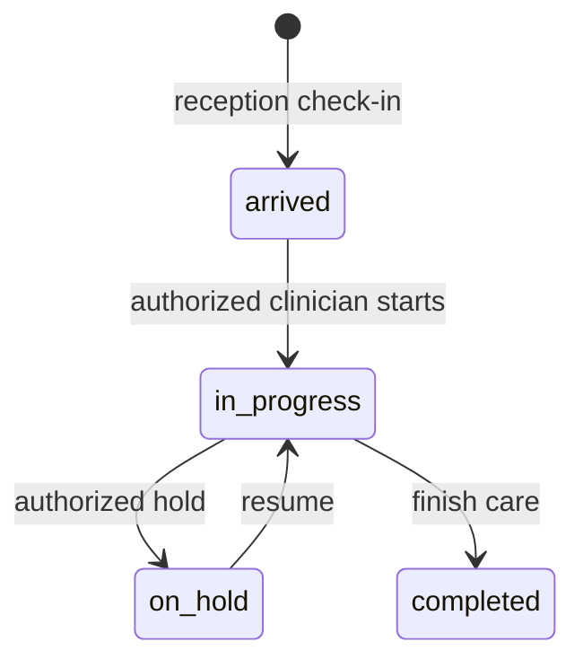

# Receptionist / Cashier

Snapshot: **2026-10-31**, repository source audit. No application code or live database was changed. “Source-confirmed” describes inspected code, not a passed browser, deployment or hospital test. ⚠️ UNVERIFIED = unresolved or untested; 🚧 NOT IMPLEMENTED = absent from the inspected ownership/routes; 🐞 SUSPECTED BUG = evidence needs a focused reproduction. Testing VPS and legacy LAN deployments are distinct. Actual VPS state and actual hospital configuration are not inferred from this checkout.

## 1. Purpose — who this person is in the hospital

Registration, visits, billing, payments. No clinical access. This is a **system role**, not an HR Position. An Employee's job title grants no access by itself; an AppUser must hold this role through UserRole. `apps/api/src/auth/permissions.ts:50`; `apps/api/prisma/schema.prisma:967`.

## 2. Responsibilities — daily / per-shift / monthly

The procedures below describe the coded work this role supports. Daily: check assigned work and correct patient/source identity before saving. Per shift: hand over unresolved work and sign out of shared devices. Monthly: review unresolved exceptions with the designated supervisor. These frequencies are **recommended SOP assignments, ⚠️ not application-enforced duties**. The hospital must approve ownership and cadence. Capability source: `apps/web/src/pages/ReceptionPage.tsx:1`.

## 3. Prerequisites — before this person can work

An active User, facility, password change completion and the listed permission grants are required. Optional module screens also require enablement. Clinical accounts created through Users are refused; use Employee-linked onboarding for Doctor, Nurse, Lab technician and Pharmacist. HR self service requires an Employee link even for nonclinical accounts. Doctor accounts additionally require a clinical Position and linked Practitioner/department membership. Required workflow-specific catalogs and balances are in [the dependency matrix](../03-dependency-matrix.md). `apps/api/src/common/guards/jwt-auth.guard.ts:1`; `apps/api/src/modules/users/users.service.ts:73`; `apps/api/src/modules/staff/staff.service.ts:566`.

## 4. Permissions

Each cell lists exact permission codes, rather than implying every action in a module is allowed. Verb grouping is for reading only; some permissions appear in more than one column. Conditional rules and all denied permissions are in [the master matrix](../07-permission-matrix.md). Database grant drift is ⚠️ UNVERIFIED on the VPS.

| Module | View | Create | Edit | Delete/Cancel | Approve | Print/Export | Source (file:line) |
| --- | --- | --- | --- | --- | --- | --- | --- |
| reception | reception.read | No matching grant | No matching grant | No matching grant | No matching grant | No matching grant | apps/api/src/auth/permissions.ts:121; apps/api/src/auth/permissions.ts:122 |
| hr | hr.roster.view; hr.self.view | hr.leave.request | No matching grant | No matching grant | No matching grant | No matching grant | apps/api/src/auth/permissions.ts:136; apps/api/src/auth/permissions.ts:142; apps/api/src/auth/permissions.ts:148 |
| crm | No matching grant | No matching grant | No matching grant | No matching grant | No matching grant | No matching grant | Denied by absence: `apps/api/src/auth/permissions.ts:1` |
| payroll | No matching grant | No matching grant | No matching grant | No matching grant | No matching grant | No matching grant | Denied by absence: `apps/api/src/auth/permissions.ts:1` |
| finance | No matching grant | No matching grant | No matching grant | No matching grant | No matching grant | No matching grant | Denied by absence: `apps/api/src/auth/permissions.ts:1` |
| auth | auth.login; auth.me | No matching grant | No matching grant | No matching grant | No matching grant | No matching grant | apps/api/src/auth/permissions.ts:199; apps/api/src/auth/permissions.ts:222 |
| user | No matching grant | No matching grant | No matching grant | No matching grant | No matching grant | No matching grant | Denied by absence: `apps/api/src/auth/permissions.ts:1` |
| role | No matching grant | No matching grant | No matching grant | No matching grant | No matching grant | No matching grant | Denied by absence: `apps/api/src/auth/permissions.ts:1` |
| facility | No matching grant | No matching grant | No matching grant | No matching grant | No matching grant | No matching grant | Denied by absence: `apps/api/src/auth/permissions.ts:1` |
| department | No matching grant | No matching grant | No matching grant | No matching grant | No matching grant | No matching grant | Denied by absence: `apps/api/src/auth/permissions.ts:1` |
| room | No matching grant | No matching grant | No matching grant | No matching grant | No matching grant | No matching grant | Denied by absence: `apps/api/src/auth/permissions.ts:1` |
| practitioner | No matching grant | No matching grant | No matching grant | No matching grant | No matching grant | No matching grant | Denied by absence: `apps/api/src/auth/permissions.ts:1` |
| service | No matching grant | No matching grant | No matching grant | No matching grant | No matching grant | No matching grant | Denied by absence: `apps/api/src/auth/permissions.ts:1` |
| price | No matching grant | No matching grant | No matching grant | No matching grant | No matching grant | No matching grant | Denied by absence: `apps/api/src/auth/permissions.ts:1` |
| drug | No matching grant | No matching grant | No matching grant | No matching grant | No matching grant | No matching grant | Denied by absence: `apps/api/src/auth/permissions.ts:1` |
| labtest | No matching grant | No matching grant | No matching grant | No matching grant | No matching grant | No matching grant | Denied by absence: `apps/api/src/auth/permissions.ts:1` |
| panel | No matching grant | No matching grant | No matching grant | No matching grant | No matching grant | No matching grant | Denied by absence: `apps/api/src/auth/permissions.ts:1` |
| template | No matching grant | No matching grant | No matching grant | No matching grant | No matching grant | No matching grant | Denied by absence: `apps/api/src/auth/permissions.ts:1` |
| setting | No matching grant | No matching grant | No matching grant | No matching grant | No matching grant | No matching grant | Denied by absence: `apps/api/src/auth/permissions.ts:1` |
| patient | patient.search; patient.read_demographics | patient.create | patient.edit_demographics | No matching grant | No matching grant | No matching grant | apps/api/src/auth/permissions.ts:288; apps/api/src/auth/permissions.ts:289; apps/api/src/auth/permissions.ts:301; apps/api/src/auth/permissions.ts:307 |
| allergy | No matching grant | No matching grant | No matching grant | No matching grant | No matching grant | No matching grant | Denied by absence: `apps/api/src/auth/permissions.ts:1` |
| visit | visit.read_queue | visit.create | visit.reassign_practitioner (R5) | visit.cancel (R5) | No matching grant | No matching grant | apps/api/src/auth/permissions.ts:347; apps/api/src/auth/permissions.ts:348; apps/api/src/auth/permissions.ts:376; apps/api/src/auth/permissions.ts:382 |
| appointment | appointment.read | appointment.create | appointment.mark_no_show | appointment.cancel | No matching grant | No matching grant | apps/api/src/auth/permissions.ts:394; apps/api/src/auth/permissions.ts:400; apps/api/src/auth/permissions.ts:407; apps/api/src/auth/permissions.ts:413 |
| vitals | No matching grant | No matching grant | No matching grant | No matching grant | No matching grant | No matching grant | Denied by absence: `apps/api/src/auth/permissions.ts:1` |
| diagnosis | No matching grant | No matching grant | No matching grant | No matching grant | No matching grant | No matching grant | Denied by absence: `apps/api/src/auth/permissions.ts:1` |
| clinical_note | No matching grant | No matching grant | No matching grant | No matching grant | No matching grant | No matching grant | Denied by absence: `apps/api/src/auth/permissions.ts:1` |
| attachment | No matching grant | No matching grant | No matching grant | No matching grant | No matching grant | No matching grant | Denied by absence: `apps/api/src/auth/permissions.ts:1` |
| prescription | No matching grant | No matching grant | No matching grant | No matching grant | No matching grant | prescription.print | apps/api/src/auth/permissions.ts:436 |
| interaction | No matching grant | No matching grant | No matching grant | No matching grant | No matching grant | No matching grant | Denied by absence: `apps/api/src/auth/permissions.ts:1` |
| follow_up | follow_up.read | No matching grant | No matching grant | No matching grant | No matching grant | No matching grant | apps/api/src/auth/permissions.ts:469 |
| lab_order | lab_order.read_queue (R8) | No matching grant | No matching grant | No matching grant | No matching grant | No matching grant | apps/api/src/auth/permissions.ts:481 |
| lab | No matching grant | No matching grant | No matching grant | No matching grant | No matching grant | lab.print_result | apps/api/src/auth/permissions.ts:487 |
| lab_result | No matching grant | No matching grant | No matching grant | No matching grant | No matching grant | No matching grant | Denied by absence: `apps/api/src/auth/permissions.ts:1` |
| pharmacy | No matching grant | No matching grant | No matching grant | No matching grant | No matching grant | No matching grant | Denied by absence: `apps/api/src/auth/permissions.ts:1` |
| invoice | invoice.read | invoice.create | No matching grant | No matching grant | No matching grant | invoice.print | apps/api/src/auth/permissions.ts:498; apps/api/src/auth/permissions.ts:503; apps/api/src/auth/permissions.ts:517 |
| payment | No matching grant | payment.receive | No matching grant | payment.refund (R5) | No matching grant | No matching grant | apps/api/src/auth/permissions.ts:518; apps/api/src/auth/permissions.ts:519 |
| refund | No matching grant | No matching grant | No matching grant | No matching grant | No matching grant | refund.print | apps/api/src/auth/permissions.ts:520 |
| discount | No matching grant | No matching grant | No matching grant | No matching grant | No matching grant | No matching grant | apps/api/src/auth/permissions.ts:522 |
| lab_charge | lab_charge.read | lab_charge.collect | No matching grant | No matching grant | No matching grant | No matching grant | apps/api/src/auth/permissions.ts:533; apps/api/src/auth/permissions.ts:534 |
| report | report.operational (R8) | No matching grant | No matching grant | No matching grant | No matching grant | No matching grant | apps/api/src/auth/permissions.ts:538 |
| audit_log | No matching grant | No matching grant | No matching grant | No matching grant | No matching grant | No matching grant | Denied by absence: `apps/api/src/auth/permissions.ts:1` |
| error_log | No matching grant | No matching grant | No matching grant | No matching grant | No matching grant | No matching grant | Denied by absence: `apps/api/src/auth/permissions.ts:1` |
| data | No matching grant | No matching grant | No matching grant | No matching grant | No matching grant | No matching grant | Denied by absence: `apps/api/src/auth/permissions.ts:1` |

## 5. What they CANNOT do (and who does it instead)

Anything absent from this role's grants is denied, including on a screen reached by manually entering its URL. Multiple roles may expand authority; this document assumes this role alone. Admin manages configuration and users; receptionist registers patients and takes lab collections; doctor writes diagnoses/notes/prescriptions; lab_tech enters/verifies lab results; pharmacist confirms medicine handover; finance roles follow independent approval and posting checks. **Admin alone is not a clinical author.** Exact exceptions and conditions: `apps/api/src/auth/permissions.ts:1`; `apps/api/src/common/guards/permissions.guard.ts:1`.

## 6. Screens they use — navigation path

English menu labels below come from the locale file. The Main group has no translated heading in the current English dictionary. Listed visibility does not prove every button is authorized. `apps/web/src/i18n/locales/en.json:1`.

| Menu group › item | URL | Module prerequisite | Source |
| --- | --- | --- | --- |
| Administration › Human resources | /hr | hr | `apps/web/src/auth/nav.ts:1` |
| Main › Dashboard | / | Core | `apps/web/src/auth/nav.ts:1` |
| Clinical › Reception | /reception | Core | `apps/web/src/auth/nav.ts:1` |
| Clinical › Reception operations | /reception/operations | Core | `apps/web/src/auth/nav.ts:1` |
| Clinical › Queue | /queue | Core | `apps/web/src/auth/nav.ts:1` |
| Clinical › Appointments | /appointments | Core | `apps/web/src/auth/nav.ts:1` |
| Clinical › Patients | /patients | Core | `apps/web/src/auth/nav.ts:1` |
| Clinical › Follow-ups | /follow-ups | Core | `apps/web/src/auth/nav.ts:1` |
| Administration › Collections | /collections | Core | `apps/web/src/auth/nav.ts:1` |
| Administration › Till | /till | Core | `apps/web/src/auth/nav.ts:1` |
| Administration › Reports | /reports | Core | `apps/web/src/auth/nav.ts:1` |

## 7. Button & action reference

These are source locations on menu-linked or permission-linked screens, including reusable controls. **Rows are an inventory, not a grant.** Read the endpoint permission against Section 4; branch-dependent visibility not proven for this role is ⚠️ UNVERIFIED. Administrator includes the complete UI inventory to guarantee no source location is silently omitted, including clinical controls the administrator cannot use. Side effects are direct static service effects; nested helpers may add effects. Runtime behavior and physical printing are not verified by this table.

| ID / source | Screen / component | Button / action (English; Dari where available) | Where | What it does / handler | Preconditions / disabled when | Side effects / trace evidence | Reversible? how | API endpoint | Permission required | Audited? |
| --- | --- | --- | --- | --- | --- | --- | --- | --- | --- | --- |
| A0001 apps/web/src/AppRoot.tsx:23 | AppRoot | FirstRunLanguagePicker | AppRoot / FirstRunLanguagePicker | Local handler / ⚠️ semantic review; onChosen: {() => setHasChosen(true)} | No explicit disabled attribute; surrounding conditions: !hasChosen ? ( <FirstRunLanguagePicker onChosen={() => setHasChosen(true)} /> ) : ( <QueryClientProvider client={queryClient}> {/* AuthProvider above the router: the route components (ProtectedRoute, | ⚠️ UNVERIFIED: inspect handler and linked API call inventory | ⚠️ Use documented cancel/reversal workflow; no generic undo | No statically resolved endpoint | ⚠️ UI local / endpoint-specific; menu is not permission | Local actions have no automatic DB audit; downstream action ⚠️ UNVERIFIED |
| A0010 apps/web/src/components/BookFollowUp.tsx:98 | ConsultPage, PatientDetailPage | Date / Department / Choose a department / With you, when the patient returns. / Doctor / Any doctor / Reason / Could not book that. Nothing was saved. / Booked for {{date}}. / Booking… / Book / تاریخ / بخش / بخش را انتخاب کنید / با شما، وقتی مریض بیرته راشي. / داکتر / هر داکتر / دلیل / ثبت ناکام شد. چیزی ذخیره نشد. / برای {{date}} ثبت شد. / در حال ثبت… / ثبت | BookFollowUp / form | Server request; onSubmit: {onSubmit} | No explicit disabled attribute | apps/api/src/modules/appointment/appointment.service.ts:76; Delegated operation: inspect linked service | ⚠️ Use documented cancel/reversal workflow; no generic undo | POST /appointments (apps/api/src/modules/appointment/appointment.controller.ts:46) | appointment.create | App request context + audited Prisma writes; read audit is endpoint-specific. Root/manual scripts are outside this coverage. |
| A0015 apps/web/src/components/BookFollowUp.tsx:178 | ConsultPage, PatientDetailPage | Booking… / Book / در حال ثبت… / ثبت | BookFollowUp / Button | Server request; {onSubmit} | {create.isPending &#124;&#124; !scheduledOn &#124;&#124; !departmentId} | apps/api/src/modules/appointment/appointment.service.ts:76; Delegated operation: inspect linked service | ⚠️ Use documented cancel/reversal workflow; no generic undo | POST /appointments (apps/api/src/modules/appointment/appointment.controller.ts:46) | appointment.create | App request context + audited Prisma writes; read audit is endpoint-specific. Root/manual scripts are outside this coverage. |
| A0288 apps/web/src/components/FinanceDateInput.tsx:21 | FinancePage, HrPage | "Shamsi date: YYYY-MM-DD (1350–1499)" | FinanceDateInput / Input | Form input / selection; onChange: {(event) => { const entered = event.target.value setEdit({ source: value, text: entered }) try { const converted = shamsiToGregorian(entered) event.target.setCustomValidity('') setEdit(null) onChange(converted) } catch { event.target.setCustomValidity('Enter a valid Shamsi date, for example 1404-07-05.') } }} | No explicit disabled attribute | Changes form selection; persistence occurs on submission | Edit again before saving | No statically resolved endpoint | ⚠️ UI local / endpoint-specific; menu is not permission | Local actions have no automatic DB audit; downstream action ⚠️ UNVERIFIED |
| A0421 apps/web/src/components/FirstRunLanguagePicker.tsx:39 | FirstRunLanguagePicker | {meta.nativeName} | FirstRunLanguagePicker / button | Local handler / ⚠️ semantic review; onClick: {() => choose(code)} | No explicit disabled attribute | ⚠️ UNVERIFIED: inspect handler and linked API call inventory | ⚠️ Use documented cancel/reversal workflow; no generic undo | No statically resolved endpoint | ⚠️ UI local / endpoint-specific; menu is not permission | Local actions have no automatic DB audit; downstream action ⚠️ UNVERIFIED |
| A0428 apps/web/src/components/InvoiceDetailView.tsx:84 | CollectionsPage, InvoicesPage, PharmacyPage | Back to invoices / بازگشت به صورت‌حساب‌ها | InvoiceDetailView / Button | Local handler / ⚠️ semantic review; onClick: {onBack} | No explicit disabled attribute | ⚠️ UNVERIFIED: inspect handler and linked API call inventory | ⚠️ Use documented cancel/reversal workflow; no generic undo | No statically resolved endpoint | ⚠️ UI local / endpoint-specific; menu is not permission | Local actions have no automatic DB audit; downstream action ⚠️ UNVERIFIED |
| A0429 apps/web/src/components/InvoiceDetailView.tsx:89 | CollectionsPage, InvoicesPage, PharmacyPage | Reprint receipt / چاپ دوباره رسید | InvoiceDetailView / Button | Browser print; onClick: {() => window.print()} | No explicit disabled attribute; surrounding conditions: canPrint && detail && ( <Button onClick={() => window.print()}> <Printer className="size-4" aria-hidden /> {t('invoices.reprint')} </Button> ) | ⚠️ UNVERIFIED: inspect handler and linked API call inventory | ⚠️ Use documented cancel/reversal workflow; no generic undo | No statically resolved endpoint | ⚠️ UI local / endpoint-specific; menu is not permission | Local actions have no automatic DB audit; downstream action ⚠️ UNVERIFIED |
| A0430 apps/web/src/components/InvoiceDetailView.tsx:116 | CollectionsPage, InvoicesPage, PharmacyPage | VisitBillsPanel | InvoiceDetailView / VisitBillsPanel | Local handler / ⚠️ semantic review; onOpen: {onOpen} | No explicit disabled attribute; surrounding conditions: detail.visit && ( <VisitBillsPanel visitId={detail.visit.id} currentInvoiceId={invoiceId} onOpen={onOpen} /> ); detail && ( <> {outstanding && ( 
 <Badge variant="warning"> {t('invoices.outstanding', { amount: outstanding, curr | ⚠️ UNVERIFIED: inspect handler and linked API call inventory | ⚠️ Use documented cancel/reversal workflow; no generic undo | No statically resolved endpoint | ⚠️ UI local / endpoint-specific; menu is not permission | Local actions have no automatic DB audit; downstream action ⚠️ UNVERIFIED |
| A0431 apps/web/src/components/InvoiceDetailView.tsx:148 | CollectionsPage, InvoicesPage, PharmacyPage | LabLinePaymentForm | InvoiceDetailView / LabLinePaymentForm | Local handler / ⚠️ semantic review; onPaid: {(amount) => setLastReceipt({ // The per-line lab endpoint settles the cash but does not issue a // receipt number the way the general till does, and — because only the // ticked lines were paid — this view has no cheap way to know whether // that closed the whole bill until the invoice refetches. receiptNo: null, amount, currency: detail.invoice.currency, settled: false, }) } | No explicit disabled attribute; surrounding conditions: detail.invoice.origin === 'lab' ? ( <LabLinePaymentForm invoiceId={invoiceId} patientId={detail.patient.id} items={detail.invoice.items} onPaid={(amount) => ; canReceive && outstanding && detail.invoice.status !== 'cancelled' && (detail.invoice.origin === 'lab' ? ( <LabLinePaymentForm invoiceId={invoiceId} patientId; detail && ( <> {outstanding && ( 
 <Badge variant="warning"> {t('invoices.outstanding', { amount: outstanding, curr | ⚠️ UNVERIFIED: inspect handler and linked API call inventory | ⚠️ Use documented cancel/reversal workflow; no generic undo | No statically resolved endpoint | ⚠️ UI local / endpoint-specific; menu is not permission | Local actions have no automatic DB audit; downstream action ⚠️ UNVERIFIED |
| A0432 apps/web/src/components/InvoiceDetailView.tsx:166 | CollectionsPage, InvoicesPage, PharmacyPage | PaymentForm | InvoiceDetailView / PaymentForm | Local handler / ⚠️ semantic review; onPaid: {(r) => setLastReceipt({ receiptNo: r.payment.receiptNo, amount: r.payment.amount, currency: r.currency, settled: r.status === 'paid', }) } | No explicit disabled attribute; surrounding conditions: detail.invoice.origin === 'lab' ? ( <LabLinePaymentForm invoiceId={invoiceId} patientId={detail.patient.id} items={detail.invoice.items} onPaid={(amount) => ; canReceive && outstanding && detail.invoice.status !== 'cancelled' && (detail.invoice.origin === 'lab' ? ( <LabLinePaymentForm invoiceId={invoiceId} patientId; detail && ( <> {outstanding && ( 
 <Badge variant="warning"> {t('invoices.outstanding', { amount: outstanding, curr | ⚠️ UNVERIFIED: inspect handler and linked API call inventory | ⚠️ Use documented cancel/reversal workflow; no generic undo | No statically resolved endpoint | ⚠️ UI local / endpoint-specific; menu is not permission | Local actions have no automatic DB audit; downstream action ⚠️ UNVERIFIED |
| A0433 apps/web/src/components/InvoiceDetailView.tsx:181 | CollectionsPage, InvoicesPage, PharmacyPage | PaymentsPanel | InvoiceDetailView / PaymentsPanel | Local handler / ⚠️ semantic review; onRefunded: {setRefundSlip} | No explicit disabled attribute; surrounding conditions: detail.payments.length > 0 && ( <PaymentsPanel invoiceId={invoiceId} payments={detail.payments} currency={detail.invoice.currency} canRefund={canRefund} onRef; detail && ( <> {outstanding && ( 
 <Badge variant="warning"> {t('invoices.outstanding', { amount: outstanding, curr | ⚠️ UNVERIFIED: inspect handler and linked API call inventory | ⚠️ Use documented cancel/reversal workflow; no generic undo | No statically resolved endpoint | ⚠️ UI local / endpoint-specific; menu is not permission | Local actions have no automatic DB audit; downstream action ⚠️ UNVERIFIED |
| A0434 apps/web/src/components/InvoiceDetailView.tsx:190 | CollectionsPage, InvoicesPage, PharmacyPage | RefundSlip | InvoiceDetailView / RefundSlip | Local handler / ⚠️ semantic review; onDone: {() => setRefundSlip(null)} | No explicit disabled attribute; surrounding conditions: refundSlip && ( <RefundSlip slip={refundSlip} facilityName={detail.facility.name} patientName={detail.patient.name} patientMrn={detail.patient.mrn} invoiceNo=; detail && ( <> {outstanding && ( 
 <Badge variant="warning"> {t('invoices.outstanding', { amount: outstanding, curr | ⚠️ UNVERIFIED: inspect handler and linked API call inventory | ⚠️ Use documented cancel/reversal workflow; no generic undo | No statically resolved endpoint | ⚠️ UI local / endpoint-specific; menu is not permission | Local actions have no automatic DB audit; downstream action ⚠️ UNVERIFIED |
| A0435 apps/web/src/components/InvoiceDetailView.tsx:250 | CollectionsPage, InvoicesPage, PharmacyPage | VisitBillRow | VisitBillsPanel / VisitBillRow | Local handler / ⚠️ semantic review; onOpen: {() => onOpen(bill.id)} | No explicit disabled attribute | ⚠️ UNVERIFIED: inspect handler and linked API call inventory | ⚠️ Use documented cancel/reversal workflow; no generic undo | No statically resolved endpoint | ⚠️ UI local / endpoint-specific; menu is not permission | Local actions have no automatic DB audit; downstream action ⚠️ UNVERIFIED |
| A0436 apps/web/src/components/InvoiceDetailView.tsx:300 | CollectionsPage, InvoicesPage, PharmacyPage | {{amount}} owed / {{amount}} باقی | VisitBillRow / button | Local handler / ⚠️ semantic review; onClick: {isCurrent ? undefined : onOpen} | No explicit disabled attribute | ⚠️ UNVERIFIED: inspect handler and linked API call inventory | ⚠️ Use documented cancel/reversal workflow; no generic undo | No statically resolved endpoint | ⚠️ UI local / endpoint-specific; menu is not permission | Local actions have no automatic DB audit; downstream action ⚠️ UNVERIFIED |
| A0437 apps/web/src/components/InvoiceDetailView.tsx:380 | CollectionsPage, InvoicesPage, PharmacyPage | toggle(item.refId!)} /> {item.description} | LabLinePaymentForm / input | Form input / selection; onChange: {() => toggle(item.refId!)} | {pay.isPending}; surrounding conditions: item.isPaid &#124;&#124; !item.refId ? (  {item.description}  ) : ( <label className="flex flex-1 items-center ga | Changes form selection; persistence occurs on submission | Edit again before saving | No statically resolved endpoint | ⚠️ UI local / endpoint-specific; menu is not permission | Local actions have no automatic DB audit; downstream action ⚠️ UNVERIFIED |
| A0438 apps/web/src/components/InvoiceDetailView.tsx:403 | CollectionsPage, InvoicesPage, PharmacyPage | Method / روش | LabLinePaymentForm / Select | Form input / selection; onChange: {(e) => setMethod(e.target.value as PaymentMethod)} | No explicit disabled attribute | Changes form selection; persistence occurs on submission | Edit again before saving | No statically resolved endpoint | ⚠️ UI local / endpoint-specific; menu is not permission | Local actions have no automatic DB audit; downstream action ⚠️ UNVERIFIED |
| A0439 apps/web/src/components/InvoiceDetailView.tsx:415 | CollectionsPage, InvoicesPage, PharmacyPage | Collecting… / Collect {{amount}} / در حال دریافت… / دریافت {{amount}} | LabLinePaymentForm / Button | Server request; onClick: {() => pay.mutate( { itemIds: chosen.map((i) => i.refId!), method }, { onSuccess: (r) => onPaid(r.amount) }, ) } | {chosen.length === 0 &#124;&#124; pay.isPending} | apps/api/src/modules/lab-billing/lab-billing.service.ts:141; invoiceItem.findMany, invoiceItem.count, invoiceItem.update, invoice.update, payment.create | ⚠️ Use documented cancel/reversal workflow; no generic undo | POST /lab-charges/pay (apps/api/src/modules/lab-billing/lab-billing.controller.ts:46) | lab_charge.collect | App request context + audited Prisma writes; read audit is endpoint-specific. Root/manual scripts are outside this coverage. |
| A0440 apps/web/src/components/InvoiceDetailView.tsx:518 | CollectionsPage, InvoicesPage, PharmacyPage | Discount amount / Reason / Why the bill is reduced (required) / Applying… / Apply discount / مبلغ تخفیف / دلیل / دلیل کاهش صورت‌حساب (الزامی) / در حال اعمال… / اعمال تخفیف | DiscountForm / form | Server request; onSubmit: {submit} | No explicit disabled attribute | apps/api/src/modules/invoice/discount.service.ts:43; invoice.findFirst, invoice.update, invoiceItem.updateMany | ⚠️ Use documented cancel/reversal workflow; no generic undo | POST /invoices/:id/discount (apps/api/src/modules/invoice/invoice.controller.ts:165) | discount.apply | App request context + audited Prisma writes; read audit is endpoint-specific. Root/manual scripts are outside this coverage. |
| A0441 apps/web/src/components/InvoiceDetailView.tsx:523 | CollectionsPage, InvoicesPage, PharmacyPage | Discount amount / مبلغ تخفیف | DiscountForm / Input | Form input / selection; onChange: {(e) => setAmount(e.target.value)} | No explicit disabled attribute | Changes form selection; persistence occurs on submission | Edit again before saving | No statically resolved endpoint | ⚠️ UI local / endpoint-specific; menu is not permission | Local actions have no automatic DB audit; downstream action ⚠️ UNVERIFIED |
| A0442 apps/web/src/components/InvoiceDetailView.tsx:536 | CollectionsPage, InvoicesPage, PharmacyPage | Reason / Why the bill is reduced (required) / دلیل / دلیل کاهش صورت‌حساب (الزامی) | DiscountForm / Input | Form input / selection; onChange: {(e) => setReason(e.target.value)} | No explicit disabled attribute | Changes form selection; persistence occurs on submission | Edit again before saving | No statically resolved endpoint | ⚠️ UI local / endpoint-specific; menu is not permission | Local actions have no automatic DB audit; downstream action ⚠️ UNVERIFIED |
| A0443 apps/web/src/components/InvoiceDetailView.tsx:544 | CollectionsPage, InvoicesPage, PharmacyPage | Applying… / Apply discount / در حال اعمال… / اعمال تخفیف | DiscountForm / Button | Server request; {submit} | {!valid &#124;&#124; apply.isPending}; surrounding conditions: !showApproval && ( <Button type="submit" variant="outline" disabled={!valid &#124;&#124; apply.isPending}> {apply.isPending ? t('discount.applying') : t('discount.apply')} </Button> ) | apps/api/src/modules/invoice/discount.service.ts:43; invoice.findFirst, invoice.update, invoiceItem.updateMany | ⚠️ Use documented cancel/reversal workflow; no generic undo | POST /invoices/:id/discount (apps/api/src/modules/invoice/invoice.controller.ts:165) | discount.apply | App request context + audited Prisma writes; read audit is endpoint-specific. Root/manual scripts are outside this coverage. |
| A0444 apps/web/src/components/InvoiceDetailView.tsx:551 | CollectionsPage, InvoicesPage, PharmacyPage | Over 10% — an administrator must approve this discount. / Admin username / Admin password / Applying… / Approve & apply / بیش از ۱۰٪ — یک مدیر باید این تخفیف را تأیید کند. / نام کاربری مدیر / رمز عبور مدیر / در حال اعمال… / تأیید و اعمال | DiscountForm / form | Server request; onSubmit: {submit} | No explicit disabled attribute; surrounding conditions: showApproval && ( <form onSubmit={submit} className="space-y-2 rounded-md border border-warning/40 p-3"> 
{t('discount.approvalNeeded')}
 
 setApproverUsername(e.target.value)} | No explicit disabled attribute; surrounding conditions: showApproval && ( <form onSubmit={submit} className="space-y-2 rounded-md border border-warning/40 p-3"> 
{t('discount.approvalNeeded')}
 
 setApproverPassword(e.target.value)} | No explicit disabled attribute; surrounding conditions: showApproval && ( <form onSubmit={submit} className="space-y-2 rounded-md border border-warning/40 p-3"> 
{t('discount.approvalNeeded')}
 
 
{t('discount.approvalNeeded')}
 
 { setOpenFor(openFor === p.id ? null : p.id) setReason('') }} | No explicit disabled attribute; surrounding conditions: refundable ? ( <Button variant="ghost" className="h-7 px-2 text-xs" onClick={() => { setOpenFor(openFor === p.id ? null : p.id) ; p.isReversed ? ( <Badge variant="muted">{t('refund.reversed')}</Badge> ) : refundable ? ( <Button variant="ghost" className="h-7 px-2 text-xs" ; isRefundRow ? ( <Badge variant="danger">{t('refund.refundRow')}</Badge> ) : p.isReversed ? ( <Badge variant="muted">{t('refund.reversed')}</Badge> ) : refundable ? ( | ⚠️ UNVERIFIED: inspect handler and linked API call inventory | ⚠️ Use documented cancel/reversal workflow; no generic undo | No statically resolved endpoint | ⚠️ UI local / endpoint-specific; menu is not permission | Local actions have no automatic DB audit; downstream action ⚠️ UNVERIFIED |
| A0449 apps/web/src/components/InvoiceDetailView.tsx:715 | CollectionsPage, InvoicesPage, PharmacyPage | Reason for the refund (required) / Refunding… / Confirm refund / دلیل بازپرداخت (الزامی) / در حال بازپرداخت… / تأیید بازپرداخت | PaymentsPanel / Input | Form input / selection; onChange: {(e) => setReason(e.target.value)} | No explicit disabled attribute; surrounding conditions: openFor === p.id && ( 
 <Input value={reason} onChange={(e) => setReason(e.target.value)} placehold | Changes form selection; persistence occurs on submission | Edit again before saving | No statically resolved endpoint | ⚠️ UI local / endpoint-specific; menu is not permission | Local actions have no automatic DB audit; downstream action ⚠️ UNVERIFIED |
| A0450 apps/web/src/components/InvoiceDetailView.tsx:722 | CollectionsPage, InvoicesPage, PharmacyPage | Refunding… / Confirm refund / در حال بازپرداخت… / تأیید بازپرداخت | PaymentsPanel / Button | Server request; onClick: {() => submit(p.id)} | {reason.trim().length < 3 &#124;&#124; refund.isPending}; surrounding conditions: openFor === p.id && ( 
 <Input value={reason} onChange={(e) => setReason(e.target.value)} placehold | apps/api/src/modules/invoice/payment.service.ts:169; payment.findFirst, payment.updateMany, payment.create, invoice.update, invoiceItem.updateMany | ⚠️ Use documented cancel/reversal workflow; no generic undo | POST /invoices/:id/payments/:paymentId/refund (apps/api/src/modules/invoice/invoice.controller.ts:132) | payment.refund | App request context + audited Prisma writes; read audit is endpoint-specific. Root/manual scripts are outside this coverage. |
| A0451 apps/web/src/components/InvoiceDetailView.tsx:767 | CollectionsPage, InvoicesPage, PharmacyPage | Print refund slip / چاپ رسید بازپرداخت | RefundSlip / Button | Browser print; onClick: {() => window.print()} | No explicit disabled attribute; surrounding conditions: canPrint && ( <Button onClick={() => window.print()}> <Printer className="size-4" aria-hidden /> {t('refund.print')} </Button> ) | ⚠️ UNVERIFIED: inspect handler and linked API call inventory | ⚠️ Use documented cancel/reversal workflow; no generic undo | No statically resolved endpoint | ⚠️ UI local / endpoint-specific; menu is not permission | Local actions have no automatic DB audit; downstream action ⚠️ UNVERIFIED |
| A0452 apps/web/src/components/InvoiceDetailView.tsx:772 | CollectionsPage, InvoicesPage, PharmacyPage | Done / انجام شد | RefundSlip / Button | Local handler / ⚠️ semantic review; onClick: {onDone} | No explicit disabled attribute | ⚠️ UNVERIFIED: inspect handler and linked API call inventory | ⚠️ Use documented cancel/reversal workflow; no generic undo | No statically resolved endpoint | ⚠️ UI local / endpoint-specific; menu is not permission | Local actions have no automatic DB audit; downstream action ⚠️ UNVERIFIED |
| A0455 apps/web/src/components/LabChargesCard.tsx:128 | PatientDetailPage | Collecting… / Collect {{amount}} / در حال دریافت… / دریافت {{amount}} | ChargeOrder / Button | Server request; onClick: {() => pay.mutate({ itemIds: chosen.map((i) => i.itemId), method }) } | {chosen.length === 0 &#124;&#124; pay.isPending}; surrounding conditions: mayPay && unpaid.length > 0 && ( 
 <Select aria-label={t('labCharges.method')} value={method} onChange={(e) => setMethod(e.target.value | apps/api/src/modules/lab-billing/lab-billing.service.ts:141; invoiceItem.findMany, invoiceItem.count, invoiceItem.update, invoice.update, payment.create | ⚠️ Use documented cancel/reversal workflow; no generic undo | POST /lab-charges/pay (apps/api/src/modules/lab-billing/lab-billing.controller.ts:46) | lab_charge.collect | App request context + audited Prisma writes; read audit is endpoint-specific. Root/manual scripts are outside this coverage. |
| A0464 apps/web/src/components/LanguageToggle.tsx:30 | LanguageToggle | {meta.nativeName} | LanguageToggle / button | Local handler / ⚠️ semantic review; onClick: {() => select(code)} | No explicit disabled attribute | ⚠️ UNVERIFIED: inspect handler and linked API call inventory | ⚠️ Use documented cancel/reversal workflow; no generic undo | No statically resolved endpoint | ⚠️ UI local / endpoint-specific; menu is not permission | Local actions have no automatic DB audit; downstream action ⚠️ UNVERIFIED |
| A0477 apps/web/src/components/PatientFormFields.tsx:66 | CrmPage, PatientDetailPage, ReceptionPage | {label} onChange(toWesternDigits(e.target.value).replace(/[^\d]/g, ''))} /> | AgeBox / Input | Form input / selection; onChange: {(e) => onChange(toWesternDigits(e.target.value).replace(/[^\d]/g, ''))} | No explicit disabled attribute | Changes form selection; persistence occurs on submission | Edit again before saving | No statically resolved endpoint | ⚠️ UI local / endpoint-specific; menu is not permission | Local actions have no automatic DB audit; downstream action ⚠️ UNVERIFIED |
| A0478 apps/web/src/components/PatientFormFields.tsx:110 | CrmPage, PatientDetailPage, ReceptionPage | set('firstName', e.target.value)} /> | PatientFormFields / Input | Form input / selection; onChange: {(e) => set('firstName', e.target.value)} | No explicit disabled attribute | Changes form selection; persistence occurs on submission | Edit again before saving | No statically resolved endpoint | ⚠️ UI local / endpoint-specific; menu is not permission | Local actions have no automatic DB audit; downstream action ⚠️ UNVERIFIED |
| A0479 apps/web/src/components/PatientFormFields.tsx:121 | CrmPage, PatientDetailPage, ReceptionPage | Leave blank if the patient has no family name. / اگر بیمار تخلص ندارد، خالی بگذارید. | PatientFormFields / Input | Form input / selection; onChange: {(e) => set('lastName', e.target.value)} | No explicit disabled attribute | Changes form selection; persistence occurs on submission | Edit again before saving | No statically resolved endpoint | ⚠️ UI local / endpoint-specific; menu is not permission | Local actions have no automatic DB audit; downstream action ⚠️ UNVERIFIED |
| A0480 apps/web/src/components/PatientFormFields.tsx:134 | CrmPage, PatientDetailPage, ReceptionPage | {t(`patients.gender.${value}`)} | PatientFormFields / Button | Local handler / ⚠️ semantic review; onClick: {() => set('gender', value)} | No explicit disabled attribute | ⚠️ UNVERIFIED: inspect handler and linked API call inventory | ⚠️ Use documented cancel/reversal workflow; no generic undo | No statically resolved endpoint | ⚠️ UI local / endpoint-specific; menu is not permission | Local actions have no automatic DB audit; downstream action ⚠️ UNVERIFIED |
| A0481 apps/web/src/components/PatientFormFields.tsx:151 | CrmPage, PatientDetailPage, ReceptionPage | set('ageYears', value)} /> set('ageMonths', value)} /> set('ageDays', value)} /> | PatientFormFields / AgeBox | Local handler / ⚠️ semantic review; onChange: {(value) => set('ageYears', value)} | No explicit disabled attribute | ⚠️ UNVERIFIED: inspect handler and linked API call inventory | ⚠️ Use documented cancel/reversal workflow; no generic undo | No statically resolved endpoint | ⚠️ UI local / endpoint-specific; menu is not permission | Local actions have no automatic DB audit; downstream action ⚠️ UNVERIFIED |
| A0482 apps/web/src/components/PatientFormFields.tsx:158 | CrmPage, PatientDetailPage, ReceptionPage | set('ageYears', value)} /> set('ageMonths', value)} /> set('ageDays', value)} /> | PatientFormFields / AgeBox | Local handler / ⚠️ semantic review; onChange: {(value) => set('ageMonths', value)} | No explicit disabled attribute | ⚠️ UNVERIFIED: inspect handler and linked API call inventory | ⚠️ Use documented cancel/reversal workflow; no generic undo | No statically resolved endpoint | ⚠️ UI local / endpoint-specific; menu is not permission | Local actions have no automatic DB audit; downstream action ⚠️ UNVERIFIED |
| A0483 apps/web/src/components/PatientFormFields.tsx:165 | CrmPage, PatientDetailPage, ReceptionPage | set('ageYears', value)} /> set('ageMonths', value)} /> set('ageDays', value)} /> | PatientFormFields / AgeBox | Local handler / ⚠️ semantic review; onChange: {(value) => set('ageDays', value)} | No explicit disabled attribute | ⚠️ UNVERIFIED: inspect handler and linked API call inventory | ⚠️ Use documented cancel/reversal workflow; no generic undo | No statically resolved endpoint | ⚠️ UI local / endpoint-specific; menu is not permission | Local actions have no automatic DB audit; downstream action ⚠️ UNVERIFIED |
| A0484 apps/web/src/components/PatientFormFields.tsx:177 | CrmPage, PatientDetailPage, ReceptionPage | {/* dir="ltr" even under RTL — a phone number renders scrambled otherwise. */} set('phone', toWesternDigits(e.target.value))} /> {belowPhone} | PatientFormFields / Input | Form input / selection; onChange: {(e) => set('phone', toWesternDigits(e.target.value))} | No explicit disabled attribute | Changes form selection; persistence occurs on submission | Edit again before saving | No statically resolved endpoint | ⚠️ UI local / endpoint-specific; menu is not permission | Local actions have no automatic DB audit; downstream action ⚠️ UNVERIFIED |
| A0485 apps/web/src/components/PatientFormFields.tsx:192 | CrmPage, PatientDetailPage, ReceptionPage | set('address', e.target.value)} /> | PatientFormFields / Input | Form input / selection; onChange: {(e) => set('address', e.target.value)} | No explicit disabled attribute | Changes form selection; persistence occurs on submission | Edit again before saving | No statically resolved endpoint | ⚠️ UI local / endpoint-specific; menu is not permission | Local actions have no automatic DB audit; downstream action ⚠️ UNVERIFIED |
| A0486 apps/web/src/components/PatientFormFields.tsx:201 | CrmPage, PatientDetailPage, ReceptionPage | More details / معلومات بیشتر | PatientFormFields / button | Local handler / ⚠️ semantic review; onClick: {() => setShowMore((open) => !open)} | No explicit disabled attribute | ⚠️ UNVERIFIED: inspect handler and linked API call inventory | ⚠️ Use documented cancel/reversal workflow; no generic undo | No statically resolved endpoint | ⚠️ UI local / endpoint-specific; menu is not permission | Local actions have no automatic DB audit; downstream action ⚠️ UNVERIFIED |
| A0487 apps/web/src/components/PatientFormFields.tsx:218 | CrmPage, PatientDetailPage, ReceptionPage | set('prefix', e.target.value)} /> | PatientFormFields / Input | Form input / selection; onChange: {(e) => set('prefix', e.target.value)} | No explicit disabled attribute; surrounding conditions: showMore && ( 
 <Field id="prefix" label={t('patients.fields.prefix')}> <Input id="prefix" value={values.prefix} autoComplete | Changes form selection; persistence occurs on submission | Edit again before saving | No statically resolved endpoint | ⚠️ UI local / endpoint-specific; menu is not permission | Local actions have no automatic DB audit; downstream action ⚠️ UNVERIFIED |
| A0488 apps/web/src/components/PatientFormFields.tsx:227 | CrmPage, PatientDetailPage, ReceptionPage | Only if the patient knows it. The age above is enough. / تنها اگر بیمار آن را می‌داند. سن بالا کافی است. | PatientFormFields / Input | Form input / selection; onChange: {(e) => set('dateOfBirth', e.target.value)} | No explicit disabled attribute; surrounding conditions: showMore && ( 
 <Field id="prefix" label={t('patients.fields.prefix')}> <Input id="prefix" value={values.prefix} autoComplete | Changes form selection; persistence occurs on submission | Edit again before saving | No statically resolved endpoint | ⚠️ UI local / endpoint-specific; menu is not permission | Local actions have no automatic DB audit; downstream action ⚠️ UNVERIFIED |
| A0489 apps/web/src/components/PatientFormFields.tsx:238 | CrmPage, PatientDetailPage, ReceptionPage | set('guardianName', e.target.value)} /> | PatientFormFields / Input | Form input / selection; onChange: {(e) => set('guardianName', e.target.value)} | No explicit disabled attribute; surrounding conditions: showMore && ( 
 <Field id="prefix" label={t('patients.fields.prefix')}> <Input id="prefix" value={values.prefix} autoComplete | Changes form selection; persistence occurs on submission | Edit again before saving | No statically resolved endpoint | ⚠️ UI local / endpoint-specific; menu is not permission | Local actions have no automatic DB audit; downstream action ⚠️ UNVERIFIED |
| A0490 apps/web/src/components/PatientFormFields.tsx:247 | CrmPage, PatientDetailPage, ReceptionPage | Not specified / مشخص نشده | PatientFormFields / select | Form input / selection; onChange: {(e) => set('guardianRelation', e.target.value)} | No explicit disabled attribute; surrounding conditions: showMore && ( 
 <Field id="prefix" label={t('patients.fields.prefix')}> <Input id="prefix" value={values.prefix} autoComplete | Changes form selection; persistence occurs on submission | Edit again before saving | No statically resolved endpoint | ⚠️ UI local / endpoint-specific; menu is not permission | Local actions have no automatic DB audit; downstream action ⚠️ UNVERIFIED |
| A0491 apps/web/src/components/PatientFormFields.tsx:263 | CrmPage, PatientDetailPage, ReceptionPage | set('altPhone', toWesternDigits(e.target.value))} /> | PatientFormFields / Input | Form input / selection; onChange: {(e) => set('altPhone', toWesternDigits(e.target.value))} | No explicit disabled attribute; surrounding conditions: showMore && ( 
 <Field id="prefix" label={t('patients.fields.prefix')}> <Input id="prefix" value={values.prefix} autoComplete | Changes form selection; persistence occurs on submission | Edit again before saving | No statically resolved endpoint | ⚠️ UI local / endpoint-specific; menu is not permission | Local actions have no automatic DB audit; downstream action ⚠️ UNVERIFIED |
| A0492 apps/web/src/components/PatientFormFields.tsx:275 | CrmPage, PatientDetailPage, ReceptionPage | set('district', e.target.value)} /> | PatientFormFields / Input | Form input / selection; onChange: {(e) => set('district', e.target.value)} | No explicit disabled attribute; surrounding conditions: showMore && ( 
 <Field id="prefix" label={t('patients.fields.prefix')}> <Input id="prefix" value={values.prefix} autoComplete | Changes form selection; persistence occurs on submission | Edit again before saving | No statically resolved endpoint | ⚠️ UI local / endpoint-specific; menu is not permission | Local actions have no automatic DB audit; downstream action ⚠️ UNVERIFIED |
| A0493 apps/web/src/components/PatientFormFields.tsx:283 | CrmPage, PatientDetailPage, ReceptionPage | set('province', e.target.value)} /> | PatientFormFields / Input | Form input / selection; onChange: {(e) => set('province', e.target.value)} | No explicit disabled attribute; surrounding conditions: showMore && ( 
 <Field id="prefix" label={t('patients.fields.prefix')}> <Input id="prefix" value={values.prefix} autoComplete | Changes form selection; persistence occurs on submission | Edit again before saving | No statically resolved endpoint | ⚠️ UI local / endpoint-specific; menu is not permission | Local actions have no automatic DB audit; downstream action ⚠️ UNVERIFIED |
| A0494 apps/web/src/components/PatientFormFields.tsx:294 | CrmPage, PatientDetailPage, ReceptionPage | set('nationalId', e.target.value)} /> | PatientFormFields / Input | Form input / selection; onChange: {(e) => set('nationalId', e.target.value)} | No explicit disabled attribute; surrounding conditions: showMore && ( 
 <Field id="prefix" label={t('patients.fields.prefix')}> <Input id="prefix" value={values.prefix} autoComplete | Changes form selection; persistence occurs on submission | Edit again before saving | No statically resolved endpoint | ⚠️ UI local / endpoint-specific; menu is not permission | Local actions have no automatic DB audit; downstream action ⚠️ UNVERIFIED |
| A0495 apps/web/src/components/PatientFormFields.tsx:303 | CrmPage, PatientDetailPage, ReceptionPage | set('passportNo', e.target.value)} /> | PatientFormFields / Input | Form input / selection; onChange: {(e) => set('passportNo', e.target.value)} | No explicit disabled attribute; surrounding conditions: showMore && ( 
 <Field id="prefix" label={t('patients.fields.prefix')}> <Input id="prefix" value={values.prefix} autoComplete | Changes form selection; persistence occurs on submission | Edit again before saving | No statically resolved endpoint | ⚠️ UI local / endpoint-specific; menu is not permission | Local actions have no automatic DB audit; downstream action ⚠️ UNVERIFIED |
| A0496 apps/web/src/components/PatientFormFields.tsx:315 | CrmPage, PatientDetailPage, ReceptionPage | set('occupation', e.target.value)} /> | PatientFormFields / Input | Form input / selection; onChange: {(e) => set('occupation', e.target.value)} | No explicit disabled attribute; surrounding conditions: showMore && ( 
 <Field id="prefix" label={t('patients.fields.prefix')}> <Input id="prefix" value={values.prefix} autoComplete | Changes form selection; persistence occurs on submission | Edit again before saving | No statically resolved endpoint | ⚠️ UI local / endpoint-specific; menu is not permission | Local actions have no automatic DB audit; downstream action ⚠️ UNVERIFIED |
| A0497 apps/web/src/components/PatientFormFields.tsx:323 | CrmPage, PatientDetailPage, ReceptionPage | set('nationality', e.target.value)} /> | PatientFormFields / Input | Form input / selection; onChange: {(e) => set('nationality', e.target.value)} | No explicit disabled attribute; surrounding conditions: showMore && ( 
 <Field id="prefix" label={t('patients.fields.prefix')}> <Input id="prefix" value={values.prefix} autoComplete | Changes form selection; persistence occurs on submission | Edit again before saving | No statically resolved endpoint | ⚠️ UI local / endpoint-specific; menu is not permission | Local actions have no automatic DB audit; downstream action ⚠️ UNVERIFIED |
| A0498 apps/web/src/components/PatientFormFields.tsx:333 | CrmPage, PatientDetailPage, ReceptionPage | set('bloodGroup', e.target.value)} /> | PatientFormFields / Input | Form input / selection; onChange: {(e) => set('bloodGroup', e.target.value)} | No explicit disabled attribute; surrounding conditions: showMore && ( 
 <Field id="prefix" label={t('patients.fields.prefix')}> <Input id="prefix" value={values.prefix} autoComplete | Changes form selection; persistence occurs on submission | Edit again before saving | No statically resolved endpoint | ⚠️ UI local / endpoint-specific; menu is not permission | Local actions have no automatic DB audit; downstream action ⚠️ UNVERIFIED |
| A0499 apps/web/src/components/PaymentForm.tsx:63 | CollectionsPage, InvoicesPage, PharmacyPage | Amount / Method / Reference / Card slip or transfer no. (optional) / Taking… / Take payment / مبلغ / روش / مرجع / شماره رسید کارت یا انتقال (اختیاری) / در حال دریافت… / دریافت پول | PaymentForm / form | Server request; onSubmit: {submit} | No explicit disabled attribute | apps/api/src/modules/invoice/payment.service.ts:36; invoice.findFirst, invoice.updateMany, payment.create, invoiceItem.updateMany | ⚠️ Use documented cancel/reversal workflow; no generic undo | POST /invoices/:id/payments (apps/api/src/modules/invoice/invoice.controller.ts:107) | payment.receive | App request context + audited Prisma writes; read audit is endpoint-specific. Root/manual scripts are outside this coverage. |
| A0500 apps/web/src/components/PaymentForm.tsx:68 | CollectionsPage, InvoicesPage, PharmacyPage | Amount / مبلغ | PaymentForm / Input | Form input / selection; onChange: {(e) => setAmount(e.target.value)} | No explicit disabled attribute | Changes form selection; persistence occurs on submission | Edit again before saving | No statically resolved endpoint | ⚠️ UI local / endpoint-specific; menu is not permission | Local actions have no automatic DB audit; downstream action ⚠️ UNVERIFIED |
| A0501 apps/web/src/components/PaymentForm.tsx:82 | CollectionsPage, InvoicesPage, PharmacyPage | {PAYMENT_TENDERS.map((m) => ( {t(`payments.methodLabel.${m}`)} ))} | PaymentForm / Select | Form input / selection; onChange: {(e) => setMethod(e.target.value as PaymentTender)} | No explicit disabled attribute | Changes form selection; persistence occurs on submission | Edit again before saving | No statically resolved endpoint | ⚠️ UI local / endpoint-specific; menu is not permission | Local actions have no automatic DB audit; downstream action ⚠️ UNVERIFIED |
| A0502 apps/web/src/components/PaymentForm.tsx:99 | CollectionsPage, InvoicesPage, PharmacyPage | Reference / Card slip or transfer no. (optional) / مرجع / شماره رسید کارت یا انتقال (اختیاری) | PaymentForm / Input | Form input / selection; onChange: {(e) => setReference(e.target.value)} | No explicit disabled attribute | Changes form selection; persistence occurs on submission | Edit again before saving | No statically resolved endpoint | ⚠️ UI local / endpoint-specific; menu is not permission | Local actions have no automatic DB audit; downstream action ⚠️ UNVERIFIED |
| A0503 apps/web/src/components/PaymentForm.tsx:106 | CollectionsPage, InvoicesPage, PharmacyPage | Taking… / Take payment / در حال دریافت… / دریافت پول | PaymentForm / Button | Server request; {submit} | {!valid &#124;&#124; record.isPending} | apps/api/src/modules/invoice/payment.service.ts:36; invoice.findFirst, invoice.updateMany, payment.create, invoiceItem.updateMany | ⚠️ Use documented cancel/reversal workflow; no generic undo | POST /invoices/:id/payments (apps/api/src/modules/invoice/invoice.controller.ts:107) | payment.receive | App request context + audited Prisma writes; read audit is endpoint-specific. Root/manual scripts are outside this coverage. |
| A0538 apps/web/src/components/Sidebar.tsx:35 | Sidebar | div | Sidebar / div | Local handler / ⚠️ semantic review; onClick: {onClose} | No explicit disabled attribute; surrounding conditions: open && ( 
 ) | ⚠️ UNVERIFIED: inspect handler and linked API call inventory | ⚠️ Use documented cancel/reversal workflow; no generic undo | No statically resolved endpoint | ⚠️ UI local / endpoint-specific; menu is not permission | Local actions have no automatic DB audit; downstream action ⚠️ UNVERIFIED |
| A0539 apps/web/src/components/Sidebar.tsx:71 | Sidebar | {Icon && } {t(`nav.${item.key}`)} {item.key === 'collections' && } | Sidebar / NavLink | Navigation; onClick: {onClose} | No explicit disabled attribute | Changes browser destination; target: {item.to} | Browser Back | No statically resolved endpoint | ⚠️ UI local / endpoint-specific; menu is not permission | Local actions have no automatic DB audit; downstream action ⚠️ UNVERIFIED |
| A0540 apps/web/src/components/ThemeToggle.tsx:15 | ThemeToggle | {t(theme === 'dark' ? 'theme.toLight' : 'theme.toDark')} | ThemeToggle / Button | Local handler / ⚠️ semantic review; onClick: {toggle} | No explicit disabled attribute | ⚠️ UNVERIFIED: inspect handler and linked API call inventory | ⚠️ Use documented cancel/reversal workflow; no generic undo | No statically resolved endpoint | ⚠️ UI local / endpoint-specific; menu is not permission | Local actions have no automatic DB audit; downstream action ⚠️ UNVERIFIED |
| A0544 apps/web/src/components/ui/input.tsx:11 | AppointmentsPage, ChangePasswordPage, CollectionsPage, ConsultPage, CrmPage, DepartmentsPage, DrugsPage, FinancePage, FollowUpsPage, HrPage, IcdLookupPage, InteractionCheckerPage, InvoicesPage, LabPanelsPage, LabQueuePage, LabTestsPage, MyConsultationsPage, PatientDetailPage, PatientsPage, PharmacyPage, PractitionersPage, QueuePage, ReceptionOperationsPage, ReceptionPage, ReportsPage, ServicesPage, SettingsPage, StartVisitPage, TillPage, UsersPage | input | Input / input | Form input / selection; ⚠️ UNVERIFIED | No explicit disabled attribute | Changes form selection; persistence occurs on submission | Edit again before saving | No statically resolved endpoint | ⚠️ UI local / endpoint-specific; menu is not permission | Local actions have no automatic DB audit; downstream action ⚠️ UNVERIFIED |
| A0545 apps/web/src/components/ui/select.tsx:14 | AppointmentsPage, CollectionsPage, ConsultPage, DepartmentsPage, HrPage, InvoicesPage, LabQueuePage, LabTestsPage, PatientDetailPage, PharmacyPage, PractitionersPage, QueuePage, ReceptionOperationsPage, ReportsPage, ServicesPage, StartVisitPage, UsersPage | {children} | Select / select | Form input / selection; ⚠️ UNVERIFIED | No explicit disabled attribute | Changes form selection; persistence occurs on submission | Edit again before saving | No statically resolved endpoint | ⚠️ UI local / endpoint-specific; menu is not permission | Local actions have no automatic DB audit; downstream action ⚠️ UNVERIFIED |
| A0547 apps/web/src/components/ui/textarea.tsx:6 | ConsultPage, DrugsPage, ReportsPage, StartVisitPage | textarea | Textarea / textarea | Form input / selection; ⚠️ UNVERIFIED | No explicit disabled attribute | Changes form selection; persistence occurs on submission | Edit again before saving | No statically resolved endpoint | ⚠️ UI local / endpoint-specific; menu is not permission | Local actions have no automatic DB audit; downstream action ⚠️ UNVERIFIED |
| A0551 apps/web/src/layouts/RootLayout.tsx:26 | RootLayout | Open menu / Signed in as {{name}} / ⚠️ auth.password.title / Sign out / باز کردن منو / وارد شده به عنوان {{name}} / ⚠️ / خروج | RootLayout / Sidebar | Local handler / ⚠️ semantic review; onClose: {() => setSidebarOpen(false)} | No explicit disabled attribute | ⚠️ UNVERIFIED: inspect handler and linked API call inventory | ⚠️ Use documented cancel/reversal workflow; no generic undo | No statically resolved endpoint | ⚠️ UI local / endpoint-specific; menu is not permission | Local actions have no automatic DB audit; downstream action ⚠️ UNVERIFIED |
| A0552 apps/web/src/layouts/RootLayout.tsx:35 | RootLayout | Open menu / باز کردن منو | RootLayout / Button | Local handler / ⚠️ semantic review; onClick: {() => setSidebarOpen(true)} | No explicit disabled attribute | ⚠️ UNVERIFIED: inspect handler and linked API call inventory | ⚠️ Use documented cancel/reversal workflow; no generic undo | No statically resolved endpoint | ⚠️ UI local / endpoint-specific; menu is not permission | Local actions have no automatic DB audit; downstream action ⚠️ UNVERIFIED |
| A0553 apps/web/src/layouts/RootLayout.tsx:53 | RootLayout | ⚠️ auth.password.title / ⚠️ | RootLayout / Link | Navigation; "/change-password" | No explicit disabled attribute | Changes browser destination; target: "/change-password" | Browser Back | No statically resolved endpoint | ⚠️ UI local / endpoint-specific; menu is not permission | Local actions have no automatic DB audit; downstream action ⚠️ UNVERIFIED |
| A0554 apps/web/src/layouts/RootLayout.tsx:56 | RootLayout | Sign out / خروج | RootLayout / Button | Local handler / ⚠️ semantic review; onClick: {logout} | No explicit disabled attribute | ⚠️ UNVERIFIED: inspect handler and linked API call inventory | ⚠️ Use documented cancel/reversal workflow; no generic undo | No statically resolved endpoint | ⚠️ UI local / endpoint-specific; menu is not permission | Local actions have no automatic DB audit; downstream action ⚠️ UNVERIFIED |
| A0555 apps/web/src/pages/AppointmentsPage.tsx:61 | AppointmentsPage | One day / یک روز | AppointmentsPage / Button | Local handler / ⚠️ semantic review; onClick: {() => setUpcoming(false)} | No explicit disabled attribute | ⚠️ UNVERIFIED: inspect handler and linked API call inventory | ⚠️ Use documented cancel/reversal workflow; no generic undo | No statically resolved endpoint | ⚠️ UI local / endpoint-specific; menu is not permission | Local actions have no automatic DB audit; downstream action ⚠️ UNVERIFIED |
| A0556 apps/web/src/pages/AppointmentsPage.tsx:68 | AppointmentsPage | Upcoming / پیش رو | AppointmentsPage / Button | Local handler / ⚠️ semantic review; onClick: {() => setUpcoming(true)} | No explicit disabled attribute | ⚠️ UNVERIFIED: inspect handler and linked API call inventory | ⚠️ Use documented cancel/reversal workflow; no generic undo | No statically resolved endpoint | ⚠️ UI local / endpoint-specific; menu is not permission | Local actions have no automatic DB audit; downstream action ⚠️ UNVERIFIED |
| A0557 apps/web/src/pages/AppointmentsPage.tsx:81 | AppointmentsPage | From / Date / از / تاریخ | AppointmentsPage / Input | Form input / selection; onChange: {(e) => setDate(e.target.value)} | No explicit disabled attribute | Changes form selection; persistence occurs on submission | Edit again before saving | No statically resolved endpoint | ⚠️ UI local / endpoint-specific; menu is not permission | Local actions have no automatic DB audit; downstream action ⚠️ UNVERIFIED |
| A0558 apps/web/src/pages/AppointmentsPage.tsx:92 | AppointmentsPage | All departments / همه بخش‌ها | AppointmentsPage / Select | Form input / selection; onChange: {(e) => setDepartmentId(e.target.value)} | No explicit disabled attribute | Changes form selection; persistence occurs on submission | Edit again before saving | No statically resolved endpoint | ⚠️ UI local / endpoint-specific; menu is not permission | Local actions have no automatic DB audit; downstream action ⚠️ UNVERIFIED |
| A0559 apps/web/src/pages/AppointmentsPage.tsx:161 | AppointmentsPage | {appointment.patientName} | AppointmentRow / Link | Navigation; {`/patients/${appointment.patientId}`} | No explicit disabled attribute | Changes browser destination; target: {`/patients/${appointment.patientId}`} | Browser Back | No statically resolved endpoint | ⚠️ UI local / endpoint-specific; menu is not permission | Local actions have no automatic DB audit; downstream action ⚠️ UNVERIFIED |
| A0560 apps/web/src/pages/AppointmentsPage.tsx:238 | AppointmentsPage | Reschedule | AppointmentRow / Button | Local handler / ⚠️ semantic review; onClick: {() => setEditing((value) => !value)} | No explicit disabled attribute; surrounding conditions: canClose && open && ( 
 
 <Button type="button" size="sm" variant="outline" onClick={() => setEditing((value) | ⚠️ UNVERIFIED: inspect handler and linked API call inventory | ⚠️ Use documented cancel/reversal workflow; no generic undo | No statically resolved endpoint | ⚠️ UI local / endpoint-specific; menu is not permission | Local actions have no automatic DB audit; downstream action ⚠️ UNVERIFIED |
| A0561 apps/web/src/pages/AppointmentsPage.tsx:241 | AppointmentsPage | Did not come / نیامد | AppointmentRow / Button | Server request; onClick: {() => close.mutate({ status: 'no_show', reason: 'No-show at scheduled time' }) } | {close.isPending}; surrounding conditions: canClose && open && ( 
 
 <Button type="button" size="sm" variant="outline" onClick={() => setEditing((value) | apps/api/src/modules/appointment/appointment.service.ts:230; Delegated operation: inspect linked service | ⚠️ Use documented cancel/reversal workflow; no generic undo | PATCH /appointments/:id/close (apps/api/src/modules/appointment/appointment.controller.ts:82) | appointment.read | App request context + audited Prisma writes; read audit is endpoint-specific. Root/manual scripts are outside this coverage. |
| A0562 apps/web/src/pages/AppointmentsPage.tsx:252 | AppointmentsPage | Cancel / لغو | AppointmentRow / Button | Server request; onClick: {() => close.mutate({ status: 'cancelled', reason: cancelReason }) } | {close.isPending &#124;&#124; !cancelReason.trim()}; surrounding conditions: canClose && open && ( 
 
 <Button type="button" size="sm" variant="outline" onClick={() => setEditing((value) | apps/api/src/modules/appointment/appointment.service.ts:230; Delegated operation: inspect linked service | ⚠️ Use documented cancel/reversal workflow; no generic undo | PATCH /appointments/:id/close (apps/api/src/modules/appointment/appointment.controller.ts:82) | appointment.read | App request context + audited Prisma writes; read audit is endpoint-specific. Root/manual scripts are outside this coverage. |
| A0563 apps/web/src/pages/AppointmentsPage.tsx:264 | AppointmentsPage | Did not come / Cancel / That did not go through. / نیامد / لغو / انجام نشد. | AppointmentRow / Input | Form input / selection; onChange: {(e) => setCancelReason(e.target.value)} | No explicit disabled attribute; surrounding conditions: canClose && open && ( 
 
 <Button type="button" size="sm" variant="outline" onClick={() => setEditing((value) | Changes form selection; persistence occurs on submission | Edit again before saving | No statically resolved endpoint | ⚠️ UI local / endpoint-specific; menu is not permission | Local actions have no automatic DB audit; downstream action ⚠️ UNVERIFIED |
| A0564 apps/web/src/pages/AppointmentsPage.tsx:265 | AppointmentsPage | {departments.map((department) => {department.name} )} Save new appointment {reschedule.isError && Could not reschedule appointment. } | AppointmentRow / form | Server request; onSubmit: {(event) => { event.preventDefault() const form = new FormData(event.currentTarget) reschedule.mutate({ departmentId: form.get('departmentId') as string, practitionerId: appointment.practitionerId, scheduledOn: form.get('scheduledOn') as string, reason: form.get('reason') as string, appointmentReason: appointment.reason ?? '', idempotencyKey: crypto.randomUUID(), }, { onSuccess: () => setEditing(false) }) }} | No explicit disabled attribute; surrounding conditions: editing && <form className="grid w-full min-w-72 gap-2 rounded-md border bg-muted/30 p-3" onSubmit={(event) => { event.preventDefault() const form = new FormData(event.currentTarget) reschedule.muta; canClose && open && ( 
 
 <Button type="button" size="sm" variant="outline" onClick={() => setEditing((value) | apps/api/src/modules/appointment/appointment.service.ts:238; appointment.findFirst | ⚠️ Use documented cancel/reversal workflow; no generic undo | PATCH /appointments/:id/reschedule (apps/api/src/modules/appointment/appointment.controller.ts:107) | appointment.cancel | App request context + audited Prisma writes; read audit is endpoint-specific. Root/manual scripts are outside this coverage. |
| A0565 apps/web/src/pages/AppointmentsPage.tsx:277 | AppointmentsPage | {departments.map((department) => {department.name} )} | AppointmentRow / Select | Form input / selection; {(event) => { event.preventDefault() const form = new FormData(event.currentTarget) reschedule.mutate({ departmentId: form.get('departmentId') as string, practitionerId: appointment.practitionerId, scheduledOn: form.get('scheduledOn') as string, reason: form.get('reason') as string, appointmentReason: appointment.reason ?? '', idempotencyKey: crypto.randomUUID(), }, { onSuccess: () => setEditing(false) }) }} | No explicit disabled attribute; surrounding conditions: editing && <form className="grid w-full min-w-72 gap-2 rounded-md border bg-muted/30 p-3" onSubmit={(event) => { event.preventDefault() const form = new FormData(event.currentTarget) reschedule.muta; canClose && open && ( 
 
 <Button type="button" size="sm" variant="outline" onClick={() => setEditing((value) | Changes form selection; persistence occurs on submission | Edit again before saving | No statically resolved endpoint | ⚠️ UI local / endpoint-specific; menu is not permission | Local actions have no automatic DB audit; downstream action ⚠️ UNVERIFIED |
| A0566 apps/web/src/pages/AppointmentsPage.tsx:278 | AppointmentsPage | {departments.map((department) => {department.name} )} Save new appointment {reschedule.isError && Could not reschedule appointment. } | AppointmentRow / Input | Form input / selection; {(event) => { event.preventDefault() const form = new FormData(event.currentTarget) reschedule.mutate({ departmentId: form.get('departmentId') as string, practitionerId: appointment.practitionerId, scheduledOn: form.get('scheduledOn') as string, reason: form.get('reason') as string, appointmentReason: appointment.reason ?? '', idempotencyKey: crypto.randomUUID(), }, { onSuccess: () => setEditing(false) }) }} | No explicit disabled attribute; surrounding conditions: editing && <form className="grid w-full min-w-72 gap-2 rounded-md border bg-muted/30 p-3" onSubmit={(event) => { event.preventDefault() const form = new FormData(event.currentTarget) reschedule.muta; canClose && open && ( 
 
 <Button type="button" size="sm" variant="outline" onClick={() => setEditing((value) | Changes form selection; persistence occurs on submission | Edit again before saving | No statically resolved endpoint | ⚠️ UI local / endpoint-specific; menu is not permission | Local actions have no automatic DB audit; downstream action ⚠️ UNVERIFIED |
| A0567 apps/web/src/pages/AppointmentsPage.tsx:279 | AppointmentsPage | {departments.map((department) => {department.name} )} Save new appointment {reschedule.isError && Could not reschedule appointment. } | AppointmentRow / Input | Form input / selection; {(event) => { event.preventDefault() const form = new FormData(event.currentTarget) reschedule.mutate({ departmentId: form.get('departmentId') as string, practitionerId: appointment.practitionerId, scheduledOn: form.get('scheduledOn') as string, reason: form.get('reason') as string, appointmentReason: appointment.reason ?? '', idempotencyKey: crypto.randomUUID(), }, { onSuccess: () => setEditing(false) }) }} | No explicit disabled attribute; surrounding conditions: editing && <form className="grid w-full min-w-72 gap-2 rounded-md border bg-muted/30 p-3" onSubmit={(event) => { event.preventDefault() const form = new FormData(event.currentTarget) reschedule.muta; canClose && open && ( 
 
 <Button type="button" size="sm" variant="outline" onClick={() => setEditing((value) | Changes form selection; persistence occurs on submission | Edit again before saving | No statically resolved endpoint | ⚠️ UI local / endpoint-specific; menu is not permission | Local actions have no automatic DB audit; downstream action ⚠️ UNVERIFIED |
| A0568 apps/web/src/pages/AppointmentsPage.tsx:280 | AppointmentsPage | Save new appointment | AppointmentRow / Button | Server request; {(event) => { event.preventDefault() const form = new FormData(event.currentTarget) reschedule.mutate({ departmentId: form.get('departmentId') as string, practitionerId: appointment.practitionerId, scheduledOn: form.get('scheduledOn') as string, reason: form.get('reason') as string, appointmentReason: appointment.reason ?? '', idempotencyKey: crypto.randomUUID(), }, { onSuccess: () => setEditing(false) }) }} | {reschedule.isPending}; surrounding conditions: editing && <form className="grid w-full min-w-72 gap-2 rounded-md border bg-muted/30 p-3" onSubmit={(event) => { event.preventDefault() const form = new FormData(event.currentTarget) reschedule.muta; canClose && open && ( 
 
 <Button type="button" size="sm" variant="outline" onClick={() => setEditing((value) | apps/api/src/modules/appointment/appointment.service.ts:238; appointment.findFirst | ⚠️ Use documented cancel/reversal workflow; no generic undo | PATCH /appointments/:id/reschedule (apps/api/src/modules/appointment/appointment.controller.ts:107) | appointment.cancel | App request context + audited Prisma writes; read audit is endpoint-specific. Root/manual scripts are outside this coverage. |
| A0570 apps/web/src/pages/ChangePasswordPage.tsx:53 | ChangePasswordPage | ⚠️ auth.password.current / ⚠️ auth.password.new / ⚠️ auth.password.confirm / ⚠️ auth.password.save / ⚠️ / ⚠️ / ⚠️ / ⚠️ | ChangePasswordPage / form | Server request; onSubmit: {(event) => { void submit(event) }} | No explicit disabled attribute; surrounding conditions: done ? <> 
{t('auth.password.done', 'Password changed. Sign in again with your new password.')}
 <Button onClick={() => { logout(); navigate('/login', { replace: true }) }}>{t('auth.password.signInAgai | apps/api/src/auth/auth.service.ts:354; appUser.findFirst, appUser.updateMany, session.updateMany | ⚠️ Use documented cancel/reversal workflow; no generic undo | POST /auth/change-password (apps/api/src/auth/auth.controller.ts:93) | auth.me | App request context + audited Prisma writes; read audit is endpoint-specific. Root/manual scripts are outside this coverage. |
| A0574 apps/web/src/pages/ChangePasswordPage.tsx:64 | ChangePasswordPage | ⚠️ auth.password.save / ⚠️ | ChangePasswordPage / Button | Server request; {(event) => { void submit(event) }} | {busy}; surrounding conditions: done ? <> 
{t('auth.password.done', 'Password changed. Sign in again with your new password.')}
 <Button onClick={() => { logout(); navigate('/login', { replace: true }) }}>{t('auth.password.signInAgai | apps/api/src/auth/auth.service.ts:354; appUser.findFirst, appUser.updateMany, session.updateMany | ⚠️ Use documented cancel/reversal workflow; no generic undo | POST /auth/change-password (apps/api/src/auth/auth.controller.ts:93) | auth.me | App request context + audited Prisma writes; read audit is endpoint-specific. Root/manual scripts are outside this coverage. |
| A0577 apps/web/src/pages/CollectionsPage.tsx:107 | CollectionsPage | InvoiceDetailView | CollectionsPage / InvoiceDetailView | Local handler / ⚠️ semantic review; onBack: {() => setSelectedId(null)}; onOpen: {setSelectedId} | No explicit disabled attribute | ⚠️ UNVERIFIED: inspect handler and linked API call inventory | ⚠️ Use documented cancel/reversal workflow; no generic undo | No statically resolved endpoint | ⚠️ UI local / endpoint-specific; menu is not permission | Local actions have no automatic DB audit; downstream action ⚠️ UNVERIFIED |
| A0578 apps/web/src/pages/CollectionsPage.tsx:128 | CollectionsPage | Invoice number, patient name or MRN / شماره صورت‌حساب، نام مریض یا شماره فایل | CollectionsPage / Input | Form input / selection; onChange: {(e) => setInput(e.target.value)} | No explicit disabled attribute | Changes form selection; persistence occurs on submission | Edit again before saving | No statically resolved endpoint | ⚠️ UI local / endpoint-specific; menu is not permission | Local actions have no automatic DB audit; downstream action ⚠️ UNVERIFIED |
| A0579 apps/web/src/pages/CollectionsPage.tsx:138 | CollectionsPage | {t(`reports.presets.${p}`)} | CollectionsPage / Button | Local handler / ⚠️ semantic review; onClick: {() => applyPreset(p)} | No explicit disabled attribute | ⚠️ UNVERIFIED: inspect handler and linked API call inventory | ⚠️ Use documented cancel/reversal workflow; no generic undo | No statically resolved endpoint | ⚠️ UI local / endpoint-specific; menu is not permission | Local actions have no automatic DB audit; downstream action ⚠️ UNVERIFIED |
| A0580 apps/web/src/pages/CollectionsPage.tsx:150 | CollectionsPage | From / از | CollectionsPage / Input | Form input / selection; onChange: {(e) => { setFrom(e.target.value) setPreset(null) }} | No explicit disabled attribute | Changes form selection; persistence occurs on submission | Edit again before saving | No statically resolved endpoint | ⚠️ UI local / endpoint-specific; menu is not permission | Local actions have no automatic DB audit; downstream action ⚠️ UNVERIFIED |
| A0581 apps/web/src/pages/CollectionsPage.tsx:163 | CollectionsPage | To / تا | CollectionsPage / Input | Form input / selection; onChange: {(e) => { setTo(e.target.value) setPreset(null) }} | No explicit disabled attribute | Changes form selection; persistence occurs on submission | Edit again before saving | No statically resolved endpoint | ⚠️ UI local / endpoint-specific; menu is not permission | Local actions have no automatic DB audit; downstream action ⚠️ UNVERIFIED |
| A0582 apps/web/src/pages/CollectionsPage.tsx:175 | CollectionsPage | All dates / همه تاریخ‌ها | CollectionsPage / Button | Local handler / ⚠️ semantic review; onClick: {clearDates} | No explicit disabled attribute; surrounding conditions: (from &#124;&#124; to) && ( <Button variant="ghost" onClick={clearDates}> {t('collections.allDates')} </Button> ) | ⚠️ UNVERIFIED: inspect handler and linked API call inventory | ⚠️ Use documented cancel/reversal workflow; no generic undo | No statically resolved endpoint | ⚠️ UI local / endpoint-specific; menu is not permission | Local actions have no automatic DB audit; downstream action ⚠️ UNVERIFIED |
| A0583 apps/web/src/pages/CollectionsPage.tsx:208 | CollectionsPage | CollectionsRow | CollectionsPage / CollectionsRow | Local handler / ⚠️ semantic review; onOpen: {() => setSelectedId(bill.id)} | No explicit disabled attribute; surrounding conditions: bills.length === 0 && !listQuery.isPending ? ( 
 {total === 0 && !q && !from && !to ? t('collections.empty') : t('collections.noMatch')} 
 ) : ( | ⚠️ UNVERIFIED: inspect handler and linked API call inventory | ⚠️ Use documented cancel/reversal workflow; no generic undo | No statically resolved endpoint | ⚠️ UI local / endpoint-specific; menu is not permission | Local actions have no automatic DB audit; downstream action ⚠️ UNVERIFIED |
| A0584 apps/web/src/pages/CollectionsPage.tsx:225 | CollectionsPage | Previous / قبلی | CollectionsPage / Button | Local handler / ⚠️ semantic review; onClick: {() => setPage((p) => Math.max(1, p - 1))} | {page <= 1}; surrounding conditions: pageCount > 1 && ( 
 
 {t('collections.page', { page, pageCount })} ; bills.length === 0 && !listQuery.isPending ? ( 
 {total === 0 && !q && !from && !to ? t('collections.empty') : t('collections.noMatch')} 
 ) : ( | ⚠️ UNVERIFIED: inspect handler and linked API call inventory | ⚠️ Use documented cancel/reversal workflow; no generic undo | No statically resolved endpoint | ⚠️ UI local / endpoint-specific; menu is not permission | Local actions have no automatic DB audit; downstream action ⚠️ UNVERIFIED |
| A0585 apps/web/src/pages/CollectionsPage.tsx:233 | CollectionsPage | Next / بعدی | CollectionsPage / Button | Local handler / ⚠️ semantic review; onClick: {() => setPage((p) => Math.min(pageCount, p + 1))} | {page >= pageCount}; surrounding conditions: pageCount > 1 && ( 
 
 {t('collections.page', { page, pageCount })} ; bills.length === 0 && !listQuery.isPending ? ( 
 {total === 0 && !q && !from && !to ? t('collections.empty') : t('collections.noMatch')} 
 ) : ( | ⚠️ UNVERIFIED: inspect handler and linked API call inventory | ⚠️ Use documented cancel/reversal workflow; no generic undo | No statically resolved endpoint | ⚠️ UI local / endpoint-specific; menu is not permission | Local actions have no automatic DB audit; downstream action ⚠️ UNVERIFIED |
| A0586 apps/web/src/pages/CollectionsPage.tsx:274 | CollectionsPage | New / جدید | CollectionsRow / tr | Local handler / ⚠️ semantic review; onClick: {onOpen} | No explicit disabled attribute | ⚠️ UNVERIFIED: inspect handler and linked API call inventory | ⚠️ Use documented cancel/reversal workflow; no generic undo | No statically resolved endpoint | ⚠️ UI local / endpoint-specific; menu is not permission | Local actions have no automatic DB audit; downstream action ⚠️ UNVERIFIED |
| A0711 apps/web/src/pages/FollowUpsPage.tsx:77 | FollowUpsPage | From / از | FollowUpsPage / Input | Form input / selection; onChange: {(event) => setFrom(event.target.value)} | No explicit disabled attribute | Changes form selection; persistence occurs on submission | Edit again before saving | No statically resolved endpoint | ⚠️ UI local / endpoint-specific; menu is not permission | Local actions have no automatic DB audit; downstream action ⚠️ UNVERIFIED |
| A0712 apps/web/src/pages/FollowUpsPage.tsx:87 | FollowUpsPage | To / تا | FollowUpsPage / Input | Form input / selection; onChange: {(event) => setTo(event.target.value)} | No explicit disabled attribute | Changes form selection; persistence occurs on submission | Edit again before saving | No statically resolved endpoint | ⚠️ UI local / endpoint-specific; menu is not permission | Local actions have no automatic DB audit; downstream action ⚠️ UNVERIFIED |
| A0713 apps/web/src/pages/FollowUpsPage.tsx:97 | FollowUpsPage | Earlier window / مدت قبلی | FollowUpsPage / Button | Local handler / ⚠️ semantic review; onClick: {() => shiftWindow(-(FOLLOW_UP_DEFAULT_DAYS + 1))} | {!data} | ⚠️ UNVERIFIED: inspect handler and linked API call inventory | ⚠️ Use documented cancel/reversal workflow; no generic undo | No statically resolved endpoint | ⚠️ UI local / endpoint-specific; menu is not permission | Local actions have no automatic DB audit; downstream action ⚠️ UNVERIFIED |
| A0714 apps/web/src/pages/FollowUpsPage.tsx:105 | FollowUpsPage | Later window / مدت بعدی | FollowUpsPage / Button | Local handler / ⚠️ semantic review; onClick: {() => shiftWindow(FOLLOW_UP_DEFAULT_DAYS + 1)} | {!data} | ⚠️ UNVERIFIED: inspect handler and linked API call inventory | ⚠️ Use documented cancel/reversal workflow; no generic undo | No statically resolved endpoint | ⚠️ UI local / endpoint-specific; menu is not permission | Local actions have no automatic DB audit; downstream action ⚠️ UNVERIFIED |
| A0715 apps/web/src/pages/FollowUpsPage.tsx:115 | FollowUpsPage | Only those not seen / تنها آنانی که دیده نشده‌اند | FollowUpsPage / input | Form input / selection; onChange: {(event) => setOnlyMissed(event.target.checked)} | No explicit disabled attribute | Changes form selection; persistence occurs on submission | Edit again before saving | No statically resolved endpoint | ⚠️ UI local / endpoint-specific; menu is not permission | Local actions have no automatic DB audit; downstream action ⚠️ UNVERIFIED |
| A0716 apps/web/src/pages/FollowUpsPage.tsx:124 | FollowUpsPage | Refresh / تازه‌سازی | FollowUpsPage / Button | Local handler / ⚠️ semantic review; onClick: {() => void followUps.refetch()} | {followUps.isFetching} | ⚠️ UNVERIFIED: inspect handler and linked API call inventory | ⚠️ Use documented cancel/reversal workflow; no generic undo | No statically resolved endpoint | ⚠️ UI local / endpoint-specific; menu is not permission | Local actions have no automatic DB audit; downstream action ⚠️ UNVERIFIED |
| A0717 apps/web/src/pages/FollowUpsPage.tsx:220 | FollowUpsPage | No phone number / Seen / Not seen / Open the visit / شمارهٔ تیلفون ندارد / دیده شده / دیده نشده / باز کردن ملاقات | FollowUpRow / Card | Local handler / ⚠️ semantic review; onClick: {isCallCenterOnly ? undefined : openConsult}; onKeyDown: { isCallCenterOnly ? undefined : (event) => { if (event.key === 'Enter' &#124;&#124; event.key === ' ') { event.preventDefault() openConsult() } } } | No explicit disabled attribute | ⚠️ UNVERIFIED: inspect handler and linked API call inventory | ⚠️ Use documented cancel/reversal workflow; no generic undo | No statically resolved endpoint | ⚠️ UI local / endpoint-specific; menu is not permission | Local actions have no automatic DB audit; downstream action ⚠️ UNVERIFIED |
| A0718 apps/web/src/pages/FollowUpsPage.tsx:250 | FollowUpsPage | {followUp.patientName} | FollowUpRow / Link | Navigation; onClick: {(event) => event.stopPropagation()} | No explicit disabled attribute; surrounding conditions: isCallCenterOnly ? ( {followUp.patientName} ) : ( <Link to={`/patients/${followUp.patientId}`} onClick={(event) => event.stopPropagat | Changes browser destination; target: {`/patients/${followUp.patientId}`} | Browser Back | No statically resolved endpoint | ⚠️ UI local / endpoint-specific; menu is not permission | Local actions have no automatic DB audit; downstream action ⚠️ UNVERIFIED |
| A0719 apps/web/src/pages/FollowUpsPage.tsx:269 | FollowUpsPage | {followUp.patientPhone} | FollowUpRow / a | Navigation; onClick: {(event) => event.stopPropagation()} | No explicit disabled attribute; surrounding conditions: followUp.patientPhone ? ( <a href={`tel:${followUp.patientPhone}`} onClick={(event) => event.stopPropagation()} className="inline-flex items-center gap-1.5 text-sm text-primary hover:underline" | Changes browser destination; target: {`tel:${followUp.patientPhone}`} | Browser Back | No statically resolved endpoint | ⚠️ UI local / endpoint-specific; menu is not permission | Local actions have no automatic DB audit; downstream action ⚠️ UNVERIFIED |
| A0720 apps/web/src/pages/FollowUpsPage.tsx:294 | FollowUpsPage | div | FollowUpRow / div | Local handler / ⚠️ semantic review; onClick: {(event) => event.stopPropagation()} | No explicit disabled attribute; surrounding conditions: canRespond && ( 
 event.stopPropagation()}> <RespondControls prescriptionId={followUp.prescriptionId} /> 
 ) | ⚠️ UNVERIFIED: inspect handler and linked API call inventory | ⚠️ Use documented cancel/reversal workflow; no generic undo | No statically resolved endpoint | ⚠️ UI local / endpoint-specific; menu is not permission | Local actions have no automatic DB audit; downstream action ⚠️ UNVERIFIED |
| A0721 apps/web/src/pages/FollowUpsPage.tsx:303 | FollowUpsPage | Open the visit / باز کردن ملاقات | FollowUpRow / Link | Navigation; onClick: {(event) => event.stopPropagation()} | No explicit disabled attribute; surrounding conditions: !isCallCenterOnly && ( <Link to={`/consult/${followUp.visitId}`} onClick={(event) => event.stopPropagation()} className="inline-flex items-center gap-1.5 text-sm text-primary hover:underline" > | Changes browser destination; target: {`/consult/${followUp.visitId}`} | Browser Back | No statically resolved endpoint | ⚠️ UI local / endpoint-specific; menu is not permission | Local actions have no automatic DB audit; downstream action ⚠️ UNVERIFIED |
| A0722 apps/web/src/pages/FollowUpsPage.tsx:344 | FollowUpsPage | What did they say? / Save / Cancel / چه گفت؟ / ذخیره / لغو | RespondControls / Input | Form input / selection; onChange: {(event) => setNote(event.target.value)} | No explicit disabled attribute | Changes form selection; persistence occurs on submission | Edit again before saving | No statically resolved endpoint | ⚠️ UI local / endpoint-specific; menu is not permission | Local actions have no automatic DB audit; downstream action ⚠️ UNVERIFIED |
| A0723 apps/web/src/pages/FollowUpsPage.tsx:351 | FollowUpsPage | Save / ذخیره | RespondControls / Button | Server request; onClick: {() => send('custom', note)} | {respond.isPending} | apps/api/src/modules/follow-up/follow-up.service.ts:100; prescription.findFirst, followUpResponse.create | ⚠️ Use documented cancel/reversal workflow; no generic undo | POST /follow-ups/:prescriptionId/respond (apps/api/src/modules/follow-up/follow-up.controller.ts:57) | follow_up.respond; ⚠️ This role lacks: follow_up.respond | App request context + audited Prisma writes; read audit is endpoint-specific. Root/manual scripts are outside this coverage. |
| A0724 apps/web/src/pages/FollowUpsPage.tsx:359 | FollowUpsPage | Cancel / لغو | RespondControls / Button | Local handler / ⚠️ semantic review; onClick: {() => setShowCustom(false)} | No explicit disabled attribute | ⚠️ UNVERIFIED: inspect handler and linked API call inventory | ⚠️ Use documented cancel/reversal workflow; no generic undo | No statically resolved endpoint | ⚠️ UI local / endpoint-specific; menu is not permission | Local actions have no automatic DB audit; downstream action ⚠️ UNVERIFIED |
| A0725 apps/web/src/pages/FollowUpsPage.tsx:368 | FollowUpsPage | Coming / می‌آید | RespondControls / Button | Server request; onClick: {() => send('coming')} | {respond.isPending} | apps/api/src/modules/follow-up/follow-up.service.ts:100; prescription.findFirst, followUpResponse.create | ⚠️ Use documented cancel/reversal workflow; no generic undo | POST /follow-ups/:prescriptionId/respond (apps/api/src/modules/follow-up/follow-up.controller.ts:57) | follow_up.respond; ⚠️ This role lacks: follow_up.respond | App request context + audited Prisma writes; read audit is endpoint-specific. Root/manual scripts are outside this coverage. |
| A0726 apps/web/src/pages/FollowUpsPage.tsx:377 | FollowUpsPage | Not coming / نمی‌آید | RespondControls / Button | Server request; onClick: {() => send('not_coming')} | {respond.isPending} | apps/api/src/modules/follow-up/follow-up.service.ts:100; prescription.findFirst, followUpResponse.create | ⚠️ Use documented cancel/reversal workflow; no generic undo | POST /follow-ups/:prescriptionId/respond (apps/api/src/modules/follow-up/follow-up.controller.ts:57) | follow_up.respond; ⚠️ This role lacks: follow_up.respond | App request context + audited Prisma writes; read audit is endpoint-specific. Root/manual scripts are outside this coverage. |
| A0727 apps/web/src/pages/FollowUpsPage.tsx:386 | FollowUpsPage | Custom / یادداشت | RespondControls / Button | Local handler / ⚠️ semantic review; onClick: {() => setShowCustom(true)} | No explicit disabled attribute | ⚠️ UNVERIFIED: inspect handler and linked API call inventory | ⚠️ Use documented cancel/reversal workflow; no generic undo | No statically resolved endpoint | ⚠️ UI local / endpoint-specific; menu is not permission | Local actions have no automatic DB audit; downstream action ⚠️ UNVERIFIED |
| A0728 apps/web/src/pages/HomePage.tsx:106 | HomePage | Open workspace / باز کردن محیط کاری | HomePage / Link | Navigation; {item.to} | No explicit disabled attribute | Changes browser destination; target: {item.to} | Browser Back | No statically resolved endpoint | ⚠️ UI local / endpoint-specific; menu is not permission | Local actions have no automatic DB audit; downstream action ⚠️ UNVERIFIED |
| A0729 apps/web/src/pages/HrPage.tsx:172 | HrPage | {x[0].toUpperCase() + x.slice(1)} | HrPage / Button | Local handler / ⚠️ semantic review; onClick: {() => setParams({ tab: x })} | No explicit disabled attribute | ⚠️ UNVERIFIED: inspect handler and linked API call inventory | ⚠️ Use documented cancel/reversal workflow; no generic undo | No statically resolved endpoint | ⚠️ UI local / endpoint-specific; menu is not permission | Local actions have no automatic DB audit; downstream action ⚠️ UNVERIFIED |
| A0730 apps/web/src/pages/HrPage.tsx:258 | HrPage | Employee register setQ(e.target.value)} /> | Employees / Input | Form input / selection; onChange: {(e) => setQ(e.target.value)} | No explicit disabled attribute | Changes form selection; persistence occurs on submission | Edit again before saving | No statically resolved endpoint | ⚠️ UI local / endpoint-specific; menu is not permission | Local actions have no automatic DB audit; downstream action ⚠️ UNVERIFIED |
| A0731 apps/web/src/pages/HrPage.tsx:272 | HrPage | {e.employeeNo} {e.fullName} {e.departmentName} {e.positionTitle} {e.status} | Employees / tr | Local handler / ⚠️ semantic review; onClick: {() => setSelectedId(e.id)} | No explicit disabled attribute; surrounding conditions: list.isPending ? ( 
Loading employees…
 ) : ( <Table headings={["No.", "Employee", "Department", "Position", "Status"]} > {list.data?.items.map((e) => ( <tr | ⚠️ UNVERIFIED: inspect handler and linked API call inventory | ⚠️ Use documented cancel/reversal workflow; no generic undo | No statically resolved endpoint | ⚠️ UI local / endpoint-specific; menu is not permission | Local actions have no automatic DB audit; downstream action ⚠️ UNVERIFIED |
| A0732 apps/web/src/pages/HrPage.tsx:299 | HrPage | Create a clinical position | Employees / Link | Navigation; "/hr?tab=settings" | No explicit disabled attribute; surrounding conditions: refs.positionsLoaded && refs.positions.length === 0 && ( 
 
 Create an active clinical pos; selectedId && detail.data ? ( <EmployeeDetail employee={detail.data} /> ) : ( <Card className="space-y-4 p-5"> {refs.positionsLoaded && refs.positions.length === 0 && ( 
 ( {d.name} ))} Select… {refs.positions.map((p) => ( {p.titleEn} ))} Permanent Fixed term Part time Temporary Volunteer Create employee {notice && {notice} } | Employees / form | Server request; onSubmit: {submit} | No explicit disabled attribute; surrounding conditions: selectedId && detail.data ? ( <EmployeeDetail employee={detail.data} /> ) : ( <Card className="space-y-4 p-5"> {refs.positionsLoaded && refs.positions.length === 0 && ( 
 ) : ( <Card className="space-y-4 p-5"> {refs.positionsLoaded && refs.positions.length === 0 && ( 
 ) : ( <Card className="space-y-4 p-5"> {refs.positionsLoaded && refs.positions.length === 0 && ( 
 ) : ( <Card className="space-y-4 p-5"> {refs.positionsLoaded && refs.positions.length === 0 && ( 
 ) : ( <Card className="space-y-4 p-5"> {refs.positionsLoaded && refs.positions.length === 0 && ( 
 ) : ( <Card className="space-y-4 p-5"> {refs.positionsLoaded && refs.positions.length === 0 && ( 
 ( {d.name} ))} | Employees / Select | Form input / selection; {submit} | No explicit disabled attribute; surrounding conditions: selectedId && detail.data ? ( <EmployeeDetail employee={detail.data} /> ) : ( <Card className="space-y-4 p-5"> {refs.positionsLoaded && refs.positions.length === 0 && ( 
 ( {p.titleEn} ))} | Employees / Select | Form input / selection; {submit} | No explicit disabled attribute; surrounding conditions: selectedId && detail.data ? ( <EmployeeDetail employee={detail.data} /> ) : ( <Card className="space-y-4 p-5"> {refs.positionsLoaded && refs.positions.length === 0 && ( 
 ) : ( <Card className="space-y-4 p-5"> {refs.positionsLoaded && refs.positions.length === 0 && ( 
 ) : ( <Card className="space-y-4 p-5"> {refs.positionsLoaded && refs.positions.length === 0 && ( 
 ) : ( <Card className="space-y-4 p-5"> {refs.positionsLoaded && refs.positions.length === 0 && ( 
 { e.preventDefault(); const f = new FormData(e.currentTarget); const file = f.get("file"); if (file instanceof File) upload.mutate({ file, title: String(f.get("title")), type: String(f.get("type")), }); }} | No explicit disabled attribute | apps/api/src/modules/staff/staff.service.ts:369; employeeDocument.create | ⚠️ Use documented cancel/reversal workflow; no generic undo | POST /employees/:id/documents (apps/api/src/modules/staff/staff.controller.ts:100) | hr.document.manage; ⚠️ This role lacks: hr.document.manage | App request context + audited Prisma writes; read audit is endpoint-specific. Root/manual scripts are outside this coverage. |
| A0747 apps/web/src/pages/HrPage.tsx:507 | HrPage | Private documents Identity Contract Education License Training Other Upload | EmployeeDetail / Input | Form input / selection; {(e) => { e.preventDefault(); const f = new FormData(e.currentTarget); const file = f.get("file"); if (file instanceof File) upload.mutate({ file, title: String(f.get("title")), type: String(f.get("type")), }); }} | No explicit disabled attribute | Changes form selection; persistence occurs on submission | Edit again before saving | No statically resolved endpoint | ⚠️ UI local / endpoint-specific; menu is not permission | Local actions have no automatic DB audit; downstream action ⚠️ UNVERIFIED |
| A0748 apps/web/src/pages/HrPage.tsx:508 | HrPage | Identity Contract Education License Training Other | EmployeeDetail / Select | Form input / selection; {(e) => { e.preventDefault(); const f = new FormData(e.currentTarget); const file = f.get("file"); if (file instanceof File) upload.mutate({ file, title: String(f.get("title")), type: String(f.get("type")), }); }} | No explicit disabled attribute | Changes form selection; persistence occurs on submission | Edit again before saving | No statically resolved endpoint | ⚠️ UI local / endpoint-specific; menu is not permission | Local actions have no automatic DB audit; downstream action ⚠️ UNVERIFIED |
| A0749 apps/web/src/pages/HrPage.tsx:516 | HrPage | Private documents Identity Contract Education License Training Other Upload | EmployeeDetail / Input | Form input / selection; {(e) => { e.preventDefault(); const f = new FormData(e.currentTarget); const file = f.get("file"); if (file instanceof File) upload.mutate({ file, title: String(f.get("title")), type: String(f.get("type")), }); }} | No explicit disabled attribute | Changes form selection; persistence occurs on submission | Edit again before saving | No statically resolved endpoint | ⚠️ UI local / endpoint-specific; menu is not permission | Local actions have no automatic DB audit; downstream action ⚠️ UNVERIFIED |
| A0750 apps/web/src/pages/HrPage.tsx:522 | HrPage | Upload | EmployeeDetail / Button | Server request; {(e) => { e.preventDefault(); const f = new FormData(e.currentTarget); const file = f.get("file"); if (file instanceof File) upload.mutate({ file, title: String(f.get("title")), type: String(f.get("type")), }); }} | No explicit disabled attribute | apps/api/src/modules/staff/staff.service.ts:369; employeeDocument.create | ⚠️ Use documented cancel/reversal workflow; no generic undo | POST /employees/:id/documents (apps/api/src/modules/staff/staff.controller.ts:100) | hr.document.manage; ⚠️ This role lacks: hr.document.manage | App request context + audited Prisma writes; read audit is endpoint-specific. Root/manual scripts are outside this coverage. |
| A0751 apps/web/src/pages/HrPage.tsx:526 | HrPage | {d.title} ( {Math.ceil(d.sizeBytes / 1024)} KB) | EmployeeDetail / button | Server request; onClick: {() => void apiDownload( `/employees/${employee.id}/documents/${d.id}/download`, ) } | No explicit disabled attribute | apps/api/src/modules/staff/staff.service.ts:401; employeeDocument.findFirst | ⚠️ Use documented cancel/reversal workflow; no generic undo | GET /employees/:id/documents/:documentId/download (apps/api/src/modules/staff/staff.controller.ts:111) | hr.document.manage; ⚠️ This role lacks: hr.document.manage | App request context + audited Prisma writes; read audit is endpoint-specific. Root/manual scripts are outside this coverage. |
| A0752 apps/web/src/pages/HrPage.tsx:545 | HrPage | Create system account Select role… Doctor Nurse Lab technician Pharmacist Receptionist Payroll officer Accountant Create linked account | EmployeeDetail / form | Server request; onSubmit: {(e) => { e.preventDefault(); const f = new FormData(e.currentTarget); account.mutate({ username: f.get("username"), password: f.get("password"), email: f.get("email") &#124;&#124; null, roleCodes: [f.get("role")], }); }} | No explicit disabled attribute; surrounding conditions: employee.userId ? ( 
 <strong>System account:</strong> linked 
 ) : ( <form className="space-y-2" onSubmit={(e) => { e.preventD | apps/api/src/modules/staff/staff.service.ts:566; role.findMany, appUser.findUnique, practitioner.findUnique, employee.findFirst, practitioner.findFirst, appUser.create, userRole.createMany, employee.update, practitioner.update, practitioner.create, practitionerDepartment.upsert | ⚠️ Use documented cancel/reversal workflow; no generic undo | POST /employees/:id/account (apps/api/src/modules/staff/staff.controller.ts:141) | user.create; ⚠️ This role lacks: user.create | App request context + audited Prisma writes; read audit is endpoint-specific. Root/manual scripts are outside this coverage. |
| A0753 apps/web/src/pages/HrPage.tsx:559 | HrPage | Create system account Select role… Doctor Nurse Lab technician Pharmacist Receptionist Payroll officer Accountant Create linked account | EmployeeDetail / Input | Form input / selection; {(e) => { e.preventDefault(); const f = new FormData(e.currentTarget); account.mutate({ username: f.get("username"), password: f.get("password"), email: f.get("email") &#124;&#124; null, roleCodes: [f.get("role")], }); }} | No explicit disabled attribute; surrounding conditions: employee.userId ? ( 
 <strong>System account:</strong> linked 
 ) : ( <form className="space-y-2" onSubmit={(e) => { e.preventD | Changes form selection; persistence occurs on submission | Edit again before saving | No statically resolved endpoint | ⚠️ UI local / endpoint-specific; menu is not permission | Local actions have no automatic DB audit; downstream action ⚠️ UNVERIFIED |
| A0754 apps/web/src/pages/HrPage.tsx:560 | HrPage | Create system account Select role… Doctor Nurse Lab technician Pharmacist Receptionist Payroll officer Accountant Create linked account | EmployeeDetail / Input | Form input / selection; {(e) => { e.preventDefault(); const f = new FormData(e.currentTarget); account.mutate({ username: f.get("username"), password: f.get("password"), email: f.get("email") &#124;&#124; null, roleCodes: [f.get("role")], }); }} | No explicit disabled attribute; surrounding conditions: employee.userId ? ( 
 <strong>System account:</strong> linked 
 ) : ( <form className="space-y-2" onSubmit={(e) => { e.preventD | Changes form selection; persistence occurs on submission | Edit again before saving | No statically resolved endpoint | ⚠️ UI local / endpoint-specific; menu is not permission | Local actions have no automatic DB audit; downstream action ⚠️ UNVERIFIED |
| A0755 apps/web/src/pages/HrPage.tsx:561 | HrPage | Create system account Select role… Doctor Nurse Lab technician Pharmacist Receptionist Payroll officer Accountant Create linked account | EmployeeDetail / Input | Form input / selection; {(e) => { e.preventDefault(); const f = new FormData(e.currentTarget); account.mutate({ username: f.get("username"), password: f.get("password"), email: f.get("email") &#124;&#124; null, roleCodes: [f.get("role")], }); }} | No explicit disabled attribute; surrounding conditions: employee.userId ? ( 
 <strong>System account:</strong> linked 
 ) : ( <form className="space-y-2" onSubmit={(e) => { e.preventD | Changes form selection; persistence occurs on submission | Edit again before saving | No statically resolved endpoint | ⚠️ UI local / endpoint-specific; menu is not permission | Local actions have no automatic DB audit; downstream action ⚠️ UNVERIFIED |
| A0756 apps/web/src/pages/HrPage.tsx:568 | HrPage | Select role… Doctor Nurse Lab technician Pharmacist Receptionist Payroll officer Accountant | EmployeeDetail / Select | Form input / selection; {(e) => { e.preventDefault(); const f = new FormData(e.currentTarget); account.mutate({ username: f.get("username"), password: f.get("password"), email: f.get("email") &#124;&#124; null, roleCodes: [f.get("role")], }); }} | No explicit disabled attribute; surrounding conditions: employee.userId ? ( 
 <strong>System account:</strong> linked 
 ) : ( <form className="space-y-2" onSubmit={(e) => { e.preventD | Changes form selection; persistence occurs on submission | Edit again before saving | No statically resolved endpoint | ⚠️ UI local / endpoint-specific; menu is not permission | Local actions have no automatic DB audit; downstream action ⚠️ UNVERIFIED |
| A0757 apps/web/src/pages/HrPage.tsx:578 | HrPage | Create linked account | EmployeeDetail / Button | Server request; {(e) => { e.preventDefault(); const f = new FormData(e.currentTarget); account.mutate({ username: f.get("username"), password: f.get("password"), email: f.get("email") &#124;&#124; null, roleCodes: [f.get("role")], }); }} | No explicit disabled attribute; surrounding conditions: employee.userId ? ( 
 <strong>System account:</strong> linked 
 ) : ( <form className="space-y-2" onSubmit={(e) => { e.preventD | apps/api/src/modules/staff/staff.service.ts:566; role.findMany, appUser.findUnique, practitioner.findUnique, employee.findFirst, practitioner.findFirst, appUser.create, userRole.createMany, employee.update, practitioner.update, practitioner.create, practitionerDepartment.upsert | ⚠️ Use documented cancel/reversal workflow; no generic undo | POST /employees/:id/account (apps/api/src/modules/staff/staff.controller.ts:141) | user.create; ⚠️ This role lacks: user.create | App request context + audited Prisma writes; read audit is endpoint-specific. Root/manual scripts are outside this coverage. |
| A0758 apps/web/src/pages/HrPage.tsx:582 | HrPage | Add credential Professional license Education Certification Training Other Blocks clinical work after expiry Save credential | EmployeeDetail / form | Server request; onSubmit: {(e) => { e.preventDefault(); const f = new FormData(e.currentTarget); credential.mutate({ type: f.get("type"), name: f.get("name"), issuingAuthority: f.get("authority") &#124;&#124; null, referenceNo: f.get("reference") &#124;&#124; null, expiresOn: f.get("expiresOn") &#124;&#124; null, blocksClinicalWork: f.get("blocks") === "on", }); }} | No explicit disabled attribute | apps/api/src/modules/staff/staff.service.ts:437; credential.create | ⚠️ Use documented cancel/reversal workflow; no generic undo | POST /employees/:id/credentials (apps/api/src/modules/staff/staff.controller.ts:134) | hr.credential.manage; ⚠️ This role lacks: hr.credential.manage | App request context + audited Prisma writes; read audit is endpoint-specific. Root/manual scripts are outside this coverage. |
| A0759 apps/web/src/pages/HrPage.tsx:598 | HrPage | Add credential Professional license Education Certification Training Other Blocks clinical work after expiry Save credential | EmployeeDetail / Input | Form input / selection; {(e) => { e.preventDefault(); const f = new FormData(e.currentTarget); credential.mutate({ type: f.get("type"), name: f.get("name"), issuingAuthority: f.get("authority") &#124;&#124; null, referenceNo: f.get("reference") &#124;&#124; null, expiresOn: f.get("expiresOn") &#124;&#124; null, blocksClinicalWork: f.get("blocks") === "on", }); }} | No explicit disabled attribute | Changes form selection; persistence occurs on submission | Edit again before saving | No statically resolved endpoint | ⚠️ UI local / endpoint-specific; menu is not permission | Local actions have no automatic DB audit; downstream action ⚠️ UNVERIFIED |
| A0760 apps/web/src/pages/HrPage.tsx:599 | HrPage | Professional license Education Certification Training Other | EmployeeDetail / Select | Form input / selection; {(e) => { e.preventDefault(); const f = new FormData(e.currentTarget); credential.mutate({ type: f.get("type"), name: f.get("name"), issuingAuthority: f.get("authority") &#124;&#124; null, referenceNo: f.get("reference") &#124;&#124; null, expiresOn: f.get("expiresOn") &#124;&#124; null, blocksClinicalWork: f.get("blocks") === "on", }); }} | No explicit disabled attribute | Changes form selection; persistence occurs on submission | Edit again before saving | No statically resolved endpoint | ⚠️ UI local / endpoint-specific; menu is not permission | Local actions have no automatic DB audit; downstream action ⚠️ UNVERIFIED |
| A0761 apps/web/src/pages/HrPage.tsx:606 | HrPage | Add credential Professional license Education Certification Training Other Blocks clinical work after expiry Save credential | EmployeeDetail / Input | Form input / selection; {(e) => { e.preventDefault(); const f = new FormData(e.currentTarget); credential.mutate({ type: f.get("type"), name: f.get("name"), issuingAuthority: f.get("authority") &#124;&#124; null, referenceNo: f.get("reference") &#124;&#124; null, expiresOn: f.get("expiresOn") &#124;&#124; null, blocksClinicalWork: f.get("blocks") === "on", }); }} | No explicit disabled attribute | Changes form selection; persistence occurs on submission | Edit again before saving | No statically resolved endpoint | ⚠️ UI local / endpoint-specific; menu is not permission | Local actions have no automatic DB audit; downstream action ⚠️ UNVERIFIED |
| A0762 apps/web/src/pages/HrPage.tsx:607 | HrPage | Add credential Professional license Education Certification Training Other Blocks clinical work after expiry Save credential | EmployeeDetail / Input | Form input / selection; {(e) => { e.preventDefault(); const f = new FormData(e.currentTarget); credential.mutate({ type: f.get("type"), name: f.get("name"), issuingAuthority: f.get("authority") &#124;&#124; null, referenceNo: f.get("reference") &#124;&#124; null, expiresOn: f.get("expiresOn") &#124;&#124; null, blocksClinicalWork: f.get("blocks") === "on", }); }} | No explicit disabled attribute | Changes form selection; persistence occurs on submission | Edit again before saving | No statically resolved endpoint | ⚠️ UI local / endpoint-specific; menu is not permission | Local actions have no automatic DB audit; downstream action ⚠️ UNVERIFIED |
| A0763 apps/web/src/pages/HrPage.tsx:612 | HrPage | Blocks clinical work after expiry | EmployeeDetail / input | Form input / selection; {(e) => { e.preventDefault(); const f = new FormData(e.currentTarget); credential.mutate({ type: f.get("type"), name: f.get("name"), issuingAuthority: f.get("authority") &#124;&#124; null, referenceNo: f.get("reference") &#124;&#124; null, expiresOn: f.get("expiresOn") &#124;&#124; null, blocksClinicalWork: f.get("blocks") === "on", }); }} | No explicit disabled attribute | Changes form selection; persistence occurs on submission | Edit again before saving | No statically resolved endpoint | ⚠️ UI local / endpoint-specific; menu is not permission | Local actions have no automatic DB audit; downstream action ⚠️ UNVERIFIED |
| A0764 apps/web/src/pages/HrPage.tsx:615 | HrPage | Save credential | EmployeeDetail / Button | Server request; {(e) => { e.preventDefault(); const f = new FormData(e.currentTarget); credential.mutate({ type: f.get("type"), name: f.get("name"), issuingAuthority: f.get("authority") &#124;&#124; null, referenceNo: f.get("reference") &#124;&#124; null, expiresOn: f.get("expiresOn") &#124;&#124; null, blocksClinicalWork: f.get("blocks") === "on", }); }} | No explicit disabled attribute | apps/api/src/modules/staff/staff.service.ts:437; credential.create | ⚠️ Use documented cancel/reversal workflow; no generic undo | POST /employees/:id/credentials (apps/api/src/modules/staff/staff.controller.ts:134) | hr.credential.manage; ⚠️ This role lacks: hr.credential.manage | App request context + audited Prisma writes; read audit is endpoint-specific. Root/manual scripts are outside this coverage. |
| A0765 apps/web/src/pages/HrPage.tsx:618 | HrPage | Exit employee | EmployeeDetail / Button | Server request; onClick: {() => { if ( window.confirm( "Exit this employee and disable the linked user account?", ) ) exit.mutate(); }} | No explicit disabled attribute; surrounding conditions: employee.status !== "exited" && ( <Button variant="destructive" size="sm" onClick={() => { if ( window.confirm( "Exit this employee and disable the linked user | apps/api/src/modules/staff/staff.service.ts:342; employee.findFirst, employee.update, appUser.update, session.updateMany | ⚠️ Use documented cancel/reversal workflow; no generic undo | POST /employees/:id/exit (apps/api/src/modules/staff/staff.controller.ts:92) | hr.employee.exit; ⚠️ This role lacks: hr.employee.exit | App request context + audited Prisma writes; read audit is endpoint-specific. Root/manual scripts are outside this coverage. |
| A0766 apps/web/src/pages/HrPage.tsx:666 | HrPage | All credentials {credentialStateSchema.options.map((s) => ( {s.replaceAll("_", " ")} ))} | Credentials / Select | Form input / selection; onChange: {(e) => setState(e.target.value)} | No explicit disabled attribute | Changes form selection; persistence occurs on submission | Edit again before saving | No statically resolved endpoint | ⚠️ UI local / endpoint-specific; menu is not permission | Local actions have no automatic DB audit; downstream action ⚠️ UNVERIFIED |
| A0767 apps/web/src/pages/HrPage.tsx:678 | HrPage | CSV | Credentials / Button | Local handler / ⚠️ semantic review; onClick: {() => downloadTable("hr-credentials", exportRows)} | No explicit disabled attribute | ⚠️ UNVERIFIED: inspect handler and linked API call inventory | ⚠️ Use documented cancel/reversal workflow; no generic undo | No statically resolved endpoint | ⚠️ UI local / endpoint-specific; menu is not permission | Local actions have no automatic DB audit; downstream action ⚠️ UNVERIFIED |
| A0768 apps/web/src/pages/HrPage.tsx:684 | HrPage | Excel | Credentials / Button | Local handler / ⚠️ semantic review; onClick: {() => downloadTable("hr-credentials", exportRows, true)} | No explicit disabled attribute | ⚠️ UNVERIFIED: inspect handler and linked API call inventory | ⚠️ Use documented cancel/reversal workflow; no generic undo | No statically resolved endpoint | ⚠️ UI local / endpoint-specific; menu is not permission | Local actions have no automatic DB audit; downstream action ⚠️ UNVERIFIED |
| A0769 apps/web/src/pages/HrPage.tsx:775 | HrPage | FinanceDateInput | Attendance / FinanceDateInput | Local handler / ⚠️ semantic review; onChange: {setDate} | No explicit disabled attribute | ⚠️ UNVERIFIED: inspect handler and linked API call inventory | ⚠️ Use documented cancel/reversal workflow; no generic undo | No statically resolved endpoint | ⚠️ UI local / endpoint-specific; menu is not permission | Local actions have no automatic DB audit; downstream action ⚠️ UNVERIFIED |
| A0770 apps/web/src/pages/HrPage.tsx:778 | HrPage | CSV | Attendance / Button | Local handler / ⚠️ semantic review; onClick: {() => downloadTable("hr-attendance-month", reportRows)} | No explicit disabled attribute | ⚠️ UNVERIFIED: inspect handler and linked API call inventory | ⚠️ Use documented cancel/reversal workflow; no generic undo | No statically resolved endpoint | ⚠️ UI local / endpoint-specific; menu is not permission | Local actions have no automatic DB audit; downstream action ⚠️ UNVERIFIED |
| A0771 apps/web/src/pages/HrPage.tsx:784 | HrPage | Excel | Attendance / Button | Local handler / ⚠️ semantic review; onClick: {() => downloadTable("hr-attendance-month", reportRows, true) } | No explicit disabled attribute | ⚠️ UNVERIFIED: inspect handler and linked API call inventory | ⚠️ Use documented cancel/reversal workflow; no generic undo | No statically resolved endpoint | ⚠️ UI local / endpoint-specific; menu is not permission | Local actions have no automatic DB audit; downstream action ⚠️ UNVERIFIED |
| A0772 apps/web/src/pages/HrPage.tsx:792 | HrPage | Save attendance | Attendance / Button | Server request; onClick: {() => save.mutate()} | {!query.data?.length &#124;&#124; save.isPending} | apps/api/src/modules/staff/staff-operations.service.ts:453; employee.count, attendanceDay.findFirst, attendanceDay.update, attendanceDay.create | ⚠️ Use documented cancel/reversal workflow; no generic undo | PUT /hr/attendance (apps/api/src/modules/staff/staff-operations.controller.ts:128) | hr.attendance.mark; ⚠️ This role lacks: hr.attendance.mark | App request context + audited Prisma writes; read audit is endpoint-specific. Root/manual scripts are outside this coverage. |
| A0773 apps/web/src/pages/HrPage.tsx:806 | HrPage | Present Absent Late On leave | Attendance / Select | Form input / selection; onChange: {(e) => setMarks((m) => ({ ...m, [r.employeeId]: e.target.value })) } | { r.source === "holiday" &#124;&#124; r.source === "rest_day" &#124;&#124; r.status === "on_leave" } | Changes form selection; persistence occurs on submission | Edit again before saving | No statically resolved endpoint | ⚠️ UI local / endpoint-specific; menu is not permission | Local actions have no automatic DB audit; downstream action ⚠️ UNVERIFIED |
| A0774 apps/web/src/pages/HrPage.tsx:878 | HrPage | Request leave {canApprove && ( My record {employees.data?.items.map((e) => ( {e.fullName} ))} )} Select… {types.data?.map((t) => ( {t.nameEn} ))} Submit request | Leave / form | Server request; onSubmit: {submit} | No explicit disabled attribute | apps/api/src/modules/staff/staff-operations.service.ts:200; employee.findFirst, leaveType.findFirst, leaveRequest.count, leaveRequest.create | ⚠️ Use documented cancel/reversal workflow; no generic undo | POST /hr/leave-requests (apps/api/src/modules/staff/staff-operations.controller.ts:95) | hr.leave.request | App request context + audited Prisma writes; read audit is endpoint-specific. Root/manual scripts are outside this coverage. |
| A0775 apps/web/src/pages/HrPage.tsx:882 | HrPage | My record {employees.data?.items.map((e) => ( {e.fullName} ))} | Leave / Select | Form input / selection; {submit} | No explicit disabled attribute; surrounding conditions: canApprove && ( <Field label="Employee"> <Select name="employeeId" defaultValue=""> <option value="">My record</option> {employees.data?.items.map((e) => ( <option | Changes form selection; persistence occurs on submission | Edit again before saving | No statically resolved endpoint | ⚠️ UI local / endpoint-specific; menu is not permission | Local actions have no automatic DB audit; downstream action ⚠️ UNVERIFIED |
| A0776 apps/web/src/pages/HrPage.tsx:893 | HrPage | Select… {types.data?.map((t) => ( {t.nameEn} ))} | Leave / Select | Form input / selection; {submit} | No explicit disabled attribute | Changes form selection; persistence occurs on submission | Edit again before saving | No statically resolved endpoint | ⚠️ UI local / endpoint-specific; menu is not permission | Local actions have no automatic DB audit; downstream action ⚠️ UNVERIFIED |
| A0777 apps/web/src/pages/HrPage.tsx:909 | HrPage | Input | Leave / Input | Form input / selection; {submit} | No explicit disabled attribute | Changes form selection; persistence occurs on submission | Edit again before saving | No statically resolved endpoint | ⚠️ UI local / endpoint-specific; menu is not permission | Local actions have no automatic DB audit; downstream action ⚠️ UNVERIFIED |
| A0778 apps/web/src/pages/HrPage.tsx:911 | HrPage | Submit request | Leave / Button | Server request; {submit} | No explicit disabled attribute | apps/api/src/modules/staff/staff-operations.service.ts:200; employee.findFirst, leaveType.findFirst, leaveRequest.count, leaveRequest.create | ⚠️ Use documented cancel/reversal workflow; no generic undo | POST /hr/leave-requests (apps/api/src/modules/staff/staff-operations.controller.ts:95) | hr.leave.request | App request context + audited Prisma writes; read audit is endpoint-specific. Root/manual scripts are outside this coverage. |
| A0779 apps/web/src/pages/HrPage.tsx:919 | HrPage | {mine ? "Show all" : "Show mine"} | Leave / Button | Local handler / ⚠️ semantic review; onClick: {() => setMine((x) => !x)} | No explicit disabled attribute; surrounding conditions: canApprove && ( <Button variant="outline" size="sm" onClick={() => setMine((x) => !x)} > {mine ? "Show all" : "Show mine"} </Button> ) | ⚠️ UNVERIFIED: inspect handler and linked API call inventory | ⚠️ Use documented cancel/reversal workflow; no generic undo | No statically resolved endpoint | ⚠️ UI local / endpoint-specific; menu is not permission | Local actions have no automatic DB audit; downstream action ⚠️ UNVERIFIED |
| A0780 apps/web/src/pages/HrPage.tsx:943 | HrPage | Approve | Leave / Button | Server request; onClick: {() => decide.mutate({ id: r.id, decision: "approve" }) } | No explicit disabled attribute; surrounding conditions: canApprove && r.status === "submitted" && (  <Button size="sm" onClick={() => decide.mutate({ id: r.id, d | apps/api/src/modules/staff/staff-operations.service.ts:315; leaveRequest.findFirst, leaveRequest.update, attendanceDay.findFirst, attendanceDay.update, attendanceDay.create | ⚠️ Use documented cancel/reversal workflow; no generic undo | POST /hr/leave-requests/:id/decision (apps/api/src/modules/staff/staff-operations.controller.ts:101) | hr.leave.approve; ⚠️ This role lacks: hr.leave.approve | App request context + audited Prisma writes; read audit is endpoint-specific. Root/manual scripts are outside this coverage. |
| A0781 apps/web/src/pages/HrPage.tsx:951 | HrPage | Reject | Leave / Button | Server request; onClick: {() => decide.mutate({ id: r.id, decision: "reject" }) } | No explicit disabled attribute; surrounding conditions: canApprove && r.status === "submitted" && (  <Button size="sm" onClick={() => decide.mutate({ id: r.id, d | apps/api/src/modules/staff/staff-operations.service.ts:315; leaveRequest.findFirst, leaveRequest.update, attendanceDay.findFirst, attendanceDay.update, attendanceDay.create | ⚠️ Use documented cancel/reversal workflow; no generic undo | POST /hr/leave-requests/:id/decision (apps/api/src/modules/staff/staff-operations.controller.ts:101) | hr.leave.approve; ⚠️ This role lacks: hr.leave.approve | App request context + audited Prisma writes; read audit is endpoint-specific. Root/manual scripts are outside this coverage. |
| A0782 apps/web/src/pages/HrPage.tsx:1080 | HrPage | Select… {employees.data?.items.map((e) => ( {e.fullName} ))} Select… {shifts.data?.map((s) => ( {s.nameEn} ))} Assign | Roster / form | Server request; onSubmit: {submit} | No explicit disabled attribute; surrounding conditions: canEdit && ( <Card className="p-5"> <form className="grid gap-3 md:grid-cols-5" onSubmit={submit}> <Field label="Employee"> <Select name="employeeId" required defaultValue=""> <opt | apps/api/src/modules/staff/staff-operations.service.ts:631; employee.findFirst, shiftType.findFirst, leaveRequest.count, rosterEntry.create | ⚠️ Use documented cancel/reversal workflow; no generic undo | POST /hr/roster (apps/api/src/modules/staff/staff-operations.controller.ts:161) | hr.roster.edit; ⚠️ This role lacks: hr.roster.edit | App request context + audited Prisma writes; read audit is endpoint-specific. Root/manual scripts are outside this coverage. |
| A0783 apps/web/src/pages/HrPage.tsx:1082 | HrPage | Select… {employees.data?.items.map((e) => ( {e.fullName} ))} | Roster / Select | Form input / selection; {submit} | No explicit disabled attribute; surrounding conditions: canEdit && ( <Card className="p-5"> <form className="grid gap-3 md:grid-cols-5" onSubmit={submit}> <Field label="Employee"> <Select name="employeeId" required defaultValue=""> <opt | Changes form selection; persistence occurs on submission | Edit again before saving | No statically resolved endpoint | ⚠️ UI local / endpoint-specific; menu is not permission | Local actions have no automatic DB audit; downstream action ⚠️ UNVERIFIED |
| A0784 apps/web/src/pages/HrPage.tsx:1092 | HrPage | Select… {shifts.data?.map((s) => ( {s.nameEn} ))} | Roster / Select | Form input / selection; {submit} | No explicit disabled attribute; surrounding conditions: canEdit && ( <Card className="p-5"> <form className="grid gap-3 md:grid-cols-5" onSubmit={submit}> <Field label="Employee"> <Select name="employeeId" required defaultValue=""> <opt | Changes form selection; persistence occurs on submission | Edit again before saving | No statically resolved endpoint | ⚠️ UI local / endpoint-specific; menu is not permission | Local actions have no automatic DB audit; downstream action ⚠️ UNVERIFIED |
| A0785 apps/web/src/pages/HrPage.tsx:1105 | HrPage | "on_call" | Roster / Input | Form input / selection; {submit} | No explicit disabled attribute; surrounding conditions: canEdit && ( <Card className="p-5"> <form className="grid gap-3 md:grid-cols-5" onSubmit={submit}> <Field label="Employee"> <Select name="employeeId" required defaultValue=""> <opt | Changes form selection; persistence occurs on submission | Edit again before saving | No statically resolved endpoint | ⚠️ UI local / endpoint-specific; menu is not permission | Local actions have no automatic DB audit; downstream action ⚠️ UNVERIFIED |
| A0786 apps/web/src/pages/HrPage.tsx:1108 | HrPage | Assign | Roster / Button | Server request; {submit} | No explicit disabled attribute; surrounding conditions: canEdit && ( <Card className="p-5"> <form className="grid gap-3 md:grid-cols-5" onSubmit={submit}> <Field label="Employee"> <Select name="employeeId" required defaultValue=""> <opt | apps/api/src/modules/staff/staff-operations.service.ts:631; employee.findFirst, shiftType.findFirst, leaveRequest.count, rosterEntry.create | ⚠️ Use documented cancel/reversal workflow; no generic undo | POST /hr/roster (apps/api/src/modules/staff/staff-operations.controller.ts:161) | hr.roster.edit; ⚠️ This role lacks: hr.roster.edit | App request context + audited Prisma writes; read audit is endpoint-specific. Root/manual scripts are outside this coverage. |
| A0787 apps/web/src/pages/HrPage.tsx:1117 | HrPage | FinanceDateInput | Roster / FinanceDateInput | Local handler / ⚠️ semantic review; onChange: {setFrom} | No explicit disabled attribute | ⚠️ UNVERIFIED: inspect handler and linked API call inventory | ⚠️ Use documented cancel/reversal workflow; no generic undo | No statically resolved endpoint | ⚠️ UI local / endpoint-specific; menu is not permission | Local actions have no automatic DB audit; downstream action ⚠️ UNVERIFIED |
| A0788 apps/web/src/pages/HrPage.tsx:1120 | HrPage | FinanceDateInput | Roster / FinanceDateInput | Local handler / ⚠️ semantic review; onChange: {setTo} | No explicit disabled attribute | ⚠️ UNVERIFIED: inspect handler and linked API call inventory | ⚠️ Use documented cancel/reversal workflow; no generic undo | No statically resolved endpoint | ⚠️ UI local / endpoint-specific; menu is not permission | Local actions have no automatic DB audit; downstream action ⚠️ UNVERIFIED |
| A0789 apps/web/src/pages/HrPage.tsx:1124 | HrPage | Copy previous week | Roster / Button | Server request; onClick: {() => copy.mutate()} | No explicit disabled attribute; surrounding conditions: canEdit && ( <> <Button variant="outline" onClick={() => copy.mutate()}> Copy previous week </Button> <Button onClick={() => publish.mutate()}>Publish roster</Button> | apps/api/src/modules/staff/staff-operations.service.ts:675; rosterEntry.findMany, rosterEntry.upsert | ⚠️ Use documented cancel/reversal workflow; no generic undo | POST /hr/roster/copy (apps/api/src/modules/staff/staff-operations.controller.ts:167) | hr.roster.edit; ⚠️ This role lacks: hr.roster.edit | App request context + audited Prisma writes; read audit is endpoint-specific. Root/manual scripts are outside this coverage. |
| A0790 apps/web/src/pages/HrPage.tsx:1127 | HrPage | Publish roster | Roster / Button | Server request; onClick: {() => publish.mutate()} | No explicit disabled attribute; surrounding conditions: canEdit && ( <> <Button variant="outline" onClick={() => copy.mutate()}> Copy previous week </Button> <Button onClick={() => publish.mutate()}>Publish roster</Button> | apps/api/src/modules/staff/staff-operations.service.ts:728; rosterEntry.findMany, rosterEntry.updateMany, hrNotification.createMany | ⚠️ Use documented cancel/reversal workflow; no generic undo | POST /hr/roster/publish (apps/api/src/modules/staff/staff-operations.controller.ts:179) | hr.roster.edit; ⚠️ This role lacks: hr.roster.edit | App request context + audited Prisma writes; read audit is endpoint-specific. Root/manual scripts are outside this coverage. |
| A0791 apps/web/src/pages/HrPage.tsx:1186 | HrPage | Open salary and payroll | HrSettings / Link | Navigation; "/finance?payrollRun=" | No explicit disabled attribute | Changes browser destination; target: "/finance?payrollRun=" | Browser Back | No statically resolved endpoint | ⚠️ UI local / endpoint-specific; menu is not permission | Local actions have no automatic DB audit; downstream action ⚠️ UNVERIFIED |
| A0792 apps/web/src/pages/HrPage.tsx:1191 | HrPage | HR calendar and controls Weekly rest days {["Sun", "Mon", "Tue", "Wed", "Thu", "Fri", "Sat"].map((d, i) => ( {d} ))} Save controls | HrSettings / form | Server request; onSubmit: {(e) => { e.preventDefault(); const f = new FormData(e.currentTarget); saveConfig.mutate({ weeklyRestDays: f.getAll("rest").map(Number), leavePastEntryDays: Number(f.get("past")), maxConsecutiveNightShifts: Number(f.get("nights")), credentialReminderDays: [90, 60, 30, 0], staffingRequirements: config.data?.staffingRequirements ?? [], }); }} | No explicit disabled attribute | apps/api/src/modules/staff/staff.service.ts:557; setting.upsert | ⚠️ Use documented cancel/reversal workflow; no generic undo | PUT /hr/config (apps/api/src/modules/staff/staff.controller.ts:219) | hr.employee.edit; ⚠️ This role lacks: hr.employee.edit | App request context + audited Prisma writes; read audit is endpoint-specific. Root/manual scripts are outside this coverage. |
| A0793 apps/web/src/pages/HrPage.tsx:1218 | HrPage | {d} | HrSettings / input | Form input / selection; {(e) => { e.preventDefault(); const f = new FormData(e.currentTarget); saveConfig.mutate({ weeklyRestDays: f.getAll("rest").map(Number), leavePastEntryDays: Number(f.get("past")), maxConsecutiveNightShifts: Number(f.get("nights")), credentialReminderDays: [90, 60, 30, 0], staffingRequirements: config.data?.staffingRequirements ?? [], }); }} | No explicit disabled attribute | Changes form selection; persistence occurs on submission | Edit again before saving | No statically resolved endpoint | ⚠️ UI local / endpoint-specific; menu is not permission | Local actions have no automatic DB audit; downstream action ⚠️ UNVERIFIED |
| A0794 apps/web/src/pages/HrPage.tsx:1230 | HrPage | Input | HrSettings / Input | Form input / selection; {(e) => { e.preventDefault(); const f = new FormData(e.currentTarget); saveConfig.mutate({ weeklyRestDays: f.getAll("rest").map(Number), leavePastEntryDays: Number(f.get("past")), maxConsecutiveNightShifts: Number(f.get("nights")), credentialReminderDays: [90, 60, 30, 0], staffingRequirements: config.data?.staffingRequirements ?? [], }); }} | No explicit disabled attribute | Changes form selection; persistence occurs on submission | Edit again before saving | No statically resolved endpoint | ⚠️ UI local / endpoint-specific; menu is not permission | Local actions have no automatic DB audit; downstream action ⚠️ UNVERIFIED |
| A0795 apps/web/src/pages/HrPage.tsx:1238 | HrPage | Input | HrSettings / Input | Form input / selection; {(e) => { e.preventDefault(); const f = new FormData(e.currentTarget); saveConfig.mutate({ weeklyRestDays: f.getAll("rest").map(Number), leavePastEntryDays: Number(f.get("past")), maxConsecutiveNightShifts: Number(f.get("nights")), credentialReminderDays: [90, 60, 30, 0], staffingRequirements: config.data?.staffingRequirements ?? [], }); }} | No explicit disabled attribute | Changes form selection; persistence occurs on submission | Edit again before saving | No statically resolved endpoint | ⚠️ UI local / endpoint-specific; menu is not permission | Local actions have no automatic DB audit; downstream action ⚠️ UNVERIFIED |
| A0796 apps/web/src/pages/HrPage.tsx:1245 | HrPage | Save controls | HrSettings / Button | Server request; {(e) => { e.preventDefault(); const f = new FormData(e.currentTarget); saveConfig.mutate({ weeklyRestDays: f.getAll("rest").map(Number), leavePastEntryDays: Number(f.get("past")), maxConsecutiveNightShifts: Number(f.get("nights")), credentialReminderDays: [90, 60, 30, 0], staffingRequirements: config.data?.staffingRequirements ?? [], }); }} | No explicit disabled attribute | apps/api/src/modules/staff/staff.service.ts:557; setting.upsert | ⚠️ Use documented cancel/reversal workflow; no generic undo | PUT /hr/config (apps/api/src/modules/staff/staff.controller.ts:219) | hr.employee.edit; ⚠️ This role lacks: hr.employee.edit | App request context + audited Prisma writes; read audit is endpoint-specific. Root/manual scripts are outside this coverage. |
| A0797 apps/web/src/pages/HrPage.tsx:1250 | HrPage | Minimum shift coverage {config.data?.staffingRequirements.length ? `${config.data.staffingRequirements.length} coverage rule(s) configured.` : "No coverage rules configured."} Select… {refs.departments.map((d) => ( {d.name} ))} Select… {shifts.data?.map((s) => ( {s.nameEn} ))} Add coverage rule | HrSettings / form | Server request; onSubmit: {(e) => { e.preventDefault(); if (!config.data) return; const f = new FormData(e.currentTarget); saveConfig.mutate({ ...config.data, staffingRequirements: [ ...config.data.staffingRequirements, { departmentId: String(f.get("departmentId")), shiftTypeId: String(f.get("shiftTypeId")), minimumStaff: Number(f.get("minimumStaff")), roleOnShift: String(f.get("roleOnShift") &#124;&#124; "") &#124;&#124; null, }, ], }); }} | No explicit disabled attribute | apps/api/src/modules/staff/staff.service.ts:557; setting.upsert | ⚠️ Use documented cancel/reversal workflow; no generic undo | PUT /hr/config (apps/api/src/modules/staff/staff.controller.ts:219) | hr.employee.edit; ⚠️ This role lacks: hr.employee.edit | App request context + audited Prisma writes; read audit is endpoint-specific. Root/manual scripts are outside this coverage. |
| A0798 apps/web/src/pages/HrPage.tsx:1277 | HrPage | Select… {refs.departments.map((d) => ( {d.name} ))} | HrSettings / Select | Form input / selection; {(e) => { e.preventDefault(); if (!config.data) return; const f = new FormData(e.currentTarget); saveConfig.mutate({ ...config.data, staffingRequirements: [ ...config.data.staffingRequirements, { departmentId: String(f.get("departmentId")), shiftTypeId: String(f.get("shiftTypeId")), minimumStaff: Number(f.get("minimumStaff")), roleOnShift: String(f.get("roleOnShift") &#124;&#124; "") &#124;&#124; null, }, ], }); }} | No explicit disabled attribute | Changes form selection; persistence occurs on submission | Edit again before saving | No statically resolved endpoint | ⚠️ UI local / endpoint-specific; menu is not permission | Local actions have no automatic DB audit; downstream action ⚠️ UNVERIFIED |
| A0799 apps/web/src/pages/HrPage.tsx:1287 | HrPage | Select… {shifts.data?.map((s) => ( {s.nameEn} ))} | HrSettings / Select | Form input / selection; {(e) => { e.preventDefault(); if (!config.data) return; const f = new FormData(e.currentTarget); saveConfig.mutate({ ...config.data, staffingRequirements: [ ...config.data.staffingRequirements, { departmentId: String(f.get("departmentId")), shiftTypeId: String(f.get("shiftTypeId")), minimumStaff: Number(f.get("minimumStaff")), roleOnShift: String(f.get("roleOnShift") &#124;&#124; "") &#124;&#124; null, }, ], }); }} | No explicit disabled attribute | Changes form selection; persistence occurs on submission | Edit again before saving | No statically resolved endpoint | ⚠️ UI local / endpoint-specific; menu is not permission | Local actions have no automatic DB audit; downstream action ⚠️ UNVERIFIED |
| A0800 apps/web/src/pages/HrPage.tsx:1297 | HrPage | Input | HrSettings / Input | Form input / selection; {(e) => { e.preventDefault(); if (!config.data) return; const f = new FormData(e.currentTarget); saveConfig.mutate({ ...config.data, staffingRequirements: [ ...config.data.staffingRequirements, { departmentId: String(f.get("departmentId")), shiftTypeId: String(f.get("shiftTypeId")), minimumStaff: Number(f.get("minimumStaff")), roleOnShift: String(f.get("roleOnShift") &#124;&#124; "") &#124;&#124; null, }, ], }); }} | No explicit disabled attribute | Changes form selection; persistence occurs on submission | Edit again before saving | No statically resolved endpoint | ⚠️ UI local / endpoint-specific; menu is not permission | Local actions have no automatic DB audit; downstream action ⚠️ UNVERIFIED |
| A0801 apps/web/src/pages/HrPage.tsx:1300 | HrPage | "on_call" | HrSettings / Input | Form input / selection; {(e) => { e.preventDefault(); if (!config.data) return; const f = new FormData(e.currentTarget); saveConfig.mutate({ ...config.data, staffingRequirements: [ ...config.data.staffingRequirements, { departmentId: String(f.get("departmentId")), shiftTypeId: String(f.get("shiftTypeId")), minimumStaff: Number(f.get("minimumStaff")), roleOnShift: String(f.get("roleOnShift") &#124;&#124; "") &#124;&#124; null, }, ], }); }} | No explicit disabled attribute | Changes form selection; persistence occurs on submission | Edit again before saving | No statically resolved endpoint | ⚠️ UI local / endpoint-specific; menu is not permission | Local actions have no automatic DB audit; downstream action ⚠️ UNVERIFIED |
| A0802 apps/web/src/pages/HrPage.tsx:1302 | HrPage | Add coverage rule | HrSettings / Button | Server request; {(e) => { e.preventDefault(); if (!config.data) return; const f = new FormData(e.currentTarget); saveConfig.mutate({ ...config.data, staffingRequirements: [ ...config.data.staffingRequirements, { departmentId: String(f.get("departmentId")), shiftTypeId: String(f.get("shiftTypeId")), minimumStaff: Number(f.get("minimumStaff")), roleOnShift: String(f.get("roleOnShift") &#124;&#124; "") &#124;&#124; null, }, ], }); }} | {!config.data} | apps/api/src/modules/staff/staff.service.ts:557; setting.upsert | ⚠️ Use documented cancel/reversal workflow; no generic undo | PUT /hr/config (apps/api/src/modules/staff/staff.controller.ts:219) | hr.employee.edit; ⚠️ This role lacks: hr.employee.edit | App request context + audited Prisma writes; read audit is endpoint-specific. Root/manual scripts are outside this coverage. |
| A0803 apps/web/src/pages/HrPage.tsx:1306 | HrPage | Positions {refs.positions.map((p) => p.titleEn).join(" · ") &#124;&#124; "No positions configured"} Clinical position Add position | HrSettings / form | Server request; onSubmit: {(e) => { e.preventDefault(); const f = new FormData(e.currentTarget); add.mutate({ path: "/hr/positions", body: { titleEn: f.get("titleEn"), titlePrs: f.get("titlePrs") &#124;&#124; null, titlePs: f.get("titlePs") &#124;&#124; null, category: f.get("category") &#124;&#124; null, isClinical: f.get("clinical") === "on", isActive: true, }, }); }} | No explicit disabled attribute | apps/api/src/modules/staff/staff.service.ts:166; position.create | ⚠️ Use documented cancel/reversal workflow; no generic undo | POST /hr/positions (apps/api/src/modules/staff/staff.controller.ts:175) | hr.employee.edit; ⚠️ This role lacks: hr.employee.edit | App request context + audited Prisma writes; read audit is endpoint-specific. Root/manual scripts are outside this coverage. |
| A0804 apps/web/src/pages/HrPage.tsx:1329 | HrPage | Positions {refs.positions.map((p) => p.titleEn).join(" · ") &#124;&#124; "No positions configured"} Clinical position Add position | HrSettings / Input | Form input / selection; {(e) => { e.preventDefault(); const f = new FormData(e.currentTarget); add.mutate({ path: "/hr/positions", body: { titleEn: f.get("titleEn"), titlePrs: f.get("titlePrs") &#124;&#124; null, titlePs: f.get("titlePs") &#124;&#124; null, category: f.get("category") &#124;&#124; null, isClinical: f.get("clinical") === "on", isActive: true, }, }); }} | No explicit disabled attribute | Changes form selection; persistence occurs on submission | Edit again before saving | No statically resolved endpoint | ⚠️ UI local / endpoint-specific; menu is not permission | Local actions have no automatic DB audit; downstream action ⚠️ UNVERIFIED |
| A0805 apps/web/src/pages/HrPage.tsx:1330 | HrPage | Positions {refs.positions.map((p) => p.titleEn).join(" · ") &#124;&#124; "No positions configured"} Clinical position Add position | HrSettings / Input | Form input / selection; {(e) => { e.preventDefault(); const f = new FormData(e.currentTarget); add.mutate({ path: "/hr/positions", body: { titleEn: f.get("titleEn"), titlePrs: f.get("titlePrs") &#124;&#124; null, titlePs: f.get("titlePs") &#124;&#124; null, category: f.get("category") &#124;&#124; null, isClinical: f.get("clinical") === "on", isActive: true, }, }); }} | No explicit disabled attribute | Changes form selection; persistence occurs on submission | Edit again before saving | No statically resolved endpoint | ⚠️ UI local / endpoint-specific; menu is not permission | Local actions have no automatic DB audit; downstream action ⚠️ UNVERIFIED |
| A0806 apps/web/src/pages/HrPage.tsx:1331 | HrPage | Positions {refs.positions.map((p) => p.titleEn).join(" · ") &#124;&#124; "No positions configured"} Clinical position Add position | HrSettings / Input | Form input / selection; {(e) => { e.preventDefault(); const f = new FormData(e.currentTarget); add.mutate({ path: "/hr/positions", body: { titleEn: f.get("titleEn"), titlePrs: f.get("titlePrs") &#124;&#124; null, titlePs: f.get("titlePs") &#124;&#124; null, category: f.get("category") &#124;&#124; null, isClinical: f.get("clinical") === "on", isActive: true, }, }); }} | No explicit disabled attribute | Changes form selection; persistence occurs on submission | Edit again before saving | No statically resolved endpoint | ⚠️ UI local / endpoint-specific; menu is not permission | Local actions have no automatic DB audit; downstream action ⚠️ UNVERIFIED |
| A0807 apps/web/src/pages/HrPage.tsx:1332 | HrPage | Positions {refs.positions.map((p) => p.titleEn).join(" · ") &#124;&#124; "No positions configured"} Clinical position Add position | HrSettings / Input | Form input / selection; {(e) => { e.preventDefault(); const f = new FormData(e.currentTarget); add.mutate({ path: "/hr/positions", body: { titleEn: f.get("titleEn"), titlePrs: f.get("titlePrs") &#124;&#124; null, titlePs: f.get("titlePs") &#124;&#124; null, category: f.get("category") &#124;&#124; null, isClinical: f.get("clinical") === "on", isActive: true, }, }); }} | No explicit disabled attribute | Changes form selection; persistence occurs on submission | Edit again before saving | No statically resolved endpoint | ⚠️ UI local / endpoint-specific; menu is not permission | Local actions have no automatic DB audit; downstream action ⚠️ UNVERIFIED |
| A0808 apps/web/src/pages/HrPage.tsx:1334 | HrPage | Clinical position | HrSettings / input | Form input / selection; {(e) => { e.preventDefault(); const f = new FormData(e.currentTarget); add.mutate({ path: "/hr/positions", body: { titleEn: f.get("titleEn"), titlePrs: f.get("titlePrs") &#124;&#124; null, titlePs: f.get("titlePs") &#124;&#124; null, category: f.get("category") &#124;&#124; null, isClinical: f.get("clinical") === "on", isActive: true, }, }); }} | No explicit disabled attribute | Changes form selection; persistence occurs on submission | Edit again before saving | No statically resolved endpoint | ⚠️ UI local / endpoint-specific; menu is not permission | Local actions have no automatic DB audit; downstream action ⚠️ UNVERIFIED |
| A0809 apps/web/src/pages/HrPage.tsx:1336 | HrPage | Add position | HrSettings / Button | Server request; {(e) => { e.preventDefault(); const f = new FormData(e.currentTarget); add.mutate({ path: "/hr/positions", body: { titleEn: f.get("titleEn"), titlePrs: f.get("titlePrs") &#124;&#124; null, titlePs: f.get("titlePs") &#124;&#124; null, category: f.get("category") &#124;&#124; null, isClinical: f.get("clinical") === "on", isActive: true, }, }); }} | No explicit disabled attribute | apps/api/src/modules/staff/staff.service.ts:166; position.create | ⚠️ Use documented cancel/reversal workflow; no generic undo | POST /hr/positions (apps/api/src/modules/staff/staff.controller.ts:175) | hr.employee.edit; ⚠️ This role lacks: hr.employee.edit | App request context + audited Prisma writes; read audit is endpoint-specific. Root/manual scripts are outside this coverage. |
| A0810 apps/web/src/pages/HrPage.tsx:1340 | HrPage | Leave types {leaveTypes.data ?.map((x) => `${x.code} (${x.annualEntitlement ?? "unlimited"})`) .join(" · ")} Paid Requires attachment Add leave type | HrSettings / form | Server request; onSubmit: {(e) => { e.preventDefault(); const f = new FormData(e.currentTarget); add.mutate({ path: "/hr/leave-types", body: { code: f.get("code"), nameEn: f.get("name"), annualEntitlement: f.get("days") ? Number(f.get("days")) : null, requiresAttachment: f.get("attachment") === "on", isPaid: f.get("paid") === "on", isActive: true, }, }); }} | No explicit disabled attribute | apps/api/src/modules/staff/staff-operations.service.ts:44; leaveType.create | ⚠️ Use documented cancel/reversal workflow; no generic undo | POST /hr/leave-types (apps/api/src/modules/staff/staff-operations.controller.ts:59) | hr.leave.approve; ⚠️ This role lacks: hr.leave.approve | App request context + audited Prisma writes; read audit is endpoint-specific. Root/manual scripts are outside this coverage. |
| A0811 apps/web/src/pages/HrPage.tsx:1364 | HrPage | Leave types {leaveTypes.data ?.map((x) => `${x.code} (${x.annualEntitlement ?? "unlimited"})`) .join(" · ")} Paid Requires attachment Add leave type | HrSettings / Input | Form input / selection; {(e) => { e.preventDefault(); const f = new FormData(e.currentTarget); add.mutate({ path: "/hr/leave-types", body: { code: f.get("code"), nameEn: f.get("name"), annualEntitlement: f.get("days") ? Number(f.get("days")) : null, requiresAttachment: f.get("attachment") === "on", isPaid: f.get("paid") === "on", isActive: true, }, }); }} | No explicit disabled attribute | Changes form selection; persistence occurs on submission | Edit again before saving | No statically resolved endpoint | ⚠️ UI local / endpoint-specific; menu is not permission | Local actions have no automatic DB audit; downstream action ⚠️ UNVERIFIED |
| A0812 apps/web/src/pages/HrPage.tsx:1365 | HrPage | Leave types {leaveTypes.data ?.map((x) => `${x.code} (${x.annualEntitlement ?? "unlimited"})`) .join(" · ")} Paid Requires attachment Add leave type | HrSettings / Input | Form input / selection; {(e) => { e.preventDefault(); const f = new FormData(e.currentTarget); add.mutate({ path: "/hr/leave-types", body: { code: f.get("code"), nameEn: f.get("name"), annualEntitlement: f.get("days") ? Number(f.get("days")) : null, requiresAttachment: f.get("attachment") === "on", isPaid: f.get("paid") === "on", isActive: true, }, }); }} | No explicit disabled attribute | Changes form selection; persistence occurs on submission | Edit again before saving | No statically resolved endpoint | ⚠️ UI local / endpoint-specific; menu is not permission | Local actions have no automatic DB audit; downstream action ⚠️ UNVERIFIED |
| A0813 apps/web/src/pages/HrPage.tsx:1366 | HrPage | Leave types {leaveTypes.data ?.map((x) => `${x.code} (${x.annualEntitlement ?? "unlimited"})`) .join(" · ")} Paid Requires attachment Add leave type | HrSettings / Input | Form input / selection; {(e) => { e.preventDefault(); const f = new FormData(e.currentTarget); add.mutate({ path: "/hr/leave-types", body: { code: f.get("code"), nameEn: f.get("name"), annualEntitlement: f.get("days") ? Number(f.get("days")) : null, requiresAttachment: f.get("attachment") === "on", isPaid: f.get("paid") === "on", isActive: true, }, }); }} | No explicit disabled attribute | Changes form selection; persistence occurs on submission | Edit again before saving | No statically resolved endpoint | ⚠️ UI local / endpoint-specific; menu is not permission | Local actions have no automatic DB audit; downstream action ⚠️ UNVERIFIED |
| A0814 apps/web/src/pages/HrPage.tsx:1368 | HrPage | Paid | HrSettings / input | Form input / selection; {(e) => { e.preventDefault(); const f = new FormData(e.currentTarget); add.mutate({ path: "/hr/leave-types", body: { code: f.get("code"), nameEn: f.get("name"), annualEntitlement: f.get("days") ? Number(f.get("days")) : null, requiresAttachment: f.get("attachment") === "on", isPaid: f.get("paid") === "on", isActive: true, }, }); }} | No explicit disabled attribute | Changes form selection; persistence occurs on submission | Edit again before saving | No statically resolved endpoint | ⚠️ UI local / endpoint-specific; menu is not permission | Local actions have no automatic DB audit; downstream action ⚠️ UNVERIFIED |
| A0815 apps/web/src/pages/HrPage.tsx:1371 | HrPage | Requires attachment | HrSettings / input | Form input / selection; {(e) => { e.preventDefault(); const f = new FormData(e.currentTarget); add.mutate({ path: "/hr/leave-types", body: { code: f.get("code"), nameEn: f.get("name"), annualEntitlement: f.get("days") ? Number(f.get("days")) : null, requiresAttachment: f.get("attachment") === "on", isPaid: f.get("paid") === "on", isActive: true, }, }); }} | No explicit disabled attribute | Changes form selection; persistence occurs on submission | Edit again before saving | No statically resolved endpoint | ⚠️ UI local / endpoint-specific; menu is not permission | Local actions have no automatic DB audit; downstream action ⚠️ UNVERIFIED |
| A0816 apps/web/src/pages/HrPage.tsx:1373 | HrPage | Add leave type | HrSettings / Button | Server request; {(e) => { e.preventDefault(); const f = new FormData(e.currentTarget); add.mutate({ path: "/hr/leave-types", body: { code: f.get("code"), nameEn: f.get("name"), annualEntitlement: f.get("days") ? Number(f.get("days")) : null, requiresAttachment: f.get("attachment") === "on", isPaid: f.get("paid") === "on", isActive: true, }, }); }} | No explicit disabled attribute | apps/api/src/modules/staff/staff-operations.service.ts:44; leaveType.create | ⚠️ Use documented cancel/reversal workflow; no generic undo | POST /hr/leave-types (apps/api/src/modules/staff/staff-operations.controller.ts:59) | hr.leave.approve; ⚠️ This role lacks: hr.leave.approve | App request context + audited Prisma writes; read audit is endpoint-specific. Root/manual scripts are outside this coverage. |
| A0817 apps/web/src/pages/HrPage.tsx:1377 | HrPage | Shift types {shifts.data ?.map((x) => `${x.nameEn} ${x.startsAt}–${x.endsAt}`) .join(" · ")} Add shift | HrSettings / form | Server request; onSubmit: {(e) => { e.preventDefault(); const f = new FormData(e.currentTarget); add.mutate({ path: "/hr/shift-types", body: { code: f.get("code"), nameEn: f.get("name"), startsAt: f.get("startsAt"), endsAt: f.get("endsAt"), color: f.get("color") &#124;&#124; null, isActive: true, }, }); }} | No explicit disabled attribute | apps/api/src/modules/staff/staff-operations.service.ts:522; shiftType.create | ⚠️ Use documented cancel/reversal workflow; no generic undo | POST /hr/shift-types (apps/api/src/modules/staff/staff-operations.controller.ts:137) | hr.roster.edit; ⚠️ This role lacks: hr.roster.edit | App request context + audited Prisma writes; read audit is endpoint-specific. Root/manual scripts are outside this coverage. |
| A0818 apps/web/src/pages/HrPage.tsx:1401 | HrPage | Shift types {shifts.data ?.map((x) => `${x.nameEn} ${x.startsAt}–${x.endsAt}`) .join(" · ")} Add shift | HrSettings / Input | Form input / selection; {(e) => { e.preventDefault(); const f = new FormData(e.currentTarget); add.mutate({ path: "/hr/shift-types", body: { code: f.get("code"), nameEn: f.get("name"), startsAt: f.get("startsAt"), endsAt: f.get("endsAt"), color: f.get("color") &#124;&#124; null, isActive: true, }, }); }} | No explicit disabled attribute | Changes form selection; persistence occurs on submission | Edit again before saving | No statically resolved endpoint | ⚠️ UI local / endpoint-specific; menu is not permission | Local actions have no automatic DB audit; downstream action ⚠️ UNVERIFIED |
| A0819 apps/web/src/pages/HrPage.tsx:1402 | HrPage | Shift types {shifts.data ?.map((x) => `${x.nameEn} ${x.startsAt}–${x.endsAt}`) .join(" · ")} Add shift | HrSettings / Input | Form input / selection; {(e) => { e.preventDefault(); const f = new FormData(e.currentTarget); add.mutate({ path: "/hr/shift-types", body: { code: f.get("code"), nameEn: f.get("name"), startsAt: f.get("startsAt"), endsAt: f.get("endsAt"), color: f.get("color") &#124;&#124; null, isActive: true, }, }); }} | No explicit disabled attribute | Changes form selection; persistence occurs on submission | Edit again before saving | No statically resolved endpoint | ⚠️ UI local / endpoint-specific; menu is not permission | Local actions have no automatic DB audit; downstream action ⚠️ UNVERIFIED |
| A0820 apps/web/src/pages/HrPage.tsx:1404 | HrPage | Input | HrSettings / Input | Form input / selection; {(e) => { e.preventDefault(); const f = new FormData(e.currentTarget); add.mutate({ path: "/hr/shift-types", body: { code: f.get("code"), nameEn: f.get("name"), startsAt: f.get("startsAt"), endsAt: f.get("endsAt"), color: f.get("color") &#124;&#124; null, isActive: true, }, }); }} | No explicit disabled attribute | Changes form selection; persistence occurs on submission | Edit again before saving | No statically resolved endpoint | ⚠️ UI local / endpoint-specific; menu is not permission | Local actions have no automatic DB audit; downstream action ⚠️ UNVERIFIED |
| A0821 apps/web/src/pages/HrPage.tsx:1407 | HrPage | Input | HrSettings / Input | Form input / selection; {(e) => { e.preventDefault(); const f = new FormData(e.currentTarget); add.mutate({ path: "/hr/shift-types", body: { code: f.get("code"), nameEn: f.get("name"), startsAt: f.get("startsAt"), endsAt: f.get("endsAt"), color: f.get("color") &#124;&#124; null, isActive: true, }, }); }} | No explicit disabled attribute | Changes form selection; persistence occurs on submission | Edit again before saving | No statically resolved endpoint | ⚠️ UI local / endpoint-specific; menu is not permission | Local actions have no automatic DB audit; downstream action ⚠️ UNVERIFIED |
| A0822 apps/web/src/pages/HrPage.tsx:1409 | HrPage | Shift types {shifts.data ?.map((x) => `${x.nameEn} ${x.startsAt}–${x.endsAt}`) .join(" · ")} Add shift | HrSettings / Input | Form input / selection; {(e) => { e.preventDefault(); const f = new FormData(e.currentTarget); add.mutate({ path: "/hr/shift-types", body: { code: f.get("code"), nameEn: f.get("name"), startsAt: f.get("startsAt"), endsAt: f.get("endsAt"), color: f.get("color") &#124;&#124; null, isActive: true, }, }); }} | No explicit disabled attribute | Changes form selection; persistence occurs on submission | Edit again before saving | No statically resolved endpoint | ⚠️ UI local / endpoint-specific; menu is not permission | Local actions have no automatic DB audit; downstream action ⚠️ UNVERIFIED |
| A0823 apps/web/src/pages/HrPage.tsx:1410 | HrPage | Add shift | HrSettings / Button | Server request; {(e) => { e.preventDefault(); const f = new FormData(e.currentTarget); add.mutate({ path: "/hr/shift-types", body: { code: f.get("code"), nameEn: f.get("name"), startsAt: f.get("startsAt"), endsAt: f.get("endsAt"), color: f.get("color") &#124;&#124; null, isActive: true, }, }); }} | No explicit disabled attribute | apps/api/src/modules/staff/staff-operations.service.ts:522; shiftType.create | ⚠️ Use documented cancel/reversal workflow; no generic undo | POST /hr/shift-types (apps/api/src/modules/staff/staff-operations.controller.ts:137) | hr.roster.edit; ⚠️ This role lacks: hr.roster.edit | App request context + audited Prisma writes; read audit is endpoint-specific. Root/manual scripts are outside this coverage. |
| A0852 apps/web/src/pages/LabQueuePage.tsx:137 | LabQueuePage | Date / تاریخ | LabQueuePage / Input | Form input / selection; onChange: {(e) => setDate(e.target.value)} | No explicit disabled attribute | Changes form selection; persistence occurs on submission | Edit again before saving | No statically resolved endpoint | ⚠️ UI local / endpoint-specific; menu is not permission | Local actions have no automatic DB audit; downstream action ⚠️ UNVERIFIED |
| A0853 apps/web/src/pages/LabQueuePage.tsx:148 | LabQueuePage | All active / همه فعال | LabQueuePage / Select | Form input / selection; onChange: {(e) => setStatus(e.target.value as LabOrderItemStatus &#124; '')} | No explicit disabled attribute | Changes form selection; persistence occurs on submission | Edit again before saving | No statically resolved endpoint | ⚠️ UI local / endpoint-specific; menu is not permission | Local actions have no automatic DB audit; downstream action ⚠️ UNVERIFIED |
| A0854 apps/web/src/pages/LabQueuePage.tsx:162 | LabQueuePage | Refresh / تازه‌سازی | LabQueuePage / Button | Local handler / ⚠️ semantic review; onClick: {() => void queue.refetch()} | {queue.isFetching} | ⚠️ UNVERIFIED: inspect handler and linked API call inventory | ⚠️ Use documented cancel/reversal workflow; no generic undo | No statically resolved endpoint | ⚠️ UI local / endpoint-specific; menu is not permission | Local actions have no automatic DB audit; downstream action ⚠️ UNVERIFIED |
| A0855 apps/web/src/pages/LabQueuePage.tsx:240 | LabQueuePage | {group.patientName} | OrderCard / Link | Navigation; {`/consult/${group.visitId}`} | No explicit disabled attribute | Changes browser destination; target: {`/consult/${group.visitId}`} | Browser Back | No statically resolved endpoint | ⚠️ UI local / endpoint-specific; menu is not permission | Local actions have no automatic DB audit; downstream action ⚠️ UNVERIFIED |
| A0856 apps/web/src/pages/LabQueuePage.tsx:306 | LabQueuePage | Collecting… / Collect sample ({{count}}) / در حال نمونه‌گیری… / نمونه‌گیری ({{count}}) | OrderCard / Button | Server request; onClick: {() => collect.mutate(ready.map((entry) => entry.itemId))} | {collect.isPending}; surrounding conditions: mayCollect && ready.length > 0 && ( 
 {/* Says what happened rather than silently doing nothing — the common refusal is the desk not yet pai | apps/api/src/modules/lab-order/lab-sample.service.ts:32; labOrderItem.findMany, invoiceItem.findMany, labOrderItem.count, labOrderItem.update | ⚠️ Use documented cancel/reversal workflow; no generic undo | POST /lab-queue/collect (apps/api/src/modules/lab-order/lab-queue.controller.ts:69) | lab.collect_sample; ⚠️ This role lacks: lab.collect_sample | App request context + audited Prisma writes; read audit is endpoint-specific. Root/manual scripts are outside this coverage. |
| A0857 apps/web/src/pages/LabQueuePage.tsx:330 | LabQueuePage | Verifying… / Verify ({{count}}) / در حال تأیید… / تأیید ({{count}}) | OrderCard / Button | Server request; onClick: {() => verify.mutate(resulted.map((entry) => entry.itemId))} | {verify.isPending}; surrounding conditions: mayVerify && resulted.length > 0 && ( 
 {verify.isError && ( 
 {verify.error instanceof | apps/api/src/modules/lab-order/lab-result.service.ts:190; labOrderItem.findMany, labOrderItem.count, labResult.update, labOrderItem.update | ⚠️ Use documented cancel/reversal workflow; no generic undo | POST /lab-queue/verify (apps/api/src/modules/lab-order/lab-queue.controller.ts:101) | lab.verify_result; ⚠️ This role lacks: lab.verify_result | App request context + audited Prisma writes; read audit is endpoint-specific. Root/manual scripts are outside this coverage. |
| A0858 apps/web/src/pages/LabQueuePage.tsx:370 | LabQueuePage | … / Save / Could not save the result. / … / ذخیره / نتیجه ذخیره نشد. | ResultCell / Input | Server request; onChange: {(e) => setValue(e.target.value)}; onKeyDown: {(e) => { if (e.key === 'Enter') { e.preventDefault() submit() } }} | No explicit disabled attribute | apps/api/src/modules/lab-order/lab-result.service.ts:39; labOrderItem.findFirst, labResult.upsert, labOrderItem.update | ⚠️ Use documented cancel/reversal workflow; no generic undo | PUT /lab-queue/items/:itemId/result (apps/api/src/modules/lab-order/lab-queue.controller.ts:83) | lab.enter_result; ⚠️ This role lacks: lab.enter_result | App request context + audited Prisma writes; read audit is endpoint-specific. Root/manual scripts are outside this coverage. |
| A0859 apps/web/src/pages/LabQueuePage.tsx:384 | LabQueuePage | … / Save / … / ذخیره | ResultCell / Button | Server request; onClick: {submit} | {save.isPending &#124;&#124; !value.trim()} | apps/api/src/modules/lab-order/lab-result.service.ts:39; labOrderItem.findFirst, labResult.upsert, labOrderItem.update | ⚠️ Use documented cancel/reversal workflow; no generic undo | PUT /lab-queue/items/:itemId/result (apps/api/src/modules/lab-order/lab-queue.controller.ts:83) | lab.enter_result; ⚠️ This role lacks: lab.enter_result | App request context + audited Prisma writes; read audit is endpoint-specific. Root/manual scripts are outside this coverage. |
| A0860 apps/web/src/pages/LabQueuePage.tsx:405 | LabQueuePage | Edit result / ویرایش نتیجه | ResultCell / Button | Local handler / ⚠️ semantic review; onClick: {() => { setValue(result.value) setEditing(true) }} | No explicit disabled attribute; surrounding conditions: mayEnter && entry.status === 'resulted' && ( <Button type="button" size="icon-sm" variant="ghost" aria-label={t('labQueue.result.edit')} onClick={() => { se | ⚠️ UNVERIFIED: inspect handler and linked API call inventory | ⚠️ Use documented cancel/reversal workflow; no generic undo | No statically resolved endpoint | ⚠️ UI local / endpoint-specific; menu is not permission | Local actions have no automatic DB audit; downstream action ⚠️ UNVERIFIED |
| A0906 apps/web/src/pages/PatientDetailPage.tsx:169 | PatientDetailPage | Remove / حذف | PatientDetailPage / Button | Server request; onClick: {() => removeIdentifier.mutate(identifier.id)} | {removeIdentifier.isPending}; surrounding conditions: canEdit && ( <Button type="button" variant="ghost" size="icon-sm" disabled={removeIdentifier.isPending} onClick={() => rem; patient.identifiers.length === 0 ? ( 
{t('patients.identifiers.empty')}
 ) : ( <ul className="divide-y divide-border"> {patient.identifiers.map((identifi | apps/api/src/modules/patient/patient.service.ts:512; patientIdentifier.findFirst, patientIdentifier.delete | ⚠️ Use documented cancel/reversal workflow; no generic undo | DELETE /patients/:id/identifiers/:identifierId (apps/api/src/modules/patient/patient.controller.ts:146) | patient.edit_demographics | App request context + audited Prisma writes; read audit is endpoint-specific. Root/manual scripts are outside this coverage. |
| A0907 apps/web/src/pages/PatientDetailPage.tsx:186 | PatientDetailPage | Type / Number / Add / نوع / شماره / افزودن | PatientDetailPage / form | Server request; onSubmit: {onAddIdentifier} | No explicit disabled attribute; surrounding conditions: canEdit && ( <form onSubmit={onAddIdentifier} className="flex flex-wrap items-end gap-2"> 
 <Label htmlFor="identifierSystem">{t('patients.identifiers.system')}</Label> | apps/api/src/modules/patient/patient.service.ts:489; patientIdentifier.findUnique, patientIdentifier.create | ⚠️ Use documented cancel/reversal workflow; no generic undo | POST /patients/:id/identifiers (apps/api/src/modules/patient/patient.controller.ts:127) | patient.edit_demographics | App request context + audited Prisma writes; read audit is endpoint-specific. Root/manual scripts are outside this coverage. |
| A0910 apps/web/src/pages/PatientDetailPage.tsx:212 | PatientDetailPage | Add / افزودن | PatientDetailPage / Button | Server request; {onAddIdentifier} | {addIdentifier.isPending}; surrounding conditions: canEdit && ( <form onSubmit={onAddIdentifier} className="flex flex-wrap items-end gap-2"> 
 <Label htmlFor="identifierSystem">{t('patients.identifiers.system')}</Label> | apps/api/src/modules/patient/patient.service.ts:489; patientIdentifier.findUnique, patientIdentifier.create | ⚠️ Use documented cancel/reversal workflow; no generic undo | POST /patients/:id/identifiers (apps/api/src/modules/patient/patient.controller.ts:127) | patient.edit_demographics | App request context + audited Prisma writes; read audit is endpoint-specific. Root/manual scripts are outside this coverage. |
| A0911 apps/web/src/pages/PatientDetailPage.tsx:231 | PatientDetailPage | Save anyway / Could not save the changes. / Changes saved. / Saving… / Save changes / به هر حال ذخیره شود / ذخیرهٔ تغییرات ناکام شد. / تغییرات ذخیره شد. / در حال ذخیره… / ذخیرهٔ تغییرات | PatientDetailPage / form | Server request; onSubmit: {onSubmit} | No explicit disabled attribute; surrounding conditions: canEdit && ( <Card className="max-w-lg p-6"> <h2 className="mb-5 font-medium text-foreground">{t('patients.detail.editTitle')}</h2> <form onSubmit={onSubmit} className="space-y-5" noValidate> <Patient | apps/api/src/modules/patient/patient.service.ts:420; patient.update | ⚠️ Use documented cancel/reversal workflow; no generic undo | PATCH /patients/:id (apps/api/src/modules/patient/patient.controller.ts:111) | patient.edit_demographics | App request context + audited Prisma writes; read audit is endpoint-specific. Root/manual scripts are outside this coverage. |
| A0912 apps/web/src/pages/PatientDetailPage.tsx:237 | PatientDetailPage | Save anyway / به هر حال ذخیره شود | PatientDetailPage / Button | Server request; onClick: {() => submit(true)} | {updatePatient.isPending}; surrounding conditions: blocked && blocked.length > 0 && ( 
 <DuplicateNotice matches={blocked} tone="blocking" /> <Button ; canEdit && ( <Card className="max-w-lg p-6"> <h2 className="mb-5 font-medium text-foreground">{t('patients.detail.editTitle')}</h2> <form onSubmit={onSubmit} className="space-y-5" noValidate> <Patient | apps/api/src/modules/patient/patient.service.ts:420; patient.update | ⚠️ Use documented cancel/reversal workflow; no generic undo | PATCH /patients/:id (apps/api/src/modules/patient/patient.controller.ts:111) | patient.edit_demographics | App request context + audited Prisma writes; read audit is endpoint-specific. Root/manual scripts are outside this coverage. |
| A0913 apps/web/src/pages/PatientDetailPage.tsx:256 | PatientDetailPage | Saving… / Save changes / در حال ذخیره… / ذخیرهٔ تغییرات | PatientDetailPage / Button | Server request; {onSubmit} | {updatePatient.isPending}; surrounding conditions: canEdit && ( <Card className="max-w-lg p-6"> <h2 className="mb-5 font-medium text-foreground">{t('patients.detail.editTitle')}</h2> <form onSubmit={onSubmit} className="space-y-5" noValidate> <Patient | apps/api/src/modules/patient/patient.service.ts:420; patient.update | ⚠️ Use documented cancel/reversal workflow; no generic undo | PATCH /patients/:id (apps/api/src/modules/patient/patient.controller.ts:111) | patient.edit_demographics | App request context + audited Prisma writes; read audit is endpoint-specific. Root/manual scripts are outside this coverage. |
| A0914 apps/web/src/pages/PatientsPage.tsx:54 | PatientsPage | Name, MRN, or phone… / نام، شمارهٔ دوسیه یا تماس… | PatientsPage / Input | Form input / selection; onChange: {(e) => setInput(e.target.value)} | No explicit disabled attribute | Changes form selection; persistence occurs on submission | Edit again before saving | No statically resolved endpoint | ⚠️ UI local / endpoint-specific; menu is not permission | Local actions have no automatic DB audit; downstream action ⚠️ UNVERIFIED |
| A0915 apps/web/src/pages/PatientsPage.tsx:63 | PatientsPage | Register patient / ثبت بیمار | PatientsPage / Link | Navigation; "/reception" | No explicit disabled attribute; surrounding conditions: canRegister && ( <Link to="/reception" className={cn(buttonVariants())}> <UserPlus className="size-4" aria-hidden /> {t('patients.search.register')} </Link> ) | Changes browser destination; target: "/reception" | Browser Back | No statically resolved endpoint | ⚠️ UI local / endpoint-specific; menu is not permission | Local actions have no automatic DB audit; downstream action ⚠️ UNVERIFIED |
| A0916 apps/web/src/pages/PatientsPage.tsx:83 | PatientsPage | Register a new patient / ثبت بیمار جدید | PatientsPage / Link | Navigation; "/reception" | No explicit disabled attribute; surrounding conditions: canRegister && ( <Link to="/reception" className={cn(buttonVariants({ variant: 'outline' }))}> <UserPlus className="size-4" aria-hidden /> {t('patients.search.registerInstead')} ; results.length === 0 && !searchQuery.isPending ? ( 
 
 {term ? t('patients.search.empty') : t('patients.search.none')} </p; !searchQuery.isError && ( <section className="space-y-3"> {results.length === 0 && !searchQuery.isPending ? ( 
 
 {ter | Changes browser destination; target: "/reception" | Browser Back | No statically resolved endpoint | ⚠️ UI local / endpoint-specific; menu is not permission | Local actions have no automatic DB audit; downstream action ⚠️ UNVERIFIED |
| A0917 apps/web/src/pages/PatientsPage.tsx:120 | PatientsPage | Previous / قبلی | PatientsPage / Button | Local handler / ⚠️ semantic review; onClick: {() => setPage((p) => Math.max(1, p - 1))} | {page <= 1}; surrounding conditions: pageCount > 1 && ( 
 
 {t('patients.search.page', { page, pageCount })} ; results.length === 0 && !searchQuery.isPending ? ( 
 
 {term ? t('patients.search.empty') : t('patients.search.none')} 
 setPage((p) => Math.min(pageCount, p + 1))} | {page >= pageCount}; surrounding conditions: pageCount > 1 && ( 
 
 {t('patients.search.page', { page, pageCount })} ; results.length === 0 && !searchQuery.isPending ? ( 
 
 {term ? t('patients.search.empty') : t('patients.search.none')} 
 cancel.mutate({ reason: reason.trim() })} | {cancel.isPending &#124;&#124; reason.trim().length < 3} | apps/api/src/modules/visit/visit.service.ts:507; visit.findFirst, invoice.findMany, visit.update, payment.update, payment.create, invoice.update | ⚠️ Use documented cancel/reversal workflow; no generic undo | POST /visits/:id/cancel (apps/api/src/modules/visit/visit.controller.ts:174) | visit.cancel | App request context + audited Prisma writes; read audit is endpoint-specific. Root/manual scripts are outside this coverage. |
| A0971 apps/web/src/pages/QueuePage.tsx:571 | QueuePage | Reassigning… / Reassign / در حال تبدیل… / تبدیل کردن | ReassignPractitionerAction / Button | Server request; onClick: {() => reassign.mutate( { practitionerId, reason: reason.trim() }, { onSuccess: () => setOpen(false) }, ) } | {reassign.isPending &#124;&#124; !practitionerId &#124;&#124; reason.trim().length < 3} | apps/api/src/modules/visit/visit.service.ts:661; visit.findFirst, practitioner.findFirst, visit.update | ⚠️ Use documented cancel/reversal workflow; no generic undo | POST /visits/:id/reassign-practitioner (apps/api/src/modules/visit/visit.controller.ts:202) | visit.reassign_practitioner | App request context + audited Prisma writes; read audit is endpoint-specific. Root/manual scripts are outside this coverage. |
| A0974 apps/web/src/pages/ReceptionOperationsPage.tsx:56 | ReceptionOperationsPage | {label} | ReceptionOperationsPage / Button | Local handler / ⚠️ semantic review; onClick: {() => setTab(key)} | No explicit disabled attribute | ⚠️ UNVERIFIED: inspect handler and linked API call inventory | ⚠️ Use documented cancel/reversal workflow; no generic undo | No statically resolved endpoint | ⚠️ UI local / endpoint-specific; menu is not permission | Local actions have no automatic DB audit; downstream action ⚠️ UNVERIFIED |
| A0975 apps/web/src/pages/ReceptionOperationsPage.tsx:117 | ReceptionOperationsPage | Admission Transfer Discharge Queue priority Duplicate merge review Routine Urgent Emergency Choose when required {data.departments.filter((d:any)=>d.type==='ipd').map((d:any)=> {d.name} )} Unassigned {data.beds.filter((b:any)=>b.status==='available').map((b:any)=> {b.code} · {b.label} )} None {data.beds.filter((b:any)=>b.status==='occupied').map((b:any)=> {b.code} · {b.label} )} Submit request Emergency arrival | DeskPanel / PatientPicker | Local handler / ⚠️ semantic review; onChange: {setPatient} | No explicit disabled attribute; surrounding conditions: canCoordinate && 
 <FormCard title="Clinical coordination request" subtitle="Reception requests; a doctor or administrator approves clinical decisions."> <PatientPicker value={patient} | ⚠️ UNVERIFIED: inspect handler and linked API call inventory | ⚠️ Use documented cancel/reversal workflow; no generic undo | No statically resolved endpoint | ⚠️ UI local / endpoint-specific; menu is not permission | Local actions have no automatic DB audit; downstream action ⚠️ UNVERIFIED |
| A0976 apps/web/src/pages/ReceptionOperationsPage.tsx:118 | ReceptionOperationsPage | Admission Transfer Discharge Queue priority Duplicate merge review Routine Urgent Emergency Choose when required {data.departments.filter((d:any)=>d.type==='ipd').map((d:any)=> {d.name} )} Unassigned {data.beds.filter((b:any)=>b.status==='available').map((b:any)=> {b.code} · {b.label} )} None {data.beds.filter((b:any)=>b.status==='occupied').map((b:any)=> {b.code} · {b.label} )} Submit request Emergency arrival | DeskPanel / form | Local handler / ⚠️ semantic review; onSubmit: {createRequest} | No explicit disabled attribute; surrounding conditions: canCoordinate && 
 <FormCard title="Clinical coordination request" subtitle="Reception requests; a doctor or administrator approves clinical decisions."> <PatientPicker value={patient} | ⚠️ UNVERIFIED: inspect handler and linked API call inventory | ⚠️ Use documented cancel/reversal workflow; no generic undo | No statically resolved endpoint | ⚠️ UI local / endpoint-specific; menu is not permission | Local actions have no automatic DB audit; downstream action ⚠️ UNVERIFIED |
| A0977 apps/web/src/pages/ReceptionOperationsPage.tsx:119 | ReceptionOperationsPage | Admission Transfer Discharge Queue priority Duplicate merge review | DeskPanel / Select | Form input / selection; {createRequest} | No explicit disabled attribute; surrounding conditions: canCoordinate && 
 <FormCard title="Clinical coordination request" subtitle="Reception requests; a doctor or administrator approves clinical decisions."> <PatientPicker value={patient} | Changes form selection; persistence occurs on submission | Edit again before saving | No statically resolved endpoint | ⚠️ UI local / endpoint-specific; menu is not permission | Local actions have no automatic DB audit; downstream action ⚠️ UNVERIFIED |
| A0978 apps/web/src/pages/ReceptionOperationsPage.tsx:120 | ReceptionOperationsPage | Routine Urgent Emergency | DeskPanel / Select | Form input / selection; {createRequest} | No explicit disabled attribute; surrounding conditions: canCoordinate && 
 <FormCard title="Clinical coordination request" subtitle="Reception requests; a doctor or administrator approves clinical decisions."> <PatientPicker value={patient} | Changes form selection; persistence occurs on submission | Edit again before saving | No statically resolved endpoint | ⚠️ UI local / endpoint-specific; menu is not permission | Local actions have no automatic DB audit; downstream action ⚠️ UNVERIFIED |
| A0979 apps/web/src/pages/ReceptionOperationsPage.tsx:121 | ReceptionOperationsPage | Choose when required {data.departments.filter((d:any)=>d.type==='ipd').map((d:any)=> {d.name} )} | DeskPanel / Select | Form input / selection; {createRequest} | No explicit disabled attribute; surrounding conditions: canCoordinate && 
 <FormCard title="Clinical coordination request" subtitle="Reception requests; a doctor or administrator approves clinical decisions."> <PatientPicker value={patient} | Changes form selection; persistence occurs on submission | Edit again before saving | No statically resolved endpoint | ⚠️ UI local / endpoint-specific; menu is not permission | Local actions have no automatic DB audit; downstream action ⚠️ UNVERIFIED |
| A0980 apps/web/src/pages/ReceptionOperationsPage.tsx:122 | ReceptionOperationsPage | Unassigned {data.beds.filter((b:any)=>b.status==='available').map((b:any)=> {b.code} · {b.label} )} | DeskPanel / Select | Form input / selection; {createRequest} | No explicit disabled attribute; surrounding conditions: canCoordinate && 
 <FormCard title="Clinical coordination request" subtitle="Reception requests; a doctor or administrator approves clinical decisions."> <PatientPicker value={patient} | Changes form selection; persistence occurs on submission | Edit again before saving | No statically resolved endpoint | ⚠️ UI local / endpoint-specific; menu is not permission | Local actions have no automatic DB audit; downstream action ⚠️ UNVERIFIED |
| A0981 apps/web/src/pages/ReceptionOperationsPage.tsx:123 | ReceptionOperationsPage | None {data.beds.filter((b:any)=>b.status==='occupied').map((b:any)=> {b.code} · {b.label} )} | DeskPanel / Select | Form input / selection; {createRequest} | No explicit disabled attribute; surrounding conditions: canCoordinate && 
 <FormCard title="Clinical coordination request" subtitle="Reception requests; a doctor or administrator approves clinical decisions."> <PatientPicker value={patient} | Changes form selection; persistence occurs on submission | Edit again before saving | No statically resolved endpoint | ⚠️ UI local / endpoint-specific; menu is not permission | Local actions have no automatic DB audit; downstream action ⚠️ UNVERIFIED |
| A0982 apps/web/src/pages/ReceptionOperationsPage.tsx:124 | ReceptionOperationsPage | "Required for transfer, discharge or priority" | DeskPanel / Input | Form input / selection; {createRequest} | No explicit disabled attribute; surrounding conditions: canCoordinate && 
 <FormCard title="Clinical coordination request" subtitle="Reception requests; a doctor or administrator approves clinical decisions."> <PatientPicker value={patient} | Changes form selection; persistence occurs on submission | Edit again before saving | No statically resolved endpoint | ⚠️ UI local / endpoint-specific; menu is not permission | Local actions have no automatic DB audit; downstream action ⚠️ UNVERIFIED |
| A0983 apps/web/src/pages/ReceptionOperationsPage.tsx:125 | ReceptionOperationsPage | "Required for merge review" | DeskPanel / Input | Form input / selection; {createRequest} | No explicit disabled attribute; surrounding conditions: canCoordinate && 
 <FormCard title="Clinical coordination request" subtitle="Reception requests; a doctor or administrator approves clinical decisions."> <PatientPicker value={patient} | Changes form selection; persistence occurs on submission | Edit again before saving | No statically resolved endpoint | ⚠️ UI local / endpoint-specific; menu is not permission | Local actions have no automatic DB audit; downstream action ⚠️ UNVERIFIED |
| A0984 apps/web/src/pages/ReceptionOperationsPage.tsx:126 | ReceptionOperationsPage | Input | DeskPanel / Input | Form input / selection; {createRequest} | No explicit disabled attribute; surrounding conditions: canCoordinate && 
 <FormCard title="Clinical coordination request" subtitle="Reception requests; a doctor or administrator approves clinical decisions."> <PatientPicker value={patient} | Changes form selection; persistence occurs on submission | Edit again before saving | No statically resolved endpoint | ⚠️ UI local / endpoint-specific; menu is not permission | Local actions have no automatic DB audit; downstream action ⚠️ UNVERIFIED |
| A0985 apps/web/src/pages/ReceptionOperationsPage.tsx:127 | ReceptionOperationsPage | Input | DeskPanel / Input | Form input / selection; {createRequest} | No explicit disabled attribute; surrounding conditions: canCoordinate && 
 <FormCard title="Clinical coordination request" subtitle="Reception requests; a doctor or administrator approves clinical decisions."> <PatientPicker value={patient} | Changes form selection; persistence occurs on submission | Edit again before saving | No statically resolved endpoint | ⚠️ UI local / endpoint-specific; menu is not permission | Local actions have no automatic DB audit; downstream action ⚠️ UNVERIFIED |
| A0986 apps/web/src/pages/ReceptionOperationsPage.tsx:128 | ReceptionOperationsPage | Submit request | DeskPanel / Button | ⚠️ No direct handler (submit/child behavior); {createRequest} | {!patient &#124;&#124; request.isPending}; surrounding conditions: canCoordinate && 
 <FormCard title="Clinical coordination request" subtitle="Reception requests; a doctor or administrator approves clinical decisions."> <PatientPicker value={patient} | ⚠️ UNVERIFIED: inspect handler and linked API call inventory | ⚠️ Use documented cancel/reversal workflow; no generic undo | No statically resolved endpoint | ⚠️ UI local / endpoint-specific; menu is not permission | Local actions have no automatic DB audit; downstream action ⚠️ UNVERIFIED |
| A0987 apps/web/src/pages/ReceptionOperationsPage.tsx:128 | ReceptionOperationsPage | Emergency arrival | DeskPanel / Link | Navigation; {createRequest} | No explicit disabled attribute; surrounding conditions: canCoordinate && 
 <FormCard title="Clinical coordination request" subtitle="Reception requests; a doctor or administrator approves clinical decisions."> <PatientPicker value={patient} | Changes browser destination; target: "/reception?type=emergency" | Browser Back | No statically resolved endpoint | ⚠️ UI local / endpoint-specific; menu is not permission | Local actions have no automatic DB audit; downstream action ⚠️ UNVERIFIED |
| A0988 apps/web/src/pages/ReceptionOperationsPage.tsx:133 | ReceptionOperationsPage | Choose {data.departments.map((d:any)=> {d.name} )} Routine Urgent Emergency Add to waitlist Open slot calendar | DeskPanel / PatientPicker | Local handler / ⚠️ semantic review; onChange: {setPatient} | No explicit disabled attribute; surrounding conditions: canCoordinate && 
 <FormCard title="Clinical coordination request" subtitle="Reception requests; a doctor or administrator approves clinical decisions."> <PatientPicker value={patient} | ⚠️ UNVERIFIED: inspect handler and linked API call inventory | ⚠️ Use documented cancel/reversal workflow; no generic undo | No statically resolved endpoint | ⚠️ UI local / endpoint-specific; menu is not permission | Local actions have no automatic DB audit; downstream action ⚠️ UNVERIFIED |
| A0989 apps/web/src/pages/ReceptionOperationsPage.tsx:134 | ReceptionOperationsPage | Choose {data.departments.map((d:any)=> {d.name} )} Routine Urgent Emergency Add to waitlist Open slot calendar | DeskPanel / form | Local handler / ⚠️ semantic review; onSubmit: {addWaitlist} | No explicit disabled attribute; surrounding conditions: canCoordinate && 
 <FormCard title="Clinical coordination request" subtitle="Reception requests; a doctor or administrator approves clinical decisions."> <PatientPicker value={patient} | ⚠️ UNVERIFIED: inspect handler and linked API call inventory | ⚠️ Use documented cancel/reversal workflow; no generic undo | No statically resolved endpoint | ⚠️ UI local / endpoint-specific; menu is not permission | Local actions have no automatic DB audit; downstream action ⚠️ UNVERIFIED |
| A0990 apps/web/src/pages/ReceptionOperationsPage.tsx:135 | ReceptionOperationsPage | Choose {data.departments.map((d:any)=> {d.name} )} | DeskPanel / Select | Form input / selection; {addWaitlist} | No explicit disabled attribute; surrounding conditions: canCoordinate && 
 <FormCard title="Clinical coordination request" subtitle="Reception requests; a doctor or administrator approves clinical decisions."> <PatientPicker value={patient} | Changes form selection; persistence occurs on submission | Edit again before saving | No statically resolved endpoint | ⚠️ UI local / endpoint-specific; menu is not permission | Local actions have no automatic DB audit; downstream action ⚠️ UNVERIFIED |
| A0991 apps/web/src/pages/ReceptionOperationsPage.tsx:136 | ReceptionOperationsPage | Input | DeskPanel / Input | Form input / selection; {addWaitlist} | No explicit disabled attribute; surrounding conditions: canCoordinate && 
 <FormCard title="Clinical coordination request" subtitle="Reception requests; a doctor or administrator approves clinical decisions."> <PatientPicker value={patient} | Changes form selection; persistence occurs on submission | Edit again before saving | No statically resolved endpoint | ⚠️ UI local / endpoint-specific; menu is not permission | Local actions have no automatic DB audit; downstream action ⚠️ UNVERIFIED |
| A0992 apps/web/src/pages/ReceptionOperationsPage.tsx:137 | ReceptionOperationsPage | Routine Urgent Emergency | DeskPanel / Select | Form input / selection; {addWaitlist} | No explicit disabled attribute; surrounding conditions: canCoordinate && 
 <FormCard title="Clinical coordination request" subtitle="Reception requests; a doctor or administrator approves clinical decisions."> <PatientPicker value={patient} | Changes form selection; persistence occurs on submission | Edit again before saving | No statically resolved endpoint | ⚠️ UI local / endpoint-specific; menu is not permission | Local actions have no automatic DB audit; downstream action ⚠️ UNVERIFIED |
| A0993 apps/web/src/pages/ReceptionOperationsPage.tsx:138 | ReceptionOperationsPage | Input | DeskPanel / Input | Form input / selection; {addWaitlist} | No explicit disabled attribute; surrounding conditions: canCoordinate && 
 <FormCard title="Clinical coordination request" subtitle="Reception requests; a doctor or administrator approves clinical decisions."> <PatientPicker value={patient} | Changes form selection; persistence occurs on submission | Edit again before saving | No statically resolved endpoint | ⚠️ UI local / endpoint-specific; menu is not permission | Local actions have no automatic DB audit; downstream action ⚠️ UNVERIFIED |
| A0994 apps/web/src/pages/ReceptionOperationsPage.tsx:139 | ReceptionOperationsPage | Add to waitlist | DeskPanel / Button | ⚠️ No direct handler (submit/child behavior); {addWaitlist} | {!patient &#124;&#124; waitlist.isPending}; surrounding conditions: canCoordinate && 
 <FormCard title="Clinical coordination request" subtitle="Reception requests; a doctor or administrator approves clinical decisions."> <PatientPicker value={patient} | ⚠️ UNVERIFIED: inspect handler and linked API call inventory | ⚠️ Use documented cancel/reversal workflow; no generic undo | No statically resolved endpoint | ⚠️ UI local / endpoint-specific; menu is not permission | Local actions have no automatic DB audit; downstream action ⚠️ UNVERIFIED |
| A0995 apps/web/src/pages/ReceptionOperationsPage.tsx:139 | ReceptionOperationsPage | Open slot calendar | DeskPanel / Link | Navigation; {addWaitlist} | No explicit disabled attribute; surrounding conditions: canCoordinate && 
 <FormCard title="Clinical coordination request" subtitle="Reception requests; a doctor or administrator approves clinical decisions."> <PatientPicker value={patient} | Changes browser destination; target: "/appointments" | Browser Back | No statically resolved endpoint | ⚠️ UI local / endpoint-specific; menu is not permission | Local actions have no automatic DB audit; downstream action ⚠️ UNVERIFIED |
| A0996 apps/web/src/pages/ReceptionOperationsPage.tsx:145 | ReceptionOperationsPage | IPD department {data.departments.filter((d:any)=>d.type==='ipd').map((d:any)=> {d.name} )} Available Maintenance Cleaning Add bed | DeskPanel / form | Local handler / ⚠️ semantic review; onSubmit: {(event)=>{event.preventDefault(); const f=new FormData(event.currentTarget); createBed.mutate({departmentId:f.get('departmentId'),roomId:null,code:f.get('code'),label:f.get('label'),status:f.get('status'),notes:'',isActive:true},{onSuccess:()=>event.currentTarget.reset()})}} | No explicit disabled attribute; surrounding conditions: canManageBeds && <FormCard title="Bed register" subtitle="Nursing or administration maintains operational bed status."> <form className="grid gap-3 sm:grid-cols-5" onSubmit={(event)=>{event.preventDefault(); const f=new FormData(event | ⚠️ UNVERIFIED: inspect handler and linked API call inventory | ⚠️ Use documented cancel/reversal workflow; no generic undo | No statically resolved endpoint | ⚠️ UI local / endpoint-specific; menu is not permission | Local actions have no automatic DB audit; downstream action ⚠️ UNVERIFIED |
| A0997 apps/web/src/pages/ReceptionOperationsPage.tsx:146 | ReceptionOperationsPage | IPD department {data.departments.filter((d:any)=>d.type==='ipd').map((d:any)=> {d.name} )} | DeskPanel / Select | Form input / selection; {(event)=>{event.preventDefault(); const f=new FormData(event.currentTarget); createBed.mutate({departmentId:f.get('departmentId'),roomId:null,code:f.get('code'),label:f.get('label'),status:f.get('status'),notes:'',isActive:true},{onSuccess:()=>event.currentTarget.reset()})}} | No explicit disabled attribute; surrounding conditions: canManageBeds && <FormCard title="Bed register" subtitle="Nursing or administration maintains operational bed status."> <form className="grid gap-3 sm:grid-cols-5" onSubmit={(event)=>{event.preventDefault(); const f=new FormData(event | Changes form selection; persistence occurs on submission | Edit again before saving | No statically resolved endpoint | ⚠️ UI local / endpoint-specific; menu is not permission | Local actions have no automatic DB audit; downstream action ⚠️ UNVERIFIED |
| A0998 apps/web/src/pages/ReceptionOperationsPage.tsx:147 | ReceptionOperationsPage | IPD department {data.departments.filter((d:any)=>d.type==='ipd').map((d:any)=> {d.name} )} Available Maintenance Cleaning Add bed | DeskPanel / Input | Form input / selection; {(event)=>{event.preventDefault(); const f=new FormData(event.currentTarget); createBed.mutate({departmentId:f.get('departmentId'),roomId:null,code:f.get('code'),label:f.get('label'),status:f.get('status'),notes:'',isActive:true},{onSuccess:()=>event.currentTarget.reset()})}} | No explicit disabled attribute; surrounding conditions: canManageBeds && <FormCard title="Bed register" subtitle="Nursing or administration maintains operational bed status."> <form className="grid gap-3 sm:grid-cols-5" onSubmit={(event)=>{event.preventDefault(); const f=new FormData(event | Changes form selection; persistence occurs on submission | Edit again before saving | No statically resolved endpoint | ⚠️ UI local / endpoint-specific; menu is not permission | Local actions have no automatic DB audit; downstream action ⚠️ UNVERIFIED |
| A0999 apps/web/src/pages/ReceptionOperationsPage.tsx:147 | ReceptionOperationsPage | IPD department {data.departments.filter((d:any)=>d.type==='ipd').map((d:any)=> {d.name} )} Available Maintenance Cleaning Add bed | DeskPanel / Input | Form input / selection; {(event)=>{event.preventDefault(); const f=new FormData(event.currentTarget); createBed.mutate({departmentId:f.get('departmentId'),roomId:null,code:f.get('code'),label:f.get('label'),status:f.get('status'),notes:'',isActive:true},{onSuccess:()=>event.currentTarget.reset()})}} | No explicit disabled attribute; surrounding conditions: canManageBeds && <FormCard title="Bed register" subtitle="Nursing or administration maintains operational bed status."> <form className="grid gap-3 sm:grid-cols-5" onSubmit={(event)=>{event.preventDefault(); const f=new FormData(event | Changes form selection; persistence occurs on submission | Edit again before saving | No statically resolved endpoint | ⚠️ UI local / endpoint-specific; menu is not permission | Local actions have no automatic DB audit; downstream action ⚠️ UNVERIFIED |
| A1000 apps/web/src/pages/ReceptionOperationsPage.tsx:148 | ReceptionOperationsPage | Available Maintenance Cleaning | DeskPanel / Select | Form input / selection; {(event)=>{event.preventDefault(); const f=new FormData(event.currentTarget); createBed.mutate({departmentId:f.get('departmentId'),roomId:null,code:f.get('code'),label:f.get('label'),status:f.get('status'),notes:'',isActive:true},{onSuccess:()=>event.currentTarget.reset()})}} | No explicit disabled attribute; surrounding conditions: canManageBeds && <FormCard title="Bed register" subtitle="Nursing or administration maintains operational bed status."> <form className="grid gap-3 sm:grid-cols-5" onSubmit={(event)=>{event.preventDefault(); const f=new FormData(event | Changes form selection; persistence occurs on submission | Edit again before saving | No statically resolved endpoint | ⚠️ UI local / endpoint-specific; menu is not permission | Local actions have no automatic DB audit; downstream action ⚠️ UNVERIFIED |
| A1001 apps/web/src/pages/ReceptionOperationsPage.tsx:149 | ReceptionOperationsPage | Add bed | DeskPanel / Button | ⚠️ No direct handler (submit/child behavior); {(event)=>{event.preventDefault(); const f=new FormData(event.currentTarget); createBed.mutate({departmentId:f.get('departmentId'),roomId:null,code:f.get('code'),label:f.get('label'),status:f.get('status'),notes:'',isActive:true},{onSuccess:()=>event.currentTarget.reset()})}} | {createBed.isPending}; surrounding conditions: canManageBeds && <FormCard title="Bed register" subtitle="Nursing or administration maintains operational bed status."> <form className="grid gap-3 sm:grid-cols-5" onSubmit={(event)=>{event.preventDefault(); const f=new FormData(event | ⚠️ UNVERIFIED: inspect handler and linked API call inventory | ⚠️ Use documented cancel/reversal workflow; no generic undo | No statically resolved endpoint | ⚠️ UI local / endpoint-specific; menu is not permission | Local actions have no automatic DB audit; downstream action ⚠️ UNVERIFIED |
| A1002 apps/web/src/pages/ReceptionOperationsPage.tsx:158 | ReceptionOperationsPage | Change status… Available Cleaning Maintenance | BedRow / Select | Form input / selection; onChange: {e=>{if(e.target.value)update.mutate({status:e.target.value});e.currentTarget.value=''}} | No explicit disabled attribute; surrounding conditions: canManage&&<Select defaultValue="" onChange={e=>{if(e.target.value)update.mutate({status:e.target.value});e.currentTarget.value=''}} className="h-8 w-40"><option value="">Change status…</option><option value="available">Available</option><o | Changes form selection; persistence occurs on submission | Edit again before saving | No statically resolved endpoint | ⚠️ UI local / endpoint-specific; menu is not permission | Local actions have no automatic DB audit; downstream action ⚠️ UNVERIFIED |
| A1003 apps/web/src/pages/ReceptionOperationsPage.tsx:162 | ReceptionOperationsPage | Approve | CareRequestRow / Button | Local handler / ⚠️ semantic review; onClick: {()=>review.mutate({status:'approved',note:''})} | No explicit disabled attribute; surrounding conditions: canReview&&row.status==='pending'&&<><Button size="sm" onClick={()=>review.mutate({status:'approved',note:''})}>Approve</Button><Button size="sm" variant="outline" onClick={()=>review.mutate({status:'rejected',note:'Not approved by clinical | ⚠️ UNVERIFIED: inspect handler and linked API call inventory | ⚠️ Use documented cancel/reversal workflow; no generic undo | No statically resolved endpoint | ⚠️ UI local / endpoint-specific; menu is not permission | Local actions have no automatic DB audit; downstream action ⚠️ UNVERIFIED |
| A1004 apps/web/src/pages/ReceptionOperationsPage.tsx:162 | ReceptionOperationsPage | Reject | CareRequestRow / Button | Local handler / ⚠️ semantic review; onClick: {()=>review.mutate({status:'rejected',note:'Not approved by clinical reviewer'})} | No explicit disabled attribute; surrounding conditions: canReview&&row.status==='pending'&&<><Button size="sm" onClick={()=>review.mutate({status:'approved',note:''})}>Approve</Button><Button size="sm" variant="outline" onClick={()=>review.mutate({status:'rejected',note:'Not approved by clinical | ⚠️ UNVERIFIED: inspect handler and linked API call inventory | ⚠️ Use documented cancel/reversal workflow; no generic undo | No statically resolved endpoint | ⚠️ UI local / endpoint-specific; menu is not permission | Local actions have no automatic DB audit; downstream action ⚠️ UNVERIFIED |
| A1005 apps/web/src/pages/ReceptionOperationsPage.tsx:162 | ReceptionOperationsPage | Complete | CareRequestRow / Button | Local handler / ⚠️ semantic review; onClick: {()=>review.mutate({status:'completed',note:''})} | No explicit disabled attribute; surrounding conditions: canReview&&row.status==='approved'&&<Button size="sm" onClick={()=>review.mutate({status:'completed',note:''})}>Complete</Button> | ⚠️ UNVERIFIED: inspect handler and linked API call inventory | ⚠️ Use documented cancel/reversal workflow; no generic undo | No statically resolved endpoint | ⚠️ UI local / endpoint-specific; menu is not permission | Local actions have no automatic DB audit; downstream action ⚠️ UNVERIFIED |
| A1006 apps/web/src/pages/ReceptionOperationsPage.tsx:168 | ReceptionOperationsPage | Mark offered | WaitlistRow / Button | Local handler / ⚠️ semantic review; onClick: {()=>update.mutate({status:'offered',appointmentId:null,note:row.note})} | No explicit disabled attribute; surrounding conditions: row.status==='waiting'&&<Button size="sm" variant="outline" onClick={()=>update.mutate({status:'offered',appointmentId:null,note:row.note})}>Mark offered</Button> | ⚠️ UNVERIFIED: inspect handler and linked API call inventory | ⚠️ Use documented cancel/reversal workflow; no generic undo | No statically resolved endpoint | ⚠️ UI local / endpoint-specific; menu is not permission | Local actions have no automatic DB audit; downstream action ⚠️ UNVERIFIED |
| A1007 apps/web/src/pages/ReceptionOperationsPage.tsx:168 | ReceptionOperationsPage | "Booked appointment ID" | WaitlistRow / Input | Form input / selection; onChange: {e=>setAppointmentId(e.target.value)} | No explicit disabled attribute; surrounding conditions: row.status==='offered'&&<><Input className="h-8 w-52" value={appointmentId} onChange={e=>setAppointmentId(e.target.value)} placeholder="Booked appointment ID"/><Button size="sm" disabled={!appointmentId} onClick={()=>update.mutate({status:' | Changes form selection; persistence occurs on submission | Edit again before saving | No statically resolved endpoint | ⚠️ UI local / endpoint-specific; menu is not permission | Local actions have no automatic DB audit; downstream action ⚠️ UNVERIFIED |
| A1008 apps/web/src/pages/ReceptionOperationsPage.tsx:168 | ReceptionOperationsPage | Link booking | WaitlistRow / Button | Local handler / ⚠️ semantic review; onClick: {()=>update.mutate({status:'booked',appointmentId,note:row.note})} | {!appointmentId}; surrounding conditions: row.status==='offered'&&<><Input className="h-8 w-52" value={appointmentId} onChange={e=>setAppointmentId(e.target.value)} placeholder="Booked appointment ID"/><Button size="sm" disabled={!appointmentId} onClick={()=>update.mutate({status:' | ⚠️ UNVERIFIED: inspect handler and linked API call inventory | ⚠️ Use documented cancel/reversal workflow; no generic undo | No statically resolved endpoint | ⚠️ UI local / endpoint-specific; menu is not permission | Local actions have no automatic DB audit; downstream action ⚠️ UNVERIFIED |
| A1009 apps/web/src/pages/ReceptionOperationsPage.tsx:183 | ReceptionOperationsPage | {patient&& Identifiers & patient record printReceptionForm('registration') }> Registration form printReceptionForm('consent')}> Consent form } | PatientServices / PatientPicker | Local handler / ⚠️ semantic review; onChange: {setPatient} | No explicit disabled attribute | ⚠️ UNVERIFIED: inspect handler and linked API call inventory | ⚠️ Use documented cancel/reversal workflow; no generic undo | No statically resolved endpoint | ⚠️ UI local / endpoint-specific; menu is not permission | Local actions have no automatic DB audit; downstream action ⚠️ UNVERIFIED |
| A1010 apps/web/src/pages/ReceptionOperationsPage.tsx:183 | ReceptionOperationsPage | Identifiers & patient record | PatientServices / Link | Navigation; {`/patients/${patient.id}`} | No explicit disabled attribute; surrounding conditions: patient&&
<Link className={buttonVariants({variant:'outline'})} to={`/patients/${patient.id}`}>Identifiers & patient record</Link><Button variant="outline" onClick={()=>printReceptionForm('registrat | Changes browser destination; target: {`/patients/${patient.id}`} | Browser Back | No statically resolved endpoint | ⚠️ UI local / endpoint-specific; menu is not permission | Local actions have no automatic DB audit; downstream action ⚠️ UNVERIFIED |
| A1011 apps/web/src/pages/ReceptionOperationsPage.tsx:183 | ReceptionOperationsPage | Registration form | PatientServices / Button | Local handler / ⚠️ semantic review; onClick: {()=>printReceptionForm('registration') } | No explicit disabled attribute; surrounding conditions: patient&&
<Link className={buttonVariants({variant:'outline'})} to={`/patients/${patient.id}`}>Identifiers & patient record</Link><Button variant="outline" onClick={()=>printReceptionForm('registrat | ⚠️ UNVERIFIED: inspect handler and linked API call inventory | ⚠️ Use documented cancel/reversal workflow; no generic undo | No statically resolved endpoint | ⚠️ UI local / endpoint-specific; menu is not permission | Local actions have no automatic DB audit; downstream action ⚠️ UNVERIFIED |
| A1012 apps/web/src/pages/ReceptionOperationsPage.tsx:183 | ReceptionOperationsPage | Consent form | PatientServices / Button | Local handler / ⚠️ semantic review; onClick: {()=>printReceptionForm('consent')} | No explicit disabled attribute; surrounding conditions: patient&&
<Link className={buttonVariants({variant:'outline'})} to={`/patients/${patient.id}`}>Identifiers & patient record</Link><Button variant="outline" onClick={()=>printReceptionForm('registrat | ⚠️ UNVERIFIED: inspect handler and linked API call inventory | ⚠️ Use documented cancel/reversal workflow; no generic undo | No statically resolved endpoint | ⚠️ UI local / endpoint-specific; menu is not permission | Local actions have no automatic DB audit; downstream action ⚠️ UNVERIFIED |
| A1013 apps/web/src/pages/ReceptionOperationsPage.tsx:187 | ReceptionOperationsPage | Guardian Emergency Family Other Save contact consent | PatientServices / form | Local handler / ⚠️ semantic review; onSubmit: {e=>{e.preventDefault();const f=new FormData(e.currentTarget);contact.mutate({name:f.get('name'),relationship:f.get('relationship'),phone:f.get('phone'),kind:f.get('kind'),isPrimary:f.get('isPrimary')==='on',isEmergency:f.get('isEmergency')==='on',canCall:f.get('canCall')==='on',canSms:f.get('canSms')==='on',canWhatsapp:f.get('canWhatsapp')==='on',safeInstructions:f.get('safeInstructions')&#124;&#124;''},{onSuccess:()=>e.currentTarget.reset()})}} | No explicit disabled attribute; surrounding conditions: patient&&<><ReceptionPrintForms patient={patient}/>
 <FormCard title="Guardian, emergency contact & privacy" subtitle="Messages are allowed only through an explicitly consented contact."> | ⚠️ UNVERIFIED: inspect handler and linked API call inventory | ⚠️ Use documented cancel/reversal workflow; no generic undo | No statically resolved endpoint | ⚠️ UI local / endpoint-specific; menu is not permission | Local actions have no automatic DB audit; downstream action ⚠️ UNVERIFIED |
| A1014 apps/web/src/pages/ReceptionOperationsPage.tsx:188 | ReceptionOperationsPage | Guardian Emergency Family Other Save contact consent | PatientServices / Input | Form input / selection; {e=>{e.preventDefault();const f=new FormData(e.currentTarget);contact.mutate({name:f.get('name'),relationship:f.get('relationship'),phone:f.get('phone'),kind:f.get('kind'),isPrimary:f.get('isPrimary')==='on',isEmergency:f.get('isEmergency')==='on',canCall:f.get('canCall')==='on',canSms:f.get('canSms')==='on',canWhatsapp:f.get('canWhatsapp')==='on',safeInstructions:f.get('safeInstructions')&#124;&#124;''},{onSuccess:()=>e.currentTarget.reset()})}} | No explicit disabled attribute; surrounding conditions: patient&&<><ReceptionPrintForms patient={patient}/>
 <FormCard title="Guardian, emergency contact & privacy" subtitle="Messages are allowed only through an explicitly consented contact."> | Changes form selection; persistence occurs on submission | Edit again before saving | No statically resolved endpoint | ⚠️ UI local / endpoint-specific; menu is not permission | Local actions have no automatic DB audit; downstream action ⚠️ UNVERIFIED |
| A1015 apps/web/src/pages/ReceptionOperationsPage.tsx:188 | ReceptionOperationsPage | Guardian Emergency Family Other Save contact consent | PatientServices / Input | Form input / selection; {e=>{e.preventDefault();const f=new FormData(e.currentTarget);contact.mutate({name:f.get('name'),relationship:f.get('relationship'),phone:f.get('phone'),kind:f.get('kind'),isPrimary:f.get('isPrimary')==='on',isEmergency:f.get('isEmergency')==='on',canCall:f.get('canCall')==='on',canSms:f.get('canSms')==='on',canWhatsapp:f.get('canWhatsapp')==='on',safeInstructions:f.get('safeInstructions')&#124;&#124;''},{onSuccess:()=>e.currentTarget.reset()})}} | No explicit disabled attribute; surrounding conditions: patient&&<><ReceptionPrintForms patient={patient}/>
 <FormCard title="Guardian, emergency contact & privacy" subtitle="Messages are allowed only through an explicitly consented contact."> | Changes form selection; persistence occurs on submission | Edit again before saving | No statically resolved endpoint | ⚠️ UI local / endpoint-specific; menu is not permission | Local actions have no automatic DB audit; downstream action ⚠️ UNVERIFIED |
| A1016 apps/web/src/pages/ReceptionOperationsPage.tsx:188 | ReceptionOperationsPage | Guardian Emergency Family Other Save contact consent | PatientServices / Input | Form input / selection; {e=>{e.preventDefault();const f=new FormData(e.currentTarget);contact.mutate({name:f.get('name'),relationship:f.get('relationship'),phone:f.get('phone'),kind:f.get('kind'),isPrimary:f.get('isPrimary')==='on',isEmergency:f.get('isEmergency')==='on',canCall:f.get('canCall')==='on',canSms:f.get('canSms')==='on',canWhatsapp:f.get('canWhatsapp')==='on',safeInstructions:f.get('safeInstructions')&#124;&#124;''},{onSuccess:()=>e.currentTarget.reset()})}} | No explicit disabled attribute; surrounding conditions: patient&&<><ReceptionPrintForms patient={patient}/>
 <FormCard title="Guardian, emergency contact & privacy" subtitle="Messages are allowed only through an explicitly consented contact."> | Changes form selection; persistence occurs on submission | Edit again before saving | No statically resolved endpoint | ⚠️ UI local / endpoint-specific; menu is not permission | Local actions have no automatic DB audit; downstream action ⚠️ UNVERIFIED |
| A1017 apps/web/src/pages/ReceptionOperationsPage.tsx:188 | ReceptionOperationsPage | Guardian Emergency Family Other | PatientServices / Select | Form input / selection; {e=>{e.preventDefault();const f=new FormData(e.currentTarget);contact.mutate({name:f.get('name'),relationship:f.get('relationship'),phone:f.get('phone'),kind:f.get('kind'),isPrimary:f.get('isPrimary')==='on',isEmergency:f.get('isEmergency')==='on',canCall:f.get('canCall')==='on',canSms:f.get('canSms')==='on',canWhatsapp:f.get('canWhatsapp')==='on',safeInstructions:f.get('safeInstructions')&#124;&#124;''},{onSuccess:()=>e.currentTarget.reset()})}} | No explicit disabled attribute; surrounding conditions: patient&&<><ReceptionPrintForms patient={patient}/>
 <FormCard title="Guardian, emergency contact & privacy" subtitle="Messages are allowed only through an explicitly consented contact."> | Changes form selection; persistence occurs on submission | Edit again before saving | No statically resolved endpoint | ⚠️ UI local / endpoint-specific; menu is not permission | Local actions have no automatic DB audit; downstream action ⚠️ UNVERIFIED |
| A1018 apps/web/src/pages/ReceptionOperationsPage.tsx:189 | ReceptionOperationsPage | Guardian Emergency Family Other Save contact consent | PatientServices / Input | Form input / selection; {e=>{e.preventDefault();const f=new FormData(e.currentTarget);contact.mutate({name:f.get('name'),relationship:f.get('relationship'),phone:f.get('phone'),kind:f.get('kind'),isPrimary:f.get('isPrimary')==='on',isEmergency:f.get('isEmergency')==='on',canCall:f.get('canCall')==='on',canSms:f.get('canSms')==='on',canWhatsapp:f.get('canWhatsapp')==='on',safeInstructions:f.get('safeInstructions')&#124;&#124;''},{onSuccess:()=>e.currentTarget.reset()})}} | No explicit disabled attribute; surrounding conditions: patient&&<><ReceptionPrintForms patient={patient}/>
 <FormCard title="Guardian, emergency contact & privacy" subtitle="Messages are allowed only through an explicitly consented contact."> | Changes form selection; persistence occurs on submission | Edit again before saving | No statically resolved endpoint | ⚠️ UI local / endpoint-specific; menu is not permission | Local actions have no automatic DB audit; downstream action ⚠️ UNVERIFIED |
| A1019 apps/web/src/pages/ReceptionOperationsPage.tsx:190 | ReceptionOperationsPage | Save contact consent | PatientServices / Button | ⚠️ No direct handler (submit/child behavior); {e=>{e.preventDefault();const f=new FormData(e.currentTarget);contact.mutate({name:f.get('name'),relationship:f.get('relationship'),phone:f.get('phone'),kind:f.get('kind'),isPrimary:f.get('isPrimary')==='on',isEmergency:f.get('isEmergency')==='on',canCall:f.get('canCall')==='on',canSms:f.get('canSms')==='on',canWhatsapp:f.get('canWhatsapp')==='on',safeInstructions:f.get('safeInstructions')&#124;&#124;''},{onSuccess:()=>e.currentTarget.reset()})}} | {contact.isPending}; surrounding conditions: patient&&<><ReceptionPrintForms patient={patient}/>
 <FormCard title="Guardian, emergency contact & privacy" subtitle="Messages are allowed only through an explicitly consented contact."> | ⚠️ UNVERIFIED: inspect handler and linked API call inventory | ⚠️ Use documented cancel/reversal workflow; no generic undo | No statically resolved endpoint | ⚠️ UI local / endpoint-specific; menu is not permission | Local actions have no automatic DB audit; downstream action ⚠️ UNVERIFIED |
| A1020 apps/web/src/pages/ReceptionOperationsPage.tsx:195 | ReceptionOperationsPage | Identity Referral Consent Insurance Other setFileName(e.target.files?.[0]?.name&#124;&#124;'')}/> Upload document | PatientServices / form | Local handler / ⚠️ semantic review; onSubmit: {upload} | No explicit disabled attribute; surrounding conditions: patient&&<><ReceptionPrintForms patient={patient}/>
 <FormCard title="Guardian, emergency contact & privacy" subtitle="Messages are allowed only through an explicitly consented contact."> | ⚠️ UNVERIFIED: inspect handler and linked API call inventory | ⚠️ Use documented cancel/reversal workflow; no generic undo | No statically resolved endpoint | ⚠️ UI local / endpoint-specific; menu is not permission | Local actions have no automatic DB audit; downstream action ⚠️ UNVERIFIED |
| A1021 apps/web/src/pages/ReceptionOperationsPage.tsx:195 | ReceptionOperationsPage | Identity Referral Consent Insurance Other | PatientServices / Select | Form input / selection; {upload} | No explicit disabled attribute; surrounding conditions: patient&&<><ReceptionPrintForms patient={patient}/>
 <FormCard title="Guardian, emergency contact & privacy" subtitle="Messages are allowed only through an explicitly consented contact."> | Changes form selection; persistence occurs on submission | Edit again before saving | No statically resolved endpoint | ⚠️ UI local / endpoint-specific; menu is not permission | Local actions have no automatic DB audit; downstream action ⚠️ UNVERIFIED |
| A1022 apps/web/src/pages/ReceptionOperationsPage.tsx:195 | ReceptionOperationsPage | Identity Referral Consent Insurance Other setFileName(e.target.files?.[0]?.name&#124;&#124;'')}/> Upload document | PatientServices / Input | Form input / selection; onChange: {e=>setFileName(e.target.files?.[0]?.name&#124;&#124;'')} | No explicit disabled attribute; surrounding conditions: patient&&<><ReceptionPrintForms patient={patient}/>
 <FormCard title="Guardian, emergency contact & privacy" subtitle="Messages are allowed only through an explicitly consented contact."> | Changes form selection; persistence occurs on submission | Edit again before saving | No statically resolved endpoint | ⚠️ UI local / endpoint-specific; menu is not permission | Local actions have no automatic DB audit; downstream action ⚠️ UNVERIFIED |
| A1023 apps/web/src/pages/ReceptionOperationsPage.tsx:195 | ReceptionOperationsPage | Upload document | PatientServices / Button | ⚠️ No direct handler (submit/child behavior); {upload} | {!fileName&#124;&#124;document.isPending}; surrounding conditions: patient&&<><ReceptionPrintForms patient={patient}/>
 <FormCard title="Guardian, emergency contact & privacy" subtitle="Messages are allowed only through an explicitly consented contact."> | ⚠️ UNVERIFIED: inspect handler and linked API call inventory | ⚠️ Use documented cancel/reversal workflow; no generic undo | No statically resolved endpoint | ⚠️ UI local / endpoint-specific; menu is not permission | Local actions have no automatic DB audit; downstream action ⚠️ UNVERIFIED |
| A1024 apps/web/src/pages/ReceptionOperationsPage.tsx:196 | ReceptionOperationsPage | {d.fileName} {d.category} · {Math.ceil(d.sizeBytes/1024)} KB | PatientServices / button | Local handler / ⚠️ semantic review; onClick: {()=>downloadPatientDocument(patient.id,d.id)} | No explicit disabled attribute; surrounding conditions: patient&&<><ReceptionPrintForms patient={patient}/>
 <FormCard title="Guardian, emergency contact & privacy" subtitle="Messages are allowed only through an explicitly consented contact."> | ⚠️ UNVERIFIED: inspect handler and linked API call inventory | ⚠️ Use documented cancel/reversal workflow; no generic undo | No statically resolved endpoint | ⚠️ UI local / endpoint-specific; menu is not permission | Local actions have no automatic DB audit; downstream action ⚠️ UNVERIFIED |
| A1025 apps/web/src/pages/ReceptionOperationsPage.tsx:199 | ReceptionOperationsPage | Choose panel {data.panels.map((p:any)=> {p.name} )} Pending verification Eligible Ineligible Expired Save coverage | PatientServices / form | Local handler / ⚠️ semantic review; onSubmit: {e=>{e.preventDefault();const f=new FormData(e.currentTarget);coverage.mutate({panelId:f.get('panelId'),memberNo:f.get('memberNo'),status:f.get('status'),validFrom:f.get('validFrom')&#124;&#124;null,validTo:f.get('validTo')&#124;&#124;null,notes:f.get('notes')&#124;&#124;''},{onSuccess:()=>e.currentTarget.reset()})}} | No explicit disabled attribute; surrounding conditions: patient&&<><ReceptionPrintForms patient={patient}/>
 <FormCard title="Guardian, emergency contact & privacy" subtitle="Messages are allowed only through an explicitly consented contact."> | ⚠️ UNVERIFIED: inspect handler and linked API call inventory | ⚠️ Use documented cancel/reversal workflow; no generic undo | No statically resolved endpoint | ⚠️ UI local / endpoint-specific; menu is not permission | Local actions have no automatic DB audit; downstream action ⚠️ UNVERIFIED |
| A1026 apps/web/src/pages/ReceptionOperationsPage.tsx:199 | ReceptionOperationsPage | Choose panel {data.panels.map((p:any)=> {p.name} )} | PatientServices / Select | Form input / selection; {e=>{e.preventDefault();const f=new FormData(e.currentTarget);coverage.mutate({panelId:f.get('panelId'),memberNo:f.get('memberNo'),status:f.get('status'),validFrom:f.get('validFrom')&#124;&#124;null,validTo:f.get('validTo')&#124;&#124;null,notes:f.get('notes')&#124;&#124;''},{onSuccess:()=>e.currentTarget.reset()})}} | No explicit disabled attribute; surrounding conditions: patient&&<><ReceptionPrintForms patient={patient}/>
 <FormCard title="Guardian, emergency contact & privacy" subtitle="Messages are allowed only through an explicitly consented contact."> | Changes form selection; persistence occurs on submission | Edit again before saving | No statically resolved endpoint | ⚠️ UI local / endpoint-specific; menu is not permission | Local actions have no automatic DB audit; downstream action ⚠️ UNVERIFIED |
| A1027 apps/web/src/pages/ReceptionOperationsPage.tsx:199 | ReceptionOperationsPage | Choose panel {data.panels.map((p:any)=> {p.name} )} Pending verification Eligible Ineligible Expired Save coverage | PatientServices / Input | Form input / selection; {e=>{e.preventDefault();const f=new FormData(e.currentTarget);coverage.mutate({panelId:f.get('panelId'),memberNo:f.get('memberNo'),status:f.get('status'),validFrom:f.get('validFrom')&#124;&#124;null,validTo:f.get('validTo')&#124;&#124;null,notes:f.get('notes')&#124;&#124;''},{onSuccess:()=>e.currentTarget.reset()})}} | No explicit disabled attribute; surrounding conditions: patient&&<><ReceptionPrintForms patient={patient}/>
 <FormCard title="Guardian, emergency contact & privacy" subtitle="Messages are allowed only through an explicitly consented contact."> | Changes form selection; persistence occurs on submission | Edit again before saving | No statically resolved endpoint | ⚠️ UI local / endpoint-specific; menu is not permission | Local actions have no automatic DB audit; downstream action ⚠️ UNVERIFIED |
| A1028 apps/web/src/pages/ReceptionOperationsPage.tsx:199 | ReceptionOperationsPage | Pending verification Eligible Ineligible Expired | PatientServices / Select | Form input / selection; {e=>{e.preventDefault();const f=new FormData(e.currentTarget);coverage.mutate({panelId:f.get('panelId'),memberNo:f.get('memberNo'),status:f.get('status'),validFrom:f.get('validFrom')&#124;&#124;null,validTo:f.get('validTo')&#124;&#124;null,notes:f.get('notes')&#124;&#124;''},{onSuccess:()=>e.currentTarget.reset()})}} | No explicit disabled attribute; surrounding conditions: patient&&<><ReceptionPrintForms patient={patient}/>
 <FormCard title="Guardian, emergency contact & privacy" subtitle="Messages are allowed only through an explicitly consented contact."> | Changes form selection; persistence occurs on submission | Edit again before saving | No statically resolved endpoint | ⚠️ UI local / endpoint-specific; menu is not permission | Local actions have no automatic DB audit; downstream action ⚠️ UNVERIFIED |
| A1029 apps/web/src/pages/ReceptionOperationsPage.tsx:199 | ReceptionOperationsPage | Choose panel {data.panels.map((p:any)=> {p.name} )} Pending verification Eligible Ineligible Expired Save coverage | PatientServices / Input | Form input / selection; {e=>{e.preventDefault();const f=new FormData(e.currentTarget);coverage.mutate({panelId:f.get('panelId'),memberNo:f.get('memberNo'),status:f.get('status'),validFrom:f.get('validFrom')&#124;&#124;null,validTo:f.get('validTo')&#124;&#124;null,notes:f.get('notes')&#124;&#124;''},{onSuccess:()=>e.currentTarget.reset()})}} | No explicit disabled attribute; surrounding conditions: patient&&<><ReceptionPrintForms patient={patient}/>
 <FormCard title="Guardian, emergency contact & privacy" subtitle="Messages are allowed only through an explicitly consented contact."> | Changes form selection; persistence occurs on submission | Edit again before saving | No statically resolved endpoint | ⚠️ UI local / endpoint-specific; menu is not permission | Local actions have no automatic DB audit; downstream action ⚠️ UNVERIFIED |
| A1030 apps/web/src/pages/ReceptionOperationsPage.tsx:199 | ReceptionOperationsPage | Choose panel {data.panels.map((p:any)=> {p.name} )} Pending verification Eligible Ineligible Expired Save coverage | PatientServices / Input | Form input / selection; {e=>{e.preventDefault();const f=new FormData(e.currentTarget);coverage.mutate({panelId:f.get('panelId'),memberNo:f.get('memberNo'),status:f.get('status'),validFrom:f.get('validFrom')&#124;&#124;null,validTo:f.get('validTo')&#124;&#124;null,notes:f.get('notes')&#124;&#124;''},{onSuccess:()=>e.currentTarget.reset()})}} | No explicit disabled attribute; surrounding conditions: patient&&<><ReceptionPrintForms patient={patient}/>
 <FormCard title="Guardian, emergency contact & privacy" subtitle="Messages are allowed only through an explicitly consented contact."> | Changes form selection; persistence occurs on submission | Edit again before saving | No statically resolved endpoint | ⚠️ UI local / endpoint-specific; menu is not permission | Local actions have no automatic DB audit; downstream action ⚠️ UNVERIFIED |
| A1031 apps/web/src/pages/ReceptionOperationsPage.tsx:199 | ReceptionOperationsPage | Choose panel {data.panels.map((p:any)=> {p.name} )} Pending verification Eligible Ineligible Expired Save coverage | PatientServices / Input | Form input / selection; {e=>{e.preventDefault();const f=new FormData(e.currentTarget);coverage.mutate({panelId:f.get('panelId'),memberNo:f.get('memberNo'),status:f.get('status'),validFrom:f.get('validFrom')&#124;&#124;null,validTo:f.get('validTo')&#124;&#124;null,notes:f.get('notes')&#124;&#124;''},{onSuccess:()=>e.currentTarget.reset()})}} | No explicit disabled attribute; surrounding conditions: patient&&<><ReceptionPrintForms patient={patient}/>
 <FormCard title="Guardian, emergency contact & privacy" subtitle="Messages are allowed only through an explicitly consented contact."> | Changes form selection; persistence occurs on submission | Edit again before saving | No statically resolved endpoint | ⚠️ UI local / endpoint-specific; menu is not permission | Local actions have no automatic DB audit; downstream action ⚠️ UNVERIFIED |
| A1032 apps/web/src/pages/ReceptionOperationsPage.tsx:199 | ReceptionOperationsPage | Save coverage | PatientServices / Button | ⚠️ No direct handler (submit/child behavior); {e=>{e.preventDefault();const f=new FormData(e.currentTarget);coverage.mutate({panelId:f.get('panelId'),memberNo:f.get('memberNo'),status:f.get('status'),validFrom:f.get('validFrom')&#124;&#124;null,validTo:f.get('validTo')&#124;&#124;null,notes:f.get('notes')&#124;&#124;''},{onSuccess:()=>e.currentTarget.reset()})}} | {coverage.isPending}; surrounding conditions: patient&&<><ReceptionPrintForms patient={patient}/>
 <FormCard title="Guardian, emergency contact & privacy" subtitle="Messages are allowed only through an explicitly consented contact."> | ⚠️ UNVERIFIED: inspect handler and linked API call inventory | ⚠️ Use documented cancel/reversal workflow; no generic undo | No statically resolved endpoint | ⚠️ UI local / endpoint-specific; menu is not permission | Local actions have no automatic DB audit; downstream action ⚠️ UNVERIFIED |
| A1033 apps/web/src/pages/ReceptionOperationsPage.tsx:203 | ReceptionOperationsPage | Cash Card Bank transfer Mobile money Receive deposit | PatientServices / form | Local handler / ⚠️ semantic review; onSubmit: {e=>{e.preventDefault();const f=new FormData(e.currentTarget);deposit.mutate({patientId:patient.id,amount:f.get('amount'),method:f.get('method'),reference:f.get('reference')&#124;&#124;''},{onSuccess:()=>e.currentTarget.reset()})}} | No explicit disabled attribute; surrounding conditions: patient&&<><ReceptionPrintForms patient={patient}/>
 <FormCard title="Guardian, emergency contact & privacy" subtitle="Messages are allowed only through an explicitly consented contact."> | ⚠️ UNVERIFIED: inspect handler and linked API call inventory | ⚠️ Use documented cancel/reversal workflow; no generic undo | No statically resolved endpoint | ⚠️ UI local / endpoint-specific; menu is not permission | Local actions have no automatic DB audit; downstream action ⚠️ UNVERIFIED |
| A1034 apps/web/src/pages/ReceptionOperationsPage.tsx:203 | ReceptionOperationsPage | Cash Card Bank transfer Mobile money Receive deposit | PatientServices / Input | Form input / selection; {e=>{e.preventDefault();const f=new FormData(e.currentTarget);deposit.mutate({patientId:patient.id,amount:f.get('amount'),method:f.get('method'),reference:f.get('reference')&#124;&#124;''},{onSuccess:()=>e.currentTarget.reset()})}} | No explicit disabled attribute; surrounding conditions: patient&&<><ReceptionPrintForms patient={patient}/>
 <FormCard title="Guardian, emergency contact & privacy" subtitle="Messages are allowed only through an explicitly consented contact."> | Changes form selection; persistence occurs on submission | Edit again before saving | No statically resolved endpoint | ⚠️ UI local / endpoint-specific; menu is not permission | Local actions have no automatic DB audit; downstream action ⚠️ UNVERIFIED |
| A1035 apps/web/src/pages/ReceptionOperationsPage.tsx:203 | ReceptionOperationsPage | Cash Card Bank transfer Mobile money | PatientServices / Select | Form input / selection; {e=>{e.preventDefault();const f=new FormData(e.currentTarget);deposit.mutate({patientId:patient.id,amount:f.get('amount'),method:f.get('method'),reference:f.get('reference')&#124;&#124;''},{onSuccess:()=>e.currentTarget.reset()})}} | No explicit disabled attribute; surrounding conditions: patient&&<><ReceptionPrintForms patient={patient}/>
 <FormCard title="Guardian, emergency contact & privacy" subtitle="Messages are allowed only through an explicitly consented contact."> | Changes form selection; persistence occurs on submission | Edit again before saving | No statically resolved endpoint | ⚠️ UI local / endpoint-specific; menu is not permission | Local actions have no automatic DB audit; downstream action ⚠️ UNVERIFIED |
| A1036 apps/web/src/pages/ReceptionOperationsPage.tsx:203 | ReceptionOperationsPage | Cash Card Bank transfer Mobile money Receive deposit | PatientServices / Input | Form input / selection; {e=>{e.preventDefault();const f=new FormData(e.currentTarget);deposit.mutate({patientId:patient.id,amount:f.get('amount'),method:f.get('method'),reference:f.get('reference')&#124;&#124;''},{onSuccess:()=>e.currentTarget.reset()})}} | No explicit disabled attribute; surrounding conditions: patient&&<><ReceptionPrintForms patient={patient}/>
 <FormCard title="Guardian, emergency contact & privacy" subtitle="Messages are allowed only through an explicitly consented contact."> | Changes form selection; persistence occurs on submission | Edit again before saving | No statically resolved endpoint | ⚠️ UI local / endpoint-specific; menu is not permission | Local actions have no automatic DB audit; downstream action ⚠️ UNVERIFIED |
| A1037 apps/web/src/pages/ReceptionOperationsPage.tsx:203 | ReceptionOperationsPage | Receive deposit | PatientServices / Button | ⚠️ No direct handler (submit/child behavior); {e=>{e.preventDefault();const f=new FormData(e.currentTarget);deposit.mutate({patientId:patient.id,amount:f.get('amount'),method:f.get('method'),reference:f.get('reference')&#124;&#124;''},{onSuccess:()=>e.currentTarget.reset()})}} | {deposit.isPending}; surrounding conditions: patient&&<><ReceptionPrintForms patient={patient}/>
 <FormCard title="Guardian, emergency contact & privacy" subtitle="Messages are allowed only through an explicitly consented contact."> | ⚠️ UNVERIFIED: inspect handler and linked API call inventory | ⚠️ Use documented cancel/reversal workflow; no generic undo | No statically resolved endpoint | ⚠️ UI local / endpoint-specific; menu is not permission | Local actions have no automatic DB audit; downstream action ⚠️ UNVERIFIED |
| A1038 apps/web/src/pages/ReceptionOperationsPage.tsx:207 | ReceptionOperationsPage | Consented contact {profile.data?.contacts.map(c=> {c.name} · {c.phone} )} SMS WhatsApp Queue reminder | PatientServices / form | Local handler / ⚠️ semantic review; onSubmit: {e=>{e.preventDefault();const f=new FormData(e.currentTarget);reminder.mutate({patientId:patient.id,appointmentId:null,contactId:f.get('contactId')&#124;&#124;null,channel:f.get('channel'),destination:f.get('destination'),template:f.get('template'),scheduledFor:new Date(String(f.get('scheduledFor'))).toISOString()},{onSuccess:()=>e.currentTarget.reset()})}} | No explicit disabled attribute; surrounding conditions: patient&&<><ReceptionPrintForms patient={patient}/>
 <FormCard title="Guardian, emergency contact & privacy" subtitle="Messages are allowed only through an explicitly consented contact."> | ⚠️ UNVERIFIED: inspect handler and linked API call inventory | ⚠️ Use documented cancel/reversal workflow; no generic undo | No statically resolved endpoint | ⚠️ UI local / endpoint-specific; menu is not permission | Local actions have no automatic DB audit; downstream action ⚠️ UNVERIFIED |
| A1039 apps/web/src/pages/ReceptionOperationsPage.tsx:207 | ReceptionOperationsPage | Consented contact {profile.data?.contacts.map(c=> {c.name} · {c.phone} )} | PatientServices / Select | Form input / selection; {e=>{e.preventDefault();const f=new FormData(e.currentTarget);reminder.mutate({patientId:patient.id,appointmentId:null,contactId:f.get('contactId')&#124;&#124;null,channel:f.get('channel'),destination:f.get('destination'),template:f.get('template'),scheduledFor:new Date(String(f.get('scheduledFor'))).toISOString()},{onSuccess:()=>e.currentTarget.reset()})}} | No explicit disabled attribute; surrounding conditions: patient&&<><ReceptionPrintForms patient={patient}/>
 <FormCard title="Guardian, emergency contact & privacy" subtitle="Messages are allowed only through an explicitly consented contact."> | Changes form selection; persistence occurs on submission | Edit again before saving | No statically resolved endpoint | ⚠️ UI local / endpoint-specific; menu is not permission | Local actions have no automatic DB audit; downstream action ⚠️ UNVERIFIED |
| A1040 apps/web/src/pages/ReceptionOperationsPage.tsx:207 | ReceptionOperationsPage | SMS WhatsApp | PatientServices / Select | Form input / selection; {e=>{e.preventDefault();const f=new FormData(e.currentTarget);reminder.mutate({patientId:patient.id,appointmentId:null,contactId:f.get('contactId')&#124;&#124;null,channel:f.get('channel'),destination:f.get('destination'),template:f.get('template'),scheduledFor:new Date(String(f.get('scheduledFor'))).toISOString()},{onSuccess:()=>e.currentTarget.reset()})}} | No explicit disabled attribute; surrounding conditions: patient&&<><ReceptionPrintForms patient={patient}/>
 <FormCard title="Guardian, emergency contact & privacy" subtitle="Messages are allowed only through an explicitly consented contact."> | Changes form selection; persistence occurs on submission | Edit again before saving | No statically resolved endpoint | ⚠️ UI local / endpoint-specific; menu is not permission | Local actions have no automatic DB audit; downstream action ⚠️ UNVERIFIED |
| A1041 apps/web/src/pages/ReceptionOperationsPage.tsx:207 | ReceptionOperationsPage | Consented contact {profile.data?.contacts.map(c=> {c.name} · {c.phone} )} SMS WhatsApp Queue reminder | PatientServices / Input | Form input / selection; {e=>{e.preventDefault();const f=new FormData(e.currentTarget);reminder.mutate({patientId:patient.id,appointmentId:null,contactId:f.get('contactId')&#124;&#124;null,channel:f.get('channel'),destination:f.get('destination'),template:f.get('template'),scheduledFor:new Date(String(f.get('scheduledFor'))).toISOString()},{onSuccess:()=>e.currentTarget.reset()})}} | No explicit disabled attribute; surrounding conditions: patient&&<><ReceptionPrintForms patient={patient}/>
 <FormCard title="Guardian, emergency contact & privacy" subtitle="Messages are allowed only through an explicitly consented contact."> | Changes form selection; persistence occurs on submission | Edit again before saving | No statically resolved endpoint | ⚠️ UI local / endpoint-specific; menu is not permission | Local actions have no automatic DB audit; downstream action ⚠️ UNVERIFIED |
| A1042 apps/web/src/pages/ReceptionOperationsPage.tsx:207 | ReceptionOperationsPage | Consented contact {profile.data?.contacts.map(c=> {c.name} · {c.phone} )} SMS WhatsApp Queue reminder | PatientServices / Input | Form input / selection; {e=>{e.preventDefault();const f=new FormData(e.currentTarget);reminder.mutate({patientId:patient.id,appointmentId:null,contactId:f.get('contactId')&#124;&#124;null,channel:f.get('channel'),destination:f.get('destination'),template:f.get('template'),scheduledFor:new Date(String(f.get('scheduledFor'))).toISOString()},{onSuccess:()=>e.currentTarget.reset()})}} | No explicit disabled attribute; surrounding conditions: patient&&<><ReceptionPrintForms patient={patient}/>
 <FormCard title="Guardian, emergency contact & privacy" subtitle="Messages are allowed only through an explicitly consented contact."> | Changes form selection; persistence occurs on submission | Edit again before saving | No statically resolved endpoint | ⚠️ UI local / endpoint-specific; menu is not permission | Local actions have no automatic DB audit; downstream action ⚠️ UNVERIFIED |
| A1043 apps/web/src/pages/ReceptionOperationsPage.tsx:207 | ReceptionOperationsPage | Consented contact {profile.data?.contacts.map(c=> {c.name} · {c.phone} )} SMS WhatsApp Queue reminder | PatientServices / Input | Form input / selection; {e=>{e.preventDefault();const f=new FormData(e.currentTarget);reminder.mutate({patientId:patient.id,appointmentId:null,contactId:f.get('contactId')&#124;&#124;null,channel:f.get('channel'),destination:f.get('destination'),template:f.get('template'),scheduledFor:new Date(String(f.get('scheduledFor'))).toISOString()},{onSuccess:()=>e.currentTarget.reset()})}} | No explicit disabled attribute; surrounding conditions: patient&&<><ReceptionPrintForms patient={patient}/>
 <FormCard title="Guardian, emergency contact & privacy" subtitle="Messages are allowed only through an explicitly consented contact."> | Changes form selection; persistence occurs on submission | Edit again before saving | No statically resolved endpoint | ⚠️ UI local / endpoint-specific; menu is not permission | Local actions have no automatic DB audit; downstream action ⚠️ UNVERIFIED |
| A1044 apps/web/src/pages/ReceptionOperationsPage.tsx:207 | ReceptionOperationsPage | Queue reminder | PatientServices / Button | ⚠️ No direct handler (submit/child behavior); {e=>{e.preventDefault();const f=new FormData(e.currentTarget);reminder.mutate({patientId:patient.id,appointmentId:null,contactId:f.get('contactId')&#124;&#124;null,channel:f.get('channel'),destination:f.get('destination'),template:f.get('template'),scheduledFor:new Date(String(f.get('scheduledFor'))).toISOString()},{onSuccess:()=>e.currentTarget.reset()})}} | {reminder.isPending}; surrounding conditions: patient&&<><ReceptionPrintForms patient={patient}/>
 <FormCard title="Guardian, emergency contact & privacy" subtitle="Messages are allowed only through an explicitly consented contact."> | ⚠️ UNVERIFIED: inspect handler and linked API call inventory | ⚠️ Use documented cancel/reversal workflow; no generic undo | No statically resolved endpoint | ⚠️ UI local / endpoint-specific; menu is not permission | Local actions have no automatic DB audit; downstream action ⚠️ UNVERIFIED |
| A1045 apps/web/src/pages/ReceptionOperationsPage.tsx:213 | ReceptionOperationsPage | Refund | DepositRow / Button | Local handler / ⚠️ semantic review; onClick: {()=>close.mutate({status:'refunded',invoiceId:null,reason:'Refund authorised at reception'})} | No explicit disabled attribute; surrounding conditions: row.status==='active'&&<Button size="sm" variant="outline" onClick={()=>close.mutate({status:'refunded',invoiceId:null,reason:'Refund authorised at reception'})}>Refund</Button> | ⚠️ UNVERIFIED: inspect handler and linked API call inventory | ⚠️ Use documented cancel/reversal workflow; no generic undo | No statically resolved endpoint | ⚠️ UI local / endpoint-specific; menu is not permission | Local actions have no automatic DB audit; downstream action ⚠️ UNVERIFIED |
| A1046 apps/web/src/pages/ReceptionOperationsPage.tsx:220 | ReceptionOperationsPage | Next receptionist not assigned {data.staff.map((u:any)=> {u.name} )} Create handover | ShiftPanel / form | Local handler / ⚠️ semantic review; onSubmit: {e=>{e.preventDefault();const f=new FormData(e.currentTarget);handover.mutate({toUserId:f.get('toUserId')&#124;&#124;null,note:f.get('note')},{onSuccess:()=>e.currentTarget.reset()})}} | No explicit disabled attribute | ⚠️ UNVERIFIED: inspect handler and linked API call inventory | ⚠️ Use documented cancel/reversal workflow; no generic undo | No statically resolved endpoint | ⚠️ UI local / endpoint-specific; menu is not permission | Local actions have no automatic DB audit; downstream action ⚠️ UNVERIFIED |
| A1047 apps/web/src/pages/ReceptionOperationsPage.tsx:220 | ReceptionOperationsPage | Next receptionist not assigned {data.staff.map((u:any)=> {u.name} )} | ShiftPanel / Select | Form input / selection; {e=>{e.preventDefault();const f=new FormData(e.currentTarget);handover.mutate({toUserId:f.get('toUserId')&#124;&#124;null,note:f.get('note')},{onSuccess:()=>e.currentTarget.reset()})}} | No explicit disabled attribute | Changes form selection; persistence occurs on submission | Edit again before saving | No statically resolved endpoint | ⚠️ UI local / endpoint-specific; menu is not permission | Local actions have no automatic DB audit; downstream action ⚠️ UNVERIFIED |
| A1048 apps/web/src/pages/ReceptionOperationsPage.tsx:220 | ReceptionOperationsPage | Next receptionist not assigned {data.staff.map((u:any)=> {u.name} )} Create handover | ShiftPanel / Input | Form input / selection; {e=>{e.preventDefault();const f=new FormData(e.currentTarget);handover.mutate({toUserId:f.get('toUserId')&#124;&#124;null,note:f.get('note')},{onSuccess:()=>e.currentTarget.reset()})}} | No explicit disabled attribute | Changes form selection; persistence occurs on submission | Edit again before saving | No statically resolved endpoint | ⚠️ UI local / endpoint-specific; menu is not permission | Local actions have no automatic DB audit; downstream action ⚠️ UNVERIFIED |
| A1049 apps/web/src/pages/ReceptionOperationsPage.tsx:220 | ReceptionOperationsPage | Create handover | ShiftPanel / Button | ⚠️ No direct handler (submit/child behavior); {e=>{e.preventDefault();const f=new FormData(e.currentTarget);handover.mutate({toUserId:f.get('toUserId')&#124;&#124;null,note:f.get('note')},{onSuccess:()=>e.currentTarget.reset()})}} | {handover.isPending} | ⚠️ UNVERIFIED: inspect handler and linked API call inventory | ⚠️ Use documented cancel/reversal workflow; no generic undo | No statically resolved endpoint | ⚠️ UI local / endpoint-specific; menu is not permission | Local actions have no automatic DB audit; downstream action ⚠️ UNVERIFIED |
| A1050 apps/web/src/pages/ReceptionOperationsPage.tsx:221 | ReceptionOperationsPage | Close till | ShiftPanel / form | Local handler / ⚠️ semantic review; onSubmit: {e=>{e.preventDefault();const f=new FormData(e.currentTarget);till.mutate({startsAt:new Date(String(f.get('startsAt'))).toISOString(),endsAt:new Date(String(f.get('endsAt'))).toISOString(),opening:f.get('opening'),counted:f.get('counted'),note:f.get('note')&#124;&#124;''},{onSuccess:()=>e.currentTarget.reset()})}} | No explicit disabled attribute | ⚠️ UNVERIFIED: inspect handler and linked API call inventory | ⚠️ Use documented cancel/reversal workflow; no generic undo | No statically resolved endpoint | ⚠️ UI local / endpoint-specific; menu is not permission | Local actions have no automatic DB audit; downstream action ⚠️ UNVERIFIED |
| A1051 apps/web/src/pages/ReceptionOperationsPage.tsx:221 | ReceptionOperationsPage | Close till | ShiftPanel / Input | Form input / selection; {e=>{e.preventDefault();const f=new FormData(e.currentTarget);till.mutate({startsAt:new Date(String(f.get('startsAt'))).toISOString(),endsAt:new Date(String(f.get('endsAt'))).toISOString(),opening:f.get('opening'),counted:f.get('counted'),note:f.get('note')&#124;&#124;''},{onSuccess:()=>e.currentTarget.reset()})}} | No explicit disabled attribute | Changes form selection; persistence occurs on submission | Edit again before saving | No statically resolved endpoint | ⚠️ UI local / endpoint-specific; menu is not permission | Local actions have no automatic DB audit; downstream action ⚠️ UNVERIFIED |
| A1052 apps/web/src/pages/ReceptionOperationsPage.tsx:221 | ReceptionOperationsPage | Close till | ShiftPanel / Input | Form input / selection; {e=>{e.preventDefault();const f=new FormData(e.currentTarget);till.mutate({startsAt:new Date(String(f.get('startsAt'))).toISOString(),endsAt:new Date(String(f.get('endsAt'))).toISOString(),opening:f.get('opening'),counted:f.get('counted'),note:f.get('note')&#124;&#124;''},{onSuccess:()=>e.currentTarget.reset()})}} | No explicit disabled attribute | Changes form selection; persistence occurs on submission | Edit again before saving | No statically resolved endpoint | ⚠️ UI local / endpoint-specific; menu is not permission | Local actions have no automatic DB audit; downstream action ⚠️ UNVERIFIED |
| A1053 apps/web/src/pages/ReceptionOperationsPage.tsx:221 | ReceptionOperationsPage | Close till | ShiftPanel / Input | Form input / selection; {e=>{e.preventDefault();const f=new FormData(e.currentTarget);till.mutate({startsAt:new Date(String(f.get('startsAt'))).toISOString(),endsAt:new Date(String(f.get('endsAt'))).toISOString(),opening:f.get('opening'),counted:f.get('counted'),note:f.get('note')&#124;&#124;''},{onSuccess:()=>e.currentTarget.reset()})}} | No explicit disabled attribute | Changes form selection; persistence occurs on submission | Edit again before saving | No statically resolved endpoint | ⚠️ UI local / endpoint-specific; menu is not permission | Local actions have no automatic DB audit; downstream action ⚠️ UNVERIFIED |
| A1054 apps/web/src/pages/ReceptionOperationsPage.tsx:221 | ReceptionOperationsPage | Close till | ShiftPanel / Input | Form input / selection; {e=>{e.preventDefault();const f=new FormData(e.currentTarget);till.mutate({startsAt:new Date(String(f.get('startsAt'))).toISOString(),endsAt:new Date(String(f.get('endsAt'))).toISOString(),opening:f.get('opening'),counted:f.get('counted'),note:f.get('note')&#124;&#124;''},{onSuccess:()=>e.currentTarget.reset()})}} | No explicit disabled attribute | Changes form selection; persistence occurs on submission | Edit again before saving | No statically resolved endpoint | ⚠️ UI local / endpoint-specific; menu is not permission | Local actions have no automatic DB audit; downstream action ⚠️ UNVERIFIED |
| A1055 apps/web/src/pages/ReceptionOperationsPage.tsx:221 | ReceptionOperationsPage | Close till | ShiftPanel / Input | Form input / selection; {e=>{e.preventDefault();const f=new FormData(e.currentTarget);till.mutate({startsAt:new Date(String(f.get('startsAt'))).toISOString(),endsAt:new Date(String(f.get('endsAt'))).toISOString(),opening:f.get('opening'),counted:f.get('counted'),note:f.get('note')&#124;&#124;''},{onSuccess:()=>e.currentTarget.reset()})}} | No explicit disabled attribute | Changes form selection; persistence occurs on submission | Edit again before saving | No statically resolved endpoint | ⚠️ UI local / endpoint-specific; menu is not permission | Local actions have no automatic DB audit; downstream action ⚠️ UNVERIFIED |
| A1056 apps/web/src/pages/ReceptionOperationsPage.tsx:221 | ReceptionOperationsPage | Close till | ShiftPanel / Button | ⚠️ No direct handler (submit/child behavior); {e=>{e.preventDefault();const f=new FormData(e.currentTarget);till.mutate({startsAt:new Date(String(f.get('startsAt'))).toISOString(),endsAt:new Date(String(f.get('endsAt'))).toISOString(),opening:f.get('opening'),counted:f.get('counted'),note:f.get('note')&#124;&#124;''},{onSuccess:()=>e.currentTarget.reset()})}} | {till.isPending} | ⚠️ UNVERIFIED: inspect handler and linked API call inventory | ⚠️ Use documented cancel/reversal workflow; no generic undo | No statically resolved endpoint | ⚠️ UI local / endpoint-specific; menu is not permission | Local actions have no automatic DB audit; downstream action ⚠️ UNVERIFIED |
| A1057 apps/web/src/pages/ReceptionOperationsPage.tsx:225 | ReceptionOperationsPage | Acknowledge | HandoverRow / Button | Local handler / ⚠️ semantic review; onClick: {()=>update.mutate({status:'acknowledged'})} | No explicit disabled attribute; surrounding conditions: row.status==='open'&&<Button size="sm" onClick={()=>update.mutate({status:'acknowledged'})}>Acknowledge</Button> | ⚠️ UNVERIFIED: inspect handler and linked API call inventory | ⚠️ Use documented cancel/reversal workflow; no generic undo | No statically resolved endpoint | ⚠️ UI local / endpoint-specific; menu is not permission | Local actions have no automatic DB audit; downstream action ⚠️ UNVERIFIED |
| A1058 apps/web/src/pages/ReceptionOperationsPage.tsx:225 | ReceptionOperationsPage | Close | HandoverRow / Button | Local handler / ⚠️ semantic review; onClick: {()=>update.mutate({status:'closed'})} | No explicit disabled attribute; surrounding conditions: row.status==='acknowledged'&&<Button size="sm" variant="outline" onClick={()=>update.mutate({status:'closed'})}>Close</Button> | ⚠️ UNVERIFIED: inspect handler and linked API call inventory | ⚠️ Use documented cancel/reversal workflow; no generic undo | No statically resolved endpoint | ⚠️ UI local / endpoint-specific; menu is not permission | Local actions have no automatic DB audit; downstream action ⚠️ UNVERIFIED |
| A1059 apps/web/src/pages/ReceptionOperationsPage.tsx:226 | ReceptionOperationsPage | Approve close | TillRow / Button | Local handler / ⚠️ semantic review; onClick: {()=>approve.mutate({})} | No explicit disabled attribute; surrounding conditions: canSupervise&&<Button size="sm" onClick={()=>approve.mutate({})}>Approve close</Button>; row.approvedAt?<Status value="approved"/>:canSupervise&&<Button size="sm" onClick={()=>approve.mutate({})}>Approve close</Button> | ⚠️ UNVERIFIED: inspect handler and linked API call inventory | ⚠️ Use documented cancel/reversal workflow; no generic undo | No statically resolved endpoint | ⚠️ UI local / endpoint-specific; menu is not permission | Local actions have no automatic DB audit; downstream action ⚠️ UNVERIFIED |
| A1060 apps/web/src/pages/ReceptionOperationsPage.tsx:230 | ReceptionOperationsPage | Save local marker printReceptionForm('downtime')}> Print blank downtime form | DowntimePanel / form | Local handler / ⚠️ semantic review; onSubmit: {e=>{e.preventDefault();const f=new FormData(e.currentTarget);setDrafts(v=>[{id:crypto.randomUUID(),temporaryNo:String(f.get('temporaryNo')),createdAt:new Date().toISOString()},...v]);e.currentTarget.reset()}} | No explicit disabled attribute | ⚠️ UNVERIFIED: inspect handler and linked API call inventory | ⚠️ Use documented cancel/reversal workflow; no generic undo | No statically resolved endpoint | ⚠️ UI local / endpoint-specific; menu is not permission | Local actions have no automatic DB audit; downstream action ⚠️ UNVERIFIED |
| A1061 apps/web/src/pages/ReceptionOperationsPage.tsx:230 | ReceptionOperationsPage | Save local marker printReceptionForm('downtime')}> Print blank downtime form | DowntimePanel / Input | Form input / selection; {e=>{e.preventDefault();const f=new FormData(e.currentTarget);setDrafts(v=>[{id:crypto.randomUUID(),temporaryNo:String(f.get('temporaryNo')),createdAt:new Date().toISOString()},...v]);e.currentTarget.reset()}} | No explicit disabled attribute | Changes form selection; persistence occurs on submission | Edit again before saving | No statically resolved endpoint | ⚠️ UI local / endpoint-specific; menu is not permission | Local actions have no automatic DB audit; downstream action ⚠️ UNVERIFIED |
| A1062 apps/web/src/pages/ReceptionOperationsPage.tsx:230 | ReceptionOperationsPage | Save local marker | DowntimePanel / Button | ⚠️ No direct handler (submit/child behavior); {e=>{e.preventDefault();const f=new FormData(e.currentTarget);setDrafts(v=>[{id:crypto.randomUUID(),temporaryNo:String(f.get('temporaryNo')),createdAt:new Date().toISOString()},...v]);e.currentTarget.reset()}} | No explicit disabled attribute | ⚠️ UNVERIFIED: inspect handler and linked API call inventory | ⚠️ Use documented cancel/reversal workflow; no generic undo | No statically resolved endpoint | ⚠️ UI local / endpoint-specific; menu is not permission | Local actions have no automatic DB audit; downstream action ⚠️ UNVERIFIED |
| A1063 apps/web/src/pages/ReceptionOperationsPage.tsx:230 | ReceptionOperationsPage | Print blank downtime form | DowntimePanel / Button | Local handler / ⚠️ semantic review; onClick: {()=>printReceptionForm('downtime')} | No explicit disabled attribute | ⚠️ UNVERIFIED: inspect handler and linked API call inventory | ⚠️ Use documented cancel/reversal workflow; no generic undo | No statically resolved endpoint | ⚠️ UI local / endpoint-specific; menu is not permission | Local actions have no automatic DB audit; downstream action ⚠️ UNVERIFIED |
| A1064 apps/web/src/pages/ReceptionOperationsPage.tsx:230 | ReceptionOperationsPage | Re-enter online | DowntimePanel / Link | Navigation; "/reception" | No explicit disabled attribute | Changes browser destination; target: "/reception" | Browser Back | No statically resolved endpoint | ⚠️ UI local / endpoint-specific; menu is not permission | Local actions have no automatic DB audit; downstream action ⚠️ UNVERIFIED |
| A1065 apps/web/src/pages/ReceptionOperationsPage.tsx:230 | ReceptionOperationsPage | Delete verified marker | DowntimePanel / Button | Local handler / ⚠️ semantic review; onClick: {()=>setDrafts(v=>v.filter(x=>x.id!==d.id))} | No explicit disabled attribute | ⚠️ UNVERIFIED: inspect handler and linked API call inventory | ⚠️ Use documented cancel/reversal workflow; no generic undo | No statically resolved endpoint | ⚠️ UI local / endpoint-specific; menu is not permission | Local actions have no automatic DB audit; downstream action ⚠️ UNVERIFIED |
| A1066 apps/web/src/pages/ReceptionOperationsPage.tsx:232 | ReceptionOperationsPage | {onChange(null);setTerm(e.target.value)}} placeholder="MRN, name or phone" className="ps-9"/> {!value&&term.length>=2&&rows.length>0&& {rows.map(p=> onChange(p)}> {p.mrn} · {p.firstName} {p.lastName} · {p.phone} )} } | PatientPicker / Input | Form input / selection; onChange: {e=>{onChange(null);setTerm(e.target.value)}} | No explicit disabled attribute | Changes form selection; persistence occurs on submission | Edit again before saving | No statically resolved endpoint | ⚠️ UI local / endpoint-specific; menu is not permission | Local actions have no automatic DB audit; downstream action ⚠️ UNVERIFIED |
| A1067 apps/web/src/pages/ReceptionOperationsPage.tsx:232 | ReceptionOperationsPage | {p.mrn} · {p.firstName} {p.lastName} · {p.phone} | PatientPicker / button | Local handler / ⚠️ semantic review; onClick: {()=>onChange(p)} | No explicit disabled attribute; surrounding conditions: !value&&term.length>=2&&rows.length>0&&
{rows.map(p=><button type="button" key={p.id} className="block w-full px-3 py-2 text-start text- | ⚠️ UNVERIFIED: inspect handler and linked API call inventory | ⚠️ Use documented cancel/reversal workflow; no generic undo | No statically resolved endpoint | ⚠️ UI local / endpoint-specific; menu is not permission | Local actions have no automatic DB audit; downstream action ⚠️ UNVERIFIED |
| A1068 apps/web/src/pages/ReceptionOperationsPage.tsx:232 | ReceptionOperationsPage | Choose another patient | PatientPicker / button | Local handler / ⚠️ semantic review; onClick: {()=>onChange(null)} | No explicit disabled attribute; surrounding conditions: value&&<button type="button" className="mt-1 text-xs text-primary" onClick={()=>onChange(null)}>Choose another patient</button> | ⚠️ UNVERIFIED: inspect handler and linked API call inventory | ⚠️ Use documented cancel/reversal workflow; no generic undo | No statically resolved endpoint | ⚠️ UI local / endpoint-specific; menu is not permission | Local actions have no automatic DB audit; downstream action ⚠️ UNVERIFIED |
| A1069 apps/web/src/pages/ReceptionOperationsPage.tsx:238 | ReceptionOperationsPage | {name.replace(/([A-Z])/g,' $1').replace(/^./,c=>c.toUpperCase())} | Checks / input | Form input / selection; ⚠️ UNVERIFIED | No explicit disabled attribute | Changes form selection; persistence occurs on submission | Edit again before saving | No statically resolved endpoint | ⚠️ UI local / endpoint-specific; menu is not permission | Local actions have no automatic DB audit; downstream action ⚠️ UNVERIFIED |
| A1070 apps/web/src/pages/ReceptionPage.tsx:351 | ReceptionPage | Print receipt / چاپ رسید | ReceptionPage / Button | Browser print; onClick: {() => window.print()} | No explicit disabled attribute | ⚠️ UNVERIFIED: inspect handler and linked API call inventory | ⚠️ Use documented cancel/reversal workflow; no generic undo | No statically resolved endpoint | ⚠️ UI local / endpoint-specific; menu is not permission | Local actions have no automatic DB audit; downstream action ⚠️ UNVERIFIED |
| A1071 apps/web/src/pages/ReceptionPage.tsx:356 | ReceptionPage | Print ID card / چاپ کارت هویت | ReceptionPage / Button | Local handler / ⚠️ semantic review; onClick: {() => printTarget('id-card')} | No explicit disabled attribute; surrounding conditions: checkIn.data.patient.isNew && ( <Button type="button" size="sm" variant="outline" onClick={() => printTarget('id-card')} > <CreditCa | ⚠️ UNVERIFIED: inspect handler and linked API call inventory | ⚠️ Use documented cancel/reversal workflow; no generic undo | No statically resolved endpoint | ⚠️ UI local / endpoint-specific; menu is not permission | Local actions have no automatic DB audit; downstream action ⚠️ UNVERIFIED |
| A1072 apps/web/src/pages/ReceptionPage.tsx:366 | ReceptionPage | Next patient / بیمار بعدی | ReceptionPage / Button | Local handler / ⚠️ semantic review; onClick: {startAnother} | No explicit disabled attribute | ⚠️ UNVERIFIED: inspect handler and linked API call inventory | ⚠️ Use documented cancel/reversal workflow; no generic undo | No statically resolved endpoint | ⚠️ UI local / endpoint-specific; menu is not permission | Local actions have no automatic DB audit; downstream action ⚠️ UNVERIFIED |
| A1073 apps/web/src/pages/ReceptionPage.tsx:370 | ReceptionPage | Open the patient record / باز کردن دوسیهٔ بیمار | ReceptionPage / Link | Navigation; {`/patients/${checkIn.data.patient.id}`} | No explicit disabled attribute | Changes browser destination; target: {`/patients/${checkIn.data.patient.id}`} | Browser Back | No statically resolved endpoint | ⚠️ UI local / endpoint-specific; menu is not permission | Local actions have no automatic DB audit; downstream action ⚠️ UNVERIFIED |
| A1074 apps/web/src/pages/ReceptionPage.tsx:389 | ReceptionPage | Reception operations | ReceptionPage / Link | Navigation; "/reception/operations" | No explicit disabled attribute | Changes browser destination; target: "/reception/operations" | Browser Back | No statically resolved endpoint | ⚠️ UI local / endpoint-specific; menu is not permission | Local actions have no automatic DB audit; downstream action ⚠️ UNVERIFIED |
| A1075 apps/web/src/pages/ReceptionPage.tsx:394 | ReceptionPage | Patient / Name, MRN, or phone… / No patient matches that search. / Register a new patient / Find an existing patient instead / Visit / Department / Choose a department / Doctor / No doctor / No doctor / Charges / Choose a department to see its charges. / Payment / Saving… / Save and take {{amount}} / Register anyway / This patient already has an open visit here / Start another visit / Could not complete the check-in. Nothing was saved — check the fields and try again. / بیمار / نام، شمارهٔ دوسیه یا تماس… / هیچ بیماری با این جستجو مطابقت ندارد. / ثبت بیمار جدید / به جای آن بیمار موجود را جستجو کنید / مراجعه / بخش / بخش را انتخاب کنید / داکتر / بدون داکتر / بدون داکتر / مصارف / برای دیدن مصارف، بخش را انتخاب کنید. / پرداخت / در حال ذخیره… / ذخیره و دریافت {{amount}} / به هر حال ثبت شود / این بیمار در همین بخش مراجعهٔ باز دارد / مراجعهٔ دیگر شروع شود / پذیرش تکمیل نشد. چیزی ذخیره نشد — موارد را بررسی و دوباره کوشش کنید. | ReceptionPage / form | Local handler / ⚠️ semantic review; onSubmit: {onSubmit}; onKeyDown: {onFormKeyDown} | No explicit disabled attribute | ⚠️ UNVERIFIED: inspect handler and linked API call inventory | ⚠️ Use documented cancel/reversal workflow; no generic undo | No statically resolved endpoint | ⚠️ UI local / endpoint-specific; menu is not permission | Local actions have no automatic DB audit; downstream action ⚠️ UNVERIFIED |
| A1076 apps/web/src/pages/ReceptionPage.tsx:410 | ReceptionPage | ChosenPatient | ReceptionPage / ChosenPatient | Local handler / ⚠️ semantic review; onClear: {() => setChosen(null)} | No explicit disabled attribute; surrounding conditions: chosen ? ( <ChosenPatient patient={chosen} onClear={() => setChosen(null)} /> ) : ( <> 
 <Search className="pointer-event; mode === 'search' ? ( 
 {chosen ? ( <ChosenPatient patient={chosen} onClear={() => setChosen(null)} /> ) : ( <> | ⚠️ UNVERIFIED: inspect handler and linked API call inventory | ⚠️ Use documented cancel/reversal workflow; no generic undo | No statically resolved endpoint | ⚠️ UI local / endpoint-specific; menu is not permission | Local actions have no automatic DB audit; downstream action ⚠️ UNVERIFIED |
| A1077 apps/web/src/pages/ReceptionPage.tsx:415 | ReceptionPage | Name, MRN, or phone… / نام، شمارهٔ دوسیه یا تماس… | ReceptionPage / Input | Form input / selection; onChange: {(e) => setTerm(e.target.value)} | No explicit disabled attribute; surrounding conditions: chosen ? ( <ChosenPatient patient={chosen} onClear={() => setChosen(null)} /> ) : ( <> 
 <Search className="pointer-event; mode === 'search' ? ( 
 {chosen ? ( <ChosenPatient patient={chosen} onClear={() => setChosen(null)} /> ) : ( <> | Changes form selection; persistence occurs on submission | Edit again before saving | No statically resolved endpoint | ⚠️ UI local / endpoint-specific; menu is not permission | Local actions have no automatic DB audit; downstream action ⚠️ UNVERIFIED |
| A1078 apps/web/src/pages/ReceptionPage.tsx:428 | ReceptionPage | {[patient.prefix, patient.firstName, patient.lastName] .filter(Boolean) .join(' ')} {patient.mrn} | ReceptionPage / button | Local handler / ⚠️ semantic review; onClick: {() => setChosen(patient)} | No explicit disabled attribute; surrounding conditions: term.trim().length >= PATIENT_SEARCH_MIN && ( <ul className="max-h-40 divide-y divide-border overflow-y-auto rounded border text-sm"> {(search.data?.patients ?? []).map((patient) => ( | ⚠️ UNVERIFIED: inspect handler and linked API call inventory | ⚠️ Use documented cancel/reversal workflow; no generic undo | No statically resolved endpoint | ⚠️ UI local / endpoint-specific; menu is not permission | Local actions have no automatic DB audit; downstream action ⚠️ UNVERIFIED |
| A1079 apps/web/src/pages/ReceptionPage.tsx:451 | ReceptionPage | Register a new patient / ثبت بیمار جدید | ReceptionPage / Button | Local handler / ⚠️ semantic review; onClick: {() => setMode('new')} | No explicit disabled attribute; surrounding conditions: chosen ? ( <ChosenPatient patient={chosen} onClear={() => setChosen(null)} /> ) : ( <> 
 <Search className="pointer-event; mode === 'search' ? ( 
 {chosen ? ( <ChosenPatient patient={chosen} onClear={() => setChosen(null)} /> ) : ( <> | ⚠️ UNVERIFIED: inspect handler and linked API call inventory | ⚠️ Use documented cancel/reversal workflow; no generic undo | No statically resolved endpoint | ⚠️ UI local / endpoint-specific; menu is not permission | Local actions have no automatic DB audit; downstream action ⚠️ UNVERIFIED |
| A1080 apps/web/src/pages/ReceptionPage.tsx:472 | ReceptionPage | Find an existing patient instead / به جای آن بیمار موجود را جستجو کنید | ReceptionPage / Button | Local handler / ⚠️ semantic review; onClick: {() => setMode('search')} | No explicit disabled attribute; surrounding conditions: mode === 'search' ? ( 
 {chosen ? ( <ChosenPatient patient={chosen} onClear={() => setChosen(null)} /> ) : ( <> | ⚠️ UNVERIFIED: inspect handler and linked API call inventory | ⚠️ Use documented cancel/reversal workflow; no generic undo | No statically resolved endpoint | ⚠️ UI local / endpoint-specific; menu is not permission | Local actions have no automatic DB audit; downstream action ⚠️ UNVERIFIED |
| A1081 apps/web/src/pages/ReceptionPage.tsx:492 | ReceptionPage | Chip | ReceptionPage / Chip | Local handler / ⚠️ semantic review; onClick: {() => setVisitType(option)} | No explicit disabled attribute | ⚠️ UNVERIFIED: inspect handler and linked API call inventory | ⚠️ Use documented cancel/reversal workflow; no generic undo | No statically resolved endpoint | ⚠️ UI local / endpoint-specific; menu is not permission | Local actions have no automatic DB audit; downstream action ⚠️ UNVERIFIED |
| A1082 apps/web/src/pages/ReceptionPage.tsx:509 | ReceptionPage | Choose a department / بخش را انتخاب کنید | ReceptionPage / Input | Form input / selection; onChange: {(e) => onDepartmentSearchChange(e.target.value)}; onFocus: {() => { setShowDepartmentDropdown(true) setDepartmentSearch('') }} | No explicit disabled attribute | Changes form selection; persistence occurs on submission | Edit again before saving | No statically resolved endpoint | ⚠️ UI local / endpoint-specific; menu is not permission | Local actions have no automatic DB audit; downstream action ⚠️ UNVERIFIED |
| A1083 apps/web/src/pages/ReceptionPage.tsx:527 | ReceptionPage | button | ReceptionPage / button | Local handler / ⚠️ semantic review; onClick: {() => { setDepartmentId('') setPractitionerId('') setQuantities({}) }} | No explicit disabled attribute; surrounding conditions: departmentId && !showDepartmentDropdown && ( <button type="button" onClick={() => { setDepartmentId('') setPractitionerId('') | ⚠️ UNVERIFIED: inspect handler and linked API call inventory | ⚠️ Use documented cancel/reversal workflow; no generic undo | No statically resolved endpoint | ⚠️ UI local / endpoint-specific; menu is not permission | Local actions have no automatic DB audit; downstream action ⚠️ UNVERIFIED |
| A1084 apps/web/src/pages/ReceptionPage.tsx:544 | ReceptionPage | {dept.code} {departmentName(dept)} | ReceptionPage / button | Local handler / ⚠️ semantic review; onClick: {() => chooseDepartment(dept)} | No explicit disabled attribute; surrounding conditions: showDepartmentDropdown && ( <ul className="absolute z-10 mt-1 max-h-40 w-full overflow-y-auto rounded border bg-popover shadow-lg"> {filteredDepartments.map((dept) => ( <li key={de | ⚠️ UNVERIFIED: inspect handler and linked API call inventory | ⚠️ Use documented cancel/reversal workflow; no generic undo | No statically resolved endpoint | ⚠️ UI local / endpoint-specific; menu is not permission | Local actions have no automatic DB audit; downstream action ⚠️ UNVERIFIED |
| A1085 apps/web/src/pages/ReceptionPage.tsx:578 | ReceptionPage | No doctor / بدون داکتر | ReceptionPage / Input | Form input / selection; onChange: {(e) => onDoctorSearchChange(e.target.value)}; onFocus: {() => { setShowDoctorDropdown(true) setDoctorSearch('') }} | {!departmentId} | Changes form selection; persistence occurs on submission | Edit again before saving | No statically resolved endpoint | ⚠️ UI local / endpoint-specific; menu is not permission | Local actions have no automatic DB audit; downstream action ⚠️ UNVERIFIED |
| A1086 apps/web/src/pages/ReceptionPage.tsx:598 | ReceptionPage | button | ReceptionPage / button | Local handler / ⚠️ semantic review; onClick: {() => setPractitionerId('')} | No explicit disabled attribute; surrounding conditions: practitionerId && !showDoctorDropdown && ( <button type="button" onClick={() => setPractitionerId('')} className="absolute end-2 top-1/2 -translate-y-1/2" | ⚠️ UNVERIFIED: inspect handler and linked API call inventory | ⚠️ Use documented cancel/reversal workflow; no generic undo | No statically resolved endpoint | ⚠️ UI local / endpoint-specific; menu is not permission | Local actions have no automatic DB audit; downstream action ⚠️ UNVERIFIED |
| A1087 apps/web/src/pages/ReceptionPage.tsx:611 | ReceptionPage | {doctor.code} {doctor.name} | ReceptionPage / button | Local handler / ⚠️ semantic review; onClick: {() => chooseDoctor(doctor)} | No explicit disabled attribute; surrounding conditions: showDoctorDropdown && ( <ul className="absolute z-10 mt-1 max-h-40 w-full overflow-y-auto rounded border bg-popover shadow-lg"> {filteredDoctors.map((doctor) => ( <li key={doctor.i | ⚠️ UNVERIFIED: inspect handler and linked API call inventory | ⚠️ Use documented cancel/reversal workflow; no generic undo | No statically resolved endpoint | ⚠️ UI local / endpoint-specific; menu is not permission | Local actions have no automatic DB audit; downstream action ⚠️ UNVERIFIED |
| A1088 apps/web/src/pages/ReceptionPage.tsx:663 | ReceptionPage | setServiceSearch(e.target.value)} placeholder="Search services..." className="h-7 ps-7 text-xs" /> | ReceptionPage / Input | Form input / selection; onChange: {(e) => setServiceSearch(e.target.value)} | No explicit disabled attribute; surrounding conditions: !departmentId ? ( 
{t('reception.bill.chooseFirst')}
 ) : ( <> 
 <Search className="point | Changes form selection; persistence occurs on submission | Edit again before saving | No statically resolved endpoint | ⚠️ UI local / endpoint-specific; menu is not permission | Local actions have no automatic DB audit; downstream action ⚠️ UNVERIFIED |
| A1089 apps/web/src/pages/ReceptionPage.tsx:713 | ReceptionPage | Discount % onDiscountPercentChange(e.target.value)} className="h-7 text-xs" aria-invalid={overCeiling} /> | ReceptionPage / Input | Form input / selection; onChange: {(e) => onDiscountPercentChange(e.target.value)} | No explicit disabled attribute; surrounding conditions: !departmentId ? ( 
{t('reception.bill.chooseFirst')}
 ) : ( <> 
 <Search className="point | Changes form selection; persistence occurs on submission | Edit again before saving | No statically resolved endpoint | ⚠️ UI local / endpoint-specific; menu is not permission | Local actions have no automatic DB audit; downstream action ⚠️ UNVERIFIED |
| A1090 apps/web/src/pages/ReceptionPage.tsx:727 | ReceptionPage | Discount onDiscountAmountChange(e.target.value)} className="h-7 text-xs" aria-invalid={overCeiling} /> {overCeiling && ( Max {maxDiscountPercent}% ({ceilingAmount.toFixed(2)}) )} | ReceptionPage / Input | Form input / selection; onChange: {(e) => onDiscountAmountChange(e.target.value)} | No explicit disabled attribute; surrounding conditions: !departmentId ? ( 
{t('reception.bill.chooseFirst')}
 ) : ( <> 
 <Search className="point | Changes form selection; persistence occurs on submission | Edit again before saving | No statically resolved endpoint | ⚠️ UI local / endpoint-specific; menu is not permission | Local actions have no automatic DB audit; downstream action ⚠️ UNVERIFIED |
| A1091 apps/web/src/pages/ReceptionPage.tsx:746 | ReceptionPage | Reason setDiscountReason(e.target.value)} className="h-7 text-xs" /> | ReceptionPage / Input | Form input / selection; onChange: {(e) => setDiscountReason(e.target.value)} | {discountAmount.lte('0')}; surrounding conditions: !departmentId ? ( 
{t('reception.bill.chooseFirst')}
 ) : ( <> 
 <Search className="point | Changes form selection; persistence occurs on submission | Edit again before saving | No statically resolved endpoint | ⚠️ UI local / endpoint-specific; menu is not permission | Local actions have no automatic DB audit; downstream action ⚠️ UNVERIFIED |
| A1092 apps/web/src/pages/ReceptionPage.tsx:784 | ReceptionPage | Chip | ReceptionPage / Chip | Local handler / ⚠️ semantic review; onClick: {() => setPaymentMethod(method)} | No explicit disabled attribute | ⚠️ UNVERIFIED: inspect handler and linked API call inventory | ⚠️ Use documented cancel/reversal workflow; no generic undo | No statically resolved endpoint | ⚠️ UI local / endpoint-specific; menu is not permission | Local actions have no automatic DB audit; downstream action ⚠️ UNVERIFIED |
| A1093 apps/web/src/pages/ReceptionPage.tsx:798 | ReceptionPage | Reference setPaymentReference(e.target.value)} className="h-7 text-xs" /> | ReceptionPage / Input | Form input / selection; onChange: {(e) => setPaymentReference(e.target.value)} | No explicit disabled attribute; surrounding conditions: paymentMethod !== 'cash' && ( 
 <Label className="text-[10px]" htmlFor="paymentReference"> Reference </Label> <Input | Changes form selection; persistence occurs on submission | Edit again before saving | No statically resolved endpoint | ⚠️ UI local / endpoint-specific; menu is not permission | Local actions have no automatic DB audit; downstream action ⚠️ UNVERIFIED |
| A1094 apps/web/src/pages/ReceptionPage.tsx:809 | ReceptionPage | Saving… / Save and take {{amount}} / در حال ذخیره… / ذخیره و دریافت {{amount}} | ReceptionPage / Button | Server request; {onSubmit} | { checkIn.isPending &#124;&#124; !patientReady &#124;&#124; !departmentId &#124;&#124; chosenServices.length === 0 } | apps/api/src/modules/reception/reception.service.ts:57; invoice.create, payment.create | ⚠️ Use documented cancel/reversal workflow; no generic undo | POST /reception/check-in (apps/api/src/modules/reception/reception.controller.ts:42) | visit.create | App request context + audited Prisma writes; read audit is endpoint-specific. Root/manual scripts are outside this coverage. |
| A1095 apps/web/src/pages/ReceptionPage.tsx:825 | ReceptionPage | Register anyway / به هر حال ثبت شود | ReceptionPage / Button | Server request; onClick: {() => submit({ acknowledgeDuplicate: true })} | {checkIn.isPending}; surrounding conditions: conflict?.kind === 'duplicate' && ( 
 <DuplicateNotice matches={conflict.matches} tone="blocking" /> <Button | apps/api/src/modules/reception/reception.service.ts:57; invoice.create, payment.create | ⚠️ Use documented cancel/reversal workflow; no generic undo | POST /reception/check-in (apps/api/src/modules/reception/reception.controller.ts:42) | visit.create | App request context + audited Prisma writes; read audit is endpoint-specific. Root/manual scripts are outside this coverage. |
| A1096 apps/web/src/pages/ReceptionPage.tsx:849 | ReceptionPage | Start another visit / مراجعهٔ دیگر شروع شود | ReceptionPage / Button | Server request; onClick: {() => submit({ acknowledgeOpenVisit: true })} | {checkIn.isPending}; surrounding conditions: conflict?.kind === 'openVisit' && ( 
 
{t('visits.open.title')}
 <ul className="mt-1 | apps/api/src/modules/reception/reception.service.ts:57; invoice.create, payment.create | ⚠️ Use documented cancel/reversal workflow; no generic undo | POST /reception/check-in (apps/api/src/modules/reception/reception.controller.ts:42) | visit.create | App request context + audited Prisma writes; read audit is endpoint-specific. Root/manual scripts are outside this coverage. |
| A1097 apps/web/src/pages/ReceptionPage.tsx:897 | ReceptionPage | {selected && } | ServiceGrid / button | Local handler / ⚠️ semantic review; onClick: {() => setQuantity(service.id, selected ? 0 : 1)} | No explicit disabled attribute | ⚠️ UNVERIFIED: inspect handler and linked API call inventory | ⚠️ Use documented cancel/reversal workflow; no generic undo | No statically resolved endpoint | ⚠️ UI local / endpoint-specific; menu is not permission | Local actions have no automatic DB audit; downstream action ⚠️ UNVERIFIED |
| A1098 apps/web/src/pages/ReceptionPage.tsx:915 | ReceptionPage | − | ServiceGrid / button | Local handler / ⚠️ semantic review; onClick: {(e) => { e.stopPropagation() setQuantity(service.id, Math.max(1, quantity - 1)) }} | No explicit disabled attribute; surrounding conditions: selected && ( 
 <button type="button" onClick={(e) => { e.stopPropagation() se | ⚠️ UNVERIFIED: inspect handler and linked API call inventory | ⚠️ Use documented cancel/reversal workflow; no generic undo | No statically resolved endpoint | ⚠️ UI local / endpoint-specific; menu is not permission | Local actions have no automatic DB audit; downstream action ⚠️ UNVERIFIED |
| A1099 apps/web/src/pages/ReceptionPage.tsx:926 | ReceptionPage | + | ServiceGrid / button | Local handler / ⚠️ semantic review; onClick: {(e) => { e.stopPropagation() setQuantity(service.id, Math.min(99, quantity + 1)) }} | No explicit disabled attribute; surrounding conditions: selected && ( 
 <button type="button" onClick={(e) => { e.stopPropagation() se | ⚠️ UNVERIFIED: inspect handler and linked API call inventory | ⚠️ Use documented cancel/reversal workflow; no generic undo | No statically resolved endpoint | ⚠️ UI local / endpoint-specific; menu is not permission | Local actions have no automatic DB audit; downstream action ⚠️ UNVERIFIED |
| A1100 apps/web/src/pages/ReceptionPage.tsx:956 | ReceptionPage | {label} | Chip / button | Local handler / ⚠️ semantic review; onClick: {onClick} | No explicit disabled attribute | ⚠️ UNVERIFIED: inspect handler and linked API call inventory | ⚠️ Use documented cancel/reversal workflow; no generic undo | No statically resolved endpoint | ⚠️ UI local / endpoint-specific; menu is not permission | Local actions have no automatic DB audit; downstream action ⚠️ UNVERIFIED |
| A1101 apps/web/src/pages/ReceptionPage.tsx:997 | ReceptionPage | Choose a different patient / انتخاب بیمار دیگر | ChosenPatient / Button | Local handler / ⚠️ semantic review; onClick: {onClear} | No explicit disabled attribute | ⚠️ UNVERIFIED: inspect handler and linked API call inventory | ⚠️ Use documented cancel/reversal workflow; no generic undo | No statically resolved endpoint | ⚠️ UI local / endpoint-specific; menu is not permission | Local actions have no automatic DB audit; downstream action ⚠️ UNVERIFIED |
| A1102 apps/web/src/pages/ReportsPage.tsx:184 | ReportsPage | {tab.label} | ReportsPage / Button | Local handler / ⚠️ semantic review; onClick: {() => setActive(tab.key)} | No explicit disabled attribute | ⚠️ UNVERIFIED: inspect handler and linked API call inventory | ⚠️ Use documented cancel/reversal workflow; no generic undo | No statically resolved endpoint | ⚠️ UI local / endpoint-specific; menu is not permission | Local actions have no automatic DB audit; downstream action ⚠️ UNVERIFIED |
| A1103 apps/web/src/pages/ReportsPage.tsx:199 | ReportsPage | {t(`reports.presets.${p}`)} | ReportsPage / Button | Local handler / ⚠️ semantic review; onClick: {() => applyPreset(p)} | No explicit disabled attribute; surrounding conditions: showFilters && ( 
 
 {(['today', 'yesterday', 'thisMonth', 'lastMonth'] as const).map((p) => ( <Button | ⚠️ UNVERIFIED: inspect handler and linked API call inventory | ⚠️ Use documented cancel/reversal workflow; no generic undo | No statically resolved endpoint | ⚠️ UI local / endpoint-specific; menu is not permission | Local actions have no automatic DB audit; downstream action ⚠️ UNVERIFIED |
| A1104 apps/web/src/pages/ReportsPage.tsx:211 | ReportsPage | From / از | ReportsPage / Input | Form input / selection; onChange: {(e) => { setFrom(e.target.value) setPreset('custom') }} | No explicit disabled attribute; surrounding conditions: showFilters && ( 
 
 {(['today', 'yesterday', 'thisMonth', 'lastMonth'] as const).map((p) => ( <Button | Changes form selection; persistence occurs on submission | Edit again before saving | No statically resolved endpoint | ⚠️ UI local / endpoint-specific; menu is not permission | Local actions have no automatic DB audit; downstream action ⚠️ UNVERIFIED |
| A1105 apps/web/src/pages/ReportsPage.tsx:223 | ReportsPage | To / تا | ReportsPage / Input | Form input / selection; onChange: {(e) => { setTo(e.target.value) setPreset('custom') }} | No explicit disabled attribute; surrounding conditions: showFilters && ( 
 
 {(['today', 'yesterday', 'thisMonth', 'lastMonth'] as const).map((p) => ( <Button | Changes form selection; persistence occurs on submission | Edit again before saving | No statically resolved endpoint | ⚠️ UI local / endpoint-specific; menu is not permission | Local actions have no automatic DB audit; downstream action ⚠️ UNVERIFIED |
| A1106 apps/web/src/pages/ReportsPage.tsx:237 | ReportsPage | All departments / همه بخش‌ها | ReportsPage / Select | Form input / selection; onChange: {(e) => { setDepartmentId(e.target.value) setPractitionerId('') }} | No explicit disabled attribute; surrounding conditions: showFilters && ( 
 
 {(['today', 'yesterday', 'thisMonth', 'lastMonth'] as const).map((p) => ( <Button | Changes form selection; persistence occurs on submission | Edit again before saving | No statically resolved endpoint | ⚠️ UI local / endpoint-specific; menu is not permission | Local actions have no automatic DB audit; downstream action ⚠️ UNVERIFIED |
| A1107 apps/web/src/pages/ReportsPage.tsx:258 | ReportsPage | All doctors / همه داکتران | ReportsPage / Select | Form input / selection; onChange: {(e) => setPractitionerId(e.target.value)} | No explicit disabled attribute; surrounding conditions: showPractitionerFilter && ( 
 <label className="mb-1 block text-xs text-muted-foreground"> {t('reports.filterDoctor')} </label> <Select value={practit; showFilters && ( 
 
 {(['today', 'yesterday', 'thisMonth', 'lastMonth'] as const).map((p) => ( <Button | Changes form selection; persistence occurs on submission | Edit again before saving | No statically resolved endpoint | ⚠️ UI local / endpoint-specific; menu is not permission | Local actions have no automatic DB audit; downstream action ⚠️ UNVERIFIED |
| A1108 apps/web/src/pages/ReportsPage.tsx:272 | ReportsPage | Print / چاپ | ReportsPage / Button | Browser print; onClick: {() => window.print()} | No explicit disabled attribute; surrounding conditions: showFilters && ( 
 
 {(['today', 'yesterday', 'thisMonth', 'lastMonth'] as const).map((p) => ( <Button | ⚠️ UNVERIFIED: inspect handler and linked API call inventory | ⚠️ Use documented cancel/reversal workflow; no generic undo | No statically resolved endpoint | ⚠️ UI local / endpoint-specific; menu is not permission | Local actions have no automatic DB audit; downstream action ⚠️ UNVERIFIED |
| A1109 apps/web/src/pages/ReportsPage.tsx:371 | ReportsPage | Download CSV / دانلود CSV | CensusView / Button | Local handler / ⚠️ semantic review; onClick: {() => downloadCsv( `census_${from}_${to}.csv`, ['Date', 'Department', 'Visits', 'Completed', 'Cancelled', 'No-show'], data.rows.map((r) => [r.date, r.departmentName, r.visitCount, r.completed, r.cancelled, r.noShow]), ) } | No explicit disabled attribute; surrounding conditions: data && ( <> 
 
 {t('reports.census.totals', { visits: data.totals.visitCoun | ⚠️ UNVERIFIED: inspect handler and linked API call inventory | ⚠️ Use documented cancel/reversal workflow; no generic undo | No statically resolved endpoint | ⚠️ UI local / endpoint-specific; menu is not permission | Local actions have no automatic DB audit; downstream action ⚠️ UNVERIFIED |
| A1110 apps/web/src/pages/ReportsPage.tsx:473 | ReportsPage | Download CSV / دانلود CSV | WaitTimesView / Button | Local handler / ⚠️ semantic review; onClick: {() => downloadCsv( `wait_times_${from}_${to}.csv`, ['Department', 'Doctor', 'Visits', 'Avg wait (min)', 'Median wait (min)'], data.rows.map((r) => [ r.departmentName, r.practitionerName ?? '', r.visitCount, r.avgWaitMinutes?.toFixed(1) ?? '', r.medianWaitMinutes?.toFixed(1) ?? '', ]), ) } | No explicit disabled attribute; surrounding conditions: data && ( <> {bars.length > 0 && ( <Card className="p-4"> <ChartHeading icon={Clock}>{t('reports.waitTimes.chartTitle')}</ChartHeading> <HorizontalBarChart data={bars} aria | ⚠️ UNVERIFIED: inspect handler and linked API call inventory | ⚠️ Use documented cancel/reversal workflow; no generic undo | No statically resolved endpoint | ⚠️ UI local / endpoint-specific; menu is not permission | Local actions have no automatic DB audit; downstream action ⚠️ UNVERIFIED |
| A1111 apps/web/src/pages/ReportsPage.tsx:602 | ReportsPage | Download CSV / دانلود CSV | RevenueView / Button | Local handler / ⚠️ semantic review; onClick: {() => downloadCsv( `revenue_${from}_${to}.csv`, ['Date', 'Total'], data.byDay.map((d) => [d.date, d.total]), ) } | No explicit disabled attribute; surrounding conditions: data && ( <> <Card className="max-w-xs p-4"> 
{t('reports.revenue.grandTotal')}
 
 downloadCsv( `diagnoses_${from}_${to}.csv`, ['ICD code', 'Diagnosis', 'Count'], data.rows.map((r) => [r.icdCode ?? '', r.label, r.count]), ) } | No explicit disabled attribute; surrounding conditions: data && ( <> {bars.length > 0 && ( <Card className="p-4"> <ChartHeading icon={Stethoscope}>{t('reports.diagnoses.chartTitle')}</ChartHeading> <HorizontalBarChart data={bars | ⚠️ UNVERIFIED: inspect handler and linked API call inventory | ⚠️ Use documented cancel/reversal workflow; no generic undo | No statically resolved endpoint | ⚠️ UI local / endpoint-specific; menu is not permission | Local actions have no automatic DB audit; downstream action ⚠️ UNVERIFIED |
| A1113 apps/web/src/pages/ReportsPage.tsx:737 | ReportsPage | Any action / هر عملیه | AuditLogView / Select | Form input / selection; onChange: {(e) => { setAction(e.target.value) setPage(1) }} | No explicit disabled attribute | Changes form selection; persistence occurs on submission | Edit again before saving | No statically resolved endpoint | ⚠️ UI local / endpoint-specific; menu is not permission | Local actions have no automatic DB audit; downstream action ⚠️ UNVERIFIED |
| A1114 apps/web/src/pages/ReportsPage.tsx:755 | ReportsPage | Entity / Patient, Invoice… / موجودیت / بیمار، فکتور… | AuditLogView / Input | Form input / selection; onChange: {(e) => { setEntity(e.target.value) setPage(1) }} | No explicit disabled attribute | Changes form selection; persistence occurs on submission | Edit again before saving | No statically resolved endpoint | ⚠️ UI local / endpoint-specific; menu is not permission | Local actions have no automatic DB audit; downstream action ⚠️ UNVERIFIED |
| A1115 apps/web/src/pages/ReportsPage.tsx:806 | ReportsPage | Previous / قبلی | AuditLogView / Button | Local handler / ⚠️ semantic review; onClick: {() => setPage((p) => p - 1)} | {page <= 1}; surrounding conditions: data && ( <> <Card className="overflow-x-auto p-0"> <table className="w-full text-sm"> <thead className="border-b border-border text-muted-foreground"> <tr> | ⚠️ UNVERIFIED: inspect handler and linked API call inventory | ⚠️ Use documented cancel/reversal workflow; no generic undo | No statically resolved endpoint | ⚠️ UI local / endpoint-specific; menu is not permission | Local actions have no automatic DB audit; downstream action ⚠️ UNVERIFIED |
| A1116 apps/web/src/pages/ReportsPage.tsx:809 | ReportsPage | Next / بعدی | AuditLogView / Button | Local handler / ⚠️ semantic review; onClick: {() => setPage((p) => p + 1)} | {page * data.limit >= data.total}; surrounding conditions: data && ( <> <Card className="overflow-x-auto p-0"> <table className="w-full text-sm"> <thead className="border-b border-border text-muted-foreground"> <tr> | ⚠️ UNVERIFIED: inspect handler and linked API call inventory | ⚠️ Use documented cancel/reversal workflow; no generic undo | No statically resolved endpoint | ⚠️ UI local / endpoint-specific; menu is not permission | Local actions have no automatic DB audit; downstream action ⚠️ UNVERIFIED |
| A1117 apps/web/src/pages/ReportsPage.tsx:847 | ReportsPage | Any status / هر حالت | ErrorLogView / Select | Form input / selection; onChange: {(e) => { setStatusCode(e.target.value) setPage(1) }} | No explicit disabled attribute | Changes form selection; persistence occurs on submission | Edit again before saving | No statically resolved endpoint | ⚠️ UI local / endpoint-specific; menu is not permission | Local actions have no automatic DB audit; downstream action ⚠️ UNVERIFIED |
| A1118 apps/web/src/pages/ReportsPage.tsx:882 | ReportsPage | {formatDateTime(r.createdAt)} {r.statusCode} {r.method} {r.path} {r.message} {r.userName ?? '—'} | ErrorLogView / tr | Local handler / ⚠️ semantic review; onClick: {() => setExpandedId(expandedId === r.id ? null : r.id)} | No explicit disabled attribute; surrounding conditions: data && ( <> <Card className="overflow-x-auto p-0"> <table className="w-full text-sm"> <thead className="border-b border-border text-muted-foreground"> <tr> | ⚠️ UNVERIFIED: inspect handler and linked API call inventory | ⚠️ Use documented cancel/reversal workflow; no generic undo | No statically resolved endpoint | ⚠️ UI local / endpoint-specific; menu is not permission | Local actions have no automatic DB audit; downstream action ⚠️ UNVERIFIED |
| A1119 apps/web/src/pages/ReportsPage.tsx:920 | ReportsPage | Previous / قبلی | ErrorLogView / Button | Local handler / ⚠️ semantic review; onClick: {() => setPage((p) => p - 1)} | {page <= 1}; surrounding conditions: data && ( <> <Card className="overflow-x-auto p-0"> <table className="w-full text-sm"> <thead className="border-b border-border text-muted-foreground"> <tr> | ⚠️ UNVERIFIED: inspect handler and linked API call inventory | ⚠️ Use documented cancel/reversal workflow; no generic undo | No statically resolved endpoint | ⚠️ UI local / endpoint-specific; menu is not permission | Local actions have no automatic DB audit; downstream action ⚠️ UNVERIFIED |
| A1120 apps/web/src/pages/ReportsPage.tsx:923 | ReportsPage | Next / بعدی | ErrorLogView / Button | Local handler / ⚠️ semantic review; onClick: {() => setPage((p) => p + 1)} | {page * data.limit >= data.total}; surrounding conditions: data && ( <> <Card className="overflow-x-auto p-0"> <table className="w-full text-sm"> <thead className="border-b border-border text-muted-foreground"> <tr> | ⚠️ UNVERIFIED: inspect handler and linked API call inventory | ⚠️ Use documented cancel/reversal workflow; no generic undo | No statically resolved endpoint | ⚠️ UI local / endpoint-specific; menu is not permission | Local actions have no automatic DB audit; downstream action ⚠️ UNVERIFIED |
| A1121 apps/web/src/pages/ReportsPage.tsx:979 | ReportsPage | Reason for this export / دلیل این استخراج | PatientExportView / Textarea | Form input / selection; onChange: {(e) => setReason(e.target.value)} | No explicit disabled attribute | Changes form selection; persistence occurs on submission | Edit again before saving | No statically resolved endpoint | ⚠️ UI local / endpoint-specific; menu is not permission | Local actions have no automatic DB audit; downstream action ⚠️ UNVERIFIED |
| A1122 apps/web/src/pages/ReportsPage.tsx:981 | ReportsPage | Export patient list / استخراج فهرست بیماران | PatientExportView / Button | ⚠️ Dynamic API trace; onClick: {run} | {pending &#124;&#124; reason.trim().length < 5} | ⚠️ UNVERIFIED: inspect handler and linked API call inventory | ⚠️ Use documented cancel/reversal workflow; no generic undo | apiGet `/reports/patient-export?reason=${encodeURIComponent(reason | ⚠️ UI local / endpoint-specific; menu is not permission | Local actions have no automatic DB audit; downstream action ⚠️ UNVERIFIED |
| A1142 apps/web/src/pages/StartVisitPage.tsx:188 | StartVisitPage | Visit type / Department / Choose a department / Doctor / No doctor / No doctor is assigned to this department yet. / Leave blank for a walk-in lab or pharmacy visit. / Chief complaint / In the patient's own words. The diagnosis comes later. / Referral / Referred by / Referral source / This patient already has an open visit here / Start another visit / Could not start the visit. Nothing was saved — check the fields and try again. / Could not load departments and doctors. / Starting… / Start visit / نوع مراجعه / بخش / بخش را انتخاب کنید / داکتر / بدون داکتر / هنوز داکتری به این بخش تعیین نشده است. / برای مراجعهٔ مستقیم به لابراتوار یا دواخانه خالی بگذارید. / شکایت عمده / به زبان خود بیمار. تشخیص بعداً می‌آید. / معرفی / معرفی‌کننده / منبع معرفی / این بیمار در همین بخش مراجعهٔ باز دارد / مراجعهٔ دیگر شروع شود / شروع مراجعه ناکام شد. چیزی ذخیره نشد — موارد را بررسی و دوباره کوشش کنید. / بارگیری بخش‌ها و داکتران ناکام شد. / در حال شروع… / شروع مراجعه | StartVisitPage / form | Server request; onSubmit: {onSubmit} | No explicit disabled attribute | apps/api/src/modules/visit/visit.service.ts:129; patient.findFirst, department.findFirst, practitioner.findFirst, visit.create | ⚠️ Use documented cancel/reversal workflow; no generic undo | POST /visits (apps/api/src/modules/visit/visit.controller.ts:49) | visit.create | App request context + audited Prisma writes; read audit is endpoint-specific. Root/manual scripts are outside this coverage. |
| A1150 apps/web/src/pages/StartVisitPage.tsx:329 | StartVisitPage | Start another visit / مراجعهٔ دیگر شروع شود | StartVisitPage / Button | Server request; onClick: {() => submit(true)} | {createVisit.isPending}; surrounding conditions: openVisits && openVisits.length > 0 && ( 
 
{t('visits.open.title')}
 | apps/api/src/modules/visit/visit.service.ts:129; patient.findFirst, department.findFirst, practitioner.findFirst, visit.create | ⚠️ Use documented cancel/reversal workflow; no generic undo | POST /visits (apps/api/src/modules/visit/visit.controller.ts:49) | visit.create | App request context + audited Prisma writes; read audit is endpoint-specific. Root/manual scripts are outside this coverage. |
| A1151 apps/web/src/pages/StartVisitPage.tsx:349 | StartVisitPage | Starting… / Start visit / در حال شروع… / شروع مراجعه | StartVisitPage / Button | Server request; {onSubmit} | {createVisit.isPending &#124;&#124; !departmentId} | apps/api/src/modules/visit/visit.service.ts:129; patient.findFirst, department.findFirst, practitioner.findFirst, visit.create | ⚠️ Use documented cancel/reversal workflow; no generic undo | POST /visits (apps/api/src/modules/visit/visit.controller.ts:49) | visit.create | App request context + audited Prisma writes; read audit is endpoint-specific. Root/manual scripts are outside this coverage. |
| A1152 apps/web/src/pages/TillPage.tsx:42 | TillPage | Date / تاریخ | TillPage / Input | Form input / selection; onChange: {(e) => setDate(e.target.value)} | No explicit disabled attribute | Changes form selection; persistence occurs on submission | Edit again before saving | No statically resolved endpoint | ⚠️ UI local / endpoint-specific; menu is not permission | Local actions have no automatic DB audit; downstream action ⚠️ UNVERIFIED |

## 8. Step-by-step procedures

1. **Register and check in.** Open Reception. Search for an existing patient first; otherwise enter the new patient fields. Choose an active department and available practitioner, select priced services and payment method, review the total and save. Review any duplicate/open-visit warning before overriding. Print the saved check-in receipt. Sources: `apps/web/src/pages/ReceptionPage.tsx:1`; [action reference](../_audit/ui-actions.md); [workflow service traces](../_audit/endpoint-effects.md).

2. **Collect outstanding charges.** Open Collections. Select the unpaid bill; inspect its patient and origin. For lab charges select eligible lines, receive payment and print the receipt. For pharmacy billing collect the outstanding amount before pharmacy handover. Sources: `apps/web/src/pages/ReceptionPage.tsx:1`; [action reference](../_audit/ui-actions.md); [workflow service traces](../_audit/endpoint-effects.md).

3. **Book a return.** Open Appointments, choose the existing patient and department/practitioner, enter the return date and save. Cancellation and no-show are separate actions. Sources: `apps/web/src/pages/ReceptionPage.tsx:1`; [action reference](../_audit/ui-actions.md); [workflow service traces](../_audit/endpoint-effects.md).

4. **Close the desk.** Open Till, choose the facility date and compare physical cash with net signed payments. Record any reception till-close/handover in Reception operations when available; a displayed daily total is not a locked cash session. Sources: `apps/web/src/pages/ReceptionPage.tsx:1`; [action reference](../_audit/ui-actions.md); [workflow service traces](../_audit/endpoint-effects.md).

For account onboarding use [Day 0](../02-initial-setup-runbook.md); for status-sensitive money, lab and dispensing operations use [Workflows](../04-workflows.md). These steps describe code paths and have not been executed as hospital UAT in this task.

## 9. Status flows they touch

Only execute transitions allowed by the endpoint and current role. These diagrams show a supported path; they do not imply this role can perform every transition.

Visit contract: `packages/shared/src/visit.ts:47`. Cancel/entered_in_error are separate controlled actions, not an undo button. Other role-specific states are in [04-workflows.md](../04-workflows.md) and the [enum inventory](../_inventory.md#enums-and-declared-states).

## 10. Common errors & what to do

| Exact message | Cause | What to do |
| --- | --- | --- |
| Change your temporary password before using the system. | Password-change flag is set | Open Change password; set a different permanent password. `apps/api/src/common/guards/jwt-auth.guard.ts:132` |
| Missing permission: <permission> | This account does not hold the endpoint grant | Ask the administrator to check intended roles; do not share another user's login. `apps/api/src/common/guards/permissions.guard.ts:93` |
| Module not enabled: <module> | Optional module is off | Ask the administrator to review Modules. `apps/api/src/common/guards/module.guard.ts:71` |
| Your account is not linked to an employee record. | HR self-service account has no Employee link | Ask the administrator to inspect employee/account onboarding. `apps/api/src/modules/staff/staff.service.ts:266` |

All exact business-rule messages, including amount/state/date/reference errors, are in [validation messages](../_audit/validation-messages.md). A generic UI error can hide a more specific API response; report the screen, action and timestamp without passwords or patient notes.

## 11. Handover / end-of-shift duties

Recommended SOP: finish or explicitly hand over pending records; reconcile any physical cash handled against Till and source receipts; identify uncollected samples/unverified results/undispensed paid prescriptions appropriate to the role; lock or sign out of shared devices. A saved shift handover does not itself reconcile GL balances. These duties need hospital approval. Relevant implemented screens: `apps/web/src/pages/ReceptionOperationsPage.tsx:1`; `apps/web/src/pages/TillPage.tsx:1`; `apps/web/src/layouts/RootLayout.tsx:1`.

## 12. Reports they can see

| Permission | Qualification | Source |
| --- | --- | --- |
| report.operational | R8 | apps/api/src/auth/permissions.ts:538 |

If this table is empty, no report permission in those families is granted to this role. Screen visibility and exact filter/export affordances are in Section 7. Do not treat aggregate reporting authority as permission to read psychiatric notes.
